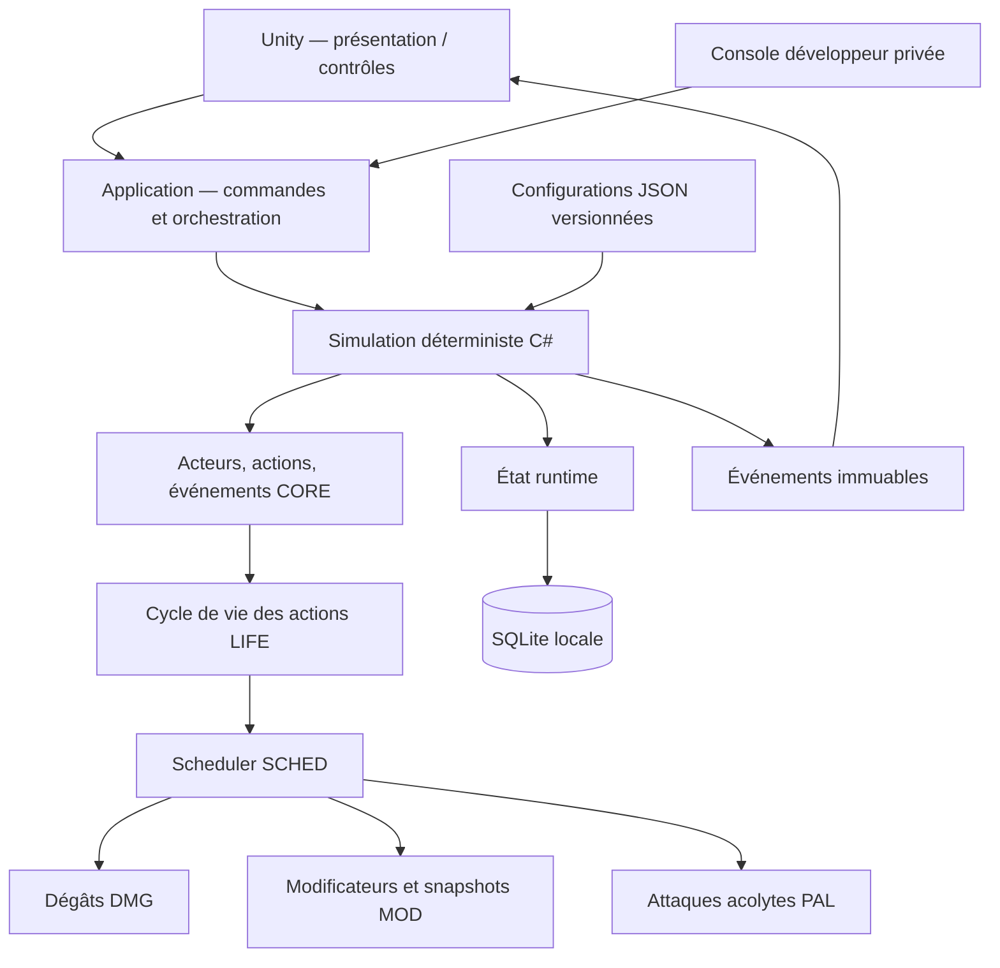

# Architecture — Vue structurante du référentiel

**Portée :** synthèse d'intégration des décisions ratifiées (T005, T074, T076–T078, T111, T145–T150). Ce diagramme est une représentation dérivée ; les contrats originaux prévalent en cas d'ambiguïté.

**Invariants d'intégration :** événements de domaine immuables, ordre de résolution déterministe, aucune dépendance du moteur au rendu, sauvegarde versionnée, aucune récompense émise directement par le calculateur de dégâts. Le profil de dégâts comporte une calibration en attente.

## Matrice des composants

| Composant | Input principal | Output principal | Contrats |
|---|---|---|---|
| Acteurs / actions / événements | définitions, état, commandes | actions et événements causalement liés | CORE-001…012 |
| Action Lifecycle | actions engagées | transitions et opérations valides | LIFE-001…016 |
| Scheduler | échéances, instantanés | ordre de traitement reproductible | SCHED-001…018 |
| Damage Resolution | impacts et snapshots | dégâts quantifiés, boucliers, morts | DMG-001…024 |
| Modifier & Snapshot | effets et groupes | attributs résolus, snapshots | MOD-001…024 |
| Pal Combat Integration | propriétaire, acolyte déployé | actions indépendantes, dépendance vie du propriétaire | PAL-001…008 |

Les schémas détaillés de causalité, timeline, dégâts, et snapshots sont conservés dans l'annexe technique ratifiée (sans les réinterpréter).
