# GDD SYS-002 — Référentiel canonique versionné

**Version documentaire :** 1.1.1 (22 novembre 2026)  
**Produit :** Idle RPG original, solo / offline, Android, Unity 6 / C#  
**Source :** export original de la conversation « Activation du mode absolu » (150 échanges)  
**Empreinte SHA-256 source :** `9ff27efc833dcadeabba8db617d5ebdf7000b28c55904a73e7723f2ee034b1d2`  
**Statut du corpus :** décisions de conception approuvées. `implementation=not_started`, `tests=not_executed` pour les sous-systèmes où ces statuts ont été explicitement consignés.  
**Point de reprise :** `SYS-002.D.13.7.12.1`, 20 contrats `CLF` proposés, encore non ratifiés.

## Préambule

Ce référentiel constitue la **source de vérité documentaire**, pas une preuve d'implémentation. Les décisions obsolètes sont identifiées comme telles dans le registre des restrictions. Les contenus de validation demeurent intégralement traçables à leurs tours d'origine.

**Les extraits techniques intégrés aux décisions ne peuvent pas introduire de règle supplémentaire non couverte par la validation.** Un schéma représente un mécanisme admis ; s'il entre en conflit avec une correction ultérieure, la correction prévaut. Les dossiers techniques détaillés D.13.1 à D.13.6 sont des pièces d'appui approuvées avec les contrats correspondants.

## Table des matières

- [Chapitre 00 — Vision, objectifs et conventions](chapitres/00_vision_objectifs_et_conventions.md)
- [Chapitre 01 — Modèle mathématique — dégâts bruts](chapitres/01_modele_mathematique_degats_bruts.md)
- [Chapitre 02 — Défense, pénétration et résistances](chapitres/02_defense_penetration_et_resistances.md)
- [Chapitre 03 — Critiques et dégâts critiques](chapitres/03_critiques_et_degats_critiques.md)
- [Chapitre 04 — Évasion et probabilités de toucher](chapitres/04_evasion_et_probabilites_de_toucher.md)
- [Chapitre 05 — Cadence, vitesse et temps](chapitres/05_cadence_vitesse_et_temps.md)
- [Chapitre 06 — Modificateurs, groupes et priorités](chapitres/06_modificateurs_groupes_et_priorites.md)
- [Chapitre 07 — Dictionnaire des caractéristiques](chapitres/07_dictionnaire_des_caracteristiques.md)
- [Chapitre 08 — Combo, contre-attaque, contrôle, blocage et soins](chapitres/08_combo_contre_attaque_controle_blocage_et_soins.md)
- [Chapitre 09 — Acolytes — modèle et combat](chapitres/09_acolytes_modele_et_combat.md)
- [Chapitre 10 — Acolytes — progression, invocations et persistance](chapitres/10_acolytes_progression_invocations_et_persistance.md)
- [Chapitre 11 — Équipement et Lampe Magique](chapitres/11_equipement_et_lampe_magique.md)
- [Chapitre 12 — Classes, spécialisations, compétences et Éveils](chapitres/12_classes_specialisations_competences_et_eveils.md)
- [Chapitre 13 — Shared Combat Engine — contrats transversaux](chapitres/13_shared_combat_engine_contrats_transversaux.md)
- [Contrôle de qualité et couverture](CONTROLE_QUALITE_ET_COUVERTURE.md)
- [Statuts, restrictions et points non validés](STATUTS_ET_RESTRICTIONS.md)
- [Méthode de validation et de sauvegarde](CONTRIBUTION_ET_MAINTENANCE.md)
- [Contrats et dossiers techniques du moteur partagé](annexes/SPECIFICATIONS_DETAILLEES_D13.1_A_D13.6.md)

## Portée

Le GDD est découpé en quatorze chapitres, contient le **texte intégral de chaque prescription propriétaire enregistrée**, et inclut les 102 contrats ratifiés `CORE`/`LIFE`/`SCHED`/`DMG`/`MOD`/`PAL` avec leurs descriptions et dossiers techniques. Les formules et schémas présents dans les dossiers techniques validés demeurent sous leur forme originelle. Les sources historiques complètes et les fichiers CSV sont disponibles dans `references/`.

Le référentiel doit évoluer par **versions immuables**, avec génération d'archive immédiatement après chaque approbation. Aucun accès persistant à un dépôt Git externe n'est implicite.


---

# Chapitre 00 — Vision, objectifs et conventions

**Autorité :** décisions expressément approuvées dans la conversation source. Les modèles obsolètes sont remplacés par les rectifications ultérieures ; les paramètres provisoires restent provisoires.

**Statut du chapitre :** `functionally_specified` pour ses spécifications validées ; aucune exécution de test ou implémentation ne découle de ce statut.

**Traçabilité :** 2 décision(s) du propriétaire. Toutes les références `Txxx` renvoient à `references/HISTORIQUE_SOURCE_ORIGINAL.md`.

## Décisions structurantes en vigueur

| Sujet | Règle approuvée | Justificatif |
|---|---|---|
| Produit | RPG mobile idle/AFK original, solo, automatique, sans monétisation | T002, T005 |
| Plateforme | Android, application locale indépendante | T076–T078 |
| Moteur et langage | **Unity 6 / C#**, remplaçant Godot / GDScript envisagés au départ | T076–T078 |
| Architecture | Simulation déterministe, indépendance du rendu, séparation domaine/application/infrastructure/présentation | T005, T074, T078 |
| Données | Configurations versionnées, persistance SQLite locale, architecture extensible | T076, T111 |
| Administration | Outils développeur privés contrôlant la progression et les ressources, par services métier | T002, T005 |

Le jeu doit utiliser des assets, un univers, des interfaces et un code originaux. Les mécanismes généraux constituent l'inspiration, pas un transfert d'actifs propriétaires.


## Registre détaillé des décisions approuvées


### T002 · T002 · 17/11/2026 16:36:22

**Nature :** `EXIGENCE_OU_RECTIFICATION_PROPRIETAIRE` · **Ligne d’approbation source :** 23 · **Ligne de formalisation :** 30.

**Décision / prescription originale (texte intégral du propriétaire) :**

Le sujet de cette instance conversationnelle portera sur un nouveau projet.
Tu connais certainement le jeu mobile Legend of Mushrooms.
Je souhaiterais le reproduire pour avoir ma propre version. Dans la mesure à ne pas créer de plagia il faudrait peut être modifier certaines choses, mais globalement je souhaite reproduire ce jeu personnellement afin de pouvoir jouer en bénéficiant de tous les avantages en jeu.


**Source technique :** réponse consécutive et proposition précédant cette validation, consultables dans l’historique original. Aucun extrait automatique n’a été retenu faute de délimitation non ambiguë.


### T005 · T005 · 17/11/2026 16:56:52

**Nature :** `APPROBATION_EXPLICITE` · **Ligne d’approbation source :** 1035 · **Ligne de formalisation :** 1040.

**Décision / prescription originale (texte intégral du propriétaire) :**

Décision GDD SYS-002 : modèle de combat A. Précisions : Les déplacements, attaques et compétences sont automatiques. Le joueur observe le combat et intervient principalement dans la progression.. Poursuivons la spécification du moteur de combat.


**Source technique :** réponse consécutive et proposition précédant cette validation, consultables dans l’historique original. Aucun extrait automatique n’a été retenu faute de délimitation non ambiguë.


---

# Chapitre 01 — Modèle mathématique — dégâts bruts

**Autorité :** décisions expressément approuvées dans la conversation source. Les modèles obsolètes sont remplacés par les rectifications ultérieures ; les paramètres provisoires restent provisoires.

**Statut du chapitre :** `functionally_specified` pour ses spécifications validées ; aucune exécution de test ou implémentation ne découle de ce statut.

**Traçabilité :** 2 décision(s) du propriétaire. Toutes les références `Txxx` renvoient à `references/HISTORIQUE_SOURCE_ORIGINAL.md`.

## Formule fondamentale ratifiée — modèle hybride

\[
D_{brut}=A\times C\times(1+B)\times\prod_{i=1}^{n}M_i
\]

- **A :** attaque finale ; **C :** coefficient de l'action ; **B :** somme des bonus additifs du groupe concerné ; **Mᵢ :** multiplicateurs indépendants.
- L'arrondi n'intervient pas dans les étapes intermédiaires (T007). Le quantificateur final et les restrictions ont été affinés dans T020 et D.13.4.


## Registre détaillé des décisions approuvées


### SYS-002.D.1 · T006 · 17/11/2026 17:16:39

**Nature :** `EXIGENCE_OU_RECTIFICATION_PROPRIETAIRE` · **Ligne d’approbation source :** 1509 · **Ligne de formalisation :** 1515.

**Décision / prescription originale (texte intégral du propriétaire) :**

Continuons.
Pour chaque étape, donnes moi la possibilité de valider les choix afin d'apporter une modification/spécification si necessaire.


<details><summary>Formalisation technique de la décision ratifiée (extrait sourcé)</summary>

## SYS-002.D.1 — Construction des dégâts bruts

### 1. Objectif

Définir comment le moteur calcule les dégâts théoriques d'une attaque avant toute intervention de la défense adverse, des coups critiques ou des boucliers.

Nous allons distinguer quatre variables :

| Variable | Description |
|--------|--------|
| $A$ | Attaque finale de l'attaquant |
| $C$ | Coefficient de puissance de l'action |
| $B$ | Bonus de dégâts additifs |
| $M$ | Multiplicateurs indépendants |

L'attaque finale $A$ sera fournie par le système de statistiques du personnage. Elle intégrera les caractéristiques de base et les bonus permanents.

### 2. Trois modèles envisageables

**Modèle A — Cumul entièrement additif**

Tous les bonus en pourcentage sont additionnés.

$$
D_{\text{brut}}=A\times C\times(1+\sum b_i)
$$

Avantages :

- Simple à comprendre.
- Facile à équilibrer.
- Limite la croissance exponentielle des dégâts.

Inconvénient : difficile de différencier certains effets spéciaux des bonus classiques.

**Modèle B — Modèle hybride**

Les bonus classiques sont additionnés, tandis que les multiplicateurs spécifiques sont multipliés entre eux.

$$
D_{\text{brut}} =
A\times C\times(1+B)\times\prod M_i
$$

Exemple :

- Attaque : 100.
- Coefficient de compétence : 1,5.
- Bonus équipement : +20 %.
- Bonus passif : +10 %.
- Multiplicateur spécial : ×1,25.

$$
D=100\times1,5\times1,30\times1,25
$$

(243,75 dégâts)

Avantages :

- Bonne flexibilité.
- Distinction claire entre bonus classiques et effets spéciaux.
- Équilibrage indépendant des différentes catégories.
- Architecture extensible.

Inconvénient : nécessite de catégoriser rigoureusement les bonus.

**Modèle C — Cumul entièrement multiplicatif**

Chaque bonus est appliqué indépendamment.

$$
D_{\text{brut}}=A\times C\times\prod(1+b_i)
$$

Avantages :

- Grande liberté dans la conception des bonus.
- Forte progression de puissance.

Inconvénient : croissance potentiellement excessive des dégâts lorsque les bonus deviennent nombreux.

### 3. Ma recommandation

Je recommande le **modèle B : hybride**.

Il permet notamment de distinguer :

- Les bonus permanents provenant de l'équipement.
- Les bonus passifs des compétences.
- Les bonus temporaires.
- Les multiplicateurs spécifiques à certaines attaques.

Nous pourrons également modifier individuellement chaque catégorie sans devoir réécrire le calculateur de dégâts.

*Note d'ingénierie : aucun arrondi intermédiaire ne sera effectué. Le moteur conservera une précision flottante pendant toute la résolution de l'attaque. L'arrondi interviendra au moment de l'application finale des dégâts.*

---

## 4. Validation de SYS-002.D.1

**Quel modèle souhaites-tu retenir ?**

**A — Entièrement additif**

Progression contrôlée et calcul simple.

**B — Hybride (recommandé)**

Bonus additifs et multiplicateurs indépendants.

**C — Entièrement multiplicatif**

Progression de puissance plus agressive.

---

**Modifications ou précisions éventuelles**

[Texte de substitution de la zone de texte : Précise ici les modifications souhaitées. Tu peux également laisser ce champ vide.] (valeur actuelle indisponible.)

[Valider SYS-002.D.1]

**Règle :** nous ne passerons à SYS-002.D.2 (mitigation par la défense) qu'après validation de cette première spécification.

</details>


### SYS-002.D.1 · T007 · 17/11/2026 17:54:18

**Nature :** `APPROBATION_EXPLICITE` · **Ligne d’approbation source :** 1694 · **Ligne de formalisation :** 1706.

**Décision / prescription originale (texte intégral du propriétaire) :**

Validation SYS-002.D.1 : modèle B. Précisions et modifications : Le mode hybride est très bien.
Je vais rajouter des caractéristiques propres au jeu officiel afin qu'on puisse être sur les mêmes bases.
Attributs basiques :
PV, ATQ,  DEF, Vitesse d'ATQ
Attributs avancés : 
Coup critique, Ignorance de coup critique, Dégâts critique, Résistance critique, Combo, Ignorance du combo, Contre attaque, Ignorance de contre attaque, Etourdissement, Ignorance d'étourdissement, Evasion, Ignorance d'évasion, Régénération, Ignorance de régénération, En vol, Ignorance d'en vol, Coefficient d'ATQ normale, Réduction des dégâts d'ATQ normale, Coefficient de combo, Réduction des dégâts de combo, Coefficient de contre attaque, Réduction des dégâts de contre attaque, Coup critique de compétence, Ignorance du coup critique de compétence, Dégâts critiques de compétence, Dégâts de compétence, Réduction des dégâts de compétence, Dégâts de boss, Réduction des dégâts de boss, Dégâts d'Acolyte, Réduction des dégâts d'acolyte, Taux de guérison, Quantité de guérison, Perforation d'armure, Ignorance de perforation d'armure, Blocage, ignorance de blocage, Inspiration des acolytes, Ignorance de l'inspiration des Acolytes, Résistance des Acolytes, Ignorance de résistance des acolytes, Pénétration, Anti pénétration, Pénétration de compétence, Pénétration d'acolyte, Anti pénétration d'acolyte, Réduction des dégâts, Bonus de PV, Bonus d'ATQ, Bonus de Def, Bonus de vitesse d'ATQ, Augmentation des dégâts finales, Réduction des dégâts finale
Attributs finaux :
PV finaux, ATQ finale, DEF finale, Vitesse d'ATQ finale. Formalise la décision dans le GDD et passe à SYS-002.D.2.


<details><summary>Formalisation technique de la décision ratifiée (extrait sourcé)</summary>

# 1. Formalisation GDD - SYS-002.D.1

(Validé) (Version 1.1)

**Modèle mathématique retenu : hybride.**

$$
D_{\text{brut}} =
A \times C \times (1+B) \times \prod_{i=1}^{n}M_i
$$

Avec :

- $A$ : attaque finale.
- $C$ : coefficient de l'action.
- $B$ : somme des bonus additifs applicables.
- $M_i$ : multiplicateurs indépendants applicables.

Les bonus seront classés par catégories afin d'éviter les cumuls involontaires.

## 1.1 Référentiel des attributs

Nous introduisons trois niveaux de caractéristiques.

### A. Attributs basiques

| Attribut | Identifiant technique |
|--------|--------|
| PV | `hp` |
| ATQ | `attack` |
| DEF | `defense` |
| Vitesse d'ATQ | `attack_speed` |

### B. Attributs avancés

Je les organise en familles fonctionnelles. Les noms français constituent les libellés de référence.

**Famille 1 - Critiques**

- Coup critique
- Ignorance de coup critique
- Dégâts critique
- Résistance critique
- Coup critique de compétence
- Ignorance du coup critique de compétence
- Dégâts critiques de compétence

**Famille 2 - Mécaniques de combat**

- Combo
- Ignorance du combo
- Contre-attaque
- Ignorance de contre-attaque
- Étourdissement
- Ignorance d'étourdissement
- Évasion
- Ignorance d'évasion
- Régénération
- Ignorance de régénération
- En vol
- Ignorance d'en vol
- Blocage
- Ignorance de blocage

**Famille 3 - Attaques et coefficients**

- Coefficient d'ATQ normale
- Réduction des dégâts d'ATQ normale
- Coefficient de combo
- Réduction des dégâts de combo
- Coefficient de contre-attaque
- Réduction des dégâts de contre-attaque

**Famille 4 - Compétences**

- Dégâts de compétence
- Réduction des dégâts de compétence
- Pénétration de compétence

**Famille 5 - Boss et acolytes**

- Dégâts de boss
- Réduction des dégâts de boss
- Dégâts d'acolyte
- Réduction des dégâts d'acolyte
- Inspiration des acolytes
- Ignorance de l'inspiration des acolytes
- Résistance des acolytes
- Ignorance de résistance des acolytes
- Pénétration d'acolyte
- Anti-pénétration d'acolyte

**Famille 6 - Guérison**

- Taux de guérison
- Quantité de guérison

**Famille 7 - Défense et pénétration**

- Perforation d'armure
- Ignorance de perforation d'armure
- Pénétration
- Anti-pénétration

**Famille 8 - Bonus globaux**

- Réduction des dégâts
- Bonus de PV
- Bonus d'ATQ
- Bonus de DEF
- Bonus de vitesse d'ATQ
- Augmentation des dégâts finales
- Réduction des dégâts finale

### C. Attributs finaux

Ce sont les caractéristiques effectivement exploitées par les systèmes de combat.

| Attribut | Identifiant technique |
|--------|--------|
| PV finaux | `final_hp` |
| ATQ finale | `final_attack` |
| DEF finale | `final_defense` |
| Vitesse d'ATQ finale | `final_attack_speed` |

**Règle architecturale :** les attributs finaux sont calculés à partir des attributs basiques et avancés. Ils ne constituent pas une seconde source de vérité.

## 1.2 Conséquence sur l'architecture

Nous introduisons un nouveau module dans le projet :

`Character Stats Engine`

Sa responsabilité sera de :

- Centraliser les caractéristiques.
- Appliquer les bonus et malus.
- Gérer les interactions entre attributs.
- Calculer les quatre attributs finaux.
- Fournir un résultat cohérent aux autres systèmes.

Nous ne coderons pas individuellement les calculs de statistiques dans les différents modules.

*Note d'ingénierie : chaque attribut disposera de métadonnées précisant son unité, sa catégorie, son périmètre d'application et ses éventuelles limites. Cela évitera notamment de confondre un taux de déclenchement avec un multiplicateur de dégâts.*

---

</details>


---

# Chapitre 02 — Défense, pénétration et résistances

**Autorité :** décisions expressément approuvées dans la conversation source. Les modèles obsolètes sont remplacés par les rectifications ultérieures ; les paramètres provisoires restent provisoires.

**Statut du chapitre :** `functionally_specified` pour ses spécifications validées ; aucune exécution de test ou implémentation ne découle de ce statut.

**Traçabilité :** 3 décision(s) du propriétaire. Toutes les références `Txxx` renvoient à `references/HISTORIQUE_SOURCE_ORIGINAL.md`.

## Modèle DEF ratifié

\[
M_{DEF}=\frac{DEF_{eff}}{DEF_{eff}+K},\qquad D_{apres\,DEF}=D_{avant\,DEF}\frac{K}{DEF_{eff}+K}
\]

La constante **K est configurable et en attente de calibration**, sans hypothèse numérique présentée comme définitive. La pénétration et la perforation restent des mécanismes distincts, selon T009–T010.


## Registre détaillé des décisions approuvées


### SYS-002.D.2.1 · T008 · 17/11/2026 18:04:39

**Nature :** `APPROBATION_EXPLICITE` · **Ligne d’approbation source :** 2076 · **Ligne de formalisation :** 2081.

**Décision / prescription originale (texte intégral du propriétaire) :**

Validation SYS-002.D.2.1 : modèle B. Constante K : dynamic. Précisions : Aucune.. Formalise la décision et poursuis avec la spécification des mécanismes de pénétration et perforation d'armure.


<details><summary>Formalisation technique de la décision ratifiée (extrait sourcé)</summary>

# 1. Formalisation GDD - SYS-002.D.2.1

(Validé) (Version 1.0)

**Modèle retenu : mitigation à rendement décroissant.**

$$
M_{\text{DEF}}=\frac{DEF_{\text{eff}}}{DEF_{\text{eff}}+K}
$$

$$
D_{\text{reçu}}=D_{\text{brut}}\times(1-M_{\text{DEF}})
$$

| Paramètre | Décision |
|--------|--------|
| Modèle | Rendement décroissant |
| Constante K | À déterminer expérimentalement |
| DEF effective minimale | 0 |
| Mitigation | Calcul en précision flottante |
| Arrondi | À l'application finale des dégâts |
| Plafond de mitigation | Aucun plafond arbitraire à ce stade |

**Précision sur K :** K sera un paramètre configurable, calibré à partir des distributions réelles de DEF observées dans le jeu. Il ne sera pas recalculé arbitrairement à chaque attaque. Sa valeur devra rester cohérente à l'intérieur d'un même contexte de combat.

Cette décision est désormais intégrée au référentiel mathématique.

---

</details>


### SYS-002.D.2.2 · T009 · 17/11/2026 18:19:50

**Nature :** `APPROBATION_EXPLICITE` · **Ligne d’approbation source :** 2449 · **Ligne de formalisation :** 2454.

**Décision / prescription originale (texte intégral du propriétaire) :**

Validation SYS-002.D.2.2 : modèle DEF = keep ; cumul pénétration = multiplicative ; ajout anti-pénétration compétence = oui ; perforation armure = instant ; observations = Aucune. Formalise les décisions et poursuis selon le protocole de validation.


<details><summary>Formalisation technique de la décision ratifiée (extrait sourcé)</summary>

# 1. Formalisation GDD - SYS-002.D.2.2

(Validé) (Version 1.0)

## 1.1 Décisions actées

| Élément | Décision |
|--------|--------|
| Modèle de défense | Rendement décroissant |
| Pénétration générale | Cumul multiplicatif |
| Pénétration de compétence | Cumul multiplicatif |
| Pénétration d'acolyte | Cumul multiplicatif |
| Anti-pénétration de compétence | Ajoutée |
| Perforation d'armure | Effet instantané |

## 1.2 Formalisation de la pénétration

Pour chaque catégorie de pénétration :

$$
\Delta P=P_{\text{attaquant}}-AP_{\text{défenseur}}
$$

$$
n=\left\lfloor\frac{|\Delta P|}{1000}\right\rfloor
$$

Le multiplicateur retenu est :

$$
M_P=
\begin{cases}
1.10^n & \text{si }\Delta P>0\\
0.90^n & \text{si }\Delta P<0\\
1 & \text{si }\Delta P=0
\end{cases}
$$

Cette règle reprend les tranches complètes de 1 000 points proposées précédemment. Les valeurs intermédiaires ne produisent pas de tranche supplémentaire.

Trois calculs indépendants seront disponibles :

- `general_penetration_multiplier`
- `skill_penetration_multiplier`
- `acolyte_penetration_multiplier`

Chaque multiplicateur ne s'applique qu'à sa catégorie de dégâts.

## 1.3 Formalisation de la perforation d'armure

La règle de conception retenue est :

1. Calcul de la perforation effective.
2. Vérification du déclenchement à 30 %.
3. Calcul de l'ignorance de résistance.
4. Application immédiate à l'attaque déclenchante.
5. Suppression de l'effet après résolution de cette attaque.

L'effet n'est ni cumulatif ni persistant.

Important : cette dernière règle est désormais une décision de conception de notre version. Elle ne constitue pas une confirmation du comportement exact du jeu officiel.

## 1.4 Mise à jour du référentiel

Ajout :

| Attribut | Identifiant |
|--------|--------|
| Anti-pénétration de compétence | `skill_anti_penetration` |

Le référentiel compte désormais 57 attributs avancés, en conservant les caractéristiques initialement communiquées.

---

# 2. Vérification des mécaniques de référence

La confrontation avec la documentation communautaire de Legend of Mushroom permet de confirmer plusieurs règles importantes.

| Mécanisme | Règle documentée |
|--------|--------|
| Pénétration générale | \+10 % par tranche de 1 000 |
| Anti-pénétration | Multiplicateur ×0,9 par tranche de 1 000 |
| Pénétration de compétence | Même logique, catégorie indépendante |
| Pénétration d'acolyte | Même logique, catégorie indépendante |
| Perforation d'armure | Déclenchement à 30 %, jusqu'à 50 % d'ignorance de résistance |
| Blocage | Déclenchement à 30 %, jusqu'à 50 % de résistance supplémentaire |

\[[Характеристики: базовы...](https://legendofmushroom.ru/books/7-klassy-i-sborki/page/xarakteristiki-bazovye-prodvinutye-povedenie-vo-vremia-boia?utm_source=chatgpt.com); [Обновление от 28.05.2025](https://legendofmushroom.ru/books/2-novosti-i-obnovleniia/page/obnovlenie-ot-28052025?utm_source=chatgpt.com)\]

Deux précisions importantes :

- La perforation d'armure concerne les résistances aux attaques normales, compétences, boss, combos et contre-attaques. Son application aux dégâts d'acolytes n'est pas établie par cette documentation.
- La durée exacte de l'effet de perforation n'est pas documentée. Nous conservons donc ton choix d'application instantanée comme règle propre à notre implémentation.

**Correction du dictionnaire :** la liste initiale contient 53 attributs avancés. Avec l'ajout de l'anti-pénétration de compétence, nous en avons 54, et non 57 comme indiqué précédemment.

---

</details>


### SYS-002.D.2.3 · T010 · 17/11/2026 18:26:12

**Nature :** `APPROBATION_EXPLICITE` · **Ligne d’approbation source :** 2755 · **Ligne de formalisation :** 2760.

**Décision / prescription originale (texte intégral du propriétaire) :**

Validation SYS-002.D.2.3 : cumul des résistances = multiplicative ; portée perforation armure = specific ; dégâts de boss = separate ; observations = Aucune. Formalise la décision et poursuis vers la prochaine spécification.


<details><summary>Formalisation technique de la décision ratifiée (extrait sourcé)</summary>

# 1. Formalisation GDD - SYS-002.D.2.3

(Validé) (Version 1.0)

| Élément | Décision retenue |
|--------|--------|
| Cumul des résistances | Multiplicatif |
| Portée de la perforation d'armure | Résistances spécifiques uniquement |
| Dégâts de boss | Modificateur indépendant |
| Réduction globale | Couche indépendante |
| Réduction finale | Couche indépendante |

## 1.1 Formule consolidée

Nous établissons le pipeline suivant :

$$
\begin{aligned}
D_1 &= D_{\text{brut}}\times M_{\text{DEF}}\\
D_2 &= D_1\times M_{\text{pénétration}}\\
D_3 &= D_2\times(1-R_{\text{spécifique,eff}})\\
D_4 &= D_3\times M_{\text{boss}}\\
D_5 &= D_4\times(1-R_{\text{boss}})\\
D_6 &= D_5\times(1-R_{\text{globale}})\\
D_{\text{final}} &= D_6\times(1+B_{\text{final}})\times(1-R_{\text{final}})
\end{aligned}
$$

Où les résistances sont exprimées sous forme décimale.

La perforation d'armure intervient dans le calcul de $R_{\text{spécifique,eff}}$, avant son application.

Les limites, plafonds et interactions entre résistances seront spécifiés dans une étape ultérieure.

*Note d'ingénierie : le moteur conservera chaque couche de calcul séparément. Nous pourrons ainsi tracer précisément l'origine d'une variation de dégâts et tester chaque mécanisme indépendamment.*

---

</details>


---

# Chapitre 03 — Critiques et dégâts critiques

**Autorité :** décisions expressément approuvées dans la conversation source. Les modèles obsolètes sont remplacés par les rectifications ultérieures ; les paramètres provisoires restent provisoires.

**Statut du chapitre :** `functionally_specified` pour ses spécifications validées ; aucune exécution de test ou implémentation ne découle de ce statut.

**Traçabilité :** 2 décision(s) du propriétaire. Toutes les références `Txxx` renvoient à `references/HISTORIQUE_SOURCE_ORIGINAL.md`.


## Registre détaillé des décisions approuvées


### SYS-002.D.3.1 · T011 · 17/11/2026 18:31:16

**Nature :** `APPROBATION_EXPLICITE` · **Ligne d’approbation source :** 3025 · **Ligne de formalisation :** 3030.

**Décision / prescription originale (texte intégral du propriétaire) :**

Validation SYS-002.D.3.1 : critique général = subtract ; critique compétence = separate ; plafond = 100 ; héritage du type de dégâts = type ; observations = Aucune. Formalise les décisions et poursuis vers SYS-002.D.3.2.


<details><summary>Formalisation technique de la décision ratifiée (extrait sourcé)</summary>

# 1. Formalisation GDD - SYS-002.D.3.1

(Validé) (Version 1.0)

## 1.1 Décisions enregistrées

| Élément | Décision |
|--------|--------|
| Critique général | Soustraction des attributs antagonistes |
| Critique de compétence | Système indépendant |
| Plafond du taux critique | 100 % |
| Compétence avec type de dégâts spécifique | Hérite du système critique de son type |
| Plancher du taux critique | 0 % |

## 1.2 Formules validées

**Critique général**

$$
P_{\text{crit}}=
\operatorname{clamp}(CR-ICR,0,100)
$$

**Critique de compétence**

$$
P_{\text{skill}}=
\operatorname{clamp}(SCR-ISCR,0,100)
$$

Les valeurs sont exprimées en pourcentage dans le GDD et normalisées entre 0 et 1 dans le moteur.

## 1.3 Règle de sélection du système critique

| Type de dégâts | Système critique |
|--------|--------|
| Attaque normale | Général |
| Combo | Général |
| Contre-attaque | Général |
| Compétence classique | Compétence |
| Compétence infligeant des dégâts de combo | Général |
| Compétence infligeant des dégâts de contre-attaque | Général |

Une attaque ne pourra déclencher qu'un seul calcul critique par impact.

---

# 2. Analyse des mécaniques critiques du jeu de référence

Avant de fixer les formules, j'ai confronté les attributs à plusieurs documentations spécialisées de Legend of Mushroom.

Une distinction importante apparaît :

**La résistance critique ne réduit pas le taux de déclenchement critique. Elle intervient dans le calcul des dégâts critiques.**

Il faut donc distinguer trois mécanismes :

| Mécanisme | Attributs |
|--------|--------|
| Probabilité de critique | Coup critique / Ignorance de coup critique |
| Puissance du critique | Dégâts critiques / Résistance critique |
| Critique de compétence | Critique compétence / Ignorance critique compétence / Dégâts critiques compétence |

Cette distinction est cohérente avec les formules documentées du jeu. \[[LegendOfMushroom.gg :: Your source for Legend of Mushroom guides, tools, and content\!](https://legendofmushroom.gg/guides/how-your-damage-is-actually-calculated?utm_source=chatgpt.com); [Характеристики: базовы...](https://legendofmushroom.ru/books/7-klassy-i-sborki/page/xarakteristiki-bazovye-prodvinutye-povedenie-vo-vremia-boia?utm_source=chatgpt.com)\]

</details>


### SYS-002.D.3.2 · T012 · 17/11/2026 18:36:21

**Nature :** `APPROBATION_EXPLICITE` · **Ligne d’approbation source :** 3303 · **Ligne de formalisation :** 3308.

**Décision / prescription originale (texte intégral du propriétaire) :**

Validation SYS-002.D.3.2 : dégâts critiques généraux = reference ; dégâts critiques compétence = power ; portée résistance critique = general ; multiplicateur minimal = 150 ; ordre application = before_final ; observations = Aucune. Formalise les décisions et poursuis selon le protocole.


<details><summary>Formalisation technique de la décision ratifiée (extrait sourcé)</summary>

# 1. Formalisation GDD - SYS-002.D.3.2

(Validé) (Version 1.0)

## 1.1 Décisions enregistrées

| Élément | Décision |
|--------|--------|
| Dégâts critiques généraux | Formule de référence |
| Dégâts critiques de compétence | Formule avec puissance 0,98 |
| Résistance critique | S'applique aux critiques généraux |
| Multiplicateur critique minimal | 1,5 |
| Ordre d'application | Après résistances spécifiques, avant modificateurs finaux |

## 1.2 Formules validées

**Critiques généraux**

$$
M_{\text{crit}}=
\max\left(1.5,\frac{CD}{CR_{\text{défenseur}}}\right)
$$

**Critiques de compétence**

$$
M_{\text{skill crit}}=
\left(1+\frac{SCD}{100}\right)^{0.98}
$$

Ces formules seront conservées dans le GDD comme règles de référence. La convention exacte des unités et valeurs affichées devra être vérifiée avant implémentation.

## 1.3 Ordre de résolution

Le pipeline est désormais :

1. Calcul des dégâts bruts.
2. Mitigation par la défense.
3. Application de la pénétration.
4. Application des résistances spécifiques.
5. Détermination du critique.
6. Application du multiplicateur critique.
7. Application des modificateurs finaux.
8. Arrondi et application des dégâts.

Une attaque ne peut bénéficier que d'un seul système critique par impact.

---

</details>


---

# Chapitre 04 — Évasion et probabilités de toucher

**Autorité :** décisions expressément approuvées dans la conversation source. Les modèles obsolètes sont remplacés par les rectifications ultérieures ; les paramètres provisoires restent provisoires.

**Statut du chapitre :** `functionally_specified` pour ses spécifications validées ; aucune exécution de test ou implémentation ne découle de ce statut.

**Traçabilité :** 2 décision(s) du propriétaire. Toutes les références `Txxx` renvoient à `references/HISTORIQUE_SOURCE_ORIGINAL.md`.


## Registre détaillé des décisions approuvées


### SYS-002.D.4.1 · T013 · 17/11/2026 18:49:38

**Nature :** `APPROBATION_EXPLICITE` · **Ligne d’approbation source :** 3614 · **Ligne de formalisation :** 3622.

**Décision / prescription originale (texte intégral du propriétaire) :**

Validation SYS-002.D.4.1 : formule évasion = reference  plafond = 100 ; précision = remove ; effets après esquive = on_hit ; observations = Il faudrait vérifier comment fonctionne l'évasion dans le jeu officiel.
La définition de l'évasion dans le jeu est : Chance d'esquiver l'ATQ normale lors de l'ATQ normale subit.
Concernant l'ignorance de l'évasion : Réduit le taux d'évasion lors de l'ATQ normale.
Dans le jeu officiel, le taux de l'évasion va au-delà de 100%.. Formalise les décisions dans le GDD et poursuis selon le protocole.


**Source technique :** réponse consécutive et proposition précédant cette validation, consultables dans l’historique original. Aucun extrait automatique n’a été retenu faute de délimitation non ambiguë.


### SYS-002.D.4.2 · T014 · 17/11/2026 19:53:53

**Nature :** `APPROBATION_EXPLICITE` · **Ligne d’approbation source :** 3873 · **Ligne de formalisation :** 3878.

**Décision / prescription originale (texte intégral du propriétaire) :**

Validation SYS-002.D.4.2 : portée = expanded ; plafond PvE = 100 ; plafond PvP = 80 ; formule = reference ; observations = Aucune. Formalise les décisions et poursuis selon le protocole.


<details><summary>Formalisation technique de la décision ratifiée (extrait sourcé)</summary>

# 1. Formalisation GDD - SYS-002.D.4.2

(Validé) (Version 1.0)

## 1.1 Décisions enregistrées

| Élément | Décision |
|--------|--------|
| Portée de l'évasion | Attaques normales, combos, contre-attaques et acolytes |
| Plafond effectif PvE | 100 % |
| Plafond effectif PvP | 80 % |
| Formule | Référence, puissance 0,9 |
| Statistique brute | Peut dépasser 100 % |
| Précision | Non utilisée |

## 1.2 Formule consolidée

$$
E_{\text{net}}=\max(0,E-IE)
$$

$$
E_{\text{effective}}=
\min(E_{\text{net}}^{0.9},E_{\text{cap}})
$$

Avec :

- $E$ : évasion brute du défenseur.
- $IE$ : ignorance d'évasion de l'attaquant.
- $E_{\text{cap}}$ : plafond applicable au mode de jeu.

Les valeurs sont exprimées en points de pourcentage pour cette formule.

| Mode | Plafond effectif |
|--------|--------|
| PvE | 100 % |
| PvP | 80 % |

La statistique brute ne sera jamais écrasée par les calculs intermédiaires.

## 1.3 Contrat technique

Le `EvasionSystem` devra recevoir :

- Les statistiques de l'attaquant.
- Les statistiques du défenseur.
- Le type d'attaque.
- Le mode de jeu.
- Le générateur aléatoire.

Il retournera un `EvasionResult` comprenant la probabilité calculée et le résultat du tirage.

Une attaque esquivée ne déclenche pas les effets nécessitant un impact.

*Note d'ingénierie : les règles PvP sont conservées dans la configuration du mode de jeu, même si le PvP n'est pas prévu dans notre première version. Cela évite de coupler les règles de combat à l'interface ou à la plateforme.*

---

</details>


---

# Chapitre 05 — Cadence, vitesse et temps

**Autorité :** décisions expressément approuvées dans la conversation source. Les modèles obsolètes sont remplacés par les rectifications ultérieures ; les paramètres provisoires restent provisoires.

**Statut du chapitre :** `functionally_specified` pour ses spécifications validées ; aucune exécution de test ou implémentation ne découle de ce statut.

**Traçabilité :** 2 décision(s) du propriétaire. Toutes les références `Txxx` renvoient à `references/HISTORIQUE_SOURCE_ORIGINAL.md`.


## Registre détaillé des décisions approuvées


### SYS-002.D.5.1 · T015 · 17/11/2026 20:03:26

**Nature :** `APPROBATION_EXPLICITE` · **Ligne d’approbation source :** 4147 · **Ligne de formalisation :** 4152.

**Décision / prescription originale (texte intégral du propriétaire) :**

Validation SYS-002.D.5.1 : unité = aps ; portée = basic_skill ; cumul des bonus = hybrid ; plafond = none ; observations = Aucune. Formalise les décisions et poursuis avec la spécification de la cadence, des cooldowns et des modifications de vitesse en combat.


<details><summary>Formalisation technique de la décision ratifiée (extrait sourcé)</summary>

# 1. Formalisation GDD - SYS-002.D.5.1

(Validé) (Version 1.0)

## 1.1 Décisions enregistrées

| Élément | Décision |
|--------|--------|
| Unité | Attaques par seconde (APS) |
| Portée | Attaques normales et exécution des compétences |
| Cooldowns | Indépendants de la vitesse d'attaque |
| Cumul des bonus | Hybride |
| Plafond maximal | Aucun plafond artificiel |

## 1.2 Calcul de la vitesse finale

La formule architecturale retenue est :

$$
AS_{\text{final}}=AS_{\text{base}}\times\prod_{g=1}^{n}
\left(1+\sum_{j=1}^{m_g}B_{g,j}\right)
$$

Les bonus d'une même catégorie sont additionnés. Les catégories indépendantes sont multipliées.

Les catégories et leur composition seront définies dans le dictionnaire des attributs.

## 1.3 Principes invariants

- La vitesse finale est exprimée en APS.
- Les attaques normales utilisent cette valeur pour déterminer leur cadence.
- Les compétences utilisent cette valeur pour déterminer leur vitesse d'exécution.
- Les cooldowns ne sont pas réduits par la vitesse d'attaque.
- Aucun plafond maximal arbitraire ne sera imposé.
- Une vitesse nulle suspend les attaques normales ; une vitesse négative est invalide.

---

</details>


### SYS-002.D.5.2 · T016 · 17/11/2026 20:17:57

**Nature :** `APPROBATION_EXPLICITE` · **Ligne d’approbation source :** 4558 · **Ligne de formalisation :** 4563.

**Décision / prescription originale (texte intégral du propriétaire) :**

Validation SYS-002.D.5.2 : première attaque = immediate ; modification dynamique = preserve ; début cooldown = activation ; exécution compétence = inverse ; verrou compétences = parallel ; précision temporelle = microseconds ; observations = Aucune. Formalise les décisions et poursuis selon le protocole.


<details><summary>Formalisation technique de la décision ratifiée (extrait sourcé)</summary>

# 1. Formalisation GDD - SYS-002.D.5.2

(Validé) (Version 1.0)

## 1.1 Décisions enregistrées

| Élément | Décision |
|--------|--------|
| Première attaque | Immédiate dès que la cible est à portée |
| Modification dynamique | Préservation de la progression du cycle |
| Début du cooldown | Au déclenchement |
| Exécution des compétences | Inversement proportionnelle à la vitesse |
| Exécution simultanée | Plusieurs compétences en parallèle |
| Précision temporelle | Microsecondes entières, 64 bits |

## 1.2 Cadence des attaques

$$
T_{\text{attaque}}=\frac{1\,000\,000}{AS_{\text{final}}}
$$

Le résultat est exprimé en microsecondes.

La première attaque intervient dès que les conditions de combat sont réunies. Les suivantes respectent la cadence calculée.

## 1.3 Modification dynamique de vitesse

La progression temporelle est conservée.

$$
p=\frac{t_{\text{écoulé}}}{T_{\text{cycle}}}
$$

$$
T_{\text{restant}}=(1-p)\times T_{\text{nouveau}}
$$

Cette règle s'applique aux cycles d'attaques et aux exécutions de compétences.

## 1.4 Compétences parallèles

Chaque compétence possède son propre état :

- Temps d'activation.
- Cooldown.
- Durée d'exécution.
- Progression d'exécution.
- État d'exécution.

Plusieurs compétences distinctes peuvent être exécutées simultanément.

Le cooldown commence à l'activation, indépendamment de la fin de l'exécution.

Une règle complémentaire reste à définir : une même compétence pourra-t-elle être relancée alors que son exécution précédente n'est pas terminée ? Je propose de l'interdire par défaut, sans empêcher l'exécution parallèle de compétences différentes.

## 1.5 Précision temporelle

Le moteur utilisera :

- `int64` pour les timestamps.
- Des microsecondes comme unité interne.
- Un accumulateur pour les intervalles fractionnaires.
- Un ordonnancement déterministe des événements.

---

</details>


---

# Chapitre 06 — Modificateurs, groupes et priorités

**Autorité :** décisions expressément approuvées dans la conversation source. Les modèles obsolètes sont remplacés par les rectifications ultérieures ; les paramètres provisoires restent provisoires.

**Statut du chapitre :** `functionally_specified` pour ses spécifications validées ; aucune exécution de test ou implémentation ne découle de ce statut.

**Traçabilité :** 4 décision(s) du propriétaire. Toutes les références `Txxx` renvoient à `references/HISTORIQUE_SOURCE_ORIGINAL.md`.


## Registre détaillé des décisions approuvées


### SYS-002.D.6.1 · T017 · 17/11/2026 20:52:02

**Nature :** `APPROBATION_EXPLICITE` · **Ligne d’approbation source :** 4876 · **Ligne de formalisation :** 4881.

**Décision / prescription originale (texte intégral du propriétaire) :**

Validation SYS-002.D.6.1 : groupes = explicit ; bonus plats = before ; cumul pourcentages = group ; groupe manquant = reject ; observations = Aucune. Formalise les décisions et poursuis avec SYS-002.D.6.2.


<details><summary>Formalisation technique de la décision ratifiée (extrait sourcé)</summary>

# 1. Formalisation GDD - SYS-002.D.6.1

(Validé) (Version 1.0)

| Élément | Décision |
|--------|--------|
| Groupes de cumul | Explicitement configurés |
| Bonus plats | Avant les bonus en pourcentage |
| Bonus d'un même groupe | Additifs |
| Groupes indépendants | Multiplicatifs |
| Groupe manquant | Rejet du modificateur |

## 1.1 Contrat du Modifier Resolver

Chaque modificateur devra obligatoirement posséder :

- Un identifiant unique.
- Un attribut cible.
- Une opération.
- Une valeur.
- Un groupe de cumul.
- Une portée d'application.
- Des conditions éventuelles.
- Une durée éventuelle.

Les opérations autorisées sont :

| Opération | Description |
|--------|--------|
| `ADD_FLAT` | Ajout d'une valeur fixe |
| `ADD_PERCENT` | Ajout d'un pourcentage |
| `MULTIPLY` | Multiplication indépendante |
| `OVERRIDE` | Remplacement selon une priorité explicite |

Tout modificateur incomplet sera rejeté lors de la validation des données.

---

</details>


### SYS-002.D.6.2 · T018 · 17/11/2026 21:12:09

**Nature :** `APPROBATION_EXPLICITE` · **Ligne d’approbation source :** 5222 · **Ligne de formalisation :** 5227.

**Décision / prescription originale (texte intégral du propriétaire) :**

Validation SYS-002.D.6.2 : cumul attaque/cible = multiply ; cumul résistances même famille = family ; position critique = after_global ; augmentation/réduction finale = independent ; observations = Aucune. Formalise les décisions et poursuis selon le protocole.


<details><summary>Formalisation technique de la décision ratifiée (extrait sourcé)</summary>

# 1. Formalisation GDD - SYS-002.D.6.2

(Validé) (Version 1.0)

## 1.1 Décisions enregistrées

| Élément | Décision |
|--------|--------|
| Bonus attaque / cible | Multiplicatifs indépendants |
| Sources d'une même résistance | Additives |
| Familles de résistances différentes | Multiplicatives |
| Position du critique | Après résistances globales |
| Augmentation finale | Multiplicateur indépendant |
| Réduction finale | Multiplicateur indépendant |

## 1.2 Formule consolidée

Nous retenons :

$$
D_{\text{pré-crit}}=
D_0\times M_{\text{DEF}}
\times M_{\text{pen}}
\times M_{\text{attaque}}
\times M_{\text{cible}}
\times M_{\text{résistances}}
$$

Puis :

$$
D_{\text{pré-final}}=
D_{\text{pré-crit}}\times M_{\text{crit}}
$$

Et enfin :

$$
\boxed{
D_{\text{final}}=
D_{\text{pré-final}}
\times(1+A_{\text{final}})
\times(1-R_{\text{final}})
}
$$

Les bonus spécifiques à l'attaque et à la cible sont indépendants. Une compétence contre un boss bénéficie donc des deux catégories.

Les sources d'une même famille de résistance sont additionnées avant application. Les familles indépendantes sont ensuite multipliées.

## 1.3 Correction d'un exemple numérique

Une erreur arithmétique figurait dans l'exemple précédent.

Pour 10 000 dégâts de base, avec :

- Bonus compétence : +30 %.
- Bonus boss : +20 %.
- Résistance compétence : 15 %.
- Résistance boss : 10 %.
- Réduction globale : 5 %.

Le résultat correct est :

$$
10000\times1,30\times1,20
\times0,85\times0,90\times0,95
$$

(11 337,30 dégâts)

Le calculateur devra produire une décomposition de chaque multiplicateur afin de rendre les résultats vérifiables.

---

</details>


### SYS-002.D.6.3 · T019 · 18/11/2026 14:07:29

**Nature :** `APPROBATION_EXPLICITE` · **Ligne d’approbation source :** 5632 · **Ligne de formalisation :** 5637.

**Décision / prescription originale (texte intégral du propriétaire) :**

Validation SYS-002.D.6.3 : OVERRIDE = base ; conflit même priorité = reject ; politique de cumul = explicit ; valeurs négatives = allow_clamp ; expiration = before ; UNIQUE_SOURCE = refresh ; observations = Afin d'être en accord, si plusieurs bonus se succèdent par rapport au même attribut, il doivent s'additionner, pas seulement choisir le dernier ou le plus élevé. Par exemple si une compétence applique +5% de vitesse d'attaque pendant 3 secondes et qu'une autre compétence simultanément active +3% de vitesse d'attaque pendant 6 secondes, le bonus sera de 8% pendant 3 secondes puis redescendra à 3% pour les 3 secondes restantes. Est ce clair ?. Formalise les décisions et poursuis selon le protocole.


<details><summary>Formalisation technique de la décision ratifiée (extrait sourcé)</summary>

# 1. Formalisation GDD — SYS-002.D.6.3

(Validé) (Version 1.1)

## 1.1 Décisions enregistrées

| Élément | Décision |
|--------|--------|
| `OVERRIDE` | Remplace la valeur de base |
| Conflit de priorité identique | Rejet |
| Politique de cumul | Obligatoire et explicite |
| Valeurs négatives | Autorisées, avec contraintes par attribut |
| Expiration | Avant les événements au même timestamp |
| `UNIQUE_SOURCE` | Actualisation de la durée |

## 1.2 Nouvelle règle : cumul des effets provenant de sources différentes

Les bonus provenant de sources différentes doivent pouvoir coexister et s'additionner lorsqu'ils appartiennent au même groupe de cumul.

Ton exemple devient une règle de référence du GDD.

**Configuration initiale :**

| Source | Bonus vitesse ATQ | Durée |
|--------|--------|--------|
| Compétence A | \+5 % | 3 secondes |
| Compétence B | \+3 % | 6 secondes |

**Chronologie des effets**

**0 à 3 secondes** (\+8 %)

Compétence A (+5 %) + Compétence B (+3 %)

---

**3 à 6 secondes** (\+3 %)

Compétence A expirée. Compétence B toujours active.

Mathématiquement :

$$
B_{\text{actif}}(t)=\sum_{i\in A(t)}B_i
$$

Où $A(t)$ représente l'ensemble des instances de bonus actives à l'instant $t$.

### 1.3 Règles techniques complémentaires

Nous distinguons désormais trois notions :

- `source_id` : identifie la compétence, l'équipement ou le système qui produit l'effet.
- `instance_id` : identifie chaque application individuelle de cet effet.
- `stacking_group` : détermine les effets qui se cumulent ensemble.

Les règles sont les suivantes :

1. Deux compétences différentes peuvent cumuler leurs bonus.
2. Les bonus du même groupe sont additionnés.
3. Chaque instance conserve sa propre durée.
4. L'expiration d'une instance ne supprime pas les autres.
5. Une nouvelle application provenant de la même source suit la politique `UNIQUE_SOURCE` si celle-ci est configurée.
6. `HIGHEST`, `LOWEST` et `REPLACE` restent disponibles uniquement pour les effets explicitement conçus avec ces politiques.

**Précision de cohérence :** les bonus appartenant à des groupes indépendants restent multiplicatifs, conformément à SYS-002.D.6.1. Ton exemple concerne deux bonus de vitesse d'attaque appartenant au même groupe additif.

*Note d'ingénierie : une instance d'effet ne sera jamais écrasée par une autre source. Le moteur conservera chaque durée indépendamment. C'est cette séparation qui garantit la restauration correcte des bonus après expiration.*

---

</details>


### SYS-002.D.6.4 · T020 · 18/11/2026 14:35:48

**Nature :** `APPROBATION_EXPLICITE` · **Ligne d’approbation source :** 5990 · **Ligne de formalisation :** 5995.

**Décision / prescription originale (texte intégral du propriétaire) :**

Validation SYS-002.D.6.4 : résistances négatives = clamp ; dégâts minimum = zero ; arrondi = floor ; application contraintes = final ; dénominateur critique invalide = reject ; observations = Je ne sais plus si j'ai déjà parlé des caractéristiques : Combo d'Acolyte et Coup critique d'Acolyte qui sont également des caractéristiques comme le Combo, la Contre attaque, le Coup critique etc.... Formalise les décisions et poursuis vers la validation globale du Character Stats Engine.


<details><summary>Formalisation technique de la décision ratifiée (extrait sourcé)</summary>

# 1. Formalisation GDD — SYS-002.D.6.4

(Validé) (Version 1.0)

## 1.1 Décisions enregistrées

| Élément | Décision |
|--------|--------|
| Résistances négatives | Ramener la valeur effective à 0 % |
| Résistance maximale | 100 % |
| Dégâts minimum | 0 |
| Arrondi des dégâts | `floor()` |
| Application des contraintes | Après résolution des modificateurs |
| Dénominateur critique invalide | Rejet de la configuration |

## 1.2 Règles mathématiques

**Résistances :**

$$
R_{\text{effective}}=\operatorname{clamp}(R_{\text{raw}},0,100)
$$

La valeur brute est conservée. Seule la valeur effective est limitée.

**Dégâts appliqués :**

$$
D_{\text{appliqué}}=
\max(0,\lfloor D_{\text{calculé}}\rfloor)
$$

**Résistance critique :**

$$
CR_{\text{défenseur}}>0
$$

Toute configuration ne respectant pas cette contrainte est rejetée.

Les contrôles de sécurité indispensables restent effectués au moment où une valeur est consommée : une probabilité doit être valide avant son tirage aléatoire, et un dénominateur doit être valide avant une division.

---

# 2. Mise à jour du dictionnaire des attributs

## 2.1 Nouveaux attributs : acolytes

Les deux caractéristiques que tu viens de mentionner n'étaient effectivement pas présentes dans notre inventaire initial.

Nous les ajoutons.

| Attribut | Identifiant technique |
|--------|--------|
| Combo d'acolyte | `acolyte_combo_rate` |
| Coup critique d'acolyte | `acolyte_critical_rate` |

(Ajoutés au référentiel)

### Règles de conception

Ces caractéristiques sont indépendantes des attributs généraux :

- `combo_rate`
- `critical_rate`

Elles concernent les attaques provenant des acolytes et ne doivent pas modifier les statistiques du personnage joueur.

Leurs formules précises restent à spécifier.

Nous ne créons pas automatiquement des caractéristiques supplémentaires sans confirmation :

- Ignorance du combo d'acolyte.
- Ignorance du coup critique d'acolyte.
- Dégâts critiques d'acolyte.
- Coefficient de combo d'acolyte.

Ces éléments sont inscrits dans les points à vérifier.

## 2.2 Nouveau bilan du référentiel

# 4

Attributs basiques

# 56

Attributs avancés

# 4

Attributs finaux

---

**Total des définitions**

# 64

Les quatre attributs finaux sont des valeurs dérivées, et non des sources indépendantes de statistiques.

---

# 3. Référentiel consolidé — 56 attributs avancés

Voici la structure complète actuelle.

## 3.1 Déclenchement et mécaniques de combat — 20

| Identifiant | Attribut |
|--------|--------|
| `critical_rate` | Coup critique |
| `critical_ignore` | Ignorance de coup critique |
| `critical_damage` | Dégâts critiques |
| `critical_resistance` | Résistance critique |
| `combo_rate` | Combo |
| `combo_ignore` | Ignorance du combo |
| `counter_attack_rate` | Contre-attaque |
| `counter_attack_ignore` | Ignorance de contre-attaque |
| `stun_rate` | Étourdissement |
| `stun_ignore` | Ignorance d'étourdissement |
| `evasion` | Évasion |
| `evasion_ignore` | Ignorance d'évasion |
| `regeneration_rate` | Régénération |
| `regeneration_ignore` | Ignorance de régénération |
| `airborne_rate` | En vol |
| `airborne_ignore` | Ignorance d'en vol |
| `block_rate` | Blocage |
| `block_ignore` | Ignorance de blocage |
| `acolyte_combo_rate` | Combo d'acolyte |
| `acolyte_critical_rate` | Coup critique d'acolyte |

## 3.2 Coefficients et compétences — 11

| Identifiant | Attribut |
|--------|--------|
| `normal_attack_coefficient` | Coefficient d'ATQ normale |
| `normal_attack_damage_reduction` | Réduction des dégâts d'ATQ normale |
| `combo_coefficient` | Coefficient de combo |
| `combo_damage_reduction` | Réduction des dégâts de combo |
| `counter_attack_coefficient` | Coefficient de contre-attaque |
| `counter_attack_damage_reduction` | Réduction des dégâts de contre-attaque |
| `skill_critical_rate` | Coup critique de compétence |
| `skill_critical_ignore` | Ignorance du coup critique de compétence |
| `skill_critical_damage` | Dégâts critiques de compétence |
| `skill_damage` | Dégâts de compétence |
| `skill_damage_reduction` | Réduction des dégâts de compétence |

## 3.3 Boss et acolytes — 8

| Identifiant | Attribut |
|--------|--------|
| `boss_damage` | Dégâts de boss |
| `boss_damage_reduction` | Réduction des dégâts de boss |
| `acolyte_damage` | Dégâts d'acolyte |
| `acolyte_damage_reduction` | Réduction des dégâts d'acolyte |
| `acolyte_inspiration` | Inspiration des acolytes |
| `acolyte_inspiration_ignore` | Ignorance de l'inspiration des acolytes |
| `acolyte_resistance` | Résistance des acolytes |
| `acolyte_resistance_ignore` | Ignorance de résistance des acolytes |

## 3.4 Guérison — 2

| Identifiant | Attribut |
|--------|--------|
| `healing_rate` | Taux de guérison |
| `healing_amount` | Quantité de guérison |

## 3.5 Pénétration — 8

| Identifiant | Attribut |
|--------|--------|
| `armor_penetration` | Perforation d'armure |
| `armor_penetration_ignore` | Ignorance de perforation d'armure |
| `penetration` | Pénétration |
| `anti_penetration` | Anti-pénétration |
| `skill_penetration` | Pénétration de compétence |
| `skill_anti_penetration` | Anti-pénétration de compétence |
| `acolyte_penetration` | Pénétration d'acolyte |
| `acolyte_anti_penetration` | Anti-pénétration d'acolyte |

## 3.6 Bonus globaux — 7

| Identifiant | Attribut |
|--------|--------|
| `damage_reduction` | Réduction des dégâts |
| `hp_bonus` | Bonus de PV |
| `attack_bonus` | Bonus d'ATQ |
| `defense_bonus` | Bonus de DEF |
| `attack_speed_bonus` | Bonus de vitesse d'ATQ |
| `final_damage_increase` | Augmentation des dégâts finales |
| `final_damage_reduction` | Réduction des dégâts finale |

---

</details>


---

# Chapitre 07 — Dictionnaire des caractéristiques

**Autorité :** décisions expressément approuvées dans la conversation source. Les modèles obsolètes sont remplacés par les rectifications ultérieures ; les paramètres provisoires restent provisoires.

**Statut du chapitre :** `functionally_specified` pour ses spécifications validées ; aucune exécution de test ou implémentation ne découle de ce statut.

**Traçabilité :** 2 décision(s) du propriétaire. Toutes les références `Txxx` renvoient à `references/HISTORIQUE_SOURCE_ORIGINAL.md`.


## Registre détaillé des décisions approuvées


### SYS-002.D.7.1 · T021 · 18/11/2026 14:57:12

**Nature :** `EXIGENCE_OU_RECTIFICATION_PROPRIETAIRE` · **Ligne d’approbation source :** 6395 · **Ligne de formalisation :** 6408.

**Décision / prescription originale (texte intégral du propriétaire) :**

SYS-002.D.7.1 — Validation du référentiel : nature combo/critique acolyte = bonus ; attributs antagonistes = unknown ; dégâts critiques acolyte = unknown ; autres caractéristiques = Je vais donner plus de précision sur la synergie de ces deux attributs.
La synergie entre le combo d'acolyte et le coup critique d'acolyte repose sur la façon dont les compagnons (acolytes) infligent des dégâts.

Le combo d'acolyte :
Il donne une chance aux acolytes d'effectuer une attaque supplémentaire (un combo) après leur coup initial.
Le coup critique d'acolyte :
Il permet aux attaques des acolytes d'infliger des dégâts critiques (multipliés par vos dégâts de coup critique d'acolyte)
Lorsqu'un acolyte attaque, il peut déclencher un coup critique, puis éventuellement enchaîner avec un combo (qui peut lui aussi être critique selon les statistiques).
Pour qu'un build "acolyte" soit redoutable, il ne faut pas négliger l'attaque globale, car les dégâts de base des acolytes dépendent directement de notre puissance d'attaque générale et des multiplicateurs spécifiques (dégâts d'acolyte purs multipliés par vos bonus).. Formalise les décisions, finalise l'audit du Character Stats Engine et prépare la validation globale.


<details><summary>Formalisation technique de la décision ratifiée (extrait sourcé)</summary>

# 1. Formalisation GDD - SYS-002.D.7.1

(Décisions intégrées) (Version 1.1)

## 1.1 Nature des attributs d'acolytes

Les deux caractéristiques sont des bonus offensifs spécifiques aux acolytes.

| Attribut | Identifiant | Fonction |
|--------|--------|--------|
| Combo d'acolyte | `acolyte_combo_rate` | Augmente la chance de déclencher une attaque supplémentaire |
| Coup critique d'acolyte | `acolyte_critical_rate` | Permet aux attaques des acolytes de devenir critiques |
| Dégâts critiques d'acolyte | `acolyte_critical_damage` | Détermine le multiplicateur des dégâts critiques des acolytes |

Le troisième attribut est nouvellement identifié grâce à tes précisions. Il est ajouté au référentiel.

## 1.2 Fonctionnement du combo d'acolyte

Un acolyte effectue initialement une attaque.

Après cette attaque, un tirage détermine si un combo est déclenché.

$$
P_{\text{combo acolyte}}=
f(\text{acolyte\_combo\_rate})
$$

En cas de déclenchement, une attaque supplémentaire est générée.

Cette attaque supplémentaire :

- Produit son propre événement de dégâts.
- Peut déclencher un coup critique.
- Utilise les caractéristiques offensives applicables aux acolytes.
- Est soumise aux résistances et mécanismes défensifs de sa cible.

La formule exacte du taux de déclenchement reste à spécifier.

## 1.3 Fonctionnement du coup critique d'acolyte

Chaque attaque d'acolyte peut déclencher un coup critique.

Cela concerne :

- L'attaque initiale.
- L'attaque supplémentaire issue d'un combo.

Le multiplicateur critique utilise désormais un attribut dédié :

$$
M_{\text{acolyte crit}}=
f(\text{acolyte\_critical\_damage})
$$

Nous ne réutilisons pas automatiquement `critical_damage` ou `skill_critical_damage`.

Les formules et les éventuels attributs antagonistes restent à vérifier.

## 1.4 Séquence de combat d'un acolyte

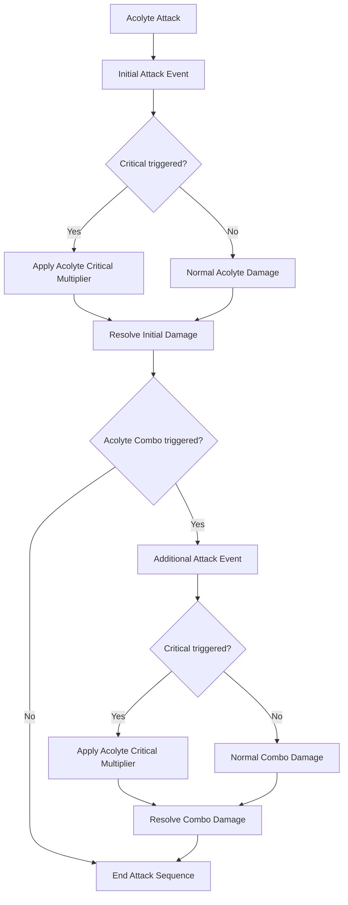

Une distinction fondamentale est désormais établie : le combo et le critique sont deux mécanismes indépendants.

Un combo n'est pas nécessairement critique. Un critique ne déclenche pas nécessairement un combo.

---

# 2. Synergie entre ATQ générale et dégâts d'acolytes

C'est probablement le point le plus important de ta précision.

Les acolytes ne disposent pas nécessairement d'une puissance offensive entièrement indépendante de leur propriétaire.

Leur puissance dépend de l'ATQ générale du personnage.

## 2.1 Formule de dégâts de base

Je propose le modèle suivant :

$$
D_{\text{acolyte,base}}=
ATQ_{\text{final propriétaire}}
\times C_{\text{acolyte}}
$$

Avec :

- $ATQ_{\text{final propriétaire}}$ : puissance d'attaque finale du personnage.
- $C_{\text{acolyte}}$ : coefficient de base défini par l'acolyte.

Les dégâts spécifiques aux acolytes interviennent ensuite :

$$
D_{\text{acolyte}}=
D_{\text{acolyte,base}}
\times M_{\text{acolyte}}
$$

Où $M_{\text{acolyte}}$ représente les bonus spécifiques aux dégâts d'acolytes, résolus par le Modifier Resolver.

**Conséquence importante :** augmenter l'ATQ générale améliore les dégâts de base des acolytes, tandis qu'augmenter les dégâts d'acolytes améliore leur multiplicateur spécifique.

Ces deux investissements sont donc complémentaires.

## 2.2 Exemple numérique

Prenons un exemple fictif :

| Caractéristique | Valeur |
|--------|--------|
| ATQ finale du personnage | 10 000 |
| Coefficient de base acolyte | 0,50 |
| Bonus dégâts acolyte | \+40 % |

$$
D_{\text{base}}=10\,000\times0,50=5\,000
$$

$$
D_{\text{acolyte}}=5\,000\times1,40
$$

Dégâts de l'attaque initiale avant défense et critique

# 7 000

Si cette attaque déclenche un critique, le multiplicateur spécifique d'acolyte intervient ensuite.

## 2.3 Conséquence sur le Character Stats Engine

Le système doit impérativement conserver cette dépendance :

**Statistiques du personnage**

# ATQ finale

**Acolyte Damage Calculator**

Coefficient de base × dégâts spécifiques

**Initial Attack**

Calcul critique indépendant

**Combo Attack**

Calcul critique indépendant

Le calculateur d'acolytes consommera donc les snapshots du personnage. Il ne maintiendra pas une copie indépendante et potentiellement désynchronisée de son ATQ.

*Note d'ingénierie : le bonus `attack_bonus` est déjà incorporé dans `final_attack`. Il ne devra jamais être appliqué une seconde fois au calcul des dégâts des acolytes.*

---

# 3. Mise à jour du référentiel des attributs

L'ajout de `acolyte_critical_damage` porte le référentiel à :

# 4

Attributs basiques

# 57

Attributs avancés

# 4

Attributs finaux

---

**Total des définitions**

# 65

## 3.1 Répartition actualisée

| Famille | Nombre |
|--------|--------|
| Critiques et mécaniques de combat | 21 |
| Coefficients et compétences | 11 |
| Boss et acolytes | 8 |
| Guérison | 2 |
| Pénétration | 8 |
| Bonus globaux | 7 |
| **Total avancé** | **57** |

## 3.2 Attributs d'acolytes désormais identifiés

| Attribut | Statut |
|--------|--------|
| Combo d'acolyte | (Défini) |
| Coup critique d'acolyte | (Défini) |
| Dégâts critiques d'acolyte | (Ajouté) |
| Dégâts d'acolyte | (Défini) |
| Réduction dégâts d'acolyte | (Défini) |
| Pénétration d'acolyte | (Défini) |
| Anti-pénétration d'acolyte | (Défini) |
| Inspiration des acolytes | (Défini) |
| Résistance des acolytes | (Défini) |

Les attributs suivants ne sont pas ajoutés sans confirmation :

- `acolyte_combo_ignore`
- `acolyte_critical_ignore`
- `acolyte_critical_resistance`

---

</details>


### SYS-002.D.7.3 · T022 · 18/11/2026 15:25:55

**Nature :** `EXIGENCE_OU_RECTIFICATION_PROPRIETAIRE` · **Ligne d’approbation source :** 6864 · **Ligne de formalisation :** 6877.

**Décision / prescription originale (texte intégral du propriétaire) :**

SYS-002.D.7.3 — Validation globale : ATQ acolyte = final ; coefficient acolyte = individual ; critiques = per_hit ; enchaînement combo = single ; architecture = approve ; observations = Je vais rajouter une précision concernant les acolytes, qu'il faudra certainement approfondir plus tard.
Les acolytes sont des compagnons qui accompagnent et soutiennent le personnage dans ses combats (PvE ou PvP). 
Les acolytes possèdent également un niveau, allant du niveau 1 à 200.
Pour faire évoluer et monter en niveau les acolytes, il faut accumuler des doublons en effectuant des invocations d'acolyte.
Chaque acolyte possède des caractéristiques qui lui sont propres indépendamment des caractéristiques (que nous connaissons déjà) du personnage.
L'acolyte possède :
Coefficient de dégâts, Vitesse d'attaque, Coup critique, Dégâts critique, Combo, Coefficient de combo, Ignorance d'évasion.
Chaque acolyte possède également un effet de déploiement qui lui est propre (à définir plus tard).
Ils possèdent différents niveaux de rareté (rares, excellents, épiques, mythiques, etc.), les plus rares offrant des compétences uniques très puissantes (boucliers, soin, boosts massifs de stats etc.). Formalise les décisions, clôture l'audit architectural et établis le plan de spécification mathématique restant.


<details><summary>Formalisation technique de la décision ratifiée (extrait sourcé)</summary>

# 1. Formalisation GDD - SYS-002.D.7.3

(Architecture validée) (Version 1.2)

## 1.1 Décisions précédemment validées

| Élément | Décision |
|--------|--------|
| ATQ utilisée pour les dégâts des acolytes | `final_attack` du propriétaire |
| Coefficient de dégâts | Individuel à chaque acolyte |
| Déclenchement critique | Tirage indépendant par attaque |
| Déclenchement du combo | Un seul combo supplémentaire par attaque initiale |
| Architecture Character Stats Engine | Approuvée |

## 1.2 Nouvelles caractéristiques des acolytes

Nous introduisons une distinction fondamentale entre les caractéristiques propres à un acolyte et les caractéristiques de son propriétaire.

**Caractéristiques intrinsèques de l'acolyte :**

| Attribut | Identifiant technique |
|--------|--------|
| Coefficient de dégâts | `damage_coefficient` |
| Vitesse d'attaque | `attack_speed` |
| Coup critique | `critical_rate` |
| Dégâts critiques | `critical_damage` |
| Combo | `combo_rate` |
| Coefficient de combo | `combo_coefficient` |
| Ignorance d'évasion | `evasion_ignore` |

Ces sept caractéristiques appartiennent à la fiche individuelle de chaque acolyte.

Elles ne sont pas des attributs supplémentaires du personnage joueur.

**Caractéristiques du propriétaire influençant les acolytes :**

| Attribut | Identifiant |
|--------|--------|
| ATQ finale | `final_attack` |
| Dégâts d'acolyte | `acolyte_damage` |
| Combo d'acolyte | `acolyte_combo_rate` |
| Coup critique d'acolyte | `acolyte_critical_rate` |
| Dégâts critiques d'acolyte | `acolyte_critical_damage` |
| Pénétration d'acolyte | `acolyte_penetration` |

Cette séparation permet de conserver des acolytes différents tout en leur faisant bénéficier de la progression offensive du personnage.

---

# 2. Nouveau sous-système - Acolyte Engine

(Intégré à l'architecture)

Je propose de créer un sous-système autonome comprenant cinq composants.

**Acolyte Registry**

Définitions, rareté, statistiques intrinsèques et compétences propres

**Progression System**

Niveau 1 à 200, doublons et évolution

**Acolyte Stat Calculator**

Statistiques intrinsèques et bonus du propriétaire

**Acolyte Combat Engine**

Cadence, attaques initiales, combos et critiques

**Acolyte Skill &amp; Deployment System**

Effets de déploiement, soins, boucliers et compétences uniques

## 2.1 Acolyte Registry

Chaque acolyte disposera d'une définition statique.

Elle contiendra :

```text
AcolyteDefinition
│
├── id
├── name
├── rarity
├── base_stats
│   ├── damage_coefficient
│   ├── attack_speed
│   ├── critical_rate
│   ├── critical_damage
│   ├── combo_rate
│   ├── combo_coefficient
│   └── evasion_ignore
│
├── level_growth
├── deployment_effect
├── unique_skills
└── combat_configuration
```

Les définitions seront indépendantes des instances possédées par le joueur.

Ainsi, deux joueurs possédant le même acolyte auront accès à la même définition, mais pourront disposer de niveaux et de progressions différents.

## 2.2 Progression des acolytes

(Niveaux 1 à 200) (Progression par doublons)

Chaque acolyte possède un niveau individuel.

La progression repose sur l'accumulation de doublons obtenus par invocation.

Le système devra distinguer :

- L'acquisition initiale d'un acolyte.
- L'acquisition d'un doublon.
- Le stock de doublons disponibles.
- Les doublons consommés pour progresser.
- Le niveau actuel.
- Le niveau maximal autorisé.

La courbe de progression et le nombre de doublons nécessaires par niveau restent à déterminer.

Nous ne présumons pas qu'un doublon équivaut systématiquement à un niveau supplémentaire.

## 2.3 Rareté

Les catégories communiquées sont intégrées :

- Rare.
- Excellent.
- Épique.
- Mythique.
- Autres catégories éventuelles.

La rareté déterminera notamment :

- Les caractéristiques initiales.
- Les courbes de progression.
- Les compétences accessibles.
- Les effets de déploiement.
- Le potentiel de spécialisation.

Les compétences uniques des acolytes les plus rares pourront inclure :

| Catégorie | Exemple de fonctionnalité |
|--------|--------|
| Défensive | Génération de bouclier |
| Soutien | Récupération de PV |
| Offensive | Augmentation massive d'ATQ |
| Utilitaire | Bonus de vitesse ou réduction de cooldown |
| Hybride | Combinaison de plusieurs effets |

Ces exemples constituent des catégories de conception, pas des compétences définitivement attribuées à des acolytes.

---

# 3. Formalisation mathématique préliminaire des acolytes

Nous pouvons déjà établir les relations entre les différentes caractéristiques sans inventer les coefficients définitifs.

## 3.1 Dégâts de l'attaque initiale

$$
D_{\text{initial}}=
ATQ_{\text{final propriétaire}}
\times C_{\text{dégâts acolyte}}
\times M_{\text{bonus acolyte}}
$$

Où :

- $ATQ_{\text{final propriétaire}}$ : ATQ finale du personnage.
- $C_{\text{dégâts acolyte}}$ : coefficient individuel de l'acolyte.
- $M_{\text{bonus acolyte}}$ : multiplicateur issu des bonus spécifiques du propriétaire.

## 3.2 Dégâts du combo

$$
D_{\text{combo}}=
ATQ_{\text{final propriétaire}}
\times C_{\text{dégâts acolyte}}
\times C_{\text{combo}}
\times M_{\text{bonus acolyte}}
$$

Le coefficient de combo est propre à chaque acolyte.

## 3.3 Déclenchement critique

Chaque attaque effectue son propre tirage :

$$
P_{\text{crit acolyte}}=
f(CR_{\text{acolyte}},CR_{\text{propriétaire}})
$$

En cas de critique :

$$
D_{\text{critique}}=
D_{\text{normal}}\times M_{\text{crit acolyte}}
$$

Le multiplicateur dépendra des caractéristiques critiques de l'acolyte et du propriétaire.

La formule exacte reste à déterminer.

## 3.4 Déclenchement du combo

$$
P_{\text{combo acolyte}}=
f(CB_{\text{acolyte}},CB_{\text{propriétaire}})
$$

Une attaque initiale peut produire au maximum une attaque supplémentaire.

Le combo ne peut pas déclencher un autre combo.

## 3.5 Vitesse d'attaque

La vitesse d'attaque sera une caractéristique intrinsèque individuelle.

$$
T_{\text{attaque acolyte}}=
\frac{1\,000\,000}{AS_{\text{acolyte final}}}
$$

L'influence éventuelle de la vitesse d'attaque du propriétaire sur celle de ses acolytes reste à vérifier.

*Note d'ingénierie : le moteur d'acolytes utilisera un scheduler indépendant du personnage. Il pourra néanmoins partager le même gestionnaire temporel et le même générateur aléatoire déterministe.*

---

# 4. Mise à jour du référentiel global

Le référentiel du personnage reste composé de :

# 4

Attributs basiques

# 57

Attributs avancés

# 4

Attributs finaux

---

**Total du Character Stats Engine**

# 65

Les sept caractéristiques intrinsèques des acolytes sont gérées dans un référentiel distinct.

Le nombre de définitions du système global augmente donc sans polluer le référentiel des statistiques du personnage.

---

# 5. Clôture de l'audit architectural

(Audit architectural clôturé)

Les décisions suivantes sont désormais considérées comme acquises :

| Composant | État |
|--------|--------|
| Character Stats Engine | Architecture validée |
| Stat Registry | Architecture validée |
| Modifier Resolver | Architecture validée |
| Derived Stat Calculator | Architecture validée |
| Stat Snapshot | Architecture validée |
| Damage Calculator | Contrat architectural défini |
| Combat Scheduler | Architecture définie |
| Critical System | Architecture définie |
| Evasion System | Architecture définie |
| Acolyte Engine | Architecture intégrée |
| Acolyte Progression System | Architecture intégrée |
| Acolyte Skill System | Architecture intégrée |

La validation architecturale ne signifie pas que les formules de tous les composants sont terminées.

Nous passons maintenant à la spécification mathématique.

---

# 6. Plan de spécification mathématique restant

Je propose de structurer la suite en six grands blocs.

## Roadmap SYS-002.D

1. **SYS-002.D.8 - Mécaniques de combat restantes**
   
   (Prochaine étape)
   
   - Combo général.
   - Contre-attaque.
   - Étourdissement.
   - En vol.
   - Blocage.
   - Régénération.
   - Inspiration et résistance des acolytes.
2. **SYS-002.D.9 - Acolyte Engine**
   
   - Formules des sept caractéristiques individuelles.
   - Progression des statistiques par niveau.
   - Synergie avec les statistiques du propriétaire.
   - Cadence et déclenchement des attaques.
   - Combo et critique.
   - Dégâts et pénétration.
3. **SYS-002.D.10 - Acolyte Progression &amp; Skills**
   
   - Progression du niveau 1 à 200.
   - Conversion des doublons.
   - Rareté et évolution.
   - Effets de déploiement.
   - Compétences uniques.
   - Boucliers, soins et buffs.
4. **SYS-002.D.11 - Damage Calculator final**
   
   - Consolidation des formules.
   - Calibration de la constante K.
   - Normalisation des unités.
   - Ordre définitif des calculs.
   - Vérification des multiplicateurs.
5. **SYS-002.D.12 - Matrice de tests**
   
   - Tests unitaires mathématiques.
   - Tests de propriétés.
   - Tests de simultanéité.
   - Tests de cas limites.
   - Tests PvE et PvP.
   - Scénarios de référence.
6. **SYS-002.D.13 - Validation technique finale**
   
   - Contrats définitifs.
   - Dépendances intermodules.
   - Interfaces publiques.
   - Critères d'acceptation.
   - Autorisation d'implémentation.

## 6.1 Ordre de priorité

Je recommande de commencer par SYS-002.D.8 plutôt que de développer immédiatement les acolytes.

La raison est architecturale : les acolytes réutilisent plusieurs mécaniques fondamentales du moteur de combat, notamment les critiques, les résistances, les esquives, les combos et les calculs de dégâts.

Spécifier ces mécanismes une seule fois évitera de dupliquer les règles entre le personnage et ses compagnons.

---

</details>


---

# Chapitre 08 — Combo, contre-attaque, contrôle, blocage et soins

**Autorité :** décisions expressément approuvées dans la conversation source. Les modèles obsolètes sont remplacés par les rectifications ultérieures ; les paramètres provisoires restent provisoires.

**Statut du chapitre :** `functionally_specified` pour ses spécifications validées ; aucune exécution de test ou implémentation ne découle de ce statut.

**Traçabilité :** 7 décision(s) du propriétaire. Toutes les références `Txxx` renvoient à `references/HISTORIQUE_SOURCE_ORIGINAL.md`.


## Registre détaillé des décisions approuvées


### SYS-002.D.8.1 · T024 · 18/11/2026 15:49:49

**Nature :** `APPROBATION_EXPLICITE` · **Ligne d’approbation source :** 7591 · **Ligne de formalisation :** 7596.

**Décision / prescription originale (texte intégral du propriétaire) :**

Validation SYS-002.D.8.1 : portée du combo = normal ; formule ignorance = subtract ; nombre de combos = single ; condition = landed ; temporalité = immediate ; base dégâts = attack_times_coefficient ; observations = Aucune. Formalise les décisions et poursuis avec SYS-002.D.8.2 — Contre-attaque.


<details><summary>Formalisation technique de la décision ratifiée (extrait sourcé)</summary>

# 1. Formalisation GDD - SYS-002.D.8.1

(Validé) (Version 1.0)

## 1.1 Décisions enregistrées

| Élément | Décision |
|--------|--------|
| Portée du déclenchement | Attaques normales uniquement |
| Calcul du taux | Soustraction directe |
| Nombre de combos | Un par attaque initiale |
| Condition | Attaque initiale non esquivée |
| Temporalité | Immédiatement après l'attaque initiale |
| Base des dégâts | ATQ finale × coefficient de combo |

## 1.2 Formules consolidées

Le taux de combo effectif est :

$$
C_{\text{effectif}}=
\max(0,C_{\text{attaquant}}-CI_{\text{défenseur}})
$$

La probabilité est ensuite plafonnée à 100 % pour le tirage.

Les dégâts de base sont :

$$
D_{\text{combo,base}}=
ATQ_{\text{final}}\times C_{\text{combo}}
$$

Le résultat passe ensuite par le `Damage Calculator`, avec le canal `COMBO`.

## 1.3 Séquence définitive

1. Une attaque normale est initiée.
2. Le système vérifie l'évasion.
3. Si l'attaque est esquivée, aucun combo n'est déclenché.
4. Si elle touche, les dégâts initiaux sont résolus.
5. Le système calcule la probabilité de combo.
6. Un tirage indépendant détermine son déclenchement.
7. Si le combo est déclenché, une attaque supplémentaire est créée.
8. Cette attaque dispose de son propre tirage critique et de son propre calcul de dégâts.
9. Elle ne peut pas déclencher un autre combo.

Une attaque de combo peut elle-même être esquivée par la cible.

Le cycle normal d'attaque n'est pas réinitialisé.

---

</details>


### SYS-002.D.8.2 · T025 · 18/11/2026 16:44:12

**Nature :** `APPROBATION_EXPLICITE` · **Ligne d’approbation source :** 7955 · **Ligne de formalisation :** 7965.

**Décision / prescription originale (texte intégral du propriétaire) :**

Validation SYS-002.D.8.2 : portée = direct ; condition = positive_damage ; ignorance = subtract ; nombre = per_event ; base dégâts = attack_coefficient ; critique = general ; évasion = yes ; temporalité = immediate ; observations = • Les attaques normales : Chaque attaque de base de l'adversaire lance un jet de probabilité selon votre taux de contre-attaque.
• Les attaques de combo : Chaque coup supplémentaire issu d'un combo ennemi compte comme une attaque distincte et peut déclencher une riposte.
• Les compétences actives : Les compétences qui infligent des dégâts directs à votre personnage activent également votre probabilité de contre-attaque.
• Les attaques d'acolytes : Les coups portés directement par les familiers adverses peuvent déclencher vos ripostes.
L'évasion (Esquive) : Si vous esquivez une attaque grâce à votre statistique d'évasion, la contre-attaque ne se déclenche pas dans les mécaniques standards, car vous n'avez pas été touché (sauf effet de classe très spécifique).
Les boucliers : Si vous absorbez un coup grâce à un bouclier, l'attaque est tout de même comptabilisée comme reçue et peut donc déclencher votre contre-attaque.. Formalise les décisions et poursuis avec SYS-002.D.8.3 — Étourdissement.


<details><summary>Formalisation technique de la décision ratifiée (extrait sourcé)</summary>

# 1. Formalisation GDD - SYS-002.D.8.2

(Validé) (Version 1.1)

## 1.1 Décisions enregistrées

| Élément | Décision |
|--------|--------|
| Portée | Toutes les attaques directes |
| Condition | Attaque reçue et non esquivée |
| Ignorance | Soustraction directe |
| Nombre | Une contre-attaque par événement |
| Base des dégâts | ATQ finale × coefficient de contre-attaque |
| Critique | Système critique général |
| Évasion | Possible sur la contre-attaque |
| Temporalité | Immédiatement après l'attaque reçue |
| Contre-attaque récursive | Interdite |

## 1.2 Précision sur les attaques éligibles

Les observations permettent de préciser la portée `direct`.

| Type d'attaque reçue | Contre-attaque possible |
|--------|--------|
| Attaque normale | Oui |
| Combo ennemi | Oui, chaque coup individuellement |
| Compétence directe | Oui |
| Attaque d'acolyte | Oui |
| Contre-attaque ennemie | Non |
| Dégâts périodiques | Non, sauf extension ultérieure |
| Dégâts indirects | Non |

Chaque coup d'une compétence multicoup constitue un événement distinct et peut donc effectuer son propre tirage.

## 1.3 Correction de la condition concernant les boucliers

La décision initiale `positive_damage` doit être précisée.

Un coup absorbé intégralement par un bouclier reste une attaque reçue.

Nous distinguons donc :

- `hit_confirmed` : l'attaque a effectivement touché.
- `evaded` : l'attaque a été esquivée.
- `shield_absorbed` : le bouclier a absorbé tout ou partie des dégâts.
- `hp_damage` : dégâts effectivement retirés aux PV.

La nouvelle condition est :

$$
\text{CounterEligible}=
\text{HitConfirmed}
\land
\neg\text{Evaded}
\land
(D_{\text{avant bouclier}}>0)
$$

Ainsi, une attaque entièrement absorbée par un bouclier peut déclencher une contre-attaque.

En revanche, une attaque esquivée ne le peut pas.

## 1.4 Formule consolidée

$$
CA_{\text{effectif}}=
\max(0,CA_{\text{défenseur}}-CAI_{\text{attaquant}})
$$

La probabilité est plafonnée à 100 % pour le tirage.

Les dégâts de la contre-attaque sont calculés à partir de l'ATQ finale de son propriétaire :

$$
D_{\text{contre,base}}=
ATQ_{\text{final}}\times C_{\text{contre}}
$$

Le résultat passe ensuite par le `Damage Calculator`, avec le canal `COUNTER`.

## 1.5 Séquence définitive

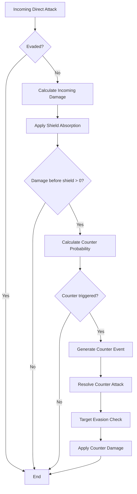

*Note d'ingénierie : le bouclier et les PV seront traités comme deux couches distinctes de réception des dégâts. La contre-attaque dépend de la confirmation du coup, pas exclusivement de la diminution des PV.*

---

</details>


### SYS-002.D.8.3 · T026 · 18/11/2026 17:38:40

**Nature :** `APPROBATION_EXPLICITE` · **Ligne d’approbation source :** 8318 · **Ligne de formalisation :** 8323.

**Décision / prescription originale (texte intégral du propriétaire) :**

Validation SYS-002.D.8.3 : signification stun_ignore = reduce ; portée = direct ; condition = landed ; actions bloquées = all_actions ; durée = effect_defined ; réapplication = refresh ; observations = Aucune. Formalise les décisions et poursuis avec SYS-002.D.8.4 — En vol.


<details><summary>Formalisation technique de la décision ratifiée (extrait sourcé)</summary>

# 1. Formalisation GDD - SYS-002.D.8.3

(Validé) (Version 1.0)

## 1.1 Décisions enregistrées

| Élément | Décision |
|--------|--------|
| Ignorance d'étourdissement | Réduction directe du taux adverse |
| Portée | Toutes les attaques directes |
| Condition | Attaque non esquivée |
| Actions bloquées | Toutes les actions offensives et défensives |
| Durée | Définie par l'effet |
| Réapplication | Actualisation de la durée |

## 1.2 Formule définitive

$$
S_{\text{effectif}}=
\max(0,S_{\text{attaquant}}-SI_{\text{défenseur}})
$$

$$
P_{\text{stun}}=\min(S_{\text{effectif}},100)
$$

Les valeurs sont exprimées en points de pourcentage.

## 1.3 Règles d'application

- Toutes les attaques directes peuvent provoquer un étourdissement.
- Une attaque esquivée ne peut pas provoquer d'étourdissement.
- Un bouclier n'empêche pas le déclenchement.
- L'effet bloque les nouvelles actions offensives et défensives.
- Les cooldowns continuent de progresser.
- Les buffs et debuffs continuent leur durée normale.
- Une nouvelle application actualise le timestamp d'expiration.
- L'effet ne se propage pas automatiquement aux compagnons du personnage.

Une question technique reste ouverte : l'interruption des compétences déjà en cours d'exécution. Elle sera traitée dans la matrice globale des contrôles.

*Note d'ingénierie : nous utiliserons un gestionnaire générique de contrôles (`ControlEffectManager`\) plutôt qu'un système indépendant pour chaque effet. L'étourdissement et l'état En vol partageront leur infrastructure sans nécessairement partager leurs conséquences.*

---

</details>


### SYS-002.D.8.4 · T027 · 18/11/2026 17:50:32

**Nature :** `APPROBATION_EXPLICITE` · **Ligne d’approbation source :** 8654 · **Ligne de formalisation :** 8667.

**Décision / prescription originale (texte intégral du propriétaire) :**

Validation SYS-002.D.8.4 : ignorance = subtract ; portée = direct ; effet = verify ; vulnérabilité = vulnerable ; durée = effect ; réapplication = refresh ; interaction étourdissement = coexist ; observations = Il faudrait changer le nom de cette caractéristique, je ne la trouve pas très clair au premier abord.
Le mécanisme d'en vol (ou lancement en l'air) est un effet de contrôle de foule qui projette brièvement la cible dans les airs, interrompant toutes ses actions.

Fonctionnement et effets en combat

• Interruption totale (Micro-étourdissement) : Lorsqu'un ennemi est projeté en vol, il est incapable d'attaquer, de déclencher des combos, de contre-attaquer ou d'activer ses compétences tant qu'il est en l'air.
• Durée très courte : Contrairement à l'étourdissement classique des Mages qui dure plusieurs secondes, le lancement en vol est très bref.
• Contre-mesure contre la résistance à l'étourdissement : Le lancement en vol est considéré comme une mécanique distincte de l'étourdissement. Il ignore la statistique de « Résistance à l'étourdissement » de l'adversaire, ce qui le rend redoutable en PvP.
• Réinitialisation des animations : En plus de faire gagner de précieuses fractions de seconde, la projection brise le rythme d'attaque de l'adversaire et retarde le rechargement de ses compétences actives.. Formalise les décisions et poursuis avec SYS-002.D.8.5 — Blocage.


<details><summary>Formalisation technique de la décision ratifiée (extrait sourcé)</summary>

# 1. Formalisation GDD - SYS-002.D.8.4

(Validé) (Version 1.1)

## 1.1 Changement de nomenclature

Le terme « En vol » est remplacé par **Projection aérienne**.

Ce nom décrit directement le mécanisme et évite de confondre l'état de la cible avec l'effet qui le provoque.

| Ancien nom | Nouveau nom | Identifiant technique |
|--------|--------|--------|
| En vol | Chance de projection aérienne | `air_launch_rate` |
| Ignorance d'en vol | Ignorance de projection aérienne | `air_launch_ignore` |

Les anciens identifiants `airborne_rate` et `airborne_ignore` sont abandonnés dans le référentiel canonique.

## 1.2 Décisions consolidées

| Élément | Décision |
|--------|--------|
| Calcul de l'ignorance | Soustraction directe |
| Portée | Toutes les attaques directes |
| Effet | Interruption totale des actions |
| Vulnérabilité | La cible reste attaquable |
| Durée | Très courte, définie par effet |
| Réapplication | Actualisation de la durée |
| Interaction avec étourdissement | Coexistence indépendante |
| Résistance à l'étourdissement | Ignorée |

## 1.3 Nature de la projection aérienne

La projection aérienne est un effet de contrôle de foule indépendant de l'étourdissement classique.

Ses propriétés sont les suivantes :

- Interruption immédiate des actions en cours.
- Impossibilité d'attaquer.
- Impossibilité de déclencher un combo.
- Impossibilité de contre-attaquer.
- Impossibilité d'activer une compétence.
- Durée très courte.
- Vulnérabilité conservée.
- Réinitialisation du rythme d'attaque.
- Retardement du rechargement des compétences actives.

### Distinction avec l'étourdissement

| Propriété | Étourdissement | Projection aérienne |
|--------|--------|--------|
| Contrôle complet | Oui | Oui |
| Durée | Plusieurs secondes possibles | Très courte |
| Résistance à l'étourdissement | À prendre en compte | Ignorée |
| Interruption des actions | Oui | Oui |
| Réinitialisation du rythme d'attaque | À définir | Oui |
| Retardement des cooldowns actifs | Non, progression normale | Oui |

## 1.4 Interaction avec le système temporel

La projection aérienne introduit une particularité importante par rapport à l'étourdissement.

Pendant sa durée :

1. L'animation d'attaque en cours est interrompue.
2. La progression de la cadence d'attaque est réinitialisée.
3. Les cooldowns des compétences actives sont temporairement suspendus.
4. À expiration, les cooldowns reprennent leur progression avec le temps restant.
5. Le personnage retrouve sa capacité d'action.

La règle de suspension des cooldowns constitue une exception spécifique à la projection aérienne. Elle ne modifie pas la règle générale validée dans SYS-002.D.5.2.

## 1.5 Nouvelle caractéristique identifiée : Résistance à l'étourdissement

Tu viens d'identifier une caractéristique qui ne figurait pas dans notre référentiel initial.

| Attribut | Identifiant |
|--------|--------|
| Résistance à l'étourdissement | `stun_resistance` |

(Ajouté au référentiel)

Cette caractéristique devra intervenir dans le calcul des étourdissements classiques.

La projection aérienne l'ignore entièrement.

Son interaction mathématique exacte avec `stun_rate` et `stun_ignore` sera spécifiée dans la matrice des résistances.

## 1.6 Mise à jour du référentiel

# 4

Attributs basiques

# 58

Attributs avancés

# 4

Attributs finaux

---

**Total des définitions**

# 66

*Note d'ingénierie : la projection aérienne sera enregistrée comme un effet de contrôle distinct. Le fait que deux effets bloquent les mêmes actions ne signifie pas qu'ils possèdent les mêmes règles temporelles ou les mêmes résistances.*

---

</details>


### SYS-002.D.8.5 · T028 · 18/11/2026 18:16:39

**Nature :** `APPROBATION_EXPLICITE` · **Ligne d’approbation source :** 9067 · **Ligne de formalisation :** 9079.

**Décision / prescription originale (texte intégral du propriétaire) :**

Validation SYS-002.D.8.5 : portée = direct ; ignorance = subtract ; conséquence = reduce ; quantité bloquée = fixed ; fréquence = per_hit ; effets secondaires = hit_effects ; ordre de calcul = before_defense ; observations = le blocage (Block) est une statistique défensive avancée qui permet de réduire une partie des dégâts subis lors d'une attaque directe, et s'oppose directement à la statistique de perforation (Pierce).

Fonctionnement en combat

• Réduction des dégâts subis : Lorsqu'un blocage s'active face à une attaque ennemie, il diminue considérablement les dégâts finaux que vous recevez, ce qui vous permet de survivre beaucoup plus longtemps face aux classes à gros dégâts (DPS).
• Opposition Blocage vs Perforation : Le système fonctionne par comparaison entre votre statistique de Blocage et la statistique de Perforation (Pierce) de l'adversaire. Plus votre blocage est supérieur à sa perforation, plus le déclenchement et l'efficacité de la réduction sont élevés.
• Interactions avec les autres mécaniques : Contrairement à l'évasion qui annule totalement le coup (et empêche la contre-attaque), le blocage laisse l'attaque vous toucher avec des dégâts réduits. Cela permet aux Guerriers d'encaisser le coup tout en continuant de déclencher leurs contre-attaques.
• Limites face aux dégâts spéciaux : Le blocage est très efficace contre les attaques classiques, mais son impact est beaucoup plus faible contre les dégâts indexés sur un pourcentage de vos PV maximum.. Formalise les décisions et poursuis avec SYS-002.D.8.6 — Régénération.


<details><summary>Formalisation technique de la décision ratifiée (extrait sourcé)</summary>

# 1. Formalisation GDD - SYS-002.D.8.5

(Validé) (Version 1.1)

## 1.1 Décisions enregistrées

| Élément | Décision |
|--------|--------|
| Portée | Toutes les attaques directes |
| Ignorance de blocage | Soustraction directe |
| Conséquence | Réduction des dégâts |
| Réduction de base | Valeur fixe configurable |
| Fréquence | Un tirage par coup |
| Effets secondaires | Conservés |
| Ordre d'application | Avant défense et pénétration |

## 1.2 Nouvelle interaction : Blocage contre Pénétration

Nous intégrons une relation directe entre :

- `block_rate` : blocage du défenseur.
- `penetration` : pénétration (Pierce) de l'attaquant.
- `block_ignore` : ignorance de blocage de l'attaquant.
- `anti_penetration` : anti-pénétration du défenseur.

Il faut conserver une distinction entre pénétration et ignorance de blocage : ce sont deux caractéristiques présentes dans le référentiel initial, même si elles interviennent toutes deux dans la résolution du blocage.

Le calcul proposé est :

$$
P_{\text{effective}}=
f(P_{\text{attaquant}},AP_{\text{défenseur}})
$$

Puis :

$$
B_{\text{marge}}=
\max(0,B_{\text{défenseur}}-
P_{\text{effective}}-
BI_{\text{attaquant}})
$$

La fonction de résolution de la pénétration reste celle du système SYS-002.D.2.

**Conséquence :** plus la marge entre le blocage et la pénétration est élevée, plus la probabilité et l'efficacité du blocage augmentent.

Nous ne fixons pas encore la fonction mathématique exacte de cette progression.

## 1.3 Nouvelle distinction : probabilité et efficacité

Le blocage possède désormais deux sorties mathématiques distinctes.

| Variable | Fonction |
|--------|--------|
| `block_probability` | Probabilité que le blocage se déclenche |
| `block_effectiveness` | Pourcentage des dégâts réduit lorsque le blocage réussit |

Je propose le modèle suivant :

$$
P_{\text{block}}=f(B_{\text{marge}})
$$

$$
R_{\text{block}}=g(B_{\text{marge}})
$$

La réduction effective sera ensuite adaptée au type de dégâts.

Pour les dégâts indexés sur les PV maximum, un coefficient spécifique réduira l'efficacité du blocage :

$$
R_{\text{block,HP\%}}=
R_{\text{block}}\times K_{\text{HP\%}}
$$

Avec un coefficient $K_{\text{HP\%}}$ inférieur à celui des attaques classiques.

Sa valeur reste à calibrer.

## 1.4 Interactions avec les autres mécaniques

| Mécanique | Conséquence |
|--------|--------|
| Évasion | Annule le coup, aucun blocage |
| Blocage | L'attaque touche avec des dégâts réduits |
| Contre-attaque | Peut toujours se déclencher |
| Étourdissement | Peut toujours se déclencher |
| Projection aérienne | Peut toujours se déclencher |
| Bouclier | Absorbe les dégâts restants |
| Dégâts en % des PV max | Efficacité du blocage réduite |

La condition de contre-attaque est donc confirmée : une attaque bloquée reste une attaque reçue et peut provoquer une riposte.

## 1.5 Ordre de résolution actualisé

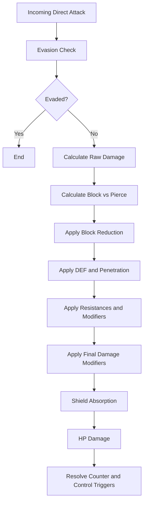

Cette représentation fixe l'ordre général du blocage. Les positions exactes des contrôles secondaires et des boucliers seront consolidées dans SYS-002.D.11.

*Note d'ingénierie : le calculateur devra conserver le type de dégâts dans chaque événement. Une attaque basée sur un pourcentage des PV maximum ne doit pas utiliser aveuglément la même efficacité de blocage qu'une attaque physique classique.*

---

</details>


### SYS-002.D.8.6 · T029 · 18/11/2026 18:26:33

**Nature :** `APPROBATION_EXPLICITE` · **Ligne d’approbation source :** 9497 · **Ligne de formalisation :** 9509.

**Décision / prescription originale (texte intégral du propriétaire) :**

Validation SYS-002.D.8.6 : unité = max_hp ; fréquence = periodic ; ignorance = subtract ; portée ignorance = continuous ; interaction guérison = separate ; contrôles = continue ; cumul = independent ; observations = la régénération (Regen) permet de récupérer des points de vie (PV) de façon passive et continue chaque seconde durant un combat.

Fonctionnement et mécanismes

• Soin par seconde : Contrairement au vol de vie ou aux soins déclenchés par vos attaques, la régénération restaure automatiquement un pourcentage de vos PV maximum chaque seconde.
• Aucune condition d'action : Vous continuez de regagner de la vie même lorsque vous êtes étourdi (Stun), projeté en l'air ou incapable d'attaquer.
• Synergie avec les PV maximum : Plus votre réserve totale de PV est élevée, plus le montant réel de soins récupéré à chaque seconde est important.
• Limite d'efficacité (Anti-soin) : En PvP, l'efficacité de la régénération diminue à mesure que le combat s'éternise (réduction progressive des soins dans le temps) et peut être réduite par des effets « anti-soin » adverses.. Formalise les décisions et poursuis avec SYS-002.D.8.7 — Inspiration et résistance des acolytes.


<details><summary>Formalisation technique de la décision ratifiée (extrait sourcé)</summary>

# 1. Formalisation GDD — SYS-002.D.8.6

(Validé) (Version 1.1)

## 1.1 Décisions enregistrées

| Élément | Décision |
|--------|--------|
| Unité | Pourcentage des PV maximum par seconde |
| Fréquence | Périodique, toutes les secondes |
| Ignorance de régénération | Soustraction directe |
| Portée | Continue pendant le combat |
| Interaction avec la guérison | Indépendante |
| Étourdissement | Régénération maintenue |
| Projection aérienne | Régénération maintenue |
| Cumul des sources | Instances indépendantes et cumulatives |

## 1.2 Fonctionnement consolidé

La régénération est une récupération passive des PV qui intervient automatiquement chaque seconde pendant un combat.

Elle ne dépend :

- Ni des attaques effectuées.
- Ni des compétences activées.
- Ni des déplacements.
- Ni de la capacité du personnage à agir.

Elle reste active pendant les effets de contrôle.

## 1.3 Formule mathématique

Nous distinguons désormais trois niveaux de calcul.

**A. Régénération brute**

$$
H_{\text{brut}}=PV_{\max}\times R
$$

Où $R$ représente le taux de régénération par seconde.

**B. Régénération après ignorance**

$$
R_{\text{net}}=\max(0,R-RI)
$$

Où $RI$ représente l'ignorance de régénération adverse.

**C. Régénération effective en PvP**

$$
H_{\text{PvP}}(t)=PV_{\max}\times R_{\text{net}}\times F_{\text{PvP}}(t)
$$

Avec :

- $t$ : temps écoulé depuis le début du combat.
- $F_{\text{PvP}}(t)$ : coefficient de régénération PvP.
- Ce coefficient diminue progressivement pendant le combat.

La fonction exacte reste à déterminer.

En PvE, aucun mécanisme de diminution progressive n'est actuellement défini.

## 1.4 Introduction des effets anti-soin

Nous ajoutons un mécanisme distinct : `anti_heal_effect`.

Il ne constitue pas encore une nouvelle caractéristique permanente du personnage. Il s'agit d'un modificateur temporaire pouvant réduire la régénération reçue.

Le calcul général devient :

$$
H_{\text{effectif}}(t)=
PV_{\max}\times R_{\text{net}}
\times F_{\text{PvP}}(t)
\times M_{\text{anti-heal}}
$$

En l'absence d'effet anti-soin :

$$
M_{\text{anti-heal}}=1
$$

Les règles de cumul des effets anti-soin seront spécifiées ultérieurement.

## 1.5 Exemple numérique

Prenons un personnage fictif :

| Caractéristique | Valeur |
|--------|--------|
| PV maximum | 1 000 000 |
| Régénération | 2 % / seconde |
| Ignorance adverse | 0,5 % / seconde |
| Coefficient PvP | 0,75 |
| Réduction anti-soin | 20 % |

$$
H=1\,000\,000\times0,015\times0,75\times0,8
$$

Régénération effective par seconde

# 9 000 PV

Exemple illustratif, coefficients non calibrés sur le jeu officiel.

## 1.6 Règles complémentaires

- Les PV récupérés ne peuvent pas dépasser les PV maximum.
- Un personnage mort ne récupère pas de PV.
- Chaque source de régénération conserve sa propre durée.
- Les sources actives se cumulent.
- Les effets de contrôle ne suspendent pas la régénération.
- Les soins instantanés restent indépendants.
- La diminution progressive PvP est calculée à partir du temps de combat.

*Note d'ingénierie : le moteur conservera un accumulateur temporel indépendant du framerate. Les ticks seront déclenchés toutes les secondes de simulation. Les fractions de PV seront conservées dans les calculs intermédiaires pour éviter les pertes de précision cumulatives.*

---

</details>


### SYS-002.D.8.7 · T030 · 18/11/2026 18:53:18

**Nature :** `APPROBATION_EXPLICITE` · **Ligne d’approbation source :** 9841 · **Ligne de formalisation :** 9857.

**Décision / prescription originale (texte intégral du propriétaire) :**

Validation SYS-002.D.8.7 : inspiration = stats ; ignorance inspiration = reduce ; résistance = damage ; ignorance résistance = reduce ; portée = unknown ; modèle mathématique = unknown ; observations = la caractéristique d'inspiration des acolytes correspond à une attaque spéciale déclenchée par vos acolytes en plus de leurs attaques normales et de leurs compétences passives.
Mécanisme de déclenchement et effets
- Une attaque de groupe ou renforcée : Lorsqu'un acolyte déclenche son inspiration, il effectue une frappe spéciale dont les dégâts sont calculés à partir de votre statistique d'attaque globale et amplifiés par le multiplicateur d'inspiration d'acolyte.
- Condition d'activation : L'inspiration fonctionne sur un système de probabilité par attaque ou de jauge d'énergie liée aux coups portés par vos acolytes. Plus la vitesse d'attaque de vos acolytes est élevée, plus ils accumulent rapidement les conditions nécessaires pour déclencher cette inspiration.
- Synergie avec la classe Dompteur : La branche du Dompteur (Beast Master / Tamer) repose entièrement sur ce mécanisme. Ses compétences actives et ses passifs d'éveil augmentent directement le taux d'inspiration, les dégâts d'inspiration et permettent à tous vos acolytes équipés de déclencher simultanément un état d'excitation.
- Interaction avec les critiques et combos d'acolytes : Une attaque d'inspiration peut également bénéficier d'un coup critique d'acolyte, créant des pics de dégâts massifs en combat.

la statistique Ignorance de l'inspiration d'acolyte (Ignore Pal Inspire) est une caractéristique défensive de fin de jeu conçue pour réduire ou annuler les bonus d'inspiration des acolytes adverses. [[1](https://www.youtube.com/watch?v=SF8rWwtzfoo&t=294), [2](https://guidesbygrace.uk/divining)]
Fonctionnement en combat
- Contre-mesure directe : Elle s'oppose directement à la statistique d'Inspiration d'acolyte (Pal Inspire) de votre adversaire lors du calcul des dégâts. [[1](https://guidesbygrace.uk/divining)]
- Réduction des dégâts spéciaux des familiers : Lorsqu'un ennemi déclenche l'inspiration de ses acolytes, votre valeur d'ignorance soustrait ou diminue le multiplicateur appliqué à leurs attaques spéciales.
- Spécialisation anti-Dompteur : Cette statistique vise particulièrement la classe Dompteur (Beast Master / Tamer), ainsi que tous les joueurs qui misent sur des familiers à très gros dégâts.. Formalise les décisions et clôture SYS-002.D.8.


<details><summary>Formalisation technique de la décision ratifiée (extrait sourcé)</summary>

# 1. Formalisation GDD — SYS-002.D.8.7

(Validé fonctionnellement) (Version 1.1)

## 1.1 Inspiration des acolytes

**Identifiant :** `acolyte_inspiration`

La sélection initiale `inspiration = stats` est remplacée par la définition précisée dans les observations.

L'inspiration est une attaque spéciale déclenchée par les acolytes, en complément de leurs attaques normales.

Elle constitue un événement offensif distinct.

### Fonctionnement

Lorsqu'un acolyte remplit les conditions nécessaires, il peut déclencher une attaque d'inspiration.

Cette attaque :

- Utilise l'ATQ finale du propriétaire comme base de calcul.
- Applique un multiplicateur spécifique d'inspiration.
- Peut bénéficier des coups critiques d'acolyte.
- Est indépendante des attaques normales et des compétences passives.
- Peut être renforcée par les compétences et passifs de certaines classes.

### Formule conceptuelle

$$
D_{\text{inspiration,base}}=
ATQ_{\text{final propriétaire}}
\times C_{\text{inspiration}}
$$

Puis application des modificateurs applicables :

$$
D_{\text{inspiration}}=
D_{\text{inspiration,base}}
\times M_{\text{critique acolyte}}
\times M_{\text{défense cible}}
\times M_{\text{final}}
$$

Le multiplicateur d'inspiration et les éventuelles interactions supplémentaires restent à calibrer.

### Déclenchement

Deux mécanismes sont identifiés :

1. Probabilité indépendante à chaque attaque d'acolyte.
2. Accumulation d'une jauge d'énergie alimentée par les attaques.

La vitesse d'attaque des acolytes influence la fréquence à laquelle les conditions de déclenchement sont remplies.

Le modèle exact reste à déterminer.

### Synergie avec le Dompteur

La classe Dompteur (Beast Master / Tamer) possède une spécialisation autour de cette mécanique.

Ses compétences et passifs peuvent :

- Augmenter le taux de déclenchement.
- Augmenter les dégâts d'inspiration.
- Déclencher un état d'excitation collectif.
- Permettre à tous les acolytes équipés de bénéficier simultanément de cet état.

Nous introduisons donc un futur composant :

`AcolyteExcitementSystem`

Il sera chargé de gérer les effets collectifs appliqués aux acolytes.

## 1.2 Ignorance de l'inspiration des acolytes

**Identifiant :** `acolyte_inspiration_ignore`

(Fonction validée)

Il s'agit d'une caractéristique défensive destinée à réduire les dégâts spéciaux provenant de l'inspiration des acolytes adverses.

Elle s'oppose directement à l'inspiration adverse.

Son fonctionnement porte sur le multiplicateur de dégâts d'inspiration, et non sur la probabilité de déclenchement.

Modèle conceptuel :

$$
M_{\text{inspiration effectif}}=
f(M_{\text{inspiration attaquant}},
I_{\text{inspiration défenseur}})
$$

La fonction exacte reste à déterminer.

**Conséquence architecturale :** cette caractéristique doit être intégrée au calculateur des dégâts d'inspiration, et non au gestionnaire de déclenchement.

Elle constitue notamment une contre-mesure aux builds spécialisés Dompteur.

## 1.3 Résistance des acolytes

**Identifiant :** `acolyte_resistance`

(Fonction validée)

Cette caractéristique réduit les dégâts reçus provenant des acolytes adverses.

Elle intervient dans le calcul défensif des dégâts.

Le périmètre exact reste à déterminer : toutes les attaques d'acolytes, uniquement certaines catégories d'attaques ou certains événements particuliers.

## 1.4 Ignorance de résistance des acolytes

**Identifiant :** `acolyte_resistance_ignore`

Cette caractéristique réduit la résistance aux acolytes de la cible.

Modèle conceptuel :

$$
R_{\text{effective}}=
f(R_{\text{défenseur}},RI_{\text{attaquant}})
$$

Elle intervient dans le calcul des dégâts provenant des acolytes.

Son interaction exacte avec la pénétration d'acolyte reste à spécifier.

---

# 2. Référentiel des caractéristiques mis à jour

| Caractéristique | Fonction |
|--------|--------|
| Inspiration des acolytes | Déclenchement et puissance des attaques spéciales d'inspiration |
| Ignorance de l'inspiration | Réduction du multiplicateur d'inspiration adverse |
| Résistance des acolytes | Réduction des dégâts provenant des acolytes adverses |
| Ignorance de résistance | Réduction de la résistance adverse aux dégâts d'acolytes |

Il est important de conserver quatre caractéristiques distinctes.

L'inspiration et l'ignorance de l'inspiration interviennent dans une mécanique offensive spéciale.

La résistance et son ignorance interviennent dans la mitigation des dégâts provenant des acolytes.

---

# 3. Architecture définitive de SYS-002.D.8.7

**Acolyte Inspiration System**

Déclenchement des attaques spéciales

**Inspiration Trigger**

Probabilité ou jauge d'énergie

**Inspiration Damage**

ATQ propriétaire et multiplicateur

**Acolyte Damage Calculator**

Critiques, ignorance d'inspiration, résistance et pénétration

---

**Combat Event Resolution**

Application des dégâts et interactions avec le combat

Cette architecture conserve l'indépendance entre le déclenchement d'une inspiration et le calcul de ses dégâts.

*Note d'ingénierie : le déclenchement et la résolution des dégâts doivent être deux opérations séparées. Une modification de la résistance adverse ne doit jamais modifier artificiellement la fréquence de déclenchement de l'inspiration.*

---

</details>


---

# Chapitre 09 — Acolytes — modèle et combat

**Autorité :** décisions expressément approuvées dans la conversation source. Les modèles obsolètes sont remplacés par les rectifications ultérieures ; les paramètres provisoires restent provisoires.

**Statut du chapitre :** `functionally_specified` pour ses spécifications validées ; aucune exécution de test ou implémentation ne découle de ce statut.

**Traçabilité :** 6 décision(s) du propriétaire. Toutes les références `Txxx` renvoient à `references/HISTORIQUE_SOURCE_ORIGINAL.md`.


## Registre détaillé des décisions approuvées


### SYS-002.D.9.1 · T032 · 18/11/2026 19:08:16

**Nature :** `APPROBATION_EXPLICITE` · **Ligne d’approbation source :** 10567 · **Ligne de formalisation :** 10592.

**Décision / prescription originale (texte intégral du propriétaire) :**

Validation SYS-002.D.9.1 : gestion instances = separate ; doublons = shared_balance ; progression niveaux = individual ; courbes = rarity_curve ; influence rareté = capabilities ; effets déploiement = on_deploy ; runtime = snapshot ; observations = Les acolytes (Pals) sont classés selon 8 niveaux de rareté standard (du plus commun au plus rare), auxquels s'ajoute une catégorie spéciale pour les événements exclusifs.

Les 8 raretés principales (du plus faible au plus puissant)

• Normal (Gris / Blanc) : Les acolytes de base obtenus dès le début du jeu, offrant de très faibles bonus.
• Unique (Vert) : La deuxième catégorie de départ, utile uniquement lors des toutes premières heures de progression.
• Bien / Supérieur (Bleu) : Permet d'obtenir les premiers petits effets passifs utiles en début de partie.
• Rare (Violet) : Introduit des effets de déploiement plus intéressants pour commencer à orienter votre style de jeu.
• Mythique (Orange) : Marque un cap important avec des bonus nettement plus élevés et des synergies de classe plus marquées.
• Épique (Rouge) : Des acolytes très puissants qui constituent la base des équipes de milieu et fin de jeu.
• Légendaire (Doré / Jaune) : Offrent des capacités passives majeures et de gros multiplicateurs de statistiques.
• Immortel (Rose / Arc-en-ciel) : Le rang ultime des invocations classiques, doté des meilleurs effets de combat et des plus hauts bonus passifs permanents.

Catégorie supplémentaire

• Exclusif / Collab (Spécial) : Certains acolytes spéciaux (comme ceux issus des collaborations ou événements temporaires) disposent de leur propre classement à part et ne s'obtiennent pas dans le portail d'invocation classique, comme le détaille le catalogue de Guides by Grace.

Ce qu'il faut savoir sur les raretés

• Double effet : Chaque acolyte possède un effet de déploiement (actif uniquement s'il est équipé dans votre équipe de 5) et un effet permanent (bonus d'ATQ, PV et DÉF actif dès que vous le possédez, même sans l'équiper).
• Probabilités d'invocation : Plus le niveau de votre portail d'invocation augmente grâce aux tirages, plus vos chances d'obtenir des raretés Épique, Légendaire et Immortel progressent.. Formalise les décisions dans le GDD et poursuis selon le protocole avec SYS-002.D.9.2 — Acolyte Progression System.


<details><summary>Formalisation technique de la décision ratifiée (extrait sourcé)</summary>

# 1. Formalisation GDD - SYS-002.D.9.1

(Validé) (Version 1.1)

## 1.1 Décisions architecturales

| Élément | Décision |
|--------|--------|
| Gestion des instances | Instances individuelles |
| Doublons | Solde partagé par type |
| Progression | Individuelle |
| Courbes | Dépendantes de la rareté |
| Influence de la rareté | Statistiques et compétences |
| Effets de déploiement | Conditionnés par l'équipement |
| Runtime | Snapshot actualisable |

## 1.2 Référentiel officiel des raretés

Nous intégrons huit niveaux de rareté standards, classés dans l'ordre suivant.

## Raretés standards

---

**Catégorie spéciale : Exclusif / Collaboration**

(Hors classement standard)

Les acolytes événementiels et issus de collaborations possèdent une classification indépendante. Ils ne sont pas automatiquement positionnés dans la hiérarchie des huit raretés.

Les couleurs sont des métadonnées visuelles. Elles ne doivent pas intervenir dans les calculs mathématiques.

Nous utiliserons deux champs distincts :

```text
rarity_track:
    STANDARD
    EXCLUSIVE

rarity_rank:
    1..8 ou NULL
```

Cette structure permet d'intégrer de futures raretés sans modifier le moteur de progression.

## 1.3 Double système d'effets

C'est une évolution importante du modèle.

Chaque acolyte possède deux catégories d'effets.

**A. Effet permanent - Collection Effect**

(Actif dès acquisition)

Le bonus est appliqué au propriétaire dès que l'acolyte est possédé, même s'il n'est pas équipé.

- Bonus d'ATQ.
- Bonus de PV.
- Bonus de DEF.
- Autres bonus éventuels à identifier.

---

**B. Effet de déploiement - Deployment Effect**

(Conditionné par l'équipement)

L'effet est disponible uniquement lorsque l'acolyte est équipé dans l'équipe active.

- Effets offensifs.
- Effets défensifs.
- Bonus de caractéristiques.
- Effets de soutien.
- Compétences particulières.

Le modèle de données devient :

```text
AcolyteDefinition
│
├── identity
├── rarity
├── base_stats
│
├── permanent_effect
│   ├── attack_bonus
│   ├── hp_bonus
│   └── defense_bonus
│
├── deployment_effect
│   ├── effect_id
│   ├── effect_type
│   ├── activation_condition
│   └── effect_configuration
│
├── progression
├── skills
└── combat_configuration
```

Les deux effets sont indépendants.

Un acolyte non équipé conserve donc ses bonus permanents.

## 1.4 Configuration de l'équipe

(5 emplacements confirmés)

Le `AcolyteLoadout` possède désormais cinq emplacements.

```text
AcolyteLoadout
│
├── owner_id
├── active_slots[5]
│   ├── slot_1
│   ├── slot_2
│   ├── slot_3
│   ├── slot_4
│   └── slot_5
│
└── configuration_status
```

Les bonus permanents sont calculés à partir de la collection possédée.

Les effets de déploiement sont calculés à partir des cinq emplacements actifs.

Il faudra ultérieurement déterminer si un même acolyte peut occuper plusieurs emplacements. Cette règle n'est pas encore connue.

## 1.5 Système d'invocation

Nous ajoutons une dépendance externe au modèle de progression.

Le niveau du portail d'invocation influence les probabilités d'obtention des différentes raretés.

Les probabilités des catégories Épique, Légendaire et Immortel augmentent avec le niveau du portail.

Il faut donc séparer :

- `AcolyteProgressionSystem` : progression des acolytes possédés.
- `SummonPortalSystem` : niveau du portail et probabilités d'invocation.

Le niveau du portail ne doit pas être confondu avec le niveau individuel d'un acolyte.

Les probabilités exactes et leur normalisation seront spécifiées dans un module d'invocation ultérieur.

---

</details>


### SYS-002.D.9.2 · T033 · 18/11/2026 19:20:51

**Nature :** `APPROBATION_EXPLICITE` · **Ligne d’approbation source :** 11027 · **Ligne de formalisation :** 11046.

**Décision / prescription originale (texte intégral du propriétaire) :**

Validation SYS-002.D.9.2 : gestion instances = one_per_type ; ressources = duplicates_only ; coût = rarity_table ; statistiques évolutives = all_seven ; courbes = piecewise ; montée de niveau = multi ; doublons niveau 200 = retain ; bonus permanents = unknown ; observations = Je vais clarifier :
un acolyte monte du niveau 1 au niveau 200 exclusivement en consommant des exemplaires identiques (doublons) obtenus lors de vos invocations au portail.

La montée en niveau (1 à 200) et consommation des doublons

• Déblocage initial : Le tout premier exemplaire tiré au portail débloque l'acolyte au niveau 1.
• Coût progressif en doublons : Pour passer au niveau supérieur, il faut accumuler un nombre précis de cartes du même acolyte. Ce coût commence très bas (2 ou 3 doublons aux tout premiers niveaux) et augmente progressivement par paliers jusqu'au niveau 200.
• Bouton « Amélioration rapide » : Dès que vous possédez assez de doublons pour un ou plusieurs paliers, un bouton d'amélioration globale permet de convertir automatiquement tous vos doublons disponibles en niveaux.
• Recyclage des doublons après le niveau 200 : Une fois qu'un acolyte atteint le niveau maximum (200), les doublons supplémentaires que vous continuez de tirer ne sont pas perdus. Le jeu les fusionne automatiquement pour générer des cartes d'acolytes de la rareté supérieure, ce qui accélère considérablement la montée des acolytes Mythiques, Légendaires et Immortels en fin de jeu.

L'évolution des caractéristiques à chaque niveau

• L'effet possédé (Bonus passif permanent) : À chaque niveau gagné, le pourcentage d'ATQ, de PV et de DÉF que l'acolyte confère à votre personnage augmente. Ce bonus s'applique en permanence à votre compte, même si l'acolyte n'est pas équipé dans votre équipe.
• Les dégâts directs en combat : Le multiplicateur de dégâts de base de l'acolyte augmente à chaque niveau, rendant ses attaques normales et ses attaques d'inspiration beaucoup plus puissantes sur le terrain.
• Ce qui n'évolue pas avec les niveaux : La vitesse d'attaque de base de l'acolyte ainsi que les valeurs numériques de son effet de déploiement (par exemple, +60 % de dégâts de combo pour la Pieuvre de Pirate ou +30 % de temps d'étourdissement pour le Renard Divin) restent fixes du niveau 1 au niveau 200, comme le montrent les fiches d'acolytes sur Mobi.gg.. Formalise les décisions dans le GDD et poursuis avec SYS-002.D.9.3 — Acolyte Stats Engine.


<details><summary>Formalisation technique de la décision ratifiée (extrait sourcé)</summary>

# 1. Formalisation GDD - SYS-002.D.9.2

(Validé) (Version 1.2)

## 1.1 Décisions consolidées

| Élément | Décision définitive |
|--------|--------|
| Déblocage | Premier exemplaire obtenu au niveau 1 |
| Instance de progression | Une par type d'acolyte |
| Ressource | Doublons identiques exclusivement |
| Coût | Table par rareté et niveau |
| Progression | Individuelle, niveaux 1 à 200 |
| Courbes | Par paliers |
| Amélioration rapide | Plusieurs niveaux en une opération |
| Niveau maximal | 200 |
| Doublons après niveau 200 | Fusion automatique vers la rareté supérieure |
| Bonus permanents | Évoluent avec le niveau |

### Correction du modèle d'instances

La décision `one_per_type` remplace la granularité initialement envisagée dans SYS-002.D.9.1.

Nous retenons désormais :

- Une seule fiche de progression par type d'acolyte possédé.
- Un compteur de doublons associé à ce type.
- Chaque invocation supplémentaire alimente ce compteur.
- Les doublons ne créent pas de nouvelles instances de progression.

Le `AcolyteRuntime` reste néanmoins une instance dynamique créée pour chaque acolyte déployé en combat.

## 1.2 Progression par doublons

Le premier exemplaire débloque l'acolyte au niveau 1.

Les exemplaires suivants alimentent son solde de doublons.

Le coût augmente progressivement en fonction du niveau et de la rareté.

$$
C(L,R)=\text{coût du passage de }L\text{ à }L+1
$$

Les premiers niveaux nécessitent approximativement deux ou trois doublons. Les coûts augmentent ensuite par paliers.

Aucune table numérique définitive ne sera inventée : les valeurs exactes seront intégrées à partir des données de référence.

## 1.3 Amélioration rapide

Le système doit calculer automatiquement le nombre maximal de niveaux accessibles avec le solde disponible.

$$
N_{\max}=
\max\left\{
n:
\sum_{i=0}^{n-1}C(L+i,R)
\leq D
\right\}
$$

Avec :

- $L$ : niveau actuel.
- $R$ : rareté.
- $D$ : solde de doublons.
- $N_{\max}$ : nombre de niveaux accessibles.

L'opération est transactionnelle :

1. Calcul des niveaux accessibles.
2. Calcul du coût total.
3. Vérification du solde.
4. Consommation des doublons.
5. Mise à jour du niveau.
6. Recalcul des caractéristiques.
7. Enregistrement de l'évolution.

Aucun doublon ne peut être consommé sans progression correspondante.

## 1.4 Recyclage après le niveau 200

(Nouvelle règle intégrée)

Lorsque l'acolyte atteint le niveau 200, les nouveaux doublons obtenus ne sont plus affectés à sa progression.

Ils sont automatiquement dirigés vers un système de fusion permettant d'obtenir des cartes d'acolytes de rareté supérieure.

Nous introduisons donc :

`AcolyteRarityFusionSystem`

Ce système devra gérer :

- La rareté source.
- La rareté cible.
- Le nombre de cartes nécessaires.
- Les éventuelles restrictions de conversion.
- Le traitement des acolytes exclusifs.
- La gestion des excédents.

Les ratios de fusion restent à spécifier.

## 1.5 Évolution des caractéristiques

C'est ici que ta clarification corrige une décision importante.

La sélection initiale `all_seven` est abandonnée.

Toutes les caractéristiques ne progressent pas nécessairement avec le niveau.

| Caractéristique | Progression 1-200 |
|--------|--------|
| Coefficient de dégâts | (Augmente) |
| Vitesse d'attaque | (Fixe) |
| Coup critique | À déterminer |
| Dégâts critiques | À déterminer |
| Combo | À déterminer |
| Coefficient de combo | À déterminer |
| Ignorance d'évasion | À déterminer |

Les valeurs fixes de base peuvent néanmoins être modifiées par des buffs ou effets de déploiement pendant le combat.

### Évolution des bonus permanents

Chaque niveau augmente également les bonus de collection :

- Bonus d'ATQ.
- Bonus de PV.
- Bonus de DEF.

Ces bonus sont actifs dès que l'acolyte est possédé, indépendamment de son équipement.

### Évolution des effets de déploiement

Les valeurs numériques des effets de déploiement restent fixes entre les niveaux 1 et 200.

Exemples communiqués :

- Pieuvre de Pirate : +60 % de dégâts de combo.
- Renard Divin : +30 % de durée d'étourdissement.

Ces valeurs ne sont pas multipliées automatiquement par le niveau de l'acolyte.

*Note d'ingénierie : le moteur doit posséder trois profils de croissance indépendants : statistiques intrinsèques, bonus permanents de collection et effets de déploiement. Cela évite qu'une évolution de niveau modifie accidentellement une compétence dont la valeur est censée rester fixe.*

---

# 2. Modèle de données actualisé

La structure de progression devient :

```text
AcolyteOwnership
│
├── owner_id
├── acolyte_definition_id
├── is_unlocked
├── acquisition_timestamp
│
├── progression
│   ├── current_level
│   ├── max_level = 200
│   └── progression_history
│
├── duplicate_balance
│
└── collection_effect
    ├── attack_bonus
    ├── hp_bonus
    └── defense_bonus
```

Le catalogue conserve les paramètres de croissance :

```text
AcolyteGrowthProfile
│
├── rarity
├── damage_coefficient_curve
├── collection_bonus_curve
├── critical_rate_growth
├── critical_damage_growth
├── combo_rate_growth
├── combo_coefficient_growth
└── evasion_ignore_growth
```

Les champs dont la progression n'est pas connue restent configurables et non présumés.

---

</details>


### SYS-002.D.9.3 · T034 · 18/11/2026 19:30:46

**Nature :** `APPROBATION_EXPLICITE` · **Ligne d’approbation source :** 11498 · **Ligne de formalisation :** 11519.

**Décision / prescription originale (texte intégral du propriétaire) :**

Validation SYS-002.D.9.3 : croissance des cinq caractéristiques = individual ; combinaison propriétaire/acolyte = explicit ; vitesse d'attaque = acolyte_only ; base bonus collection = base ; ciblage déploiement = per_effect ; actualisation snapshot = incremental ; cumul bonus collection = additive ; observations = Précision :
chaque caractéristique d'un acolyte possède sa propre règle d'évolution. Toutes les statistiques n'augmentent pas avec le niveau : certaines progressent linéairement, tandis que d'autres sont totalement figées ou dépendent uniquement de votre personnage principal.

Les caractéristiques qui évoluent avec le niveau (1 à 200)

• Le multiplicateur d'attaque de base (Dégâts de base) : C'est la statistique intrinsèque de combat qui augmente à chaque niveau gagné. Plus le niveau de l'acolyte est élevé, plus le pourcentage de votre attaque globale qu'il utilise pour frapper augmente.
• L'effet possédé (Bonus passif du compte) : À chaque montée de niveau, le pourcentage d'ATQ, de PV et de DÉF que l'acolyte apporte de manière permanente à votre personnage augmente progressivement.

Les caractéristiques intrinsèques fixes (qui n'évoluent pas avec le niveau)

• La vitesse d'attaque de base : Chaque acolyte possède une cadence de frappe propre (par exemple 1.0, 1.2 ou 1.5 attaque par seconde selon l'espèce) qui reste strictement identique du niveau 1 au niveau 200. Pour l'augmenter, il faut passer par la classe Dompteur d'Âmes, les reliques ou l'équipement.
• Les valeurs numériques du passif de déploiement : Les pourcentages ou durées inscrits dans la description du talent de l'acolyte (comme un bonus de dégâts de combo, un vol de vie ou un temps de contrôle) sont figés dès le niveau 1 et ne changent jamais avec les doublons.

Les caractéristiques héritées de votre personnage

• Critique, Combo, Inspiration et Ignore-évasion d'acolyte : Un acolyte ne possède pas sa propre réserve de ces statistiques qui monterait avec son niveau. Ses chances de déclencher un critique, un combo ou une inspiration dépendent uniquement des statistiques globales d'acolyte accumulées sur votre champignon (via la lampe magique, la recherche, les âmes martiales et les reliques).
• Les points de vie et la défense : Les acolytes ne peuvent pas être ciblés ni tués individuellement en combat. Ils n'ont donc aucune statistique intrinsèque de PV ou de résistance à faire évoluer.. Formalise les décisions dans le GDD et poursuis selon le protocole.


<details><summary>Formalisation technique de la décision ratifiée (extrait sourcé)</summary>

# 1. Formalisation GDD - SYS-002.D.9.3

(Validé) (Version 1.2)

## 1.1 Classification définitive des caractéristiques

Nous abandonnons le modèle dans lequel les sept caractéristiques intrinsèques progressaient potentiellement avec le niveau.

Les caractéristiques sont désormais réparties en trois catégories.

### A. Caractéristiques évolutives

(Progression niveau 1-200)

| Caractéristique | Identifiant | Évolution |
|--------|--------|--------|
| Coefficient de dégâts | `damage_coefficient` | Augmente à chaque niveau |
| Bonus permanent ATQ | `collection_attack_bonus` | Augmente avec le niveau |
| Bonus permanent PV | `collection_hp_bonus` | Augmente avec le niveau |
| Bonus permanent DEF | `collection_defense_bonus` | Augmente avec le niveau |

Le coefficient de dégâts détermine la proportion de l'ATQ finale du propriétaire utilisée par l'acolyte.

$$
D_{\text{base}}=ATQ_{\text{final propriétaire}}\times C_{\text{dégâts}}(L)
$$

Les bonus permanents augmentent les caractéristiques du propriétaire et restent actifs même lorsque l'acolyte n'est pas équipé.

### B. Caractéristiques intrinsèques fixes

(Valeurs fixes)

| Caractéristique | Identifiant | Règle |
|--------|--------|--------|
| Vitesse d'attaque | `base_attack_speed` | Fixe du niveau 1 au 200 |
| Valeurs des effets de déploiement | `deployment_effect_values` | Fixes du niveau 1 au 200 |

La vitesse d'attaque peut néanmoins être modifiée par :

- La classe Dompteur d'Âmes.
- Les reliques.
- L'équipement.
- Les effets ciblant explicitement les acolytes.

Les valeurs des effets de déploiement ne progressent pas avec les doublons.

### C. Caractéristiques héritées du propriétaire

(Dépendance au personnage principal)

Les acolytes ne possèdent pas de réserve individuelle pour ces caractéristiques.

| Caractéristique | Source |
|--------|--------|
| Coup critique d'acolyte | Statistiques globales du propriétaire |
| Dégâts critiques d'acolyte | Statistiques globales du propriétaire |
| Combo d'acolyte | Statistiques globales du propriétaire |
| Inspiration d'acolyte | Statistiques globales du propriétaire |
| Ignorance d'évasion d'acolyte | Statistiques globales du propriétaire |

Ces statistiques peuvent notamment provenir de la lampe magique, de la recherche, des âmes martiales et des reliques.

Le niveau de l'acolyte ne modifie pas directement ces caractéristiques.

## 1.2 Caractéristiques inexistantes individuellement

(Exclues du modèle intrinsèque)

Les acolytes ne possèdent pas de PV ni de DEF individuels.

La raison est fonctionnelle :

- Ils ne peuvent pas être ciblés individuellement.
- Ils ne peuvent pas être tués individuellement.
- Ils ne constituent pas des unités indépendantes disposant d'une barre de vie.

Attention à la distinction : leurs bonus permanents peuvent augmenter les PV et la DEF du propriétaire. Cela ne signifie pas qu'ils possèdent eux-mêmes ces caractéristiques.

## 1.3 Cas du coefficient de combo

Une caractéristique nécessite encore une clarification : `combo_coefficient`.

Elle figurait dans la liste initiale des caractéristiques propres aux acolytes, mais les nouvelles précisions ne déterminent pas explicitement si elle est :

- Fixe et intrinsèque à chaque acolyte.
- Héritée du propriétaire.
- Définie par une compétence ou un effet particulier.

Nous conservons donc cet attribut dans le référentiel, avec le statut `pending_classification`.

Aucune règle de progression ne lui sera attribuée arbitrairement.

---

# 2. Architecture définitive du Stats Engine

La structure du moteur est désormais la suivante :

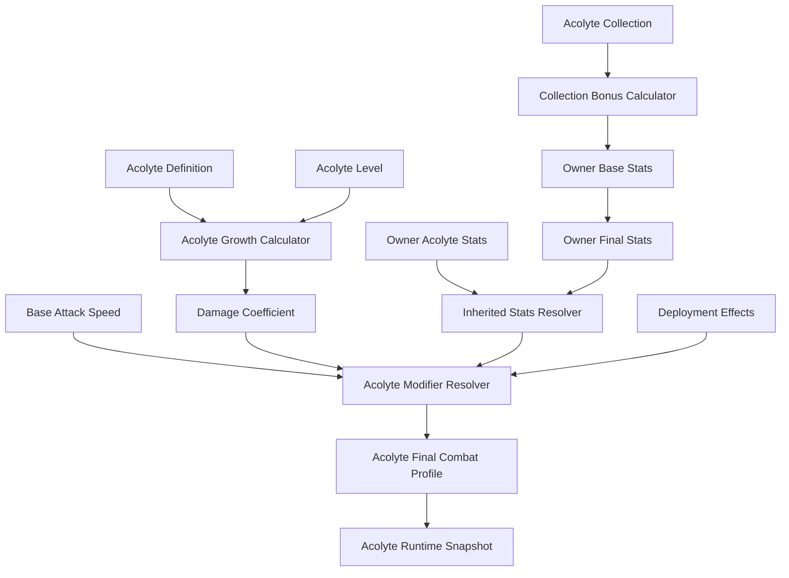

## 2.1 Ordre obligatoire des calculs

1. Chargement des acolytes possédés.
2. Calcul des bonus permanents de collection.
3. Application additive des bonus ATQ, PV et DEF.
4. Calcul des statistiques finales du propriétaire.
5. Chargement des cinq acolytes équipés.
6. Calcul de leur coefficient de dégâts selon leur niveau.
7. Récupération des caractéristiques héritées du propriétaire.
8. Application des effets de déploiement.
9. Application des modificateurs explicites.
10. Construction des snapshots de combat.

Cette architecture interdit une dépendance circulaire entre l'ATQ du propriétaire et les dégâts des acolytes.

## 2.2 Contrat technique

```text
AcolyteFinalCombatProfile
│
├── identity
│   ├── instance_id
│   ├── definition_id
│   └── level
│
├── intrinsic_stats
│   ├── damage_coefficient
│   └── base_attack_speed
│
├── inherited_stats
│   ├── critical_rate
│   ├── critical_damage
│   ├── combo_rate
│   ├── inspiration_rate
│   └── evasion_ignore
│
├── derived_stats
│   ├── final_damage_coefficient
│   ├── final_attack_speed
│   └── effective_combat_modifiers
│
└── deployment_effects
    ├── active_effect_ids
    └── resolved_effect_values
```

Les bonus permanents de collection restent dans le système de statistiques du propriétaire. Ils ne sont pas dupliqués dans chaque profil de combat d'acolyte.

*Note d'ingénierie : les statistiques héritées doivent être référencées depuis le contexte du propriétaire, et non copiées dans les données persistantes de chaque acolyte. Cela garantit qu'une modification de la lampe magique ou des reliques peut actualiser les cinq profils de combat sans modifier les définitions individuelles.*

---

# 3. Clôture SYS-002.D.9.3

(Spécification fonctionnelle validée)

| Élément | État |
|--------|--------|
| Croissance du coefficient de dégâts | Défini |
| Croissance des bonus permanents | Défini |
| Vitesse d'attaque | Défini |
| Critique et dégâts critiques | Défini |
| Combo | Défini |
| Inspiration | Défini |
| Ignorance d'évasion | Défini |
| Absence de PV/DEF individuels | Défini |
| Cumul des bonus de collection | Défini |
| Effets de déploiement | Défini |
| Coefficient de combo | À classifier |

Le coefficient de combo reste un point ouvert, sans bloquer la spécification fonctionnelle générale.

---

</details>


### SYS-002.D.9.4 · T035 · 18/11/2026 19:40:55

**Nature :** `APPROBATION_EXPLICITE` · **Ligne d’approbation source :** 11949 · **Ligne de formalisation :** 11968.

**Décision / prescription originale (texte intégral du propriétaire) :**

Validation SYS-002.D.9.4 : participation = all_five ; scheduler = independent ; première attaque = immediate ; ciblage = owner_target ; changement de cible = immediate ; contrôles propriétaire = independent ; coefficient combo = unknown ; portée = per_acolyte ; observations = Précisions :
la gestion des cadences (vitesse d'attaque et fréquence des compétences) des acolytes en combat repose sur une séparation nette entre leurs attaques de base et leurs compétences passives à temps de recharge.

1. La cadence des attaques de base

• Rythme individuel et indépendant : Chaque acolyte attaque automatiquement selon sa propre vitesse d'attaque de base (exprimée en attaques par seconde). Vos 5 familiers n'attaquent pas de manière synchronisée par défaut, chacun suivant son propre compteur interne dès le début du combat.
• Calcul des modificateurs de vitesse : La vitesse d'attaque finale d'un acolyte est égale à sa vitesse de base multipliée par vos bonus globaux de Vitesse d'attaque d'acolyte (provenant de l'équipement, de la recherche, des âmes martiales et de la classe Dompteur).
• Impact sur les déclenchements : Plus cette cadence est rapide, plus l'acolyte effectue de frappes par seconde, ce qui augmente mécaniquement le nombre d'occasions de déclencher un Combo d'acolyte, un Critique d'acolyte ou la jauge d'Inspiration.
• Immunité aux contrôles de foule : Contrairement à votre personnage principal qui arrête de frapper lorsqu'il est étourdi (Stun) ou projeté en l'air (En vol), vos acolytes ne sont pas affectés par les contrôles ennemis et maintiennent leur cadence d'attaque en continu.

2. La gestion des compétences passives (Temps de recharge et seuils)

• Compétences à temps de recharge (Cooldown) : De nombreux acolytes possèdent un effet actif périodique (par exemple, infliger des dégâts de zone ou poser un bouclier toutes les X secondes). Cette cadence dépend uniquement du chronomètre du combat et n'est pas accélérée par la vitesse d'attaque de base de l'acolyte.
• Compétences déclenchées par le nombre de coups : Certains familiers (comme la Pieuvre de Pirate ou le Chaton) déclenchent un effet spécial toutes les X attaques normales (par exemple toutes les 3 ou 5 attaques). Pour ces acolytes précis, augmenter la vitesse d'attaque et le combo d'acolyte accélère directement la cadence de leurs effets spéciaux.
• Compétences liées à votre personnage : D'autres acolytes calquent leur rythme sur les actions de votre champignon (par exemple, déclencher un bonus après que votre personnage a utilisé une compétence active ou subi un coup).. Formalise les décisions dans le GDD et poursuis avec la prochaine spécification.


<details><summary>Formalisation technique de la décision ratifiée (extrait sourcé)</summary>

# 1. Formalisation GDD - SYS-002.D.9.4

(Validé fonctionnellement) (Version 1.1)

## 1.1 Décisions enregistrées

| Élément | Décision |
|--------|--------|
| Participation | Les cinq acolytes équipés |
| Cadence | Scheduler indépendant par acolyte |
| Première attaque | Immédiate |
| Ciblage | Cible du propriétaire |
| Changement de cible | Immédiat, sans réinitialisation de cadence |
| Contrôles du propriétaire | Sans incidence sur les acolytes |
| Coefficient de combo | Non déterminé |
| Portée | Individuelle par acolyte |

## 1.2 Cadence des attaques normales

Chaque acolyte dispose de sa propre vitesse d'attaque de base.

Cette caractéristique reste fixe du niveau 1 au niveau 200.

Cependant, elle peut être modifiée par les bonus globaux de vitesse d'attaque des acolytes.

Les sources identifiées sont :

- Équipement.
- Recherche.
- Âmes martiales.
- Classe Dompteur d'Âmes.

La formule devient :

$$
APS_{\text{final}} =
APS_{\text{base}}\times M_{\text{APS acolyte}}
$$

Avec :

- $APS_{\text{base}}$ : vitesse d'attaque intrinsèque.
- $M_{\text{APS acolyte}}$ : multiplicateur résultant des bonus globaux applicables.

Exemple :

| Paramètre | Valeur |
|--------|--------|
| Vitesse de base | 1,2 APS |
| Bonus global | \+25 % |
| Vitesse finale | 1,5 APS |

Chaque acolyte conserve son propre calendrier d'attaque.

### Gestion temporelle

Chaque scheduler possède :

```text
AcolyteAttackScheduler
│
├── acolyte_runtime_id
├── base_attack_speed
├── final_attack_speed
├── attack_interval
├── next_attack_at
├── attack_sequence_id
└── scheduler_state
```

$$
T_{\text{attaque}}=\frac{1}{APS_{\text{final}}}
$$

La première attaque est immédiate. Les suivantes respectent l'intervalle calculé.

## 1.3 Conséquences sur les déclenchements

Une augmentation de vitesse d'attaque augmente le nombre d'événements offensifs générés.

Cela augmente mécaniquement les occasions de déclencher :

- Critiques d'acolyte.
- Combos d'acolyte.
- Inspiration d'acolyte.

Il s'agit d'une augmentation du nombre de tentatives, et non d'une modification automatique de la probabilité individuelle de déclenchement.

Les probabilités restent déterminées par les caractéristiques applicables.

## 1.4 Immunité aux contrôles

(Règle validée)

Les acolytes ne sont pas affectés par les contrôles ennemis dans le modèle de combat standard.

Ils continuent donc :

- Leurs attaques normales.
- Leurs calendriers de compétences.
- Leurs compteurs de coups.
- Leurs mécanismes d'inspiration.

Cette règle est indépendante des contrôles appliqués au propriétaire.

## 1.5 Séparation des trois mécanismes temporels

C'est la principale évolution de cette spécification.

**A. Attaques normales**

(Attack Scheduler)

- Cadence déterminée par la vitesse d'attaque finale.
- Une première attaque immédiate.
- Répétition automatique.
- Compteur indépendant pour chaque acolyte.

---

**B. Compétences périodiques**

(Cooldown Scheduler)

- Déclenchement après un délai défini.
- Chronomètre indépendant de la vitesse d'attaque.
- Progression basée sur le temps de combat.
- Exemple : compétence toutes les 10 secondes.

---

**C. Compétences à seuil de coups**

(Hit Counter Scheduler)

- Déclenchement après un nombre déterminé d'attaques.
- Accumulation des événements éligibles.
- Accélération possible par la vitesse d'attaque.
- Accélération possible par les combos lorsque ceux-ci alimentent le compteur.

### Compétences liées au propriétaire

Une troisième catégorie de déclenchement est également confirmée :

`OWNER_EVENT_TRIGGER`

Certains effets réagissent directement aux événements du personnage principal.

Exemples :

- Activation d'une compétence active.
- Réception d'une attaque.
- Déclenchement d'un événement particulier.

Leur fonctionnement ne dépend pas du scheduler d'attaque de l'acolyte.

## 1.6 Architecture logicielle actualisée

```text
AcolyteCombatEngine
│
├── AttackScheduler
│   ├── initialize()
│   ├── calculate_attack_interval()
│   └── process_attack()
│
├── CooldownScheduler
│   ├── register_skill_cooldown()
│   ├── update_cooldowns()
│   └── trigger_ready_skills()
│
├── HitCounterScheduler
│   ├── register_attack_event()
│   ├── update_hit_counter()
│   └── evaluate_threshold()
│
├── OwnerEventListener
│   ├── on_owner_skill_used()
│   └── on_owner_damage_received()
│
├── TargetingSystem
│   ├── get_owner_target()
│   └── retarget_if_invalid()
│
└── CombatEventManager
    ├── emit_attack_event()
    ├── resolve_damage()
    └── update_runtime()
```

Chaque compétence déclarera explicitement son mode de déclenchement.

*Note d'ingénierie : il ne faut jamais déduire le déclenchement d'une compétence de la simple présence d'un événement d'attaque. Un cooldown ne doit pas être accéléré par l'APS, tandis qu'un compteur de coups doit pouvoir consommer les événements éligibles, y compris les combos lorsque la compétence le prévoit.*

---

# 2. Clôture fonctionnelle - SYS-002.D.9.4

(Validé fonctionnellement)

Les règles suivantes sont désormais acquises :

- Cinq acolytes attaquent indépendamment.
- Chaque attaque possède son propre calendrier.
- La vitesse de base est intrinsèque et fixe.
- Les bonus globaux de vitesse d'attaque des acolytes modifient leur cadence finale.
- Les acolytes sont immunisés aux contrôles standards.
- Les compétences possèdent leurs propres mécanismes temporels.
- Les compétences à seuil de coups peuvent exploiter les événements de combo.
- Les compétences liées au propriétaire écoutent ses événements de combat.

Deux éléments restent ouverts :

1. Classification mathématique du coefficient de combo.
2. Paramétrage individuel des compétences et de leurs événements éligibles, qui sera approfondi dans SYS-002.D.9.6.

---

</details>


### SYS-002.D.9.5 · T036 · 18/11/2026 19:51:54

**Nature :** `APPROBATION_EXPLICITE` · **Ligne d’approbation source :** 12498 · **Ligne de formalisation :** 12517.

**Décision / prescription originale (texte intégral du propriétaire) :**

Validation SYS-002.D.9.5 : déclenchement = per_acolyte ; événements éligibles = normal_combo ; portée jauge = unknown ; réinitialisation = unknown ; formule dégâts = unknown ; critiques = inherited_per_hit ; ignorance inspiration = subtract ; simultanéité = independent ; interaction combo = unknown ; excitation Dompteur = tamer_effect ; observations = Précisions : 
l'inspiration fonctionne par un double mécanisme probabiliste et cumulatif lié aux attaques normales de vos acolytes.

Les étapes du déclenchement

• Jet de probabilité sur attaque normale. À chaque attaque de base effectuée par un acolyte, le jeu réalise un tirage basé sur votre statistique de Taux d'inspiration d'acolyte (Pal Inspire Rate).
• Activation de l'état d'inspiration. Si le tirage réussit, l'acolyte entre instantanément en état d'inspiration et exécute une frappe spéciale dont les dégâts sont multipliés par votre statistique de Dégâts d'inspiration.
• Interdiction de chaîne (Non-récursivité). Une attaque déclenchée par l'inspiration ne peut pas déclencher un combo d'acolyte ni réactiver une nouvelle inspiration sur le même coup.
• Déclenchement forcé par compétences actives. La branche de classe Dompteur (Beast Master / Tamer) dispose de compétences actives et d'éveils qui court-circuitent le tirage aléatoire en forçant tous les acolytes équipés à entrer simultanément en état d'inspiration pendant une durée fixe.
• Résolution défensive (Opposition). Avant d'appliquer les dégâts finaux à l'ennemi, votre valeur d'inspiration est comparée à la statistique d'Ignorance de l'inspiration d'acolyte (Ignore Pal Inspire) de l'adversaire, ce qui réduit le taux de déclenchement effectif ou le multiplicateur de dégâts subis.

Facteurs qui accélèrent le déclenchement

• La vitesse d'attaque d'acolyte. Comme le tirage s'effectue uniquement sur les attaques de base, augmenter la cadence de frappe via les reliques ou l'équipement augmente directement le nombre de lancers de dés par seconde.
• Les Voies de divination (Divining Path). Cet arbre de progression tardif est la source principale permettant d'augmenter le taux brut d'inspiration et de contrer la résistance des tanks adverses.. Formalise les décisions dans le GDD et poursuis selon le protocole.


<details><summary>Formalisation technique de la décision ratifiée (extrait sourcé)</summary>

# 1. Formalisation GDD - SYS-002.D.9.5

(Validé fonctionnellement) (Version 1.2)

Les nouvelles observations permettent de trancher plusieurs points précédemment laissés ouverts.

La mécanique d'inspiration n'utilise pas nécessairement une jauge d'énergie. Son fonctionnement standard repose sur un tirage probabiliste réalisé à chaque attaque normale.

## 1.1 Modèle de déclenchement définitif

**Décision :** `PER_ACOLYTE_PROBABILITY_TRIGGER`

Chaque acolyte possède son propre mécanisme de déclenchement.

À chaque attaque normale, un tirage est effectué à partir du taux d'inspiration global du propriétaire.

$$
P(\text{inspiration})=f(I_{\text{inspiration}})
$$

Le résultat positif déclenche immédiatement une frappe spéciale.

Il faut distinguer deux notions :

- Le taux d'inspiration détermine la probabilité de déclenchement.
- Les dégâts d'inspiration déterminent la puissance de la frappe spéciale.

Nous ajoutons donc deux attributs distincts au référentiel :

| Attribut | Identifiant | Fonction |
|--------|--------|--------|
| Taux d'inspiration | `acolyte_inspiration_rate` | Probabilité de déclenchement |
| Dégâts d'inspiration | `acolyte_inspiration_damage` | Multiplicateur de dégâts |

Ces deux caractéristiques appartiennent au propriétaire et sont héritées par les acolytes.

## 1.2 Événements éligibles

(Règle corrigée)

Seules les attaques normales déclenchent le tirage standard d'inspiration.

| Événement | Déclenchement possible |
|--------|--------|
| Attaque normale | Oui |
| Attaque de combo | Non |
| Attaque d'inspiration | Non |
| Compétence périodique | Non |
| Compétence à seuil | Non, sauf déclenchement forcé spécifique |

Cette décision corrige la sélection initiale `normal_combo`.

Une attaque normale peut déclencher indépendamment un combo et une inspiration. Toutefois, les attaques supplémentaires générées par ces mécanismes ne peuvent pas relancer récursivement la chaîne.

## 1.3 Non-récursivité

Une frappe d'inspiration constitue un événement offensif autonome.

Elle ne peut pas :

- Déclencher un nouveau combo.
- Déclencher une nouvelle inspiration.
- Relancer sa propre chaîne d'événements.

Nous introduisons un champ obligatoire dans les événements de combat :

```text
CombatAttackEvent
│
├── event_id
├── source_acolyte_id
├── attack_type
├── parent_event_id
│
├── trigger_permissions
│   ├── can_trigger_combo
│   └── can_trigger_inspiration
│
└── damage_context
```

Pour une attaque d'inspiration :

```text
can_trigger_combo = false
can_trigger_inspiration = false
```

Cette règle garantit l'absence de récursion, même lorsque plusieurs systèmes offensifs sont actifs simultanément.

## 1.4 Influence de la vitesse d'attaque

La vitesse d'attaque augmente le nombre de tirages probabilistes par seconde.

Elle ne modifie pas directement le taux de réussite individuel.

Exemple purement illustratif :

| Paramètre | Acolyte A | Acolyte B |
|--------|--------|--------|
| APS | 1 | 2 |
| Taux d'inspiration | 20 % | 20 % |
| Tentatives par seconde | 1 | 2 |
| Inspirations moyennes par seconde | 0,2 | 0,4 |

L'augmentation de cadence double ici le nombre moyen de déclenchements.

Il ne s'agit pas d'une garantie de déclenchement à chaque intervalle : les résultats restent probabilistes.

La jauge d'énergie et sa réinitialisation deviennent donc non applicables au modèle standard retenu.

## 1.5 Déclenchement forcé - Dompteur

(Mécanisme confirmé)

Les compétences actives et éveils du Dompteur peuvent court-circuiter le tirage aléatoire.

Ils déclenchent un état d'inspiration collectif sur les cinq acolytes équipés, pendant une durée déterminée.

Nous distinguons désormais :

- `NORMAL_INSPIRATION` : déclenchement probabiliste individuel.
- `FORCED_INSPIRATION` : activation imposée par une compétence du Dompteur.

Le second mécanisme ne doit pas être traité comme cinq tirages probabilistes indépendants.

La durée, le nombre de frappes garanties et le comportement des attaques normales pendant cet état restent à calibrer.

## 1.6 Résolution défensive

La statistique `acolyte_inspiration_ignore` est conservée.

Nous devons néanmoins distinguer deux étapes potentielles :

1. Réduction du taux de déclenchement effectif.
2. Réduction du multiplicateur de dégâts d'inspiration.

Les observations confirment une opposition entre inspiration et ignorance de l'inspiration, mais ne permettent pas encore de déterminer avec certitude si l'ignorance agit sur la première étape, la seconde ou les deux.

La décision mathématique `subtract` est conservée, sans fixer prématurément son point d'application.

## 1.7 Critiques et simultanéité

Chaque frappe d'inspiration possède son propre tirage critique.

Elle utilise les caractéristiques héritées du propriétaire :

- Coup critique d'acolyte.
- Dégâts critiques d'acolyte.

Les déclenchements standards restent indépendants. Plusieurs acolytes peuvent donc déclencher leur inspiration au même instant.

Le Dompteur peut également provoquer une activation collective.

## 1.8 Sources des caractéristiques

Nous ajoutons les Voies de divination au référentiel des sources de statistiques.

| Source | Contribution identifiée |
|--------|--------|
| Voies de divination | Taux d'inspiration et opposition aux défenses |
| Équipement | Bonus de vitesse et caractéristiques associées |
| Reliques | Bonus de vitesse et caractéristiques associées |
| Âmes martiales | Statistiques globales d'acolytes |
| Classe Dompteur | Déclenchement forcé et renforcement de l'inspiration |

Les contributions exactes seront définies dans le Character Stats Engine.

# 2. Points restant à spécifier dans SYS-002.D.9.5

La spécification fonctionnelle est suffisamment avancée, mais quatre paramètres restent ouverts.

| Élément | État |
|--------|--------|
| Probabilité exacte de déclenchement | À calibrer |
| Formule des dégâts d'inspiration | À déterminer |
| Portée de l'ignorance de l'inspiration | À déterminer |
| Comportement exact de l'excitation forcée | À déterminer |

Ces points seront conservés dans le registre des décisions ouvertes. Ils ne bloquent pas la poursuite de l'architecture.

---

</details>


### SYS-002.D.9.6 · T037 · 18/11/2026 20:26:31

**Nature :** `APPROBATION_EXPLICITE` · **Ligne d’approbation source :** 13043 · **Ligne de formalisation :** 13048.

**Décision / prescription originale (texte intégral du propriétaire) :**

Validation SYS-002.D.9.6 : activation déploiement = while_equipped ; séparation effets/compétences = separate ; exécution = automatic ; déclenchement = per_skill ; cooldowns = independent ; ciblage = per_skill ; simultanéité = parallel ; cumul = modifier_engine ; déblocage = definition ; observations = Aucune. Formalise les décisions dans le GDD, clôture SYS-002.D.9 et prépare l'audit global de l'Acolyte Engine.


<details><summary>Formalisation technique de la décision ratifiée (extrait sourcé)</summary>

# 1. Formalisation GDD - SYS-002.D.9.6

(Validé) (Version 1.0)

## 1.1 Décisions définitives

| Élément | Décision |
|--------|--------|
| Activation des effets de déploiement | Tant que l'acolyte est équipé |
| Séparation effets/compétences | Deux systèmes distincts |
| Exécution des compétences | Automatique |
| Déclenchement | Configurable individuellement |
| Cooldowns | Indépendants par compétence |
| Ciblage | Défini individuellement |
| Exécution simultanée | Autorisée |
| Cumul des effets | Modifier Engine SYS-002.D.6 |
| Déblocage des compétences | Définition de l'acolyte |

## 1.2 Effets de déploiement

Un effet de déploiement est actif tant que son acolyte occupe un emplacement de l'équipe.

Il ne nécessite pas de déclenchement ponctuel.

Ses propriétés :

- Activation conditionnée par l'équipement.
- Valeurs fixes du niveau 1 au niveau 200.
- Ciblage configurable.
- Application par le Modifier Engine.
- Suppression lorsque l'acolyte n'est plus équipé.

Le système doit également gérer proprement les changements d'équipe pendant une session de jeu.

## 1.3 Compétences individuelles

Chaque acolyte possède un ensemble de compétences défini dans son catalogue.

Les compétences sont automatiquement exécutées lorsque leurs conditions sont satisfaites.

Chaque compétence dispose de son propre contrat :

```text
AcolyteAbilityDefinition
│
├── identity
│   ├── ability_id
│   └── acolyte_definition_id
│
├── activation
│   ├── trigger_type
│   ├── cooldown
│   ├── hit_threshold
│   └── activation_conditions
│
├── targeting
│   ├── target_scope
│   └── target_selection
│
├── effect
│   ├── effect_type
│   ├── effect_parameters
│   ├── duration
│   └── tick_interval
│
├── modifiers
│   ├── affected_attributes
│   ├── stacking_policy
│   └── priority
│
└── restrictions
    ├── activation_limit
    ├── reapplication_policy
    └── event_permissions
```

Les compétences ne sont pas codées individuellement dans le moteur. Elles sont décrites par des configurations interprétées par les composants spécialisés.

## 1.4 Indépendance des compétences

Plusieurs compétences peuvent fonctionner simultanément.

Exemple :

| Compétence | Déclenchement |
|--------|--------|
| Bouclier | Toutes les 12 secondes |
| Soin | Toutes les 8 secondes |
| Attaque de zone | Toutes les 5 attaques |
| Bonus offensif | Après utilisation d'une compétence du propriétaire |

Aucune de ces compétences ne doit modifier artificiellement le cooldown des autres.

Leur interaction passe par les règles de cumul du Modifier Engine.

## 1.5 Gestion des effets et réapplications

Toutes les compétences réutilisent les règles de SYS-002.D.6.

Cela implique notamment :

- Cumul additif lorsque la politique le prévoit.
- Gestion explicite des priorités.
- Expiration avant les nouvelles applications lorsque cette règle est applicable.
- Actualisation des effets `UNIQUE_SOURCE`.
- Rejet des conflits de priorité non résolus.
- Gestion explicite des valeurs négatives et des plafonds.

Chaque effet doit déclarer sa politique de cumul. Aucun comportement implicite ne sera accepté.

---

</details>


---

# Chapitre 10 — Acolytes — progression, invocations et persistance

**Autorité :** décisions expressément approuvées dans la conversation source. Les modèles obsolètes sont remplacés par les rectifications ultérieures ; les paramètres provisoires restent provisoires.

**Statut du chapitre :** `functionally_specified` pour ses spécifications validées ; aucune exécution de test ou implémentation ne découle de ce statut.

**Traçabilité :** 35 décision(s) du propriétaire. Toutes les références `Txxx` renvoient à `references/HISTORIQUE_SOURCE_ORIGINAL.md`.

## Rectifications prioritaires

**Croissance des acolytes :** le modèle retenu ultérieurement est la croissance linéaire à incrément constant, par niveau individuel (T051–T052). Les courbes convexes / exponentielles proposées plus tôt ne constituent pas les règles actives.

**Fusion :** seules les cartes déjà débloquées par un tirage peuvent être candidates à la fusion (T065), même lorsqu'une ancienne formalisation évoquait tout le catalogue.


## Registre détaillé des décisions approuvées


### SYS-002.D.10.1 · T039 · 19/11/2026 16:24:43

**Nature :** `APPROBATION_EXPLICITE` · **Ligne d’approbation source :** 13897 · **Ligne de formalisation :** 13910.

**Décision / prescription originale (texte intégral du propriétaire) :**

Validation SYS-002.D.10.1 : acolytes identiques = unknown ; bonus collection = once_per_type ; recyclage niveau 200 = immediate ; profils exclusifs = explicit_profile ; emplacements vides = allowed ; multiplicité Runtime = per_slot ; observations = Précisions :
Il n'est pas possible d'équiper exactement le même acolyte plusieurs fois, mais vous pouvez équiper plusieurs acolytes d'une même famille (de raretés différentes).

Fonctionnement dans l'équipe de cinq

• Acolyte unique. Chaque carte d'acolyte possède un seul emplacement d'amélioration (les doublons tirés servent à monter son niveau) et ne peut occuper qu'une seule place dans votre formation.
• Familles d'acolytes (variantes de rareté). Une même espèce (comme les oiseaux, les cerfs, les chats ou les escargots) existe en plusieurs versions de rareté différente, et vous pouvez les placer ensemble dans votre équipe.
• Non-cumul des passifs identiques. Comme le soulignent les joueurs sur la communauté Reddit Legend of Mushroom, les effets passifs de la même famille ne se cumulent généralement pas et seul le bonus de l'acolyte ayant la plus haute statistique s'applique (à de rares exceptions près comme certains dragons).
• Priorité aux synergies. Il est donc préférable de varier les familles d'acolytes afin d'activer cinq bonus passifs distincts et adaptés à votre classe, comme détaillé dans le classement des acolytes sur Mobi.gg.. Formalise les décisions, corrige le modèle de données et poursuis l'audit SYS-002.D.10.1 jusqu'à sa clôture.


<details><summary>Formalisation technique de la décision ratifiée (extrait sourcé)</summary>

# 1. Formalisation GDD - SYS-002.D.10.1

(Validé) (Version 1.1)

## 1.1 Décisions consolidées

| Élément | Décision |
|--------|--------|
| Équipement d'un acolyte identique | Interdit |
| Équipement de variantes d'une même famille | Autorisé |
| Bonus de collection | Une fois par variante possédée |
| Recyclage au niveau 200 | Immédiat |
| Profils des acolytes exclusifs | Profil explicite |
| Emplacements vides | Autorisés |
| Runtime | Un par emplacement |
| Passifs familiaux identiques | Non cumulables par défaut |
| Sélection des passifs | Valeur effective la plus élevée |
| Exceptions familiales | Configurables explicitement |

## 1.2 Distinction entre acolyte et famille

Nous introduisons une distinction fondamentale entre deux identifiants.

- `acolyte_id` : identifie une carte précise, avec sa rareté et ses caractéristiques.
- `family_id` : identifie la famille biologique ou thématique à laquelle appartient cette carte.

Exemple conceptuel :

**Famille : Oiseaux**

[](https://mobi.gg/en/tips/legend-of-mushroom-avians-guide/)

**Oiseau Normal**

Variante A

[](https://note.com/ichiro2077/n/n0cee45b56e8f)

**Oiseau Épique**

Variante B

[](https://mobi.gg/en/tips/legend-of-mushroom-avians-guide/)

**Oiseau Légendaire**

Variante C

---

(Équipement autorisé)

Les trois variantes peuvent coexister dans la même équipe, puisqu'elles représentent trois cartes distinctes.

La contrainte d'unicité devient donc :

```text
UNIQUE(loadout_id, acolyte_id)
```

En revanche, aucune contrainte d'unicité ne doit être appliquée à `family_id`.

Cela permet d'équiper plusieurs variantes d'une même famille tout en interdisant d'équiper deux fois exactement la même carte.

## 1.3 Règle de non-cumul des passifs familiaux

(Règle fonctionnelle intégrée)

Nous introduisons un mécanisme de résolution des passifs familiaux.

Lorsque plusieurs acolytes équipés appartiennent à une même famille et possèdent un effet passif comparable, le moteur ne cumule pas automatiquement leurs bonus.

Il sélectionne celui dont la valeur effective est la plus élevée.

Exemple illustratif :

| Acolyte | Famille | Bonus de combo |
|--------|--------|--------|
| Acolyte A | Oiseaux | \+20 % |
| Acolyte B | Oiseaux | \+35 % |
| Acolyte C | Oiseaux | \+25 % |

Résultat :

$$
Bonus_{\text{combo effectif}}=\max(20,35,25)=35\%
$$

Le bonus effectif est donc de 35 %, et non de 80 %.

### Exceptions

Certaines familles, notamment certains dragons selon tes observations, peuvent posséder des passifs cumulables.

Nous ne coderons aucune exception directement dans le moteur.

Chaque effet possédera une politique de cumul explicite :

| Politique | Comportement |
|--------|--------|
| `FAMILY_MAX` | Seule la valeur la plus élevée de la famille est appliquée |
| `ADDITIVE` | Les bonus sont additionnés |
| `STACK` | Les effets sont appliqués indépendamment |
| `INDEPENDENT` | Les effets ne sont pas considérés comme concurrents |

La politique `FAMILY_MAX` sera la règle par défaut pour les passifs familiaux concernés.

Un identifiant de groupe permettra de comparer uniquement les effets de même nature. Deux passifs différents d'une même famille ne seront donc pas supprimés arbitrairement.

*Note d'ingénierie : la sélection doit s'effectuer sur la valeur effective du bonus, et non simplement sur la rareté. Un acolyte de rareté supérieure n'est pas nécessairement gagnant si son effet possède une valeur inférieure.*

---

# 2. Correction du modèle de données canonique

Nous apportons maintenant les modifications nécessaires aux structures précédentes.

## 2.1 AcolyteFamilyDefinition

Nouvelle entité permettant de représenter les familles.

```python
@dataclass(frozen=True)
class AcolyteFamilyDefinition:
    family_id: str
    family_name: str
```

Cette entité permet de regrouper les variantes d'une même espèce sans mélanger leurs identifiants individuels.

## 2.2 AcolyteDefinition

```python
@dataclass(frozen=True)
class AcolyteDefinition:
    acolyte_id: str
    family_id: str
    name: str

    rarity_track: str
    rarity_rank: int | None

    growth_profile_id: str

    base_damage_coefficient: float
    base_attack_speed: float
    attack_range: float

    permanent_effect_ids: tuple[str, ...]
    deployment_effect_ids: tuple[str, ...]
    ability_ids: tuple[str, ...]
```

Chaque variante de rareté possède sa propre définition.

Deux variantes d'une même famille partagent leur `family_id`, mais jamais leur `acolyte_id`.

## 2.3 AcolyteOwnership

La structure précédente reste valide.

```python
@dataclass
class AcolyteOwnership:
    owner_id: str
    acolyte_id: str

    current_level: int
    duplicate_balance: int

    unlocked: bool
    acquisition_timestamp: int
    progression_revision: int
```

Contrainte :

```text
UNIQUE(owner_id, acolyte_id)
```

Chaque variante possède donc sa propre progression et son propre solde de doublons.

## 2.4 AcolyteLoadout

La configuration conserve cinq emplacements fixes.

```python
@dataclass
class AcolyteLoadout:
    loadout_id: str
    owner_id: str
    slots: tuple["AcolyteLoadoutSlot", ...]
```

```python
@dataclass
class AcolyteLoadoutSlot:
    slot_id: int
    acolyte_id: str | None
```

Contraintes :

- Cinq emplacements maximum.
- Un emplacement peut être vide.
- Une carte exacte ne peut être équipée qu'une fois.
- Plusieurs variantes d'une même famille sont autorisées.
- Chaque acolyte équipé doit être possédé.

## 2.5 AcolyteEffectDefinition

Nous ajoutons les propriétés nécessaires à la résolution des passifs familiaux.

```python
@dataclass(frozen=True)
class AcolyteEffectDefinition:
    effect_id: str
    effect_type: str

    stacking_group_id: str | None
    stacking_scope: str
    stacking_policy: str

    comparison_metric: str | None

    target_scope: str
    effect_parameters: dict
```

Les champs importants sont :

- `stacking_group_id` : identifie les effets comparables.
- `stacking_scope` : détermine si le cumul s'effectue au niveau familial ou global.
- `stacking_policy` : définit le comportement de cumul.
- `comparison_metric` : définit la valeur utilisée pour sélectionner le meilleur effet.

Les exceptions sont définies dans les données, sans modification du moteur.

## 2.6 AcolyteFusionRuleDefinition

Nous ajoutons également une définition explicite des règles de fusion.

```python
@dataclass(frozen=True)
class AcolyteFusionRuleDefinition:
    fusion_rule_id: str

    source_acolyte_id: str
    target_acolyte_id: str

    source_quantity: int
    target_quantity: int

    conversion_policy: str
```

Le système pourra ainsi déterminer exactement quelle variante supérieure est produite et en quelle quantité.

Les ratios restent à calibrer.

---

# 3. Architecture de résolution des passifs familiaux

Nous ajoutons un composant spécialisé :

`FamilyPassiveResolver`

Son rôle est de détecter les effets concurrents et de sélectionner ceux qui doivent réellement être appliqués.

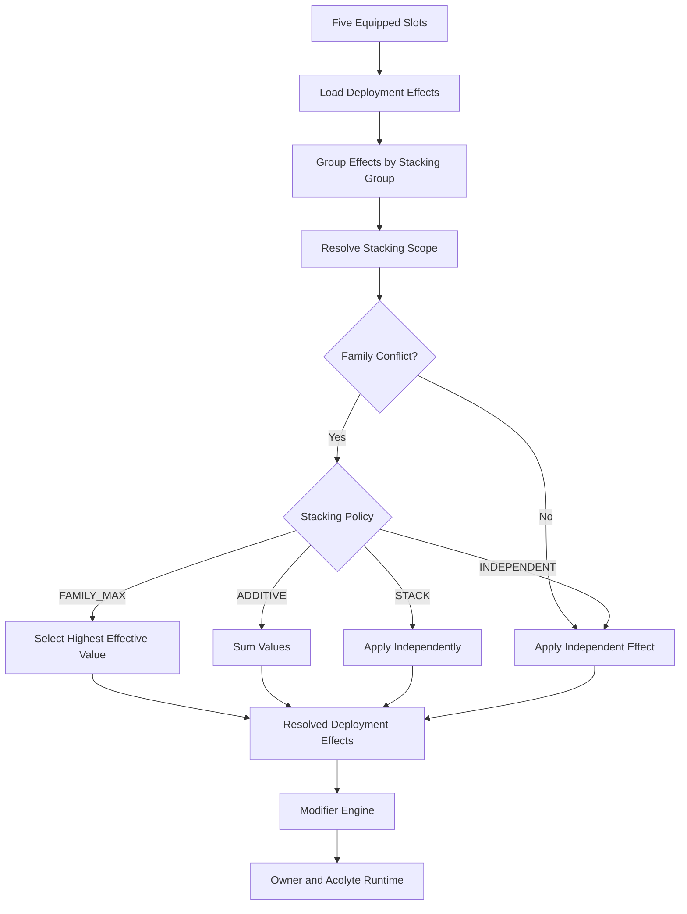

Le traitement est réalisé avant l'application finale des modificateurs au contexte de combat.

Le `FamilyPassiveResolver` ne modifie jamais les définitions originales.

---

# 4. Correction du traitement des doublons au niveau 200

(Règle immédiate confirmée)

Nous remplaçons le comportement initial de conservation par une conversion automatique.

Le processus devient :

1. Réception d'un nouvel exemplaire.
2. Identification de la variante concernée.
3. Vérification du niveau de l'acolyte.
4. Si niveau inférieur à 200 : ajout au solde de doublons.
5. Si niveau égal à 200 : déclenchement immédiat de la règle de fusion.
6. Création des cartes de rareté supérieure.
7. Enregistrement de la transaction.

L'opération doit être atomique et idempotente.

Une même acquisition ne peut jamais être convertie deux fois.

L'entité `AcolyteFusionLedger` conserve la trace de chaque conversion.

---

# 5. Audit des invariants

Les nouvelles observations permettent d'ajouter quatre contraintes.

| ID | Invariant | État |
|--------|--------|--------|
| INV-013 | Une carte exacte ne peut être équipée qu'une fois | Validé |
| INV-014 | Plusieurs variantes d'une même famille peuvent coexister | Validé |
| INV-015 | Les passifs familiaux utilisent une politique de cumul explicite | Validé |
| INV-016 | Les doublons d'un acolyte niveau 200 sont immédiatement convertis | Validé |

Les contraintes précédentes restent applicables.

## 5.1 Tests d'acceptation complémentaires

| ID | Scénario | Résultat attendu |
|--------|--------|--------|
| AT-015 | Équiper deux fois la même carte | Rejet |
| AT-016 | Équiper deux variantes de même famille | Acceptation |
| AT-017 | Deux passifs familiaux de 20 % et 35 % | Application de 35 % |
| AT-018 | Deux passifs de familles différentes | Application indépendante |
| AT-019 | Exception familiale `ADDITIVE` | Addition des valeurs |
| AT-020 | Acquisition d'un doublon au niveau 200 | Fusion immédiate |
| AT-021 | Réception répétée du même événement d'acquisition | Une seule conversion |

---

# 6. Résultat de l'audit SYS-002.D.10.1

**Data Model Audit** (Clôturé)

# 16 / 16

Invariants identifiés et formalisés

---

**Structures consolidées**

- Familles et variantes de rareté.
- Possession et progression.
- Configuration des cinq emplacements.
- Effets de collection et de déploiement.
- Compétences individuelles.
- Runtime par emplacement.
- Fusion et traçabilité.
- Résolution des passifs familiaux.
  
  ---
  
  **Conclusion**

Le modèle de données est architecturalement cohérent et suffisamment défini pour servir de contrat à l'implémentation.

Les valeurs numériques des courbes, les ratios de fusion et le catalogue exact des exceptions restent des données de configuration à renseigner, et non des défauts structurels du modèle.

---

</details>


### SYS-002.D.10.1 · T040 · 19/11/2026 16:34:17

**Nature :** `EXIGENCE_OU_RECTIFICATION_PROPRIETAIRE` · **Ligne d’approbation source :** 14383 · **Ligne de formalisation :** 14418.

**Décision / prescription originale (texte intégral du propriétaire) :**

Je veux rajouter d'autres précisions :

**les acolytes sont regroupés par espèces ou « familles » thématiques, chacune offrant un type de bonus passif spécifique à travers plusieurs paliers de rareté**.

Voici les principales familles d'acolytes et leurs effets associés en combat :

**Familles orientées attaque et critiques**

- **Oiseaux** (*Champignon Oiseau, Oiseau Anti-Pluie, Oiseau Azuré, Plumes de feu sombre*). Ils augmentent la vitesse d'attaque, les chances de combo ou les dégâts de combo.
- **Poules et Coqs** (*Poussin Éclos, Coq Combattant*). Ils renforcent les dégâts des attaques normales.
- **Cactus** (*Cactus Bébé, Cactus de Bête, Cactus dynamique*). Ils infligent des dégâts supplémentaires toutes les trois attaques normales.
- **Dragons** (*Dragon du Trésor, Dragon noir, Dragon de bonheur*). Ils améliorent les chances et les dégâts de coups critiques (attaques normales et compétences).
- **Pieuvres** (*Pieuvre de Pirate*). Elles augmentent les dégâts de combo et déclenchent des attaques supplémentaires tous les trois combos.

**Familles orientées compétences et contrôle**

- **Hydro-Elfes / Blobs** (*Hydro-Elfe Rose, Hydro-Elfe Belliqueux*). Ils accélèrent la régénération d'énergie des compétences actives.
- **Chats** (*Chaton, Chat Noir, Chat Magicien*). Ils prolongent la durée d'étourdissement des ennemis ou augmentent les dégâts de contre-attaque selon leur variante.
- **Escargots** (*Petit Escargot Jaune, Escargot Épineux, Escargot Vert*). Ils ralentissent la vitesse de déplacement et d'attaque des ennemis.
- **Elfes de Neige / Yétis** (*Pudding de Neige, Boulette de Neige, Elfe de Neige*). Ils réduisent la vitesse d'attaque des adversaires pour limiter les dégâts subis.

**Familles orientées survie et défense**

- **Cerfs** (*Jeune Cerf, Cerf à Cornes, Cerf aux Fleurs*). Ils réduisent les dégâts subis par votre personnage.
- **Pandas** (*Panda, Marteau de Panda, Panda d'Apprenti, Panda Messager*). Ils améliorent la régénération des points de vie (PV) en combat.
- **Tortues** (*Tortue Hipster*). Elles octroient des boucliers défensifs ou améliorent la résistance globale lorsque vos PV baissent.
- **Chiens** (*Chien Sautant, Chien Électronique*). Ils renforcent les dégâts et la survie liés à la contre-attaque.

*(Note : Des acolytes spéciaux issus d'événements ou de collaborations, comme les Renards, les Lézards ou les Paladins/Pals de collab, viennent compléter ces familles classiques.)*

Vous pouvez consulter la liste complète et les tier lists par classe sur [**Mobi.gg**](https://mobi.gg/fr/astuces/meilleurs-acolytes-legend-of-mushroom/) ou la base de données [**Guides by Grace**](https://guidesbygrace.uk/pals-database).


<details><summary>Formalisation technique de la décision ratifiée (extrait sourcé)</summary>

# 1. Addendum GDD - SYS-002.D.10.1

(Intégré) (Version 1.2)

Nous ajoutons une classification fonctionnelle des familles.

## 1.1 Taxonomie des familles

| Famille | Orientation | Effets principaux |
|--------|--------|--------|
| Oiseaux | Offensive | Vitesse d'attaque, combo |
| Poules / Coqs | Offensive | Dégâts d'attaque normale |
| Cactus | Offensive | Attaques supplémentaires périodiques |
| Dragons | Critique | Critique normal et compétence |
| Pieuvres | Combo | Dégâts de combo, attaques périodiques |
| Hydro-Elfes / Blobs | Support | Régénération d'énergie |
| Chats | Offensive / contrôle | Effets offensifs et contrôle à préciser |
| Escargots | Contrôle | Réduction de vitesse de déplacement |
| Elfes de Neige / Yétis | Contrôle | Réduction de vitesse d'attaque adverse |
| Cerfs | Défensive | Réduction des dégâts |
| Pandas | Défensive | Régénération des PV |
| Tortues | Défensive | Boucliers et survie conditionnelle |
| Chiens | Défensive / offensive | Contre-attaque et protection |
| Familles spéciales | Variable | Effets spécifiques aux événements et collaborations |

Cette classification est fonctionnelle : elle ne détermine ni la rareté ni la politique de cumul.

## 1.2 Vérification documentaire

La consultation de [Mobi.gg — Classement des acolytes](https://mobi.gg/fr/astuces/meilleurs-acolytes-legend-of-mushroom/?utm_source=chatgpt.com) permet de confirmer plusieurs correspondances et de préciser certains effets.

Exemples relevés dans le catalogue :

| Acolyte | Effet documenté |
|--------|--------|
| Champignon Oiseau | \+5 % vitesse d'ATQ |
| Oiseau Anti-Pluie | \+8 % vitesse d'ATQ |
| Oiseau Azuré | \+10 % vitesse d'ATQ |
| Cactus Bébé | Dégâts supplémentaires toutes les 3 attaques normales |
| Cactus Dynamique | Dégâts supplémentaires toutes les 3 attaques normales |
| Pieuvre de Pirate | \+60 % dégâts de combo et attaque supplémentaire toutes les 3 combos |
| Hydro-Elfe Rose | \+5 % régénération d'énergie des compétences actives |
| Cerf aux Fleurs | \+10 % réduction des dégâts |
| Panda d'Apprenti | \+30 % régénération des PV |
| Tortue Hipster | Bouclier conditionné par les PV, avec cooldown |

\[[Meilleurs acolytes Legend of Mushroom : le classement](https://mobi.gg/fr/astuces/meilleurs-acolytes-legend-of-mushroom/?utm_source=chatgpt.com)\]

Quelques différences méritent d'être enregistrées :

- Les effets documentés des chats comprennent notamment des explosions offensives. Les effets d'étourdissement que tu mentionnes nécessitent une vérification individuelle.
- Les escargots documentés ralentissent principalement le déplacement ennemi. La réduction de vitesse d'attaque est notamment associée aux Elfes de Neige.
- Le Chien Électronique renforce les dégâts de contre-attaque et permet une récupération de PV lors de ces attaques. Le Chien Sautant améliore quant à lui les effets de bouclier.
- Plumes de feu sombre possède un effet de dégâts supplémentaires indexé sur les PV actuels de la cible dans le catalogue consulté.

\[[Meilleurs acolytes Legend of Mushroom : le classement](https://mobi.gg/fr/astuces/meilleurs-acolytes-legend-of-mushroom/?utm_source=chatgpt.com)\]

Ces différences ne justifient pas de supprimer tes observations. Elles doivent être conservées comme données à vérifier individuellement, car les catalogues communautaires peuvent évoluer ou ne pas couvrir toutes les variantes.

Concernant les acolytes exclusifs, [Guides by Grace — Pals Database](https://guidesbygrace.uk/pals-database?utm_source=chatgpt.com) propose notamment un catalogue spécifique aux acolytes d'événements et de collaborations. Il complète le référentiel, mais ne constitue pas à lui seul un catalogue exhaustif des acolytes standards. \[[Database - Pals \| Discover Top Pals – Boost Your Game — Legend of Mushroom](https://guidesbygrace.uk/pals-database?utm_source=chatgpt.com)\]

---

# 2. Évolution du modèle de données

Nous ajoutons une entité supplémentaire : `AcolyteEffectLineage`.

Elle permet de regrouper les effets équivalents provenant de différentes variantes d'une famille.

L'architecture distingue désormais quatre dimensions.

**1. Family**

Identification de l'espèce.

Exemple : `BIRD`.

---

**2. Variant**

Identification de la carte et de sa rareté.

Exemple : `BIRD_AZURE`.

---

**3. Effect Lineage**

Identification de la mécanique commune.

Exemple : `BIRD_ATTACK_SPEED`.

---

**4. Stacking Policy**

Règle de résolution.

Exemple : `FAMILY_MAX`.

## 2.1 Nouveau contrat

```python
@dataclass(frozen=True)
class AcolyteEffectLineage:
    effect_lineage_id: str
    family_id: str
    effect_archetype: str
    comparable_attribute: str
    stacking_scope: str
    default_stacking_policy: str
```

Chaque effet individuel conserve sa propre définition :

```python
@dataclass(frozen=True)
class AcolyteEffectDefinition:
    effect_id: str
    acolyte_id: str

    effect_lineage_id: str | None

    effect_type: str
    trigger_type: str
    target_scope: str

    parameters: dict

    stacking_policy: str
    stacking_priority: int
```

## 2.2 Nouvelle règle de cumul

La règle précédemment validée est affinée.

**Deux effets appartenant à la même famille ne sont pas nécessairement concurrents.**

Ils doivent partager une même lignée d'effet pour être comparés selon `FAMILY_MAX`.

Exemple :

| Effet | Famille | Lignée | Résolution |
|--------|--------|--------|--------|
| \+10 % vitesse d'ATQ | Oiseaux | Attack Speed | Concurrent |
| \+15 % vitesse d'ATQ | Oiseaux | Attack Speed | Concurrent |
| \+20 % dégâts de combo | Oiseaux | Combo Damage | Indépendant |
| \+10 % réduction dégâts | Cerfs | Damage Reduction | Indépendant |

La résolution devient :

$$
E_{\text{effectif}}=
\max(E_1,E_2,\ldots,E_n)
$$

Uniquement pour les effets partageant une même lignée et une même portée de cumul.

Les exceptions utilisent une politique explicitement configurée.

---

# 3. Registre des données à constituer

Pour chaque variante d'acolyte, nous devons désormais enregistrer les propriétés suivantes :

| Propriété | Exemple |
|--------|--------|
| Identifiant | `CACTUS_BABY` |
| Famille | `CACTUS` |
| Rareté | `RARE` |
| Orientation | `OFFENSIVE` |
| Lignée d'effet | `PERIODIC_NORMAL_ATTACK_DAMAGE` |
| Déclenchement | `EVERY_N_NORMAL_ATTACKS` |
| Seuil | 3 |
| Type de dégâts | À déterminer |
| Valeur | À renseigner |
| Politique de cumul | À déterminer |

Cette structure permettra de construire progressivement un catalogue exhaustif sans modifier le moteur de combat à chaque ajout.

---

</details>


### SYS-002.D.10.2.1 · T042 · 19/11/2026 16:47:37

**Nature :** `APPROBATION_EXPLICITE` · **Ligne d’approbation source :** 15172 · **Ligne de formalisation :** 15197.

**Décision / prescription originale (texte intégral du propriétaire) :**

Validation SYS-002.D.10.2.1 : courbe de coûts = stepwise ; monotonie coûts = non_decreasing  monotonie caractéristiques = non_decreasing ; coefficient combo = unknown ; profils de croissance = individual_reusable ; précision numérique = full_precision ; observations = Précisions :
La progression des acolytes (et des compétences) suit un modèle mathématique par paliers sur 200 niveaux, combinant un coût en doublons croissant et une courbe de croissance des statistiques qui s'accélère fortement à haut niveau.

1. Structure des coûts en doublons (Niveaux 1 à 200)

• Progression par paliers. Le nombre de copies (doublons) requises pour monter d'un niveau augmente par tranches de niveaux plutôt que de façon strictement linéaire à chaque niveau.
• Premiers niveaux (1 à 50). Les premiers paliers ne demandent que 2 à 5 doublons par niveau, ce qui permet de monter rapidement les raretés communes (Gris, Vert, Bleu) via les invocations.
• Milieu de courbe (51 à 150). Le coût grimpe progressivement par tranches (passant autour de 10, 15, puis 20 à 30 doublons par niveau), créant le premier goulot d'étranglement sur les raretés Violet et Jaune.
• Derniers paliers (151 à 200). Les ultimes niveaux exigent plusieurs dizaines de doublons par niveau (pouvant atteindre 40 à 50 copies sur les derniers paliers), portant le total cumulé à plusieurs milliers de copies pour atteindre le niveau 200.

2. Courbe de croissance des statistiques (Effet possédé vs équipé)

• Double impact statistique. Chaque niveau gagné augmente à la fois les dégâts de base de l'acolyte en combat et son bonus passif « Possédé » (PV, Attaque ou Défense globale), qui s'applique à votre personnage même lorsque l'acolyte n'est pas dans votre équipe de cinq.
• Accélération exponentielle. Contrairement au bonus passif spécial de l'acolyte (qui reste fixe quelle que soit la montée de niveau, par exemple le taux de combo ou la réduction de dégâts), le bonus « Possédé » suit une courbe exponentielle.
• Rentabilité des hauts niveaux. Un gain de niveau entre 150 et 200 apporte un saut statistique beaucoup plus massif qu'entre les niveaux 1 et 50, ce qui explique pourquoi les acolytes de rareté inférieure (Gris, Vert, Bleu) au niveau 180+ surpassent largement en statistiques passives un acolyte Rouge/Immortel de niveau 10.

3. Mécanique de recyclage au niveau 200 (Synthèse rapide)

• Plafond atteint. Une fois qu'un acolyte atteint le niveau 200 (MAX), ses doublons ne sont plus perdus.
• Conversion à taux fixe (3 pour 1). Comme le montrent les guides de progression sur YouTube, chaque tranche de 3 doublons supplémentaires d'un acolyte niveau 200 est convertie automatiquement (via le bouton Synthèse rapide / Quick Enhance) en 1 exemplaire aléatoire de la rareté immédiatement supérieure (3 Gris = 1 Vert, 3 Verts = 1 Bleu, etc.).
• Effet boule de neige. Ce système transforme progressivement tous vos tirages communs en progression vers les raretés Rouge et Rose/Immortel, rendant l'accumulation de tickets pour les événements Sprint d'acolytes particulièrement rentable sur le long terme.. Formalise les décisions dans le GDD, établis les contrats mathématiques définitifs et poursuis le protocole SYS-002.D.10.2.1.


**Source technique :** réponse consécutive et proposition précédant cette validation, consultables dans l’historique original. Aucun extrait automatique n’a été retenu faute de délimitation non ambiguë.


### SYS-002.D.10.2.1 · T043 · 19/11/2026 16:54:28

**Nature :** `EXIGENCE_OU_RECTIFICATION_PROPRIETAIRE` · **Ligne d’approbation source :** 15627 · **Ligne de formalisation :** 15643.

**Décision / prescription originale (texte intégral du propriétaire) :**

Précisions :

**Non, les compétences individuelles des acolytes n'ont pas de progression indépendante de niveau 1 à 200.** Un acolyte ne possède qu'une seule jauge de niveau globale (de 1 à 200) qui affecte uniquement ses dégâts de base et son bonus passif « Possédé ». 

**Distinction entre le niveau de l'acolyte et son effet**

- **Un seul niveau global par acolyte.** Vous améliorez l'acolyte dans son ensemble via ses doublons, sans jamais avoir à monter une compétence séparée sur sa fiche.
- **Effet de déploiement fixe.** Le bonus spécial d'un acolyte lorsqu'il est équipé dans l'équipe (par exemple l'augmentation du taux de combo, la durée d'étourdissement ou la régénération de PV) reste identique du niveau 1 au niveau 200.
- **Évolution liée au niveau global.** Monter de niveau (de 1 à 200) augmente uniquement le multiplicateur de dégâts des attaques de l'acolyte en combat ainsi que son bonus permanent « Possédé » (PV, Attaque ou Défense).
- **Ne pas confondre avec les compétences du personnage.** Les **compétences actives** de votre champignon (équipées dans les 5 emplacements de sorts) suivent quant à elles une progression séparée de niveau 1 à 200 via leurs propres tirages et doublons.

Pour approfondir le fonctionnement des tirages et des améliorations, vous pouvez consulter le guide dédié sur [**Guides by Grace**](https://guidesbygrace.uk/pals-skills).


<details><summary>Formalisation technique de la décision ratifiée (extrait sourcé)</summary>

# 1. Addendum GDD - SYS-002.D.10.2.1

(Décision validée) (Version 1.2)

## 1.1 Contrat définitif de progression des acolytes

| Élément | Évolution avec le niveau |
|--------|--------|
| Multiplicateur de dégâts de base | Oui |
| Bonus possédé ATQ | Oui |
| Bonus possédé PV | Oui |
| Bonus possédé DEF | Oui |
| Vitesse d'attaque intrinsèque | Non |
| Critique d'acolyte | Non, hérité |
| Dégâts critiques d'acolyte | Non, hérité |
| Combo d'acolyte | Non, hérité |
| Coefficient de combo intrinsèque | Inconnu |
| Inspiration d'acolyte | Non, héritée |
| Ignorance d'évasion | Non, héritée |
| Effet de déploiement | Non |
| Compétences individuelles | Non |

La progression possède donc exactement quatre sorties statistiques évolutives confirmées.

## 1.2 Contrat de progression des compétences du personnage

Les compétences actives du personnage constituent un système distinct.

| Propriété | Acolytes | Compétences du personnage |
|--------|--------|--------|
| Niveau | 1-200 | 1-200 |
| Ressources | Doublons d'acolyte | Doublons de compétence |
| Invocation | Portail d'acolytes | Portail de compétences |
| Progression | Individuelle par variante | Individuelle par compétence |
| Effets spéciaux | Fixes | À spécifier séparément |
| Progression statistique | Dégâts et bonus possédés | Paramètres propres à la compétence |

Cette séparation sera conservée jusque dans les structures persistantes et les services de progression.

# 2. Correction du modèle mathématique

Une précision structurelle doit être apportée à la précédente formalisation.

Les trois bonus ATQ, PV et DEF constituent les catégories possibles de bonus possédé. Ils ne doivent pas nécessairement tous évoluer simultanément sur chaque acolyte.

Nous retenons donc :

$$
\text{AcolyteGrowth}(L)=
\begin{cases}
K_{\text{dégâts}}(L)\\
B_{\text{possédé}}(L)
\end{cases}
$$

Avec :

$$
B_{\text{possédé}}\in\{B_{\text{ATQ}},B_{\text{PV}},B_{\text{DEF}}\}
$$

Chaque définition d'acolyte précise la caractéristique concernée.

Le contrat devient :

```python
@dataclass(frozen=True)
class AcolyteGrowthProfile:
    growth_profile_id: str
    damage_coefficient_curve_id: str
    owned_bonus_curve_id: str
    max_level: int = 200
```

Le type de bonus possédé est défini dans la fiche de l'acolyte, et non dans une règle universelle de progression.

# 3. Architecture des deux moteurs

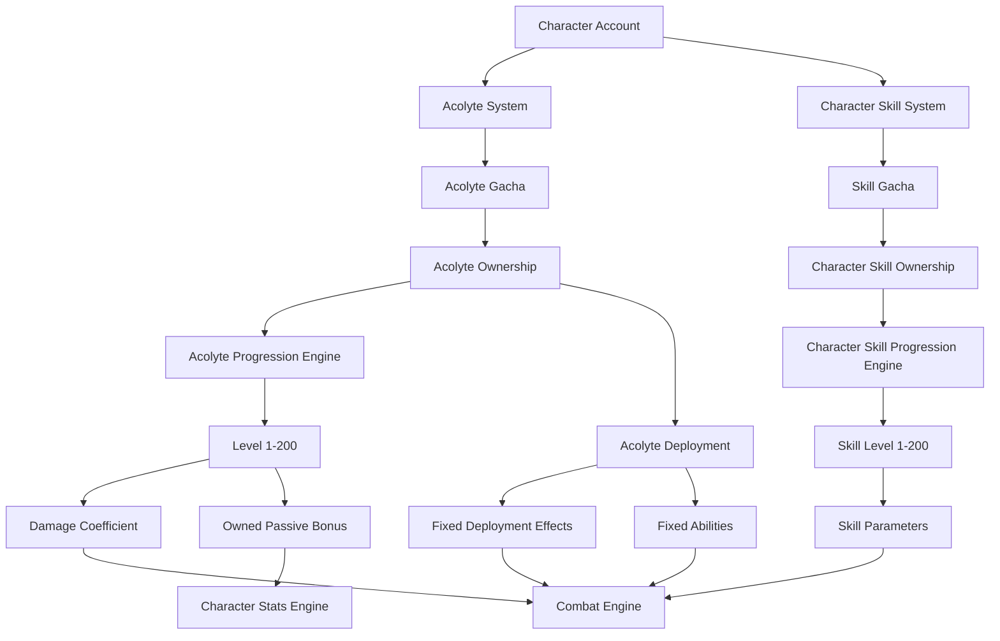

La séparation des portails d'invocation est également cohérente avec la documentation de Guides by Grace, qui distingue explicitement le portail des acolytes de celui des compétences. \[[Pals &amp; Skills — Legend of Mushroom](https://guidesbygrace.uk/pals-skills?utm_source=chatgpt.com)\]

*Note d'ingénierie : aucun état de progression ne doit être partagé entre les deux moteurs. Une acquisition de doublon d'acolyte ne peut jamais modifier le niveau d'une compétence du personnage, et inversement.*

# 4. Mise à jour du registre des décisions

| ID | Décision | État |
|--------|--------|--------|
| PROG-009 | Niveau global unique par acolyte | (Validé) |
| PROG-010 | Deux catégories de sorties évolutives | (Validé) |
| PROG-011 | Effets de déploiement fixes | (Validé) |
| PROG-012 | Compétences d'acolytes sans progression propre | (Validé) |
| PROG-013 | Progression indépendante des compétences du personnage | (Validé) |
| PROG-014 | Portails et ressources distincts | (Validé) |

# 5. État de SYS-002.D.10.2.1

**Spécification mathématique** (Contrat fonctionnel défini)

- [x] Coûts par paliers.
- [x] Monotonie des coûts.
- [x] Croissance linéaire par segments des dégâts.
- [x] Croissance exponentielle des bonus possédés.
- [x] Effets de déploiement fixes.
- [x] Progression globale unique.
- [x] Fusion automatique 3:1.
- [x] Séparation des compétences du personnage.
- [ ] Calibration numérique des courbes.
- [ ] Vérification des ratios et exceptions de fusion.

La spécification fonctionnelle est consolidée. La calibration numérique reste ouverte.

# 6. SYS-002.D.10.2.1.C - Calibration des coûts

Nous pouvons maintenant construire les profils numériques.

Je propose de commencer par les coûts en doublons, avant de travailler sur les courbes statistiques.

Les huit raretés standards sont concernées :

1. Normal
2. Unique
3. Supérieur
4. Rare
5. Mythique
6. Épique
7. Légendaire
8. Immortel

Les acolytes exclusifs disposeront de profils explicitement configurés.

**Première décision de calibration :** les trois grandes plages de progression (1-50, 51-150 et 151-200) doivent-elles être communes aux huit raretés, avec des coûts différents selon la rareté, ou chaque rareté doit-elle pouvoir disposer de ses propres frontières de paliers ?

Cette décision déterminera la structure définitive de `AcolyteDuplicateCostProfile`.

</details>


### SYS-002.D.10.2.1 · T044 · 19/11/2026 17:00:09

**Nature :** `EXIGENCE_OU_RECTIFICATION_PROPRIETAIRE` · **Ligne d’approbation source :** 15862 · **Ligne de formalisation :** 15887.

**Décision / prescription originale (texte intégral du propriétaire) :**

Précisions : 

**Dans la pratique (et comme observé dans *Legend of Mushroom*), les paliers de niveaux sont communs à toutes les raretés, mais chaque rareté possède sa propre échelle de coûts en doublons et ses propres taux de chute pour équilibrer la progression.**

Si vous concevez un système similaire (game design) ou cherchez à comprendre la logique mathématique derrière cette structure, voici pourquoi les paliers communs avec coûts différenciés s'imposent face aux paliers variables :

**1. Pourquoi garder des frontières de paliers communes (1–50, 51–150, 151–200)**

- **Lisibilité et repères cognitifs.** Le joueur assimile rapidement qu'un cap (comme le niveau 50, 100 ou 150) marque un changement de rythme universel, quelle que soit la carte consultée.
- **Alignement des courbes de puissance.** Garder les mêmes seuils permet de synchroniser les pics de statistiques passives (« Possédé ») entre les raretés communes et les raretés mythiques, facilitant l'équilibrage global du jeu.
- **Simplicité d'implémentation et de maintenance.** Une seule table de tranches de niveaux évite de multiplier les formules complexes et réduit les risques d'erreurs d'équilibrage lors de l'ajout d'une nouvelle rareté.

**2. Comment différencier les raretés sans changer les paliers**

- **Multiplicateur de coût par rareté.** Bien que les tranches de niveaux soient identiques, le nombre de doublons requis par niveau est ajusté selon la rareté (une rareté Commune demandera plus de copies par palier pour compenser sa grande abondance au tirage, tandis qu'une rareté Immortelle/Rose demandera moins de copies mais avec un taux d'invocation infime).
- **Taux d'obtention (Gacha) comme levier principal.** C'est la probabilité de tirage (par exemple 50 % pour le Gris contre 0,05 % pour le Rose) qui crée naturellement le ralentissement sur les hautes raretés, sans avoir besoin de déplacer les frontières de paliers.
- **Mécanique de conversion (3 pour 1).** Des frontières communes permettent aux raretés inférieures d'atteindre le plafond (niveau 200) en premier afin d'alimenter les raretés supérieures via la synthèse automatique.

**3. Quand envisager des frontières propres à chaque rareté**

- **Cas d'un plafonnement progressif.** Des frontières spécifiques ne sont pertinentes que si les raretés inférieures sont bloquées à un niveau maximum inférieur (par exemple : Gris bloqué au niveau 100, Vert au niveau 150, Rouge au niveau 200), ce qui n'est pas le cas ici puisque toutes les cartes montent jusqu'au niveau 200.


**Source technique :** réponse consécutive et proposition précédant cette validation, consultables dans l’historique original. Aucun extrait automatique n’a été retenu faute de délimitation non ambiguë.


### SYS-002.D.10.2.1.C.2 · T045 · 19/11/2026 17:08:35

**Nature :** `APPROBATION_EXPLICITE` · **Ligne d’approbation source :** 16172 · **Ligne de formalisation :** 16185.

**Décision / prescription originale (texte intégral du propriétaire) :**

Validation SYS-002.D.10.2.1.C.2 : sous-paliers = shared ; multiplicateur = global ; courbe de référence = lookup ; fusion Immortel = terminal ; observations = Précisions :
Oui, au sommet de la rareté Immortelle (Rose), il n'existe plus de palier supérieur vers lequel fusionner. Une fois qu'un acolyte ou une compétence (celles du personnage) Immortelle atteint le niveau 200 (MAX), les doublons supplémentaires s'accumulent dans votre inventaire sans conversion automatique.

Gestion des doublons au plafond Immortel

• Arrêt de la chaîne de synthèse. La mécanique de fusion (3 doublons de niveau 200 contre 1 exemplaire aléatoire de la rareté supérieure) s'arrête dès que les cartes Rouges (Mythiques/Exotiques) fusionnent vers les cartes Roses (Immortelles).
• Conservation dans l'inventaire. Les copies excédentaires d'un acolyte Immortel déjà au niveau 200 restent stockées en réserve sur sa fiche, car le jeu ne propose pas de rareté supérieure invocables dans le portail classique.
• Intérêt stratégique continu. Même lorsqu'un ou plusieurs Immortels atteignent le niveau maximum, les fusions issues des raretés inférieures continuent d'alimenter les autres acolytes Immortels qui ne sont pas encore niveau 200.
• Utilité pour les événements. Continuer à invoquer et fusionner des doublons reste rentable durant les événements de type Sprint d'acolytes ou de compétences, car les points sont attribués au nombre de tirages effectués et non à l'utilisation des doublons.. Formalise les décisions et poursuis la calibration mathématique.


<details><summary>Formalisation technique de la décision ratifiée (extrait sourcé)</summary>

# 1. Formalisation GDD - SYS-002.D.10.2.1.C.2

(Validé) (Version 1.4)

| Paramètre | Décision |
|--------|--------|
| Grandes phases | Communes aux raretés |
| Sous-paliers | Communs aux raretés |
| Multiplicateur | Global par rareté |
| Courbe de référence | Lookup table |
| Monotonie | Non décroissante |
| Arrondi | Ceiling |
| Fusion standard | 3:1 |
| Rareté terminale | Immortel |
| Doublons Immortels au niveau 200 | Conservation |
| Fusion des Immortels maxés | Désactivée |

## 1.1 Chaîne de rareté

La progression des raretés est représentée par un ordre canonique :

$$
R_1 \rightarrow R_2 \rightarrow \dots \rightarrow R_8
$$

Avec :

$$
R_8=\text{IMMORTAL}
$$

Le moteur utilisera les identifiants et rangs de rareté, jamais les couleurs ou les appellations visuelles pour déterminer la rareté supérieure.

Cela évite notamment les ambiguïtés entre les appellations Mythique, Épique et Exotique.

# 2. Gestion des doublons au niveau maximal

Nous distinguons désormais trois situations.

**Cas A - Rareté non terminale, niveau inférieur à 200**

(Progression normale)

Les doublons alimentent le solde de progression.

---

**Cas B - Rareté non terminale, niveau 200**

(Fusion automatique)

Chaque groupe de trois doublons génère un exemplaire aléatoire de la rareté supérieure.

---

**Cas C - Rareté Immortelle, niveau 200**

(Conservation)

Les doublons supplémentaires sont stockés dans une réserve dédiée. Aucune fusion n'est déclenchée.

Cette règle s'applique aux deux domaines.

| Situation | Acolyte | Compétence |
|--------|--------|--------|
| Niveau inférieur à 200 | Progression | Progression |
| Niveau 200, rareté intermédiaire | Fusion 3:1 | Fusion 3:1 |
| Niveau 200, Immortel | Conservation | Conservation |
| Utilisation des doublons excédentaires | Réserve | Réserve |

Les deux systèmes conservent leurs propres inventaires, tables de coûts, probabilités et historiques.

## 2.1 Extension du modèle de données

Nous ajoutons un compteur spécifique aux ressources excédentaires :

```python
@dataclass
class ProgressionOwnership:
    owner_id: str
    item_id: str

    current_level: int

    duplicate_balance: int
    terminal_duplicate_balance: int

    progression_revision: int
```

Règles :

- `duplicate_balance` : doublons utilisables pour progresser.
- `terminal_duplicate_balance` : doublons conservés lorsque le niveau 200 et la rareté terminale sont atteints.

Le compteur terminal ne participe jamais à un calcul de progression ou de fusion.

## 2.2 Suivi des événements d'invocation

Une précision importante concerne les événements Sprint.

Le système de comptabilisation des tirages doit être indépendant de celui des doublons.

Nous ajoutons :

`GachaPullLedger`

Chaque invocation génère un événement enregistré avant toute opération de progression ou de fusion.

Ainsi :

$$
Points_{\text{événement}}=
f(N_{\text{tirages}})
$$

et non :

$$
f(N_{\text{doublons consommés}})
$$

La fusion et l'amélioration ne peuvent donc pas modifier rétroactivement les points attribués aux tirages.

---

</details>


### SYS-002.D.10.2.1.C.3 · T046 · 19/11/2026 17:15:32

**Nature :** `APPROBATION_EXPLICITE` · **Ligne d’approbation source :** 16589 · **Ligne de formalisation :** 16594.

**Décision / prescription originale (texte intégral du propriétaire) :**

Validation SYS-002.D.10.2.1.C.3 : sous-paliers = approve ; coûts de référence = approve ; rareté de référence = normal_one ; ordre des multiplicateurs = non_increasing ; observations = Aucune. Formalise les décisions et poursuis avec la calibration des huit multiplicateurs de rareté.


**Source technique :** réponse consécutive et proposition précédant cette validation, consultables dans l’historique original. Aucun extrait automatique n’a été retenu faute de délimitation non ambiguë.


### SYS-002.D.10.2.1.C.4 · T047 · 19/11/2026 17:26:48

**Nature :** `APPROBATION_EXPLICITE` · **Ligne d’approbation source :** 16812 · **Ligne de formalisation :** 16846.

**Décision / prescription originale (texte intégral du propriétaire) :**

Validation SYS-002.D.10.2.1.C.4 : multiplicateurs = approve ; statut calibration = provisional ; observations = Précisions :
Dans Legend of Mushroom, les probabilités de gacha d'obtention des acolytes et des compétences évoluent selon le niveau de la machine d'invocation (de 1 à 15), atteignant un maximum de 0,04 % (1 chance sur 2 500) pour la rareté Immortelle.

1. Évolution des taux selon le niveau d'invocation (1 à 15)

Chaque tirage effectué fait progresser une jauge d'expérience propre au portail (Acolytes ou Compétences) afin de débloquer de meilleures probabilités :
• Niveaux 1 à 8 (Début de partie). Les chances se concentrent quasi exclusivement sur les raretés Grise (Commune), Verte et Bleue, avec l'apparition progressive du Violet et du Jaune.
• Niveaux 9 à 12 (Milieu de partie). Les raretés Orange et Rouge (Exotique/Mythique) deviennent accessibles, tandis que la rareté Rose (Immortelle) s'ouvre autour du niveau 11-12 avec un taux initial de 0,01 % (1 chance sur 10 000).
• Niveau 13. Le taux d'obtention d'un Immortel double pour passer à 0,02 % (1 chance sur 5 000).
• Niveau 15 (Plafond maximum). La machine atteint son rendement maximal avec 0,04 % de chance pour un Immortel (1 chance sur 2 500), environ 0,2 % à 0,5 % pour le Rouge, et une forte réduction du taux de cartes Grises au profit des raretés Bleues, Violettes et Jaunes.

2. Probabilité de cibler une carte précise

• Partage équitable au sein d'une rareté. Lorsqu'un tirage tombe sur une rareté donnée, le jeu sélectionne aléatoirement l'une des cartes disponibles dans ce palier (par exemple, avec 3 à 5 compétences Immortelles dans le portail classique, obtenir une compétence précise représente environ 15 % à 33 % de chance une fois le palier Rose déclenché).
• Absence de « Pity » classique. Contrairement à d'autres jeux gacha, les machines à pinces standards d'acolytes et de compétences n'ont pas de compteur de garantie (pity) fixe : chaque tirage est indépendant, bien que les grands nombres et la synthèse (3 pour 1) lissent les résultats sur la durée.

3. Autres portails et optimisation des tirages

• Invocations d'Âmes Martiales. Les cristaux d'âme suivent une table différente, avec un taux d'environ 0,4 % pour une âme rouge/LR de haut rang, compensé par un système de garantie et d'essence d'âme.
• Tirages groupés avantageux. Utiliser l'option x35 tirages ne coûte que 30 tickets (soit environ 14 % de tirages gratuits en plus), et le niveau 15 débloque l'option x999

Atteindre le niveau 15 d'invocation demande plusieurs dizaines de milliers de tirages cumulés (avec des paliers de 3 000 à plus de 10 000 tirages par niveau sur la fin), mais il est tout à fait possible d'obtenir et de monter des cartes Immortelles gratuitement grâce au recyclage des doublons et aux événements hebdomadaires.

1. Progression des niveaux de machine (1 à 15)

Chaque tirage effectué rapporte 1 point d'expérience à la machine concernée (Acolytes ou Compétences) :
• Niveaux 1 à 8 (Montée rapide). Les premiers paliers ne demandent que quelques dizaines à quelques centaines de tirages (par exemple 50, 100, 200, 400 tirages) pour débloquer progressivement les raretés Bleue, Violette, Jaune et Orange.
• Niveaux 9 à 11 (Transition vers le Mythique). Chaque niveau exige entre 1 000 et 2 500 tirages, débloquant la rareté Rouge (Exotique/Mythique) autour du niveau 6-9 selon le portail.
• Niveau 12 (Ouverture des Immortels). Il faut 3 000 tirages supplémentaires depuis le niveau 11 pour atteindre le niveau 12, seuil où les cartes Roses (Immortelles) apparaissent enfin à 0,01 %, comme illustré dans les sessions de tirages sur YouTube.
• Niveaux 13 à 15 (Plafond de rendement). Les trois derniers paliers requièrent entre 5 000 et 15 000 tirages par niveau pour faire grimper le taux Immortel à 0,02 % (niveau 13), 0,03 % (niveau 14), puis 0,04 % (niveau 15).. Formalise les décisions, calcule les profils définitifs et poursuis SYS-002.D.10.2.1.


<details><summary>Formalisation technique de la décision ratifiée (extrait sourcé)</summary>

# 1. Formalisation GDD - SYS-002.D.10.2.1.C.4

(Validé) (Calibration provisoire)

Les huit multiplicateurs sont acceptés avec les valeurs suivantes :

| Rareté | Multiplicateur |
|--------|--------|
| Normal | 1,00 |
| Unique | 0,90 |
| Supérieur | 0,80 |
| Rare | 0,70 |
| Mythique | 0,60 |
| Épique | 0,50 |
| Légendaire | 0,40 |
| Immortel | 0,30 |

La fonction de coût reste :

$$
C(R,L)=\lceil B(L)\times M_R\rceil
$$

Les multiplicateurs sont acceptés comme paramètres de notre modèle, mais leur calibration économique reste provisoire jusqu'à l'intégration complète des probabilités d'invocation.

## 1.1 Profils de coûts calculés

Voici les coûts effectifs obtenus après application des multiplicateurs et de l'arrondi supérieur.

Chaque valeur représente le coût d'un niveau à l'intérieur du palier correspondant.

| Rareté | P01 | P02 | P03 | P04 | P05 | P06 |
|--------|--------|--------|--------|--------|--------|--------|
| Normal | 2 | 3 | 4 | 5 | 10 | 15 |
| Unique | 2 | 3 | 4 | 5 | 9 | 14 |
| Supérieur | 2 | 3 | 4 | 4 | 8 | 12 |
| Rare | 2 | 3 | 3 | 4 | 7 | 11 |
| Mythique | 2 | 2 | 3 | 3 | 6 | 9 |
| Épique | 1 | 2 | 2 | 3 | 5 | 8 |
| Légendaire | 1 | 2 | 2 | 2 | 4 | 6 |
| Immortel | 1 | 1 | 2 | 2 | 3 | 5 |

| Rareté | P07 | P08 | P09 | P10 | P11 | Total |
|--------|--------|--------|--------|--------|--------|--------|
| Normal | 20 | 30 | 40 | 45 | 50 | **4 275** |
| Unique | 18 | 27 | 36 | 41 | 45 | **3 885** |
| Supérieur | 16 | 24 | 32 | 36 | 40 | **3 445** |
| Rare | 14 | 21 | 28 | 32 | 35 | **3 040** |
| Mythique | 12 | 18 | 24 | 27 | 30 | **2 585** |
| Épique | 10 | 15 | 20 | 23 | 25 | **2 170** |
| Légendaire | 8 | 12 | 16 | 18 | 20 | **1 730** |
| Immortel | 6 | 9 | 12 | 14 | 15 | **1 325** |

P01 à P11 désignent les onze sous-paliers validés. Les totaux comptabilisent les 199 améliorations nécessaires pour atteindre le niveau 200.

Ces profils sont mathématiquement cohérents.

---

# 2. Nouvelle spécification - Gacha Machine Engine

(SYS-002.D.10.2.1.D - Ouverture)

Nous introduisons un moteur indépendant pour gérer les machines d'invocation.

Il existe deux instances distinctes :

- `ACOLYTE_GACHA`
- `CHARACTER_SKILL_GACHA`

Chaque machine possède son propre niveau, son expérience et ses probabilités de tirage.

## 2.1 Contrat fonctionnel

| Propriété | Décision |
|--------|--------|
| Niveau initial | 1 |
| Niveau maximal | 15 |
| Expérience par tirage | 1 XP |
| Progression | Automatique |
| Machine acolytes | Indépendante |
| Machine compétences | Indépendante |
| Probabilités | Dépendantes du niveau |
| Garantie classique (Pity) | Absente |
| Sélection dans une rareté | Équitable |
| Option x35 | 35 tirages pour 30 tickets |
| Option x999 | Débloquée au niveau 15 |

La progression du portail ne doit jamais être confondue avec la progression des cartes.

Par exemple, atteindre le niveau 15 de la machine à acolytes ne signifie pas que les acolytes possédés progressent automatiquement.

## 2.2 Architecture proposée

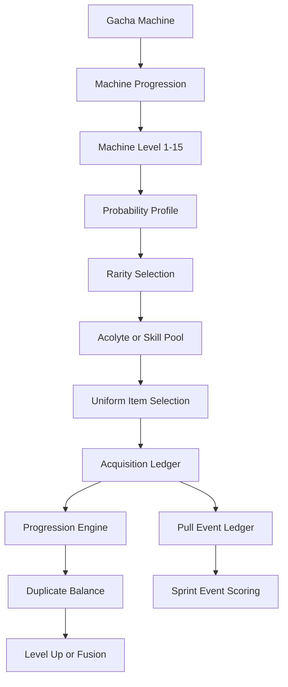

Le `GachaMachineEngine` ne doit pas directement améliorer les cartes.

Il produit des acquisitions. Les moteurs de progression et de fusion traitent ensuite ces acquisitions.

# 3. Progression des machines - niveaux 1 à 15

## 3.1 Expérience nécessaire

Chaque tirage rapporte un point d'expérience :

$$
XP_{\text{machine}}=N_{\text{tirages}}
$$

Les seuils communiqués permettent d'établir le référentiel suivant.

| Niveau | XP supplémentaire indicative | État |
|--------|--------|--------|
| 1-8 | Dizaines à centaines | À calibrer |
| 9 | 1 000-2 500 | Indicatif |
| 10 | 1 000-2 500 | Indicatif |
| 11 | 1 000-2 500 | Indicatif |
| 12 | 3 000 | Observé |
| 13 | 5 000-15 000 | Indicatif |
| 14 | 5 000-15 000 | Indicatif |
| 15 | 5 000-15 000 | Indicatif |

Les exemples de 50, 100, 200 et 400 tirages concernent les premiers paliers, mais leur attribution exacte aux niveaux n'est pas encore établie.

### Conséquence mathématique

Entre les niveaux 11 et 15, la progression nécessite approximativement :

$$
XP_{11\rightarrow15}
=3000+3\times[5000,15000]
$$

$$
\boxed{18000\leq XP\leq48000}
$$

Cette plage est indicative et devra être calibrée séparément pour les deux machines.

## 3.2 Contrat de données

```python
@dataclass
class GachaMachineState:
    owner_id: str
    machine_id: str

    machine_type: str
    current_level: int
    accumulated_xp: int

    progression_revision: int

@dataclass(frozen=True)
class GachaMachineLevel:
    machine_type: str
    level: int
    xp_required: int

@dataclass(frozen=True)
class GachaProbabilityProfile:
    machine_type: str
    machine_level: int
    rarity_probabilities: dict[str, float]
```

Les seuils d'expérience seront configurés séparément pour chaque type de machine.

---

# 4. Calibration des probabilités d'invocation

C'est ici que tes observations apportent les informations les plus intéressantes.

## 4.1 Probabilités Immortelles

Nous disposons de quatre points de référence précis.

**Évolution du taux Immortel**

| **Niveau 12** | 0,01 % |
|--------|--------|
| **Niveau 13** | 0,02 % |
| **Niveau 14** | 0,03 % |
| **Niveau 15** | 0,04 % |

Nous retenons le niveau 12 comme seuil d'apparition des Immortels, conformément à ta précision la plus détaillée.

Pour les niveaux 1 à 11 :

$$
P(\text{Immortel})=0
$$

À partir du niveau 12, le taux augmente selon les valeurs du tableau.

## 4.2 Probabilité d'obtenir une carte précise

Tu indiques que la sélection à l'intérieur d'une rareté est équitable.

Nous définissons :

$$
P(A_i\mid R)=\frac{1}{N_R}
$$

Où $N_R$ représente le nombre de cartes disponibles dans la rareté.

La probabilité totale devient :

$$
\boxed{P(A_i)=\frac{P(R)}{N_R}}
$$

Prenons trois à cinq cartes Immortelles disponibles.

| Niveau machine | Taux Immortel | Chance d'une carte précise |
|--------|--------|--------|
| 12 | 0,01 % | 0,002-0,00333 % |
| 13 | 0,02 % | 0,004-0,00667 % |
| 14 | 0,03 % | 0,006-0,01000 % |
| 15 | 0,04 % | 0,008-0,01333 % |

La probabilité conditionnelle d'obtenir une carte précise après avoir déclenché la rareté Immortelle est donc de 20 à 33,33 % pour un pool de trois à cinq cartes.

Attention : les 15 % mentionnés dans tes observations supposeraient un pool de sept cartes environ. Ce point reste à vérifier.

## 4.3 Espérance de tirages

En l'absence de Pity, le nombre moyen de tirages nécessaire pour obtenir un Immortel est :

$$
E[N]=\frac{1}{p}
$$

| Niveau | Taux Immortel | Espérance |
|--------|--------|--------|
| 12 | 0,01 % | 10 000 |
| 13 | 0,02 % | 5 000 |
| 14 | 0,03 % | 3 333 |
| 15 | 0,04 % | 2 500 |

Ces nombres sont des espérances, pas des garanties.

À 0,04 %, après 2 500 tirages effectués au même niveau, la probabilité d'obtenir au moins un Immortel est d'environ 63,2 %.

La probabilité d'obtenir zéro Immortel reste donc d'environ 36,8 %.

---

# 5. Absence de Pity et indépendance des tirages

La décision fonctionnelle est la suivante :

$$
P(X_n\mid X_1,\ldots,X_{n-1})=P(X_n)
$$

À niveau de machine constant, chaque tirage est indépendant.

Il n'existe aucun compteur de garantie qui augmente progressivement les probabilités après une série de résultats négatifs.

En revanche, la progression de la machine modifie les probabilités lorsqu'un nouveau niveau est atteint.

Il faut donc distinguer :

- Indépendance des tirages à niveau constant.
- Évolution déterministe des probabilités lors d'une montée de niveau.

## 5.1 Probabilités des autres raretés

Les informations disponibles permettent de définir des contraintes, mais pas une table complète.

| Niveau | Distribution connue |
|--------|--------|
| 1-8 | Forte concentration sur les raretés communes |
| 9-11 | Progression des raretés supérieures |
| 12 | Immortel : 0,01 % |
| 13 | Immortel : 0,02 % |
| 14 | Immortel : 0,03 % |
| 15 | Immortel : 0,04 % ; Rouge : environ 0,2-0,5 % |

Les autres probabilités restent à renseigner.

Il existe également une divergence dans tes observations concernant le déblocage des raretés Orange et Rouge : une première description situe leur apparition entre les niveaux 9 et 12, tandis qu'une autre évoque le Rouge dès les niveaux 6 à 9.

Nous ne fixerons pas artificiellement un seuil avant d'avoir une observation précise.

---

# 6. Tirages groupés et événements

## 6.1 Option x35

Nous enregistrons :

$$
35\text{ tirages}=30\text{ tickets}
$$

Cela représente :

$$
\frac{35-30}{35}\times100
=14,29\%
$$

d'économie par rapport au prix de 35 tirages individuels.

Le joueur reçoit néanmoins 35 résultats et, selon la règle d'expérience par tirage :

$$
XP_{\text{gagné}}=35
$$

## 6.2 Option x999

Déblocage au niveau 15.

Le coût exact en tickets et les modalités d'exécution restent à documenter.

## 6.3 Sprint d'invocation

Le `GachaPullLedger` devra enregistrer chaque tirage individuellement, même lorsqu'il provient d'une invocation groupée.

Les événements Sprint comptabilisent les tirages effectués, indépendamment de l'utilisation ultérieure des doublons.

Une fusion ne génère donc pas rétroactivement de points d'invocation.

## 6.4 Âmes Martiales

Nous excluons explicitement les invocations d'Âmes Martiales de ce moteur.

Elles possèdent :

- Leur propre table de probabilités.
- Leur propre ressource.
- Leur propre système de garantie.
- Leur propre mécanisme d'essence.

Elles feront l'objet d'une spécification séparée.

---

</details>


### SYS-002.D.10.2.1.D.1 · T048 · 19/11/2026 17:31:13

**Nature :** `APPROBATION_EXPLICITE` · **Ligne d’approbation source :** 17550 · **Ligne de formalisation :** 17555.

**Décision / prescription originale (texte intégral du propriétaire) :**

Validation SYS-002.D.10.2.1.D.1 : ordre XP/tirage = before_xp ; tirages groupés = sequential ; sélection pool = uniform_available ; profils XP = independent ; observations = Aucune. Formalise les décisions, clôture les contrats mathématiques disponibles et poursuis SYS-002.D.10.2.1.


<details><summary>Formalisation technique de la décision ratifiée (extrait sourcé)</summary>

# SYS-002.D.10.2.1.D.1 — Validation et clôture des contrats Gacha

(Décisions validées) (Version 1.1)

Les quatre décisions sont intégrées. Elles rendent le comportement temporel des invocations déterministe, y compris lorsque plusieurs tirages sont exécutés dans une même opération.

## 1. Formalisation des décisions

| Paramètre | Décision validée |
|--------|--------|
| Ordre XP/tirage | `before_xp` |
| Tirages groupés | `sequential` |
| Sélection des cartes | `uniform_available` |
| Profils XP | `independent` |

### 1.1 Ordre de résolution d'un tirage

La séquence est désormais strictement définie :

1. Lecture du niveau actuel de la machine.
2. Chargement de la distribution de probabilités correspondant à ce niveau.
3. Tirage de la rareté.
4. Sélection uniforme d'une carte disponible dans cette rareté.
5. Enregistrement de l'acquisition.
6. Attribution d'un point d'expérience à la machine.
7. Vérification du franchissement éventuel d'un seuil.
8. Actualisation du niveau de machine.

Exemple :

**Machine actuellement au niveau 11**

1. **Tirage N**
   
   Probabilités du niveau 11 utilisées.
2. **Attribution de l'expérience**
   
   La machine reçoit 1 XP et atteint le seuil du niveau 12.
3. **Actualisation**
   
   La machine passe au niveau 12.
4. **Tirage N+1**
   
   Les probabilités du niveau 12 sont désormais utilisées.

Cette séquence évite toute ambiguïté concernant le tirage qui provoque le changement de niveau.

### 1.2 Tirages groupés séquentiels

Une opération x35 correspond à 35 résolutions individuelles.

$$
XP_{\text{gagnée}}=35
$$

Si un seuil de niveau est franchi pendant l'opération, les tirages suivants utilisent immédiatement les nouvelles probabilités.

Il n'existe aucun snapshot des probabilités au début du groupe.

Même principe pour x999, disponible à partir du niveau 15.

### 1.3 Sélection uniforme

Pour une rareté donnée :

$$
P(A_i\mid R)=\frac{1}{N_R}
$$

La population utilisée est celle des cartes effectivement disponibles dans le pool concerné au moment du tirage.

Les cartes indisponibles ne participent pas à la sélection.

### 1.4 Indépendance des machines

Les machines possèdent des états entièrement distincts.

| État | Acolytes | Compétences |
|--------|--------|--------|
| Niveau | Indépendant | Indépendant |
| Expérience | Indépendante | Indépendante |
| Probabilités | Profil propre | Profil propre |
| Historique des tirages | Séparé | Séparé |
| Ressources | Tickets dédiés | Tickets dédiés |

Aucune progression d'une machine ne modifie l'autre.

---

# 2. Contrats mathématiques désormais clôturés

Il faut distinguer les contrats dont les fonctions sont complètement définies de ceux dont les paramètres numériques restent incomplets.

## 2.1 Duplicate Cost Engine

(Contrat mathématique clôturé)

Les huit profils de coûts sont calculables.

| Rareté | Multiplicateur | Coût total niveau 1 → 200 |
|--------|--------|--------|
| Normal | 1,00 | 4 275 |
| Unique | 0,90 | 3 885 |
| Supérieur | 0,80 | 3 445 |
| Rare | 0,70 | 3 040 |
| Mythique | 0,60 | 2 585 |
| Épique | 0,50 | 2 170 |
| Légendaire | 0,40 | 1 730 |
| Immortel | 0,30 | 1 325 |

Les valeurs sont exactes pour la table de référence et les multiplicateurs provisoires validés.

Les 1 592 transitions individuelles ont été déterminées mathématiquement.

Les propriétés suivantes sont garanties :

- Coûts strictement positifs.
- Coûts entiers.
- Monotonie non décroissante.
- Frontières communes.
- Absence de niveaux inaccessibles.
- Niveau maximal égal à 200.

## 2.2 Fusion Engine

(Contrat fonctionnel clôturé)

$$
Q=\left\lfloor\frac{N}{3}\right\rfloor
$$

$$
R=N\bmod3
$$

- Fusion 3:1 pour les raretés non terminales, lorsque la carte source est niveau 200.
- Sélection aléatoire dans le pool supérieur autorisé.
- Conservation des reliquats.
- Conservation des doublons Immortels au niveau 200.
- Aucun débordement vers une rareté inexistante.

La règle de conservation au sommet de la rareté s'applique aux acolytes et aux compétences.

Les tables de coûts des compétences restent indépendantes de celles des acolytes.

## 2.3 Gacha Resolution Engine

(Contrat de résolution clôturé)

Les fonctions suivantes sont définies :

$$
P(R\mid L_{\text{machine}})
$$

$$
P(A_i\mid R)=\frac{1}{N_R}
$$

$$
XP_{\text{machine}}=N_{\text{tirages}}
$$

Les tirages sont indépendants en l'absence de Pity, à niveau de machine constant.

La résolution séquentielle permet une évolution des probabilités à l'intérieur d'un tirage groupé.

**Limite :** le contrat de résolution est clôturé, mais la table complète des probabilités et les seuils exacts d'expérience des machines ne le sont pas encore.

# 3. Registre des paramètres Gacha

Les observations sont intégrées comme contraintes de calibration.

## 3.1 Probabilités Immortelles

(Valeurs de référence intégrées)

| Niveau machine | Probabilité Immortel |
|--------|--------|
| 1–11 | 0 % |
| 12 | 0,01 % |
| 13 | 0,02 % |
| 14 | 0,03 % |
| 15 | 0,04 % |

Ces valeurs s'appliquent indépendamment aux deux machines, sous réserve de confirmation que leurs tables officielles sont effectivement identiques.

## 3.2 Paramètres encore non calibrés

| Paramètre | État |
|--------|--------|
| Probabilités Normal à Légendaire, niveaux 1–15 | À renseigner |
| Probabilités exactes Rouge, niveaux 9–15 | À renseigner |
| XP nécessaire par niveau de machine | À renseigner |
| Nombre de cartes par rareté | À documenter |
| Probabilités des bannières spéciales | À documenter |
| Coût exact x999 | À documenter |
| Tables de compétences | Indépendantes, à calibrer |

Une contrainte mathématique est impérative :

$$
\boxed{\sum_{R}P(R\mid L)=1}
$$

La somme des probabilités de toutes les raretés doit être exactement égale à 100 %.

Nous ne pouvons donc pas compléter artificiellement les probabilités manquantes à partir du seul taux Immortel.

---

</details>


### SYS-002.D.10.2.1.E.1 · T049 · 19/11/2026 17:43:43

**Nature :** `APPROBATION_EXPLICITE` · **Ligne d’approbation source :** 17958 · **Ligne de formalisation :** 17963.

**Décision / prescription originale (texte intégral du propriétaire) :**

Validation SYS-002.D.10.2.1.E.1 : points d'ancrage = shared_5  croissance bonus possédés = piecewise_exponential ; nombre de bonus possédés = single_type ; valeurs initiales = first_anchor_positive ; observations = Aucune. Formalise les décisions et poursuis avec la construction mathématique des courbes de croissance.


**Source technique :** réponse consécutive et proposition précédant cette validation, consultables dans l’historique original. Aucun extrait automatique n’a été retenu faute de délimitation non ambiguë.


### SYS-002.D.10.2.1 · T051 · 19/11/2026 17:55:54

**Nature :** `EXIGENCE_OU_RECTIFICATION_PROPRIETAIRE` · **Ligne d’approbation source :** 18706 · **Ligne de formalisation :** 18728.

**Décision / prescription originale (texte intégral du propriétaire) :**

**Il n'existe pas de base de données publique listant les valeurs numériques exactes niveau par niveau (1, 50, 100, 150, 200) de chaque acolyte**, mais nous disposons de la structure complète d'une fiche type et des formules exactes qui régissent sa progression.

Voici toutefois comment se présente une **fiche technique complète d'acolyte** et comment évoluent ses deux valeurs chiffrées sur les paliers demandés :

**1. Anatomie d'une fiche d'acolyte**

Sur la carte d'un acolyte en jeu, on retrouve quatre éléments distincts :

- **Rareté et niveau actuel (1 à 200).** Indique le palier de couleur (de Gris à Rose/Immortel) et l'avancement vers le plafond.
- **Effet de déploiement (Statique).** Le bonus spécial actif uniquement lorsque l'acolyte est équipé dans l'équipe de cinq (par exemple : *Vitesse d'attaque +15 %* ou *Dégâts de combo +25 %*), dont la valeur est identique au niveau 1 et au niveau 200.
- **Coefficient de dégâts en combat (Évolutif).** Le pourcentage de l'attaque de votre personnage que l'acolyte inflige à chacune de ses propres attaques basiques (par exemple : *Inflige 45 % de votre ATQ en dégâts* au niveau 1).
- **Bonus « Possédé » (Évolutif et cumulatif).** Le pourcentage permanent d'ATQ, de PV ou de DÉF ajouté à votre personnage, actif en permanence même si l'acolyte reste dans votre inventaire.

**2. Courbe d'évolution sur les paliers (1, 50, 100, 150, 200)**

- **Progression linéaire par niveau.** Contrairement au coût en doublons qui grimpe par paliers, le **bonus « Possédé »** et le **coefficient de dégâts** augmentent d'un incrément fixe à chaque niveau gagné (selon la rareté de la carte).
- **Écart d'échelle selon la rareté.** Une carte **Grise (Commune)** démarre avec un bonus possédé très faible (environ **+0,1 %** au niveau 1) pour atteindre environ **+20 % à +40 %** au niveau 200, tandis qu'une carte **Rose (Immortelle)** démarre beaucoup plus haut (plusieurs pourcents dès le niveau 1) pour dépasser les **+1 000 %** au niveau 200.
- **Impact en combat (Formule de dégâts).** Comme l'expliquent les analyses mathématiques de la communauté sur [**YouTube**](https://www.youtube.com/watch?v=Vzg0jcmNF9k), les dégâts réels infligés par un acolyte se calculent en multipliant votre **Attaque finale** par le **coefficient de dégâts de l'acolyte**, puis par vos multiplicateurs dédiés (*Dégâts d'acolyte*, *Taux critique d'acolyte* et *Dégâts critiques d'acolyte*, essentiels pour la classe Dompteur).


**Source technique :** réponse consécutive et proposition précédant cette validation, consultables dans l’historique original. Aucun extrait automatique n’a été retenu faute de délimitation non ambiguë.


### SYS-002.D.10.2.1 · T052 · 19/11/2026 17:58:54

**Nature :** `APPROBATION_EXPLICITE` · **Ligne d’approbation source :** 19069 · **Ligne de formalisation :** 19074.

**Décision / prescription originale (texte intégral du propriétaire) :**

Oui je valide


**Source technique :** réponse consécutive et proposition précédant cette validation, consultables dans l’historique original. Aucun extrait automatique n’a été retenu faute de délimitation non ambiguë.


### SYS-002.D.10.2.1.E.8 · T053 · 19/11/2026 18:01:13

**Nature :** `APPROBATION_EXPLICITE` · **Ligne d’approbation source :** 19279 · **Ligne de formalisation :** 19284.

**Décision / prescription originale (texte intégral du propriétaire) :**

Validation SYS-002.D.10.2.1.E.8 : politique de calibration = soft ; ordre de puissance = expected ; réutilisation des profils = same_rarity ; observations = Aucune. Formalise les décisions et clôture la spécification mathématique de l'Acolyte Progression Engine.


<details><summary>Formalisation technique de la décision ratifiée (extrait sourcé)</summary>

# SYS-002.D.10.2.1.E.8 — Formalisation et clôture

(Validé) (Spécification clôturée)

Les trois décisions sont intégrées au GDD.

| Paramètre | Décision définitive |
|--------|--------|
| Politique de calibration | `soft` |
| Ordre de puissance des raretés | `expected` |
| Réutilisation des profils | `same_rarity` |

## 1. Règles définitives de calibration

### 1.1 Soft Constraints

Les plages de calibration constituent des références, pas des contraintes bloquantes.

- Un profil conforme est accepté.
- Un profil hors des plages attendues génère un avertissement.
- Une valeur vérifiée dans le jeu officiel peut être conservée même si elle sort des plages estimées.
- Aucune valeur observée ne doit être modifiée artificiellement pour satisfaire une hypothèse.

### 1.2 Expected Rarity Ordering

La puissance doit globalement progresser avec la rareté.

Cependant, nous n'imposons pas :

$$
K_{\text{Immortel}}>K_{\text{Légendaire}}
$$

pour chaque comparaison individuelle.

L'ordre est une tendance attendue à l'échelle des profils.

Pour les bonus possédés, les comparaisons doivent porter sur une même caractéristique : ATQ avec ATQ, PV avec PV et DEF avec DEF.

### 1.3 Same Rarity Profile Reuse

Un profil peut être partagé entre plusieurs acolytes, à condition qu'ils appartiennent à la même rareté.

$$
R(A_i)=R(A_j)
$$

et :

$$
Profile(A_i)=Profile(A_j)
$$

La réutilisation entre raretés différentes est interdite, même lorsque les paramètres numériques sont identiques.

---

# 2. Acolyte Progression Engine — Architecture finale

(Contrat mathématique clôturé)

Le moteur est désormais constitué de quatre sous-systèmes.

**Acolyte Progression Engine**

Orchestrateur de progression

**Duplicate Cost Engine**

Coûts des niveaux 1–200

**Fusion Engine**

Synthèse 3:1

**Growth Engine**

Coefficient et bonus possédé

**Profile Registry**

Profils individuels réutilisables

---

**Outputs**

Statistiques de combat et contributions à la collection

Le Gacha Machine Engine reste un système externe qui fournit les acquisitions.

Le Collection Bonus Engine consomme les contributions calculées par le Growth Engine.

# 3. Contrats mathématiques définitifs

## 3.1 Progression par doublons

Pour un acolyte de rareté $R$, actuellement au niveau $L$ :

$$
C(R,L)=\lceil B(L)\times M_R\rceil
$$

Les coûts de référence sont les onze sous-paliers validés.

| Rareté | Multiplicateur | Total niveau 200 |
|--------|--------|--------|
| Normal | 1,00 | 4 275 |
| Unique | 0,90 | 3 885 |
| Supérieur | 0,80 | 3 445 |
| Rare | 0,70 | 3 040 |
| Mythique | 0,60 | 2 585 |
| Épique | 0,50 | 2 170 |
| Légendaire | 0,40 | 1 730 |
| Immortel | 0,30 | 1 325 |

Multiplicateurs acceptés, calibration économique toujours provisoire.

Le moteur doit permettre l'amélioration rapide, en consommant successivement les coûts des niveaux jusqu'à épuisement du solde ou atteinte du niveau 200.

## 3.2 Fusion

$$
N_{\text{fusion}}=\left\lfloor\frac{D}{3}\right\rfloor
$$

$$
D_{\text{restant}}=D\bmod3
$$

Conditions :

- Acolyte non terminal au niveau 200 : fusion autorisée.
- Trois doublons : un exemplaire aléatoire de la rareté supérieure.
- Reliquat inférieur à trois : conservation.
- Immortel niveau 200 : conservation intégrale des doublons.

## 3.3 Croissance du coefficient de dégâts

$$
\boxed{K(L)=K_0+(L-1)\Delta K}
$$

Avec :

$$
K_0>0,\quad\Delta K>0
$$

## 3.4 Croissance du bonus possédé

$$
\boxed{B(L)=B_0+(L-1)\Delta B}
$$

Avec :

$$
B_0>0,\quad\Delta B>0
$$

Les deux fonctions utilisent une progression linéaire à incrément constant.

Les cinq niveaux de référence sont conservés :

$$
L\in\{1,50,100,150,200\}
$$

Ils servent à contrôler les profils et non à définir des segments de croissance.

---

# 4. Contrat définitif des profils

Chaque profil contient :

| Champ | Fonction |
|--------|--------|
| `profile_id` | Identifiant du profil |
| `rarity_id` | Rareté associée |
| `damage_base` | Coefficient initial |
| `damage_increment` | Incrément par niveau |
| `owned_bonus_base` | Bonus possédé initial |
| `owned_bonus_increment` | Incrément par niveau |

Chaque fiche d'acolyte référence un profil et possède un seul type de bonus permanent :

`ATK`, `HP` ou `DEF`.

Les profils sont réutilisables uniquement au sein de leur rareté.

## 4.1 Statistiques concernées

| Caractéristique | Évolution avec le niveau |
|--------|--------|
| Coefficient de dégâts de base | Oui |
| Bonus possédé | Oui |
| Vitesse d'attaque de base | Non |
| Effet de déploiement | Non |
| Critique d'acolyte | Non, hérité du propriétaire |
| Dégâts critiques d'acolyte | Non, hérité du propriétaire |
| Combo d'acolyte | Non, hérité du propriétaire |
| Inspiration d'acolyte | Non, statistique globale |
| Ignorance d'évasion d'acolyte | Non, statistique globale |

Les effets de déploiement restent identiques du niveau 1 au niveau 200.

---

# 5. Intégration aux moteurs existants

Deux sorties doivent être produites.

**Sortie A — Combat**

$$
D_{\text{base}}=ATQ_{\text{final propriétaire}}\times K(L)
$$

Le résultat est transmis au Damage Calculation Engine.

Les critiques, combos, inspirations et autres mécanismes suivent les règles déjà validées dans SYS-002.D.8 et SYS-002.D.9.

**Sortie B — Collection**

$$
Contribution_i=B_i(L_i)
$$

Le Collection Bonus Engine reçoit la contribution et applique ses propres règles d'agrégation.

Le Growth Engine ne décide pas si deux bonus familiaux peuvent se cumuler. Cette responsabilité appartient au moteur de collection.

---

# 6. Audit final et statut

</details>


### SYS-002.D.10.2.2.1 · T055 · 19/11/2026 18:13:28

**Nature :** `APPROBATION_EXPLICITE` · **Ligne d’approbation source :** 19935 · **Ligne de formalisation :** 19940.

**Décision / prescription originale (texte intégral du propriétaire) :**

Validation SYS-002.D.10.2.2.1 : bonus possédés = additive_unique ; effets familiaux = max_group ; exceptions = explicit ; effets différents = independent ; observations = Aucune. Formalise les décisions et poursuis avec les contrats mathématiques du Collection Bonus Engine.


<details><summary>Formalisation technique de la décision ratifiée (extrait sourcé)</summary>

# SYS-002.D.10.2.2.1 - Formalisation des décisions

(Validé) (Version 1.0)

Les quatre décisions sont intégrées au GDD.

| Paramètre | Décision |
|--------|--------|
| Bonus possédés | `additive_unique` |
| Effets familiaux | `max_group` |
| Exceptions | `explicit` |
| Effets différents | `independent` |

Une précision importante concernant la décision antérieure `once_per_type` :

Elle signifie désormais qu'un bonus possédé est comptabilisé une seule fois par acolyte distinct (`acolyte_id`\), et non une seule fois par famille.

Ainsi, deux variantes de rareté différentes d'une même famille contribuent toutes les deux aux bonus permanents.

---

</details>


### SYS-002.D.10.2.2.5 · T056 · 19/11/2026 18:19:16

**Nature :** `APPROBATION_EXPLICITE` · **Ligne d’approbation source :** 20436 · **Ligne de formalisation :** 20441.

**Décision / prescription originale (texte intégral du propriétaire) :**

Validons le modèle A


<details><summary>Formalisation technique de la décision ratifiée (extrait sourcé)</summary>

# SYS-002.D.10.2.2.5 - Validation du modèle A

(Décision validée)

Les bonus permanents de collection rejoignent les groupes additifs existants du Character Stats Engine.

Ils ne constituent ni un multiplicateur indépendant ni un multiplicateur final.

## 1. Formalisation GDD

Pour chaque caractéristique $s$, nous définissons :

$$
C_s=\sum_{i\in\mathcal A_s}B_i(L_i)
$$

Puis :

$$
\boxed{
B_s^{total}=B_s^{autres\ sources}+C_s
}
$$

Les autres sources comprennent notamment :

- Équipement.
- Compétences.
- Reliques.
- Recherche.
- Progression.
- Collection d'acolytes.

### Exemple : bonus d'ATQ

| Source | Bonus |
|--------|--------|
| Équipement | \+10 % |
| Compétences | \+15 % |
| Reliques | \+8 % |
| Recherche | \+12 % |
| Collection d'acolytes | \+25 % |
| **Total** | **\+70 %** |

$$
B_{ATQ}^{total}=10+15+8+12+25=70\%
$$

Le bonus de collection est donc intégré au cumul additif existant.

## 2. Intégration dans le calcul des statistiques

Le Character Stats Engine reste responsable de l'application des modificateurs.

Pour illustrer le fonctionnement :

$$
ATQ_{\text{pré-final}}=
(ATQ_{\text{base}}+ATQ_{\text{plat}})
\times(1+B_{ATQ}^{total})
$$

Les autres groupes de modificateurs sont ensuite appliqués selon les règles explicites de SYS-002.D.6.

Les contraintes finales restent appliquées au dernier stade.

**Règles impératives :**

- Aucun multiplicateur indépendant pour la collection.
- Aucun cumul multiplicatif entre bonus de même groupe.
- Aucun arrondi intermédiaire.
- Une contribution par acolyte distinct.
- Les bonus possédés restent actifs indépendamment de l'équipement.

---

# 3. Contrat technique d'intégration

Nous ajoutons une source de modification dédiée :

`COLLECTION_BONUS`

Elle produit trois contributions :

```python
collection_modifiers = {
    "ATK_BONUS": Decimal("0.25"),
    "HP_BONUS": Decimal("0.18"),
    "DEF_BONUS": Decimal("0.12"),
}
```

Ces valeurs sont illustratives.

Le Modifier Engine les enregistre dans les groupes correspondants.

Le Collection Bonus Engine ne modifie jamais directement les statistiques finales.

*Note d'ingénierie : conserver une source identifiable permet de tracer précisément la contribution des acolytes, de reconstruire les snapshots et de corriger une progression sans recalculer manuellement les autres sources.*

</details>


### SYS-002.D.10.2.2.6 · T057 · 19/11/2026 18:21:02

**Nature :** `APPROBATION_EXPLICITE` · **Ligne d’approbation source :** 20661 · **Ligne de formalisation :** 20666.

**Décision / prescription originale (texte intégral du propriétaire) :**

Je valide le modèle C


<details><summary>Formalisation technique de la décision ratifiée (extrait sourcé)</summary>

# SYS-002.D.10.2.2.6 - Formalisation et validation du modèle C

(Validé) (Contrat intégré au GDD)

Le modèle hybride avec validation devient la politique officielle de synchronisation du `Collection Bonus Engine`.

## 1. Principe architectural

La règle fondamentale est la suivante :

**L'inventaire constitue la source de vérité. Les snapshots constituent des données dérivées destinées à accélérer les calculs.**

Par conséquent :

- L'inventaire détermine quels acolytes sont possédés.
- Les niveaux enregistrés déterminent leurs contributions.
- Les profils de croissance déterminent les valeurs calculées.
- Les snapshots conservent les résultats précédemment calculés.
- Un snapshot invalide est reconstruit depuis les données sources.

Un snapshot ne peut jamais devenir une source de vérité indépendante.

## 2. Contrat des snapshots

Nous conservons deux snapshots indépendants.

### 2.1 Owned Bonus Snapshot

Contient les bonus permanents ATQ, PV et DEF.

Ses dépendances sont :

| Référence | Fonction |
|--------|--------|
| `inventory_revision` | Version de l'inventaire |
| `growth_profiles_revision` | Version des profils de croissance |
| `collection_rules_revision` | Version des règles d'agrégation |
| `calculation_version` | Version de l'algorithme |

### 2.2 Family Passive Snapshot

Contient les effets de déploiement actifs.

Ses dépendances sont :

| Référence | Fonction |
|--------|--------|
| `equipment_revision` | Version de l'équipe équipée |
| `deployment_definitions_revision` | Version des effets |
| `stacking_rules_revision` | Version des règles de cumul |
| `calculation_version` | Version de l'algorithme |

Les deux snapshots peuvent être reconstruits indépendamment.

## 3. Contrat de données

Chaque snapshot doit conserver ses métadonnées de validation.

```python
from dataclasses import dataclass
from decimal import Decimal

@dataclass(frozen=True)
class OwnedBonusSnapshot:
    owner_id: str

    total_atk_bonus: Decimal
    total_hp_bonus: Decimal
    total_def_bonus: Decimal

    inventory_revision: int
    inventory_fingerprint: str

    growth_profiles_revision: int
    collection_rules_revision: int

    calculation_version: str
    snapshot_revision: int
    checksum: str

@dataclass(frozen=True)
class FamilyPassiveSnapshot:
    owner_id: str

    active_effects: tuple

    equipment_revision: int
    equipment_fingerprint: str

    deployment_definitions_revision: int
    stacking_rules_revision: int

    calculation_version: str
    snapshot_revision: int
    checksum: str
```

Le checksum garantit l'intégrité du contenu enregistré. Les fingerprints permettent de vérifier que les données sources correspondent bien à celles utilisées lors du calcul.

## 4. Algorithme de chargement

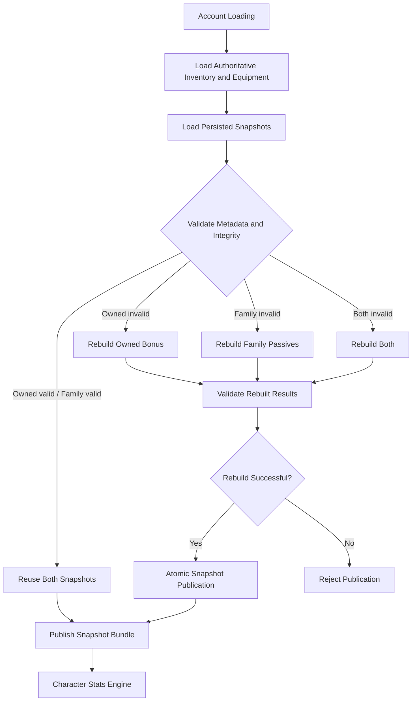

### 4.1 Conditions de validation

Un snapshot est accepté uniquement si :

1. Son propriétaire correspond au compte chargé.
2. Sa version de schéma est compatible.
3. Ses révisions sources correspondent.
4. Son fingerprint correspond aux données autoritaires.
5. Son checksum est valide.
6. Sa version de calcul est compatible.
7. Ses valeurs numériques sont valides.
8. Ses contributions ne contiennent pas de doublons d'identifiants.

Si une condition échoue, le snapshot concerné est reconstruit.

### 4.2 Échec de reconstruction

Si une reconstruction échoue :

- Aucun snapshot partiellement calculé n'est publié.
- L'ancien snapshot invalide n'est pas utilisé comme résultat courant.
- Le moteur signale une erreur de cohérence.
- Les statistiques dérivées restent indisponibles jusqu'à résolution.

Cette politique évite de masquer une corruption de données.

---

# 5. SYS-002.D.10.2.2.6.1 - Gestion des événements

Nous définissons maintenant le comportement lors des modifications en cours de session.

| Événement | Owned Snapshot | Family Snapshot |
|--------|--------|--------|
| Acquisition d'un acolyte | Incrémental | Inchangé |
| Montée de niveau | Incrémental | Inchangé |
| Fusion | Incrémental si nouvel acolyte débloqué | Selon changement d'équipe |
| Équipement | Inchangé | Reconstruction |
| Déséquipement | Inchangé | Reconstruction |
| Modification du profil de croissance | Reconstruction | Inchangé |
| Modification d'un effet | Inchangé | Reconstruction |
| Modification des règles familiales | Selon règles concernées | Reconstruction |
| Connexion | Validation | Validation |

Les mises à jour incrémentales restent le fonctionnement normal.

Les reconstructions complètes constituent le mécanisme de réconciliation.

## 6. Cohérence transactionnelle

Chaque modification doit respecter une séquence atomique :

1. Vérification de l'état initial.
2. Vérification des ressources.
3. Modification de l'inventaire ou de l'équipe.
4. Incrémentation de la révision correspondante.
5. Actualisation du snapshot concerné.
6. Validation des résultats.
7. Publication atomique du nouvel état.

Un identifiant unique d'événement est conservé afin qu'une même opération ne puisse pas être appliquée deux fois.

En cas de modification concurrente de la source pendant un calcul, la publication est rejetée et le calcul est repris depuis la dernière révision.

*Note d'ingénierie : les snapshots sont publiés sous forme d'un ensemble cohérent. Le Character Stats Engine ne doit jamais consommer une combinaison de résultats provenant de révisions incompatibles.*

---

</details>


### SYS-002.D.10.2.2.7 · T058 · 19/11/2026 18:23:39

**Nature :** `APPROBATION_EXPLICITE` · **Ligne d’approbation source :** 20950 · **Ligne de formalisation :** 20955.

**Décision / prescription originale (texte intégral du propriétaire) :**

Je valide également


<details><summary>Formalisation technique de la décision ratifiée (extrait sourcé)</summary>

# SYS-002.D.10.2.2.7 - Mutation &amp; Transaction Engine

(Validé) (Modèle C adopté)

Le modèle hybride devient la politique officielle du `Collection Bonus Engine`.

Les trois mécanismes sont désormais complémentaires :

1. Transactions synchrones pour garantir l'intégrité des mutations.
2. Journalisation durable des événements pour assurer la traçabilité et la reprise.
3. Actualisation incrémentale des snapshots, avec reconstruction complète en cas d'incohérence.

## 1. Contrat architectural définitif

### 1.1 Hiérarchie des données

| Composant | Responsabilité | Autorité |
|--------|--------|--------|
| Acolyte Inventory | Acolytes possédés, niveaux, doublons | Source de vérité |
| Equipped Team | Composition de l'équipe | Source de vérité |
| Event Journal | Historique des mutations | Journal durable |
| Owned Bonus Snapshot | Bonus permanents calculés | Donnée dérivée |
| Family Passive Snapshot | Effets de déploiement calculés | Donnée dérivée |
| Transaction Outbox | Publication des événements | File durable |

Le journal d'événements ne remplace pas l'inventaire comme source de vérité.

Les snapshots ne peuvent jamais modifier directement les données sources.

### 1.2 Séquence transactionnelle

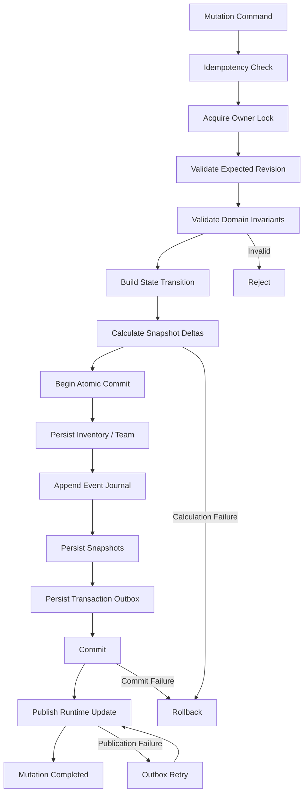

**Règle fondamentale :** aucune mutation n'est considérée comme validée avant le commit durable de la transaction.

## 2. Contrat des événements

Chaque mutation produit un événement identifiable.

| Événement | Déclencheur |
|--------|--------|
| `ACOLYTE_UNLOCKED` | Premier exemplaire obtenu |
| `DUPLICATE_BALANCE_CHANGED` | Acquisition ou consommation de doublons |
| `ACOLYTE_LEVEL_CHANGED` | Amélioration |
| `ACOLYTE_FUSION_RESOLVED` | Fusion 3:1 |
| `TEAM_SLOT_CHANGED` | Modification de l'équipe |
| `COLLECTION_SNAPSHOT_REBUILT` | Reconstruction complète |

Chaque événement contient :

- `event_id`
- `command_id`
- `owner_id`
- `aggregate_revision`
- `event_sequence`
- `event_type`
- `schema_version`
- `payload`
- `configuration_revision`

Les événements sont append-only : un événement validé n'est jamais modifié ou supprimé.

## 3. Garanties transactionnelles

Les règles suivantes deviennent obligatoires.

| Garantie | Mécanisme |
|--------|--------|
| Atomicité | Transaction ACID |
| Idempotence | Identifiant unique de commande |
| Concurrence | Verrou par propriétaire et contrôle de révision |
| Ordonnancement | Séquence monotone des événements |
| Cohérence | Validation des invariants avant commit |
| Traçabilité | Journal append-only |
| Reprise | Transaction Outbox |
| Réconciliation | Reconstruction depuis les données sources |

### 3.1 Idempotence

Une même commande ne doit jamais être appliquée deux fois.

Exemple :

Un joueur effectue une amélioration rapide, mais sa connexion est interrompue avant réception de la réponse.

Il renvoie la même commande.

Le moteur retrouve son `command_id` et retourne le résultat initial sans consommer une seconde fois les doublons.

### 3.2 Gestion de la concurrence

Chaque mutation vérifie la révision attendue.

$$
Revision_{\text{command}}=Revision_{\text{current}}
$$

Si cette condition échoue, la commande est rejetée pour conflit de révision.

Le client doit récupérer l'état actualisé avant de réessayer.

### 3.3 Gestion des événements aléatoires

Pour les fusions produisant un acolyte aléatoire, le résultat du tirage doit être enregistré dans l'événement validé.

Une nouvelle tentative de la même commande ne doit jamais effectuer un nouveau tirage.

Cela garantit qu'une interruption réseau ne peut pas modifier le résultat d'une fusion.

## 4. Comportement par opération

| Opération | Owned Snapshot | Family Snapshot |
|--------|--------|--------|
| Déblocage | Actualisation | Inchangé |
| Acquisition doublon existant | Inchangé | Inchangé |
| Amélioration | Actualisation | Inchangé |
| Fusion avec nouvel acolyte débloqué | Actualisation | Inchangé |
| Fusion vers acolyte déjà possédé | Inchangé | Inchangé |
| Équipement | Inchangé | Actualisation |
| Déséquipement | Inchangé | Actualisation |

Les mutations d'inventaire et d'équipe sont traitées dans des transactions atomiques.

L'amélioration rapide consomme uniquement les coûts des niveaux intégralement atteignables.

## 5. Gestion des défaillances

| Situation | Comportement |
|--------|--------|
| Ressources insuffisantes | Rejet sans mutation |
| Révision incorrecte | Rejet sans mutation |
| Erreur de calcul | Rollback |
| Échec du commit | Rollback |
| Échec de publication Runtime | Reprise via Outbox |
| Snapshot corrompu | Reconstruction |
| Reconstruction impossible | Refus de publication |
| Événement déjà traité | Ignoré grâce à l'idempotence |

Une publication Runtime échouée ne remet pas en cause une transaction déjà validée. L'Outbox conserve le travail restant jusqu'à sa livraison.

---

# 6. Audit final du Collection Bonus Engine

</details>


### SYS-002.D.10.3.1 · T059 · 19/11/2026 18:30:25

**Nature :** `APPROBATION_EXPLICITE` · **Ligne d’approbation source :** 21245 · **Ligne de formalisation :** 21250.

**Décision / prescription originale (texte intégral du propriétaire) :**

Validation du modèle A


<details><summary>Formalisation technique de la décision ratifiée (extrait sourcé)</summary>

# SYS-002.D.10.3.1 - Probability Resolution Engine

(Modèle A validé) (Spécification en cours)

Le modèle à tables de probabilités indépendantes est officiellement intégré au GDD.

Chaque portail possède ses propres tables de probabilités, indépendamment de l'autre portail.

## 1. Architecture retenue

Nous distinguons deux instances :

**Acolyte Summoning Portal**

# Level 1-15

15 tables de probabilités indépendantes

**Skill Summoning Portal**

# Level 1-15

15 tables de probabilités indépendantes

---

**Probability Resolution Engine**

Sélection de rareté et sélection individuelle

Les deux portails possèdent :

- Leur propre expérience cumulée.
- Leur propre niveau d'invocation.
- Leur propre progression vers le niveau 15.
- Leurs propres tables de probabilités.
- Leur propre catalogue de cartes disponibles.

Une invocation d'acolyte ne fait donc jamais progresser le portail de compétences, et inversement.

---

# 2. SYS-002.D.10.3.1.1 - Rarity Probability Tables

## 2.1 Structure des tables

Chaque portail possède 15 tables explicites.

Chaque table contient les probabilités des huit raretés classiques.

| Identifiant | Rareté | Couleur |
|--------|--------|--------|
| `NORMAL` | Normal | Gris |
| `UNIQUE` | Unique | Vert |
| `SUPERIOR` | Supérieur | Bleu |
| `RARE` | Rare | Violet |
| `MYTHIC` | Mythique | Orange |
| `EPIC` | Épique | Rouge |
| `LEGENDARY` | Légendaire | Jaune |
| `IMMORTAL` | Immortel | Rose |

La catégorie Exclusive/Collab possède un traitement séparé. Elle n'appartient pas automatiquement au catalogue des invocations classiques.

## 2.2 Exemple de structure

Voici une table illustrative pour le portail d'acolytes au niveau 15.

| Rareté | Probabilité |
|--------|--------|
| Normal | 40 % |
| Unique | 25 % |
| Supérieur | 18 % |
| Rare | 10 % |
| Mythique | 4 % |
| Épique | 2 % |
| Légendaire | 0,96 % |
| Immortel | 0,04 % |
| **Total** | **100 %** |

Exemple fictif de répartition. Seul le taux Immortel de 0,04 % provient des observations communiquées. Les autres valeurs ne sont pas des données officielles.

## 2.3 Données connues sur les Immortels

Nous pouvons déjà enregistrer quatre points de référence :

| Niveau du portail | Probabilité Immortel |
|--------|--------|
| 12 | 0,01 % |
| 13 | 0,02 % |
| 14 | 0,03 % |
| 15 | 0,04 % |

Les probabilités des niveaux 1 à 11 restent à documenter.

Ces valeurs constituent actuellement des observations provisoires, pas une calibration officielle complète.

---

# 3. SYS-002.D.10.3.1.2 - Rarity Selection Algorithm

Une invocation se déroule en deux étapes distinctes.

**Étape 1 - Sélection de la rareté**

Le moteur effectue un tirage probabiliste à partir de la table correspondant au niveau actuel du portail.

$$
R\sim P(R\mid Portal,Level)
$$

**Étape 2 - Sélection de la carte**

Une fois la rareté déterminée, le moteur sélectionne uniformément une carte parmi les cartes disponibles de cette rareté.

Si une rareté possède $N$ cartes disponibles :

$$
\boxed{
P(Card_i)=\frac{P(R)}{N}
}
$$

Exemple :

- Probabilité Mythique : 10 %.
- Nombre de cartes Mythiques disponibles : 5.

Chaque carte possède alors :

$$
P(Card_i)=\frac{10\%}{5}=2\%
$$

Cette règle reprend la décision `uniform_available` validée précédemment.

Les catalogues doivent être versionnés pour garantir la reproductibilité des résultats.

---

# 4. SYS-002.D.10.3.1.3 - Probability Resolution Sequence

Nous intégrons les décisions précédentes :

- XP par invocation : 1.
- XP avant tirage : `before_xp`.
- Tirages groupés : `sequential`.
- Sélection des cartes : `uniform_available`.
- Progressions XP : `independent`.
- Pity classique : absent.

La séquence devient :

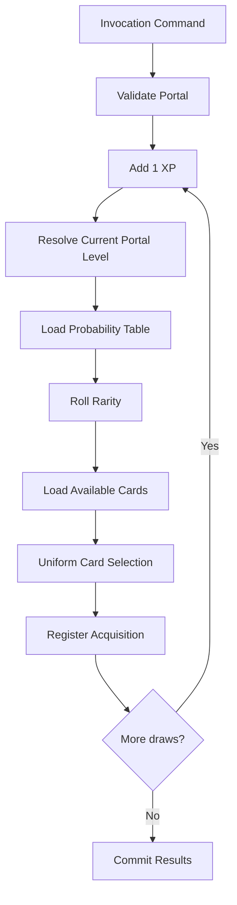

### Conséquence importante des tirages groupés

Supposons que le portail possède suffisamment d'expérience pour atteindre le niveau 12 après le premier tirage.

Le tirage suivant utilisera la table du niveau 12.

Les tirages groupés ne sont donc pas calculés comme un unique événement probabiliste.

Chaque tirage possède son propre état de portail.

Cela permet de franchir plusieurs niveaux de machine au cours d'une seule invocation groupée.

---

# 5. Contrat de données

La structure de configuration proposée :

```python
from dataclasses import dataclass
from decimal import Decimal
from typing import Mapping

@dataclass(frozen=True)
class RarityProbabilityTable:
    portal_id: str
    portal_level: int

    probabilities: Mapping[str, Decimal]

    catalog_revision: int
    table_revision: int

@dataclass(frozen=True)
class SummoningPortalState:
    portal_id: str

    total_xp: int
    current_level: int

    revision: int

@dataclass(frozen=True)
class SummoningResult:
    portal_id: str

    resolved_level: int
    selected_rarity: str
    selected_card_id: str

    table_revision: int
    catalog_revision: int
```

Les probabilités sont conservées en `Decimal`, sans arrondi intermédiaire.

Le résultat conserve les versions des configurations utilisées lors du tirage.

---

# 6. SYS-002.D.10.3.1.4 - Invariants du Probability Engine

| ID | Invariant | Comportement |
|--------|--------|--------|
| PROB-001 | Une table par niveau et portail | Obligatoire |
| PROB-002 | Huit raretés classiques explicites | Obligatoire |
| PROB-003 | Somme des probabilités | À définir |
| PROB-004 | Probabilité négative | Interdite |
| PROB-005 | Carte indisponible | Exclue du pool |
| PROB-006 | Rareté positive sans carte disponible | Rejet |
| PROB-007 | Sélection individuelle | Uniforme |
| PROB-008 | Niveau maximum | 15 |
| PROB-009 | XP des portails | Indépendante |
| PROB-010 | Pity classique | Absent |

---

# 7. SYS-002.D.10.3.1.5 - Validation des règles de normalisation

Il reste à déterminer comment le moteur traite les tables de probabilités.

Trois décisions sont nécessaires.

**1. Somme des probabilités**

- A - Strictement égale à 100 %. Toute table incorrecte est rejetée.
- B - Inférieure ou égale à 100 %. Le reliquat représente une possibilité de tirage sans récompense.

Je recommande A.

**2. Rareté indisponible**

- A - Une rareté indisponible doit avoir une probabilité de zéro.
- B - Le moteur redistribue automatiquement sa probabilité aux autres raretés.

Je recommande A. La redistribution automatique modifierait les probabilités officielles.

**3. Précision numérique**

- A - Précision décimale complète, sans arrondi intermédiaire.
- B - Précision limitée à six décimales.

Je recommande A, conformément aux décisions précédentes sur la précision numérique.

**Décisions proposées**

| Paramètre | Choix recommandé |
|--------|--------|
| Normalisation | `strict_100` |
| Rareté indisponible | `zero_probability` |
| Précision | `full_precision` |

**Validation attendue : SYS-002.D.10.3.1.5.**

Après validation, nous poursuivrons avec `SYS-002.D.10.3.2 - Portal XP Progression Engine`, qui définira précisément les seuils d'expérience des quinze niveaux et les transitions entre niveaux.

</details>


### SYS-002.D.10.3.1.5 · T060 · 19/11/2026 18:33:12

**Nature :** `APPROBATION_EXPLICITE` · **Ligne d’approbation source :** 21567 · **Ligne de formalisation :** 21572.

**Décision / prescription originale (texte intégral du propriétaire) :**

Je valide cette recommendaion


<details><summary>Formalisation technique de la décision ratifiée (extrait sourcé)</summary>

# SYS-002.D.10.3.1.5 - Formalisation et clôture

(Validé) (Contrat intégré au GDD)

Les trois décisions sont désormais définitives.

| Paramètre | Décision |
|--------|--------|
| Normalisation | `strict_100` |
| Rareté indisponible | `zero_probability` |
| Précision numérique | `full_precision` |

## 1. Contrats mathématiques

### 1.1 Normalisation stricte

Pour chaque portail $P$ et chaque niveau $L$ :

$$
\boxed{\sum_{r\in R}P(r\mid P,L)=1}
$$

Avec :

$$
R=\{NORMAL,UNIQUE,SUPERIOR,RARE,
MYTHIC,EPIC,LEGENDARY,IMMORTAL\}
$$

Une table dont la somme diffère de 100 % est rejetée.

Aucune normalisation automatique n'est autorisée.

### 1.2 Raretés indisponibles

$$
N_r=0\Rightarrow P(r)=0
$$

Si une rareté possède une probabilité positive mais aucune carte disponible, la configuration est rejetée.

Aucune redistribution automatique de cette probabilité n'est effectuée.

### 1.3 Précision

Toutes les probabilités utilisent `Decimal`.

Aucun arrondi intermédiaire n'est autorisé.

### 1.4 Sélection des cartes

Pour une rareté comportant $N_r$ cartes disponibles :

$$
P(Card_i)=\frac{P(r)}{N_r}
$$

Une carte obtenue reste dans le pool d'invocation : les doublons sont possibles et les cartes ne sont pas retirées du catalogue après un tirage.

---

</details>


### SYS-002.D.10.3.2.4 · T061 · 19/11/2026 18:36:32

**Nature :** `APPROBATION_EXPLICITE` · **Ligne d’approbation source :** 21909 · **Ligne de formalisation :** 21914.

**Décision / prescription originale (texte intégral du propriétaire) :**

Validation SYS-002.D.10.3.2.4 : stockage des seuils = cumulative_lookup ; expérience niveau 15 = retain_xp ; observations = Aucune. Formalise les décisions et poursuis selon le protocole.


<details><summary>Formalisation technique de la décision ratifiée (extrait sourcé)</summary>

# SYS-002.D.10.3.2.4 - Formalisation et clôture

(Validé) (Spécification clôturée)

Les décisions sont intégrées au GDD.

| Paramètre | Décision |
|--------|--------|
| Stockage des seuils | `cumulative_lookup` |
| XP au niveau 15 | `retain_xp` |
| XP par tirage | \+1 |
| Ordre XP/tirage | `before_xp` |
| Tirages groupés | `sequential` |
| Portails | `independent` |
| Niveau maximum | 15 |

## 1. Contrat mathématique définitif

Chaque portail possède une table de seuils cumulatifs :

$$
T_P=\{T_1,T_2,\ldots,T_{15}\}
$$

Avec :

$$
T_1=0
$$

$$
T_{l+1}>T_l
$$

Le niveau courant est déterminé par :

$$
\boxed{
L_P(X)=\min\left(15,\max\{l:T_l\leq X\}\right)
}
$$

L'expérience totale évolue ainsi :

$$
X_{n+1}=X_n+1
$$

Au niveau 15 :

$$
L_P(X)=15 \quad \forall X\geq T_{15}
$$

L'expérience continue de s'accumuler sans réinitialisation.

Elle ne modifie plus les probabilités tant que le plafond reste fixé à 15.

## 2. Source de vérité

L'expérience cumulée constitue la donnée autoritaire.

Le niveau courant est une donnée dérivée des seuils configurés.

```python
@dataclass(frozen=True)
class SummoningPortalState:
    portal_id: str
    total_xp: int
    current_level: int
    threshold_revision: int
    state_revision: int
```

Une modification de la table de seuils impose une nouvelle validation du niveau dérivé.

## 3. Tests d'acceptation

| ID | Test | Résultat |
|--------|--------|--------|
| XP-001 | XP initial | 0 |
| XP-002 | Un tirage | \+1 XP |
| XP-003 | Franchissement de seuil | Nouveau niveau immédiat |
| XP-004 | Tirage groupé | Résolution séquentielle |
| XP-005 | Niveau 15 | XP conservée |
| XP-006 | Dépassement du seuil 15 | Niveau maintenu à 15 |
| XP-007 | Portails indépendants | Aucune contamination |
| XP-008 | Seuils invalides | Configuration rejetée |

La spécification `SYS-002.D.10.3.2` est clôturée.

---

</details>


### SYS-002.D.10.3.3.4 · T062 · 19/11/2026 18:42:27

**Nature :** `APPROBATION_EXPLICITE` · **Ligne d’approbation source :** 22266 · **Ligne de formalisation :** 22271.

**Décision / prescription originale (texte intégral du propriétaire) :**

Validation SYS-002.D.10.3.3.4 : atomicité = durable_sequential ; gestion tickets = reserve_full ; sélection fusion = uniform_available ; observations = Aucune. Formalise les décisions et poursuis selon le protocole.


<details><summary>Formalisation technique de la décision ratifiée (extrait sourcé)</summary>

# SYS-002.D.10.3.3.4 - Formalisation des décisions

(Validé) (Contrat transactionnel adopté)

Les trois décisions sont intégrées au GDD.

| Paramètre | Décision |
|--------|--------|
| Atomicité | `durable_sequential` |
| Gestion des tickets | `reserve_full` |
| Sélection des fusions | `uniform_available` |

## 1. Durable Sequential - Contrat transactionnel

Une invocation groupée est désormais composée d'une transaction parent et de plusieurs transactions enfants.

- La transaction parent gère la réservation et le suivi global.
- Chaque transaction enfant correspond à un tirage individuel.
- Chaque tirage validé est définitivement enregistré.
- Une erreur sur un tirage n'annule pas les tirages précédemment validés.
- La reprise commence au prochain tirage non validé.

### Séquence d'un tirage individuel

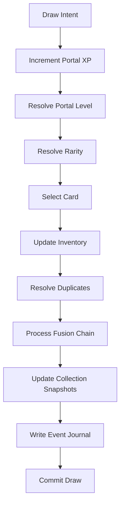

Toutes ces opérations sont atomiques à l'échelle du tirage.

Une interruption avant le commit annule uniquement les modifications de ce tirage.

Un identifiant `draw_id` unique garantit l'idempotence.

Les résultats aléatoires et les versions des configurations utilisées sont conservés afin de rendre les reprises reproductibles.

## 2. Reserve Full - Gestion des tickets

La réservation intervient avant le premier tirage.

$$
Tickets_{\text{available}}
\geq Tickets_{\text{required}}
$$

Si cette condition est satisfaite :

1. Le coût total est réservé.
2. Les tickets réservés deviennent indisponibles pour les autres commandes.
3. Chaque tirage consomme sa quote-part de réservation.
4. La somme des consommations correspond exactement au tarif de l'offre.
5. La réservation est soldée à la fin de l'invocation.

Les offres promotionnelles possèdent leur propre configuration tarifaire.

Exemple :

$$
35\text{ tirages}=30\text{ tickets}
$$

Le moteur conserve le coût total de 30 tickets et répartit comptablement la consommation entre les 35 tirages, sans arrondi susceptible de modifier le coût final.

En cas d'interruption technique, le reliquat de réservation est conservé pour permettre la reprise.

## 3. Uniform Available - Fusion 3:1

La sélection des cartes fusionnées est uniforme dans un catalogue spécifique de fusion.

Pour $N$ cartes éligibles :

$$
P(Card_i)=\frac{1}{N}
$$

Cette sélection est indépendante des probabilités des portails d'invocation.

Nous introduisons un attribut :

`fusion_eligible`

Les acolytes exclusifs et les collaborations sont exclus par défaut, sauf configuration explicite.

### Règles de fusion

| Condition | Comportement |
|--------|--------|
| Carte niveau inférieur à 200 | Doublons conservés |
| Carte niveau 200 | Fusion automatique par groupes de 3 |
| Fusion obtenue | Carte de rareté supérieure |
| Carte supérieure déjà possédée | Ajout d'un doublon |
| Carte supérieure déjà niveau 200 | Nouvelle vérification de fusion |
| Immortel niveau 200 | Doublons conservés |

La chaîne de fusion est exécutée immédiatement et se poursuit tant qu'une nouvelle fusion est possible.

Les portails Acolytes et Compétences possèdent des catalogues et des inventaires distincts. La mécanique 3:1 s'applique aux deux catégories.

---

</details>


### SYS-002.D.10.3.4.1 · T063 · 19/11/2026 18:47:23

**Nature :** `APPROBATION_EXPLICITE` · **Ligne d’approbation source :** 22550 · **Ligne de formalisation :** 22555.

**Décision / prescription originale (texte intégral du propriétaire) :**

Validation SYS-002.D.10.3.4.1 : niveau initial après fusion = level_one ; gestion des doublons = manual ; observations = Aucune. Formalise les décisions et poursuis selon le protocole.


<details><summary>Formalisation technique de la décision ratifiée (extrait sourcé)</summary>

# SYS-002.D.10.3.4.1 - Formalisation des décisions

(Validé) (Contrats intégrés au GDD)

Les deux décisions sont désormais définitives.

| Paramètre | Décision |
|--------|--------|
| Niveau initial après fusion | `level_one` |
| Gestion des doublons | `manual` |

## 1. Acquisition d'une nouvelle carte

Toute carte obtenue pour la première fois, que ce soit par invocation ou par fusion, commence au niveau 1.

$$
L_{\text{new}}=1
$$

Son niveau ne dépend jamais :

- Du niveau de la carte ayant produit la fusion.
- Du nombre de doublons consommés.
- Du niveau des autres cartes de sa famille.
- Du niveau du portail d'invocation.

Une nouvelle acquisition initialise une fiche indépendante.

## 2. Gestion des doublons

Nous distinguons trois situations.

| État de la carte | Traitement |
|--------|--------|
| Niveau 1 à 199 | Conservation des doublons |
| Niveau 200, rareté inférieure à Immortel | Synthèse automatique par groupes de 3 |
| Niveau 200, rareté Immortel | Conservation définitive des doublons |

Pour une carte inférieure au niveau 200 :

$$
D_{\text{new}}=D_{\text{current}}+1
$$

Aucune amélioration automatique n'est déclenchée.

L'amélioration rapide reste une fonctionnalité distincte du système de progression.

## 3. Traitement des doublons excédentaires au niveau 200

Une règle importante est ajoutée : lorsqu'une carte atteint le niveau 200, ses doublons déjà accumulés sont immédiatement examinés.

Exemple :

- Niveau actuel : 199.
- Doublons accumulés : 5.
- Amélioration : niveau 200.
- Fusion immédiate : 3 doublons consommés.
- Solde restant : 2 doublons.

$$
D_{\text{restant}}=5-(3\times1)=2
$$

Le mécanisme fonctionne également lorsqu'une fusion produit une carte déjà possédée et niveau 200.

---

# 4. Contrat mathématique de fusion

Soit :

- $D$ : solde de doublons.
- $k$ : nombre de fusions réalisables.
- $R$ : rareté actuelle.

Pour une carte niveau 200 :

$$
k=\left\lfloor\frac{D}{3}\right\rfloor
$$

$$
D_{\text{restant}}=D\bmod3
$$

Chaque fusion produit une carte de rareté immédiatement supérieure.

$$
R_{\text{résultat}}=NextRarity(R)
$$

La chaîne de rareté est :

$$
NORMAL\rightarrow UNIQUE\rightarrow SUPERIOR
$$

$$
\rightarrow RARE\rightarrow MYTHIC\rightarrow EPIC
$$

$$
\rightarrow LEGENDARY\rightarrow IMMORTAL
$$

`IMMORTAL` constitue un état terminal.

Les fusions sont exécutées successivement jusqu'à ce qu'aucune fusion supplémentaire ne soit possible.

# 5. Contrat de données définitif

Le modèle d'inventaire est consolidé autour d'un enregistrement unique par carte possédée.

```python
@dataclass
class OwnedCard:
    owner_id: str
    card_id: str

    rarity_id: str
    level: int

    duplicate_balance: int

    growth_profile_id: str
    inventory_revision: int
```

Contraintes :

- Un seul enregistrement par combinaison `owner_id + card_id`.
- `level` compris entre 1 et 200.
- `duplicate_balance` supérieur ou égal à zéro.
- Les doublons ne créent jamais de nouvelles fiches.
- Une carte fusionnée conserve son identité propre.
- Le profil de croissance est associé à la carte, pas à la carte ayant produit la fusion.

## 5.1 Algorithme de distribution

Le traitement d'une récompense suit désormais cet ordre :

```python

def distribute_reward(owner_id, card_id):
    card = inventory.find(owner_id, card_id)

    if card is None:
        inventory.create(
            owner_id=owner_id,
            card_id=card_id,
            level=1,
            duplicate_balance=0,
        )
        emit("CARD_UNLOCKED", owner_id, card_id)
        return

    card.duplicate_balance += 1
    emit("DUPLICATE_ADDED", owner_id, card_id)

    if card.level < 200:
        return

    if card.rarity_id == "IMMORTAL":
        return

    process_fusion_chain(owner_id, card)

def process_fusion_chain(owner_id, card):
    while (
        card.level == 200
        and card.rarity_id != "IMMORTAL"
        and card.duplicate_balance >= 3
    ):
        card.duplicate_balance -= 3

        next_rarity = next_rarity_of(card.rarity_id)

        result = select_uniform_fusion_card(next_rarity)

        emit("FUSION_RESOLVED", owner_id, result.card_id)

        distribute_fusion_result(owner_id, result.card_id)

def distribute_fusion_result(owner_id, card_id):
    card = inventory.find(owner_id, card_id)

    if card is None:
        inventory.create(
            owner_id=owner_id,
            card_id=card_id,
            level=1,
            duplicate_balance=0,
        )
        emit("CARD_UNLOCKED", owner_id, card_id)
        return

    card.duplicate_balance += 1
    emit("FUSION_DUPLICATE_ADDED", owner_id, card_id)

    if card.level == 200:
        process_fusion_chain(owner_id, card)
```

*Note d'ingénierie : cet algorithme décrit les transitions métier. En production, toutes les opérations de fusion doivent être exécutées dans la transaction enfant du tirage, avec journalisation des résultats aléatoires et protection contre les traitements récursifs non bornés.*

## 5.2 Actualisation des snapshots

| Opération | Owned Bonus Snapshot | Family Passive Snapshot |
|--------|--------|--------|
| Nouvelle acquisition d'acolyte | Actualisation | Inchangé |
| Doublon d'acolyte | Inchangé | Inchangé |
| Nouvelle acquisition de compétence | Inchangé | Inchangé |
| Fusion produisant un nouvel acolyte | Actualisation | Inchangé |
| Fusion produisant un doublon | Inchangé | Inchangé |
| Amélioration d'acolyte | Actualisation | Inchangé |

Les cartes obtenues par fusion ne sont jamais automatiquement équipées.

---

</details>


### SYS-002.D.10.3.4.2 · T064 · 19/11/2026 18:50:33

**Nature :** `APPROBATION_EXPLICITE` · **Ligne d’approbation source :** 22884 · **Ligne de formalisation :** 22889.

**Décision / prescription originale (texte intégral du propriétaire) :**

Validation SYS-002.D.10.3.4.2 : catalogue = portal_catalog  exclusifs = explicit_only. Formalise les décisions et poursuis selon le protocole.


**Source technique :** réponse consécutive et proposition précédant cette validation, consultables dans l’historique original. Aucun extrait automatique n’a été retenu faute de délimitation non ambiguë.


### SYS-002.D.10.3.4.2 · T065 · 19/11/2026 18:55:35

**Nature :** `EXIGENCE_OU_RECTIFICATION_PROPRIETAIRE` · **Ligne d’approbation source :** 23244 · **Ligne de formalisation :** 23249.

**Décision / prescription originale (texte intégral du propriétaire) :**

Je veux corriger un point, si une carte d'acolyte ou de compétence n'a pas été débloqué par le tirage, elle ne peut pas être obtenue par la fusion


<details><summary>Formalisation technique de la décision ratifiée (extrait sourcé)</summary>

# Correction GDD - SYS-002.D.10.3.4.2

(Correction intégrée)

Cette précision modifie une règle fondamentale du moteur de fusion. La décision précédente `all_catalog_entries` est remplacée.

**Nouvelle règle : une fusion ne peut produire qu'une carte que le joueur a déjà débloquée au moins une fois grâce à une invocation du portail correspondant.**

Une fusion ne permet donc jamais de débloquer une nouvelle carte.

## 1. Nouvelle règle d'éligibilité

Une carte est éligible à la fusion si toutes les conditions suivantes sont satisfaites :

1. Elle appartient au catalogue du portail concerné.
2. Elle possède la rareté immédiatement supérieure.
3. Elle a déjà été obtenue par invocation par le joueur.
4. Elle est autorisée pour la fusion.
5. Elle respecte les restrictions relatives aux cartes exclusives.

Le nouvel ensemble de candidats est :

$$
\mathcal C_{p,r}=
\left\{
c\in Catalog_p\mid
Rarity(c)=r
\land DrawUnlocked(p,c)
\land Eligible(c)
\right\}
$$

Où :

- $p$ représente le joueur et le portail.
- $r$ représente la rareté recherchée.
- `DrawUnlocked` indique que la carte a déjà été débloquée par invocation.

## 2. Conséquence sur le fonctionnement des fusions

**Cas A - Carte déjà débloquée par invocation**

(Éligible)

Le joueur possède déjà cette carte. La fusion ajoute un doublon à son inventaire.

---

**Cas B - Carte jamais obtenue par invocation**

(Non éligible)

Même si elle appartient au catalogue et possède la bonne rareté, elle ne peut pas être sélectionnée.

---

**Cas C - Aucune carte éligible dans la rareté supérieure**

(Fusion suspendue)

Les trois doublons ne sont pas consommés. Ils restent conservés dans l'inventaire jusqu'à ce qu'une carte éligible soit débloquée par invocation.

## 3. Nouveau comportement mathématique

Pour une fusion 3:1 :

$$
N=|\mathcal C_{p,r}|
$$

Si :

$$
N=0
$$

Alors :

$$
D_{\text{consommés}}=0
$$

Si :

$$
N>0
$$

Alors :

$$
P(c_i)=\frac{1}{N}
$$

La carte sélectionnée reçoit un doublon supplémentaire.

$$
D_{c_i}'=D_{c_i}+1
$$

**Aucune création de nouvelle fiche d'acolyte ou de compétence n'est autorisée par une fusion.**

## 4. Gestion des fusions en attente

Un nouveau mécanisme est nécessaire.

Lorsqu'un joueur débloque une carte par invocation, le moteur réévalue les fusions précédemment bloquées.

Exemple :

1. Le joueur possède un acolyte Normal niveau 200.
2. Il possède trois doublons supplémentaires.
3. Aucune carte Unique n'a encore été débloquée par invocation.
4. La fusion reste bloquée.
5. Le joueur invoque un acolyte Unique pour la première fois.
6. Cette carte devient éligible.
7. Le moteur réévalue les fusions en attente.
8. La fusion Normal → Unique peut désormais être exécutée.

Les doublons précédemment conservés ne sont jamais perdus.

## 5. Modifications du modèle de données

Nous ajoutons une information de provenance persistante.

```python
@dataclass
class OwnedCard:
    owner_id: str
    card_id: str

    rarity_id: str
    level: int

    duplicate_balance: int

    unlocked_by_draw: bool
    first_draw_event_id: str | None

    growth_profile_id: str
    inventory_revision: int
```

Invariant :

```python
unlocked_by_draw = True
```

Uniquement après une acquisition directe par invocation.

Une fusion ne peut jamais modifier ce champ de `False` à `True`.

## 6. Mise à jour des décisions validées

| Paramètre | Ancienne décision | Nouvelle décision |
|--------|--------|--------|
| Catalogue | `portal_catalog` | Inchangé |
| Cartes candidates | `all_catalog_entries` | `unlocked_only` |
| Exclusifs | `explicit_only` | Inchangé |
| Sélection | `uniform_available` | Inchangé |
| Nouvelle carte par fusion | Autorisée | Interdite |
| Doublons sans candidat | Fusion rejetée | Conservation en attente |

## 7. Tests d'acceptation supplémentaires

| ID | Scénario | Résultat attendu |
|--------|--------|--------|
| FUS-009 | Carte jamais invoquée | Exclue |
| FUS-010 | Carte déjà invoquée | Éligible |
| FUS-011 | Carte débloquée sur un autre portail | Exclue |
| FUS-012 | Catalogue sans candidat débloqué | Doublons conservés |
| FUS-013 | Nouveau déblocage par invocation | Réévaluation des fusions |
| FUS-014 | Fusion d'une carte déjà possédée | Ajout d'un doublon |
| FUS-015 | Fusion créant une nouvelle fiche | Interdite |
| FUS-016 | Carte exclusive non autorisée | Exclue |

---

# 8. État actualisé de SYS-002.D.10.3.4.2

(Modèle corrigé)

La règle de fusion est désormais cohérente avec une progression fondée sur le déblocage préalable des cartes par invocation.

Cette correction s'applique aux deux portails :

- Acolyte Summoning Portal.
- Skill Summoning Portal.

Elle ne modifie pas les règles de progression, les coûts 3:1, les probabilités d'invocation ou les niveaux des cartes.

**Le catalogue de fusion ne permet plus de découvrir des cartes : il permet uniquement de renforcer celles que le joueur a déjà découvertes.**

</details>


### SYS-002.D.10.3.5.1 · T066 · 19/11/2026 18:59:29

**Nature :** `APPROBATION_EXPLICITE` · **Ligne d’approbation source :** 23472 · **Ligne de formalisation :** 23477.

**Décision / prescription originale (texte intégral du propriétaire) :**

Validation SYS-002.D.10.3.5.1 : moment du débit = charge_on_start ; interruption = resume_required. Formalise les décisions et poursuis l'audit global du Summoning Engine.


<details><summary>Formalisation technique de la décision ratifiée (extrait sourcé)</summary>

# SYS-002.D.10.3.5.1 - Formalisation de la facturation

(Validé) (Contrat intégré au GDD)

Les décisions sont définitives.

| Paramètre | Décision |
|--------|--------|
| Réservation | `reserve_full` |
| Moment du débit | `charge_on_start` |
| Interruption | `resume_required` |
| Atomicité des tirages | `durable_sequential` |
| Remboursement automatique après démarrage | Non |

## 1. Cycle de vie financier

Nous distinguons désormais trois opérations.

**Étape 1 - Réservation**

À la validation de la commande :

- Vérification du solde disponible.
- Réservation du coût total de l'offre.
- Blocage des tickets réservés pour les autres opérations.

Aucun tirage n'est encore effectué.

**Étape 2 - Débit**

Juste avant le premier tirage :

- Conversion de la réservation en débit définitif.
- Passage du lot à l'état `PROCESSING`.
- Enregistrement de la date et de la référence de facturation.

Le débit et le changement d'état sont atomiques.

**Étape 3 - Distribution**

Les tirages sont exécutés individuellement.

Chaque tirage validé est définitivement enregistré. Une interruption ne remet jamais en cause les résultats précédents.

## 2. Machine à états

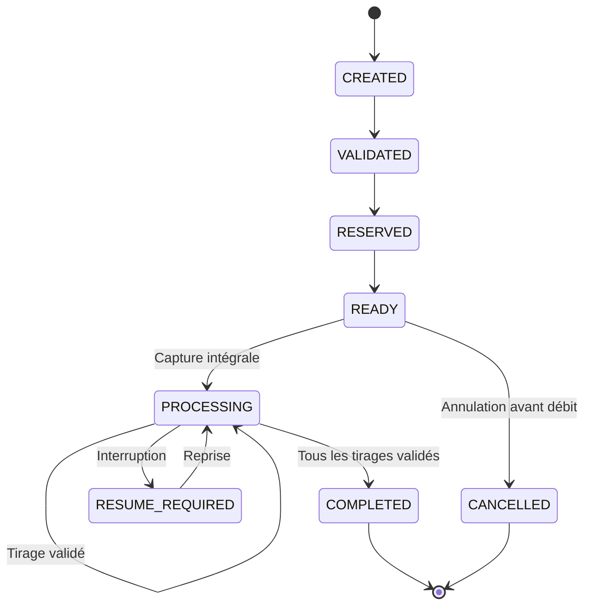

### 2.1 Règles de reprise

Exemple : une invocation de 35 tirages.

| État | Valeur |
|--------|--------|
| Tirages demandés | 35 |
| Tickets débités | 30 |
| Tirages validés | 24 |
| Tirages restants | 11 |
| Nouveaux tickets à débiter | 0 |

La reprise commence au tirage 25.

Aucun des 24 premiers tirages ne peut être rejoué.

Une impossibilité technique permanente entraîne le gel du lot et une réconciliation administrative. Aucun remboursement automatique n'est déclenché.

## 3. Comptabilité des offres

Le coût est enregistré au niveau du lot.

Par exemple :

$$
Cost(35)=30\text{ tickets}
$$

Il n'existe aucune obligation de répartir artificiellement ce coût entre les 35 tirages.

Le registre financier conserve :

- `batch_id`
- `offer_id`
- `reserved_amount`
- `captured_amount`
- `draw_count`
- `completed_draw_count`
- `next_draw_index`
- `billing_status`

---

# 4. Correction complémentaire - Cohérence du Fusion Engine

L'audit révèle une conséquence importante de ta précédente correction.

La décision `level_one` de SYS-002.D.10.3.4.1 doit être interprétée différemment.

Puisqu'une fusion ne peut plus débloquer une nouvelle carte, elle ne peut plus créer une nouvelle fiche de niveau 1.

La règle définitive devient :

| Opération | Résultat |
|--------|--------|
| Première acquisition par invocation | Nouvelle carte niveau 1 |
| Doublon obtenu par invocation | \+1 doublon |
| Fusion vers une carte déjà débloquée | \+1 doublon |
| Carte obtenue par fusion | Niveau existant conservé |
| Carte jamais débloquée par invocation | Fusion interdite |

La décision `level_one` reste applicable aux acquisitions initiales par invocation, mais devient sans objet pour les fusions.

Le précédent algorithme qui créait une fiche lorsque la carte fusionnée était absente est donc invalidé.

**Nouvel invariant :**

$$
Fusion(c)\Rightarrow DrawUnlocked(c)=True
$$

Aucune exception.

## 4.1 Gestion d'une fusion bloquée

Un cas doit être traité explicitement.

Exemple :

- Acolyte Normal niveau 200.
- 6 doublons disponibles.
- Aucune carte Unique débloquée par invocation.

Le moteur ne peut pas effectuer les deux fusions.

Il conserve les 6 doublons.

(Fusion en attente)

Lorsque des cartes Unique deviennent éligibles, le moteur peut réexaminer les fusions en attente.

Cette dernière règle nécessite encore une validation explicite.

---

</details>


### SYS-002.D.10.3.5.3 · T067 · 19/11/2026 19:05:21

**Nature :** `APPROBATION_EXPLICITE` · **Ligne d’approbation source :** 23775 · **Ligne de formalisation :** 23780.

**Décision / prescription originale (texte intégral du propriétaire) :**

Validation du modèle A


<details><summary>Formalisation technique de la décision ratifiée (extrait sourcé)</summary>

# SYS-002.D.10.3.5.3 - Formalisation du modèle A

(Validé) (Automatisation adoptée)

La réévaluation automatique des fusions en attente devient la règle officielle.

## 1. Déclenchement de la réévaluation

L'événement déclencheur est :

`CARD_DRAW_UNLOCKED`

Il est émis lorsqu'un joueur obtient pour la première fois une carte par invocation.

Le moteur lance alors une réévaluation des cartes suivantes :

$$
\mathcal F=
\left\{
c\mid
Level(c)=200
\land Duplicates(c)\geq3
\land Rarity(c)\neq IMMORTAL
\right\}
$$

Pour chaque carte, le moteur vérifie l'existence d'au moins une destination éligible dans la rareté supérieure.

Si aucune destination n'existe, les doublons restent intacts.

## 2. Séquence de traitement

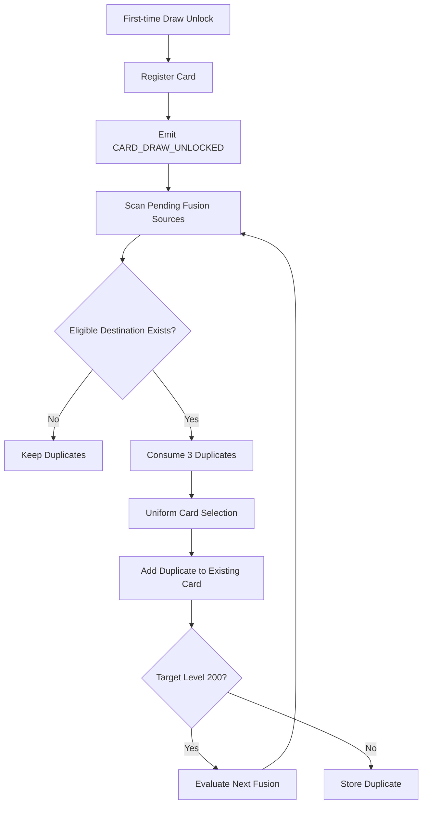

La réévaluation s'effectue dans la transaction du tirage ayant provoqué le déblocage.

Si le traitement technique échoue, la transaction est reprise sans rejouer le tirage déjà validé.

## 3. Invariants définitifs

| ID | Règle |
|--------|--------|
| FUS-017 | Déblocage initial par invocation uniquement |
| FUS-018 | Réévaluation automatique après nouveau déblocage |
| FUS-019 | Fusion immédiate si les conditions sont réunies |
| FUS-020 | Conservation des doublons si aucun candidat |
| FUS-021 | Aucun déblocage par fusion |
| FUS-022 | Aucun niveau transmis par fusion |
| FUS-023 | Conservation du niveau de la carte destination |
| FUS-024 | Immortel niveau 200 : aucune fusion supérieure |

La règle `level_one` reste applicable exclusivement à une première acquisition par invocation.

Une fusion ajoute toujours un doublon à une carte déjà débloquée.

---

</details>


### SYS-002.D.10.3.5.4 · T068 · 19/11/2026 19:07:20

**Nature :** `APPROBATION_EXPLICITE` · **Ligne d’approbation source :** 23965 · **Ligne de formalisation :** 23970.

**Décision / prescription originale (texte intégral du propriétaire) :**

Je valide le modèle A


<details><summary>Formalisation technique de la décision ratifiée (extrait sourcé)</summary>

# SYS-002.D.10.3.5.4 - Formalisation du Fusion Scheduler

(Validé) (Modèle A adopté)

La politique d'ordonnancement déterministe devient définitive.

## 1. Règles d'ordonnancement

Les sources de fusion sont classées selon deux critères successifs :

1. Rareté source croissante, de Normal à Légendaire.
2. Identifiant `card_id` croissant pour départager les cartes de même rareté.

Chaque fusion est exécutée individuellement.

Après chaque fusion, le moteur réévalue les conditions d'éligibilité et reconstruit l'ordre de traitement.

### 1.1 Exemple

État initial :

| Carte | Rareté | Niveau | Doublons |
|--------|--------|--------|--------|
| Acolyte A | Normal | 200 | 6 |
| Acolyte B | Normal | 200 | 3 |
| Acolyte C | Unique | 200 | 6 |
| Acolyte D | Rare | 200 | 3 |

Le moteur traite les cartes dans l'ordre :

1. Acolyte A.
2. Acolyte B.
3. Acolyte C.
4. Acolyte D.

Les cartes obtenues par fusion peuvent elles-mêmes devenir des sources de fusion si elles sont déjà niveau 200 et possèdent trois doublons.

## 2. Contrat de traitement

$$
Priority(c)=(RarityIndex(c),card\_id(c))
$$

Une carte est éligible comme source lorsque :

$$
Level(c)=200
$$

$$
Duplicates(c)\geq3
$$

$$
Rarity(c)\neq IMMORTAL
$$

Et qu'au moins une carte destination éligible existe dans la rareté supérieure.

Le traitement s'effectue jusqu'à épuisement des possibilités.

### 2.1 Pseudocode de référence

```python
def process_fusion_scheduler(owner_id):
    while True:
        eligible_sources = find_eligible_fusion_sources(owner_id)

        eligible_sources.sort(
            key=lambda card: (
                rarity_index(card.rarity_id),
                card.card_id,
            )
        )

        source = next(
            (
                card
                for card in eligible_sources
                if has_unlocked_fusion_destination(
                    owner_id,
                    next_rarity_of(card.rarity_id),
                )
            ),
            None,
        )

        if source is None:
            return

        execute_single_fusion(owner_id, source)

        # Recalcul complet après chaque fusion.
        # Les nouvelles possibilités sont immédiatement prises en compte.
```

*Note d'ingénierie : l'ordre des sources est déterministe, mais le choix de la carte destination reste aléatoire et uniforme. Chaque résultat aléatoire est persisté pour garantir la reprise sans nouveau tirage.*

## 3. Invariants supplémentaires

| ID | Règle |
|--------|--------|
| FUS-025 | Priorité à la rareté la plus basse |
| FUS-026 | Départage par `card_id` |
| FUS-027 | Une fusion par itération |
| FUS-028 | Réévaluation après chaque fusion |
| FUS-029 | Aucun traitement des cartes Immortelles comme sources |
| FUS-030 | Aucune destination non débloquée |
| FUS-031 | Conservation des doublons non consommés |

---

# 4. Clôture de l'audit architectural du Summoning Engine

</details>


### SYS-002.D.10.3.6.1 · T069 · 19/11/2026 19:10:07

**Nature :** `APPROBATION_EXPLICITE` · **Ligne d’approbation source :** 24276 · **Ligne de formalisation :** 24281.

**Décision / prescription originale (texte intégral du propriétaire) :**

Validation SYS-002.D.10.3.6.1 : stratégie de tests = all_layers ; RNG = injectable_rng ; persistance = crash_recovery. Formalise les décisions, complète le plan de tests et prépare la validation finale du Summoning Engine.


<details><summary>Formalisation technique de la décision ratifiée (extrait sourcé)</summary>

# SYS-002.D.10.3.6.1 - Formalisation de la stratégie de tests

(Validé) (Stratégie de tests adoptée)

Les trois décisions sont intégrées au GDD.

| Paramètre | Décision |
|--------|--------|
| Stratégie | `all_layers` |
| Générateur aléatoire | `injectable_rng` |
| Persistance | `crash_recovery` |

## 1. Architecture de validation

Nous adoptons cinq niveaux de validation complémentaires.

**L1 - Unit Tests**

(Obligatoire)

Vérification isolée des fonctions mathématiques, règles probabilistes, calculs XP, sélection et fusion.

---

**L2 - Component Tests**
Vérification de chaque moteur indépendamment : Probability Engine, Portal XP Engine, Billing Engine, Inventory Engine et Fusion Engine.

---

**L3 - Integration Tests**
Vérification des interactions entre les différents moteurs, notamment les transactions et les mises à jour d'inventaire.

---

**L4 - End-to-End Tests**
Simulation de scénarios complets depuis la commande d'invocation jusqu'à la distribution des récompenses et aux fusions.

---

**L5 - Recovery &amp; Resilience Tests**
Simulation d'interruptions à chaque étape critique, reprise des transactions et vérification de l'intégrité des données.

*Note d'ingénierie : les tests unitaires constituent la base de confiance mathématique. Les tests de récupération vérifient ensuite que cette confiance subsiste lorsque le système est interrompu à n'importe quel moment.*

---

# 2. RNG - Injectable Random Number Generator

La génération aléatoire doit être isolée du reste de l'architecture.

Nous définissons un contrat unique :

```python
class RandomGenerator(Protocol):

    def next_uint(self) -> int:
        ...

    def randbelow(self, upper_bound: int) -> int:
        ...

    def weighted_choice(
        self,
        weights: list[int],
    ) -> int:
        ...
```

Trois implémentations sont prévues.

| Implémentation | Utilisation |
|--------|--------|
| `SeededRNG` | Tests déterministes |
| `SecureRNG` | Exécution réelle |
| `ScriptedRNG` | Scénarios de tests imposant des résultats précis |

### 2.1 Garanties attendues

- Deux exécutions avec le même seed et la même séquence d'appels produisent les mêmes résultats.
- La sélection uniforme ne présente aucun biais de modulo.
- Les probabilités sont calculées à partir de poids entiers.
- Les tirages de rareté et les sélections de cartes utilisent des opérations distinctes.
- Les résultats aléatoires validés sont persistés.

Les probabilités ne seront pas manipulées directement avec des nombres flottants.

Nous utiliserons une représentation entière normalisée :

$$
\sum_{i=1}^{n}W_i=W_{\text{total}}
$$

Cette représentation permet de vérifier exactement les distributions.

### 2.2 Tests RNG

| ID | Test | Résultat |
|--------|--------|--------|
| RNG-001 | Même seed, même séquence | Résultats identiques |
| RNG-002 | Seed différent | Séquences indépendantes |
| RNG-003 | Borne inférieure | Résultat valide |
| RNG-004 | Borne supérieure | Résultat strictement inférieur |
| RNG-005 | Poids nuls | Aucun résultat associé |
| RNG-006 | Tous les poids égaux | Sélection uniforme |
| RNG-007 | Distribution pondérée | Respect des poids |
| RNG-008 | Reprise après interruption | Aucun nouveau tirage aléatoire pour un résultat déjà validé |

Des simulations statistiques complémentaires vérifieront les distributions sur de grands échantillons. Elles serviront de contrôles de cohérence, sans remplacer les tests déterministes.

---

# 3. Crash Recovery - Contrat de persistance

C'est le point le plus important de cette stratégie.

Nous devons garantir que chaque transaction possède un état durable et récupérable.

## 3.1 Frontières transactionnelles

Un tirage individuel comprend les opérations suivantes :

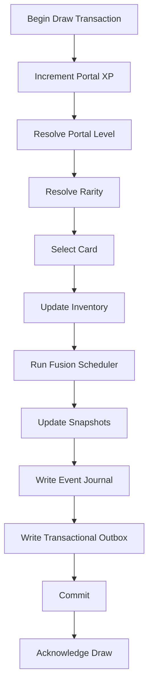

Toutes les opérations jusqu'au commit appartiennent à une transaction atomique.

Deux résultats sont possibles :

- Crash avant commit : rollback complet du tirage.
- Crash après commit : le tirage est considéré comme définitivement validé.

Un nouvel essai ne doit jamais reproduire les effets d'un tirage déjà validé.

## 3.2 Matrice de fault injection

Nous allons injecter artificiellement une interruption après chaque opération.

| ID | Point d'interruption | Résultat attendu |
|--------|--------|--------|
| REC-001 | Avant réservation | Aucun changement |
| REC-002 | Après réservation | Réservation récupérable |
| REC-003 | Avant débit | Aucun débit |
| REC-004 | Après débit | Lot payé et récupérable |
| REC-005 | Après incrément XP | Rollback si non commité |
| REC-006 | Après résolution rareté | Rollback si non commité |
| REC-007 | Après sélection carte | Rollback si non commité |
| REC-008 | Après modification inventaire | Rollback si non commité |
| REC-009 | Pendant fusion | Rollback du tirage complet |
| REC-010 | Après journalisation | Rollback si non commité |
| REC-011 | Après commit | Reprise sans duplication |
| REC-012 | Avant accusé de réception | Reconnaissance du commit existant |

Une attention particulière sera accordée au scénario :

**Débit effectué, mais aucun tirage encore validé.**

Le système doit reconnaître que le lot est déjà payé et reprendre le premier tirage sans débiter une seconde fois.

## 3.3 Idempotence

Chaque commande possède un identifiant unique.

Chaque tirage possède également un identifiant unique :

$$
draw\_id=(batch\_id,index)
$$

Une contrainte d'unicité en base de données empêche la validation multiple du même tirage.

Les événements externes sont distribués avec une outbox transactionnelle. Les consommateurs doivent être idempotents, car la livraison d'un événement peut être répétée.

---

</details>


### SYS-002.D.10.3.6.3 · T070 · 19/11/2026 19:14:43

**Nature :** `APPROBATION_EXPLICITE` · **Ligne d’approbation source :** 24853 · **Ligne de formalisation :** 24858.

**Décision / prescription originale (texte intégral du propriétaire) :**

Je valide A


<details><summary>Formalisation technique de la décision ratifiée (extrait sourcé)</summary>

# SYS-002.D.10.3.6.3 - Formalisation de la décision

(Validé) (Ruleset Snapshot adopté)

La politique `batch_pinned` est désormais définitive.

## 1. Contrat Ruleset Snapshot

Chaque invocation groupée reçoit une configuration immuable avant la réservation des ressources.

Le snapshot est créé lors de la transition :

`VALIDATED → RESERVED`

Il contient les versions suivantes :

| Configuration | Version figée |
|--------|--------|
| Probability Tables | Oui |
| Portal XP Thresholds | Oui |
| Card Catalog | Oui |
| Rarity Hierarchy | Oui |
| Fusion Policies | Oui |
| Fusion Eligibility Rules | Oui |
| Offer Pricing | Oui |
| Growth Profiles | Oui |
| RNG Algorithm | Oui |
| Engine Rules | Oui |

Chaque lot conserve notamment :

```python
@dataclass(frozen=True)
class BatchRulesetSnapshot:
    ruleset_id: str
    ruleset_hash: str

    probability_revision: str
    xp_threshold_revision: str
    catalog_revision: str
    rarity_revision: str
    fusion_revision: str
    pricing_revision: str
    growth_revision: str
    rng_algorithm_revision: str
    engine_revision: str
```

Le snapshot est immuable pendant toute la durée du lot.

## 2. Configuration figée vs état dynamique

Une distinction importante est ajoutée.

Le snapshot fige les règles du jeu, mais pas la progression du joueur.

| Donnée | Comportement |
|--------|--------|
| Tables probabilistes | Figées |
| Seuils XP | Figés |
| Catalogue | Figé |
| Prix de l'offre | Figé |
| Politique de fusion | Figée |
| XP cumulée du portail | Dynamique |
| Cartes débloquées | Dynamique |
| Doublons | Dynamiques |
| Niveaux des cartes | Dynamiques |
| Inventaire | Dynamique |

Cela permet notamment de conserver le comportement suivant :

Un joueur débloque une nouvelle carte pendant un lot de 35 invocations. Cette carte devient immédiatement éligible aux fusions ultérieures du même lot, sous réserve des règles de fusion figées dans son snapshot.

La configuration reste immuable ; la progression du joueur continue.

## 3. Nouveaux invariants

| ID | Invariant |
|--------|--------|
| INV-SUM-005 | Immutable Batch Ruleset |
| INV-SUM-006 | No Mixed Configuration Revisions |
| INV-SUM-007 | Snapshot Persistence |
| INV-SUM-008 | Dynamic Player State |
| INV-SUM-009 | Historical Ruleset Retention |

Une ancienne version de configuration ne peut être supprimée tant qu'un lot dépend encore de celle-ci.

Si une version nécessaire devient indisponible, le lot est placé en quarantaine. Le moteur ne substitue jamais silencieusement une nouvelle configuration.

---

# 4. Clôture des tests Ruleset Snapshot

Six nouveaux tests sont ajoutés.

| ID | Scénario | Résultat attendu |
|--------|--------|--------|
| SNAP-001 | Création du lot | Snapshot enregistré |
| SNAP-002 | Modification des probabilités pendant le lot | Ancienne version conservée |
| SNAP-003 | Modification du catalogue | Ancien catalogue conservé |
| SNAP-004 | Reprise après interruption | Même snapshot |
| SNAP-005 | Version historique indisponible | Quarantaine |
| SNAP-006 | Modification du tarif | Prix initial conservé |

La stratégie de tests `all_layers`, le `injectable_rng` et le `crash_recovery` restent inchangés.

---

</details>


### SYS-002.D.10.3.7.1 · T071 · 19/11/2026 19:50:42

**Nature :** `APPROBATION_CONTEXTUELLE` · **Ligne d’approbation source :** 25119 · **Ligne de formalisation :** 25124.

**Décision / prescription originale (texte intégral du propriétaire) :**

Oui


<details><summary>Formalisation technique de la décision ratifiée (extrait sourcé)</summary>

# SYS-002.D.10.3.7.1 - Formalisation du Serialized FIFO

(Validé) (Modèle A adopté)

La politique `serialized_fifo` est désormais définitive.

## 1. Contrat d'exécution

La sérialisation est définie par la combinaison :

$$
QueueKey=(owner\_id,portal\_id)
$$

Cela signifie :

- Un seul lot actif par joueur et par portail.
- Plusieurs lots peuvent attendre dans la file.
- Les lots sont exécutés dans leur ordre d'acceptation.
- Les tirages d'un même lot sont exécutés séquentiellement.
- Deux portails différents peuvent fonctionner simultanément.
- Deux joueurs différents peuvent invoquer simultanément sur le même portail.

## 2. Gestion de la file

Chaque commande reçoit un numéro de séquence durable et strictement croissant.

| Propriété | Règle |
|--------|--------|
| Ordonnancement | FIFO |
| Priorité | Ordre d'acceptation |
| Exécution simultanée même portail | Interdite |
| Exécution simultanée portails différents | Autorisée |
| Réorganisation des commandes | Interdite |
| Reprise après interruption | Prioritaire |
| Suppression d'un lot payé | Interdite |

Le numéro de séquence est attribué atomiquement à l'enregistrement de la commande.

## 3. Architecture d'exécution

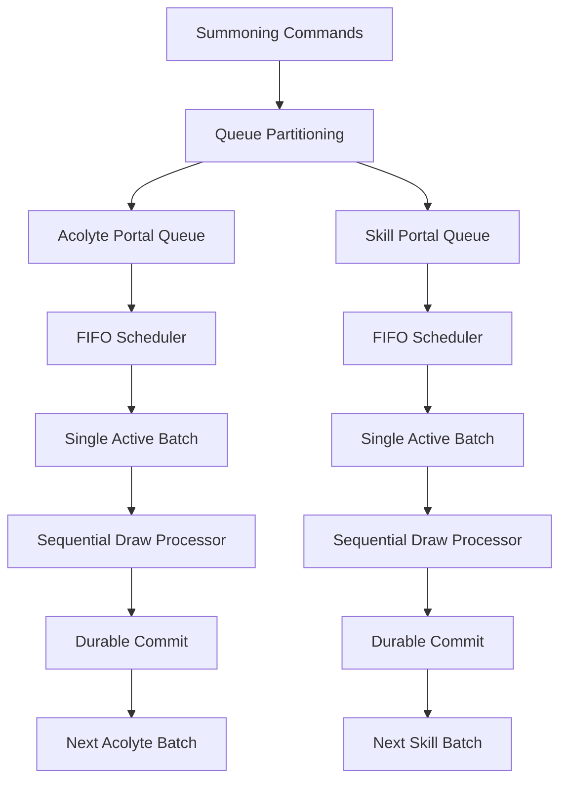

Les deux files sont indépendantes.

## 4. Gestion des interruptions

Une interruption ne permet jamais à un lot suivant de dépasser un lot précédent.

Exemple :

| Lot | État |
|--------|--------|
| Batch 001 | `RESUME_REQUIRED` |
| Batch 002 | `QUEUED` |
| Batch 003 | `QUEUED` |

Le Scheduler reprend obligatoirement le Batch 001.

Une fois celui-ci terminé, le Batch 002 peut démarrer.

Si un lot entre en quarantaine pour une erreur irrécupérable, la file concernée reste bloquée jusqu'à réconciliation.

## 5. Protection contre les exécutions concurrentes

Le Scheduler utilise :

- Un verrou par partition `owner_id + portal_id`.
- Un lease d'exécution.
- Un fencing token pour invalider les anciens workers.
- Un identifiant unique par tirage.
- Une validation transactionnelle avant progression de la file.

Un worker dont le lease a expiré ne peut plus valider de modifications, même s'il reprend son exécution tardivement.

*Note d'ingénierie : le fencing token est essentiel. Un simple verrou temporel ne suffit pas à empêcher un ancien worker de modifier l'inventaire après une reprise par un autre processus.*

## 6. Interaction avec les Ruleset Snapshots

Chaque lot conserve son propre snapshot.

Un lot en attente ne récupère jamais automatiquement une nouvelle configuration.

En revanche, l'expérience du portail reste dynamique.

Exemple :

- Batch 001 : snapshot R1.
- Batch 002 : snapshot R2.
- Batch 001 termine et fait progresser le portail.
- Batch 002 démarre avec le niveau XP actualisé, mais utilise toujours ses seuils et probabilités R2.

Cette distinction est désormais contractuelle.

## 7. Tests supplémentaires

| ID | Scénario | Résultat attendu |
|--------|--------|--------|
| FIFO-001 | Deux lots même portail | Ordre d'acceptation |
| FIFO-002 | Trois lots même portail | Exécution séquentielle |
| FIFO-003 | Deux portails différents | Exécution parallèle |
| FIFO-004 | Deux joueurs différents | Exécution parallèle |
| FIFO-005 | Crash du premier lot | Blocage des suivants |
| FIFO-006 | Reprise du premier lot | Aucun doublon |
| FIFO-007 | Deux workers concurrents | Un seul worker valide |
| FIFO-008 | Expiration du lease | Ancien worker invalidé |
| FIFO-009 | Configuration modifiée | Snapshots préservés |
| FIFO-010 | Deux commandes simultanées | Séquence durable déterministe |

---

</details>


### SYS-002.D.10.3 · T072 · 19/11/2026 19:54:18

**Nature :** `APPROBATION_CONTEXTUELLE` · **Ligne d’approbation source :** 25344 · **Ligne de formalisation :** 25349.

**Décision / prescription originale (texte intégral du propriétaire) :**

Parfait


<details><summary>Formalisation technique de la décision ratifiée (extrait sourcé)</summary>

# SYS-002.D.10.3 — Summoning Engine

(APPROVED — Architecture validée)

La validation globale est enregistrée.

Le module est désormais clôturé au niveau architectural et fonctionnel.

**Livrables validés :**

- Probability Resolution Engine
- Portal XP Progression Engine
- Summoning Transaction Engine
- Batch Billing Engine
- Reward Distribution Engine
- Duplicate &amp; Fusion Engine
- Fusion Scheduler
- RNG Architecture
- Crash Recovery
- Ruleset Snapshot
- Integration &amp; Acceptance Testing
- FIFO Scheduler

## État du projet

| Phase | Statut |
|--------|--------|
| Architecture fonctionnelle | (Terminée) |
| Contrats métier | (Validés) |
| Contrats mathématiques | (Spécifiés) |
| Calibration numérique | (À réaliser) |
| Conception technique détaillée | (Prochaine étape) |
| Implémentation | En attente |

</details>


### SYS-002.D.10.4.1 · T074 · 19/11/2026 20:09:40

**Nature :** `APPROBATION_EXPLICITE` · **Ligne d’approbation source :** 25639 · **Ligne de formalisation :** 25644.

**Décision / prescription originale (texte intégral du propriétaire) :**

Validation du modèle A


<details><summary>Formalisation technique de la décision ratifiée (extrait sourcé)</summary>

# SYS-002.D.10.4.1 - Modular Monolith

(APPROVED) (Spécification clôturée)

Le modèle A est officiellement adopté.

### Décisions intégrées au GDD

| Paramètre | Décision |
|--------|--------|
| Architecture globale | `modular_monolith` |
| Organisation métier | `domain_driven_modules` |
| Architecture interne | `ports_and_adapters` |
| Communication intermodules | `explicit_interfaces` |
| Persistance | `shared_database` |
| Transactions | `local_atomic_transactions` |
| Interface graphique | `presentation_decoupled` |

### Structure architecturale retenue

```text
src/
├── Game.Client/
│
├── Modules/
│   ├── Summoning/
│   ├── Acolytes/
│   ├── Skills/
│   ├── Character/
│   ├── Combat/
│   ├── Economy/
│   └── Equipment/
│
├── Shared/
│   ├── Domain/
│   ├── Events/
│   └── Contracts/
│
├── Infrastructure/
│   ├── Persistence/
│   ├── Random/
│   ├── Configuration/
│   └── Transactions/
│
└── Tests/
    ├── Unit/
    ├── Integration/
    ├── EndToEnd/
    └── Recovery/
```

Chaque module possède ses propres entités, services métier, interfaces et tests. Aucun module ne manipule directement les tables internes d'un autre module.

---

</details>


### SYS-002.D.10.4.2.1 · T076 · 19/11/2026 20:16:19

**Nature :** `APPROBATION_CONTEXTUELLE` · **Ligne d’approbation source :** 25916 · **Ligne de formalisation :** 25921.

**Décision / prescription originale (texte intégral du propriétaire) :**

Très bien faisons comme ça alors dans un premier temps


<details><summary>Formalisation technique de la décision ratifiée (extrait sourcé)</summary>

# SYS-002.D.10.4.2.1 - Validation de la stack technologique

(APPROVED) (Décision enregistrée)

La proposition est adoptée comme configuration initiale du projet.

| Paramètre | Décision |
|--------|--------|
| Plateforme cible | `android_only` |
| Environnement de développement | `pc` |
| Moteur graphique | `unity_6` |
| Langage | `csharp` |
| Architecture | `modular_monolith` |
| Persistance | `sqlite` |
| Configuration | `json_versioned` |
| Exécution | `standalone_offline` |
| Extensibilité | `cross_platform_preserved` |

Cette décision ne verrouille pas définitivement le projet sur Android. L'architecture conservera la possibilité d'ajouter d'autres plateformes ultérieurement.

</details>


### SYS-002.D.10.4.2.2 · T077 · 19/11/2026 20:43:18

**Nature :** `APPROBATION_EXPLICITE` · **Ligne d’approbation source :** 26194 · **Ligne de formalisation :** 26199.

**Décision / prescription originale (texte intégral du propriétaire) :**

Je valide. En parallèle j'ai installé Unity


<details><summary>Formalisation technique de la décision ratifiée (extrait sourcé)</summary>

# SYS-002.D.10.4.2.2 - Validation technologique

(APPROVED)

La stack technologique est officiellement validée.

L'installation d'Unity permettra de réaliser les premiers contrôles techniques directement dans l'éditeur. Nous ne commencerons toutefois pas à développer les moteurs métier avant d'avoir verrouillé leur architecture logicielle.

Une correction est également apportée à notre précédente proposition : les scripts destinés à être compilés par Unity doivent être placés sous `Assets/` ou dans un package Unity, et non dans un dossier `Core/` indépendant à la racine. \[[Default project directories • Project configuration • 6000.0](https://docs.unity.com/en-us/engine/6000.0/manual/get-started/project-configuration/default-directories?utm_source=chatgpt.com); [Creating assembly assets • Organize scripts into assemblies • 6000.6](https://docs.unity.com/en-us/engine/6000.6/manual/programming-environment/script-compilation/assembly-definition-files/assembly-definitions-creating?utm_source=chatgpt.com)\]

---

</details>


### SYS-002.D.10.4.2.3 · T078 · 19/11/2026 20:53:38

**Nature :** `APPROBATION_EXPLICITE` · **Ligne d’approbation source :** 26493 · **Ligne de formalisation :** 26499.

**Décision / prescription originale (texte intégral du propriétaire) :**

Je valide le modèle A.
Je souhaite apporter des informations concernant le système d'obtention des équipements ainsi que les équipements en eux même, sauf si tu possède déjà ces informations?


<details><summary>Formalisation technique de la décision ratifiée (extrait sourcé)</summary>

# SYS-002.D.10.4.2.3 — Validation

(APPROVED) (Modèle A adopté)

Nous conservons les cinq assemblies partagés par couche, avec une séparation des modules métier par namespaces et contrats explicites.

---

</details>


---

# Chapitre 11 — Équipement et Lampe Magique

**Autorité :** décisions expressément approuvées dans la conversation source. Les modèles obsolètes sont remplacés par les rectifications ultérieures ; les paramètres provisoires restent provisoires.

**Statut du chapitre :** `functionally_specified` pour ses spécifications validées ; aucune exécution de test ou implémentation ne découle de ce statut.

**Traçabilité :** 31 décision(s) du propriétaire. Toutes les références `Txxx` renvoient à `references/HISTORIQUE_SOURCE_ORIGINAL.md`.


## Registre détaillé des décisions approuvées


### SYS-002.D.11.1 · T080 · 19/11/2026 21:11:23

**Nature :** `EXIGENCE_OU_RECTIFICATION_PROPRIETAIRE` · **Ligne d’approbation source :** 26650 · **Ligne de formalisation :** 26689.

**Décision / prescription originale (texte intégral du propriétaire) :**

Système d'obtention de l'équipement :

**La Lampe Magique est le moteur central de votre progression dans *Legend of Mushroom*.** Elle fonctionne selon une boucle d'équipement et de recyclage qui fait évoluer à la fois le niveau de votre personnage et la rareté des objets générés. 

---

**1. Condensé des mécanismes de la Lampe Magique**

- **Double moteur de progression.** Le **niveau de votre champignon** fixe la puissance brute (statistiques de base) des objets générés, tandis que le **niveau de la lampe** contrôle la probabilité d'obtenir des raretés élevées.
- **Boucle de recyclage (Or et EXP).** Chaque charge de lampe génère une pièce d'équipement aléatoire. Vous l'équipez si elle est meilleure, ou vous la vendez instantanément pour gagner de **l'expérience** (montée de niveau du personnage) et des **pièces d'or** (indispensables pour améliorer la lampe). 
- **Segments d'amélioration.** Monter la lampe d'un niveau nécessite d'acheter plusieurs segments avec votre or, suivis d'un temps de construction réductible via des tickets d'accélération ou des publicités. 
- **Automatisation (Auto-Lamp).** Débloqué au **niveau 16 de personnage**, le mode automatique fait tourner la lampe en arrière-plan et s'arrête uniquement lorsqu'une pièce correspond à vos critères de rareté et de statistiques secondaires. 
- **Tirages multiples et bannissement.** Aux niveaux de lampe **16, 20 et 24**, vous débloquez l'ouverture simultanée de **6, 8 puis 10 lampes** à la fois. Aux niveaux **12, 20 et 26**, la fonction *Adjust* permet de bloquer jusqu'à **3 affixes indésirables**. 
- **Sources principales de lampes.** Vous obtenez vos charges via le coffre AFK (jusqu'à **1 080/jour**), le donjon *Voleur de lampe* (jusqu'à **2 500/jour**), la campagne, l'arène et la boutique de clan.

---

**2. Mécanisme des niveaux de rareté de la lampe**

- **Élimination par le bas et déblocage par le haut.** Au niveau 1, la lampe ne génère que les raretés de base (*Normal, Unique, Bien*). À chaque montée de niveau, les pourcentages des raretés inférieures diminuent jusqu'à disparaître complètement de la table de tirage, libérant de la place pour les paliers supérieurs.
- **Conditions spéciales en fin de jeu.** Les très hautes raretés (**Aurous** et **Éternel**) demandent à la fois un niveau de lampe élevé (niveaux 20 à 26+) et la validation d'une condition de progression affichée sur l'écran d'amélioration de la lampe.
- **Échelle complète des 10 raretés d'équipement.** Plus le palier obtenu est élevé, plus les multiplicateurs de statistiques et le nombre d'affixes secondaires augmentent : 

| **Palier** | **Rareté (Jeu)**           | **Couleur / Aspect**     | **Apparition et rôle dans la progression**                                    |
| ---------- | -------------------------- | ------------------------ | ----------------------------------------------------------------------------- |
| **1 à 3**  | **Normal / Unique / Bien** | Gris / Vert clair / Vert | Raretés de départ (lampes niveaux 1 à 5) ; disparaissent vite des tirages.    |
| **4 à 5**  | **Rare / Mythique**        | Bleu / Violet            | Début et milieu de partie ; introduisent les premiers bonus secondaires.      |
| **6 à 7**  | **Épique / Légendaire**    | Jaune / Orange           | Débloqués autour des niveaux 8 à 12 ; base solide pour spécialiser sa classe. |
| **8**      | **Immortel** (*Immortal*)  | Rouge                    | Haut de tableau classique (lampes 15+) avec de forts bonus d'affixes.         |
| **9**      | **Suprême / Aurous**       | Rose / Arc-en-ciel       | Paliers avancés (lampes 20+) ; déblocage conditionnel pour *Aurous*.          |
| **10**     | **Éternel** (*Eternal*)    | Rouge-Or / Cosmique      | Rareté ultime des très hauts niveaux de lampe (26+) avec les stats maximales. |

*(Note : Ouvrir 10 lampes d'un coup en mode automatique applique exactement les mêmes pourcentages de rareté que l'ouverture 1 par 1, sans aucun malus de probabilité.)* 

Si tu as des questions pour l'amélioration demande moi afin que je puisse te donner plus de précision.


<details><summary>Formalisation technique de la décision ratifiée (extrait sourcé)</summary>

# SYS-002.D.11.1 - Equipment Acquisition Engine

(Collecte des spécifications en cours)

Tes informations permettent déjà de définir une bonne partie de l'architecture. La Lampe Magique est un système particulièrement intéressant parce qu'elle combine génération aléatoire, progression économique, progression du personnage et gestion automatisée de l'inventaire.

Je formalise les premiers mécanismes.

## 1. SYS-002.D.11.1.1 - Lamp Generation System

### 1.1 Les deux axes de progression

Nous avons deux variables indépendantes qui influencent directement la génération des équipements.

**Niveau du personnage**

(Influence les statistiques)

Détermine la puissance brute des équipements générés.

---

**Niveau de la Lampe Magique**

(Influence les probabilités)

Détermine les probabilités d'obtention des différentes raretés et les possibilités de génération.

Ces deux paramètres ne doivent jamais être confondus dans le modèle mathématique.

Nous pouvons formaliser la génération ainsi :

$$
P(R=r)=f(L_{\text{lampe}},C)
$$

$$
Stats_{\text{base}}=g(L_{\text{personnage}},r)
$$

Avec :

- $R$ : rareté obtenue.
- $C$ : conditions de progression.
- $r$ : rareté de l'équipement.

Les fonctions exactes seront définies lors de la calibration.

### 1.2 Référentiel des raretés

Nous créons un référentiel indépendant de celui des acolytes.

**Échelle des 10 raretés d'équipement**

Les identifiants internes seront indépendants des traductions françaises et anglaises.

### 1.3 Progression des probabilités

Nous retenons les règles suivantes :

- Les raretés inférieures perdent progressivement leurs probabilités.
- Certaines raretés disparaissent totalement des tables.
- Les raretés supérieures deviennent accessibles à certains niveaux.
- Aurous et Éternel possèdent des conditions de déblocage supplémentaires.
- Les tables probabilistes dépendent exclusivement du niveau de lampe et des conditions correspondantes.

Les niveaux 20 à 26+ constituent une zone de déblocage avancée, mais nous ne fixerons pas encore les seuils exacts.

### 1.4 Génération des équipements

Chaque charge consommée produit un équipement aléatoire.

Le traitement métier est le suivant :

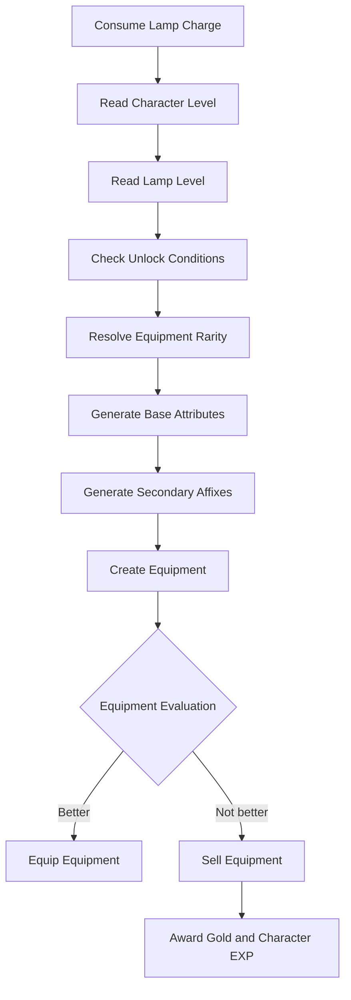

Le critère exact de comparaison entre deux équipements reste à définir.

---

## 2. SYS-002.D.11.1.2 - Lamp Features

Nous enregistrons les déblocages fonctionnels.

| Niveau de lampe | Fonctionnalité |
|--------|--------|
| 12 | Adjust |
| 16 | Auto-Lamp et ouverture ×6 |
| 20 | Adjust et ouverture ×8 |
| 24 | Ouverture ×10 |
| 26 | Adjust |

La fonction Adjust permet de bannir jusqu'à trois affixes indésirables.

Les capacités exactes à chaque palier restent à préciser.

### 2.1 Auto-Lamp

(Déblocage au niveau 16 du personnage)

Le système fonctionne selon une boucle automatisée :

1. Consommer une charge.
2. Générer un équipement.
3. Évaluer ses caractéristiques.
4. Vérifier les critères configurés.
5. Continuer ou arrêter.

Nous créerons ultérieurement un `AutoLampController` indépendant du générateur d'équipements.

### 2.2 Sources de charges

| Source | Quantité quotidienne maximale |
|--------|--------|
| Coffre AFK | 1 080 |
| Donjon Voleur de lampe | 2 500 |
| Campagne | À déterminer |
| Arène | À déterminer |
| Boutique de clan | À déterminer |

Ces quantités seront conservées comme données de référence à confirmer.

---

## 3. SYS-002.D.11.1.3 - Lamp Progression System

Nous avons identifié une boucle économique distincte :

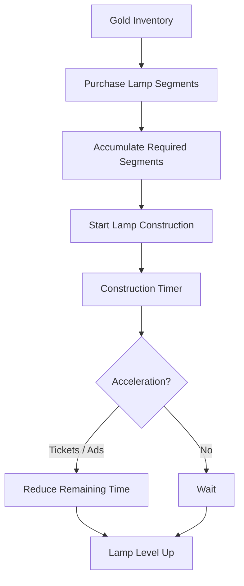

Deux ressources interviennent :

- Or : achat des segments.
- Tickets d'accélération ou publicités : réduction du temps de construction.

Nous devrons spécifier les coûts, les quantités de segments, les durées et les éventuelles limites de construction.

---

# 4. Premiers contrats fonctionnels

| ID | Contrat | Décision initiale |
|--------|--------|--------|
| EQ-ACQ-001 | Niveau personnage | Détermine la puissance brute |
| EQ-ACQ-002 | Niveau lampe | Détermine les probabilités |
| EQ-ACQ-003 | Raretés | 10 niveaux ordonnés |
| EQ-ACQ-004 | Génération | Une charge = un équipement |
| EQ-ACQ-005 | Raretés indisponibles | Probabilité nulle |
| EQ-ACQ-006 | Conditions Aurous/Éternel | Déblocage conditionnel |
| EQ-ACQ-007 | Vente | Attribution d'or et d'EXP |
| EQ-ACQ-008 | Auto-Lamp | Déblocage personnage niveau 16 |
| EQ-ACQ-009 | Tirages multiples | ×6, ×8, ×10 |
| EQ-ACQ-010 | Adjust | Bannissement jusqu'à 3 affixes |

Ces contrats constituent une première formalisation, pas encore une validation définitive.

---

# 5. SYS-002.D.11.1.4 - Première clarification : Adjust

Il existe une ambiguïté importante dans les niveaux de déblocage de cette fonctionnalité.

Tu indiques que Adjust est disponible aux niveaux 12, 20 et 26, avec une capacité maximale de trois affixes.

**Comment évolue précisément cette capacité ?**

Modèle A - Capacité progressive : 1 affixe au niveau 12, 2 au niveau 20 et 3 au niveau 26.

Modèle B - Trois affixes disponibles dès le niveau 12 ; les niveaux 20 et 26 apportent d'autres améliorations.

Autre fonctionnement.

[Valider]

Une fois cette règle clarifiée, nous poursuivrons avec la progression de la lampe et la génération des équipements.

*Point d'architecture à conserver : Equipment Acquisition Engine et Summoning Engine auront des responsabilités distinctes. La Lampe Magique ne sera pas implémentée comme un simple portail d'invocation réutilisant les règles des acolytes.*

</details>


### SYS-002.D.11.1.4 · T081 · 19/11/2026 21:24:14

**Nature :** `APPROBATION_EXPLICITE` · **Ligne d’approbation source :** 26918 · **Ligne de formalisation :** 26923.

**Décision / prescription originale (texte intégral du propriétaire) :**

SYS-002.D.11.1.4 — Validation Adjust : progressive. Formalise et poursuis.


<details><summary>Formalisation technique de la décision ratifiée (extrait sourcé)</summary>

# SYS-002.D.11.1.4 — Formalisation de Adjust

(Validé) (GDD actualisé)

La capacité de bannissement des affixes progresse par paliers.

| Niveau de lampe | Capacité de bannissement |
|--------|--------|
| 1–11 | 0 affixe |
| 12–19 | 1 affixe |
| 20–25 | 2 affixes |
| 26+ | 3 affixes |

### Contrats fonctionnels

- `ADJUST-001` : déblocage initial au niveau 12.
- `ADJUST-002` : capacité augmentée au niveau 20.
- `ADJUST-003` : capacité maximale atteinte au niveau 26.
- `ADJUST-004` : maximum de trois affixes bannis simultanément.
- `ADJUST-005` : capacité déterminée par le niveau actuel de la lampe.

La persistance des affixes bannis et leur application exacte pendant la génération restent à préciser ultérieurement.

---

</details>


### SYS-002.D.11.1.5.1 · T082 · 19/11/2026 21:29:51

**Nature :** `EXIGENCE_OU_RECTIFICATION_PROPRIETAIRE` · **Ligne d’approbation source :** 27000 · **Ligne de formalisation :** 27027.

**Décision / prescription originale (texte intégral du propriétaire) :**

**L'amélioration d'un niveau de lampe fonctionne par paliers intermédiaires (segments) achetés avec de l'or, suivis d'un minuteur de construction obligatoire avant de passer au niveau suivant.**

Voici le fonctionnement exact de chacun des quatre points :

**1. Nombre de segments par niveau**

- **Nombre variable selon le palier.** Chaque niveau de lampe est divisé en un certain nombre de segments (généralement entre **3 et 5 segments** selon le niveau), et ce nombre augmente à mesure que vous progressez vers les hauts niveaux. [[1](https://www.youtube.com/watch?v=_QSsOBihZb0\&t=36)]
- **Exemple concret.** Au niveau 23, la barre de progression se divise en plusieurs segments individuels (coûtant chacun plus d'un million d'or) avant de pouvoir déclencher le passage au niveau 24. [[1](https://www.youtube.com/watch?v=5i-Nyacw4go\&t=537), [2](https://www.youtube.com/watch?v=_QSsOBihZb0\&t=36)]

**2. Achat individuel des segments avec de l'or**

- **Paiement segment par segment.** Vous n'avez pas besoin d'économiser la totalité du coût d'un niveau en une seule fois : vous achetez chaque segment individuellement dès que vous disposez de la somme d'or requise. [[1](https://www.youtube.com/watch?v=_QSsOBihZb0\&t=36), [2](https://guidesbygrace.uk/gear-lamp)]
- **Progression enregistrée.** Chaque clic remplit une fraction de la jauge d'amélioration de la lampe et retire immédiatement l'or correspondant de votre réserve.

**3. Déclenchement du temps de construction**

- **Démarrage uniquement à 100 %.** Le minuteur de construction ne se lance qu'une fois **tous les segments du niveau actuel achetés** (lorsque la jauge est pleine).
- **Accélération du délai.** Pendant ce temps d'attente (qui passe de quelques minutes au début à plusieurs heures ou jours à haut niveau), vous continuez d'utiliser votre lampe au niveau actuel, et vous pouvez réduire le minuteur grâce aux **tickets d'accélération** (*Speed-up coupons*) ou aux **publicités quotidiennes**.

**4. Accumulation de segments à l'avance**

- **Impossible d'accumuler sur plusieurs niveaux.** Le jeu bloque l'achat de nouveaux segments dès que la barre du niveau en cours est remplie et que le compte à rebours est lancé.
- **Gestion des réserves.** Vous devez attendre la fin du minuteur (ou le terminer avec des accélérateurs) pour valider le niveau supérieur et débloquer l'accès aux segments du niveau suivant. [[1](https://www.youtube.com/watch?v=_QSsOBihZb0\&t=36)]


<details><summary>Formalisation technique de la décision ratifiée (extrait sourcé)</summary>

# SYS-002.D.11.1.5.1 - Lamp Segment Progression

(Mécanisme formalisé) (Validation en attente)

Les quatre mécanismes sont suffisamment documentés pour établir le premier contrat fonctionnel du Lamp Progression Engine.

## 1. Fonctionnement général

La progression est organisée autour de deux phases distinctes :

1. Acquisition des segments avec de l'or.
2. Construction temporisée après acquisition complète.

### 1.1 Acquisition des segments

Chaque niveau possède sa propre configuration.

| Paramètre | Règle |
|--------|--------|
| Nombre de segments | Variable, généralement 3 à 5 |
| Coût | Défini individuellement par segment |
| Paiement | Individuel |
| Déduction de l'or | Immédiate |
| Progression | Persistante |
| Achat anticipé | Interdit |

Le modèle mathématique sera fondé sur une table de configuration :

$$
Segments(L)=N_L
$$

$$
Cost(L,i)=C_{L,i}
$$

Avec :

- $L$ : niveau actuel de la lampe.
- $N_L$ : nombre de segments requis.
- $i$ : numéro du segment.
- $C_{L,i}$ : coût en or du segment.

Le coût total du niveau sera :

$$
CostTotal(L)=\sum_{i=1}^{N_L}C_{L,i}
$$

Nous conserverons les coûts individuels plutôt que d'imposer artificiellement une progression linéaire.

## 2. Machine à états

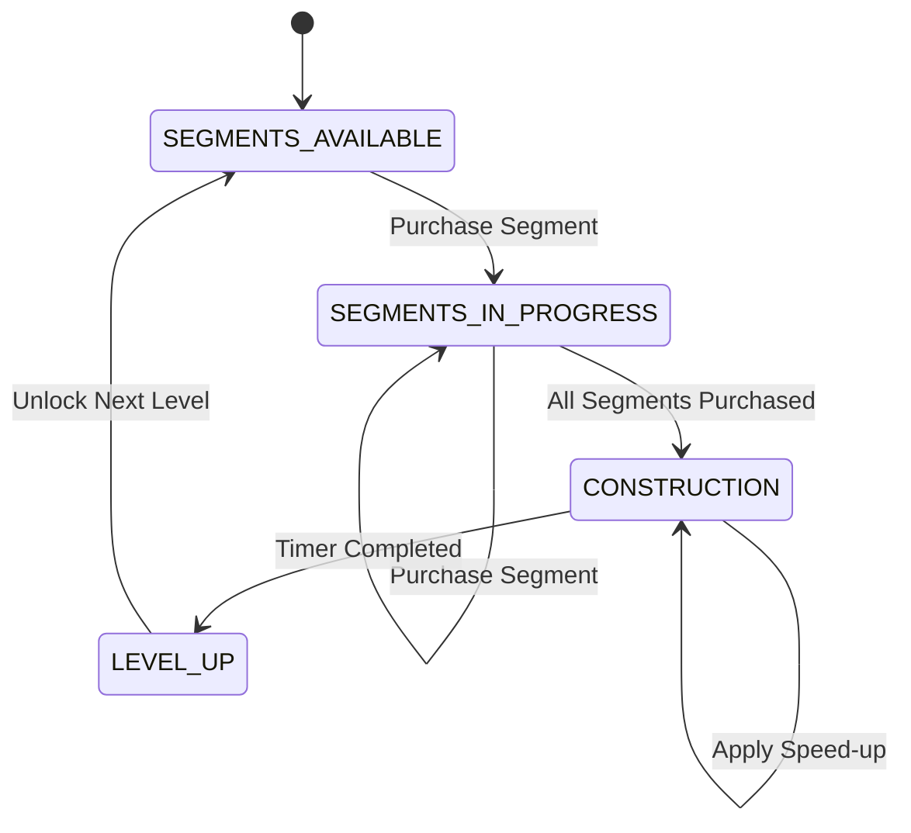

### 2.1 Règles fondamentales

- Chaque achat débite immédiatement l'or.
- Les segments achetés sont conservés.
- Le minuteur ne démarre qu'à 100 %.
- Aucun segment du niveau suivant ne peut être acheté pendant la construction.
- La lampe reste utilisable pendant la construction.
- Les équipements générés pendant cette période utilisent le niveau actuel de la lampe.
- Les tickets d'accélération et publicités réduisent le temps restant.
- Le prochain niveau devient accessible après la fin effective de la construction.

## 3. Contrats fonctionnels

| ID | Contrat | Décision |
|--------|--------|--------|
| LAMP-PROG-001 | Nombre de segments | `variable_lookup` |
| LAMP-PROG-002 | Achat | `individual_purchase` |
| LAMP-PROG-003 | Paiement | `immediate_gold_deduction` |
| LAMP-PROG-004 | Progression | `persistent` |
| LAMP-PROG-005 | Déclenchement construction | `all_segments_purchased` |
| LAMP-PROG-006 | Achat anticipé | `forbidden` |
| LAMP-PROG-007 | Utilisation pendant construction | `allowed` |
| LAMP-PROG-008 | Accélération | `speedup_or_ad` |
| LAMP-PROG-009 | Progression simultanée | `single_level_construction` |

## 4. Architecture technique envisagée

Le `Lamp Progression Engine` sera indépendant du `Equipment Acquisition Engine`.

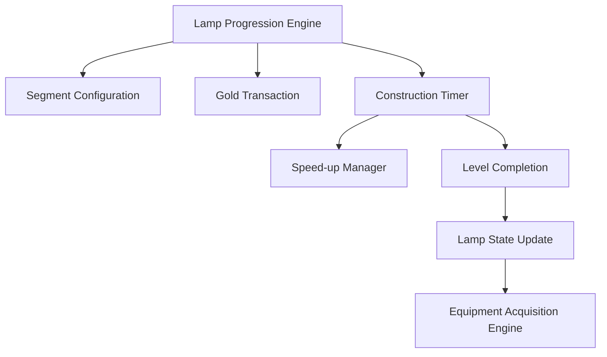

Le niveau de lampe sera une donnée partagée en lecture, mais sa modification restera sous la responsabilité exclusive du Lamp Progression Engine.

*Note d'ingénierie : séparer le minuteur de la génération des équipements évite qu'une amélioration en cours modifie accidentellement les probabilités d'un équipement généré avant la fin de la construction.*

---

</details>


### SYS-002.D.11.1.5.2 · T083 · 19/11/2026 21:33:05

**Nature :** `APPROBATION_EXPLICITE` · **Ligne d’approbation source :** 27188 · **Ligne de formalisation :** 27193.

**Décision / prescription originale (texte intégral du propriétaire) :**

C'est le modèle A


<details><summary>Formalisation technique de la décision ratifiée (extrait sourcé)</summary>

# SYS-002.D.11.1.5.2 — Validation de la finalisation automatique

(Validé) (Modèle A adopté)

La décision est intégrée au GDD.

### Contrat définitif

| Paramètre | Décision |
|--------|--------|
| Fin du minuteur | `automatic` |
| Validation manuelle | `not_required` |
| Augmentation du niveau | `automatic` |
| Déblocage des segments suivants | `immediate` |
| Utilisation de la lampe pendant construction | `allowed` |

### Règles complémentaires

1. À expiration du minuteur, le niveau de lampe augmente automatiquement.
2. Les segments du niveau suivant deviennent immédiatement accessibles.
3. L'événement de finalisation ne peut être traité qu'une seule fois.
4. Les équipements générés avant la finalisation utilisent l'ancien niveau de lampe.
5. Les équipements générés après la finalisation utilisent le nouveau niveau.

*Note d'ingénierie : la finalisation doit être idempotente. Une reprise après fermeture de l'application ne doit jamais provoquer deux augmentations de niveau.*

---

</details>


### SYS-002.D.11.1.6 · T084 · 19/11/2026 21:35:51

**Nature :** `EXIGENCE_OU_RECTIFICATION_PROPRIETAIRE` · **Ligne d’approbation source :** 27262 · **Ligne de formalisation :** 27289.

**Décision / prescription originale (texte intégral du propriétaire) :**

**Dans *Legend of Mushroom*, le minuteur de la lampe suit une progression exponentielle allant de quelques secondes à plusieurs jours, que vous pouvez réduire grâce aux tickets d'accélération (5 minutes chacun), aux publicités quotidiennes et à l'aide de votre clan.**

**1. Évolution de la durée de construction**

- **Début de partie (Niveaux 1 à 10).** Les premiers délais sont très courts, passant de quelques secondes à quelques dizaines de minutes.
- **Milieu de partie (Niveaux 11 à 20).** La durée grimpe progressivement de plusieurs heures à plus d'une journée complète par palier.
- **Haut niveau (Niveaux 21 à 28+).** Le minuteur devient un véritable goulot d'étranglement, atteignant **plusieurs jours complets** à partir du niveau 24 (nécessitant plus de 1 200 tickets d'accélération pour être passé instantanément, comme le soulignent les joueurs sur [**Reddit Legend of Mushroom**](https://www.reddit.com/r/LegendOfMushroomGame/comments/1crdw6g/had_the_game_a_couple_weeks_and_im_just_realizing/)).

**2. Tickets d'accélération (*Speed-Up Coupons*)**

- **Valeur unitaire fixe.** Chaque ticket d'accélération standard retire exactement **5 minutes** au compte à rebours en cours.
- **Cumul illimité.** Les tickets sont entièrement cumulables : un bouton dédié sur la fenêtre du minuteur permet d'utiliser d'un seul coup le nombre exact de tickets nécessaires pour terminer l'amélioration (ou de vider votre stock).
- **Double usage.** Comme le rappelle [**Pocket Gamer**](https://www.pocketgamer.com/legend-of-mushroom/guide/), ces mêmes tickets servent également à accélérer les recherches technologiques (notamment lors de l'événement *Tech Rush*).

**3. Publicités quotidiennes et aide de Clan**

- **Quota et réduction des publicités.** Vous disposez d'un quota quotidien d'environ **4 publicités** sur le minuteur de la lampe, chacune retirant **30 minutes** (soit **2 heures** de réduction gratuite par jour au total, ou un simple clic si vous possédez le pass sans pub).
- **Aide gratuite de la Famille (Clan).** En plus des publicités, vous pouvez solliciter l'aide des membres de votre clan via le bouton d'assistance sur le minuteur pour grappiller gratuitement plusieurs minutes supplémentaires à chaque niveau.

**4. Fonctionnement hors ligne (Jeu fermé)**

- **Écoulement continu.** *Legend of Mushroom* étant un jeu idle connecté en permanence aux serveurs, **le minuteur continue de s'écouler en temps réel** lorsque l'application est complètement fermée ou en arrière-plan.
- **Validation au retour.** Si le délai arrive à zéro pendant votre absence, l'amélioration s'achève automatiquement et votre lampe passe immédiatement au niveau supérieur dès votre reconnexion.


<details><summary>Formalisation technique de la décision ratifiée (extrait sourcé)</summary>

# SYS-002.D.11.1.6 - Construction Timer &amp; Acceleration System

(Spécification en cours)

Les informations permettent de formaliser le fonctionnement temporel et les trois mécanismes d'accélération.

## 1. SYS-002.D.11.1.6.1 - Construction Timer

### 1.1 Évolution des durées

La durée de construction suit une progression fortement croissante, décrite comme exponentielle.

| Palier | Comportement |
|--------|--------|
| Niveaux 1-10 | Quelques secondes à plusieurs dizaines de minutes |
| Niveaux 11-20 | Plusieurs heures à plus d'une journée |
| Niveaux 21-23 | Durées très importantes |
| Niveaux 24-28+ | Plusieurs jours |

Nous retiendrons une table de référence plutôt qu'une formule exponentielle imposée.

$$
T(L)=DurationLookup(L)
$$

Cette décision permet de reproduire précisément les durées du jeu officiel lorsque nous disposerons des valeurs.

À titre de contrôle :

$$
1200\times 5=6000\text{ minutes}
$$

Soit 100 heures, ou 4 jours et 4 heures.

Cela confirme la cohérence de l'ordre de grandeur communiqué pour les niveaux élevés.

### 1.2 Comportement du minuteur

Les règles suivantes sont retenues :

- Démarrage automatique lorsque tous les segments sont achetés.
- Écoulement continu en temps réel.
- Fonctionnement indépendant de l'utilisation de la lampe.
- Persistance du temps restant après fermeture de l'application.
- Finalisation automatique à expiration.
- Déblocage immédiat du niveau suivant.

## 2. SYS-002.D.11.1.6.2 - Speed-Up Coupons

(Règles fonctionnelles établies)

Chaque ticket possède une valeur fixe :

$$
V_{\text{ticket}}=300\text{ secondes}
$$

L'utilisation de plusieurs tickets est additive :

$$
T_{\text{réduit}}=N_{\text{tickets}}\times300
$$

Le temps restant devient :

$$
T_{\text{final}}=\max(0,T_{\text{initial}}-T_{\text{réduit}})
$$

Le nombre minimal de tickets nécessaires pour terminer instantanément :

$$
N_{\text{required}}=
\left\lceil\frac{T_{\text{remaining}}}{300}\right\rceil
$$

### Contrats fonctionnels

| Paramètre | Décision |
|--------|--------|
| Valeur unitaire | 5 minutes |
| Cumul | Additif |
| Utilisation multiple | Autorisée |
| Utilisation partielle | Autorisée |
| Dépense maximale | Stock disponible |
| Utilisation dans d'autres systèmes | Recherche technologique |
| Débit | Immédiat et atomique |

**Point architectural :** les tickets appartiennent à l'Economy Engine. Le Lamp Progression Engine et le Technology Research Engine utilisent la même ressource. Il n'existe donc pas deux inventaires indépendants de tickets.

## 3. SYS-002.D.11.1.6.3 - Publicités quotidiennes

(Calibration provisoire)

| Paramètre | Valeur |
|--------|--------|
| Quota quotidien | 4 publicités |
| Réduction unitaire | 30 minutes |
| Réduction quotidienne | 2 heures |
| Coût en tickets | 0 |

Le contrat mathématique :

$$
T_{\text{réduit}}=N_{\text{ads}}\times1800
$$

Avec :

$$
0\leq N_{\text{ads}}\leq4
$$

La possibilité de remplacer les publicités par une simple validation grâce à un pass sans publicité sera représentée par un système d'entitlements.

Le quota, sa réinitialisation et les éventuelles exceptions restent configurables.

## 4. SYS-002.D.11.1.6.4 - Clan Assistance

L'aide du clan constitue une troisième source de réduction.

Nous savons actuellement que :

- Elle est gratuite.
- Elle est sollicitée depuis l'interface du minuteur.
- Plusieurs minutes peuvent être retirées.
- Elle intervient sur chaque niveau de lampe.

Nous ne connaissons pas encore la quantité exacte de temps retirée ni les limites de sollicitations.

Nous ne fixerons donc aucune valeur arbitraire.

---

# 5. Architecture technique du Timer Engine

Le composant sera indépendant de Unity.

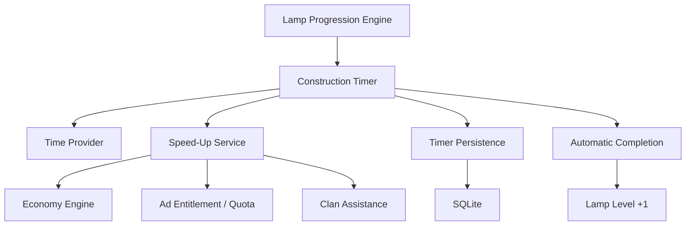

### 5.1 Modèle de données proposé

```csharp
public sealed class LampConstruction
{
    public Guid ConstructionId { get; set; }

    public int SourceLevel { get; set; }

    public int TargetLevel { get; set; }

    public DateTimeOffset StartedAtUtc { get; set; }

    public DateTimeOffset EndsAtUtc { get; set; }

    public long InitialDurationSeconds { get; set; }

    public ConstructionStatus Status { get; set; }
}
```

Le temps restant est calculé :

$$
T_{\text{remaining}}=
\max(0,EndsAtUtc-NowUtc)
$$

Les accélérations modifient `EndsAtUtc` et sont enregistrées dans un journal transactionnel.

*Note d'ingénierie : stocker une échéance absolue plutôt qu'un compteur décrémenté chaque seconde permet de reprendre correctement la construction après fermeture ou redémarrage de l'application.*

### 5.2 Gestion hors ligne

Une subtilité concerne notre architecture précédemment validée : `standalone_offline`.

Puisque nous n'avons pas prévu de serveur, je propose d'utiliser une horloge locale UTC persistée.

Au lancement :

1. Lecture de l'échéance enregistrée.
2. Lecture de l'heure actuelle.
3. Calcul du temps écoulé.
4. Si l'échéance est dépassée, finalisation automatique.
5. Sinon, reprise du compte à rebours.

La progression logique est continue, même si l'application est fermée. La mise à jour physique de l'état sera effectuée au prochain lancement si Android a interrompu le processus.

Limite connue : sans serveur de temps autoritaire, une modification manuelle de l'horloge du téléphone peut influencer la progression.

---

# 6. SYS-002.D.11.1.6.5 - Validation de la source temporelle

Nous devons maintenant verrouiller le mécanisme de référence temporelle.

**Modèle A - Horloge locale UTC**

(Recommandation)

- Persistance de l'échéance UTC.
- Écoulement pendant la fermeture de l'application.
- Reprise automatique au lancement.
- Fonctionnement entièrement hors ligne.
- Sensibilité aux modifications manuelles de l'horloge.

---

**Modèle B - Serveur de temps**

- Heure de référence fournie par un serveur.
- Progression fiable même après fermeture.
- Résistance aux modifications de l'horloge locale.
- Nécessite une infrastructure réseau et un backend.

Je recommande le modèle A, cohérent avec notre décision de développer une application personnelle autonome.

**Valides-tu le modèle A pour la gestion temporelle de la Lampe Magique ?**

Après cette validation, nous traiterons précisément les règles d'aide du clan, puis nous pourrons clôturer la spécification du système d'amélioration de la lampe.

</details>


### SYS-002.D.11.1.6.5 · T085 · 19/11/2026 21:39:16

**Nature :** `APPROBATION_EXPLICITE` · **Ligne d’approbation source :** 27560 · **Ligne de formalisation :** 27565.

**Décision / prescription originale (texte intégral du propriétaire) :**

Je valide le modèle A


<details><summary>Formalisation technique de la décision ratifiée (extrait sourcé)</summary>

# SYS-002.D.11.1.6.5 — Validation de la source temporelle

(Validé) (Modèle A adopté)

La gestion temporelle reposera sur une horloge locale UTC.

### Décisions intégrées au GDD

| Paramètre | Décision |
|--------|--------|
| Source temporelle | `local_utc` |
| Écoulement hors ligne | `continuous` |
| Persistance | `absolute_timestamp` |
| Reprise | `automatic_reconciliation` |
| Finalisation | `automatic` |
| Dépendance serveur | `none` |
| Tolérance aux changements d'horloge | `known_limitation` |

### Règles techniques complémentaires

- L'échéance de construction est persistée dans SQLite.
- Le minuteur n'a pas besoin d'être actualisé chaque seconde en base.
- Au lancement de l'application, le temps restant est recalculé.
- Une construction expirée est automatiquement finalisée.
- Une construction active reprend son décompte.

*Note d'ingénierie : l'horloge locale n'est pas une source temporelle infalsifiable. Une modification manuelle de l'heure peut modifier la progression. Cette limitation est acceptée dans notre architecture personnelle sans serveur.*

---

</details>


### SYS-002.D.11.1.7 · T086 · 19/11/2026 21:45:32

**Nature :** `EXIGENCE_OU_RECTIFICATION_PROPRIETAIRE` · **Ligne d’approbation source :** 27646 · **Ligne de formalisation :** 27673.

**Décision / prescription originale (texte intégral du propriétaire) :**

**L'aide de la Famille (Clan) fonctionne par requête unique par amélioration en cours, permettant à vos alliés de réduire gratuitement votre minuteur de construction ou de recherche technologique tout en gagnant des points de contribution**.

Voici le fonctionnement exact de chacun des quatre points dans *Legend of Mushroom* :

**1. Limite par membre (Une aide par allié)**

- **Une seule contribution par membre et par requête.** Chaque membre de votre Famille ne peut cliquer qu'une seule fois sur votre demande d'assistance dans l'onglet d'aide du clan.
- **Récompense pour l'aidant.** Comme expliqué dans les guides sur le système familial sur [**YouTube**](https://www.youtube.com/watch?v=O618QuvVAmw), chaque allié qui clique sur « Aider » reçoit en retour des **points de contribution familiale** (utilisables dans la boutique de famille, soumise à un plafond quotidien de gains d'aide).

**2. Durée retirée par assistance**

- **Réduction fixe (ou pourcentage encadré) par clic.** Chaque aide validée par un membre retire immédiatement une portion fixe du temps restant sur le minuteur (généralement **1 % du temps total de construction avec un minimum fixe de quelques minutes** selon le niveau du bâtiment/lampe).
- **Impact concret sur les longs minuteurs.** Sur les améliorations de lampe dépassant 24 à 72 heures, cumuler l'ensemble des aides de votre famille permet d'économiser plusieurs heures complètes sans dépenser de tickets d'accélération.

**3. Nombre maximal d'assistances par niveau**

- **Plafond lié au niveau de la Famille.** Il existe bien un **nombre maximal d'aides reçues par construction**, déterminé par le niveau de votre Famille (par exemple **10 à 20+ assistances maximum** selon le rang du clan).
- **Clôture automatique de la requête.** Une fois ce plafond atteint (ou lorsque le minuteur tombe à zéro), votre demande disparaît automatiquement de la liste d'entraide de la Famille.

**4. Renouvellement de la demande pour une même construction**

- **Une seule demande par minuteur.** Vous ne pouvez publier qu'**une seule demande d'aide** pour un même cycle d'amélioration de lampe ou de technologie.
- **Exception en cas de changement de clan.** Le bouton d'aide ne réapparaît pas sur un minuteur déjà sollicité, et quitter ou rejoindre une nouvelle Famille en cours de construction ne permet pas de relancer une seconde vague d'aides sur le même palier.


<details><summary>Formalisation technique de la décision ratifiée (extrait sourcé)</summary>

# SYS-002.D.11.1.7 - Clan Assistance System

(Mécanismes fonctionnels formalisés) (Calibration restante)

Les quatre règles sont intégrées au GDD. Nous pouvons également en tirer une décision architecturale importante : l'assistance du clan ne doit pas être propre à la Lampe Magique.

Elle constitue un mécanisme transversal utilisable par plusieurs systèmes de progression.

## 1. Contrat fonctionnel

### 1.1 Gestion des demandes

Chaque construction ou recherche possède une demande d'assistance unique.

| Paramètre | Règle |
|--------|--------|
| Demandes par construction | 1 |
| Aides par membre et par demande | 1 |
| Nombre maximal d'aides | Dépend du niveau du clan |
| Renouvellement de demande | Interdit |
| Changement de clan | Ne réinitialise pas la demande |
| Expiration | Automatique lorsque le minuteur atteint zéro |

Chaque demande possède un identifiant unique associé à l'opération concernée.

### 1.2 Calcul de la réduction temporelle

Nous retenons provisoirement le modèle suivant :

$$
Reduction_{\text{help}}=
\max(T_{\min},0.01\times T_{\text{initial}})
$$

Avec :

- $T_{\min}$ : réduction minimale configurable.
- $T_{\text{initial}}$ : durée initiale de construction.
- 1 % : réduction indicative par assistance.

Le temps restant devient :

$$
T_{\text{remaining}}=
\max(0,T_{\text{remaining}}-Reduction_{\text{help}})
$$

La réduction ne peut jamais produire un temps négatif.

(Calibration provisoire)

Le pourcentage exact, le minimum et la règle d'arrondi devront être confirmés.

### 1.3 Plafond d'assistance

Le nombre maximal d'aides dépend du niveau de la Famille.

$$
MaxAssistance=Lookup(FamilyLevel)
$$

Les exemples communiqués indiquent environ 10 à 20 aides ou davantage selon le rang du clan.

Nous utiliserons une table configurable plutôt qu'une formule arbitraire.

### 1.4 Récompenses des aidants

Chaque assistance validée attribue des points de contribution familiale à son auteur.

Ces points :

- Sont attribués au membre qui aide.
- Alimentent sa contribution familiale.
- Peuvent être dépensés dans la boutique du clan.
- Sont soumis à un plafond quotidien de gains.

Le système de récompenses devra donc communiquer avec l'Economy Engine.

---

## 2. Machine à états

```mermaid

stateDiagram-v2
    [*] --> NOT_REQUESTED
    NOT_REQUESTED --> REQUEST_OPEN: Publish Assistance Request
    REQUEST_OPEN --> REQUEST_OPEN: Valid Member Assistance
    REQUEST_OPEN --> REQUEST_CLOSED: Assistance Limit Reached
    REQUEST_OPEN --> REQUEST_CLOSED: Timer Expired
    REQUEST_CLOSED --> COMPLETED
    COMPLETED --> [*]
```

### Invariants

| ID | Règle |
|--------|--------|
| CLAN-001 | Une seule demande par construction |
| CLAN-002 | Un membre ne peut aider qu'une fois |
| CLAN-003 | Plafond déterminé par le niveau du clan |
| CLAN-004 | Assistance limitée au temps restant |
| CLAN-005 | Changement de clan sans réinitialisation |
| CLAN-006 | Fermeture automatique à expiration |
| CLAN-007 | Attribution des contributions aux aidants |
| CLAN-008 | Respect du plafond quotidien de contribution |

---

# 3. Architecture technique

Je propose de créer un module transversal :

`Construction Assistance Engine`

Il pourra être utilisé par :

- Lamp Progression Engine.
- Technology Research Engine.
- Éventuellement d'autres systèmes de construction temporisée.

```mermaid

flowchart TD
    A["Lamp Progression Engine"] --> D["Construction Assistance Engine"]
    B["Technology Research Engine"] --> D
    D --> E["Assistance Request Manager"]
    D --> F["Assistance Rules"]
    D --> G["Time Reduction Calculator"]
    D --> H["Contribution Reward Manager"]
    H --> I["Economy Engine"]
```

Le moteur gère les règles communes, tandis que chaque système conserve la responsabilité de son propre minuteur.

*Note d'ingénierie : cette séparation évite de dupliquer les règles d'assistance dans plusieurs moteurs et permettra de faire évoluer indépendamment les mécanismes de construction et de recherche.*

---

# 4. SYS-002.D.11.1.7.1 - Point architectural important : fonctionnement hors ligne

Nous devons maintenant résoudre une incompatibilité potentielle.

Notre application est actuellement définie comme :

- Personnelle.
- Android uniquement.
- Autonome.
- Sans dépendance obligatoire à un serveur.

Or, le système de clan nécessite normalement plusieurs joueurs réels.

Je propose deux possibilités.

**Modèle A - Simulation locale du clan**

(Recommandation)

Nous créons un système de membres virtuels.

- Membres simulés pouvant apporter leur aide.
- Limites d'assistance identiques au jeu officiel.
- Réduction temporelle calculée selon les mêmes règles.
- Simulation des contributions familiales.
- Aucun serveur nécessaire.

---

**Modèle B - Assistance désactivée**

Le système de clan est conservé dans l'architecture, mais aucune assistance n'est appliquée dans notre version personnelle.

Les minuteurs reposent uniquement sur les tickets et les publicités.

**Je recommande le modèle A**, car il permet de reproduire les mécanismes du jeu officiel sans introduire prématurément une infrastructure multijoueur.

## 5. Validation SYS-002.D.11.1.7.1

**Quel modèle souhaites-tu retenir ?**

Modèle A - Simulation locale du clan.

Modèle B - Assistance désactivée dans la version personnelle.

[Valider]

Les valeurs numériques exactes des aides et les plafonds de contribution resteront des paramètres de calibration, indépendamment de cette décision.

</details>


### SYS-002.D.11.1.7.1 · T087 · 19/11/2026 21:49:18

**Nature :** `APPROBATION_EXPLICITE` · **Ligne d’approbation source :** 27882 · **Ligne de formalisation :** 27887.

**Décision / prescription originale (texte intégral du propriétaire) :**

Validation SYS-002.D.11.1.7.1 : modèle = simulation. Formalise la décision et poursuis la spécification.


<details><summary>Formalisation technique de la décision ratifiée (extrait sourcé)</summary>

# SYS-002.D.11.1.7.1 — Clan Simulation System

(APPROVED) (Décision intégrée au GDD)

Le modèle A est officiellement adopté : **simulation locale d'une Famille composée de membres virtuels**.

Cette décision permet de reproduire les interactions du système officiel sans infrastructure multijoueur.

## 1. Architecture fonctionnelle

Le `Construction Assistance Engine` sera responsable de la simulation des assistances.

Il disposera de quatre composants.

| Composant | Responsabilité |
|--------|--------|
| `VirtualClanManager` | Gestion de la Famille simulée |
| `AssistanceRequestManager` | Création et suivi des demandes |
| `VirtualMemberSimulator` | Simulation des membres aidants |
| `ContributionRewardManager` | Gestion des points de contribution |

## 2. Contrats métier définitifs

| ID | Paramètre | Décision |
|--------|--------|--------|
| CLAN-SIM-001 | Mode | `local_simulation` |
| CLAN-SIM-002 | Membres | `virtual_members` |
| CLAN-SIM-003 | Niveau de Famille | `configurable` |
| CLAN-SIM-004 | Plafond d'assistance | `family_level_lookup` |
| CLAN-SIM-005 | Aide par membre | `once_per_request` |
| CLAN-SIM-006 | Demandes | `one_per_construction` |
| CLAN-SIM-007 | Changement de clan | `no_reset` |
| CLAN-SIM-008 | Récompenses | `virtual_member_contribution` |
| CLAN-SIM-009 | Plafond quotidien | `per_member` |
| CLAN-SIM-010 | Expiration | `automatic` |

### 2.1 Gestion des assistances

Chaque assistance doit respecter les conditions suivantes :

1. La demande est toujours ouverte.
2. Le membre virtuel n'a pas déjà participé.
3. Le plafond d'assistance n'est pas atteint.
4. Le minuteur possède encore du temps restant.

L'opération est atomique : réduction du minuteur, attribution des points et enregistrement de l'assistance doivent être réalisés ensemble.

### 2.2 Modèle mathématique

Nous conservons la formule provisoire :

$$
R_{\text{aide}}=\max(R_{\min},0.01T_0)
$$

$$
T_{n+1}=\max(0,T_n-R_{\text{aide}})
$$

Avec :

- $T_0$ : durée initiale de construction.
- $T_n$ : temps restant avant l'assistance.
- $R_{\min}$ : réduction minimale.

La calibration exacte reste ouverte.

### 2.3 Persistance

Chaque assistance sera enregistrée avec :

- Identifiant de la demande.
- Identifiant du membre virtuel.
- Horodatage UTC.
- Temps retiré.
- Points de contribution attribués.

Une contrainte d'unicité sur `(RequestId, MemberId)` empêchera les doubles assistances.

*Note d'ingénierie : l'identifiant de demande doit être lié au cycle de construction et non au clan. Cela garantit qu'un changement de Famille ne permet pas de réinitialiser artificiellement les assistances.*

---

</details>


### SYS-002.D.11 · T088 · 19/11/2026 22:02:08

**Nature :** `APPROBATION_EXPLICITE` · **Ligne d’approbation source :** 28058 · **Ligne de formalisation :** 28097.

**Décision / prescription originale (texte intégral du propriétaire) :**

Je choisis le modèle B.

Je répond en détaillant la première question :
Dans Legend of Mushroom, la Lampe Magique génère aléatoirement des pièces pour 10 emplacements d'équipement standards répartis autour de votre personnage.

1. Les 10 emplacements générés par la Lampe Magique

Chaque tirage de lampe attribue l'objet à l'un des 10 emplacements suivants :
Colonne de gauche (Offensif et haut du corps)
• Arme (Weapon). Détermine l'apparence visuelle de votre attaque en combat et apporte un fort bonus d'Attaque de base.
• Casque / Chapeau (Helmet / Hat). Protège la tête de votre champignon.
• Lunettes / Masque (Glasses / Mask). Accessoire facial offrant des statistiques de base et secondaires.
• Épaulières (Shoulderpads). Renforce la défense et les points de vie.
• Armure / T-shirt (Armor / T-shirt). Pièce principale du torse.
Colonne de droite (Défensif et bas du corps)
• Brassards / Protège-bras (Armpad). Protège les avant-bras.
• Gants (Gloves). Équipement des mains.
• Ceinture (Belt). Renforce la taille et les statistiques globales.
• Pantalon / Genouillères (Pants / Kneepads). Pièce d'armure des jambes.
• Chaussures / Bottes (Shoes / Boots). Complète l'ensemble de base.
(Note : Vous pouvez enregistrer plusieurs préréglages d'équipement directement sur la fiche de personnage afin d'alterner rapidement entre vos ensembles PvP et PvE sans avoir à retrier vos pièces).

2. Caractéristiques communes à ces 10 emplacements

• Statistiques de base identiques. Contrairement à d'autres RPG où l'arme ne donne que de l'attaque et l'armure que de la défense, chaque pièce des 10 emplacements octroie simultanément un gain de PV, d'Attaque (ATQ) et de Défense (DÉF).
• Statistiques secondaires (Affixes). À partir des raretés intermédiaires, chaque emplacement peut obtenir jusqu'à 2 statistiques secondaires aléatoires (Combo, Coup Critique, Contre-attaque, Étourdissement, Coup critique de compétence, Combo d'Acolyte, Coup critique d'acolyte,  Régénération, Evasion) qui définissent l'efficacité réelle de votre classe.
• Amélioration indépendante des emplacements. Grâce au Fourneau Magique, vous renforcez le niveau de chaque emplacement lui-même avec des Pierres d'arcane et des Cristaux divins. Ce bonus d'amélioration reste attaché à l'emplacement même lorsque vous remplacez la pièce d'équipement tirée à la lampe.

3. Les équipements spéciaux (Hors Lampe Magique)

En parallèle de ces 10 emplacements classiques, votre personnage dispose de trois catégories d'équipement supplémentaires qui ne s'obtiennent jamais via la lampe :
• Les Reliques (6 emplacements). Masques, Fossiles, Trésors, Statues, Colliers et Livres, obtenus dans la boutique de reliques via le donjon Caverne flamboyante.
• L'Accessoire dorsal (1 emplacement). Les queues (Raton laveur, Loup, Renard), débloquées et améliorées grâce aux plumes du donjon Épreuve des ténèbres.
• Les Artefacts et Montures. Équipés dans des emplacements dédiés et débloqués via des événements ou des conditions de progression spécifiques.
Pour vérifier rapidement si une nouvelle pièce tirée à la lampe améliore votre équipement actuel selon vos affixes, vous pouvez utiliser l'outil comparateur disponible sur AllClash ou consulter le récapitulatif de progression sur Guides by Grace.


<details><summary>Formalisation technique de la décision ratifiée (extrait sourcé)</summary>

# SYS-002.D.11 - Equipment System Specification

Deux décisions et ensembles de règles supplémentaires sont maintenant intégrés au référentiel.

(Clan Model B - Approved) (Equipment Taxonomy - Formalisée)

# 1. SYS-002.D.11.1.7.2 - Progressive Virtual Clan Assistance

Le modèle B est adopté.

Les membres virtuels ne répondent pas tous immédiatement. Chaque membre possède un profil de disponibilité et un délai de réponse.

## 1.1 Contrat fonctionnel

| Paramètre | Décision |
|--------|--------|
| Simulation | `progressive` |
| Réponse des membres | `scheduled` |
| Délai de réponse | `member_profile` |
| Assistance par membre | `once_per_request` |
| Nombre maximal | `family_level_lookup` |
| Récompenses | `contribution_points` |
| Fonctionnement hors ligne | `local_utc` |
| Persistance des réponses | `persistent` |
| Changement de clan | `no_reset` |

### Cycle de fonctionnement

```mermaid

flowchart TD
    A["Construction Started"] --> B["Create Assistance Request"]
    B --> C["Load Virtual Clan Roster"]
    C --> D["Schedule Member Responses"]
    D --> E["Wait for Response Time"]
    E --> F{"Request Still Open?"}
    F -->|No| G["Cancel Pending Responses"]
    F -->|Yes| H["Validate Member Eligibility"]
    H --> I["Apply Time Reduction"]
    I --> J["Award Contribution Points"]
    J --> K{"Assistance Limit Reached?"}
    K -->|Yes| L["Close Request"]
    K -->|No| E
```

Les réponses programmées seront traitées à partir de l'horloge UTC. Si l'application est fermée, les réponses dont l'échéance est dépassée seront réconciliées au prochain lancement.

*Note d'ingénierie : nous enregistrerons les échéances individuelles des membres plutôt que de simuler artificiellement un compteur global. Cela garantit une reprise déterministe après interruption.*

Les distributions de délais et les profils de disponibilité restent à calibrer.

---

# 2. SYS-002.D.11.1.8 - Equipment Item Taxonomy

(Référentiel fonctionnel établi)

Nous distinguons désormais trois catégories d'équipements.

## 2.1 Équipements standards - Magic Lamp Equipment

La Lampe Magique génère des pièces destinées à dix emplacements.

## Les 10 emplacements standards

[](https://mmostats.com/game/legend-of-mushroom)

**01 - Arme**

Weapon

[](https://mobi.gg/de/tipps/legend-of-mushroom-anfanger-guide/)

**02 - Casque**

Helmet

[](https://www.orooroktgameblog.net/entry/2024/08/13/065836)

**03 - Lunettes**

Glasses

[](https://guiadojogo.com/melhor-build-de-arqueiro-no-legend-of-mushroom/)

**04 - Épaulières**

Shoulderpads

[](https://legend-of-mushroom.en.uptodown.com/windows)

**05 - Armure**

Armor\*\*

[](https://kingshotdata.com/heroes/generation-3-heroes/)

**06 - Protège-bras**

Armpads

[](https://altema.jp/kinokodensetsu/status)

**07 - Gants**

Gloves

[](https://forum.gamer.com.tw/C.php?bsn=78957&snA=317)

**08 - Ceinture**

Belt

[](https://www.orooroktgameblog.net/entry/2024/03/25/093058)

**09 - Pantalon**

Pants

[](https://news.bittopup.com/news/taka-live-how-to-spend-450k-gold-rush-coins-complete-2026-guide)

**10 - Chaussures**

Shoes

Chaque emplacement ne peut accueillir qu'une seule pièce à la fois.

La distribution des dix emplacements lors des tirages reste à déterminer : nous ne supposerons pas qu'elle est uniforme.

## 2.2 Caractéristiques de base

(Règle établie)

Chaque pièce des dix emplacements apporte simultanément trois caractéristiques :

| Caractéristique | Identifiant |
|--------|--------|
| Points de vie | `hp` |
| Attaque | `attack` |
| Défense | `defense` |

Le modèle de données devra donc systématiquement contenir ces trois valeurs.

```text
EquipmentBaseStats
├── hp
├── attack
└── defense
```

Les coefficients numériques dépendant du niveau du personnage et de la rareté seront spécifiés dans l'Equipment Stats Engine.

## 2.3 Caractéristiques secondaires - Affixes

Nous enregistrons actuellement neuf caractéristiques candidates :

| Affixe | Identifiant métier |
|--------|--------|
| Combo | `combo` |
| Coup critique | `critical_rate` |
| Contre-attaque | `counterattack_rate` |
| Étourdissement | `stun` |
| Coup critique de compétence | `skill_critical_rate` |
| Combo d'acolyte | `acolyte_combo` |
| Coup critique d'acolyte | `acolyte_critical_rate` |
| Régénération | `regeneration` |
| Évasion | `evasion` |

Le nombre d'affixes dépend de la rareté.

Nous retenons pour l'instant :

- Les raretés initiales peuvent ne posséder aucun affixe.
- Les raretés intermédiaires introduisent des affixes.
- Une pièce peut posséder jusqu'à deux affixes secondaires selon les règles communiquées.

Les seuils précis restent à spécifier.

---

# 3. SYS-002.D.11.1.9 - Équipements spéciaux

Les équipements hors Lampe Magique appartiennent au même univers métier, mais possèdent des sources d'obtention indépendantes.

**A. Reliques - 6 emplacements**

[](https://guidesbygrace.uk/archer-1)

- Masques
- Fossiles
- Trésors
- Statues
- Colliers
- Livres

Acquisition : boutique de reliques et donjon Caverne flamboyante.

---

**B. Accessoire dorsal - 1 emplacement**

[](https://altema.jp/kinokodensetsu/hahei)

[](https://www.talkandroid.com/461896-back-accessory-guide-legend-of-mushroom/)

Acquisition : Épreuve des ténèbres, avec des plumes.

---

**C. Artefacts et montures**

[](https://guidesbygrace.uk/complete-lom-guide)

[](https://www.deconstructoroffun.com/blog/2024/4/15/the-magic-of-legend-of-mushroom)

[](https://www.talkandroid.com/460550-best-mounts-legend-of-mushroom-2/)

[](https://www.talkandroid.com/460550-best-mounts-legend-of-mushroom-2/)

[](https://www.talkandroid.com/460550-best-mounts-legend-of-mushroom-2/)

[](https://guidesbygrace.uk/mount-details)

[](https://www.deconstructoroffun.com/blog/2024/4/15/the-magic-of-legend-of-mushroom)

[](https://www.gamemakers.com/p/legend-of-mushroom-hits-a-new-high)

[](https://altema.jp/kinokodensetsu/norimono)

Acquisition : événements et conditions spécifiques de progression.

Le nombre exact d'emplacements et les règles de progression restent à documenter.

### Décision architecturale

Nous conserverons des catégories distinctes :

```text
Equipment
├── LampEquipment
├── Relics
├── BackAccessories
├── Artifacts
└── Mounts
```

Leurs systèmes d'acquisition ne seront pas fusionnés artificiellement dans le Magic Lamp Engine.

---

# 4. SYS-002.D.11.2 - Equipment Progression Engine

Une information particulièrement importante concerne le Fourneau Magique.

## 4.1 Amélioration attachée à l'emplacement

(Règle établie)

L'amélioration concerne l'emplacement et non la pièce d'équipement.

Conséquence :

- L'emplacement possède son propre niveau d'amélioration.
- L'amélioration est indépendante de l'équipement actuellement installé.
- Remplacer une pièce ne réinitialise pas l'amélioration.
- Les ressources utilisées sont les Pierres d'arcane et les Cristaux divins.

Nous distinguons donc deux entités :

```text
EquipmentSlot
├── SlotType
├── EquippedItemId
└── EnhancementState
    ├── EnhancementLevel
    ├── ArcaneStonesInvested
    └── DivineCrystalsInvested
```

Et :

```text
EquipmentItem
├── ItemId
├── SlotType
├── Rarity
├── BaseStats
└── SecondaryAffixes
```

Cette séparation est fondamentale pour éviter de perdre la progression lorsqu'un équipement est remplacé.

*Note d'ingénierie : l'amélioration doit être persistée dans l'état de l'emplacement. Elle ne doit jamais être copiée dans l'objet EquipmentItem lors de son équipement.*

## 4.2 Préréglages

Nous enregistrons également la présence de plusieurs configurations d'équipement.

Le modèle devra permettre de conserver plusieurs préréglages et de changer rapidement de configuration, notamment entre PvE et PvP.

Le nombre maximal de préréglages et leur périmètre exact restent inconnus.

---

# 5. État du GDD

| Spécification | État |
|--------|--------|
| Clan Assistance | (Validée architecturalement) |
| 10 emplacements standards | (Documentés) |
| Statistiques de base | (Documentées) |
| Affixes | (À calibrer) |
| Équipements spéciaux | (Catégories définies) |
| Fourneau Magique | (Principe validé) |
| Préréglages | (À approfondir) |

---

# 6. SYS-002.D.11.1.10 - Affix Generation Rules

Nous devons maintenant déterminer précisément comment les raretés influencent les affixes.

C'est une décision importante : elle conditionnera le générateur aléatoire, le fonctionnement d'Adjust et le comparateur d'équipements.

**Première question : comment évolue le nombre d'affixes selon la rareté ?**

Je souhaite connaître le nombre d'affixes pour chacune des dix raretés, même si tu ne disposes que d'informations approximatives.

Nous établirons ensuite une table de référence commune à toutes les pièces des dix emplacements, sauf exception propre à certains équipements.

</details>


### SYS-002.D.11.1.10 · T089 · 19/11/2026 22:10:37

**Nature :** `EXIGENCE_OU_RECTIFICATION_PROPRIETAIRE` · **Ligne d’approbation source :** 28460 · **Ligne de formalisation :** 28488.

**Décision / prescription originale (texte intégral du propriétaire) :**

Dans *Legend of Mushroom*, **le nombre d'affixes (statistiques secondaires soulignées) plafonne très rapidement à 2 maximum sur l'ensemble des équipements de la Lampe Magique**. [[1](https://www.allclash.com/best-setup-for-mage-class-mushroom-in-legend-of-mushroom/)]

Contrairement à d'autres RPG où les raretés ultimes empilent 4 ou 5 lignes bonus, les 10 raretés de *Legend of Mushroom* plafonnent dès le palier *Bien* (*Well*) et font évoluer **la puissance des pourcentages** ainsi que **la probabilité d'obtenir ces affixes** plutôt que leur quantité.

**1. Nombre d'affixes par rareté (Paliers 1 à 10)**

| **Palier** | **Rareté (Jeu)**             | **Nombre d'affixes** | **Évolution des statistiques secondaires**                                                                     |
| ---------- | ---------------------------- | -------------------- | -------------------------------------------------------------------------------------------------------------- |
| **1**      | **Normal** (*Normal*)        | **0 affixe**         | Uniquement les statistiques de base (PV, ATQ, DÉF).                                                            |
| **2**      | **Unique** (*Unique*)        | **0 à 1 affixe**     | Apparition occasionnelle d'une première statistique secondaire faible.                                         |
| **3**      | **Bien** (*Well*)            | **1 à 2 affixes**    | Plafond atteint : il est déjà possible de tirer 2 affixes sur une pièce verte.                                 |
| **4**      | **Rare** (*Rare*)            | **2 affixes**        | Deux statistiques secondaires garanties avec des valeurs en hausse.                                            |
| **5**      | **Mythique** (*Mythic*)      | **2 affixes**        | Deux statistiques secondaires ; pourcentages renforcés.                                                        |
| **6**      | **Épique** (*Epic*)          | **2 affixes**        | Deux statistiques secondaires ; début de l'optimisation de classe.                                             |
| **7**      | **Légendaire** (*Legendary*) | **2 affixes**        | Deux statistiques secondaires ; pourcentages nettement plus élevés.                                            |
| **8**      | **Immortel** (*Immortal*)    | **2 affixes**        | Deux statistiques secondaires ; très forts multiplicateurs de combat.                                          |
| **9**      | **Suprême / Aurous**         | **2 affixes**        | Deux statistiques secondaires ; *Aurous* exige une condition spécifique d'affixe de classe pour être débloqué. |
| **10**     | **Éternel** (*Eternal*)      | **2 affixes**        | Deux statistiques secondaires aux valeurs maximales du jeu ; déblocage conditionné comme *Aurous*.             |

**2. Ce qui change réellement entre les raretés 3 et 10**

- **Le plafond fixe de 2 lignes.** Comme le montre le vérificateur d'équipement sur [**AllClash**](https://www.allclash.com/best-setup-for-mage-class-mushroom-in-legend-of-mushroom/), chaque pièce d'armure ou arme ne possède jamais plus de **2 bonus secondaires soulignés** (Combo, Critique, Contre-attaque, Étourdissement, Évasion ou Régénération). [[1](https://www.allclash.com/best-setup-for-mage-class-mushroom-in-legend-of-mushroom/)]
- **L'échelle des pourcentages.** À niveau de personnage égal, une pièce *Bien* (palier 3) confère environ **+0,5 %** par affixe, tandis qu'une pièce *Suprême*, *Aurous* ou *Éternel* (paliers 9 et 10) dépasse plusieurs pourcents par ligne, générant un écart massif une fois cumulé sur les **10 emplacements d'équipement**. [[1](https://www.allclash.com/best-setup-for-mage-class-mushroom-in-legend-of-mushroom/)]
- **Les affixes exclusifs aux très hauts paliers (Aurous et Éternel).** En fin de jeu, le déblocage des raretés *Aurous* et *Éternel* est lié à des affixes avancés spécifiques à votre classe, et la fonction *Adjust* de la lampe permet de bannir jusqu'à 3 affixes indésirables pour sécuriser ces deux emplacements. [[1](https://guidesbygrace.uk/gear-lamp)]


<details><summary>Formalisation technique de la décision ratifiée (extrait sourcé)</summary>

# SYS-002.D.11.1.10 - Affix Generation Rules

(Règles quantitatives formalisées) (Calibration en cours)

Cette précision modifie un aspect important de notre générateur : **la rareté ne permet pas d'obtenir davantage d'affixes après le palier Bien. Elle améliore essentiellement leur qualité et leur sélection.**

## 1. SYS-002.D.11.1.10.1 - Affix Count by Rarity

La table de référence est désormais établie.

| Palier | Rareté | Nombre d'affixes |
|--------|--------|--------|
| 1 | Normal | 0 |
| 2 | Unique | 0 à 1 |
| 3 | Bien | 1 à 2 |
| 4 | Rare | 2 |
| 5 | Mythique | 2 |
| 6 | Épique | 2 |
| 7 | Légendaire | 2 |
| 8 | Immortel | 2 |
| 9 | Suprême / Aurous | 2 |
| 10 | Éternel | 2 |

### Contrat mathématique

On définit :

$$
N_{\text{affixes}}=f(R)
$$

Avec :

$$
N_{\text{affixes}}=
\begin{cases}
0 & R=1\\
\{0,1\} & R=2\\
\{1,2\} & R=3\\
2 & 4\leq R\leq10
\end{cases}
$$

Les probabilités de distribution pour les raretés Unique et Bien restent à calibrer.

**Invariant :**

$$
0\leq N_{\text{affixes}}\leq2
$$

Aucun équipement standard généré par la Lampe Magique ne peut dépasser deux affixes secondaires.

## 2. SYS-002.D.11.1.10.2 - Affix Value Scaling

Nous distinguons désormais trois mécanismes.

| Mécanisme | Influence |
|--------|--------|
| Nombre d'affixes | Rareté |
| Valeur numérique des affixes | Rareté et paramètres de génération à préciser |
| Probabilité de sélection d'un affixe | Table probabiliste à définir |

### Modèle mathématique proposé

$$
V_{\text{affixe}}=
Lookup(R,A,L)
$$

Où :

- $R$ : rareté.
- $A$ : type d'affixe.
- $L$ : niveau du personnage.

La dépendance exacte au niveau du personnage reste à vérifier.

Nous imposons néanmoins une propriété de calibration :

$$
V(R_{i+1},A)\geq V(R_i,A)
$$

À conditions de comparaison identiques, la valeur attendue d'un affixe ne doit pas diminuer lorsque la rareté augmente.

Les valeurs numériques exactes seront stockées dans des tables versionnées, et non dispersées dans le code.

## 3. SYS-002.D.11.1.10.3 - Advanced Rarity Requirements

Les raretés Aurous et Éternel introduisent une condition supplémentaire.

**Palier 9 - Suprême / Aurous**

- Déblocage conditionné.
- Condition liée à un affixe spécifique à la classe.
- Accès dépendant de la progression du joueur.

---

**Palier 10 - Éternel**

- Déblocage conditionné.
- Conditions avancées similaires à Aurous.
- Valeurs d'affixes parmi les plus élevées.

Nous modéliserons cette mécanique avec un système de conditions indépendant :

```text
RarityUnlockCondition
├── TargetRarity
├── RequiredClass
├── RequiredAffixes
├── ProgressionRequirements
└── IsUnlocked
```

Attention : une condition de déblocage ne signifie pas automatiquement que l'affixe requis sera présent sur chaque équipement obtenu.

Cette distinction sera conservée dans le GDD.

## 4. SYS-002.D.11.1.10.4 - Adjust Integration

La génération des affixes devra intégrer le système Adjust déjà spécifié.

Rappel des capacités :

| Niveau de lampe | Affixes bannissables |
|--------|--------|
| 1-11 | 0 |
| 12-19 | 1 |
| 20-25 | 2 |
| 26+ | 3 |

Le générateur devra respecter les exclusions avant de sélectionner les affixes.

$$
Pool_{\text{eligible}}=
Pool_{\text{available}}-Pool_{\text{banned}}
$$

La sélection finale devra respecter :

- Le nombre d'affixes autorisé par rareté.
- Les conditions de déblocage.
- Les exclusions Adjust.
- Les poids de sélection applicables.

Nous ne fixerons pas encore l'ordre exact des tirages ni les règles de repli lorsque le pool disponible est insuffisant.

---

# 5. État du sous-système

| Spécification | État |
|--------|--------|
| Nombre maximal d'affixes | (Validé) |
| Distribution par rareté | (Validée) |
| Valeurs numériques | (À calibrer) |
| Poids de sélection | (À définir) |
| Conditions Aurous/Éternel | (À approfondir) |
| Intégration Adjust | (Contrat défini) |

---

# 6. SYS-002.D.11.1.10.5 - Unicité des affixes

Il reste une règle importante à déterminer avant de verrouiller le générateur.

**Lorsqu'un équipement possède deux affixes, les deux doivent-ils obligatoirement être différents ?**

**Modèle A - Affixes distincts**

Une même caractéristique ne peut apparaître qu'une seule fois sur une pièce.

**Modèle B - Doublons autorisés**

Une pièce peut obtenir deux fois le même type d'affixe.

[Valider]

Cette décision déterminera notamment si le générateur utilise un tirage sans remise ou avec remise.

Ensuite, nous pourrons spécifier le pool d'affixes, les pondérations de sélection et la génération complète d'une pièce d'équipement.

</details>


### SYS-002.D.11.1.10.5 · T090 · 19/11/2026 22:15:33

**Nature :** `APPROBATION_EXPLICITE` · **Ligne d’approbation source :** 28706 · **Ligne de formalisation :** 28711.

**Décision / prescription originale (texte intégral du propriétaire) :**

SYS-002.D.11.1.10.5 — Validation : unicité des affixes = distinct. Formalise et poursuis.


<details><summary>Formalisation technique de la décision ratifiée (extrait sourcé)</summary>

# SYS-002.D.11.1.10.5 — Affix Uniqueness

(APPROVED) (Contrat formalisé)

Le modèle A est adopté : **deux affixes d'un même équipement doivent obligatoirement être de types différents.**

## 1. Règles métier

| Règle | Décision |
|--------|--------|
| Doublons d'affixes sur une pièce | Interdits |
| Sélection de deux affixes | Sans remise |
| Valeurs numériques | Générées individuellement |
| Même affixe sur plusieurs pièces | Autorisé |
| Nombre maximal | 2 |
| Unicité | Par équipement |

Exemple :

**Équipement valide** (Valide)

- Combo : +2,5 %
- Coup critique : +3,2 %
  
  ---
  
  **Équipement invalide** (Rejeté)
- Combo : +2,5 %
- Combo : +3,8 %

Cette restriction ne s'applique pas entre différents équipements. Plusieurs pièces peuvent donc apporter du Combo.

## 2. Contrat mathématique

Soit $P$ le pool d'affixes éligibles après application des restrictions.

Pour générer deux affixes :

$$
A_1\in P
$$

$$
A_2\in P\setminus\{A_1\}
$$

Avec :

$$
A_1\neq A_2
$$

Le générateur effectue donc une sélection sans remise.

Les valeurs numériques sont ensuite générées individuellement :

$$
V_1=f(R,L,A_1)
$$

$$
V_2=f(R,L,A_2)
$$

La pondération des sélections reste indépendante de cette règle d'unicité.

## 3. Contrats techniques

| ID | Contrat | Valeur |
|--------|--------|--------|
| AFFIX-UNQ-001 | Unicité | `per_item` |
| AFFIX-UNQ-002 | Sélection | `without_replacement` |
| AFFIX-UNQ-003 | Comparaison | `affix_type_id` |
| AFFIX-UNQ-004 | Valeurs | `independent_generation` |
| AFFIX-UNQ-005 | Doublons inter-équipements | `allowed` |
| AFFIX-UNQ-006 | Validation | `reject_duplicate_type` |

*Note d'ingénierie : l'unicité doit être imposée au niveau du domaine métier, pas uniquement dans l'interface utilisateur. Un équipement invalide ne doit jamais pouvoir être persisté.*

---

</details>


### SYS-002.D.11.1.10.7 · T092 · 19/11/2026 22:34:02

**Nature :** `EXIGENCE_OU_RECTIFICATION_PROPRIETAIRE` · **Ligne d’approbation source :** 28927 · **Ligne de formalisation :** 28950.

**Décision / prescription originale (texte intégral du propriétaire) :**

**Dans *Legend of Mushroom*, la probabilité d'apparition des affixes secondaires suit une distribution uniforme (équiprobable) à l'intérieur du bassin d'affixes actifs, et c'est uniquement la mécanique de bannissement qui modifie ces chances en augmentant le niveau de la Lampe Magique.**

Contrairement aux raretés d'équipement dont les taux exacts sont affichés en jeu, le jeu ne favorise pas un attribut secondaire par rapport à un autre lors d'un tirage standard. [[1](https://www.youtube.com/watch?v=3HAAYhYqQlw), [2](https://theriagames.com/guide/legend-of-mushroom-beginner-guide/)]

**1. Équiprobabilité des affixes standards**

- **Aucune pondération cachée.** Lorsqu'une pièce d'équipement génère ses deux statistiques secondaires (Combo, Coup Critique, Contre-attaque, Étourdissement, Coup critique de compétence, Combo d'Acolyte, Coup critique d'acolyte,  Régénération, Evasion), chaque statistique disponible dans le pool possède la même probabilité de sortir.
- **Biais de perception des joueurs.** L'impression de tirer plus souvent des statistiques inutiles vient simplement du fait que sur 9 statistiques possibles, seule une combinaison précise de **2 affixes** correspond parfaitement à votre classe (par exemple *Critique + Combo* pour Archer ou *Critique + Contre-attaque* pour Guerrier).
- **Indépendance des tirages.** Comme le confirme la communauté sur [**Reddit**](https://www.reddit.com/r/LegendofMushroom/comments/1e6whkx/lamps_chances_of_rarity/), ouvrir les lampes une par une ou par lots en mode automatique applique exactement les mêmes tirages aléatoires sans aucune modification de probabilité. [[1](https://www.reddit.com/r/LegendofMushroom/comments/1e6whkx/lamps_chances_of_rarity/)]

**2. Impact réel du niveau de la Lampe Magique**

- **Les probabilités de base n'évoluent pas.** Passer la lampe du niveau 5 au niveau 25 augmente uniquement la **rareté** de l'objet et la **valeur en pourcentage** de l'affixe, mais ne modifie pas la fréquence naturelle d'apparition d'un affixe donné. [[1](https://www.alucare.fr/legend-of-mushroom-lampe-familiers-et-montures/), [2](https://theriagames.com/guide/legend-of-mushroom-beginner-guide/)]
- **Le seul levier de probabilité (Fonction *Adjust*).** Le niveau de la lampe influence vos chances uniquement via le déblocage progressif des emplacements d'exclusion (niveaux de lampe **12, 20 et 26**). [[1](https://guidesbygrace.uk/gear-lamp)]
- **Calcul du gain mathématique.** En réduisant le bassin de 9 affixes possibles à seulement 6 grâce aux **3 bannissements** du niveau 26, la **probabilité d'obtenir votre paire exacte de 2,78 % (1 chance sur 36) à 6,67 % (1 chance sur 15)**. Cela représente un **gain mathématique multiplié par 2,4** sur chaque pièce tirée.

**3. Cas particulier des raretés ultimes (Aurous et Éternel)**

- **Affixes de classe conditionnels.** Comme l'indique le guide [**Guides by Grace**](https://guidesbygrace.uk/gear-lamp), l'obtention des pièces *Aurous* et *Éternel* en très haut niveau de lampe est soumise à des conditions d'affixes spécifiques liés à votre spécialisation de classe, ce qui oriente naturellement le tirage final vers des statistiques adaptées à votre archétype une fois ces paliers débloqués. [[1](https://guidesbygrace.uk/gear-lamp)]


<details><summary>Formalisation technique de la décision ratifiée (extrait sourcé)</summary>

# SYS-002.D.11.1.10.7 - Affix Probability Distribution

(Modèle A retenu) (GDD v1.7)

Les précisions permettent de retenir une **distribution uniforme des affixes, avec sélection sans remise et modification du pool par Adjust**.

La distribution uniforme constitue notre règle de conception. Elle reste une hypothèse sur le fonctionnement exact du jeu officiel : les sources consultées confirment l'existence du bannissement et l'absence de pénalité de rareté liée aux tirages groupés, mais ne démontrent pas l'absence de pondérations internes des affixes. \[[Gear &amp; Lamp — Legend of Mushroom](https://guidesbygrace.uk/gear-lamp?utm_source=chatgpt.com); [Lamps Chances of Rarity : r/LegendofMushroom](https://www.reddit.com/r/LegendofMushroom/comments/1e6whkx/lamps_chances_of_rarity/?utm_source=chatgpt.com)\]

## 1. Contrat mathématique

Nous définissons le pool standard :

$$
\mathcal A=\{a_1,a_2,\ldots,a_9\}
$$

Chaque affixe possède une probabilité identique d'être sélectionné parmi les candidats restants.

Pour un équipement possédant deux affixes :

$$
P(A_1=a_i)=\frac{1}{n}
$$

$$
P(A_2=a_j\mid A_1=a_i)=\frac{1}{n-1}
$$

Avec $a_i\neq a_j$ et $n$ le nombre d'affixes disponibles.

Puisque l'ordre des deux affixes n'a aucune importance :

$$
\boxed{P(\{a_i,a_j\})=\frac{1}{\binom n2}}
$$

Cette formule garantit une distribution uniforme des paires non ordonnées.

## 2. Impact mathématique d'Adjust

Les trois niveaux de déblocage validés précédemment sont conservés.

| Niveau lampe | Affixes bannis | Pool restant | Chance d'une paire précise |
|--------|--------|--------|--------|
| 1-11 | 0 | 9 | 2,78 % |
| 12-19 | 1 | 8 | 3,57 % |
| 20-25 | 2 | 7 | 4,76 % |
| 26+ | 3 | 6 | 6,67 % |

Le gain obtenu entre zéro et trois bannissements est :

$$
\frac{\binom92}{\binom62}=\frac{36}{15}=\boxed{2,4}
$$

Ton calcul est correct.

Il existe néanmoins deux conditions essentielles : l'équipement doit effectivement générer deux affixes, et aucun des deux affixes recherchés ne doit être banni.

Pour les raretés Unique et Bien, dont le nombre d'affixes est variable, il faut multiplier cette probabilité par la probabilité de générer deux affixes. Pour Unique, qui ne peut en générer qu'un, la probabilité d'une paire est nulle.

---

# 3. SYS-002.D.11.1.10.7.1 - Affix Generation Pipeline

Le générateur doit respecter l'ordre suivant.

```mermaid

flowchart TD
    A["Equipment Generation"] --> B["Resolve Rarity"]
    B --> C["Resolve Affix Count"]
    C --> D["Load Global Affix Pool"]
    D --> E["Apply Adjust Bans"]
    E --> F{"Enough Eligible Affixes?"}
    F -->|No| G["Reject Configuration"]
    F -->|Yes| H["Uniform Selection: First Affix"]
    H --> I["Remove Selected Affix"]
    I --> J{"Second Affix Required?"}
    J -->|Yes| K["Uniform Selection: Second Affix"]
    J -->|No| L["Generate Affix Values"]
    K --> L
    L --> M["Validate Generated Item"]
    M --> N["Publish Equipment"]
```

### Contrats de génération

| ID | Règle |
|--------|--------|
| AFFIX-PROB-001 | Pool global commun aux dix emplacements |
| AFFIX-PROB-002 | Neuf affixes standards dans la configuration initiale |
| AFFIX-PROB-003 | Probabilité uniforme |
| AFFIX-PROB-004 | Sélection sans remise |
| AFFIX-PROB-005 | Adjust appliqué avant sélection |
| AFFIX-PROB-006 | Aucune compensation par pondération |
| AFFIX-PROB-007 | Nombre d'affixes défini par la rareté |
| AFFIX-PROB-008 | Tirages indépendants entre équipements |
| AFFIX-PROB-009 | Tirages multiples sans pénalité |
| AFFIX-PROB-010 | Générateur aléatoire injectable |

*Note d'ingénierie : le pool doit être versionné et configurable. L'ajout d'un nouvel affixe doit modifier les probabilités combinatoires automatiquement, sans nécessiter de changement du code de sélection.*

## 4. Probabilité d'obtenir un équipement recherché

La probabilité d'obtenir une combinaison précise ne suffit pas à déterminer la rareté réelle de l'objet recherché.

Nous devons combiner plusieurs événements.

Pour un équipement possédant exactement deux affixes :

$$
\boxed{
P(\text{résultat})=
P(R)\times P(S\mid R)\times
P(N=2\mid R)\times
P(\{A,B\}\mid R,S,N=2)
}
$$

Avec :

- $R$ : rareté souhaitée.
- $S$ : emplacement souhaité.
- $N$ : nombre d'affixes générés.
- $A,B$ : paire recherchée.

Dans le modèle uniforme standard, le dernier terme vaut $1/\binom n2$, si la paire reste éligible.

Cela permettra ultérieurement de calculer le nombre moyen de lampes nécessaires pour obtenir une pièce correspondant à un build.

Il faudra également intégrer les seuils minimaux de valeurs statistiques, puisque deux équipements possédant les mêmes affixes peuvent avoir des valeurs différentes.

---

# 5. Cas particulier : Aurous et Éternel

(Mécanisme à distinguer)

La documentation de [Guides by Grace — Gear &amp; Lamp](https://guidesbygrace.uk/gear-lamp?utm_source=chatgpt.com) confirme l'existence de conditions de déblocage pour Aurous et Éternel, mais ne précise pas suffisamment si ces conditions influencent directement le tirage des affixes ou seulement l'accès aux raretés. \[[Gear &amp; Lamp — Legend of Mushroom](https://guidesbygrace.uk/gear-lamp?utm_source=chatgpt.com)\]

Ces deux fonctionnements auraient des conséquences mathématiques très différentes.

</details>


### SYS-002.D.11.1.10.8 · T093 · 19/11/2026 22:38:48

**Nature :** `APPROBATION_EXPLICITE` · **Ligne d’approbation source :** 29178 · **Ligne de formalisation :** 29183.

**Décision / prescription originale (texte intégral du propriétaire) :**

Validation SYS-002.D.11.1.10.8 : conditions Aurous/Eternel = unlock_only ; observations = Aucune. Formalise les décisions dans le GDD et poursuis la spécification du Magic Lamp Equipment Generation Engine.


<details><summary>Formalisation technique de la décision ratifiée (extrait sourcé)</summary>

# SYS-002.D.11.1.10.8 - Advanced Rarity Eligibility

(VALIDÉ - Modèle A : `unlock_only`)

La décision est intégrée au GDD. Les raretés **Aurous (palier 9)** et **Éternel (palier 10)** possèdent des conditions de déblocage, mais leur génération d'affixes suit les mêmes règles que les autres raretés une fois qu'elles deviennent accessibles.

## 1. Contrat fonctionnel définitif

| ID | Règle | Décision |
|--------|--------|--------|
| RAR-001 | Déblocage des raretés avancées | Conditionnel |
| RAR-002 | Conditions de déblocage | Configurables |
| RAR-003 | Affixe de classe obligatoire | Non |
| RAR-004 | Pool d'affixes | Universel |
| RAR-005 | Distribution des affixes | Uniforme |
| RAR-006 | Doublons d'affixes | Interdits |
| RAR-007 | Exclusions Adjust | Appliquées normalement |
| RAR-008 | Génération hors conditions | Interdite |

Les conditions exactes de déblocage restent à calibrer. Nous ne présumons pas qu'elles reposent exclusivement sur le niveau de lampe ou sur une classe particulière.

### Invariant métier

Pour une rareté $R$ :

$$
Eligible(R,P)=
\begin{cases}
1 & \text{si les conditions sont satisfaites}\\
0 & \text{sinon}
\end{cases}
$$

Où $P$ représente l'état de progression du joueur.

Si `Eligible(R, P) = false`, cette rareté ne peut pas être attribuée par la lampe.

Une fois la rareté accessible, aucune contrainte supplémentaire n'est imposée à ses affixes.

*Note d'ingénierie : le déblocage intervient avant le tirage de rareté. Il ne doit pas être implémenté comme une validation tardive des affixes, car cela introduirait un biais statistique et des tirages rejetés.*

---

</details>


### SYS-002.D.11.1.11.1 · T094 · 19/11/2026 22:42:37

**Nature :** `APPROBATION_EXPLICITE` · **Ligne d’approbation source :** 29446 · **Ligne de formalisation :** 29451.

**Décision / prescription originale (texte intégral du propriétaire) :**

Validation SYS-002.D.11.1.11.1 : distribution des raretés verrouillées = normalized. Formalise la décision dans le GDD et poursuis le Magic Lamp Equipment Generation Engine.


<details><summary>Formalisation technique de la décision ratifiée (extrait sourcé)</summary>

# SYS-002.D.11.1.11.1 - Rarity Probability Normalization

(APPROVED) (GDD actualisé)

Le modèle `normalized` est adopté.

Les raretés verrouillées sont retirées du pool de tirage. Leurs probabilités sont redistribuées proportionnellement entre toutes les raretés accessibles.

## 1. Contrat mathématique définitif

Soit :

- $R$ : ensemble des dix raretés.
- $E$ : ensemble des raretés actuellement accessibles.
- $w_i$ : poids initial de la rareté $i$.

La probabilité effective devient :

$$
P(R_i)=
\begin{cases}
\dfrac{w_i}{\sum_{j\in E}w_j} & R_i\in E\\[6pt]
0 & R_i\notin E
\end{cases}
$$

### Exemple numérique

Considérons une table simplifiée :

| Rareté | Poids initial | Accessible |
|--------|--------|--------|
| Normal | 50 % | Oui |
| Unique | 30 % | Oui |
| Bien | 15 % | Oui |
| Rare | 5 % | Non |

Le total accessible est de 95 %.

Après normalisation :

| Rareté | Probabilité effective |
|--------|--------|
| Normal | 52,6316 % |
| Unique | 31,5789 % |
| Bien | 15,7895 % |
| Rare | 0 % |

La somme est toujours égale à 100 %.

### Invariants

| ID | Contrainte |
|--------|--------|
| RAR-NORM-001 | Les raretés verrouillées ne peuvent pas être tirées |
| RAR-NORM-002 | Somme des probabilités = 1 |
| RAR-NORM-003 | Conservation des rapports entre poids accessibles |
| RAR-NORM-004 | Aucun reroll nécessaire |
| RAR-NORM-005 | Déblocage immédiatement pris en compte |
| RAR-NORM-006 | Configuration sans poids accessible positif = invalide |

La table originale n'est jamais modifiée : seule sa distribution effective est recalculée.

*Note d'ingénierie : la normalisation est une transformation à l'exécution. Les poids de référence doivent rester immuables afin de garantir la reproductibilité des simulations et des tests statistiques.*

---

</details>


### SYS-002.D.11.1.11.2 · T095 · 19/11/2026 22:48:33

**Nature :** `EXIGENCE_OU_RECTIFICATION_PROPRIETAIRE` · **Ligne d’approbation source :** 29672 · **Ligne de formalisation :** 29685.

**Décision / prescription originale (texte intégral du propriétaire) :**

**Oui, chacun des 10 emplacements d'équipement dispose d'une probabilité uniforme de 10 % (1 chance sur 10) lors d'un tirage de la Lampe Magique.**

Contrairement aux raretés dont les pourcentages sont pondérés et affichés dans le tableau de la lampe, la sélection de l'emplacement obéit à un tirage aléatoire pur et équitable :

**1. Distribution uniforme entre les 10 emplacements**

- **Équiprobabilité parfaite (10 %).** Lorsqu'une charge de lampe génère un objet, le jeu tire d'abord la rareté selon la table de probabilités de votre niveau de lampe, puis sélectionne l'un des **10 emplacements** (Arme, Casque, Lunettes, Épaulières, Armure, Brassards, Gants, Ceinture, Pantalon, Chaussures) avec une probabilité identique de **10 %** chacun. [[1](https://www.deconstructoroffun.com/blog/2024/4/15/the-magic-of-legend-of-mushroom), [2](https://www.youtube.com/watch?v=3HAAYhYqQlw\&t=29)]
- **Aucune pondération par pièce.** L'arme n'est pas plus rare que les bottes ou la ceinture, et le niveau de la lampe ne modifie jamais la répartition entre les emplacements.
- **Indépendance des tirages.** Comme le confirment les analyses de fonctionnement de la lampe sur [**Deconstructor of Fun**](https://www.deconstructoroffun.com/blog/2024/4/15/the-magic-of-legend-of-mushroom) et les retours de la communauté sur [**Reddit Legend of Mushroom**](https://www.reddit.com/r/LegendofMushroom/comments/1e6whkx/lamps_chances_of_rarity/), chaque tirage est totalement indépendant du précédent, qu'il soit effectué manuellement ou par lots via le mode automatique. [[1](https://www.deconstructoroffun.com/blog/2024/4/15/the-magic-of-legend-of-mushroom), [2](https://www.reddit.com/r/LegendofMushroom/comments/1e6whkx/lamps_chances_of_rarity/)]


<details><summary>Formalisation technique de la décision ratifiée (extrait sourcé)</summary>

# SYS-002.D.11.1.11.2 - Equipment Slot Distribution

(APPROVED) (Contrat mathématique définitif)

La distribution uniforme des dix emplacements est officiellement adoptée.

## 1. Décisions intégrées au GDD

| Paramètre | Décision |
|--------|--------|
| Nombre d'emplacements | 10 |
| Distribution | `uniform` |
| Probabilité individuelle | 10 % |
| Influence du niveau de lampe | `none` |
| Influence de la rareté | `none` |
| Influence du niveau personnage | `none` |
| Dépendance entre tirages | `independent` |
| Tirages groupés | `sequential_independent` |
| Système de garantie | `none` |
| Ordre de sélection | `rarity_then_slot` |

### 1.1 Contrat mathématique

Soit :

$$
S=\{s_1,s_2,\ldots,s_{10}\}
$$

La probabilité de sélection de chaque emplacement est :

$$
\boxed{P(s_i)=\frac{1}{10}=0.1}
$$

La probabilité conjointe d'obtenir une rareté donnée et un emplacement donné est :

$$
P(R_i,S_j)=P(R_i)\times 0.1
$$

Cette relation garantit l'indépendance entre les deux mécanismes.

### 1.2 Invariants

- Aucun emplacement ne bénéficie d'une priorité.
- Aucun emplacement ne devient moins fréquent avec la progression.
- Les tirages précédents ne modifient pas les probabilités suivantes.
- Les ouvertures groupées reproduisent exactement les mêmes règles que les ouvertures individuelles.
- Les dix emplacements sont toujours présents dans le pool.

*Note d'ingénierie : la sélection d'emplacement utilisera une opération uniforme indépendante du tirage de rareté. Nous éviterons notamment de dériver le choix de l'emplacement à partir du résultat précédent.*

---

# 2. Contrats techniques

```text
EquipmentSlotDistribution
├── DistributionType: Uniform
├── SlotCount: 10
├── SlotProbability: 0.10
├── RarityDependency: None
├── LampLevelDependency: None
├── CharacterLevelDependency: None
├── HistoricalDependency: None
└── BatchProcessing: SequentialIndependent
```

Les dix identifiants techniques seront :

```text
weapon
helmet
glasses
shoulderpads
armor
armpads
gloves
belt
pants
shoes
```

### 2.1 Tests obligatoires

| Test | Vérification |
|--------|--------|
| Distribution unitaire | Chaque emplacement possède 10 % |
| Indépendance | Les résultats précédents ne modifient pas le suivant |
| Indépendance rareté/emplacement | Aucun biais conditionnel |
| Tirage groupé | Même distribution que les tirages individuels |
| RNG injectable | Reproduction déterministe des résultats de test |
| Test statistique | Test du Chi-deux sur les dix catégories |

---

</details>


### SYS-002.D.11.1.12.1 · T096 · 19/11/2026 22:53:15

**Nature :** `APPROBATION_EXPLICITE` · **Ligne d’approbation source :** 29868 · **Ligne de formalisation :** 29873.

**Décision / prescription originale (texte intégral du propriétaire) :**

Validation SYS-002.D.11.1.12.1 : génération des statistiques de base = random_range. Formalise et poursuis la spécification.


<details><summary>Formalisation technique de la décision ratifiée (extrait sourcé)</summary>

# SYS-002.D.11.1.12.1 - Equipment Base Stats Generation

(APPROVED) (Modèle B adopté)

La génération aléatoire dans une plage de valeurs est officiellement intégrée au GDD.

Deux équipements possédant le même emplacement, la même rareté et étant générés au même niveau de personnage peuvent donc présenter des caractéristiques différentes.

## 1. Contrat fonctionnel

| Paramètre | Décision |
|--------|--------|
| Génération | `random_range` |
| Statistiques concernées | `hp`, `attack`, `defense` |
| Dépendance au niveau personnage | `enabled` |
| Dépendance à la rareté | `enabled` |
| Dépendance à l'emplacement | `configurable` |
| Bornes numériques | `configurable_lookup` |
| Génération individuelle | `per_equipment` |
| RNG | `injectable_rng` |
| Reproductibilité | `seeded_generation` |
| Fourneau Magique | `separate_calculation` |

La distinction entre statistiques intrinsèques et améliorations d'emplacement est maintenue.

## 2. Modèle mathématique

Pour chaque statistique $X$ :

$$
X\in[X_{\min},X_{\max}]
$$

Les bornes dépendent du contexte :

$$
(X_{\min},X_{\max})=
Lookup(C,R,S,X)
$$

Avec :

- $C$ : niveau du personnage.
- $R$ : rareté de l'équipement.
- $S$ : emplacement.
- $X$ : statistique concernée.

La génération est représentée par :

$$
X\sim D(L,U)
$$

La distribution $D$ reste à déterminer. Nous ne supposons pas encore une distribution uniforme.

### 2.1 Configuration des plages

Nous utiliserons une structure indépendante des formules de génération :

```text
EquipmentStatRangeProfile
├── ProfileId
├── Rarity
├── CharacterLevelRange
├── SlotType
└── StatRanges
    ├── HP
    │   ├── Minimum
    │   └── Maximum
    ├── Attack
    │   ├── Minimum
    │   └── Maximum
    └── Defense
        ├── Minimum
        └── Maximum
```

Cette architecture permet de modifier les plages numériques sans modifier le générateur.

*Note d'ingénierie : les plages doivent être versionnées. Un changement d'équilibrage ne doit pas modifier rétroactivement les caractéristiques des équipements déjà générés.*

## 3. Invariants de génération

| ID | Invariant |
|--------|--------|
| BASE-001 | Chaque équipement possède trois statistiques de base |
| BASE-002 | Chaque statistique respecte ses bornes |
| BASE-003 | Les valeurs sont générées à la création |
| BASE-004 | Un équipement existant ne subit aucun nouveau tirage |
| BASE-005 | Le RNG est injectable |
| BASE-006 | Les améliorations d'emplacement sont indépendantes |
| BASE-007 | Les plages invalides empêchent la génération |

---

</details>


### SYS-002.D.11.1.12.2 · T097 · 19/11/2026 23:02:00

**Nature :** `APPROBATION_EXPLICITE` · **Ligne d’approbation source :** 30047 · **Ligne de formalisation :** 30052.

**Décision / prescription originale (texte intégral du propriétaire) :**

Modèle A


<details><summary>Formalisation technique de la décision ratifiée (extrait sourcé)</summary>

# SYS-002.D.11.1.12.2 - Statistical Independence

(APPROVED) (Modèle A adopté)

Le modèle A est officiellement intégré au GDD : **les PV, l'ATQ et la DÉF sont générés par trois tirages aléatoires indépendants.**

## 1. Décisions formalisées

| Paramètre | Décision |
|--------|--------|
| Génération PV | `independent_draw` |
| Génération ATQ | `independent_draw` |
| Génération DÉF | `independent_draw` |
| Facteur de qualité commun | `none` |
| Corrélation imposée | `none` |
| Plages numériques | `per_stat` |
| Distribution individuelle | `pending` |
| RNG | `injectable_rng` |
| Reproductibilité | `seeded_generation` |

## 2. Contrat mathématique

Pour un contexte de génération donné :

$$
C=(CharacterLevel,Rarity,Slot)
$$

Nous définissons trois variables aléatoires :

$$
HP\sim D_{HP}(L_{HP},U_{HP})
$$

$$
ATK\sim D_{ATK}(L_{ATK},U_{ATK})
$$

$$
DEF\sim D_{DEF}(L_{DEF},U_{DEF})
$$

L'indépendance implique :

$$
\boxed{
P(HP,ATK,DEF\mid C)=
P(HP\mid C)\cdot
P(ATK\mid C)\cdot
P(DEF\mid C)
}
$$

Il n'existe donc aucun mécanisme de qualité globale qui synchronise les trois statistiques.

Un équipement peut parfaitement obtenir :

- Des PV proches du maximum.
- Une ATQ proche du minimum.
- Une DÉF proche du maximum.

C'est un résultat valide.

## 3. Architecture technique

```text
EquipmentBaseStatsGenerator
│
├── GenerateHP()
│   └── HPDistribution
│
├── GenerateAttack()
│   └── AttackDistribution
│
└── GenerateDefense()
    └── DefenseDistribution
```

Chaque générateur possède :

- Ses propres bornes.
- Sa propre distribution.
- Son propre tirage.
- Ses propres règles de validation.

*Note d'ingénierie : les trois distributions doivent être indépendantes conditionnellement au contexte de génération. Aucun coefficient de qualité commun ne doit être introduit implicitement lors d'une future refonte.*

---

</details>


### SYS-002.D.11.1.12.3 · T098 · 19/11/2026 23:05:02

**Nature :** `EXIGENCE_OU_RECTIFICATION_PROPRIETAIRE` · **Ligne d’approbation source :** 30213 · **Ligne de formalisation :** 30218.

**Décision / prescription originale (texte intégral du propriétaire) :**

c'est une distribution uniforme


<details><summary>Formalisation technique de la décision ratifiée (extrait sourcé)</summary>

# SYS-002.D.11.1.12.3 — Uniform Distribution

(APPROVED) (Contrat mathématique validé)

La distribution uniforme est adoptée pour les trois statistiques de base.

## 1. Décisions intégrées au GDD

| Paramètre | Décision |
|--------|--------|
| Distribution PV | `uniform` |
| Distribution ATQ | `uniform` |
| Distribution DÉF | `uniform` |
| Tirages | `independent` |
| Bornes | `inclusive` |
| Pondération | `none` |
| Facteur de qualité | `none` |
| RNG | `injectable_rng` |

## 2. Contrat mathématique

Pour chaque caractéristique $X$, nous définissons :

$$
X\sim U(L_X,U_X)
$$

Dans le cas de valeurs entières :

$$
P(X=x)=\frac{1}{U_X-L_X+1}
$$

Pour chaque valeur entière comprise entre les bornes, la probabilité est identique.

Les trois tirages sont indépendants :

$$
P(HP,ATK,DEF)=
P(HP)\cdot P(ATK)\cdot P(DEF)
$$

### Invariants

- Minimum et maximum inclus.
- Toutes les valeurs représentables dans la plage sont équiprobables.
- Aucun biais vers les valeurs intermédiaires.
- Aucun biais vers les valeurs maximales.
- Les trois statistiques sont générées indépendamment.
- Aucun nouveau tirage lors de l'équipement ou du remplacement d'une pièce.

*Note d'ingénierie : le générateur utilisera un échantillonnage uniforme sans biais modulo. La précision numérique sera définie explicitement afin de garantir la reproductibilité des résultats.*

---

# 3. État actuel de l'Equipment Base Stats Engine

| Spécification | État |
|--------|--------|
| Génération aléatoire | (Validée) |
| Indépendance des statistiques | (Validée) |
| Distribution uniforme | (Validée) |
| Bornes numériques | (À calibrer) |
| Dépendance au niveau personnage | (À formaliser) |
| Dépendance à la rareté | (À formaliser) |
| Précision numérique | (À déterminer) |

</details>


### SYS-002.D.11.1.12.4 · T099 · 20/11/2026 10:21:00

**Nature :** `APPROBATION_EXPLICITE` · **Ligne d’approbation source :** 30319 · **Ligne de formalisation :** 30338.

**Décision / prescription originale (texte intégral du propriétaire) :**

Modèle A.

Précisions :

**Les valeurs plates de PV, ATQ et DÉF affichées sur les équipements dans *Legend of Mushroom* sont toujours des nombres entiers.** Le jeu n'affiche jamais de décimales pour les statistiques de base plates, que ce soit sur la fiche de l'objet ou dans l'écran de comparaison de la Lampe Magique.

**1. Affichage en nombres entiers et grands nombres**

- **Arrondi à l'entier sur l'équipement.** Lors du calcul interne à partir du niveau d'objet, de la rareté et de l'emplacement, le jeu arrondit systématiquement le résultat pour afficher un **nombre entier exact** sur la carte de l'objet (ex. `ATQ +12 450`, `PV +98 200`, `DÉF +4 120`).
- **Notation abrégée à haut niveau.** Dès que les valeurs dépassent les dizaines de milliers ou les millions en milieu/fin de jeu, l'interface bascule sur des suffixes abrégés (**K** pour mille, **M** pour million, **B** pour milliard, **T** pour billion, puis AA, AB, etc.) avec deux décimales d'affichage (par exemple `14.52M` = `14 520 000`), mais la valeur brute sous-jacente reste un entier.

**2. Distinction avec les statistiques en pourcentage**

- **Les affixes et bonus utilisent des décimales.** Contrairement aux valeurs plates (PV, ATQ, DÉF), les **affixes secondaires** de l'équipement (ex. `Combo +3.45 %`, `Critique +2.8 %`) ainsi que les bonus passifs des acolytes, reliques ou statues comportent régulièrement **1 à 2 décimales**.
- **Calcul en combat.** Lors de l'application des multiplicateurs en pourcentage sur les statistiques entières de base, le moteur de combat effectue les calculs en virgule flottante avant d'afficher des **dégâts entiers** à l'écran.


<details><summary>Formalisation technique de la décision ratifiée (extrait sourcé)</summary>

# SYS-002.D.11.1.12.4 - Numeric Precision &amp; Quantization

(VALIDÉ) (Modèle A - Integer-only)

Le modèle A est adopté : **les trois statistiques de base des équipements sont des nombres entiers, générés et conservés sans décimales.**

Tes précisions permettent également de formaliser une séparation importante entre la valeur réelle, sa représentation visuelle et son utilisation dans les calculs de combat.

## 1. Contrat des statistiques numériques

| Élément | Représentation | Exemple |
|--------|--------|--------|
| PV de l'équipement | Entier | `98200` |
| ATQ de l'équipement | Entier | `12450` |
| DÉF de l'équipement | Entier | `4120` |
| Affixe Combo | Pourcentage décimal | `3.45 %` |
| Affixe Critique | Pourcentage décimal | `2.80 %` |
| Affichage abrégé | Texte formaté | `14.52M` |
| Dégâts affichés | Entier | `157840` |

### Règles métier

| ID | Règle |
|--------|--------|
| BASE-NUM-001 | Les PV, ATQ et DÉF sont des entiers |
| BASE-NUM-002 | Les trois valeurs sont générées indépendamment |
| BASE-NUM-003 | Chaque tirage suit une distribution uniforme discrète |
| BASE-NUM-004 | Les bornes minimale et maximale sont incluses |
| BASE-NUM-005 | Les valeurs originales sont conservées sans perte |
| BASE-NUM-006 | La notation K/M/B/T n'affecte pas les calculs |
| BASE-NUM-007 | Les affixes sont représentés séparément des statistiques plates |
| BASE-NUM-008 | Le moteur de combat conserve la précision intermédiaire avant l'arrondi final |

---

# 2. Génération uniforme discrète

Pour chaque statistique $X$ :

$$
X \sim \mathcal U_{\mathbb Z}(L_X,U_X)
$$

Où $L_X$ et $U_X$ sont des bornes entières inclusives.

Pour tout entier $x$ appartenant à cette plage :

$$
P(X=x)=\frac{1}{U_X-L_X+1}
$$

**Conséquence technique importante :** nous tirerons directement un entier uniforme plutôt que de générer un flottant puis de l'arrondir.

Ces deux approches ne sont pas strictement équivalentes : arrondir une valeur continue uniforme peut sous-représenter les bornes.

Notre choix respecte exactement les deux décisions précédentes : `random_range` et `uniform`.

---

# 3. Séparation entre valeur réelle et affichage

EXEMPLE D'UNE STATISTIQUE D'ÉQUIPEMENT

**Valeur persistée**

# 14 523 847

Entier exact utilisé par le moteur de jeu

Affichage complet

## 14 523 847

Affichage abrégé

## 14.52M

Le système d'affichage appliquera des suffixes selon la magnitude :

| Suffixe | Échelle |
|--------|--------|
| K | $10^3$ |
| M | $10^6$ |
| B | $10^9$ |
| T | $10^{12}$ |
| AA, AB, etc. | Table de suffixes configurable |

La notation abrégée est uniquement une transformation visuelle. La valeur exacte ne doit jamais être reconstruite à partir d'une chaîne telle que `14.52M`, car cela entraînerait une perte de précision.

### Choix de représentation interne

Les valeurs d'un idle RPG peuvent devenir extrêmement élevées. Il serait risqué de limiter arbitrairement les statistiques à un `int` 32 bits.

Je propose une abstraction `GameInteger`, reposant sur `BigInteger` pour les valeurs susceptibles de dépasser les capacités de `long`.

Dans SQLite, les valeurs dépassant la plage des entiers 64 bits seraient sérialisées sous forme de chaînes décimales exactes, puis restaurées sans conversion en flottant.

*Note d'ingénierie : aucun `float` ou `double` ne doit intervenir dans la sérialisation ou le formatage des statistiques géantes. Une conversion prématurée pourrait perdre des chiffres significatifs.*

---

# 4. Affixes et calculs de combat

Nous distinguons trois niveaux.

```mermaid

flowchart TD
    A["Equipment Flat Stats: Integers"] --> C["Character Stats Aggregation"]
    B["Affix Percentages: Fixed Precision"] --> C
    C --> D["Combat Calculations"]
    D --> E["Final Rounding"]
    E --> F["Integer Damage Display"]
```

Pour les affixes exprimés avec deux décimales, une représentation en points de base est adaptée :

$$
3.45\%=345\text{ points de base}
$$

$$
1\text{ point de base}=0.01\%
$$

Cela évite les erreurs de représentation binaire lors de l'agrégation des bonus.

Dans notre moteur, les calculs pourront employer une arithmétique fixe ou rationnelle à précision contrôlée, puis appliquer la règle d'arrondi final déjà établie dans le Combat Engine.

Ainsi, nous reproduisons le comportement fonctionnel attendu sans dépendre des limites de précision d'un flottant pour les valeurs très élevées.

---

</details>


### SYS-002.D.11.1.12.5 · T100 · 20/11/2026 10:42:24

**Nature :** `APPROBATION_EXPLICITE` · **Ligne d’approbation source :** 30524 · **Ligne de formalisation :** 30529.

**Décision / prescription originale (texte intégral du propriétaire) :**

Validation SYS-002.D.11.1.12.5 : modèle de plages des statistiques par emplacement = same. Formalise la décision dans le GDD et poursuis la spécification.


<details><summary>Formalisation technique de la décision ratifiée (extrait sourcé)</summary>

# SYS-002.D.11.1.12.5 - Equipment Base Stat Ranges

(VALIDÉ - Modèle A : `same`)

La décision est intégrée au GDD : **les dix emplacements standards de la Lampe Magique utilisent exactement les mêmes plages de statistiques de base, à niveau de personnage et rareté identiques.**

Cette validation simplifie notre `Equipment Base Stats Engine` : l'emplacement détermine où l'objet peut être équipé, mais n'influence pas les valeurs de PV, ATQ ou DÉF générées.

## 1. Contrat fonctionnel définitif

| ID | Paramètre | Décision |
|--------|--------|--------|
| BASE-SLOT-001 | Plages par emplacement | `shared` |
| BASE-SLOT-002 | Modificateurs propres aux emplacements | `none` |
| BASE-SLOT-003 | Dépendance au niveau personnage | `enabled` |
| BASE-SLOT-004 | Dépendance à la rareté | `enabled` |
| BASE-SLOT-005 | Génération | `uniform_discrete` |
| BASE-SLOT-006 | Corrélation PV / ATQ / DÉF | `independent` |
| BASE-SLOT-007 | Précision des statistiques | `integer` |
| BASE-SLOT-008 | Remplacement d'équipement | `no_reroll` |

### Conséquences métier

Une arme, un casque et des chaussures générés dans les mêmes conditions possèdent les mêmes plages de valeurs possibles.

Cela ne signifie pas que leurs statistiques obtenues seront identiques : chaque pièce effectue trois nouveaux tirages indépendants.

L'emplacement peut toujours déterminer l'apparence de la pièce et son emplacement sur le personnage.

---

## 2. Formalisation mathématique

Nous pouvons supprimer la variable `Slot` de la résolution des plages.

Ancienne définition :

$$
Bounds_X=Lookup(C,R,S,X)
$$

Nouvelle définition validée :

$$
\boxed{Bounds_X=Lookup(C,R,X)}
$$

Avec :

- $C$ : niveau du personnage au moment de la génération.
- $R$ : rareté de l'objet.
- $X$ : statistique concernée, parmi PV, ATQ et DÉF.

Pour chaque statistique :

$$
X\sim\mathcal U_{\mathbb Z}
\left(L_X(C,R),U_X(C,R)\right)
$$

Les trois générations restent indépendantes.

Nous obtenons également, pour tout emplacement $S$ :

$$
P(X=x\mid C,R,S)=P(X=x\mid C,R)
$$

**Le choix d'emplacement n'introduit donc aucun biais dans les statistiques de base.**

---

## 3. Architecture simplifiée

```mermaid

flowchart TD
    A["Character Level"] --> D["Shared Stat Range Resolver"]
    B["Equipment Rarity"] --> D
    D --> E["HP Range"]
    D --> F["ATK Range"]
    D --> G["DEF Range"]
    E --> H["Uniform Integer RNG"]
    F --> I["Uniform Integer RNG"]
    G --> J["Uniform Integer RNG"]
    H --> K["Equipment Base Stats"]
    I --> K
    J --> K
    C["Equipment Slot"] --> L["Equipment Item"]
    K --> L
```

### Structure de configuration

```text
EquipmentBaseStatProfile
├── CharacterLevel
├── Rarity
├── HP
│   ├── Minimum
│   └── Maximum
├── Attack
│   ├── Minimum
│   └── Maximum
└── Defense
    ├── Minimum
    └── Maximum
```

La configuration ne possède plus de champ `SlotType`.

Un seul profil couvre les dix emplacements à niveau de personnage et rareté identiques.

*Note d'ingénierie : cette décision évite de maintenir dix tables de statistiques redondantes. Elle réduit également le risque de divergences accidentelles entre les emplacements lors des changements d'équilibrage.*

---

## 4. Tests de conformité

| Test | Résultat attendu |
|--------|--------|
| Même niveau, même rareté, emplacements différents | Bornes identiques |
| Même niveau, même rareté, plusieurs générations | Tirages indépendants |
| Changement d'emplacement | Aucune modification de distribution |
| Changement de rareté | Résolution du profil correspondant |
| Changement de niveau personnage | Résolution du profil correspondant |
| Remplacement d'une pièce existante | Statistiques intrinsèques inchangées |
| Génération aux bornes | Minimum et maximum acceptés |

Les essais statistiques seront réalisés séparément sur PV, ATQ et DÉF pour vérifier l'uniformité discrète.

---

</details>


### SYS-002.D.11.1.12.6 · T101 · 20/11/2026 10:44:21

**Nature :** `APPROBATION_EXPLICITE` · **Ligne d’approbation source :** 30748 · **Ligne de formalisation :** 30753.

**Décision / prescription originale (texte intégral du propriétaire) :**

Validation SYS-002.D.11.1.12.6 : modèle de progression des plages statistiques = anchors. Formalise la décision dans le GDD et poursuis la spécification des coefficients de rareté et du niveau du personnage.


<details><summary>Formalisation technique de la décision ratifiée (extrait sourcé)</summary>

# SYS-002.D.11.1.12.6 - Character Level &amp; Rarity Scaling

(VALIDÉ - Modèle C : `anchors`)

Le modèle **Tables d'ancrage et interpolation** est intégré au GDD.

Les plages de PV, ATQ et DÉF seront calculées à partir de niveaux de référence configurables. Les niveaux intermédiaires seront obtenus par interpolation, puis la rareté modifiera les bornes de génération.

Cette décision concerne exclusivement les statistiques intrinsèques des équipements générés par la Lampe Magique.

## 1. Architecture mathématique retenue

Le calcul est décomposé en trois étapes indépendantes.

1. **Résolution du niveau du personnage**
   
   Détermination des bornes de référence à partir des deux points d'ancrage encadrant le niveau.
2. **Application du coefficient de rareté**
   
   Transformation des bornes de référence selon la rareté obtenue.
3. **Génération aléatoire**
   
   Tirage uniforme discret, indépendant pour les PV, l'ATQ et la DÉF.

```mermaid

flowchart TD
    A["Character Level"] --> B["Anchor Lookup"]
    B --> C["Bounds Interpolation"]
    C --> D["Reference Stat Ranges"]
    E["Equipment Rarity"] --> F["Rarity Coefficient Resolver"]
    D --> G["Rarity Scaling"]
    F --> G
    G --> H["Integer Bounds Quantization"]
    H --> I["Uniform Integer RNG"]
    I --> J["HP / ATK / DEF"]
```

---

## 2. SYS-002.D.11.1.12.6.1 - Character Level Anchors

### 2.1 Structure des données

Chaque point d'ancrage représente un niveau de personnage et les plages de référence des trois statistiques.

```text
EquipmentLevelAnchor
├── CharacterLevel
├── HP
│   ├── Minimum
│   └── Maximum
├── Attack
│   ├── Minimum
│   └── Maximum
└── Defense
    ├── Minimum
    └── Maximum
```

Les ancrages seront ordonnés par niveau croissant.

Ils devront respecter les contraintes suivantes :

| ID | Invariant |
|--------|--------|
| ANCHOR-001 | Chaque niveau d'ancrage est unique |
| ANCHOR-002 | Les niveaux sont strictement croissants |
| ANCHOR-003 | Chaque ancrage possède les trois statistiques |
| ANCHOR-004 | `Minimum ≤ Maximum` |
| ANCHOR-005 | Les bornes sont positives ou nulles |
| ANCHOR-006 | Aucun niveau pris en charge ne reste sans couverture |

La densité des points d'ancrage reste configurable. Nous ne fixerons pas arbitrairement un ancrage tous les 5 ou 10 niveaux.

### 2.2 Interpolation

Pour un personnage de niveau $L$, nous recherchons deux ancrages :

$$
L_a\leq L\leq L_b
$$

Le coefficient d'interpolation est :

$$
t=\frac{L-L_a}{L_b-L_a}
$$

Pour chaque statistique $X$, nous interpolons séparément ses bornes.

$$
Min_X(L)=Min_X(L_a)+t[Min_X(L_b)-Min_X(L_a)]
$$

$$
Max_X(L)=Max_X(L_a)+t[Max_X(L_b)-Max_X(L_a)]
$$

Cette interpolation est linéaire **entre deux ancrages**, sans imposer une croissance linéaire globale.

**Exemple illustratif - ATQ**

Valeurs fictives, uniquement pour expliquer le mécanisme.

| Personnage niveau 10 | ATQ 100-150 |
|--------|--------|
| Personnage niveau 20 | ATQ 300-450 |
| Personnage niveau 15 | ATQ 200-300 |

Au niveau 15, $t=0.5$. Les deux bornes sont donc interpolées à mi-chemin.

### 2.3 Gestion des niveaux hors ancrages

Pour éviter les extrapolations incontrôlées :

- Une valeur correspondant exactement à un ancrage utilise les bornes définies.
- Une valeur comprise entre deux ancrages utilise l'interpolation.
- Une valeur hors de la plage couverte nécessite une configuration explicite.

Aucune extrapolation automatique n'est activée à ce stade.

*Note d'ingénierie : la couverture des ancrages sera vérifiée au chargement de la configuration, avant toute génération. Un équipement ne doit jamais être créé à partir de bornes estimées silencieusement.*

---

# 3. SYS-002.D.11.1.12.6.2 - Rarity Scaling

(Spécification ouverte)

Nous avons désormais les plages de référence déterminées par le niveau du personnage.

Il faut définir comment les dix raretés transforment ces plages.

Le modèle générique est :

$$
Bounds_X(L,R)=Scale_R(Bounds_X(L))
$$

Avec :

- $L$ : niveau du personnage.
- $R$ : rareté.
- $X$ : PV, ATQ ou DÉF.

Les coefficients de rareté seront indépendants du niveau de la lampe : ce dernier détermine les probabilités d'obtenir les raretés, pas directement la puissance intrinsèque d'une pièce une fois sa rareté fixée.

## 3.1 Trois modèles de coefficients

**Modèle A - Coefficient unique par rareté**

Chaque rareté possède un seul coefficient commun aux PV, à l'ATQ et à la DÉF.

$$
Min_X(L,R)=Min_X(L)\times M_R
$$

$$
Max_X(L,R)=Max_X(L)\times M_R
$$

Ce modèle conserve les proportions entre statistiques et la dispersion relative des valeurs.

---

**Modèle B - Coefficients distincts par statistique**

Chaque rareté possède trois coefficients :

$$
M_{R,HP},\quad M_{R,ATK},\quad M_{R,DEF}
$$

Chaque coefficient s'applique aux deux bornes de sa statistique.

Cela permet, par exemple, qu'une rareté améliore davantage les PV que l'ATQ.

---

**Modèle C - Coefficients distincts par borne et statistique**

Chaque rareté possède six coefficients :

$$
M^{min}_{R,X},\quad M^{max}_{R,X}
$$

Ce modèle permet de modifier non seulement la puissance, mais également la largeur des plages.

Une rareté supérieure pourrait ainsi posséder des statistiques plus fortes et une variance différente.

### Comparaison architecturale

| Critère | A | B | C |
|--------|--------|--------|--------|
| Coefficients par rareté | 1 | 3 | 6 |
| Préserve les proportions PV/ATQ/DÉF | Oui | Non nécessairement | Non nécessairement |
| Permet des bonus spécifiques à une statistique | Non | Oui | Oui |
| Permet de modifier la dispersion relative | Non | Non | Oui |
| Complexité de calibration | Faible | Modérée | Élevée |

**Recommandation : modèle A**, en l'absence de valeurs officielles montrant que les raretés affectent différemment les trois statistiques.

Il répond à notre objectif actuel : un moteur cohérent, calibrable et sans paramètres artificiellement introduits.

---

## 4. SYS-002.D.11.1.12.6.3 - Ordre des opérations

L'ordre proposé est le suivant :

$$
\boxed{
\text{Ancrages}
\rightarrow
\text{Interpolation}
\rightarrow
\text{Coefficient de rareté}
\rightarrow
\text{Bornes entières}
\rightarrow
\text{Tirage uniforme}
}
$$

La quantification intermédiaire reste à préciser.

Pour l'instant, nous conservons les bornes interpolées avec une précision exacte ou contrôlée, puis effectuons une unique conversion en entiers après application du coefficient de rareté.

Cette approche évite l'accumulation de plusieurs erreurs d'arrondi.

La politique exacte - plancher, plafond ou arrondi au plus proche - sera validée séparément.

---

# 5. Impact sur les équipements existants

Une fois générée, la pièce conserve ses valeurs intrinsèques.

Exemple : un équipement obtenu au niveau 50 ne verra pas ses statistiques augmenter lorsque le personnage atteindra le niveau 60.

| Événement | Statistiques de l'objet existant |
|--------|--------|
| Niveau du personnage augmente | Inchangées |
| Niveau de lampe augmente | Inchangées |
| Tables d'ancrage mises à jour | Inchangées |
| Pièce équipée | Inchangées |
| Fourneau Magique amélioré | Objet inchangé, contribution finale modifiée |

Les nouvelles générations utiliseront les paramètres actifs au moment de leur tirage.

*Note d'ingénierie : les objets conserveront leurs statistiques générées plutôt qu'une référence dynamique aux tables. C'est indispensable pour assurer la stabilité des inventaires entre deux versions d'équilibrage.*

---

# 6. Validation SYS-002.D.11.1.12.6.2

**Quel modèle de coefficients de rareté souhaites-tu adopter ?**

A - Un coefficient unique par rareté (recommandé)

B - Trois coefficients par rareté, un par statistique

C - Six coefficients par rareté, minimum et maximum distincts

[Valider le modèle de rareté]

Ce choix fixera la dernière dimension structurelle du calcul des plages. Les étapes suivantes porteront sur les contraintes de croissance entre niveaux et raretés, puis sur la calibration numérique des dix paliers.

</details>


### SYS-002.D.11.1.12.6.2 · T102 · 20/11/2026 10:48:34

**Nature :** `APPROBATION_EXPLICITE` · **Ligne d’approbation source :** 31040 · **Ligne de formalisation :** 31045.

**Décision / prescription originale (texte intégral du propriétaire) :**

Validation SYS-002.D.11.1.12.6.2 : coefficients de rareté = single. Formalise la décision dans le GDD et poursuis avec les contraintes de croissance, la quantification des bornes et les tables de calibration.


<details><summary>Formalisation technique de la décision ratifiée (extrait sourcé)</summary>

# SYS-002.D.11.1.12.6.2 - Rarity Scaling Model

(VALIDÉ - Modèle A : `single`)

Le GDD adopte **un coefficient multiplicateur unique par rareté**, appliqué aux bornes minimales et maximales des trois statistiques de base : PV, ATQ et DÉF.

Nous pouvons désormais spécifier les contraintes de croissance, la quantification en entiers et la structure des tables de calibration.

## 1. Contrat mathématique définitif

Pour une statistique $X$, un niveau de personnage $L$ et une rareté $R$ :

$$
B_X(L)=[Min_X(L),Max_X(L)]
$$

Ces bornes de référence proviennent de l'interpolation entre les ancrages.

Chaque rareté possède un unique coefficient $M_R$.

Les bornes après application de la rareté sont :

$$
\boxed{
\begin{aligned}
Min_X(L,R)&=Min_X(L)\times M_R\\
Max_X(L,R)&=Max_X(L)\times M_R
\end{aligned}
}
$$

Le même coefficient s'applique aux six bornes : minima et maxima de PV, ATQ et DÉF.

Cela préserve les proportions théoriques des plages, mais pas nécessairement les proportions des statistiques obtenues sur une pièce, puisque les trois tirages restent indépendants.

### Contrats validés

| ID | Règle | Valeur |
|--------|--------|--------|
| RAR-SCALE-001 | Modèle | `single_multiplier` |
| RAR-SCALE-002 | Nombre de coefficients | 1 par rareté |
| RAR-SCALE-003 | Statistiques affectées | PV, ATQ, DÉF |
| RAR-SCALE-004 | Bornes affectées | Minimum et maximum |
| RAR-SCALE-005 | Dépendance à l'emplacement | Aucune |
| RAR-SCALE-006 | Dépendance au niveau de lampe | Aucune |
| RAR-SCALE-007 | Application | Avant le tirage uniforme |

*Note d'ingénierie : un coefficient par rareté simplifie la calibration et garantit que les trois caractéristiques utilisent la même règle de progression. L'équilibrage des proportions PV/ATQ/DÉF s'effectuera principalement dans les tables d'ancrage.*

---

</details>


### SYS-002.D.11.1.12.6.4 · T103 · 20/11/2026 10:59:00

**Nature :** `APPROBATION_EXPLICITE` · **Ligne d’approbation source :** 31372 · **Ligne de formalisation :** 31377.

**Décision / prescription originale (texte intégral du propriétaire) :**

Validation SYS-002.D.11.1.12.6.4 : quantification des bornes = inward. Formalise cette décision dans le GDD, puis soumets les contraintes de croissance à validation avant de commencer la calibration numérique.


<details><summary>Formalisation technique de la décision ratifiée (extrait sourcé)</summary>

# SYS-002.D.11.1.12.6.4 - Bounds Quantization

(VALIDÉ - Modèle A : `inward`)

La décision est intégrée au GDD : **les bornes théoriques des statistiques sont converties en entiers par quantification intérieure avant tout tirage aléatoire.**

Nous pouvons maintenant soumettre les contraintes de croissance à validation.

## 1. Contrat mathématique définitif

Pour chaque statistique $X\in\{HP,ATK,DEF\}$, nous disposons de deux bornes théoriques après interpolation et application du coefficient de rareté :

$$
L_X^*=Min_X(Level)\times M_R
$$

$$
U_X^*=Max_X(Level)\times M_R
$$

La quantification intérieure donne :

$$
\boxed{
L_X=\lceil L_X^*\rceil
\qquad
U_X=\lfloor U_X^*\rfloor
}
$$

Le tirage final est ensuite :

$$
\boxed{X\sim\mathcal U_{\mathbb Z}(L_X,U_X)}
$$

Chaque valeur entière de la plage, bornes incluses, possède exactement la même probabilité.

### Exemples de quantification

| Bornes théoriques | Bornes entières | Résultat |
|--------|--------|--------|
| $$105,2 ; 189,7$$ | $$106 ; 189$$ | Valide |
| $$100 ; 200$$ | $$100 ; 200$$ | Valide |
| $$125,1 ; 125,9$$ | Aucune valeur entière | Rejeté |
| $$150 ; 150$$ | $$150 ; 150$$ | Valide |

Une configuration produisant $L_X>U_X$ est invalide.

**Aucune correction silencieuse ni aucun nouveau tirage ne seront effectués.**

## 2. Règles d'implémentation

| ID | Règle | Statut |
|--------|--------|--------|
| QUANT-001 | Quantification intérieure | (Validé) |
| QUANT-002 | Plafond pour la borne minimale | (Validé) |
| QUANT-003 | Plancher pour la borne maximale | (Validé) |
| QUANT-004 | Quantification après interpolation et multiplication | (Validé) |
| QUANT-005 | Tirage uniforme entier inclusif | (Validé) |
| QUANT-006 | Plage entière vide rejetée | (Validé) |
| QUANT-007 | Intermédiaires calculés avec précision exacte | (Validé) |

### Ordre d'exécution

```mermaid

flowchart TD
    A["Character Level"] --> B["Anchor Interpolation"]
    B --> C["Reference Bounds"]
    D["Equipment Rarity"] --> E["Single Rarity Multiplier"]
    C --> F["Apply Rarity Multiplier"]
    E --> F
    F --> G["Ceil Minimum / Floor Maximum"]
    G --> H{"Min ≤ Max?"}
    H -->|No| I["Reject Invalid Configuration"]
    H -->|Yes| J["Uniform Discrete Sampling"]
    J --> K["Immutable HP / ATK / DEF"]
```

*Note d'ingénierie : les coefficients de rareté seront représentés par des valeurs décimales exactes ou rationnelles. L'interpolation et la multiplication s'effectueront avant toute conversion en entier afin d'éviter une accumulation d'erreurs d'arrondi.*

---

</details>


### SYS-002.D.11.1.12.6.3 · T104 · 20/11/2026 11:09:03

**Nature :** `APPROBATION_EXPLICITE` · **Ligne d’approbation source :** 31614 · **Ligne de formalisation :** 31619.

**Décision / prescription originale (texte intégral du propriétaire) :**

Validation SYS-002.D.11.1.12.6.3 : contraintes de croissance = strict. Formalise la décision dans le GDD et passe à la calibration numérique des tables d'ancrage et des dix coefficients de rareté.


<details><summary>Formalisation technique de la décision ratifiée (extrait sourcé)</summary>

# SYS-002.D.11.1.12.6.3 - Growth Constraints

(VALIDÉ - Modèle A : `strict`)

Le GDD adopte définitivement des **contraintes de croissance strictes** pour les statistiques de base des équipements de la Lampe Magique.

Le moteur rejettera toute configuration dont les bornes de statistiques ou les coefficients de rareté régressent.

## 1. Contrats métier validés

| ID | Paramètre | Décision |
|--------|--------|--------|
| GROWTH-001 | Croissance selon le niveau personnage | Non décroissante |
| GROWTH-002 | Croissance selon la rareté | Non décroissante |
| GROWTH-003 | Coefficient Normal | Exactement `1` |
| GROWTH-004 | Coefficients de rareté | Strictement positifs |
| GROWTH-005 | Paliers de progression | Autorisés |
| GROWTH-006 | Régressions | Rejet de configuration |
| GROWTH-007 | Validation | Au chargement de la configuration |
| GROWTH-008 | Correction automatique de données invalides | Interdite |

### 1.1 Croissance des ancrages

Pour chaque statistique $X\in\{HP,ATK,DEF\}$, et pour deux niveaux d'ancrage successifs $L_i<L_{i+1}$ :

$$
\boxed{
\begin{aligned}
Min_X(L_{i+1})&\geq Min_X(L_i)\\
Max_X(L_{i+1})&\geq Max_X(L_i)
\end{aligned}
}
$$

Les six séries numériques sont validées indépendamment.

L'interpolation linéaire entre deux ancrages monotones conserve cette propriété.

### 1.2 Croissance des coefficients de rareté

Nous retenons :

$$
\boxed{
1=M_1\leq M_2\leq\cdots\leq M_{10}
}
$$

L'égalité entre deux coefficients reste autorisée.

Une rareté supérieure garantit des **bornes non inférieures**, mais ne garantit pas un meilleur tirage que chaque équipement de rareté inférieure.

### 1.3 Quantification et intégrité

L'ordre de calcul précédemment validé reste inchangé :

$$
\text{Ancrages}\rightarrow\text{Interpolation}
\rightarrow\text{Rareté}\rightarrow
\text{Quantification intérieure}\rightarrow\text{RNG}
$$

Pour chaque statistique :

$$
L_X=\lceil Min_X(L)\times M_R\rceil
$$

$$
U_X=\lfloor Max_X(L)\times M_R\rfloor
$$

Le moteur exige $L_X\leq U_X$. Les contraintes de monotonie ne suffisent pas à elles seules à garantir cette condition : une plage trop étroite peut devenir vide après quantification.

*Note d'ingénierie : le validateur doit vérifier non seulement les ancrages et les coefficients, mais aussi les plages entières résultantes sur tous les niveaux pris en charge et les dix raretés. Une configuration numériquement monotone peut néanmoins être inutilisable.*

---

</details>


### SYS-002.D.11.1.12.7.2 · T105 · 20/11/2026 18:23:12

**Nature :** `APPROBATION_EXPLICITE` · **Ligne d’approbation source :** 31898 · **Ligne de formalisation :** 31903.

**Décision / prescription originale (texte intégral du propriétaire) :**

Validation SYS-002.D.11.1.12.7.2 : stratégie de calibration = provisional. Formalise la décision dans le GDD et poursuis la spécification avec les tests de calibration, puis les règles de génération des valeurs numériques des affixes.


<details><summary>Formalisation technique de la décision ratifiée (extrait sourcé)</summary>

# SYS-002.D.11.1.12.7.2 - Numerical Calibration Strategy

(VALIDÉ - `provisional`)

La calibration numérique `equipment_base_stats_v0.1` est officiellement adoptée comme **profil provisoire de développement**.

Cette décision permet de poursuivre la conception et les tests du `MagicLampEquipmentGenerationEngine` sans attendre une reconstitution complète des valeurs de *Legend of Mushroom*.

## 1. Décision intégrée au GDD

| ID | Paramètre | Décision |
|--------|--------|--------|
| CAL-STRAT-001 | Stratégie | `provisional` |
| CAL-STRAT-002 | Profil actif initial | `equipment_base_stats_v0.1` |
| CAL-STRAT-003 | Provenance | `designed` |
| CAL-STRAT-004 | Niveaux couverts | 1-200 |
| CAL-STRAT-005 | Raretés couvertes | 10 |
| CAL-STRAT-006 | Interpolation | Linéaire entre ancrages |
| CAL-STRAT-007 | Coefficients de rareté | Un multiplicateur commun aux trois statistiques |
| CAL-STRAT-008 | Contraintes de croissance | Strictes |
| CAL-STRAT-009 | Quantification | Intérieure |
| CAL-STRAT-010 | Remplacement du profil | Par version de configuration |
| CAL-STRAT-011 | Modification rétroactive des objets | Interdite |

Le niveau 200 correspond uniquement à la couverture du profil initial, et non à une limite définitive de progression.

### 1.1 Tables numériques retenues

Les dix ancrages de niveau sont conservés aux niveaux :

`1, 10, 20, 40, 60, 80, 100, 120, 150, 200`

Les coefficients provisoires sont également conservés sans modification :

| Rareté | Coefficient |
|--------|--------|
| Normal | 1,00 |
| Unique | 1,18 |
| Bien | 1,40 |
| Rare | 1,70 |
| Mythique | 2,05 |
| Épique | 2,50 |
| Légendaire | 3,05 |
| Immortel | 3,75 |
| Suprême / Aurous | 4,60 |
| Éternel | 5,70 |

Ces coefficients sont désormais utilisables dans les tests et simulations. Ils ne sont pas assimilés à des mesures officielles.

### 1.2 Gestion des versions

Chaque équipement généré conservera :

- Ses trois statistiques entières définitives.
- Le niveau du personnage utilisé pour sa génération.
- Sa rareté.
- La version de configuration.
- Un identifiant de tirage unique.

Lorsqu'un nouveau profil remplacera `v0.1`, les équipements déjà créés resteront inchangés. Seules les nouvelles générations utiliseront les nouveaux paramètres.

*Note d'ingénierie : une version de configuration constitue une frontière de reproductibilité. Un test de génération ne doit jamais dépendre implicitement de la dernière table disponible.*

---

</details>


### SYS-002.D.11.1.13.2 · T106 · 20/11/2026 18:27:17

**Nature :** `APPROBATION_EXPLICITE` · **Ligne d’approbation source :** 32248 · **Ligne de formalisation :** 32253.

**Décision / prescription originale (texte intégral du propriétaire) :**

Validation SYS-002.D.11.1.13.2 : dépendance des valeurs d'affixes = rarity_only. Formalise la décision dans le GDD et poursuis avec la distribution numérique des valeurs, leurs contraintes de croissance et les tests statistiques.


<details><summary>Formalisation technique de la décision ratifiée (extrait sourcé)</summary>

# SYS-002.D.11.1.13.2 - Affix Value Dependency

(VALIDÉ - `rarity_only`)

La décision est intégrée au GDD.

La valeur numérique d'un affixe dépend exclusivement de deux paramètres :

- Sa rareté.
- Son type.

Elle ne dépend pas du niveau du personnage.

La relation est donc :

$$
\boxed{V=f(R,A)}
$$

Avec $R$ la rareté et $A$ le type d'affixe.

### Contrat fonctionnel

| ID | Paramètre | Décision |
|--------|--------|--------|
| AFFIX-DEP-001 | Dépendance à la rareté | Oui |
| AFFIX-DEP-002 | Dépendance au type | Oui |
| AFFIX-DEP-003 | Dépendance au niveau personnage | Non |
| AFFIX-DEP-004 | Dépendance au niveau de lampe | Non directe |
| AFFIX-DEP-005 | Dépendance à l'emplacement | Non, dans le modèle retenu |
| AFFIX-DEP-006 | Calibration | Par couple rareté/type |

Le niveau de lampe influence indirectement les valeurs obtenues en modifiant les probabilités d'apparition des raretés, mais ne modifie pas la distribution d'un affixe à rareté et type identiques.

---

</details>


### SYS-002.D.11.1.13.3 · T107 · 20/11/2026 18:30:49

**Nature :** `APPROBATION_EXPLICITE` · **Ligne d’approbation source :** 32649 · **Ligne de formalisation :** 32654.

**Décision / prescription originale (texte intégral du propriétaire) :**

Validation SYS-002.D.11.1.13.3 : distribution numérique des affixes = uniform. Formalise la décision dans le GDD, soumets les contraintes de croissance à validation, puis prépare la calibration provisoire des 90 profils affixe/rareté.


<details><summary>Formalisation technique de la décision ratifiée (extrait sourcé)</summary>

# SYS-002.D.11.1.13.3 - Affix Magnitude Distribution

(VALIDÉ - `uniform`)

Le GDD adopte définitivement une distribution uniforme discrète pour la génération des valeurs numériques des affixes.

Chaque valeur entière autorisée possède exactement la même probabilité d'être sélectionnée.

## 1. Contrat mathématique définitif

Pour un affixe donné $A$ et une rareté $R$ :

$$
V_{R,A}\sim\mathcal U_{\mathbb Z}
(V_{\min},V_{\max})
$$

Avec :

$$
V=V_{\min}+K\times Step
$$

Et :

$$
K\sim\mathcal U_{\mathbb Z}
\left(0,\frac{V_{\max}-V_{\min}}{Step}\right)
$$

### Paramètres verrouillés

| ID | Paramètre | Valeur |
|--------|--------|--------|
| AFFIX-DIST-001 | Distribution | `uniform_discrete` |
| AFFIX-DIST-002 | Unité | Basis points |
| AFFIX-DIST-003 | Précision | 0,01 % |
| AFFIX-DIST-004 | Pas numérique | 1 BP |
| AFFIX-DIST-005 | Bornes | Inclusives |
| AFFIX-DIST-006 | Dépendance | Rareté + type |
| AFFIX-DIST-007 | Niveau personnage | Sans influence |
| AFFIX-DIST-008 | Tirages successifs | Indépendants |

Exemple :

Un affixe Combo disposant d'une plage de 36 à 72 BP possède 37 valeurs possibles.

$$
P(V=v)=\frac{1}{37}
$$

Chaque valeur a donc une probabilité de 2,7027 %.

*Note d'ingénierie : le générateur utilisera un tirage entier uniforme sans biais modulo. La sélection du type d'affixe et celle de sa magnitude resteront deux opérations indépendantes.*

---

</details>


### SYS-002.D.11.1.13.4 · T108 · 20/11/2026 18:56:53

**Nature :** `APPROBATION_EXPLICITE` · **Ligne d’approbation source :** 33054 · **Ligne de formalisation :** 33059.

**Décision / prescription originale (texte intégral du propriétaire) :**

Je valide


<details><summary>Formalisation technique de la décision ratifiée (extrait sourcé)</summary>

# SYS-002.D.11.1.13.4 - Affix Growth Constraints

(VALIDÉ - `strict`)

Les contraintes de croissance des affixes sont désormais intégrées définitivement au GDD.

La validation porte sur les règles structurelles, et non sur l'exactitude des valeurs numériques provisoires.

## 1. Contrats définitifs

| ID | Règle | Décision |
|--------|--------|--------|
| AFFIX-GROW-001 | Minimum non décroissant | Validé |
| AFFIX-GROW-002 | Maximum non décroissant | Validé |
| AFFIX-GROW-003 | Valeurs strictement positives | Validé |
| AFFIX-GROW-004 | Minimum inférieur ou égal au maximum | Validé |
| AFFIX-GROW-005 | Pas numérique | 1 BP |
| AFFIX-GROW-006 | Alignement des bornes | Obligatoire |
| AFFIX-GROW-007 | Chevauchement des plages | Autorisé |
| AFFIX-GROW-008 | Croissance de la largeur | Libre |
| AFFIX-GROW-009 | Indépendance entre familles | Validée |
| AFFIX-GROW-010 | Profils indisponibles | Inactifs |

**Précision importante :** `strict` désigne ici une application stricte des validations. La monotonie reste non décroissante et autorise donc les égalités.

## 2. Statut de la calibration

**affix\_values\_v0.1**

Nombre de profils potentiels **90**

Profils actifs hors Normal **81**

Profils Normal désactivés **9**

Provenance `designed`

Distribution `uniform_discrete`

---

(Calibration numérique provisoire)

Les valeurs restent modifiables avant leur approbation définitive.

---

</details>


### SYS-002.D.11.1.14.1 · T109 · 20/11/2026 19:24:17

**Nature :** `APPROBATION_EXPLICITE` · **Ligne d’approbation source :** 33318 · **Ligne de formalisation :** 33323.

**Décision / prescription originale (texte intégral du propriétaire) :**

Oui je valide


<details><summary>Formalisation technique de la décision ratifiée (extrait sourcé)</summary>

# SYS-002.D.11.1.14.1 - Adjust Configuration Persistence

(VALIDÉ - `persistent_global`)

La décision est intégrée au GDD.

La configuration Adjust est désormais **persistante, globale et propre au profil du joueur**.

Elle reste active jusqu'à sa modification explicite par le joueur.

## 1. Contrat définitif

| ID | Règle | Décision |
|--------|--------|--------|
| ADJUST-PERSIST-001 | Persistance | `persistent_global` |
| ADJUST-PERSIST-002 | Portée | Toutes les pièces générées par la Lampe |
| ADJUST-PERSIST-003 | Durée | Jusqu'à modification |
| ADJUST-PERSIST-004 | Conservation hors ligne | Obligatoire |
| ADJUST-PERSIST-005 | Modification de la liste | Immédiatement enregistrée |
| ADJUST-PERSIST-006 | Application | Prochaine génération |
| ADJUST-PERSIST-007 | Modification rétroactive | Interdite |
| ADJUST-PERSIST-008 | Ouverture groupée | Configuration figée au démarrage |
| ADJUST-PERSIST-009 | Historique | Version de configuration conservée |

La portée concerne exclusivement les dix emplacements standards générés par la Lampe Magique. Les reliques, montures, accessoires dorsaux et autres systèmes restent indépendants.

## 2. Modèle de données

```text
PlayerAdjustConfiguration
├── PlayerId
├── BannedAffixIds[]
├── ConfigurationRevision
└── UpdatedAtUtc
```

Contraintes :

- Identifiants d'affixes uniques.
- Maximum de trois exclusions.
- Nombre d'exclusions inférieur ou égal au nombre d'emplacements débloqués.
- Aucun identifiant inconnu.
- Sauvegarde atomique de la configuration.

Chaque modification incrémente `ConfigurationRevision`.

### Gestion des générations groupées

Au démarrage d'une ouverture groupée, le moteur capture une copie immuable de la configuration.

Exemple :

```text
BatchGenerationContext
├── BatchId
├── CharacterLevel
├── LampLevel
├── AdjustRevision
├── BannedAffixSnapshot[]
└── PendingEquipmentCount
```

Si le joueur modifie ses exclusions pendant une ouverture groupée, les modifications ne concernent que la prochaine opération.

*Note d'ingénierie : le snapshot évite qu'une même ouverture groupée produise des équipements selon deux configurations Adjust différentes.*

---

# 3. Correction mathématique importante - Probabilités des affixes

Je corrige une subtilité dans les tableaux précédents.

La probabilité de sélectionner un affixe lors d'un tirage individuel n'est pas identique à sa probabilité d'apparaître dans une pièce possédant deux affixes.

Pour un bassin de $n$ affixes et une sélection de $k$ affixes distincts :

$$
P(A\text{ présent dans la pièce})=\frac{k}{n}
$$

La probabilité d'obtenir une paire précise est :

$$
P(\{A,B\})=\frac{1}{\binom nk}
$$

Pour deux affixes :

| Exclusions | Bassin | Présence d'un affixe précis | Paire précise |
|--------|--------|--------|--------|
| 0 | 9 | 22,22 % | 2,78 % |
| 1 | 8 | 25,00 % | 3,57 % |
| 2 | 7 | 28,57 % | 4,76 % |
| 3 | 6 | 33,33 % | 6,67 % |

Ces résultats supposent une sélection uniforme sans remise et deux affixes effectivement générés.

---

# 4. Clôture fonctionnelle du Adjust Engine

**SYS-002.D.11.1.14** (Contrat fonctionnel clôturé)

---

Déblocage progressif (Validé)

Trois exclusions maximum (Validé)

Sélection uniforme (Validé)

Absence de doublons (Validé)

Persistance globale (Validé)

Snapshot des ouvertures groupées (Validé)

Tests d'intégration (À implémenter)

Le contrat fonctionnel est fermé. La clôture technique nécessitera l'exécution des tests.

---

</details>


### SYS-002.D.11.1.15.1 · T110 · 20/11/2026 20:01:40

**Nature :** `APPROBATION_EXPLICITE` · **Ligne d’approbation source :** 33614 · **Ligne de formalisation :** 33619.

**Décision / prescription originale (texte intégral du propriétaire) :**

Validation SYS-002.D.11.1.15.1 : distribution du nombre d'affixes = weighted_lookup. Formalise la décision dans le GDD et poursuis l'audit mathématique complet du Magic Lamp Equipment Generation Engine.


<details><summary>Formalisation technique de la décision ratifiée (extrait sourcé)</summary>

# SYS-002.D.11.1.15.1 - Affix Count Distribution

(VALIDÉ - `weighted_lookup`)

Le GDD adopte une table de probabilités pondérées pour déterminer le nombre d'affixes générés sur chaque équipement.

Le nombre d'affixes dépend exclusivement de la rareté obtenue. Il ne dépend ni du niveau du personnage, ni du niveau de la lampe, ni de la configuration Adjust.

## 1. Contrat mathématique

Nous définissons :

$$
Q(R,k)=P(\text{nombre d'affixes}=k\mid R)
$$

Chaque rareté possède une table de poids entière.

La probabilité effective est :

$$
\boxed{
Q(R,k)=\frac{W_{R,k}}{\sum_j W_{R,j}}
}
$$

Où $W_{R,k}$ représente le poids associé au nombre d'affixes $k$.

Le moteur utilise un tirage entier uniforme dans la somme des poids, puis sélectionne l'entrée correspondante par intervalles cumulés.

Cette méthode évite les erreurs de précision des probabilités flottantes.

## 2. Contraintes par rareté

| Rareté | Nombre autorisé | Distribution |
|--------|--------|--------|
| Normal | 0 | Déterministe |
| Unique | 0 ou 1 | Pondérée |
| Bien | 1 ou 2 | Pondérée |
| Rare | 2 | Déterministe |
| Mythique | 2 | Déterministe |
| Épique | 2 | Déterministe |
| Légendaire | 2 | Déterministe |
| Immortel | 2 | Déterministe |
| Suprême | 2 | Déterministe |
| Éternel | 2 | Déterministe |

Les poids numériques des raretés Unique et Bien restent à calibrer. Je ne leur attribue pas de probabilités arbitraires.

### Structure de configuration

```text
AffixCountProfile
├── Rarity
├── AllowedCounts[]
│   ├── AffixCount
│   └── Weight
├── ConfigurationVersion
└── Provenance
```

### Invariants

- Aucun nombre d'affixes interdit ne peut être présent dans une table.
- La somme des poids doit être strictement positive.
- Les poids sont des entiers non négatifs.
- Une table déterministe ne possède qu'une seule entrée de poids non nul.
- Une table pondérée est versionnée.
- Aucun nouveau tirage n'est effectué pour corriger un résultat valide.

---

# 3. Correction de l'audit probabiliste

L'adoption de `weighted_lookup` entraîne une précision importante concernant nos calculs précédents.

La probabilité d'obtenir un affixe donné dans une pièce dépend maintenant du nombre d'affixes effectivement générés.

Posons :

- $n$ : taille du bassin après Adjust.
- $q_0$ : probabilité de générer zéro affixe.
- $q_1$ : probabilité d'en générer un.
- $q_2$ : probabilité d'en générer deux.

Nous avons :

$$
q_0+q_1+q_2=1
$$

Les valeurs non autorisées pour une rareté sont simplement nulles.

### Probabilité de présence d'un affixe précis

$$
\boxed{
P(A)=\frac{q_1+2q_2}{n}
}
$$

### Probabilité d'obtenir une paire précise

$$
\boxed{
P(\{A,B\})=
\frac{q_2}{\binom n2}
}
$$

Ces formules tiennent compte simultanément de la distribution du nombre d'affixes et de leur sélection uniforme sans remise.

### Conséquence pour Adjust

Avec trois exclusions :

$$
n=9-3=6
$$

Pour les raretés générant systématiquement deux affixes :

$$
P(A)=\frac{2}{6}=33.33\%
$$

$$
P(\{A,B\})=\frac{1}{15}=6.67\%
$$

Pour les raretés Unique et Bien, les probabilités dépendront de leurs poids respectifs.

---

</details>


### SYS-002.D.11.1.17.1 · T111 · 20/11/2026 20:33:35

**Nature :** `APPROBATION_EXPLICITE` · **Ligne d’approbation source :** 34136 · **Ligne de formalisation :** 34141.

**Décision / prescription originale (texte intégral du propriétaire) :**

Validation SYS-002.D.11.1.17.1 : architecture de configuration Unity = hybrid. Formalise la décision, définis les contrats des composants C# et prépare le plan d'implémentation du Magic Lamp Equipment Generation Engine.


**Source technique :** réponse consécutive et proposition précédant cette validation, consultables dans l’historique original. Aucun extrait automatique n’a été retenu faute de délimitation non ambiguë.


---

# Chapitre 12 — Classes, spécialisations, compétences et Éveils

**Autorité :** décisions expressément approuvées dans la conversation source. Les modèles obsolètes sont remplacés par les rectifications ultérieures ; les paramètres provisoires restent provisoires.

**Statut du chapitre :** `functionally_specified` pour ses spécifications validées ; aucune exécution de test ou implémentation ne découle de ce statut.

**Traçabilité :** 31 décision(s) du propriétaire. Toutes les références `Txxx` renvoient à `references/HISTORIQUE_SOURCE_ORIGINAL.md`.


## Registre détaillé des décisions approuvées


### SYS-002.D.12.1 · T113 · 20/11/2026 21:10:02

**Nature :** `EXIGENCE_OU_RECTIFICATION_PROPRIETAIRE` · **Ligne d’approbation source :** 35560 · **Ligne de formalisation :** 35565.

**Décision / prescription originale (texte intégral du propriétaire) :**

Je souhaite rester assez fidèle avec l'originale mais tout en nous laissant libre de modifier certaines mécaniques si nécessaire ou plus cohérent.


<details><summary>Formalisation technique de la décision ratifiée (extrait sourcé)</summary>

# SYS-002.D.12.1 - Design Philosophy &amp; Fidelity Policy

(VALIDÉ - `faithful_adaptive`)

Nous retenons donc une approche de **reproduction fidèle avec adaptation contrôlée**.

L'objectif est de retrouver l'expérience, les mécaniques et la logique de progression de *Legend of Mushroom*, tout en construisant un jeu techniquement cohérent, maintenable et équilibré.

Nous ne chercherons ni à reproduire aveuglément chaque détail, ni à réinventer le jeu.

## 1. Règles de conception désormais adoptées

Je distingue trois catégories.

| Catégorie | Traitement |
|--------|--------|
| `faithful` | Reproduction du fonctionnement original lorsqu'il est suffisamment documenté |
| `adaptive` | Modification contrôlée lorsqu'une mécanique peut être améliorée ou simplifiée sans dénaturer l'expérience |
| `original` | Nouvelle mécanique lorsque le projet nécessite une fonctionnalité absente de l'original |

### 1.1 Conditions d'adaptation

Une modification ne sera jamais introduite silencieusement.

Chaque adaptation devra documenter :

1. Le fonctionnement original.
2. Le problème identifié.
3. La modification proposée.
4. La justification technique ou ludique.
5. Les systèmes impactés.
6. Les conséquences sur l'équilibrage.
7. La décision de validation.

Nous conserverons également une distinction entre quatre niveaux de fiabilité des informations :

- `verified` : observé directement en jeu ou confirmé par une source fiable.
- `reported` : information communiquée par toi, mais pas encore vérifiée indépendamment.
- `inferred` : déduction à partir des mécaniques connues.
- `designed` : décision propre à notre projet.

Cette distinction est particulièrement importante pour les tables mathématiques que nous avons déjà construites. Les profils numériques provisoires resteront `designed` jusqu'à leur calibration.

---

# 2. Premier état des lieux du jeu original

J'ai également commencé à confronter les informations disponibles sur les classes et la progression actuelle du jeu.

Un point mérite notre attention : les guides publics ne sont pas tous cohérents.

### 2.1 Progression du personnage rapportée

Un guide actualisé en novembre 2026 rapporte notamment les jalons suivants : \[[Legend of Mushroom Leveling Guide](https://www.mmodude.com/leveling-guides/legend-of-mushroom-leveling-guide/?utm_source=chatgpt.com); [Classes Legend of Mushroom : guide complet](https://mobi.gg/fr/astuces/classes-legend-of-mushroom/?utm_source=chatgpt.com)\]

| Niveau | Évolution rapportée |
|--------|--------|
| 1-14 | Champignon initial |
| 15 | Première évolution : Aventurier |
| 30 | Choix de classe principale |
| 50 | Choix d'une branche |
| 70 | Évolution supplémentaire |
| 100 | Nouvelle évolution et Éveil |
| 120+ | Progression avancée et Ascension de classe |

Le même guide rapporte un plafond de niveau 220. Ce point devra être vérifié en jeu avant d'étendre notre calibration statistique, actuellement limitée au niveau 200. \[[Legend of Mushroom Leveling Guide](https://www.mmodude.com/leveling-guides/legend-of-mushroom-leveling-guide/?utm_source=chatgpt.com)\]

Autre élément important : l'expérience du personnage provient principalement de la vente des équipements inutilisés obtenus avec la Lampe Magique, et non de l'élimination des monstres. Cela devra être intégré dans le Character Progression Engine. \[[Legend of Mushroom Leveling Guide](https://www.mmodude.com/leveling-guides/legend-of-mushroom-leveling-guide/?utm_source=chatgpt.com)\]

### 2.2 Arbre des classes : une ambiguïté à résoudre
[](https://www.bluestacks.com/ko/blog/game-guides/legend-of-the-mushroom-brave-3000-free-draws/lmbf-beginner-guide-ko.html)

[](https://guiadojogo.com/legend-of-mushroom-classes/)

[](https://www.pocketgamer.com/legend-of-mushroom/best-builds/)

[](https://www.pocketgamer.com/legend-of-mushroom/guide/)

[](https://twinfinite.net/guides/maple-rush-tier-list-best-classes/)

[](https://en.18183.com/4408383.html)

[](https://www.breakflip.com/guides/25939.html)

Les sources présentent une divergence :

- Certains guides décrivent trois classes principales : Guerrier, Archer et Mage.
- D'autres présentent également le Dompteur d'Âmes / Spirit Channeler comme quatrième branche principale. \[[Classes Legend of Mushroom : guide complet](https://mobi.gg/fr/astuces/classes-legend-of-mushroom/?utm_source=chatgpt.com); [Legend of Mushroom Class Guide :: Final Hive](https://finalhive.com/legend-of-mushroom/guides/class-guide?utm_source=chatgpt.com); [Legend of Mushroom Leveling Guide](https://www.mmodude.com/leveling-guides/legend-of-mushroom-leveling-guide/?utm_source=chatgpt.com)\]

Nous ne devons pas figer arbitrairement l'une de ces versions.

Notre architecture permettra donc d'ajouter ou de retirer des branches sans modifier le fonctionnement interne du moteur.

Par ailleurs, le jeu dispose de systèmes avancés d'Ascension et de Fusion de classes, qui ajoutent notamment des passifs et des compétences supplémentaires. Nous devrons les inclure dans notre périmètre de conception, même si leur implémentation intervient plus tard. \[[Class Ascension — Legend of Mushroom](https://guidesbygrace.uk/class-ascension?utm_source=chatgpt.com)\]

---

# 3. Nouveau système : Character Progression &amp; Class Engine

Je propose de séparer ce domaine en quatre sous-moteurs.

**SYS-002.D.12 - Character Systems**

**12.1 - Character Progression Engine**

Niveau, expérience, évolution, plafonds et conditions de déblocage.

**12.2 - Class Evolution Engine**

Classes, branches, évolutions, spécialisations et ascensions.

**12.3 - Character Attribute Engine**

Statistiques fondamentales, dérivées et agrégation des bonus.

**12.4 - Skill &amp; Loadout Engine**

Compétences actives, passives, équipements de compétences et préréglages.

Ces quatre moteurs alimenteront ensuite le Combat Engine.

## 4. Ordre de travail proposé

Je souhaite commencer par le Character Progression Engine, avant de détailler les classes.

Pourquoi ?

Parce que les classes sont conditionnées par la progression du personnage. Il faut donc connaître précisément les niveaux d'évolution, les conditions de déblocage et les mécanismes d'expérience avant de construire l'arbre de classes.

Nous suivrons ce protocole :

1. Reconstituer la progression originale.
2. Définir les données et les formules.
3. Identifier les éventuelles divergences entre sources.
4. Formaliser les contrats mathématiques.
5. Te soumettre les décisions structurantes.
6. Valider le système avant de passer au suivant.

La campagne principale sera spécifiée après les systèmes de personnage, de compétences, de combat et d'ennemis. Elle sera ensuite intégrée à l'ensemble, sans être oubliée.

---

# 5. Première collecte d'informations

Pour éviter de construire une architecture sur des informations contradictoires, j'aimerais commencer par l'écran d'évolution du personnage.

**Peux-tu me transmettre une capture d'écran de ton écran Classe / Évolution dans Legend of Mushroom ?**

Idéalement, une capture montrant les classes disponibles et les prochains paliers d'évolution.

Cela nous permettra de prendre ton client de jeu comme référence principale, puis de compléter les informations manquantes avec les sources documentaires.

Nous ne commencerons pas le développement Unity avant d'avoir terminé cette phase de conception globale.

</details>


### SYS-002.D.12.2 · T114 · 20/11/2026 23:05:07

**Nature :** `EXIGENCE_OU_RECTIFICATION_PROPRIETAIRE` · **Ligne d’approbation source :** 35768 · **Ligne de formalisation :** 35837.

**Décision / prescription originale (texte intégral du propriétaire) :**

Je n'ai pas de capture d'écran, le rendu est pas assez clair et compréhensible.

Je vais faire un listing des différentes informations :

Dans *Legend of Mushroom*, **tous les joueurs débutent en tant que Champignon (*Shroomie*) au niveau 1, évoluent en Aventurier (*Adventurer*) au niveau 15, puis choisissent au niveau 30 l'une des 4 classes principales** (Combattant/Guerrier, Archer, Mage ou Dompteur/Channeler), chacune se divisant en deux branches spécialisées au niveau 50 jusqu'à l'**Éveil** (et la Transcendance en très haut niveau). [[1](https://www.bluestacks.com/blog/game-guides/legend-of-the-mushroom-brave-3000-free-draws/lotmb-classes-guide-en.html), [2](https://mobi.gg/en/tips/legend-of-mushroom-class/), [3](https://www.youtube.com/watch?v=NagLq0be1SY\&t=1)]

Voici l'arbre complet des classes et de leurs évolutions successives (Niveaux 30 → 50 → 70 → 100 → Éveil) : [[1](https://www.bluestacks.com/blog/game-guides/legend-of-the-mushroom-brave-3000-free-draws/lotmb-classes-guide-en.html)]

**1. Branche Combattant / Guerrier (*Warrior*) — Mêlée, PV et Contre-attaque**

- **Niveau 30 :** Combattant / Guerrier (*Warrior*) [[1](https://www.bluestacks.com/blog/game-guides/legend-of-the-mushroom-brave-3000-free-draws/lotmb-classes-guide-en.html), [2](https://mobi.gg/fr/astuces/classes-legend-of-mushroom/)]
- **Branche A (Défense, boucliers et résistance) :**
  - **Niveau 50 :** Épéiste (*Swordsman*)
  - **Niveau 70 :** Porteur de Claymore / Grand Maître de l'Épée (*Claymore Wielder*)
  - **Niveau 100 :** Maître d'armes / Tête de l'Épée (*Swordmaster*)
  - **Éveil :** Saint Martial (*Martial Sage*) [[1](https://www.bluestacks.com/blog/game-guides/legend-of-the-mushroom-brave-3000-free-draws/lotmb-classes-guide-en.html), [2](https://mobi.gg/fr/astuces/classes-legend-of-mushroom/)]
- **Branche B (Dégâts bruts et contre-attaque) :**
  - **Niveau 50 :** Guerrier à la hache / Samouraï à la hache (*Axe Warrior*)
  - **Niveau 70 :** Berserker (*Berserker*)
  - **Niveau 100 :** Belliciste / Seigneur de guerre (*Warmonger*)
  - **Éveil :** Porteur de guerre / Divin (*Warbringer*) [[1](https://www.bluestacks.com/blog/game-guides/legend-of-the-mushroom-brave-3000-free-draws/lotmb-classes-guide-en.html), [2](https://mobi.gg/fr/astuces/classes-legend-of-mushroom/), [3](https://mobi.gg/en/tips/legend-of-mushroom-class/)]

**2. Branche Archer (*Archer*) — Distance, Combo et Coups Critiques**

- **Niveau 30 :** Archer (*Archer*) [[1](https://www.bluestacks.com/blog/game-guides/legend-of-the-mushroom-brave-3000-free-draws/lotmb-classes-guide-en.html)]
- **Branche A (Coups critiques et rafales à l'arc) :**
  - **Niveau 50 :** Tireur d'ombre (*Shadow Sniper*)
  - **Niveau 70 :** Tireur d'élite (*Sharpshooter / Marksman*)
  - **Niveau 100 :** Chasseur d'ombre (*Shadowhunter*)
  - **Éveil :** Chasseur sacré (*Sacred Hunter*) [[1](https://www.bluestacks.com/blog/game-guides/legend-of-the-mushroom-brave-3000-free-draws/lotmb-classes-guide-en.html), [2](https://www.bluestacks.com/fr/blog/game-guides/legend-of-the-mushroom-brave-3000-free-draws/lotmb-tier-list-fr.html), [3](https://mobi.gg/en/tips/legend-of-mushroom-class/), [4](https://www.bluestacks.com/fr/blog/game-guides/legend-of-the-mushroom-brave-3000-free-draws/lotmb-classes-guide-fr.html)]
- **Branche B (Vitesse d'attaque et combos à l'arbalète) :**
  - **Niveau 50 :** Arbalétrier du vent (*Wind Crossbower*)
  - **Niveau 70 :** Double arbalétrier (*Dual Crossbower*)
  - **Niveau 100 :** Dieu des flèches (*Arrowgod*)
  - **Éveil :** Monarque des panaches (*Plume Monarch*) [[1](https://www.bluestacks.com/blog/game-guides/legend-of-the-mushroom-brave-3000-free-draws/lotmb-classes-guide-en.html), [2](https://www.bluestacks.com/fr/blog/game-guides/legend-of-the-mushroom-brave-3000-free-draws/lotmb-tier-list-fr.html), [3](https://www.bluestacks.com/fr/blog/game-guides/legend-of-the-mushroom-brave-3000-free-draws/lotmb-classes-guide-fr.html)]

**3. Branche Mage (*Mage*) — Compétences, Étourdissement et Soins**

- **Niveau 30 :** Mage (*Mage*) [[1](https://www.bluestacks.com/blog/game-guides/legend-of-the-mushroom-brave-3000-free-draws/lotmb-classes-guide-en.html)]
- **Branche A (Contrôle, étourdissement et régénération) :**
  - **Niveau 50 :** Guérisseur (*Healer*)
  - **Niveau 70 :** Chronomancien (*Chronomancer*)
  - **Niveau 100 :** Guide sacré (*Holy Guide*)
  - **Éveil :** Prophète (*Prophet*) [[1](https://www.bluestacks.com/blog/game-guides/legend-of-the-mushroom-brave-3000-free-draws/lotmb-classes-guide-en.html), [2](https://www.bluestacks.com/fr/blog/game-guides/legend-of-the-mushroom-brave-3000-free-draws/lotmb-tier-list-fr.html)]
- **Branche B (Dégâts critiques de compétences) :**
  - **Niveau 50 :** Lanceur de sorts (*Spellcaster*)
  - **Niveau 70 :** Prêtre des tempêtes (*Storm Priest*)
  - **Niveau 100 :** Évêque (*Bishop*)
  - **Éveil :** Seigneur des ténèbres (*Darklord*) [[1](https://www.bluestacks.com/blog/game-guides/legend-of-the-mushroom-brave-3000-free-draws/lotmb-classes-guide-en.html)]

**4. Branche Dompteur / Canaliseur d'esprits (*Spirit Channeler*) — Dégâts d'acolytes**

- **Niveau 30 :** Canaliseur d'esprits (*Spirit Channeler*) [[1](https://www.bluestacks.com/blog/game-guides/legend-of-the-mushroom-brave-3000-free-draws/lotmb-classes-guide-en.html)]
- **Branche A (Renforcement des acolytes et vitesse) :**
  - **Niveau 50 :** Dompteur de bêtes (*Beast Tamer*)
  - **Niveau 70 :** Chasseur d'âmes (*Soul Hunter*)
  - **Niveau 100 :** Maître des âmes animales (*Beastsoul Master*)
  - **Éveil :** Maître des bêtes (*Beastmaster*) [[1](https://www.bluestacks.com/blog/game-guides/legend-of-the-mushroom-brave-3000-free-draws/lotmb-classes-guide-en.html)]
- **Branche B (Invocations et dégâts sur la durée) :**
  - **Niveau 50 :** Mage squelette (*Skeleton Mage*)
  - **Niveau 70 :** Berger des esprits (*Spirit Shepherd*)
  - **Niveau 100 :** Maître nécromancien (*Necro Master*)
  - **Éveil :** Esprit suprême (*Supreme Spirit*) [[1](https://www.bluestacks.com/blog/game-guides/legend-of-the-mushroom-brave-3000-free-draws/lotmb-classes-guide-en.html)]

*(Note : Vous pouvez changer librement de classe et d'évolution à tout moment en jeu moyennant **4 000 diamants**, ce qui permet par exemple de monter avec un Mage en début de partie avant de basculer vers un Archer ou un Guerrier à haut niveau).* [[1](https://www.allclash.com/the-best-class-for-you-in-legend-of-mushroom/), [2](https://www.youtube.com/watch?v=B1xrmB_Sfhc)]


<details><summary>Formalisation technique de la décision ratifiée (extrait sourcé)</summary>

# SYS-002.D.12.2 - Character Class &amp; Evolution System

(Arbre des classes intégré au GDD)

Les informations fournies permettent de définir précisément la structure des classes de notre RPG. J'ai également recoupé les principales branches avec les guides BlueStacks, Mobi.gg et AllClash : les quatre archétypes, leurs spécialisations et leurs évolutions sont cohérents avec les descriptions disponibles. \[[Legend of Mushroom Class Guide – Learn About all the Evolutions](https://www.bluestacks.com/blog/game-guides/legend-of-the-mushroom-brave-3000-free-draws/lotmb-classes-guide-en.html?utm_source=chatgpt.com); [Legend of Mushroom classes: complete guide](https://mobi.gg/en/tips/legend-of-mushroom-class/?utm_source=chatgpt.com); [The Best Class (For You) in Legend of Mushroom](https://www.allclash.com/THE-BEST-CLASS-FOR-YOU-IN-LEGEND-OF-MUSHROOM/?utm_source=chatgpt.com)\]

Nous conserverons les appellations anglaises comme références documentaires, mais **les identifiants internes seront indépendants des noms affichés**. Nous pourrons ainsi renommer les classes dans notre univers original.

Une correction de mon précédent état des lieux : les mécaniques de combat, notamment les dégâts, les critiques, les combos, le scheduling, les effets temporaires et les acolytes, ont déjà fait l'objet de spécifications approfondies dans `SYS-002.D.1` à `D.10`. Il reste surtout à les relier aux classes et à préciser les compétences propres à chaque spécialisation.

## 1. SYS-002.D.12.2.1 - Character Evolution Milestones

Nous retenons les paliers suivants :

1. **Niveau 1 - Champignon**
   
   Classe initiale commune : `SHROOMIE`.
2. **Niveau 15 - Aventurier**
   
   Première évolution commune : `ADVENTURER`.
3. **Niveau 30 - Choix d'archétype**
   
   Guerrier, Archer, Mage ou Canaliseur d'esprits.
4. **Niveau 50 - Spécialisation**
   
   Deux branches possibles par archétype, soit huit voies.
5. **Niveau 70 - Deuxième évolution**
   
   Progression dans la spécialisation choisie.
6. **Niveau 100 - Troisième évolution**
   
   Nouvelle forme et nouvelles capacités.
7. **Éveil - Awakening**
   
   Forme évoluée de chaque spécialisation. Les conditions exactes d'accès seront spécifiées séparément.
8. **Progression avancée - Transcendance / Ascension**
   
   Systèmes distincts à documenter, sans supposer qu'ils constituent simplement un niveau supplémentaire du même arbre.

Le niveau du personnage débloque les possibilités d'évolution, mais nous ne supposons pas encore que chaque évolution s'effectue automatiquement sans intervention du joueur.

---

## 2. SYS-002.D.12.2.2 - Référentiel complet des classes

Nous définissons quatre archétypes principaux et huit spécialisations finales.

[](https://www.linkedin.com/posts/laurataranto_gamedev-mobilegames-legendofmushroom-activity-7191820934394044416-tJbi)

**Guerrier - `WARRIOR`**

Mêlée · PV · Défense · Contre-attaque

| Palier | Branche A | Branche B |
|--------|--------|--------|
| 50 | Épéiste | Guerrier à la hache |
| 70 | Claymore Wielder | Berserker |
| 100 | Swordmaster | Warmonger |
| Éveil | Martial Sage | Warbringer |

---

[](https://www.niaogebiji.com/article-674989-1.html)

**Archer - `ARCHER`**

Distance · Combo · Critique · Vitesse d'attaque

| Palier | Branche A | Branche B |
|--------|--------|--------|
| 50 | Shadow Sniper | Wind Crossbower |
| 70 | Sharpshooter | Dual Crossbower |
| 100 | Shadowhunter | Arrowgod |
| Éveil | Sacred Hunter | Plume Monarch |

---

[](https://guiadojogo.com/legend-of-mushroom-classes/)

**Mage - `MAGE`**

Compétences · Contrôle · Étourdissement · Soins

| Palier | Branche A | Branche B |
|--------|--------|--------|
| 50 | Healer | Spellcaster |
| 70 | Chronomancer | Storm Priest |
| 100 | Holy Guide | Bishop |
| Éveil | Prophet | Darklord |

---

[](https://x.com/legendofmush/status/1830563824124231922)

**Canaliseur d'esprits - `SPIRIT_CHANNELER`**

Acolytes · Invocations · Renforcement · Effets spéciaux

| Palier | Branche A | Branche B |
|--------|--------|--------|
| 50 | Beast Tamer | Skeleton Mage |
| 70 | Soul Hunter | Spirit Shepherd |
| 100 | Beastsoul Master | Necro Master |
| Éveil | Beastmaster | Supreme Spirit |

Les huit spécialisations ont désormais chacune un chemin d'évolution déterminé après le choix effectué au niveau 50.

Le catalogue comprend donc **38 nœuds d'évolution** : deux formes communes, quatre archétypes et huit nœuds à chacun des quatre paliers spécialisés (50, 70, 100 et Éveil).

---

# 3. SYS-002.D.12.2.3 - Class Evolution Engine

La structure des classes doit être définie à partir de données configurables, et non d'une succession de conditions codées en dur.

### Modèle métier proposé

```text
ClassDefinition
├── ClassId
├── ParentClassId
├── ArchetypeId
├── SpecializationId
├── EvolutionTier
├── MinimumCharacterLevel
├── AdditionalUnlockConditions[]
├── ClassTags[]
├── GrantedPassiveEffectIds[]
├── GrantedActiveSkillIds[]
├── AttributeModifiers[]
├── CapabilityModifiers[]
└── PresentationId
```

Chaque classe possède un parent explicite.

Cela permettra au moteur de reconstruire une lignée complète, par exemple :

```mermaid

flowchart TD
    A["Shroomie - Lv 1"] --> B["Adventurer - Lv 15"]
    B --> C["Warrior - Lv 30"]
    C --> D["Swordsman - Lv 50"]
    C --> E["Axe Warrior - Lv 50"]
    D --> F["Claymore Wielder - Lv 70"]
    F --> G["Swordmaster - Lv 100"]
    G --> H["Martial Sage - Awakening"]
    E --> I["Berserker - Lv 70"]
    I --> J["Warmonger - Lv 100"]
    J --> K["Warbringer - Awakening"]
```

Le même schéma s'appliquera aux trois autres archétypes.

### Règles proposées

| ID | Contrat |
|--------|--------|
| CLASS-EVO-001 | Une seule classe principale active |
| CLASS-EVO-002 | Une seule spécialisation active |
| CLASS-EVO-003 | Évolution uniquement vers un descendant autorisé |
| CLASS-EVO-004 | Vérification des prérequis avant transition |
| CLASS-EVO-005 | Persistance de la lignée choisie |
| CLASS-EVO-006 | Aucun nouveau tirage des équipements lors d'une évolution |
| CLASS-EVO-007 | Recalcul des caractéristiques après changement |
| CLASS-EVO-008 | Compétences et passifs attribués par leurs définitions |
| CLASS-EVO-009 | Éveil géré par une condition distincte du simple niveau |

*Note d'ingénierie : le choix au niveau 50 constitue un embranchement structurel. Les évolutions suivantes référencent la branche choisie, ce qui évite des combinaisons de classes incompatibles.*

---

# 4. SYS-002.D.12.2.4 - Class Skills &amp; Passive Effects

C'est désormais **notre principal chantier de conception**.

Les classes ne doivent pas se réduire à des multiplicateurs de statistiques. Elles modifient aussi les règles du combat.

Les guides distinguent les compétences actives propres aux classes et des passifs qui apparaissent à différents paliers. Certains effets peuvent être débloqués à des niveaux intermédiaires, sans changement du nom de classe. \[[Legend of Mushroom classes: complete guide](https://mobi.gg/en/tips/legend-of-mushroom-class/?utm_source=chatgpt.com); [The Latest Legend Of Mushroom Leaks](https://theriagames.com/guide/legend-of-mushroom-leaks/?utm_source=chatgpt.com)\]

Nous devrons donc modéliser séparément :

| Élément | Responsabilité |
|--------|--------|
| `ClassActiveSkill` | Compétence automatique propre à la classe |
| `ClassPassiveEffect` | Effet permanent ou conditionnel |
| `ClassLevelUnlock` | Déblocage à un niveau donné |
| `ClassEvolution` | Changement de forme ou de spécialisation |
| `AwakeningEffect` | Amélioration liée à l'Éveil |
| `ClassCapabilityModifier` | Modification d'une règle du jeu |

### Exemples d'intégration

Le Guerrier pourra attribuer des bonus de contre-attaque, de résistance ou de bouclier au Modifier Engine.

L'Archer pourra modifier les caractéristiques de combo, de critique ou les événements d'attaque normale.

Le Mage pourra agir sur les compétences, leurs dégâts, leurs critiques, l'étourdissement et la régénération.

Le Canaliseur d'esprits pourra modifier les dégâts des acolytes, leur vitesse d'attaque, leurs effets de déploiement ou leur capacité d'équipe.

**Les effets exacts et leurs valeurs ne sont pas encore validés.** Nous les documenterons classe par classe, en distinguant les passifs permanents des compétences temporaires.

---

## 5. Point architectural découvert : le sixième emplacement d'acolyte

(Révision nécessaire de SYS-002.D.9)

Cette nouvelle étude révèle une interaction importante avec notre Acolyte Engine.

Nous avions initialement défini cinq emplacements d'acolytes.

Or, le Canaliseur d'esprits bénéficie d'un emplacement supplémentaire selon Mobi.gg et les descriptions de l'introduction de cette classe. \[[Legend of Mushroom classes: complete guide](https://mobi.gg/en/tips/legend-of-mushroom-class/?utm_source=chatgpt.com); [The Latest Legend Of Mushroom Leaks](https://theriagames.com/guide/legend-of-mushroom-leaks/?utm_source=chatgpt.com)\]

Nous devons donc remplacer la constante de capacité par une règle dynamique.

### Contrat proposé

$$
MaxPalSlots=BasePalSlots+ClassBonusSlots
$$

Avec :

$$
BasePalSlots=5
$$

Et, pour le Canaliseur d'esprits :

$$
ClassBonusSlots=1
$$

Le résultat serait donc six emplacements.

Les autres classes conserveraient cinq emplacements, sauf bonus explicite supplémentaire.

Cette règle doit être traitée comme une **révision de capacité de déploiement**, pas comme une modification du catalogue des acolytes ni de leur progression individuelle.

*Note d'ingénierie : la taille de l'équipe ne doit pas être codée en dur dans le Pal Scheduler. Le scheduler doit itérer sur les emplacements effectivement actifs, quelle que soit leur quantité.*

Un changement de classe devra également gérer le cas où un personnage passe de six emplacements actifs à cinq, sans détruire l'acolyte précédemment équipé.

---

# 6. SYS-002.D.12.2.5 - Class Switching System

(Contrat initial établi)

Le changement de classe pour **4 000 diamants** est documenté par plusieurs guides. Le personnage conserve son niveau général, tandis que sa progression de classe est réinitialisée afin de sélectionner un nouveau chemin d'évolution. \[[Legend of Mushroom reroll guide: change class easily\!](https://mobi.gg/en/tips/legend-of-mushroom-reroll-guide/?utm_source=chatgpt.com); [Legend Of Mushroom Best Class Guide](https://theriagames.com/guide/legend-of-mushroom-best-class-guide/?utm_source=chatgpt.com); [Question about changing classes : r/LegendOfMushroomGame](https://www.reddit.com/r/LegendOfMushroomGame/comments/1f7365a/question_about_changing_classes/?utm_source=chatgpt.com)\]

### Fonctionnement cible

| Paramètre | Règle |
|--------|--------|
| Changement de classe | Autorisé |
| Coût de référence | 4 000 diamants |
| Niveau du personnage | Conservé |
| Expérience du personnage | Conservée |
| Inventaire d'équipements | Conservé |
| Collection d'acolytes | Conservée |
| Compétences possédées | Conservées |
| Classe active | Remplacée |
| Branche de spécialisation | À sélectionner de nouveau |
| Bonus de classe | Recalculés |
| Investissements d'Éveil | Règle de remboursement à préciser |

Les joueurs rapportent notamment que les ressources investies dans certains niveaux d'Éveil peuvent être remboursées lors d'un changement de classe. Cette règle nécessite encore une validation spécifique avant d'être intégrée à notre économie. \[[Question about changing classes : r/LegendOfMushroomGame](https://www.reddit.com/r/LegendOfMushroomGame/comments/1f7365a/question_about_changing_classes/?utm_source=chatgpt.com)\]

### Contrat transactionnel

Un changement de classe doit être atomique : le joueur ne peut pas perdre les diamants sans que le changement soit enregistré.

Le moteur devra également invalider les anciens effets de classe et reconstruire les bonus de la nouvelle lignée. Cela évitera les cumuls incorrects de passifs après plusieurs changements de spécialisation.

---

# 7. Impact sur les autres systèmes du GDD

| Système existant | Impact |
|--------|--------|
| Character Progression | Déblocages aux niveaux 15, 30, 50, 70 et 100 |
| Modifier Engine | Nouveaux modificateurs de classe |
| Combat Scheduler | Capacités actives propres aux classes |
| Acolyte Engine | Capacité potentielle de six emplacements |
| Skill Engine | Compétences actives et passives propres aux classes |
| Equipment Engine | Affixes inchangés, pertinence différente selon la classe |
| Economy Engine | Coût de changement de classe |
| Loadout Engine | Préréglages liés aux spécialisations |
| Adventure Campaign | Difficulté équilibrée selon les classes |
| Save System | Persistance des choix et évolutions |

Nous conserverons une seule définition des attributs dans le Character Attribute Engine. Les classes, les équipements et les acolytes contribueront à ce modèle commun.

---

# 8. État de validation du Character Class System

| Sous-système | État |
|--------|--------|
| Champignon → Aventurier | Documenté |
| Quatre archétypes | Documentés |
| Huit spécialisations | Documentées |
| Évolutions niveau 70 et 100 | Documentées |
| Formes d'Éveil | Répertoriées |
| Compétences actives | À détailler |
| Compétences passives | À détailler |
| Conditions d'Éveil | À déterminer |
| Transcendance / Ascension | À étudier |
| Changement de classe | Contrat initial défini |
| Bonus de sixième acolyte | À confirmer dans le GDD |

---

</details>


### SYS-002.D.12.3 · T115 · 21/11/2026 17:09:43

**Nature :** `EXIGENCE_OU_RECTIFICATION_PROPRIETAIRE` · **Ligne d’approbation source :** 36209 · **Ligne de formalisation :** 36249.

**Décision / prescription originale (texte intégral du propriétaire) :**

Dans *Legend of Mushroom*, **la branche Guerrier (*Warrior*) repose sur une compétence active de classe évolutive (qui inflige des dégâts de zone et amplifie la contre-attaque sur les ennemis touchés) ainsi que sur l'empilement progressif de 5 compétences passives aux paliers 30, 50, 70 et 100, culminant avec l'Éveil**.

---

**1. Évolution de la Compétence Active de Classe**

Contrairement aux 5 emplacements de compétences invocables au gacha, la compétence active propre à votre classe s'améliore automatiquement à chaque promotion :

- **Niveau 30 (Combattant / Guerrier) :** Inflige des dégâts physiques de zone (AoE) devant vous et augmente légèrement les dégâts subis par les cibles.
- **Niveaux 50, 70 et 100 (Épéiste → Maître d'armes / Guerrier à la hache → Belliciste) :** Le multiplicateur de dégâts de zone augmente à chaque palier, et la compétence applique un débuff de **5 secondes** qui augmente les **dégâts de contre-attaque subis par les ennemis à portée de +60 %** (ou réduit leur résistance aux dégâts de contre-attaque de 40 % selon les équilibrages de patch), comme détaillé sur [**BlueStacks**](https://www.bluestacks.com/fr/blog/game-guides/legend-of-the-mushroom-brave-3000-free-draws/lotmb-classes-guide-fr.html).
- **Éveil – Branche Tank (*Saint Martial / Martial Sage*) :** La durée du débuff de contre-attaque passe de 5 à **8 secondes**, chaque contre-attaque inflige des dégâts bonus basés sur les PV actuels de la cible, et vous régénérez continuellement **15 % de vos PV max pendant 5 secondes**.
- **Éveil – Branche DPS (*Porteur de guerre / Warbringer*) :** La durée du débuff passe également à **8 secondes**, et pendant **5 secondes**, vos contre-attaques **projettent les cibles dans les airs** (interrompant leurs actions) tout en convertissant une partie de votre Défense en Attaque et inversement.

---

**2. Progression des Compétences Passives par Palier**

À chaque changement de rang, votre personnage conserve ses passifs précédents et débloque un nouveau passif permanent (pour un total de **5 passifs actifs simultanément** au niveau 100) :

**Tronc commun (Niveau 30)**

- **Passif 1 (Combattant) :** Augmente le **taux de contre-attaque** de base (+15 % à +30 %) et les **dégâts de contre-attaque** (+30 %).

**Branche A — Tank, Boucliers et Survie (*Épéiste → Claymore → Maître d'armes → Saint Martial*)**

- **Niveau 50 (*Épéiste*) :** **Passif 2** — Augmente la **Défense globale de +30 %**.
- **Niveau 70 (*Porteur de Claymore*) :** **Passif 3** — Octroie une **réduction des dégâts subis de +15 %** en permanence.
- **Niveau 100 (*Maître d'armes / Swordmaster*) :** **Passifs 4 et 5** — Restaure automatiquement **8 % des PV max toutes les 5 secondes** et génère toutes les 10 secondes un **bouclier absorbant 8 % des PV max pendant 5 secondes** (comme analysé dans les guides de build sur [**YouTube**](https://www.youtube.com/watch?v=bAHltPlzOlM)).
- **Éveil (*Saint Martial*) :** Renforce l'ensemble des statistiques de survie (PV, Défense, Résistance critique) et amplifie les soins et boucliers générés.

**Branche B — Dégâts Bruts et Contre-attaque (*Guerrier à la hache → Berserker → Belliciste → Porteur de guerre*)**

- **Niveau 50 (*Guerrier à la hache*) :** **Passif 2** — Augmente l'**Attaque globale** et la **Défense** de base.
- **Niveau 70 (*Berserker*) :** **Passif 3** — Octroie un **bonus d'Attaque proportionnel aux PV manquants** (environ +3 % d'ATQ pour chaque tranche de 10 % de PV perdus), transformant les fins de combat en rafales dévastatrices.
- **Niveau 100 (*Belliciste / Warmonger*) :** **Passifs 4 et 5** — Augmente massivement le **multiplicateur de dégâts de contre-attaque**, renforce la Défense et ajoute un bonus de dégâts supplémentaires lorsque vos PV passent sous un certain seuil, comme détaillé dans les builds sur [**YouTube**](https://www.youtube.com/watch?v=pfHjIFNRC9c).
- **Éveil (*Porteur de guerre / Warbringer*) :** Débloque la synergie d'éveil convertissant mutuellement l'Attaque et la Défense lors de l'activation de la compétence de classe.


<details><summary>Formalisation technique de la décision ratifiée (extrait sourcé)</summary>

# SYS-002.D.12.3 - Warrior Class Specification

(Architecture de classe formalisée)

Les informations permettent de définir les deux spécialisations du Guerrier, leurs compétences de classe, leurs effets passifs et leurs interactions avec les moteurs de combat déjà spécifiés.

**Un point important ressort de la vérification des sources : certaines valeurs et certains niveaux de déblocage diffèrent entre les guides.** Nous allons donc conserver ton référentiel comme base de conception, tout en distinguant les mécaniques confirmées des paramètres qui nécessitent un arbitrage.

## 1. Identité et progression du Guerrier

[](https://game-head.com/en/legend-of-mushroom-warrior-build-guide-for-martial-sage-warbringer/)

**Branche A - Martial Sage**

Tank · Défense · Boucliers · Régénération · Contre-attaque

[](https://www.talkandroid.com/449338-best-builds-legend-of-mushroom/)

**Branche B - Warbringer**

DPS · Contre-attaque · Dégâts croissants · Contrôle

### Arbre d'évolution

```mermaid

flowchart TD
    A["Guerrier - Niveau 30"]
    A --> B["Épéiste - Niveau 50"]
    A --> C["Guerrier à la hache - Niveau 50"]
    B --> D["Claymore Wielder - Niveau 70"]
    D --> E["Swordmaster - Niveau 100"]
    E --> F["Martial Sage - Éveil"]
    C --> G["Berserker - Niveau 70"]
    G --> H["Warmonger - Niveau 100"]
    H --> I["Warbringer - Éveil"]
```

Le Guerrier repose sur trois mécanismes centraux : **survivre aux attaques, déclencher des contre-attaques et augmenter leur efficacité**.

Les deux branches utilisent les mêmes systèmes de base mais privilégient des stratégies différentes.

---

## 2. Audit documentaire : divergences détectées

Les différences observées ne sont pas seulement terminologiques.

| Mécanique | Informations fournies | Autres sources |
|--------|--------|--------|
| Débuff de compétence | \+60 % de dégâts de contre-attaque subis | Certains guides indiquent -40 % de résistance aux contre-attaques |
| Régénération Tank | 8 % des PV max toutes les 5 s | Mobi.gg indique 4 % toutes les 5 s |
| Bouclier Tank | 8 % des PV max toutes les 10 s | Plusieurs guides indiquent 5 % des PV max |
| Passif de défense | \+15 % de réduction des dégâts | D'autres sources indiquent +10 % |
| Déblocage des passifs | Niveaux 30, 50, 70 et 100 | Certains guides mentionnent aussi le niveau 40 |
| Warbringer Éveil | Projection et conversion ATQ/DÉF | D'autres descriptions évoquent un bonus de vitesse et de DÉF |

Ces divergences apparaissent notamment entre les versions française et anglaise du guide BlueStacks, Mobi.gg et Pro Game Guides. \[[Legend of Mushroom – Le Guide Complet de Toutes les Classes](https://www.bluestacks.com/fr/blog/game-guides/legend-of-the-mushroom-brave-3000-free-draws/lotmb-classes-guide-fr.html?utm_source=chatgpt.com); [Legend of Mushroom classes: complete guide](https://mobi.gg/en/tips/legend-of-mushroom-class/?utm_source=chatgpt.com); [Legend of Mushroom Class Guide – Learn About all the Evolutions](https://www.bluestacks.com/blog/game-guides/legend-of-the-mushroom-brave-3000-free-draws/lotmb-classes-guide-en.html?utm_source=chatgpt.com); [Legend of Mushroom Tier List - Best Classes](https://progameguides.com/legend-of-mushroom/legend-of-mushroom-tier-list-best-classes/?utm_source=chatgpt.com)\]

Il existe aussi une évolution plus récente : une analyse de septembre 2026 décrit un **sixième passif de Martial Sage** associé à l'Ascension de classe. Nous devons donc distinguer les cinq passifs de la progression classique des passifs supplémentaires de systèmes avancés. \[[Class Ascension - Theory Crafting Builds — Legend of Mushroom](https://guidesbygrace.uk/updates/september-09-2026-theory?utm_source=chatgpt.com)\]

**Décision de conception proposée :** retenir cinq emplacements de passifs de classe dans le système de progression standard, avec un mécanisme extensible pour les capacités d'Ascension. Leur calendrier exact de déblocage reste à valider.

---

# 3. SYS-002.D.12.3.1 - Warrior Class Active Skill

La compétence active de classe constitue une capacité autonome, distincte des cinq emplacements de compétences obtenues au gacha.

Nous la modéliserons avec l'identifiant logique :

`WARRIOR_CLASS_ACTIVE`

Chaque évolution sélectionne une version de cette compétence, avec ses propres paramètres.

### 3.1 Contrat fonctionnel

| Propriété | Règle |
|--------|--------|
| Déclenchement | Automatique |
| Emplacement | Dédié à la classe |
| Consommation d'un emplacement gacha | Non |
| Cibles | Ennemis présents dans la zone |
| Type d'attaque | Compétence de zone |
| Dégâts | Coefficient dépendant du rang |
| Effet secondaire | Vulnérabilité aux contre-attaques |
| Durée avant Éveil | 5 secondes |
| Durée après Éveil | 8 secondes |
| Cooldown | À documenter |
| Taille de zone | À documenter |

La durée de cinq secondes avant l'Éveil et de huit secondes après l'Éveil apparaît également dans les descriptions BlueStacks. \[[Legend of Mushroom – Le Guide Complet de Toutes les Classes](https://www.bluestacks.com/fr/blog/game-guides/legend-of-the-mushroom-brave-3000-free-draws/lotmb-classes-guide-fr.html?utm_source=chatgpt.com); [Legend of Mushroom Class Guide – Learn About all the Evolutions](https://www.bluestacks.com/blog/game-guides/legend-of-the-mushroom-brave-3000-free-draws/lotmb-classes-guide-en.html?utm_source=chatgpt.com)\]

Les coefficients précis de dégâts seront configurables par rang. Nous ne supposerons pas qu'une progression de niveau implique nécessairement une augmentation du coefficient si les données ne la confirment pas.

## 3.2 Structure métier

```text
ClassActiveSkillDefinition
├── SkillId
├── ClassId
├── EvolutionTier
├── Damage
│   ├── DamageCategory
│   ├── AttackCoefficient
│   └── TargetSelectionRule
├── AreaOfEffect
│   ├── Shape
│   └── Range
├── CounterVulnerability
│   ├── EffectType
│   ├── MagnitudeBP
│   ├── DurationMicroseconds
│   └── StackingPolicy
├── CooldownMicroseconds
└── AdditionalEffects[]
```

La séparation des effets évite de créer un moteur propre au Guerrier : le système doit réutiliser le `Damage Resolution Engine`, le `Modifier Engine` et le `Combat Scheduler`.

*Note d'ingénierie : une évolution de classe remplace la définition de compétence active. Elle ne crée pas une deuxième compétence exécutée parallèlement à l'ancienne.*

---

# 4. SYS-002.D.12.3.2 - Warrior Passive Engine

## 4.1 Tronc commun

Le passif commun du Guerrier est conservé dans ses deux spécialisations.

| Passif | Effet | Valeur de référence |
|--------|--------|--------|
| `WARRIOR_COUNTER_MASTERY` | Augmente la probabilité de contre-attaque | \+15 à +30 %, à calibrer |
| Même passif | Augmente le coefficient de dégâts de contre-attaque | \+30 %, rapporté |

Une description de Pro Game Guides indique notamment +30 % au taux de contre-attaque et +30 % au coefficient associé. \[[Legend of Mushroom Tier List - Best Classes](https://progameguides.com/legend-of-mushroom/legend-of-mushroom-tier-list-best-classes/?utm_source=chatgpt.com)\]

Nous devrons déterminer si ces deux augmentations sont des additions à des caractéristiques existantes ou des multiplicateurs, conformément à notre Modifier Engine.

## 4.2 Branche A - Martial Sage

(Profil Tank)

| Rang | Passif proposé | Mécanique | Statut |
|--------|--------|--------|--------|
| 30 | Counter Mastery | Contre-attaque améliorée | Commun |
| 50 | Iron Defense | DÉF +30 % | Rapporté |
| 70 | Damage Resistance | Réduction des dégâts subis | Valeur à arbitrer |
| 100 - P4 | Regeneration | Soin périodique | Valeur à arbitrer |
| 100 - P5 | Guardian Shield | Bouclier périodique | Valeur à arbitrer |

Pour respecter notre modèle de cinq passifs, le profil initial suit ces cinq attributions. Le calendrier sera indépendant de la structure des évolutions afin de pouvoir intégrer ultérieurement les passifs observés au niveau 40.

### Régénération périodique

Avec les valeurs de ton référentiel :

$$
Heal(t)=0.08\times HP_{\max}(t)
$$

Toutes les cinq secondes.

Il faudra préciser à terme si la valeur des PV maximaux est recalculée au déclenchement, ce que je recommande pour rester compatible avec les buffs dynamiques.

### Bouclier périodique

Valeurs de ton référentiel :

$$
ShieldAmount=0.08\times HP_{\max}
$$

- Intervalle : 10 secondes.
- Durée du bouclier : 5 secondes.
- Source : passif de classe.

Nous conserverons séparément l'intervalle, la durée et le montant absorbable.

Les sources documentaires présentent également des profils à 4 % de régénération et 5 % de bouclier ; ces valeurs ne sont donc pas encore figées. \[[Legend of Mushroom classes: complete guide](https://mobi.gg/en/tips/legend-of-mushroom-class/?utm_source=chatgpt.com)\]

## 4.3 Branche B - Warbringer

(Profil DPS / Contre-attaque)

| Rang | Passif proposé | Mécanique |
|--------|--------|--------|
| 30 | Counter Mastery | Contre-attaque améliorée |
| 50 | Offensive Fortitude | Bonus ATQ et DÉF |
| 70 | Desperation | ATQ supplémentaire selon les PV perdus |
| 100 - P4 | Counter Devastation | Bonus au coefficient de contre-attaque |
| 100 - P5 | Last Stand | Bonus de dégâts à faible santé |

Les valeurs exactes des passifs 50 et 100 restent à calibrer.

### Desperation - Bonus lié aux PV manquants

Ton référentiel indique environ +3 % d'ATQ pour chaque tranche complète de 10 % de PV perdus.

Une première représentation possible est :

$$
MissingHP=1-\frac{HP_{\text{current}}}{HP_{\max}}
$$

$$
ATKBonus=
0.03\times
\left\lfloor\frac{MissingHP}{0.10}\right\rfloor
$$

Ce fonctionnement par paliers n'est pas encore validé : une progression continue serait également possible.

Une source Mobi.gg rapporte un effet d'ATQ croissante de 3 % par tranche de 10 % de PV perdus, mais le situe à un autre moment de la progression. \[[Legend of Mushroom classes: complete guide](https://mobi.gg/en/tips/legend-of-mushroom-class/?utm_source=chatgpt.com)\]

*Note d'ingénierie : les bonus dépendant des PV actuels doivent être recalculés sur les événements de modification des PV. Ils ne doivent pas déclencher une boucle de recalcul des PV maximaux si d'autres effets dépendent de l'ATQ.*

---

# 5. SYS-002.D.12.3.3 - Awakening Effects

Les effets d'Éveil constituent des extensions de la compétence active et du profil passif.

## 5.1 Martial Sage

**Éveil défensif**

| Effet | Paramètre |
|--------|--------|
| Compétence AoE | Conservée et renforcée |
| Débuff de contre-attaque | 8 secondes |
| Dégâts supplémentaires de contre-attaque | Selon PV actuels de la cible |
| Régénération temporaire | 15 % des PV max sur 5 secondes, selon le référentiel fourni |
| Bonus de survie | À calibrer |

### Dégâts supplémentaires selon les PV de la cible

Nous avons besoin d'une catégorie dédiée :

`TARGET_CURRENT_HP_BONUS_DAMAGE`

Le calcul générique serait :

$$
D_{\text{bonus}}=\alpha\times HP_{\text{target,current}}
$$

Le guide anglais BlueStacks indique un coefficient de 1 % pour cet effet. \[[Legend of Mushroom Class Guide – Learn About all the Evolutions](https://www.bluestacks.com/blog/game-guides/legend-of-the-mushroom-brave-3000-free-draws/lotmb-classes-guide-en.html?utm_source=chatgpt.com)\]

Nous pourrons donc utiliser $\alpha=0.01$ dans un profil provisoire, sous réserve de vérifier les règles de plafonnement sur les boss.

Il faudra également spécifier si ces dégâts additionnels sont appliqués avant ou après le reste de la contre-attaque.

### Régénération d'Éveil

L'indication « 15 % pendant cinq secondes » peut signifier :

- 15 % des PV max restaurés au total sur cinq secondes ;
- ou un taux de régénération de 15 % à une fréquence particulière pendant cinq secondes.

Ces interprétations produisent des résultats très différents. Nous conserverons donc une durée de cinq secondes, mais laisserons la distribution du soin à préciser.

## 5.2 Warbringer

**Éveil offensif**

| Effet | Paramètre |
|--------|--------|
| Compétence AoE | Conservée et renforcée |
| Débuff de contre-attaque | 8 secondes |
| Projection conditionnelle | Fenêtre de 5 secondes |
| Conversion ATQ/DÉF | Valeurs à déterminer |
| Bonus offensifs temporaires | À calibrer |

### Projection des cibles

La projection utilisera l'effet `KNOCKUP` déjà spécifié dans le Combat Engine.

Elle interrompt les actions de la cible et suit les règles de suspension et de reprise définies pour ce type de contrôle.

Le déclenchement envisagé est :

```text
Warbringer Awakening Activated
    ↓
Counter-Knockup Window Active
    ↓
Owner Counterattack Triggered
    ↓
Counterattack Hits Target
    ↓
Apply Knockup If Eligible
```

Cette séquence constitue une proposition de conception à partir de ton référentiel, pas encore une règle définitivement vérifiée.

### Conversion ATQ/DÉF

La conversion bidirectionnelle doit éviter toute dépendance circulaire.

Je propose de capturer les caractéristiques avant conversion :

$$
ATK_0=ATK_{\text{snapshot}}
$$

$$
DEF_0=DEF_{\text{snapshot}}
$$

Puis d'appliquer les deux bonus indépendamment :

$$
ATK'=ATK_0+\alpha DEF_0
$$

$$
DEF'=DEF_0+\beta ATK_0
$$

Les coefficients $\alpha$ et $\beta$ restent inconnus.

Cette formulation n'est pas encore une mécanique validée : elle documente le contrat mathématique nécessaire si nous conservons cette conversion.

*Note d'ingénierie : une conversion ATQ↔DÉF calculée à partir des statistiques déjà converties pourrait produire une boucle de rétroaction. Les deux calculs doivent utiliser le même snapshot initial.*

---

# 6. Intégration avec le Combat Engine existant

Nous avons déjà prévu la plupart des mécanismes requis.

| Mécanique Guerrier | Composant existant | Travail restant |
|--------|--------|--------|
| Dégâts AoE | Damage Resolution | Définition des cibles et coefficients |
| Bonus contre-attaque | Modifier Engine | Règle de cumul |
| Contre-attaque | Counterattack Engine | Effets conditionnels de classe |
| Réduction dégâts | Resistance System | Valeurs et groupe de modificateurs |
| Régénération | Regeneration Engine | Profils de classe |
| Bouclier | Shield System | Montant, durée, empilement |
| Projection | Knockup Engine | Fenêtre d'activation |
| Bonus selon PV perdus | Dynamic Modifier | Recalcul sur changement de PV |
| Conversion ATQ/DÉF | Attribute Aggregation | Snapshot et ordre d'application |
| Compétence automatique | Combat Scheduler | Cooldown et cadence |

Nous ne créerons donc pas dix nouveaux systèmes. Les classes composeront les mécanismes déjà existants.

---

# 7. Machine d'états de la compétence active

```mermaid

stateDiagram-v2
    [*] --> READY
    READY --> ACTIVATING: Skill Trigger
    ACTIVATING --> RESOLVING: Activation Begins
    RESOLVING --> EFFECTS_ACTIVE: Damage and Effects Applied
    EFFECTS_ACTIVE --> COOLDOWN: Activation Sequence Ends
    COOLDOWN --> READY: Cooldown Expires
    EFFECTS_ACTIVE --> EFFECTS_ACTIVE: Independent Timed Effects
```

**Précision d'implémentation :** ce diagramme décrit le cycle logique de la compétence, mais les effets temporaires et le cooldown ne sont pas réellement séquentiels. Ils possèdent leurs propres échéances.

Le cooldown commence à l'activation, conformément au contrat du Combat Scheduler déjà établi. Il peut donc s'écouler pendant la durée d'un débuff.

Les événements seront ordonnés par horodatage logique, puis par priorité de résolution définie dans le scheduler.

---

# 8. État du Warrior Class System

| Élément | État |
|--------|--------|
| Arbre de progression | Documenté |
| Identité des deux branches | Documentée |
| Compétence active dédiée | Contrat défini |
| Cinq passifs classiques | Structure proposée |
| Valeurs des passifs | Calibration ouverte |
| Éveil Martial Sage | Effets recensés, à arbitrer |
| Éveil Warbringer | Effets recensés, à arbitrer |
| Durée et coefficient du débuff | Ambiguïté prioritaire |
| Cooldown de classe | À déterminer |
| Interactions Combat Engine | Identifiées |
| Tests automatisés | Non implémentés |

---

# 9. SYS-002.D.12.3.4 - Sémantique du débuff de contre-attaque

C'est la première décision à prendre, car elle conditionne directement le calcul des dégâts.

Les deux variantes documentées ne sont **pas mathématiquement équivalentes**.

### Modèle A - Vulnérabilité aux contre-attaques de +60 %

La cible reçoit 60 % de dégâts de contre-attaque supplémentaires, via un modificateur dédié.

$$
D'=D_{\text{counter,after resistance}}\times1.60
$$

### Modèle B - Réduction de résistance de 40 points de pourcentage

On soustrait 40 points de pourcentage à la résistance aux dégâts de contre-attaque de la cible, selon des limites de résistance à définir.

$$
R'_{\text{counter}}=R_{\text{counter}}-0.40
$$

Puis on recalcule la résistance effective dans le moteur de dégâts.

### Exemple comparatif

Pour 1 000 dégâts de contre-attaque avant résistance et une résistance initiale de 20 % :

| Situation | Dégâts après résistance |
|--------|--------|
| Sans débuff | 800 |
| Modèle A : +60 % après résistance | 1 280 |
| Modèle B : résistance réduite de 40 points, si les résistances négatives sont autorisées | 1 200 |

Cet exemple montre pourquoi nous ne devons pas utiliser indifféremment les deux formulations.

### Validation

SYS-002.D.12.3.4 - Quel modèle retenir ?

**A - Vulnérabilité +60 %**

Bonus de dégâts de contre-attaque subis, appliqué après la résistance.

**B - Réduction de résistance de 40 points**

Modification directe de la résistance spécifique aux contre-attaques.

**C - Modèle configurable par version (recommandé)**

Les deux mécaniques sont prises en charge, mais une seule est active dans un profil d'équilibrage donné. Le profil initial utilisera A.

[Valider SYS-002.D.12.3.4]

Une fois ce choix validé, nous poursuivrons avec les contrats individuels des passifs, leur cumul, leurs événements de déclenchement et leurs valeurs numériques. Les systèmes Archer, Mage et Canaliseur d'esprits suivront le même protocole.

</details>


### SYS-002.D.12.3.4 · T116 · 21/11/2026 17:14:46

**Nature :** `APPROBATION_EXPLICITE` · **Ligne d’approbation source :** 36725 · **Ligne de formalisation :** 36730.

**Décision / prescription originale (texte intégral du propriétaire) :**

Validation SYS-002.D.12.3.4 : modèle de débuff Guerrier = configurable. Formalise la décision dans le GDD et poursuis la spécification des cinq passifs de chaque branche, en distinguant leurs valeurs confirmées de celles à calibrer.


<details><summary>Formalisation technique de la décision ratifiée (extrait sourcé)</summary>

# SYS-002.D.12.3.4 - Warrior Counter Debuff Configuration

(VALIDÉ - `configurable`)

La décision est intégrée au GDD : **le moteur de combat prendra en charge deux interprétations du débuff de contre-attaque du Guerrier, mais une seule pourra être active dans un profil d'équilibrage donné.**

Le profil initial utilisera le modèle A, conformément à la décision précédente.

## 1. Contrat définitif du débuff

| Paramètre | Décision |
|--------|--------|
| Mode | `configurable` |
| Mode initial | `COUNTER_DAMAGE_TAKEN_MULTIPLIER` |
| Valeur initiale | \+60 % |
| Mode alternatif | `COUNTER_RESISTANCE_REDUCTION` |
| Valeur alternative | -40 points de pourcentage |
| Durée standard | 5 secondes |
| Durée après Éveil | 8 secondes |
| Cibles | Ennemis touchés par la compétence de zone |
| Application | Via le Modifier Engine |
| Empilement | Régi par une politique explicite |
| Changement de mode | Par version de configuration |

### Mode A - Vulnérabilité

$$
D_{\text{counter,final}}
=
D_{\text{counter,post-resistance}}\times1.60
$$

La vulnérabilité appartient à une famille dédiée aux dégâts de contre-attaque subis, appliquée après leur résistance.

### Mode B - Réduction de résistance

$$
R_{\text{counter,effective}}
=
R_{\text{counter,base}}-0.40
$$

Le résultat est ensuite transmis à la formule de résistance aux contre-attaques déjà définie par le Combat Engine.

Nous n'ajoutons aucun plafonnement implicite supplémentaire.

### 1.1 Contrat de configuration

```text
WarriorCounterDebuffProfile
├── ProfileId
├── ProfileVersion
├── EffectMode
│   ├── COUNTER_DAMAGE_TAKEN_MULTIPLIER
│   └── COUNTER_RESISTANCE_REDUCTION
├── MagnitudeBP
├── StandardDurationMicroseconds
├── AwakenedDurationMicroseconds
├── StackingGroupId
├── StackingPolicy
└── SourceSkillId
```

Les valeurs en points de base sont :

| Configuration | Valeur stockée |
|--------|--------|
| Vulnérabilité +60 % | `6000 BP` |
| Réduction de résistance de 40 points | `4000 BP` |

La signification de `MagnitudeBP` dépend explicitement du mode. Les deux modes ne peuvent pas être activés simultanément par une même occurrence de la compétence.

### 1.2 Gestion des effets déjà actifs

Je propose que chaque instance de débuff conserve sa version de configuration au moment de son application.

Si le profil change entre deux sessions ou versions du jeu :

- Un combat en cours utilise la configuration capturée à son démarrage.
- Un nouveau combat utilise la nouvelle version.
- Aucun effet actif ne change de signification pendant son exécution.
- Les tests de non-régression peuvent reproduire les deux comportements.

*Note d'ingénierie : les deux variantes doivent être modélisées comme deux opérations distinctes du Damage Resolution Engine. Un simple changement de coefficient dans une formule commune ne suffirait pas, car leur ordre d'application est différent.*

---

</details>


### SYS-002.D.12.3.7 · T117 · 21/11/2026 17:17:56

**Nature :** `APPROBATION_EXPLICITE` · **Ligne d’approbation source :** 37206 · **Ligne de formalisation :** 37211.

**Décision / prescription originale (texte intégral du propriétaire) :**

Validation SYS-002.D.12.3.7 : profil des passifs Guerrier = patch_reference. Formalise la décision dans le GDD puis poursuis la spécification individuelle des déclencheurs, du cumul, du scheduling et des effets d'Éveil des deux branches.


<details><summary>Formalisation technique de la décision ratifiée (extrait sourcé)</summary>

# SYS-002.D.12.3.7 - Warrior Passive Reference Profile

**Décision validée : `patch_reference`.**

Le GDD adopte le profil Guerrier issu du rééquilibrage de septembre 2024 comme référence initiale de notre adaptation.

Cette décision remplace la répartition antérieure des passifs et fixe les cinq paliers standards :

$$
\boxed{30\rightarrow40\rightarrow50\rightarrow70\rightarrow100}
$$

Les valeurs numériques sont intégrées à un profil versionné `warrior_passives_patch_v0.1`, de provenance `reported_patch`. Elles sont retenues pour notre jeu, sans prétendre qu'elles représentent nécessairement les valeurs du client officiel actuel.

## 1. Référentiel des dix passifs

Les deux spécialisations partagent P1 et P2. Chaque branche possède ensuite trois passifs exclusifs.

| Palier | Martial Sage - Tank | Warbringer - DPS |
|--------|--------|--------|
| P1 · Niv. 30 | Contre-attaque +30 points ; coefficient de base +30 points | Identique |
| P2 · Niv. 40 | Défense globale +30 % | Identique |
| P3 · Niv. 50 | Réduction des dégâts subis +15 % | Dégâts de contre-attaque +140 % |
| P4 · Niv. 70 | Régénération : 8 % PV max / 5 s | Renvoi : 60 % des dégâts d'attaque normale de référence |
| P5 · Niv. 100 | Bouclier : 8 % PV max / 10 s, durée 5 s | ATQ +3 % par tranche complète de 10 % de PV perdus |

Les modifications de régénération, de bouclier, de résistance et de renvoi sont bien décrites dans les notes de rééquilibrage publiées par Theria Games. Les valeurs de +140 % et +3 % figurent également dans le référentiel Mobi.gg. \[[The Latest Legend Of Mushroom Leaks](https://theriagames.com/guide/legend-of-mushroom-leaks/?utm_source=chatgpt.com); [Legend of Mushroom classes: complete guide](https://mobi.gg/en/tips/legend-of-mushroom-class/?utm_source=chatgpt.com)\]

Le niveau 40 débloque donc un passif sans créer une nouvelle évolution visuelle du personnage.

### Contrats de classe

| ID | Décision |
|--------|--------|
| `WAR-PASS-001` | Cinq passifs standards par lignée |
| `WAR-PASS-002` | P1 et P2 communs aux deux branches |
| `WAR-PASS-003` | P3, P4 et P5 propres à la spécialisation |
| `WAR-PASS-004` | Les passifs antérieurs restent actifs après promotion |
| `WAR-PASS-005` | Aucun cumul entre anciennes et nouvelles versions d'un même passif |
| `WAR-PASS-006` | Les passifs d'Ascension restent hors de ce référentiel |
| `WAR-PASS-007` | Chaque valeur numérique est modifiable par configuration versionnée |

**Important :** le profil du débuff de compétence active précédemment validé demeure `configurable`, avec +60 % de vulnérabilité aux contre-attaques comme mode initial. Il ne doit pas être confondu avec les bonus passifs du Guerrier.

---

</details>


### SYS-002.D.12.3.11.1 · T118 · 21/11/2026 17:21:50

**Nature :** `APPROBATION_EXPLICITE` · **Ligne d’approbation source :** 37697 · **Ligne de formalisation :** 37702.

**Décision / prescription originale (texte intégral du propriétaire) :**

Validation SYS-002.D.12.3.11.1 : profils d'Éveil Guerrier = configurable. Formalise la décision dans le GDD. Poursuis avec les conditions exactes de déclenchement, le ciblage des buffs, les règles de rafraîchissement et les paramètres temporels restants.


<details><summary>Formalisation technique de la décision ratifiée (extrait sourcé)</summary>

# SYS-002.D.12.3.11.1 - Warrior Awakening Profiles

(VALIDÉ - `configurable`)

Le GDD adopte **deux profils d'Éveil indépendants et mutuellement exclusifs** pour Martial Sage et Warbringer.

Le profil rééquilibré devient la référence active initiale. Le profil historique reste disponible pour les simulations, les comparaisons d'équilibrage et les adaptations futures.

## 1. Contrat définitif

| ID | Règle | Décision |
|--------|--------|--------|
| AWK-PROFILE-001 | Architecture | `configurable_profiles` |
| AWK-PROFILE-002 | Profil initial | `PATCH_REFERENCE` |
| AWK-PROFILE-003 | Profil alternatif | `LEGACY` |
| AWK-PROFILE-004 | Cumul entre profils | Interdit |
| AWK-PROFILE-005 | Sélection | Par version de configuration |
| AWK-PROFILE-006 | État durant le combat | Snapshot immuable |
| AWK-PROFILE-007 | Évolution du personnage | Une seule spécialisation active |
| AWK-PROFILE-008 | Compatibilité | Combat Engine et Modifier Engine existants |

Chaque branche possède ses propres définitions de compétence, d'effets et de paramètres.

```text
WarriorAwakeningConfiguration
├── ConfigurationVersion
├── ActiveProfileId
│   ├── PATCH_REFERENCE
│   └── LEGACY
├── MartialSageProfile
├── WarbringerProfile
├── TemporalRules
├── StackingRules
└── CalibrationMetadata
```

Les profils ne sont pas fusionnés à l'exécution.

*Note d'ingénierie : changer de profil doit remplacer la totalité de la définition de compétence d'Éveil, et non ajouter ou retirer ponctuellement certains effets. Cela évite de conserver accidentellement une ancienne capacité.*

## 2. Comparaison des profils d'Éveil

| Classe | Historique - `LEGACY` | Rééquilibré - `PATCH_REFERENCE` |
|--------|--------|--------|
| Martial Sage | Vulnérabilité aux contre-attaques +60 % pendant 8 s ; régénération de 15 % des PV max sur 5 s | Résistance aux dégâts de contre-attaque -40 points pendant 8 s ; dégâts additionnels de 1 % des PV actuels de la cible |
| Warbringer | Vulnérabilité aux contre-attaques +30 % pendant 8 s ; projection lors des contre-attaques durant 5 s | Résistance aux dégâts de contre-attaque -40 points pendant 8 s ; vitesse d'attaque +30 % et Défense personnelle +50 % pendant 8 s |

Ces descriptions sont celles présentées dans les notes de rééquilibrage, également reprises pour les formes rééquilibrées dans des guides de classes. \[[The Latest Legend Of Mushroom Leaks](https://theriagames.com/guide/legend-of-mushroom-leaks/?utm_source=chatgpt.com); [Legend of Mushroom Class Guide – Learn About all the Evolutions](https://www.bluestacks.com/blog/game-guides/legend-of-the-mushroom-brave-3000-free-draws/lotmb-classes-guide-en.html?utm_source=chatgpt.com)\]

### Distinction avec notre décision précédente

Nous avions validé `SYS-002.D.12.3.4` : un débuff configurable, dont la première valeur de référence était **\+60 % de vulnérabilité**.

Nous conserverons cette capacité dans le moteur. Toutefois, le nouveau profil `PATCH_REFERENCE` décrit un effet différent, à savoir **-40 points de résistance aux contre-attaques**.

Pour éviter une contradiction dans le GDD :

- Le contrat général prend en charge les deux opérations.
- Le profil historique utilise la vulnérabilité.
- Le profil rééquilibré utilise la réduction de résistance.
- Le choix du mode appartient à la définition de la compétence et non à une constante globale.

Cette résolution est une précision de configuration, pas un changement des deux opérations mathématiques déjà validées.

---

</details>


### SYS-002.D.12.3.15.1 · T119 · 21/11/2026 17:24:15

**Nature :** `APPROBATION_EXPLICITE` · **Ligne d’approbation source :** 38070 · **Ligne de formalisation :** 38075.

**Décision / prescription originale (texte intégral du propriétaire) :**

Validation SYS-002.D.12.3.15.1 : ciblage du bonus de vitesse d'attaque Warbringer = configurable. Formalise la décision dans le GDD, puis poursuis avec la validation des déclencheurs de réflexion, des règles de rafraîchissement et des premières échéances périodiques.


<details><summary>Formalisation technique de la décision ratifiée (extrait sourcé)</summary>

# SYS-002.D.12.3.15.1 - Warbringer Attack Speed Targeting

(VALIDÉ - `configurable`)

La décision est intégrée au GDD. **Le ciblage du bonus de vitesse d'attaque de Warbringer est défini par son profil de compétence**, sans règle codée en dur dans le Combat Engine.

Le profil rééquilibré initial utilise les ennemis touchés. Une variante ciblant les alliés reste disponible.

## 1. Contrat définitif

| ID | Paramètre | Décision |
|--------|--------|--------|
| `WAR-TARGET-001` | Architecture | `configurable_target_selector` |
| `WAR-TARGET-002` | Ciblage initial | `HIT_ENEMIES` |
| `WAR-TARGET-003` | Variante | `ALLIES_IN_RANGE` |
| `WAR-TARGET-004` | Bonus de vitesse d'attaque | \+30 % |
| `WAR-TARGET-005` | Durée | 8 secondes |
| `WAR-TARGET-006` | Bonus de Défense | \+50 % sur Warbringer |
| `WAR-TARGET-007` | Sélection du profil | Au démarrage du combat |
| `WAR-TARGET-008` | Cumul entre variantes | Interdit |

Les notes de rééquilibrage décrivent une augmentation de la vitesse d'attaque des cibles à portée, tandis que certaines présentations de classes évoquent les alliés. Le ciblage configurable permet de conserver ces deux lectures sans ambiguïté dans notre adaptation. \[[The Latest Legend Of Mushroom Leaks](https://theriagames.com/guide/legend-of-mushroom-leaks/?utm_source=chatgpt.com); [Legend of Mushroom tier list for the Best Classes](https://www.bluestacks.com/blog/game-guides/legend-of-the-mushroom-brave-3000-free-draws/lotmb-tier-list-en.html?utm_source=chatgpt.com)\]

### Configuration métier

```text
WarbringerAwakeningTargeting
├── ProfileId
├── AttackSpeedTargetSelector
│   ├── HIT_ENEMIES
│   └── ALLIES_IN_RANGE
├── AttackSpeedBonusBP = 3000
├── AttackSpeedDurationUs = 8000000
├── DefenseTargetSelector = SELF
├── DefenseBonusBP = 5000
├── DefenseDurationUs = 8000000
└── ConfigurationVersion
```

Le sélecteur choisi produit une liste de cibles déterminée au moment de la résolution de la compétence.

Il ne s'agit pas d'une aura permanente qui affecterait automatiquement toutes les unités entrant ultérieurement dans la zone.

### Interaction avec le Combat Scheduler

L'augmentation de vitesse d'attaque utilise notre règle déjà validée de modification dynamique de l'APS.

Lorsqu'un combattant reçoit +30 % de vitesse d'attaque, le scheduler conserve la progression relative de son attaque en cours et recalcule sa prochaine échéance.

Lorsque le bonus expire, il procède au recalcul inverse, sans remettre artificiellement la cadence à zéro.

*Note d'ingénierie : le ciblage doit être résolu avant l'application des modificateurs. Le Combat Scheduler ne doit pas connaître la classe Warbringer ; il reçoit uniquement une modification d'APS pour les combattants effectivement concernés.*

---

</details>


### SYS-002.D.12.3.15.5 · T120 · 21/11/2026 17:27:34

**Nature :** `APPROBATION_EXPLICITE` · **Ligne d’approbation source :** 38375 · **Ligne de formalisation :** 38380.

**Décision / prescription originale (texte intégral du propriétaire) :**

Validation SYS-002.D.12.3.15.5 : déclenchement réflexion = hit ; rafraîchissement = unique ; premières échéances périodiques = delayed. Formalise les trois décisions dans le GDD et poursuis l'audit des mécaniques Guerrier restantes, notamment la catégorisation des dégâts réfléchis, leur valeur de référence et les dégâts proportionnels aux PV de Martial Sage.


<details><summary>Formalisation technique de la décision ratifiée (extrait sourcé)</summary>

# SYS-002.D.12.3.15.5 - Warrior Combat Contracts

(VALIDÉ - Trois décisions intégrées au GDD)

Nous verrouillons les trois contrats suivants pour les deux spécialisations du Guerrier.

| ID | Mécanique | Décision |
|--------|--------|--------|
| `WAR-REF-001` | Déclenchement du renvoi | `ON_ELIGIBLE_BASIC_ATTACK_HIT` |
| `WAR-STACK-001` | Rafraîchissement des effets | `UNIQUE_SOURCE_REFRESH` |
| `WAR-TIME-001` | Première activation périodique | `DELAYED_FIRST_TICK` |

Ces décisions s'appliquent au profil `warrior_passives_patch_v0.1`, en conservant les valeurs numériques précédemment validées.

## 1. Renvoi de dégâts : déclenchement sur frappe

Le quatrième passif de Warbringer est déclenché lorsqu'une attaque normale éligible atteint sa cible, **même si aucun PV n'est perdu**.

| Situation | Déclenchement |
|--------|--------|
| Attaque normale réussie sur Warbringer | Oui |
| Attaque normale absorbée par un bouclier | Oui |
| Attaque normale reçue sous immunité | Oui |
| Attaque normale totalement esquivée | Non |
| Attaque normale sur une invocation alliée ciblable et éligible | Oui |
| Compétence offensive non classée `BASIC_ATTACK` | Non |
| Dégâts de renvoi | Non |

Une attaque dirigée vers une invocation alliée ne devient pas automatiquement une attaque contre Warbringer. Le passif doit explicitement autoriser cette catégorie de cible.

**Invariant :** un même événement de frappe ne peut déclencher qu'une seule réflexion par propriétaire du passif.

## 2. Rafraîchissement : `UNIQUE_SOURCE_REFRESH`

La même source ne peut pas empiler plusieurs occurrences identiques d'un effet temporaire.

Lors d'une nouvelle application :

$$
Expiration_{\text{nouvelle}}=t_{\text{application}}+Durée
$$

La magnitude reste inchangée et l'ancienne échéance d'expiration est invalidée.

La clé de suivi logique est :

$$
(\text{SourceActor},\text{SourceEffect},\text{TargetActor},\text{StackingGroup})
$$

Deux sources distinctes restent indépendantes ; leurs éventuelles interactions passent par les règles de cumul du Modifier Engine.

Cette politique concerne notamment les débuffs de contre-attaque, les bonus temporaires d'Éveil et les fenêtres de capacités conditionnelles. Le bouclier périodique de Martial Sage conserve sa règle distincte de remplacement par source.

## 3. Première échéance : `DELAYED_FIRST_TICK`

Calendrier validé - Martial Sage

Régénération : 8 % PV max toutes les 5 s

Bouclier : 8 % PV max, durée 5 s, toutes les 10 s

Le premier soin intervient à **5 secondes**, le premier bouclier à **10 secondes**. Aucun des deux effets n'est exécuté à `t=0`.

Leur programmation utilise le temps logique du Combat Scheduler :

$$
T_n=T_{\text{combat start}}+n\Delta t,\quad n\geq1
$$

La cadence ne dérive donc pas avec le temps d'exécution des événements. L'étourdissement du personnage ne suspend pas ces passifs, et tous les événements périodiques en attente sont annulés à la fin du combat.

*Note d'ingénierie : les tâches planifiées doivent être associées au contexte du combat. Un événement provenant d'un combat terminé ne doit jamais pouvoir s'exécuter lors d'un combat suivant.*

---

</details>


### SYS-002.D.12.3.19.1 · T121 · 21/11/2026 17:31:10

**Nature :** `APPROBATION_EXPLICITE` · **Ligne d’approbation source :** 38913 · **Ligne de formalisation :** 38918.

**Décision / prescription originale (texte intégral du propriétaire) :**

Validation SYS-002.D.12.3.19.1 : catégorie des dégâts réfléchis = versioned. Formalise la décision dans le GDD, puis poursuis avec la définition de la valeur d'attaque normale de référence, la politique AoE et la mitigation des dégâts proportionnels aux PV de Martial Sage.


<details><summary>Formalisation technique de la décision ratifiée (extrait sourcé)</summary>

# SYS-002.D.12.3.19.1 - Versioned Reflection Damage Classification

(VALIDÉ - `versioned`)

Le GDD adopte une **classification versionnée des dégâts réfléchis de Warbringer**. Une occurrence de dégâts possède une seule catégorie de calcul active, déterminée par son profil de configuration.

Cette décision complète le profil `warrior_passives_patch_v0.1` sans modifier les règles précédemment validées : déclenchement sur frappe normale réussie, y compris sous bouclier ou immunité ; coefficient de réflexion de 60 % ; absence de récursion.

## 1. Référentiel des catégories

| Profil | Catégorie de calcul | État |
|--------|--------|--------|
| `PATCH_REFERENCE` | `COUNTER_AOE` | Active initialement |
| `LEGACY` | `SKILL_DAMAGE` | Disponible |
| `CUSTOM_REFLECTION` | `REFLECT_DAMAGE` | Extension originale |

Les notes de rééquilibrage de 2024 confirment le passage d'une réflexion basée sur 160 % des dégâts de compétence à une réflexion basée sur 60 % des dégâts d'attaque normale actuels. Elles ne démontrent toutefois pas, à elles seules, que la nouvelle réflexion doit recevoir tous les multiplicateurs de contre-attaque : nous retenons cette dernière classification comme **choix de conception de notre profil initial**, et non comme reproduction mathématique certifiée du jeu officiel. \[[The Latest Legend Of Mushroom Leaks](https://theriagames.com/guide/legend-of-mushroom-leaks/?utm_source=chatgpt.com)\]

### Invariants

| ID | Contrat |
|--------|--------|
| `WAR-DMG-001` | La catégorie est résolue depuis le profil de compétence |
| `WAR-DMG-002` | Une occurrence possède exactement une catégorie de calcul |
| `WAR-DMG-003` | L'origine reste toujours `PASSIVE_REFLECTION` |
| `WAR-DMG-004` | L'événement n'est jamais une nouvelle attaque normale |
| `WAR-DMG-005` | L'événement ne déclenche aucune nouvelle réflexion |
| `WAR-DMG-006` | La catégorie ne change pas pendant la résolution |
| `WAR-DMG-007` | Le profil est capturé au démarrage du combat |
| `WAR-DMG-008` | Aucun multiplicateur déjà consommé n'est appliqué une seconde fois |

Nous devons notamment séparer trois propriétés qui ne sont pas interchangeables :

```text
DamageEvent
├── Origin = PASSIVE_REFLECTION
├── Reference = CURRENT_BASIC_ATTACK_DAMAGE
├── ScalingCategory = COUNTER_AOE
├── HitCategory = REFLECTED_HIT
├── ProcPolicy = NO_REFLECTION_CHAIN
└── ConfigurationProfile = PATCH_REFERENCE
```

`ScalingCategory` détermine les bonus et résistances utilisés. `Origin` et `HitCategory` déterminent les événements de combat que les dégâts peuvent déclencher.

*Note d'ingénierie : réutiliser les multiplicateurs de contre-attaque ne doit pas transformer une réflexion en événement `COUNTERATTACK_HIT`. Sans cette distinction, le renvoi pourrait déclencher les effets de Martial Sage, de nouveaux renvois ou des passifs conditionnés à une véritable contre-attaque.*

---

</details>


### SYS-002.D.12.3.19.5 · T122 · 21/11/2026 17:34:41

**Nature :** `APPROBATION_EXPLICITE` · **Ligne d’approbation source :** 39446 · **Ligne de formalisation :** 39451.

**Décision / prescription originale (texte intégral du propriétaire) :**

Validation SYS-002.D.12.3.19.5 : contrat de résolution des dégâts Guerrier = proposed. Formalise la décision et poursuis l'audit des paramètres encore ouverts du Guerrier, notamment le rayon AoE, les limites de cibles, les cooldowns et les coefficients de compétence, avant de préparer sa clôture fonctionnelle.


<details><summary>Formalisation technique de la décision ratifiée (extrait sourcé)</summary>

# SYS-002.D.12.3.19.5 - Warrior Damage Resolution Contracts

(VALIDÉ - `proposed`)

Le GDD adopte définitivement les trois contrats de résolution suivants pour le Guerrier.

| ID | Mécanique | Contrat validé |
|--------|--------|--------|
| `WAR-DMG-009` | Référence du renvoi Warbringer | `CURRENT_BASIC_ATTACK_DAMAGE_PRE_TARGET` |
| `WAR-DMG-010` | Moment du calcul | Après la résolution du coup reçu et la mise à jour des statistiques réactives |
| `WAR-DMG-011` | Coefficient du renvoi | 60 % |
| `WAR-AOE-001` | Géométrie du renvoi | Zone centrée sur l'attaquant ayant déclenché le passif |
| `WAR-AOE-002` | Résolution des cibles | Base offensive commune, mitigation indépendante |
| `MS-DMG-001` | Bonus Martial Sage | 1 % des PV actuels de la cible avant impact |
| `MS-DMG-002` | Défense et résistances | Applicables |
| `MS-DMG-003` | Boucliers et immunité | Respectés |
| `MS-DMG-004` | Critique indépendant | Interdit |
| `MS-DMG-005` | Multiplicateurs offensifs supplémentaires | Non réappliqués |
| `MS-DMG-006` | Plafond particulier contre les boss | Aucun dans le profil initial |

La catégorie des dégâts réfléchis reste celle précédemment validée : `COUNTER_AOE` pour le profil rééquilibré, `SKILL_DAMAGE` pour l'historique et `REFLECT_DAMAGE` pour une adaptation originale.

## 1. Formules mathématiques retenues

### Warbringer - P4

$$
B(t)=ATK_{\mathrm{eff}}(t)\times C_{\mathrm{basic}}(t)\times M_{\mathrm{basic}}(t)
$$

$$
\boxed{D_{\mathrm{reflect,base}}=0.60B(t)}
$$

La référence inclut les modifications d'ATQ déjà intervenues, dont `Desperation`, mais pas les défenses ou résistances de la cible.

Le profil `COUNTER_AOE` applique ensuite les groupes de contre-attaque éligibles, sans réappliquer ceux déjà intégrés dans $B(t)$.

### Martial Sage - Éveil

$$
\boxed{
D_{\mathrm{HP,raw}}=
0.01\times HP_{\mathrm{target,pre-impact}}
}
$$

Ce montant est ensuite réduit par le pipeline de mitigation validé. Le bonus fait partie de la contre-attaque initiale, sans créer un nouveau coup ni un nouveau déclenchement de passif.

**Ces règles sont désormais figées au niveau fonctionnel.** Les paramètres de portée, de fréquence et de puissance de la compétence active restent à calibrer.

---

</details>


### SYS-002.D.12.3.24.1 · T123 · 21/11/2026 17:38:13

**Nature :** `APPROBATION_EXPLICITE` · **Ligne d’approbation source :** 39902 · **Ligne de formalisation :** 39907.

**Décision / prescription originale (texte intégral du propriétaire) :**

Validation SYS-002.D.12.3.24.1 : stratégie de calibration Guerrier = provisional. Formalise la décision dans le GDD, finalise les contrats fonctionnels restants du Guerrier et prépare son passage à l'état functionally_specified avant de commencer l'Archer.


<details><summary>Formalisation technique de la décision ratifiée (extrait sourcé)</summary>

# SYS-002.D.12.3.24.1 - Warrior Provisional Calibration

**Décision validée : `provisional`.**

Le GDD adopte le profil `warrior_combat_provisional_v0.1`, destiné aux premières simulations et à la validation des comportements de combat.

Cette décision ne modifie pas les passifs, les effets d'Éveil ni les formules précédemment validées.

## 1. Paramètres désormais retenus

| ID | Paramètre | Valeur |
|--------|--------|--------|
| `WAR-CAL-001` | Rayon du renvoi Warbringer | 2 unités logiques |
| `WAR-CAL-002` | Maximum de cibles du renvoi | 5 |
| `WAR-CAL-003` | Centre du renvoi | Position de l'attaquant déclencheur |
| `WAR-CAL-004` | Rayon de la compétence active | 3 unités logiques |
| `WAR-CAL-005` | Limite de cibles de la compétence | Toutes les cibles éligibles dans la zone |
| `WAR-CAL-006` | Cooldown de compétence | 12 secondes |
| `WAR-CAL-007` | Disponibilité initiale | Début du combat |
| `WAR-CAL-008` | Délai activation → impact | 250 millisecondes |
| `WAR-CAL-009` | Coefficients de dégâts par évolution | Calibration séparée |

Provenance : `designed`. Statut : `approved_provisional`. Ces valeurs ne sont pas présentées comme des mesures officielles de Legend of Mushroom.

### Conversion en unités techniques

| Paramètre | Valeur interne |
|--------|--------|
| Cooldown | `12_000_000 µs` |
| Délai d'impact | `250_000 µs` |
| Durée du débuff standard | `5_000_000 µs` |
| Durée du débuff éveillé | `8_000_000 µs` |
| Fenêtre de projection historique | `5_000_000 µs` |

Les distances utilisent les coordonnées logiques à précision fixe retenues pour le Combat Engine, jamais directement des positions graphiques Unity.

### Contrôle mathématique

Pour une portée circulaire de rayon $R$, une cible est éligible lorsque :

$$
(x_t-x_c)^2+(y_t-y_c)^2\leq R^2
$$

La frontière est inclusive. La sélection est effectuée sur un snapshot des positions au moment de l'impact.

Les unités logiques et l'échelle d'affichage seront paramétrées séparément.

*Note d'ingénierie : les paramètres de calibration restent des données JSON. Leur changement ne doit pas nécessiter de modification de la logique C\# ni affecter un combat déjà commencé.*

---

</details>


### SYS-002.D.12.3 · T124 · 21/11/2026 17:41:19

**Nature :** `APPROBATION_EXPLICITE` · **Ligne d’approbation source :** 40298 · **Ligne de formalisation :** 40303.

**Décision / prescription originale (texte intégral du propriétaire) :**

Je valide


<details><summary>Formalisation technique de la décision ratifiée (extrait sourcé)</summary>

# SYS-002.D.12.3 - Warrior Class Specification

(VALIDÉ - `functionally_specified`)

Les trois dernières conventions d'exécution sont officiellement intégrées au GDD.

## 1. Décisions finales

| ID | Mécanique | Contrat validé |
|--------|--------|--------|
| `WAR-ACT-009` | Acquisition des cibles | Utilisation du sélecteur principal du Combat Engine |
| `WAR-ACT-010` | Résolution de l'AoE | Détermination des cibles à l'impact |
| `WAR-ACT-011` | Délai d'impact provisoire | 250 ms après activation |
| `WAR-ACT-012` | Cible principale disparue | Dernière position capturée à l'activation |
| `WAR-REF-010` | Critique indépendant du renvoi | Interdit |
| `WAR-REF-011` | Combo déclenché par le renvoi | Interdit |
| `WAR-REF-012` | Nouveau jet d'esquive du renvoi | Interdit |
| `WAR-REF-013` | Réactions récursives | Interdites |
| `WAR-FATAL-001` | Réaction déclenchée par une frappe mortelle | Résolue avant la clôture du combat |
| `WAR-FATAL-002` | Double élimination | Transmise au moteur de rencontre |

Ces règles terminent la spécification fonctionnelle standard du Guerrier, y compris ses deux spécialisations, ses passifs et les comportements fondamentaux de son Éveil.

## 2. Statut définitif du module

**Spécification fonctionnelle** (`functionally_specified`)

**Calibration numérique** (`calibration_pending`)

**Implémentation C\# / Unity** (`not_started`)

**Tests automatisés** (`not_executed`)

Les coefficients de dégâts encore inconnus, certains paramètres du profil historique et l'équilibrage final seront traités pendant la calibration. Ils ne bloquent plus la conception des autres classes.

**SYS-002.D.12.3 est clôturé sur le plan fonctionnel.**

---

</details>


### SYS-002.D.12.4.1 · T125 · 21/11/2026 17:44:17

**Nature :** `APPROBATION_EXPLICITE` · **Ligne d’approbation source :** 40455 · **Ligne de formalisation :** 40460.

**Décision / prescription originale (texte intégral du propriétaire) :**

Oui je valide


<details><summary>Formalisation technique de la décision ratifiée (extrait sourcé)</summary>

# SYS-002.D.12.4.1 - Archer Passive Skill Mapping

(VALIDÉ - `reference_provisional`)

La cartographie des cinq passifs de l'Archer est officiellement intégrée au GDD.

Nous retenons les niveaux **30, 40, 50, 70 et 100**, avec deux passifs communs et trois passifs propres à chaque spécialisation.

Cette organisation est cohérente avec les descriptions de Mobi.gg et Pro Game Guides. \[[Classes Legend of Mushroom : guide complet](https://mobi.gg/fr/astuces/classes-legend-of-mushroom/?utm_source=chatgpt.com); [Legend of Mushroom Tier List - Best Classes](https://progameguides.com/legend-of-mushroom/legend-of-mushroom-tier-list-best-classes/?utm_source=chatgpt.com)\]

## 1. Référentiel des passifs

| Niveau | Sacred Hunter - Critique | Plume Monarch - Combo |
|--------|--------|--------|
| **30 - P1** | Combo +30 % | Combo +30 % |
| **40 - P2** | Vitesse d'attaque +15 %, ignore-évasion +10 % | Identique |
| **50 - P3** | Dégâts critiques +70 % | Dégâts de combo +140 % |
| **70 - P4** | Attaques normales : 50 % de chance d'infliger des dégâts supplémentaires équivalant à 1 % des PV actuels de la cible | Projectiles multiples lors d'un combo |
| **100 - P5** | Après un critique : ATQ +40 % pendant 1 seconde | Projectiles multiples lors d'une attaque normale |

Les valeurs correspondent au profil documentaire retenu. Une divergence subsiste sur le nombre exact de projectiles supplémentaires de Plume Monarch : Mobi.gg décrit deux flèches lors des combos et attaques normales, tandis que Pro Game Guides évoque davantage de projectiles supplémentaires. \[[Classes Legend of Mushroom : guide complet](https://mobi.gg/fr/astuces/classes-legend-of-mushroom/?utm_source=chatgpt.com); [Legend of Mushroom Tier List - Best Classes](https://progameguides.com/legend-of-mushroom/legend-of-mushroom-tier-list-best-classes/?utm_source=chatgpt.com)\]

**Cette divergence ne modifie pas la validation de la cartographie P1-P5.** Elle sera traitée lors de la spécification du système de projectiles.

### Références de configuration

| Identifiant | Valeur |
|--------|--------|
| `archer_passives_reference_v0.1` | Profil de référence |
| `ARCH-PASS-001` | P1 commun : combo |
| `ARCH-PASS-002` | P2 commun : APS et ignore-évasion |
| `ARCH-PASS-003` | P3 propre à la branche |
| `ARCH-PASS-004` | P4 propre à la branche |
| `ARCH-PASS-005` | P5 propre à la branche |

Les effets sont hérités lors des évolutions. Le joueur ne perd pas P1 ou P2 lorsqu'il débloque une spécialisation avancée.

---

</details>


### SYS-002.D.12.4.5 · T126 · 21/11/2026 17:46:44

**Nature :** `APPROBATION_EXPLICITE` · **Ligne d’approbation source :** 40917 · **Ligne de formalisation :** 40922.

**Décision / prescription originale (texte intégral du propriétaire) :**

Validation SYS-002.D.12.4.5 : sémantique des passifs communs Archer = additive. Formalise la décision et poursuis avec le modèle probabiliste des projectiles multiples de Plume Monarch, le nombre exact de projectiles, les critiques et les interactions avec les combos.


<details><summary>Formalisation technique de la décision ratifiée (extrait sourcé)</summary>

# SYS-002.D.12.4.5 - Archer Common Passive Semantics

(VALIDÉ - `additive`)

Le GDD adopte officiellement la sémantique additive pour les deux premiers passifs de l'Archer.

Le tronc commun est désormais spécifié sur le plan fonctionnel. Nous pouvons passer au principal mécanisme de Plume Monarch : **la génération de plusieurs projectiles par attaque normale et par combo**.

## 1. Décision intégrée au GDD

| ID | Passif | Valeur | Comportement validé |
|--------|--------|--------|--------|
| `ARCH-COM-001` | P1 - Combo Mastery | \+30 points de pourcentage | Contribution additive au taux de combo |
| `ARCH-COM-002` | P2 - Rapid Precision | \+15 % APS | Contribution au groupe de vitesse d'attaque |
| `ARCH-COM-003` | P2 - Rapid Precision | \+10 points de pourcentage | Réduction de l'évasion effective adverse |
| `ARCH-COM-004` | Disponibilité | Niveaux 30 et 40 | Passifs communs aux deux branches |
| `ARCH-COM-005` | Persistance | Aucun ajout permanent aux statistiques | Contributions reconstruites depuis la classe active |

### Taux de combo

$$
P_{\text{combo}}=
Clamp_{[0,1]}
\left(C_{\text{base}}+\sum_i \Delta C_i\right)
$$

La contribution de P1 est `3000 BP`. Les résistances adverses et les autres règles du Combo Engine sont ensuite appliquées selon son contrat existant.

### Vitesse d'attaque

Le passif P2 contribue `1500 BP` au groupe `ATTACK_SPEED_PERCENT`.

Lorsqu'il est seul dans son groupe :

$$
APS_{\text{effective}}=APS_{\text{base}}\times1.15
$$

Les bonus provenant d'autres groupes continuent d'utiliser les règles de composition déjà validées.

### Ignore-évasion

$$
E_{\text{effective}}=
Clamp_{[0,1]}
(E_{\text{target}}-I_{\text{attacker}})
$$

Avec `I_attacker` incluant les dix points accordés par P2.

Par exemple, contre 25 % d'évasion et sans autre modificateur, l'évasion effective devient 15 %, soit une probabilité de toucher de 85 %.

*Note d'ingénierie : les trois contributions appartiennent à des groupes distincts. L'augmentation d'APS modifie la fréquence des attaques, celle du combo modifie une probabilité et l'ignore-évasion modifie la résolution des impacts. Aucune ne doit être convertie implicitement en multiplicateur de dégâts.*

---

</details>


### SYS-002.D.12.4.12.1 · T127 · 21/11/2026 17:51:44

**Nature :** `APPROBATION_EXPLICITE` · **Ligne d’approbation source :** 41584 · **Ligne de formalisation :** 41589.

**Décision / prescription originale (texte intégral du propriétaire) :**

Validation SYS-002.D.12.4.12.1 : modèle multi-projectiles Archer = reference. Formalise la décision dans le GDD, définis les coefficients et politiques de dégâts par projectile, puis poursuis la spécification des compétences actives et des Éveils Sacred Hunter et Plume Monarch.


<details><summary>Formalisation technique de la décision ratifiée (extrait sourcé)</summary>

# SYS-002.D.12.4.12.1 - Archer Multi-Projectile System

(VALIDÉ - `reference`)

Le GDD adopte le modèle multi-projectiles de référence pour la branche **Wind Crossbower → Dual Crossbower → Arrowgod → Plume Monarch**.

Les trois règles structurantes sont désormais figées :

1. Deux projectiles **au total** par combo à partir du niveau 70.
2. Deux projectiles **au total** par attaque normale à partir du niveau 100.
3. Un seul tirage de combo par attaque normale parente, avec esquive et critique indépendants pour chaque projectile.

Les descriptions de Mobi.gg et d'AllClash correspondent à cette progression. \[[Legend of Mushroom classes: complete guide](https://mobi.gg/en/tips/legend-of-mushroom-class/?utm_source=chatgpt.com); [The Best Class (For You) in Legend of Mushroom](https://www.allclash.com/THE-BEST-CLASS-FOR-YOU-IN-LEGEND-OF-MUSHROOM/?utm_source=chatgpt.com)\]

## 1. Contrats intégrés au GDD

| ID | Règle | Décision |
|--------|--------|--------|
| `ARCH-PROJ-011` | Modèle retenu | `TOTAL_PROJECTILE_COUNT` |
| `ARCH-PROJ-012` | Niveau 30-50 | 1 projectile normal et 1 par combo |
| `ARCH-PROJ-013` | Niveau 70 | 1 projectile normal, 2 par combo |
| `ARCH-PROJ-014` | Niveau 100 et Éveil | 2 projectiles normaux, 2 par combo |
| `ARCH-PROJ-015` | Déclenchement du combo | Une fois par attaque parente éligible |
| `ARCH-PROJ-016` | Condition de combo | Au moins un projectile normal ayant touché |
| `ARCH-PROJ-017` | Esquive | Jet indépendant par projectile |
| `ARCH-PROJ-018` | Critique | Jet indépendant par projectile ayant touché |
| `ARCH-PROJ-019` | Combo récursif | Interdit |
| `ARCH-PROJ-020` | Nouveau cycle APS pour un projectile supplémentaire | Interdit |
| `ARCH-PROJ-021` | Redirection automatique sur une autre cible | Désactivée |
| `ARCH-PROJ-022` | Coefficients de dégâts | Configurables par type de projectile |

Le système utilise des actions parentes et des impacts enfants. Le nombre de projectiles n'est jamais utilisé comme substitut à la vitesse d'attaque.

### Progression consolidée

| Évolution | Niveau | Tirs normaux | Tirs de combo |
|--------|--------|--------|--------|
| Archer | 30 | 1 | 1 |
| Wind Crossbower | 50 | 1 | 1 |
| Dual Crossbower | 70 | 1 | 2 |
| Arrowgod | 100 | 2 | 2 |
| Plume Monarch | Éveil | 2 | 2 |

*Note d'ingénierie : le modèle de tir doit être résolu depuis la classe active à la création de l'action. Il ne faut pas additionner successivement les projectiles des passifs P4 et P5, puisque leurs effets concernent deux catégories d'actions différentes.*

---

</details>


### SYS-002.D.12.4.19.1 · T128 · 21/11/2026 17:55:15

**Nature :** `APPROBATION_EXPLICITE` · **Ligne d’approbation source :** 42268 · **Ligne de formalisation :** 42273.

**Décision / prescription originale (texte intégral du propriétaire) :**

Validation SYS-002.D.12.4.19.1 : coefficients des projectiles Archer = full. Formalise la décision dans le GDD, puis poursuis la validation détaillée des compétences actives et des effets d'Éveil Sacred Hunter et Plume Monarch, notamment le débuff de combo, la suppression d'énergie et l'ignore-évasion.


<details><summary>Formalisation technique de la décision ratifiée (extrait sourcé)</summary>

# SYS-002.D.12.4.19.1 - Archer Projectile Damage Calibration

(VALIDÉ - `FULL_PER_PROJECTILE`)

Le GDD adopte officiellement le modèle **100 % des dégâts de référence par projectile** pour les attaques normales et les combos de la branche Arbalétrier.

Cette décision complète le modèle à deux projectiles précédemment validé et fixe le premier profil numérique de simulation.

## 1. Contrat définitif

| ID | Paramètre | Valeur validée |
|--------|--------|--------|
| `ARCH-DMG-001` | Modèle | `FULL_PER_PROJECTILE` |
| `ARCH-DMG-002` | Coefficient projectile normal | 100 % |
| `ARCH-DMG-003` | Coefficient projectile de combo | 100 % |
| `ARCH-DMG-004` | Représentation numérique | `10000 BP` par projectile |
| `ARCH-DMG-005` | Répartition des dégâts | Calcul indépendant par projectile |
| `ARCH-DMG-006` | Esquive | Un jet par projectile |
| `ARCH-DMG-007` | Critique | Un jet par projectile ayant touché |
| `ARCH-DMG-008` | Tirage de combo | Un maximum par action normale |
| `ARCH-DMG-009` | Bonus combo P3 | \+140 %, uniquement sur les dégâts de combo |
| `ARCH-DMG-010` | Provenance | `designed`, `approved_provisional` |

La calibration est enregistrée dans :

`archer_projectiles_simulation_v0.1`

Les coefficients restent versionnables dans les fichiers JSON. Leur valeur initiale est néanmoins fixée à 100 %, et aucune distribution aléatoire n'intervient dans leur sélection.

### Formules adoptées

Pour un projectile normal :

$$
D_{B,i}^{raw}
=
B_{\text{reference}}\times\frac{10000}{10000}
$$

Pour un projectile de combo :

$$
D_{C,j}^{raw}
=
C_{\text{reference}}\times\frac{10000}{10000}
$$

Les multiplicateurs de catégorie sont appliqués ensuite par le Modifier Engine, sans duplication.

À partir du niveau 100, si les deux projectiles normaux atteignent leur cible et qu'aucune mitigation n'intervient, la contribution brute totale est :

$$
D_{B,total}=2B_{\text{reference}}
$$

De même, un combo à deux projectiles produit :

$$
D_{C,total}=2C_{\text{reference}}
$$

avant application des bonus de combo, critiques et résistances.

**Précision :** les dégâts individuels sont calculés sur le même snapshot offensif de l'action parente, mais chaque projectile conserve sa propre résolution défensive.

*Note d'ingénierie : le nombre de projectiles et les coefficients de dégâts sont deux dimensions indépendantes. Les dégâts sont additionnés après résolution des impacts ; ils ne sont jamais multipliés une deuxième fois par le nombre de projectiles.*

---

</details>


### SYS-002.D.12.4.23.1 · T129 · 21/11/2026 17:59:47

**Nature :** `APPROBATION_EXPLICITE` · **Ligne d’approbation source :** 42824 · **Ligne de formalisation :** 42829.

**Décision / prescription originale (texte intégral du propriétaire) :**

Validation SYS-002.D.12.4.23.1 : compétences actives et Éveils Archer = reference. Formalise la décision dans le GDD, puis poursuis l'audit des passifs Sacred Hunter P3/P4/P5, des paramètres de déclenchement et des dernières règles de scheduling avant clôture fonctionnelle de l'Archer.


<details><summary>Formalisation technique de la décision ratifiée (extrait sourcé)</summary>

# SYS-002.D.12.4.23.1 - Archer Active Skills &amp; Awakening

(VALIDÉ - `reference`)

Le GDD adopte le profil de référence pour les compétences actives et les Éveils de **Sacred Hunter** et **Plume Monarch**.

La décision concerne trois mécaniques : le débuff de résistance aux combos, la suppression de régénération d'énergie et le contournement de l'évasion.

## 1. Contrats intégrés au GDD

| ID | Mécanique | Décision définitive |
|--------|--------|--------|
| `ARCH-ACT-001` | Compétence active | Compétence de classe automatique, indépendante du gacha |
| `ARCH-ACT-002` | Débuff initial | Réduction de résistance aux combos de 40 points |
| `ARCH-ACT-003` | Durée standard | 5 secondes |
| `ARCH-ACT-004` | Durée après Éveil | 8 secondes |
| `ARCH-ACT-005` | Application du débuff | Ennemis effectivement touchés |
| `ARCH-ACT-006` | Rafraîchissement | `UNIQUE_SOURCE_REFRESH` |
| `ARCH-SH-001` | Éveil Sacred Hunter | `SKILL_ENERGY_REGEN_SUPPRESSION` |
| `ARCH-SH-002` | Durée de suppression | 4 secondes |
| `ARCH-SH-003` | Énergie déjà accumulée | Conservée |
| `ARCH-SH-004` | Cooldowns indépendants | Non affectés |
| `ARCH-SH-005` | Régénération perdue pendant l'effet | Aucun rattrapage |
| `ARCH-PM-001` | Éveil Plume Monarch | `EVASION_CHECK_BYPASS` |
| `ARCH-PM-002` | Durée du bypass | 10 secondes |
| `ARCH-PM-003` | Attaques éligibles | Attaques normales et projectiles de combo du propriétaire |
| `ARCH-PM-004` | Acolytes | Non affectés |
| `ARCH-PM-005` | Boucliers, Défense et immunité | Toujours applicables |

Le profil initial est enregistré sous :

`archer_class_active_reference_v0.1`

**Statut :** `approved_reference`, avec coefficients AoE, cooldown et portée encore en `calibration_pending`.

### 1.1 Débuff de combo

$$
R_{\text{combo,modified}}=R_{\text{combo,base}}-0.40
$$

Les 40 points représentent une réduction de résistance, pas une augmentation directe de 40 % des dégâts.

La durée commence à l'impact réussi. Une nouvelle application provenant de la même source renouvelle la durée sans cumuler sa magnitude.

### 1.2 Éveil Sacred Hunter

Pendant quatre secondes, les sources de régénération d'énergie admissibles de l'ennemi touché ne produisent plus d'énergie.

Une compétence disposant déjà de suffisamment d'énergie reste activable si son cooldown et ses autres conditions le permettent.

### 1.3 Éveil Plume Monarch

Pendant dix secondes, les attaques normales et les projectiles de combo du propriétaire ignorent le contrôle d'esquive.

Il s'agit d'un bypass de la vérification, et non de l'ajout artificiel de 100 points d'ignore-évasion.

*Note d'ingénierie : ces trois effets réutilisent les moteurs existants de résistance, de ressources de compétence et d'esquive. Les classes fournissent des définitions d'effets ; elles ne possèdent pas leurs propres algorithmes de résolution.*

---

</details>


### SYS-002.D.12.4.29.1 · T130 · 21/11/2026 18:06:35

**Nature :** `APPROBATION_EXPLICITE` · **Ligne d’approbation source :** 43396 · **Ligne de formalisation :** 43401.

**Décision / prescription originale (texte intégral du propriétaire) :**

Validation SYS-002.D.12.4.29.1 : passifs Sacred Hunter = versioned. Formalise cette décision dans le GDD, puis finalise les règles temporelles et l'audit fonctionnel de l'Archer en vue de son passage à functionally_specified.


<details><summary>Formalisation technique de la décision ratifiée (extrait sourcé)</summary>

# SYS-002.D.12.4.29.1 - Sacred Hunter Passive Profiles

**Décision validée : `versioned`.**

Le GDD adopte deux versions mutuellement exclusives du troisième passif de Sacred Hunter. Le profil rééquilibré devient la référence initiale ; le profil historique reste disponible pour les simulations et comparaisons.

Les contrats P4 et P5 précédemment proposés sont également adoptés : déclenchement, ordre d'exécution, mitigation et rafraîchissement.

## 1. Décision formalisée

| ID | Mécanique | Décision |
|--------|--------|--------|
| `ARCH-SH-P3-001` | Architecture P3 | `versioned_profiles` |
| `ARCH-SH-P3-002` | Profil initial | `PATCH_REFERENCE` |
| `ARCH-SH-P3-003` | Profil historique | `LEGACY` |
| `ARCH-SH-P3-004` | Cumul entre profils | Interdit |
| `ARCH-SH-P3-005` | Activation | Branche critique à partir du niveau 50 |
| `ARCH-SH-P3-006` | Conservation après évolution | Oui |
| `ARCH-SH-P3-007` | Changement de profil | Par configuration versionnée |
| `ARCH-SH-P3-008` | Modification pendant un combat | Interdite |

### Profils numériques

| Profil | Effet | Valeur stockée |
|--------|--------|--------|
| `LEGACY` | Bonus aux dégâts critiques | \+70 % = `7000 BP` |
| `PATCH_REFERENCE` | Augmentation du coefficient critique de base | \+20 points = `2000 BP` |

La modification de +70 % vers +20 % du critique de base figure dans les notes de rééquilibrage de septembre 2024. La source étant un aperçu de mise à jour, nous enregistrons son contenu comme référence documentaire historique, sans affirmer qu'il représente nécessairement le client actuel. \[[Les dernières fuites de la légende des champignons](https://theriagames.com/fr/guide/legend-of-mushroom-leaks/?utm_source=chatgpt.com); [The Latest Legend Of Mushroom Leaks](https://theriagames.com/guide/legend-of-mushroom-leaks/?utm_source=chatgpt.com)\]

## 2. Sémantique mathématique de P3

### Profil historique

La contribution rejoint le groupe :

`CRITICAL_DAMAGE_BONUS`

$$
B_{\text{critical}}'=B_{\text{critical}}+0.70
$$

Elle utilise ensuite les règles d'agrégation et d'application du Modifier Engine.

### Profil rééquilibré

La contribution rejoint :

`BASE_CRITICAL_DAMAGE`

$$
C_{\text{critical,base}}'
=
C_{\text{critical,base}}+0.20
$$

Exemple avec un coefficient critique de base hypothétique de 150 % :

$$
1.50+0.20=\boxed{1.70}
$$

L'augmentation de 20 points constitue **la sémantique choisie pour notre adaptation**. Le texte du rééquilibrage ne permet pas, à lui seul, de prouver que le moteur original procède exactement ainsi.

Le coefficient critique de base est modifié avant l'application des groupes de bonus critiques additionnels.

### Invariants P3

- Un seul profil actif par combattant.
- Aucun cumul entre +70 % historique et +20 points rééquilibrés.
- Aucune modification du taux de critique : P3 agit exclusivement sur les dégâts.
- Une évolution de classe conserve le passif sans dupliquer sa contribution.
- Le changement de classe retire le modificateur avant de reconstruire les statistiques.
- La version active est capturée au début du combat.

Nous conservons le passif P3 de la branche critique dès le niveau 50. Son effet est hérité jusqu'à Sacred Hunter ; le nom du profil d'Éveil ne crée pas un deuxième passif.

*Note d'ingénierie : les deux profils doivent correspondre à deux définitions de modificateurs différentes, pas à une unique valeur numérique interchangeable. Leurs groupes et leur ordre d'application ne sont pas les mêmes.*

---

</details>


### SYS-002.D.12.4.34.1 · T131 · 21/11/2026 18:10:00

**Nature :** `APPROBATION_EXPLICITE` · **Ligne d’approbation source :** 44023 · **Ligne de formalisation :** 44028.

**Décision / prescription originale (texte intégral du propriétaire) :**

je valide


<details><summary>Formalisation technique de la décision ratifiée (extrait sourcé)</summary>

# SYS-002.D.12.4.34.1 - Archer Functional Closure

(VALIDÉ - `functionally_specified`)

Le GDD intègre officiellement les dernières conventions d'exécution de l'Archer. La spécification fonctionnelle des deux branches, **Sacred Hunter** et **Plume Monarch**, est désormais clôturée.

## 1. Contrats finaux validés

| ID | Paramètre | Contrat |
|--------|--------|--------|
| `ARCH-FINAL-001` | Cooldown de compétence | 12 secondes, provisoire |
| `ARCH-FINAL-002` | Délai activation → impact | 250 ms, provisoire |
| `ARCH-FINAL-003` | Rayon AoE | 3 unités logiques, provisoire |
| `ARCH-FINAL-004` | Nombre de cibles | Toutes les cibles éligibles dans la zone |
| `ARCH-FINAL-005` | Ciblage | Cible principale ; sélection de zone à l'impact |
| `ARCH-FINAL-006` | Cible initiale disparue | Dernière position capturée à l'activation |
| `ARCH-FINAL-007` | Étourdissement après activation | N'annule pas l'impact déjà engagé |
| `ARCH-FINAL-008` | Mort du lanceur avant impact | Annule l'impact |
| `ARCH-FINAL-009` | Critique sous bouclier ou immunité | Déclenche P5 si l'impact et le critique sont confirmés |
| `ARCH-FINAL-010` | Expiration simultanée à un impact | Expiration prioritaire |
| `ARCH-FINAL-011` | Réapplication d'effet | `UNIQUE_SOURCE_REFRESH` |
| `ARCH-FINAL-012` | Coefficient AoE absent | Profil exécutable rejeté à la validation |

Les paramètres numériques provisoires sont enregistrés dans `archer_combat_provisional_v0.1`, avec la provenance `designed`.

### Ordre temporel

Un lancement à $t=0$ suit les échéances suivantes :

- `0 µs` : activation et démarrage du cooldown.
- `250_000 µs` : résolution de l'impact et application des effets sur les ennemis touchés.
- `12_000_000 µs` : nouvelle disponibilité théorique de la compétence, sous réserve des conditions d'activation.

Les fenêtres d'Éveil déjà validées restent inchangées : quatre secondes de suppression d'énergie pour Sacred Hunter et dix secondes de contournement d'évasion pour Plume Monarch.

## 2. Statut consolidé

| Sous-système | Spécification | Calibration |
|--------|--------|--------|
| Guerrier | `functionally_specified` | `calibration_pending` |
| Archer | `functionally_specified` | `calibration_pending` |

Les deux modules sont indépendants des coefficients AoE encore inconnus. Leur implémentation Unity et leurs tests automatisés restent à réaliser.

**Jalon clôturé : `SYS-002.D.12.4`.**

---

</details>


### SYS-002.D.12.5.3 · T132 · 21/11/2026 18:12:49

**Nature :** `APPROBATION_CONTEXTUELLE` · **Ligne d’approbation source :** 44208 · **Ligne de formalisation :** 44213.

**Décision / prescription originale (texte intégral du propriétaire) :**

Oui


<details><summary>Formalisation technique de la décision ratifiée (extrait sourcé)</summary>

# SYS-002.D.12.5.3 - Mage Passive Mapping

**Décision validée : `reference_provisional`.**

La cartographie des cinq passifs du Mage est intégrée au GDD comme base documentaire. Le profil `PATCH_REFERENCE` sera privilégié lorsqu'un rééquilibrage est identifié ; les anciennes mécaniques resteront disponibles dans `LEGACY`.

Les effets P3, P4 et P5 ne sont pas encore validés individuellement.

## 1. Cartographie consolidée

| Passif | Niveau | Prophet | Darklord |
|--------|--------|--------|--------|
| P1 | 30 | Critique de compétence +15 % | Identique |
| P2 | 40 | ATQ +12 % | Identique |
| P3 | 50 | Régénération d'énergie +20 % | Dégâts critiques de compétence +50 % |
| P4 | 70 | Durée des compétences +40 %, dégâts +10 % | Dégâts supplémentaires de compétence, formule à préciser |
| P5 | 100 | Réduction de cooldown de 0,3 s par étourdissement éligible | Prochaine attaque normale renforcée de +100 % après une compétence active |

Cette structure est corroborée par Mobi.gg et Pro Game Guides, avec certaines divergences historiques sur les effets des spécialisations. \[[Classes Legend of Mushroom : guide complet](https://mobi.gg/fr/astuces/classes-legend-of-mushroom/?utm_source=chatgpt.com); [Legend of Mushroom Tier List - Best Classes](https://progameguides.com/legend-of-mushroom/legend-of-mushroom-tier-list-best-classes/?utm_source=chatgpt.com); [Legend of Mushroom classes: complete guide](https://mobi.gg/en/tips/legend-of-mushroom-class/?utm_source=chatgpt.com)\]

### Enregistrement dans le GDD

```text
mage_passives_reference_v0.1
├── status = reference_provisional
├── initial_balance_profile = PATCH_REFERENCE
├── historical_profile = LEGACY
├── shared_passives = [P1, P2]
├── prophet_passives = [P3, P4, P5]
├── darklord_passives = [P3, P4, P5]
└── implementation_status = not_started
```

L'héritage est celui déjà utilisé pour le Guerrier et l'Archer : deux passifs communs, puis trois passifs propres à la branche choisie.

---

</details>


### SYS-002.D.12.5.6.1 · T133 · 21/11/2026 18:16:58

**Nature :** `APPROBATION_EXPLICITE` · **Ligne d’approbation source :** 44559 · **Ligne de formalisation :** 44564.

**Décision / prescription originale (texte intégral du propriétaire) :**

Je valide


<details><summary>Formalisation technique de la décision ratifiée (extrait sourcé)</summary>

# SYS-002.D.12.5.6.1 - Mage Common Passives

**Décision validée : `additive`.**

Les deux passifs communs du Mage sont officiellement intégrés au GDD. Ils s'appliquent à la branche Prophet comme à la branche Darklord.

## 1. Contrats définitifs

| ID | Passif | Règle validée |
|--------|--------|--------|
| `MAGE-P1-001` | P1 - Critique de compétence | \+15 points de pourcentage |
| `MAGE-P1-002` | Groupe | `SKILL_CRITICAL_CHANCE` |
| `MAGE-P1-003` | Granularité | Un jet par impact de compétence éligible |
| `MAGE-P1-004` | Attaques normales, combos, contre-attaques | Exclues |
| `MAGE-P1-005` | Dégâts des acolytes | Exclus |
| `MAGE-P2-001` | P2 - ATQ | \+12 % |
| `MAGE-P2-002` | Groupe | `GLOBAL_ATTACK_PERCENT` |
| `MAGE-P2-003` | Application | Statistique ATQ effective du propriétaire |
| `MAGE-P2-004` | Autres bonus d'ATQ | Agrégation par le Modifier Engine |
| `MAGE-P2-005` | Dégâts indépendants de l'ATQ | Aucune amplification automatique |

Les deux passifs sont permanents tant que la lignée Mage est active. Leur contribution est construite depuis le profil de classe et retirée au changement de classe.

Pour P1 :

$$
P_{\mathrm{skillcrit}}
=
Clamp_{[0,1]}
\left(P_{\mathrm{base}}+0.15+\sum_i\Delta_i\right)
$$

Pour P2, lorsqu'il est le seul bonus d'ATQ :

$$
ATK_{\mathrm{effective}}=ATK_{\mathrm{base}}\times1.12
$$

Aucun changement n'est apporté aux règles déjà établies de critique, de snapshot offensif ou de composition des modificateurs.

**Statut : `SYS-002.D.12.5.4 = functionally_specified`.**

---

</details>


### SYS-002.D.12.5.11.1 · T134 · 21/11/2026 18:24:48

**Nature :** `APPROBATION_EXPLICITE` · **Ligne d’approbation source :** 45157 · **Ligne de formalisation :** 45162.

**Décision / prescription originale (texte intégral du propriétaire) :**

Validation SYS-002.D.12.5.11.1 : contrats des passifs Prophet = reference. Formalise la décision dans le GDD, puis poursuis l'audit des passifs Darklord P3/P4/P5, de l'immunité aux dégâts et des critiques de compétence.


<details><summary>Formalisation technique de la décision ratifiée (extrait sourcé)</summary>

# SYS-002.D.12.5.11.1 - Prophet Passive Contracts

**Décision validée : `reference`.**

Les passifs P3, P4 et P5 de Prophet sont intégrés au GDD. Leurs règles fonctionnelles sont désormais figées, tandis que les variantes historiques restent disponibles uniquement là où elles sont documentées.

## 1. Enregistrement des contrats Prophet

| ID | Passif | Contrat validé |
|--------|--------|--------|
| `MAGE-PRO-P3-001` | P3 - Régénération d'énergie | \+20 % dans `PATCH_REFERENCE` |
| `MAGE-PRO-P3-002` | Version historique | \+30 % dans `LEGACY` |
| `MAGE-PRO-P3-003` | Périmètre | Régénération des compétences actives équipées utilisant l'énergie |
| `MAGE-PRO-P3-004` | Suppression d'énergie | Prioritaire sur le bonus de régénération |
| `MAGE-PRO-P4-001` | P4 - Extension de durée | \+40 % dans `PATCH_REFERENCE`, +50 % dans `LEGACY` |
| `MAGE-PRO-P4-002` | Bonus de dégâts | \+10 % dans `PATCH_REFERENCE`, +30 % dans `LEGACY` |
| `MAGE-PRO-P4-003` | Blitz Assault | Durée non prolongée ; bonus offensif conservé |
| `MAGE-PRO-P4-004` | Effets périodiques | Échéances supplémentaires autorisées, sans double multiplication |
| `MAGE-PRO-P5-001` | P5 - Réduction de cooldown | -300 000 µs par nouvel étourdissement réussi |
| `MAGE-PRO-P5-002` | Déclencheur | `STUN_NEW_APPLICATION` causé directement par Prophet |
| `MAGE-PRO-P5-003` | Étourdissements AoE | Une réduction par cible nouvellement étourdie |
| `MAGE-PRO-P5-004` | Rafraîchissement d'un étourdissement existant | Aucun nouveau déclenchement |
| `MAGE-PRO-P5-005` | Cooldowns concernés | Compétences actives équipées uniquement |
| `MAGE-PRO-P5-006` | Cooldown minimum | Zéro, sans crédit négatif |
| `MAGE-PRO-P5-007` | Compétence nouvellement disponible | Activation différée jusqu'à la prochaine phase d'activation du scheduler |

Le profil initial est nommé :

`prophet_passives_patch_v0.1`

La validation de P5 impose aussi une déduplication par `(RootActionId, TargetActorId)` : les différentes notifications internes d'un même étourdissement ne peuvent pas réduire plusieurs fois les cooldowns.

### Exemple de contrôle

Une compétence du Prophet applique un nouvel étourdissement à trois ennemis.

$$
\Delta CD_{\text{total}}=3\times0.3s=0.9s
$$

Chaque compétence active équipée et actuellement en cooldown reçoit une réduction maximale de 0,9 seconde pour cet événement, sans devenir négative.

Un simple allongement de ces étourdissements par P4 ne déclenche aucune réduction supplémentaire.

**Statut : `SYS-002.D.12.5.7-11 = functionally_specified`.**

La branche Prophet possède maintenant ses cinq passifs spécifiés. Sa compétence active d'Éveil reste à auditer avant clôture de la spécialisation.

---

</details>


### SYS-002.D.12.5.19.1 · T135 · 21/11/2026 18:35:32

**Nature :** `APPROBATION_EXPLICITE` · **Ligne d’approbation source :** 45728 · **Ligne de formalisation :** 45733.

**Décision / prescription originale (texte intégral du propriétaire) :**

Validation SYS-002.D.12.5.19.1 : passifs Darklord = versioned. Formalise la décision, puis poursuis l'audit des compétences actives et des Éveils Prophet et Darklord, notamment la destruction des boucliers, le bonus temporaire de critique de compétence et les profils temporels.


<details><summary>Formalisation technique de la décision ratifiée (extrait sourcé)</summary>

# SYS-002.D.12.5.19.1 - Darklord Passive Contracts

**Décision validée : `versioned`.**

Les passifs P3, P4 et P5 de Darklord sont intégrés au GDD. La branche dispose désormais de ses cinq passifs spécifiés sur le plan fonctionnel.

## 1. Contrats définitifs

| ID | Passif | Règle validée |
|--------|--------|--------|
| `MAGE-DARK-P3-001` | P3 - Critique de compétence | \+50 % de dégâts critiques de compétence |
| `MAGE-DARK-P3-002` | Groupe | `SKILL_CRITICAL_DAMAGE_BONUS` |
| `MAGE-DARK-P3-003` | Chance critique | Inchangée par P3 |
| `MAGE-DARK-P4-001` | P4 - Architecture | Profils mutuellement exclusifs |
| `MAGE-DARK-P4-002` | Profil initial | `PATCH_2024` |
| `MAGE-DARK-P4-003` | `PATCH_2024` | Composante supplémentaire de 20 % |
| `MAGE-DARK-P4-004` | `GUIDE_10` | Composante supplémentaire de 10 % |
| `MAGE-DARK-P4-005` | `LEGACY_LOW_HP` | Ancienne mécanique conditionnée aux PV de la cible |
| `MAGE-DARK-P4-006` | Immunité | Seule la composante supplémentaire contourne l'immunité ordinaire |
| `MAGE-DARK-P4-007` | Autres protections | Défense, résistances, boucliers et invulnérabilité absolue restent applicables |
| `MAGE-DARK-P4-008` | Critique | Réutilisation du résultat de la compétence, sans second tirage |
| `MAGE-DARK-P5-001` | P5 - Déclencheur | Activation effective d'une compétence active du propriétaire |
| `MAGE-DARK-P5-002` | Effet | Prochaine attaque normale : +100 % de dégâts |
| `MAGE-DARK-P5-003` | Charges | Une seule, non cumulable |
| `MAGE-DARK-P5-004` | Consommation | À l'engagement de la prochaine action normale |
| `MAGE-DARK-P5-005` | Attaque esquivée | Charge consommée |
| `MAGE-DARK-P5-006` | Durée | Jusqu'à consommation ou fin du combat |
| `MAGE-DARK-P5-007` | Combo | Non renforcé directement |

Les profils `PATCH_2024`, `GUIDE_10` et `LEGACY_LOW_HP` ne peuvent jamais contribuer simultanément aux dégâts.

## 2. Séparation du critique et de l'immunité

Le calcul validé de P4 comporte deux composantes :

$$
D_{\mathrm{primary}}=D_{\mathrm{skill,raw}}
$$

$$
D_{\mathrm{P4}}=qD_{\mathrm{skill,raw}}
$$

Avec $q=0.20$ dans le profil initial et $q=0.10$ dans `GUIDE_10`.

La référence est capturée après les modificateurs offensifs et le résultat critique, mais avant la mitigation propre à la cible.

La composante principale respecte l'immunité aux dégâts. La composante P4 peut la contourner, sans ignorer les autres protections.

Le comportement sélectif est un **contrat d'adaptation validé**. Les notes de rééquilibrage indiquent un bonus de 20 % ignorant l'immunité, tandis qu'un guide ultérieur rapporte 10 %, sans détailler entièrement le pipeline de dégâts. \[[The Latest Legend Of Mushroom Leaks](https://theriagames.com/guide/legend-of-mushroom-leaks/?utm_source=chatgpt.com); [Legend of Mushroom classes: complete guide](https://mobi.gg/en/tips/legend-of-mushroom-class/?utm_source=chatgpt.com)\]

### Invariants

- Aucun nouveau jet critique pour P4.
- Aucun nouveau déclenchement de P4 depuis sa propre composante.
- Aucun cumul entre variantes de P4.
- Aucun transfert de l'effet P5 aux projectiles de combo.
- Aucun renforcement des attaques d'acolytes.
- Aucun changement de profil en cours de combat.

**Statut : `SYS-002.D.12.5.12-19 = functionally_specified`.**

La clôture de la branche Darklord reste conditionnée à la spécification de sa compétence d'Éveil, distincte de ses passifs permanents.

---

</details>


### SYS-002.D.12.5.25.1 · T136 · 21/11/2026 18:38:33

**Nature :** `APPROBATION_EXPLICITE` · **Ligne d’approbation source :** 46344 · **Ligne de formalisation :** 46349.

**Décision / prescription originale (texte intégral du propriétaire) :**

Validation SYS-002.D.12.5.25.1 : compétences actives et Éveils Mage = versioned. Formalise la décision dans le GDD, puis réalise l'audit final des dernières interactions et prépare le passage du Mage à functionally_specified avant le Spirit Channeler.


<details><summary>Formalisation technique de la décision ratifiée (extrait sourcé)</summary>

# SYS-002.D.12.5.25.1 - Mage Active Skills &amp; Awakening

**Décision validée : `versioned`.**

Le GDD adopte les compétences actives et les Éveils du Mage selon une architecture versionnée, avec `PATCH_REFERENCE` comme profil initial.

La spécification des deux branches, **Prophet** et **Darklord**, est désormais complète au niveau des mécaniques principales. Il reste à verrouiller les dernières conventions transversales avant de déclarer le Mage `functionally_specified`.

## 1. Contrats officiellement intégrés

| ID | Mécanique | Décision validée |
|--------|--------|--------|
| `MAGE-ACT-010` | Compétence de classe | Météore AoE, indépendant des compétences gacha |
| `MAGE-ACT-011` | Profil initial | `PATCH_REFERENCE` |
| `MAGE-ACT-012` | Débuff initial | -20 points de résistance aux dégâts de compétence |
| `MAGE-ACT-013` | Durée standard | 5 secondes |
| `MAGE-ACT-014` | Durée après Éveil | 8 secondes |
| `MAGE-ACT-015` | Profil historique | `LEGACY_STUN`, allongement des étourdissements reçus de 30 % |
| `MAGE-ACT-016` | Réapplication du débuff | `UNIQUE_SOURCE_REFRESH` |
| `MAGE-PRO-AWK-012` | Éveil Prophet | Destruction des boucliers destructibles lors des impacts directs |
| `MAGE-PRO-AWK-013` | Durée initiale | 8 secondes |
| `MAGE-PRO-AWK-014` | Variante documentaire | 10 secondes |
| `MAGE-DARK-AWK-011` | Éveil Darklord | \+50 points au coefficient critique de compétence de base |
| `MAGE-DARK-AWK-012` | Durée | 10 secondes |
| `MAGE-DARK-AWK-013` | Cumul avec P3 | Autorisé, groupes de modificateurs distincts |
| `MAGE-TIME-001` | Cooldown initial de simulation | 12 secondes |
| `MAGE-TIME-002` | Délai d'impact initial | 1 seconde |
| `MAGE-TIME-003` | Rayon AoE initial | 3 unités logiques |
| `MAGE-TIME-004` | Nombre de cibles | Toutes les cibles éligibles dans la zone |

Les trois derniers paramètres numériques sont de provenance `designed`, statut `approved_provisional`.

Les coefficients de dégâts AoE restent en `calibration_pending`.

### Provenance documentaire

Les notes de rééquilibrage de 2024 indiquent explicitement le passage de l'allongement des étourdissements à une réduction de résistance aux dégâts de compétence pour Prophet et Darklord. \[[The Latest Legend Of Mushroom Leaks](https://theriagames.com/guide/legend-of-mushroom-leaks/?utm_source=chatgpt.com)\]

Pour le bris de bouclier de Prophet, Mobi.gg rapporte huit secondes, contre dix secondes dans le guide BlueStacks. Le GDD conserve donc les deux variantes sans les mélanger. \[[Legend of Mushroom classes: complete guide](https://mobi.gg/en/tips/legend-of-mushroom-class/?utm_source=chatgpt.com); [Legend of Mushroom tier list for the Best Classes](https://www.bluestacks.com/blog/game-guides/legend-of-the-mushroom-brave-3000-free-draws/lotmb-tier-list-en.html?utm_source=chatgpt.com)\]

## 2. Profils de configuration

```text
mage_class_active_patch_v0.1
├── ClassSkill
│   ├── DamageCategory = CLASS_SKILL_AOE
│   ├── ResistanceDebuff = SKILL_DAMAGE_RESISTANCE
│   ├── ResistanceReductionBP = 2000
│   ├── StandardDebuffDurationUs = 5_000_000
│   └── AwakenedDebuffDurationUs = 8_000_000
│
├── ProphetAwakening
│   ├── Effect = BREAK_BREAKABLE_SHIELDS_ON_DIRECT_HIT
│   ├── DurationUs = 8_000_000
│   └── AlternateDurationUs = 10_000_000
│
├── DarklordAwakening
│   ├── Effect = BASE_SKILL_CRITICAL_DAMAGE_MODIFIER
│   ├── MagnitudeBP = 5000
│   └── DurationUs = 10_000_000
│
└── ProvisionalCombatCalibration
    ├── CooldownUs = 12_000_000
    ├── ImpactDelayUs = 1_000_000
    ├── AreaRadius = 3
    ├── MaxTargets = ALL_ELIGIBLE
    └── SkillDamageCoefficientBP = CALIBRATION_REQUIRED
```

Les profils historiques sont enregistrés séparément. Une instance de combat utilise un seul ensemble cohérent de versions, capturé à son démarrage.

*Note d'ingénierie : le versionnement doit couvrir l'ensemble du profil de classe, pas seulement les coefficients. Sinon, il serait possible d'activer accidentellement un débuff historique et un Éveil rééquilibré dans une combinaison jamais définie.*

---

</details>


### SYS-002.D.12.5.29.1 · T137 · 21/11/2026 18:41:36

**Nature :** `APPROBATION_EXPLICITE` · **Ligne d’approbation source :** 46793 · **Ligne de formalisation :** 46798.

**Décision / prescription originale (texte intégral du propriétaire) :**

Validation SYS-002.D.12.5.29.1 : clôture fonctionnelle Mage approuvée. Enregistre SYS-002.D.12.5 = functionally_specified avec calibration_pending, not_started et not_executed. Passe ensuite à SYS-002.D.12.6 — Spirit Channeler : commence par l'audit documentaire de son arbre de progression, ses deux branches et la cartographie P1–P5, notamment les emplacements d'acolytes.


<details><summary>Formalisation technique de la décision ratifiée (extrait sourcé)</summary>

# SYS-002.D.12.5.29.1 - Mage Functional Closure

**Décision validée : clôture fonctionnelle du Mage.**

Le GDD intègre les quatre conventions finales concernant les priorités temporelles, les actions simultanées, les impacts différés et les réactions mortelles.

## 1. Statut officiel du module Mage

| Propriété | État enregistré |
|--------|--------|
| `ModuleId` | `SYS-002.D.12.5` |
| `FunctionalStatus` | `functionally_specified` |
| `CalibrationStatus` | `calibration_pending` |
| `ImplementationStatus` | `not_started` |
| `TestStatus` | `not_executed` |
| `InitialProfile` | `PATCH_REFERENCE` |
| `HistoricalProfiles` | Conservés et versionnés |

Les conventions validées deviennent :

- Les expirations sont prioritaires sur les nouveaux impacts au même timestamp.
- La compétence de classe est prioritaire lorsqu'elle est disponible simultanément avec une attaque normale.
- Un étourdissement après activation ne supprime pas un impact déjà engagé ; la mort du lanceur avant cet impact l'annule.
- Les réactions immédiates déjà déclenchées sont résolues avant la clôture du combat.

Les deux spécialisations **Prophet** et **Darklord** sont fonctionnellement spécifiées. Les coefficients AoE encore inconnus ne seront pas remplacés par des valeurs implicites.

Avancement de la conception des classes

---

</details>


### SYS-002.D.12.6.7.1 · T138 · 21/11/2026 18:50:10

**Nature :** `APPROBATION_EXPLICITE` · **Ligne d’approbation source :** 47214 · **Ligne de formalisation :** 47219.

**Décision / prescription originale (texte intégral du propriétaire) :**

Validation SYS-002.D.12.6.7.1 : cartographie Spirit Channeler = provisional. Formalise la décision dans le GDD, puis audite précisément P1 et P2 : emplacements d'acolytes, persistance, vitesse d'attaque de base et ignore-évasion.


<details><summary>Formalisation technique de la décision ratifiée (extrait sourcé)</summary>

# SYS-002.D.12.6.7.1 - Spirit Channeler Passive Mapping

**Décision validée : `provisional`.**

La cartographie de Spirit Channeler est officiellement intégrée au GDD comme **base documentaire provisoire**, sans figer les niveaux de déblocage encore incertains.

## 1. Décisions enregistrées

| ID | Domaine | Contrat |
|--------|--------|--------|
| `SPIRIT-MAP-001` | Arbre d'évolution | Beastmaster / Supreme Spirit |
| `SPIRIT-MAP-002` | Passifs | Deux passifs communs P1/P2, trois propres à chaque spécialisation |
| `SPIRIT-MAP-003` | P1 | Un emplacement d'acolyte supplémentaire |
| `SPIRIT-MAP-004` | Capacité standard | 5 acolytes |
| `SPIRIT-MAP-005` | Capacité Spirit Channeler | 6 acolytes |
| `SPIRIT-MAP-006` | Héritage | Le bonus P1 est conservé après spécialisation, sans duplication |
| `SPIRIT-MAP-007` | P2 | Bonus de vitesse d'attaque de base et d'ignore-évasion des acolytes |
| `SPIRIT-MAP-008` | Niveaux P2-P4 | Configurables, validation documentaire en attente |
| `SPIRIT-MAP-009` | Statut | `reference_provisional` |

La progression documentaire retenue est :

```text
Spirit Channeler - niveau 30
│
├── Beast Tamer - niveau 50
│   └── Soul Hunter - niveau 70
│       └── Beastsoul Master - niveau 100
│           └── Beastmaster - Éveil
│
└── Skeleton Mage - niveau 50
    └── Spirit Shepherd - niveau 70
        └── Necro Master - niveau 100
            └── Supreme Spirit - Éveil
```

La distinction entre **niveau d'évolution** et **niveau de déblocage d'un passif** reste explicite. Le passage au niveau 50 ne prouve pas, à lui seul, que P3 s'active exactement à ce niveau.

Nous conservons notamment les niveaux 30, 45, 60, 80 et 100 rapportés dans la prépublication de septembre 2024 comme références historiques à vérifier. \[[The Latest Legend Of Mushroom Leaks](https://theriagames.com/guide/legend-of-mushroom-leaks/?utm_source=chatgpt.com)\]

**Statut du jalon : `SYS-002.D.12.6.7.1 = validated`.**

---

</details>


### SYS-002.D.12.6.13.1 · T139 · 21/11/2026 19:00:20

**Nature :** `APPROBATION_EXPLICITE` · **Ligne d’approbation source :** 47805 · **Ligne de formalisation :** 47810.

**Décision / prescription originale (texte intégral du propriétaire) :**

Validation SYS-002.D.12.6.13.1 : passifs communs Spirit Channeler = versioned. Formalise la décision dans le GDD, puis poursuis avec l'audit des passifs Beastmaster P3/P4/P5, des statistiques critiques des Pals et des dégâts liés aux PV manquants du propriétaire.


<details><summary>Formalisation technique de la décision ratifiée (extrait sourcé)</summary>

# SYS-002.D.12.6.13.1 - Spirit Channeler Common Passives

**Décision validée : `versioned`.**

Les passifs communs P1 et P2 de Spirit Channeler sont intégrés au GDD. Le système conserve les variantes documentaires de vitesse d'attaque, mais utilise initialement le profil `GUIDE_PERCENT_0_1`.

## 1. Contrats P1/P2 définitifs

| ID | Mécanique | Contrat validé |
|--------|--------|--------|
| `SPIRIT-P1-001` | Capacité Pal | \+1 emplacement |
| `SPIRIT-P1-002` | Capacité totale initiale | 6 Pals actifs |
| `SPIRIT-P1-003` | Héritage | Bonus unique conservé dans les deux branches |
| `SPIRIT-P1-004` | Changement de classe | Conservation du sixième Pal affecté |
| `SPIRIT-P1-005` | Emplacement inactif | Aucune contribution au combat |
| `SPIRIT-P1-006` | Retour à Spirit Channeler | Réactivation de l'affectation enregistrée |
| `SPIRIT-P2-001` | Vitesse d'attaque Pal initiale | \+0,1 % |
| `SPIRIT-P2-002` | Groupe | `PAL_BASE_ATTACK_SPEED_PERCENT` |
| `SPIRIT-P2-003` | Valeur interne | `10 BP` |
| `SPIRIT-P2-004` | Profil alternatif | `PREVIEW_FLAT_0_1` |
| `SPIRIT-P2-005` | Ignore-évasion Pal | \+10 points de pourcentage |
| `SPIRIT-P2-006` | Portée | Pals actifs appartenant au joueur |
| `SPIRIT-P2-007` | APS du personnage | Non affectée |
| `SPIRIT-P2-008` | Niveaux de déblocage P2-P4 | Configurables, non encore confirmés |

La configuration initiale est :

```text
spirit_common_passives_v0.1
├── Status = FUNCTIONALLY_APPROVED
├── P1
│   ├── AdditionalPalSlots = 1
│   └── InactiveSlotPolicy = PRESERVE_ASSIGNMENTS
│
├── P2
│   ├── ActiveSpeedProfile = GUIDE_PERCENT_0_1
│   ├── BaseAttackSpeedBonusBP = 10
│   ├── AlternateProfile = PREVIEW_FLAT_0_1
│   ├── PalIgnoreEvasionBP = 1000
│   └── EligibleActors = DEPLOYED_OWNER_PALS
│
└── UnlockRules
    └── P2ToP4 = CONFIGURATION_REQUIRED
```

Les règles P1/P2 sont validées, mais le niveau exact d'activation de P2 reste un paramètre requis. Aucun niveau ne sera introduit silencieusement dans le runtime.

### Invariants

- Les promotions Beastmaster et Supreme Spirit ne dupliquent jamais P1.
- Les emplacements inactifs restent sauvegardés mais ne fournissent ni attaques ni synergies.
- P2 modifie la cadence et l'ignore-évasion des Pals, pas celles du personnage.
- Les statistiques des Pals sont recalculées au changement de classe.
- Les deux profils de vitesse sont exclusifs et identifiés par leur version.
- Le calcul du combat utilise les statistiques Pal après installation de leurs modificateurs.

*Note d'ingénierie : la séparation entre composition sauvegardée, capacité active et statistiques calculées évite toute perte de données lors d'un changement de classe et empêche le sixième Pal inactif de contribuer aux dégâts.*

**Statut : `SYS-002.D.12.6.8-13 = functionally_specified`, avec `unlock_calibration_pending` pour P2.**

---

</details>


### SYS-002.D.12.6.21.1 · T140 · 21/11/2026 19:05:52

**Nature :** `APPROBATION_EXPLICITE` · **Ligne d’approbation source :** 48512 · **Ligne de formalisation :** 48517.

**Décision / prescription originale (texte intégral du propriétaire) :**

Validation SYS-002.D.12.6.21.1 : passifs Beastmaster P3/P4/P5 = guide. Formalise la décision dans le GDD, puis poursuis avec l'audit des passifs Supreme Spirit P3/P4/P5 : effets de déploiement, ordre des emplacements, races des acolytes et synergies de composition.


<details><summary>Formalisation technique de la décision ratifiée (extrait sourcé)</summary>

# SYS-002.D.12.6.21.1 - Beastmaster Passive Validation

**Décision validée : `guide`.**

Les passifs P3, P4 et P5 de Beastmaster sont intégrés au GDD. Leurs règles fonctionnelles sont désormais approuvées, avec un coefficient P4 versionné.

## 1. Contrats définitifs Beastmaster

| ID | Passif | Règle validée |
|--------|--------|--------|
| `SPIRIT-BM-P3-001` | P3 - Critique Pal | \+25 points de probabilité |
| `SPIRIT-BM-P3-002` | Granularité | Un tirage critique par impact Pal éligible |
| `SPIRIT-BM-P3-003` | Bénéficiaires | Tous les Pals actifs du propriétaire |
| `SPIRIT-BM-P4-001` | P4 - Coefficient Pal | \+10 points au coefficient de dégâts |
| `SPIRIT-BM-P4-002` | Profil initial | `GUIDE_STATIC_10` |
| `SPIRIT-BM-P4-003` | Profil alternatif | `PREVIEW_2024_10_TO_20` |
| `SPIRIT-BM-P4-004` | P4 après Éveil, profil initial | \+10 points, inchangé |
| `SPIRIT-BM-P4-005` | P4 après Éveil, profil alternatif | \+20 points, remplaçant +10 |
| `SPIRIT-BM-P5-001` | P5 - Dégâts selon PV manquants | \+4 % par tranche complète de 10 % |
| `SPIRIT-BM-P5-002` | Référence | PV actuellement manquants du propriétaire |
| `SPIRIT-BM-P5-003` | Soins | Réduction dynamique du bonus |
| `SPIRIT-BM-P5-004` | Cumul | `DYNAMIC_MAGNITUDE_REPLACEMENT` |
| `SPIRIT-BM-P5-005` | Dégâts absorbés par bouclier | Aucun changement de P5 |

Le profil initial devient :

`beastmaster_passives_guide_v0.1`

Le profil historique alternatif reste disponible pour comparaison, sans cumul entre les deux valeurs de P4.

### Formules retenues

$$
P_{\mathrm{PalCrit}}=
Clamp_{[0,1]}(P_{\mathrm{base}}+0.25+\text{autres contributions})
$$

$$
C_{\mathrm{Pal}}'=C_{\mathrm{Pal}}+0.10
$$

$$
k=\left\lfloor\frac{10(HP_{\max}-HP_{\mathrm{current}})}{HP_{\max}}\right\rfloor
$$

$$
M_{\mathrm{PalDamage}}=1+0.04k
$$

Le calcul de $k$ est borné entre 0 et 10, avec $HP_{\max}>0$.

Les calculs utilisent les statistiques effectives et des seuils entiers exacts. P5 ne conserve aucun historique des blessures précédentes.

**Statut : `SYS-002.D.12.6.14-21 = functionally_specified`.**

Les niveaux de déblocage P2-P4 restent en `unlock_calibration_pending`. La compétence active et l'Éveil de Beastmaster seront audités séparément.

---

</details>


### SYS-002.D.12.6.29.1 · T141 · 21/11/2026 19:13:05

**Nature :** `APPROBATION_EXPLICITE` · **Ligne d’approbation source :** 49147 · **Ligne de formalisation :** 49152.

**Décision / prescription originale (texte intégral du propriétaire) :**

Validation SYS-002.D.12.6.29.1 : passifs Supreme Spirit P3/P4/P5 = reference. Formalise la décision dans le GDD, puis poursuis avec l'audit de la compétence active commune Spirit Channeler et des Éveils Beastmaster et Supreme Spirit, en tenant compte de la clarification de septembre 2025 sur les combos et les PV actuels.


<details><summary>Formalisation technique de la décision ratifiée (extrait sourcé)</summary>

# SYS-002.D.12.6.29.1 - Supreme Spirit Passive Contracts

**Décision validée : `reference`.**

Les passifs P3, P4 et P5 de Supreme Spirit sont intégrés à la spécification du GDD. Leurs mécanismes et leurs politiques de résolution sont approuvés. Le catalogue exhaustif des effets raciaux demeure un chantier distinct.

## 1. Contrats définitifs Supreme Spirit

| ID | Passif | Contrat validé |
|--------|--------|--------|
| `SPIRIT-SS-P3-001` | P3 - Effets de déploiement | Magnitudes numériques éligibles augmentées de 20 % |
| `SPIRIT-SS-P3-002` | Sources éligibles | `NATIVE_PAL_DEPLOYMENT` uniquement |
| `SPIRIT-SS-P3-003` | Effets P4/P5 | Exclus de l'amplification P3 |
| `SPIRIT-SS-P3-004` | Application | Une seule transformation de magnitude, sans réamplification |
| `SPIRIT-SS-P4-001` | P4 avant Éveil | Examine `PAL_SLOT_01` |
| `SPIRIT-SS-P4-002` | P4 après Éveil | Examine `PAL_SLOT_01` et `PAL_SLOT_02` |
| `SPIRIT-SS-P4-003` | Position | Indices absolus, sans compactage |
| `SPIRIT-SS-P4-004` | Doublons | `UNIQUE_RACE_RULE`, sauf politique de cumul explicite |
| `SPIRIT-SS-P5-001` | P5 - Synergies | Calculées sur les Pals effectivement déployés |
| `SPIRIT-SS-P5-002` | Plusieurs synergies | `STACK_DISTINCT_RULES` |
| `SPIRIT-SS-P5-003` | Condition multiraciale | Instances distinctes nécessaires pour satisfaire plusieurs exigences |
| `SPIRIT-SS-P5-004` | Emplacements inactifs | Exclus des comptages |
| `SPIRIT-SS-P5-005` | Catalogue incomplet | `catalog_pending`, non exécutable pour les règles manquantes |

### Règles de calcul conservées

Pour P3, un bonus natif d'ATQ de 10 % devient :

$$
10\%\times1.20=\boxed{12\%}
$$

Pour P4, les positions concernées sont déterminées par l'état d'Éveil, et non par le nombre de Pals disponibles.

Pour P5, les synergies distinctes peuvent coexister ; chaque règle ne s'applique qu'une fois, sauf configuration explicite contraire.

Le profil retenu est :

`supreme_spirit_passives_reference_v0.1`

**Statut : `SYS-002.D.12.6.22-29 = functionally_specified` pour les mécanismes.**

Les niveaux de déblocage P2-P4 et les entrées raciales incomplètes restent respectivement `unlock_calibration_pending` et `catalog_pending`. Ces statuts empêchent de considérer le profil complet comme prêt à être exécuté.

---

</details>


### SYS-002.D.12.6.36.1 · T142 · 21/11/2026 19:19:23

**Nature :** `APPROBATION_EXPLICITE` · **Ligne d’approbation source :** 49744 · **Ligne de formalisation :** 49749.

**Décision / prescription originale (texte intégral du propriétaire) :**

Validation SYS-002.D.12.6.36.1 : compétences et Éveils Spirit Channeler = reference. Formalise la décision dans le GDD, réalise l'audit final des interactions Pal, du scheduler et de la fin de combat, puis prépare la clôture fonctionnelle de SYS-002.D.12.6 en conservant unlock_calibration_pending, catalog_pending et calibration_pending.


<details><summary>Formalisation technique de la décision ratifiée (extrait sourcé)</summary>

# SYS-002.D.12.6.36.1 - Spirit Channeler Active Skill &amp; Awakening Validation

**Décision validée : `reference`.**

Le GDD intègre le profil versionné de référence pour la compétence active commune et les Éveils des deux branches, **Beastmaster** et **Supreme Spirit**.

## 1. Contrats officiellement validés

| ID | Mécanique | Contrat |
|--------|--------|--------|
| `SPIRIT-ACT-013` | Compétence commune | Invocation d'âmes de loup, dégâts AoE |
| `SPIRIT-ACT-014` | Profil initial | `REFERENCE_RES_40` |
| `SPIRIT-ACT-015` | Débuff | -40 points de résistance aux dégâts Pal |
| `SPIRIT-ACT-016` | Durée standard | 5 secondes |
| `SPIRIT-ACT-017` | Durée éveillée | 8 secondes |
| `SPIRIT-ACT-018` | Application | Ennemis effectivement touchés, après résolution de l'impact |
| `SPIRIT-ACT-019` | Réapplication | `UNIQUE_SOURCE_REFRESH` |
| `SPIRIT-BM-AWK-011` | Éveil Beastmaster | Contournement de l'évasion par les impacts Pal éligibles |
| `SPIRIT-BM-AWK-012` | Durée Beastmaster | 10 secondes |
| `SPIRIT-SS-AWK-013` | Éveil Supreme Spirit | Bonus de dégâts sur combo Pal |
| `SPIRIT-SS-AWK-014` | Durée Supreme Spirit | 8 secondes |
| `SPIRIT-SS-AWK-015` | Probabilité de déclenchement | 40 % |
| `SPIRIT-SS-AWK-016` | Référence des dégâts | 1 % des PV actuels de la cible avant impact |
| `SPIRIT-SS-AWK-017` | Granularité | Un tirage maximum par action de combo Pal réussie |
| `SPIRIT-SS-AWK-018` | Critique et récursion | Aucun nouveau critique, combo ou déclenchement d'Éveil |

Les paramètres de simulation suivants sont également approuvés comme **provisoires** :

| Paramètre | Valeur | Provenance |
|--------|--------|--------|
| Cooldown de classe | 12 s | `designed` |
| Délai activation → impact | 250 ms | `designed` |
| Rayon AoE | 3 unités logiques | `designed` |
| Nombre de cibles AoE | Toutes les cibles éligibles | `designed` |

Aucune de ces valeurs provisoires ne doit être présentée comme un coefficient officiel de *Legend of Mushroom*.

## 2. Profils historiques conservés

| Profil | Fonctionnement | Statut |
|--------|--------|--------|
| `REFERENCE_RES_40` | -40 points de résistance Pal | Actif initialement |
| `GUIDE_TAKEN_40` | \+40 % de dégâts Pal reçus | Variante |
| `LEGACY_TAKEN_60` | \+60 % de dégâts Pal reçus | Variante historique |
| `ALT_STANDARD_RES_20` | -20 points de résistance Pal au rang standard | Documentaire incomplet |
| `PATCH_2025_CLARIFIED` | Combo Pal, 40 %, 1 % des PV actuels | Actif pour Supreme Spirit |
| `LEGACY_BASIC_AND_COMBO_CURRENT` | Attaques normales et combos, PV actuels | Variante |
| `GUIDE_BASIC_AND_COMBO_MAX` | Attaques normales et combos, PV maximaux | Variante |

La correction du **17 septembre 2025** précise les combos, la probabilité de 40 % et les PV actuels, sans annoncer de modification du comportement exécuté. Elle prime donc dans notre profil de référence sur les descriptions plus anciennes mentionnant les attaques normales et les PV maximaux. \[[The Latest Legend Of Mushroom Leaks](https://theriagames.com/guide/legend-of-mushroom-leaks/?utm_source=chatgpt.com); [Legend of Mushroom Class Guide – Learn About all the Evolutions](https://www.bluestacks.com/blog/game-guides/legend-of-the-mushroom-brave-3000-free-draws/lotmb-classes-guide-en.html?utm_source=chatgpt.com)\]

Le choix de la réduction de **40 points de résistance Pal** est un contrat mathématique de notre adaptation. Les descriptions disponibles emploient des termes parfois contradictoires concernant la résistance et les dégâts reçus. \[[Legend of Mushroom Class Guide – Learn About all the Evolutions](https://www.bluestacks.com/blog/game-guides/legend-of-the-mushroom-brave-3000-free-draws/lotmb-classes-guide-en.html?utm_source=chatgpt.com); [Les dernières fuites de la légende des champignons](https://theriagames.com/fr/guide/legend-of-mushroom-leaks/?utm_source=chatgpt.com)\]

**Statut : `SYS-002.D.12.6.30-36 = functionally_specified` pour les mécaniques validées.**

Le module complet `SYS-002.D.12.6` reste en audit final.

---

</details>


### SYS-002.D.12.6.44.1 · T143 · 21/11/2026 19:25:55

**Nature :** `APPROBATION_EXPLICITE` · **Ligne d’approbation source :** 50427 · **Ligne de formalisation :** 50432.

**Décision / prescription originale (texte intégral du propriétaire) :**

Validation SYS-002.D.12.6.44.1 : clôture fonctionnelle de Spirit Channeler approuvée. Enregistre SYS-002.D.12.6 = functionally_specified, avec unlock_calibration_pending, catalog_pending, calibration_pending, not_started et not_executed. Réalise ensuite une revue consolidée des quatre classes et identifie le prochain chantier prioritaire du GDD.


<details><summary>Formalisation technique de la décision ratifiée (extrait sourcé)</summary>

# SYS-002.D.12.6.44.1 - Spirit Channeler Functional Closure

(Clôture fonctionnelle validée)

La décision est intégrée au registre de référence du GDD. Les sept conventions finales `SPIRIT-FINAL-001` à `SPIRIT-FINAL-007` sont approuvées.

## 1. Enregistrement définitif

```yaml
decision_id: SYS-002.D.12.6.44.1
module_id: SYS-002.D.12.6
module_name: Spirit Channeler

decision: functional_closure_approved

status:
  functional: functionally_specified
  unlock_calibration: unlock_calibration_pending
  race_catalog: catalog_pending
  combat_calibration: calibration_pending
  implementation: not_started
  tests: not_executed

branches:
  - Beastmaster
  - Supreme Spirit

active_profile:
  common_skill: REFERENCE_RES_40
  pal_attack_speed: GUIDE_PERCENT_0_1
  beastmaster_p4: GUIDE_STATIC_10
  supreme_spirit_awakening: PATCH_2025_CLARIFIED

final_conventions:
  - SPIRIT-FINAL-001
  - SPIRIT-FINAL-002
  - SPIRIT-FINAL-003
  - SPIRIT-FINAL-004
  - SPIRIT-FINAL-005
  - SPIRIT-FINAL-006
  - SPIRIT-FINAL-007
```

Les sept conventions verrouillent notamment la composition Pal au lancement du combat, les snapshots offensifs, le déclenchement des combos, les références de PV pré-impact, les priorités temporelles et le comportement des Pals à la mort du propriétaire.

**La spécification fonctionnelle des quatre familles principales est désormais clôturée.**

---

</details>


---

# Chapitre 13 — Shared Combat Engine — contrats transversaux

**Autorité :** décisions expressément approuvées dans la conversation source. Les modèles obsolètes sont remplacés par les rectifications ultérieures ; les paramètres provisoires restent provisoires.

**Statut du chapitre :** `functionally_specified` pour ses spécifications validées ; aucune exécution de test ou implémentation ne découle de ce statut.

**Traçabilité :** 7 décision(s) du propriétaire. Toutes les références `Txxx` renvoient à `references/HISTORIQUE_SOURCE_ORIGINAL.md`.

## Contrats ratifiés

Les modules `D.13.1` à `D.13.6` ont été approuvés en six étapes successives. Total ratifié : **102 contrats**, séparés par domaine. Les textes détaillés, équations et diagrammes approuvés du bloc partagé figurent dans `annexes/SPECIFICATIONS_DETAILLEES_D13.1_A_D13.6.md`.

| Domaine | Contrats | Décision utilisateur | Statut |
|---|---:|---|---|
| D.13.1 — Actor/Action/Event | CORE-001…CORE-012 (12) | T145 | `functionally_specified` |
| D.13.2 — Action Lifecycle | LIFE-001…LIFE-016 (16) | T146 | `functionally_specified` |
| D.13.3 — Scheduler | SCHED-001…SCHED-018 (18) | T147 | `functionally_specified` |
| D.13.4 — Damage Resolution | DMG-001…DMG-024 (24) | T148 | `functionally_specified` |
| D.13.5 — Modifier & Snapshot | MOD-001…MOD-024 (24) | T149 | `functionally_specified` |
| D.13.6 — Pal Integration | PAL-001…PAL-008 (8) | T150 | `functionally_specified` |

**D.13.7** — 20 contrats CLF en attente de validation, donc **non inclus**. **D.13.8** — non commencé.


### SYS-002.D.13.1 — Combat Actor, Action & Event Model

**Validation :** `SYS-002.D.13.1.9.1` (`T145`).

| Contrat | Clause normative ratifiée |
|---|---|
| `CORE-001` | Acteurs identifiés indépendamment de leurs définitions persistantes |
| `CORE-002` | Source et propriétaire explicitement distincts |
| `CORE-003` | Capacités des acteurs configurables, notamment pour les Pals |
| `CORE-004` | Actions, opérations programmées et événements séparés |
| `CORE-005` | Engagement d'une action distinct de ses impacts |
| `CORE-006` | Annulation non rétroactive, avec résolution partielle possible |
| `CORE-007` | Graphe causal acyclique avec actions parentes et événements déclencheurs |
| `CORE-008` | Événements de domaine immuables et traces diagnostiques séparées |
| `CORE-009` | Déduplication déclarée par mécanique |
| `CORE-010` | Identifiants et ordre d'exécution déterministes |
| `CORE-011` | Échéances invalidables par génération |
| `CORE-012` | Version de configuration figée par combat |


### SYS-002.D.13.2 — Action Lifecycle

**Validation :** `SYS-002.D.13.2.10.1` (`T146`).

| Contrat | Clause normative ratifiée |
|---|---|
| `LIFE-001` | Sept états d'action, transitions strictement contrôlées |
| `LIFE-002` | Terminalité distincte du résultat effectif |
| `LIFE-003` | Compteurs d'opérations cohérents et vérifiables |
| `LIFE-004` | Engagement atomique des ressources, cooldowns et effets d'activation |
| `LIFE-005` | Rejet sans coût ni cooldown |
| `LIFE-006` | Absence de remboursement implicite après engagement |
| `LIFE-007` | Capture offensive après installation des buffs d'activation |
| `LIFE-008` | Résolution partielle possible, sans annulation rétroactive |
| `LIFE-009` | Opérations `EXECUTED`, `SKIPPED`, `CANCELLED` et `STALE` distinctes |
| `LIFE-010` | Annulation des opérations différées selon leur politique de survie |
| `LIFE-011` | Maintien des réactions immédiates déjà déclenchées |
| `LIFE-012` | Impossibilité d'engager une action ordinaire après `DEATH_PENDING` |
| `LIFE-013` | Durée de vie des effets indépendante de celle des actions |
| `LIFE-014` | Actions enfants indépendantes de la terminalité du parent |
| `LIFE-015` | Annulation avant la décision de combo empêchant la création du combo |
| `LIFE-016` | Versionnement et traçabilité de tous les engagements et annulations |


### SYS-002.D.13.3 — Combat Scheduler

**Validation :** `SYS-002.D.13.3.9.1` (`T147`).

| Contrat | Clause normative ratifiée |
|---|---|
| `SCHED-001` | Horloge logique en microsecondes entières |
| `SCHED-002` | Exécution événementielle, sans dépendance au framerate |
| `SCHED-003` | Six phases ordonnées : expirations, engagements, impacts de classe, autres impacts, réactions résiduelles, finalisation |
| `SCHED-004` | Disponibilités temporelles traitées avant les engagements |
| `SCHED-005` | Priorité des compétences de classe sur les nouvelles actions normales et Pal |
| `SCHED-006` | Une seule activation ordinaire par acteur et timestamp |
| `SCHED-007` | Clôture des réactions immédiates après chaque opération d'impact |
| `SCHED-008` | Atomicité d'une opération AoE sur son ensemble de cibles |
| `SCHED-009` | Impacts indépendants résolus séquentiellement selon un ordre total |
| `SCHED-010` | Ordre stable des opérations et des cibles |
| `SCHED-011` | Aucun retour rétroactif vers une phase clôturée |
| `SCHED-012` | Nouvelle décision au prochain instant logique admissible |
| `SCHED-013` | Politique RNG déterministe par identité de décision |
| `SCHED-014` | Aucun tirage RNG pour une décision inéligible |
| `SCHED-015` | Résultat RNG unique et reproductible par décision |
| `SCHED-016` | Règles de calcul, ordre des événements et algorithme RNG versionnés |
| `SCHED-017` | Journal des événements de domaine distinct des traces diagnostiques |
| `SCHED-018` | Reproductibilité définie par l'ensemble des entrées initiales et des commandes |


### SYS-002.D.13.4 — Damage Resolution Engine

**Validation :** `SYS-002.D.13.4.14.1` (`T148`).

| Contrat | Clause normative ratifiée |
|---|---|
| `DMG-001` | Les dégâts sont décomposés en composantes identifiées et typées |
| `DMG-002` | Origine, catégorie offensive, groupe de scaling et profil défensif sont séparés |
| `DMG-003` | Un impact confirme la touche avant la résolution des dégâts |
| `DMG-004` | Les critiques sont résolus avant les mitigations |
| `DMG-005` | Les composantes peuvent hériter d'un résultat critique sans nouveau tirage |
| `DMG-006` | La DEF utilise une formule versionnée, jamais implicite |
| `DMG-007` | Les résistances sont appliquées par groupe éligible |
| `DMG-008` | Les résistances du profil initial sont bornées entre 0 et 100 % |
| `DMG-009` | Les bonus de dégâts reçus sont distincts des réductions de résistance |
| `DMG-010` | Les immunités sont évaluées par composante |
| `DMG-011` | Le contournement d'immunité est explicite et limité aux catégories autorisées |
| `DMG-012` | L'invulnérabilité absolue protège contre les effets hostiles, sauf exception explicite |
| `DMG-013` | Les boucliers sont des instances indépendantes avec un ordre d'absorption stable |
| `DMG-014` | La destruction des boucliers précède leur absorption sur un impact admissible |
| `DMG-015` | Les pertes de capacité de bouclier sont distinctes des pertes de PV |
| `DMG-016` | Les dégâts proportionnels aux PV utilisent une référence pré-impact explicite |
| `DMG-017` | Les composantes d'un même impact suivent un ordre stable |
| `DMG-018` | Les dégâts supplémentaires ne produisent pas de critique ou de récursion implicite |
| `DMG-019` | Les calculs intermédiaires utilisent une arithmétique déterministe |
| `DMG-020` | La quantification initiale utilise `FIXED_POINT_FLOOR_FINAL` par composante |
| `DMG-021` | Les dégâts effectifs ne peuvent pas dépasser les PV disponibles |
| `DMG-022` | Les événements de touche, critique, bouclier et dégâts PV sont distincts |
| `DMG-023` | Le profil de dégâts, les formules et leurs politiques d'arrondi sont versionnés |
| `DMG-024` | Toute formule ou donnée indispensable manquante empêche l'exécution du profil |


### SYS-002.D.13.5 — Modifier & Snapshot Engine

**Validation :** `SYS-002.D.13.5.12.1` (`T149`).

| Contrat | Clause normative ratifiée |
|---|---|
| `MOD-001` | Modificateurs identifiés, typés et associés à une source |
| `MOD-002` | Agrégation calculée depuis les contributions, sans mutation cumulative des statistiques de base |
| `MOD-003` | Opérations mathématiques et unités explicites |
| `MOD-004` | Ordre stable : transformation des contributions, agrégation des groupes, composition, bornage |
| `MOD-005` | Groupes distincts pour les statistiques offensives, défensives, critiques, Pal et ressources |
| `MOD-006` | Rejet des remplacements de même priorité incompatibles |
| `MOD-007` | Politiques `STATIC_WHILE_ELIGIBLE`, `DYNAMIC_STATE_DERIVED` et `APPLICATION_SNAPSHOT` |
| `MOD-008` | Recalcul dynamique par graphe de dépendances acyclique |
| `MOD-009` | Amplification des effets natifs Supreme Spirit P3 avant agrégation, une seule fois |
| `MOD-010` | Snapshot offensif après les effets d'activation, immuable ensuite |
| `MOD-011` | Nouveau snapshot pour chaque action enfant autonome |
| `MOD-012` | Défenses, immunités et boucliers évalués à l'impact |
| `MOD-013` | Instances d'effets distinctes des actions qui les créent |
| `MOD-014` | Durées semi-ouvertes, expirations prioritaires |
| `MOD-015` | `UNIQUE_SOURCE_REFRESH` avec clé de source stable |
| `MOD-016` | Rafraîchissement remplaçant durée et magnitude, sans cumul implicite |
| `MOD-017` | Générations invalidant les anciennes échéances |
| `MOD-018` | Rafraîchissement périodique conservant sa phase de ticks par défaut |
| `MOD-019` | Persistance après mort explicitement définie par catégorie d'effet |
| `MOD-020` | Nettoyage après résolution des réactions mortelles admissibles |
| `MOD-021` | Capacités non numériques et charges consommables séparées des bonus statistiques |
| `MOD-022` | Charge Darklord P5 capturée et consommée atomiquement à l'engagement |
| `MOD-023` | Aucun recalcul rétroactif des actions déjà engagées |
| `MOD-024` | Profils de groupes, unités, durées et politiques d'effets versionnés |


### SYS-002.D.13.6 — Pal Combat Integration

**Validation :** `SYS-002.D.13.6.11.1` (`T150`).

| Contrat | Clause normative ratifiée |
|---|---|
| `PAL-001` | Les Pals sont des acteurs offensifs autonomes, dépendants d'un propriétaire |
| `PAL-002` | Les statistiques Pal et effets de déploiement utilisent les modificateurs partagés |
| `PAL-003` | Chaque Pal possède une progression d'attaque individuelle, conservée aux changements d'APS |
| `PAL-004` | Les attaques et combos Pal réutilisent les actions parentes, impacts enfants et RNG déterministes |
| `PAL-005` | Le ciblage Pal est explicite et aucun retargeting n'est implicite |
| `PAL-006` | Les passifs Beastmaster/Supreme Spirit utilisent les contrats partagés sans règles parallèles |
| `PAL-007` | Mort du propriétaire : annulation des actions Pal restantes, sans effacer les faits déjà produits |
| `PAL-008` | Les profils Pal et synergies incomplets ne peuvent pas produire de règles exécutables |


## Registre détaillé des décisions approuvées


### SYS-002.D.13 · T144 · 21/11/2026 19:32:14

**Nature :** `APPROBATION_EXPLICITE` · **Ligne d’approbation source :** 50790 · **Ligne de formalisation :** 50795.

**Décision / prescription originale (texte intégral du propriétaire) :**

Je valide l'ouverture de SYS-002.D.13 — Shared Combat Engine Specification. Commence par SYS-002.D.13.1 : audit et formalisation du modèle d'acteurs, d'actions et d'événements, avec causalité, contrats, invariants et tests. Ne commence pas l'implémentation.


**Source technique :** réponse consécutive et proposition précédant cette validation, consultables dans l’historique original. Aucun extrait automatique n’a été retenu faute de délimitation non ambiguë.


### SYS-002.D.13.1.9.1 · T145 · 21/11/2026 19:40:09

**Nature :** `APPROBATION_EXPLICITE` · **Ligne d’approbation source :** 51814 · **Ligne de formalisation :** 51819.

**Décision / prescription originale (texte intégral du propriétaire) :**

Je valide SYS-002.D.13.1.9.1 : les douze contrats CORE-001 à CORE-012 du modèle partagé d'acteurs, d'actions, d'opérations programmées et d'événements. Enregistre D.13.1 = functionally_specified, avec not_started et not_executed. Passe ensuite à SYS-002.D.13.2 — Action Lifecycle, en approfondissant les transitions, annulations partielles, engagements de ressources et impacts différés, sans implémentation.


**Source technique :** réponse consécutive et proposition précédant cette validation, consultables dans l’historique original. Aucun extrait automatique n’a été retenu faute de délimitation non ambiguë.


### SYS-002.D.13.2.10.1 · T146 · 21/11/2026 19:43:42

**Nature :** `APPROBATION_EXPLICITE` · **Ligne d’approbation source :** 52736 · **Ligne de formalisation :** 52741.

**Décision / prescription originale (texte intégral du propriétaire) :**

Je valide SYS-002.D.13.2.10.1 : les seize contrats LIFE-001 à LIFE-016 du cycle de vie des actions. Enregistre SYS-002.D.13.2 = functionally_specified avec not_started et not_executed. Passe ensuite à SYS-002.D.13.3 — Combat Scheduler : audite l'ordre total des phases, les collisions au même timestamp, le traitement des réactions, les politiques RNG et le déterminisme, sans implémentation.


**Source technique :** réponse consécutive et proposition précédant cette validation, consultables dans l’historique original. Aucun extrait automatique n’a été retenu faute de délimitation non ambiguë.


### SYS-002.D.13.3.9.1 · T147 · 21/11/2026 19:48:59

**Nature :** `APPROBATION_EXPLICITE` · **Ligne d’approbation source :** 53559 · **Ligne de formalisation :** 53564.

**Décision / prescription originale (texte intégral du propriétaire) :**

Je valide SYS-002.D.13.3.9.1 : les dix-huit contrats SCHED-001 à SCHED-018 du Combat Scheduler. Enregistre SYS-002.D.13.3 = functionally_specified avec not_started et not_executed. Passe ensuite à SYS-002.D.13.4 — Damage Resolution : audite le pipeline des dégâts, les catégories de dégâts, les critiques, la Défense, les résistances, les boucliers, les immunités, les dégâts proportionnels aux PV et les règles d'arrondi, sans implémentation.


**Source technique :** réponse consécutive et proposition précédant cette validation, consultables dans l’historique original. Aucun extrait automatique n’a été retenu faute de délimitation non ambiguë.


### SYS-002.D.13.4.14.1 · T148 · 21/11/2026 19:54:12

**Nature :** `APPROBATION_EXPLICITE` · **Ligne d’approbation source :** 54827 · **Ligne de formalisation :** 54832.

**Décision / prescription originale (texte intégral du propriétaire) :**

Je valide SYS-002.D.13.4.14.1 : les vingt-quatre contrats DMG-001 à DMG-024 du Damage Resolution Engine. Enregistre SYS-002.D.13.4 = functionally_specified avec defense_calibration_pending, damage_mode_calibration_pending, calibration_pending, not_started et not_executed. Passe ensuite à SYS-002.D.13.5 — Modifier & Snapshot Engine : audite l'agrégation des modificateurs, les groupes, les priorités, les snapshots offensifs, les effets temporaires, les rafraîchissements et la persistance après mort, sans implémentation.


**Source technique :** réponse consécutive et proposition précédant cette validation, consultables dans l’historique original. Aucun extrait automatique n’a été retenu faute de délimitation non ambiguë.


### SYS-002.D.13.5 · T149 · 21/11/2026 22:22:26

**Nature :** `APPROBATION_EXPLICITE` · **Ligne d’approbation source :** 55942 · **Ligne de formalisation :** 55947.

**Décision / prescription originale (texte intégral du propriétaire) :**

Oui je valide


<details><summary>Formalisation technique de la décision ratifiée (extrait sourcé)</summary>

# SYS-002.D.13.5 - Clôture du Modifier &amp; Snapshot Engine

**Décision validée : `SYS-002.D.13.5.12.1`.**

Les 24 contrats `MOD-001` à `MOD-024` sont intégrés au référentiel du GDD. Le moteur de modificateurs et de snapshots est désormais **fonctionnellement spécifié**.

```yaml
decision_id: SYS-002.D.13.5.12.1
module_id: SYS-002.D.13.5
module_name: Modifier & Snapshot Engine

status:
  functional: functionally_specified
  implementation: not_started
  tests: not_executed

approved_contracts:
  first: MOD-001
  last: MOD-024
  count: 24

validated_policies:
  aggregation: GROUP_BASED_DETERMINISTIC
  offensive_snapshots: IMMUTABLE_AFTER_COMMIT
  dynamic_modifiers: DEPENDENCY_DRIVEN_REPLACEMENT
  effect_refresh: VERSIONED_GENERATION
  periodic_refresh: PRESERVE_TICK_PHASE_BY_DEFAULT
  post_death_effects: EXPLICIT_PERSISTENCE_POLICY
  consumable_charges: ATOMIC_CAPTURE_AND_CONSUME
```

L'engagement d'une action capture ses statistiques offensives après installation des effets d'activation. Les changements ultérieurs n'affectent que les actions futures. Les défenses, immunités et boucliers continuent d'être résolus à l'impact.

Les effets temporaires disposent d'un cycle de vie indépendant de l'action créatrice ; leur expiration, leur rafraîchissement et leur suppression suivent des règles explicites.

## État du moteur partagé

| Module | Statut |
|--------|--------|
| `D.13.1` - Actors, Actions &amp; Events | `functionally_specified` |
| `D.13.2` - Action Lifecycle | `functionally_specified` |
| `D.13.3` - Combat Scheduler | `functionally_specified` |
| `D.13.4` - Damage Resolution | `functionally_specified` |
| `D.13.5` - Modifier &amp; Snapshot Engine | `functionally_specified` |
| `D.13.6` - Pal Combat Integration | `under_audit` |
| Implémentation | `not_started` |
| Tests | `not_executed` |

---

</details>


### SYS-002.D.13.6 · T150 · 21/11/2026 22:34:39

**Nature :** `APPROBATION_EXPLICITE` · **Ligne d’approbation source :** 57037 · **Ligne de formalisation :** 57042.

**Décision / prescription originale (texte intégral du propriétaire) :**

Je valide


<details><summary>Formalisation technique de la décision ratifiée (extrait sourcé)</summary>

# SYS-002.D.13.6 - Clôture de Pal Combat Integration

**Décision validée : `SYS-002.D.13.6.11.1`.**

Les huit contrats `PAL-001` à `PAL-008` sont intégrés au référentiel du GDD. Les règles de déploiement, de cadence, d'attaque, de combo et de dépendance au propriétaire sont approuvées.

```yaml
decision_id: SYS-002.D.13.6.11.1
module_id: SYS-002.D.13.6
module_name: Pal Combat Integration

status:
  functional: functionally_specified
  catalog: catalog_pending
  calibration: calibration_pending
  implementation: not_started
  tests: not_executed

approved_contracts:
  first: PAL-001
  last: PAL-008
  count: 8
```

Cet enregistrement concerne le GDD suivi dans notre conversation ; aucun fichier ni dépôt externe n'a été modifié.

## État consolidé du Shared Combat Engine

| Module | Statut |
|--------|--------|
| `D.13.1` - Actors, Actions &amp; Events | `functionally_specified` |
| `D.13.2` - Action Lifecycle | `functionally_specified` |
| `D.13.3` - Combat Scheduler | `functionally_specified` |
| `D.13.4` - Damage Resolution | `functionally_specified` |
| `D.13.5` - Modifier &amp; Snapshot Engine | `functionally_specified` |
| `D.13.6` - Pal Combat Integration | `functionally_specified` |
| `D.13.7` - Combat Lifecycle | `under_audit` |
| `D.13.8` - Cross-Class Acceptance Tests | `not_started` |

Le moteur Pal et les quatre familles de classes disposent désormais de contrats compatibles. Le prochain problème consiste à déterminer **à quel moment un acteur meurt définitivement, quand le combat s'arrête et quelles conséquences restent autorisées pendant sa clôture**.

---

</details>


---

# SYS-002 — Dossiers techniques ratifiés (annexe documentaire)

**Nature :** extraits de la formulation technique qui sous-tend les 102 contrats approuvés. Leurs décisions de ratification sont identifiées pour chaque dossier. Seules les six sections approuvées de `D.13.1` à `D.13.6` figurent ici ; **les 20 contrats CLF proposés ne sont pas inclus**.

Ces dossiers sont reproduits dans la formulation d'origine, y compris la mention d'hypothèses de calibration explicitement conservées comme telles. Cette annexe ne substitue pas ses illustrations aux 102 libellés approuvés du GDD normatif et n'autorise aucune donnée non encore calibrée.


---

## SYS-002.D.13.1 — Combat Actor, Action & Event Model

**Validation :** `SYS-002.D.13.1.9.1` · approbation propriétaire `T145` · spécification source `T144`. **Statut :** `functionally_specified`; implémentation `not_started`; tests `not_executed`.


# SYS-002.D.13 - Shared Combat Engine Specification

**Décision validée : ouverture du chantier de spécification du moteur de combat partagé.**

Nous commençons par `SYS-002.D.13.1 - Combat Actor, Action & Event Model`\.

**État du chantier** (En cours de spécification)

| Architecture fonctionnelle | Audit en cours |
|--------|--------|
| Implémentation C\# / Unity | `not_started` |
| Tests automatisés | `not_executed` |
| Calibration numérique | `calibration_pending` |

## 1\. Objectif et périmètre

Le moteur doit pouvoir exprimer les interactions des quatre familles déjà spécifiées, sans reproduire leurs mécanismes dans des moteurs séparés.

Nous devons notamment représenter \:

- Une attaque normale créant plusieurs projectiles et éventuellement un combo.
- Une attaque reçue déclenchant une contre-attaque ou une réflexion.
- Une compétence différée installant un buff à l'activation et un débuff à l'impact.
- Un Pal attaquant indépendamment de son propriétaire, mais dont les actions sont annulées à la mort de celui-ci.
- Un effet périodique provoquant un soin, une perte d'énergie ou une modification de statistique.
- Un même événement pouvant déclencher plusieurs réactions, sans duplication ni récursion non autorisée.

Le présent jalon définit **les identités, les responsabilités, la causalité et les invariants**\. Les algorithmes détaillés du scheduler et du calcul des dégâts appartiendront respectivement à `D.13.3` et `D.13.4`\.

## 2\. Audit architectural : quatre objets à distinguer

Je recommande de séparer quatre notions fondamentales.

| Concept | Question à laquelle il répond | Exemple |
|--------|--------|--------|
| **Actor** | Qui agit ou subit une action ? | Joueur, ennemi, Pal |
| **Action** | Quelle opération de combat a été engagée ? | Attaque normale, combo, compétence, réflexion |
| **Scheduled Operation** | Quelle opération doit être exécutée à une échéance ? | Impact à 250 ms, expiration d'un buff |
| **Combat Event** | Quel fait de combat s'est réellement produit ? | Impact réussi, critique, bouclier détruit, mort |

Cette séparation est essentielle.

Une **intention d'attaque** n'est pas encore un impact. Un **impact réussi** n'est pas nécessairement un dégât positif. Une **opération programmée** peut être annulée. Un **événement publié**, lui, décrit un fait déjà survenu.

MODÈLE CONCEPTUEL

```mermaid

flowchart TD
    A["Actor"] --> B["Creates Action"]
    B --> C["Action Committed"]
    C --> D["Scheduled Operation"]
    D --> E{"Operation still valid?"}
    E -->|No| F["Action/Operation Cancelled"]
    E -->|Yes| G["Resolve Combat Operation"]
    G --> H["Apply State Transitions"]
    H --> I["Publish Combat Events"]
    I --> J{"Triggered Reactions?"}
    J -->|Yes| K["Create Causally Linked Actions"]
    K --> D
    J -->|No| L["Continue Scheduler"]
```

**Décision architecturale proposée \:** les événements sont des faits immuables. Ils ne sont pas utilisés indistinctement comme commandes, tâches programmées et résultats.

*Note d'ingénierie : cette distinction permet d'annuler un projectile encore en attente sans effacer les événements d'activation, de consommation de ressource ou de cooldown qui ont effectivement eu lieu.*

---

# SYS-002.D.13.1.1 - Combat Actor Model

## 3\. Taxonomie des acteurs

Je recommande de distinguer la nature d'un acteur de ses capacités.

| Type | Exemples | Caractéristiques |
|--------|--------|--------|
| `PRIMARY_COMBATANT` | Personnage joueur, héros adverse | PV, statistiques, actions, états |
| `ENEMY_COMBATANT` | Monstre, boss | PV, statistiques, actions, états |
| `PAL_ACTOR` | Acolyte déployé | Statistiques, attaques, propriétaire, emplacement |
| `SUMMONED_ACTOR` | Invocation autonome future | Contrat de durée et de propriétaire explicite |

Une invocation visuelle, comme les âmes de loup d'une compétence, ne devient pas automatiquement un `SUMMONED_ACTOR`\. Si elle n'a ni décisions autonomes ni cycle de vie propre, elle reste un effet d'action.

### 3.1 Capacités plutôt qu'hypothèses par type

Un acteur peut posséder \:

| Capacité | Rôle |
|--------|--------|
| `HEALTH` | PV, dégâts, mort |
| `TARGETABLE` | Peut être sélectionné comme cible |
| `ATTACK_SCHEDULER` | Produit ses propres échéances d'attaque |
| `SKILL_RESOURCES` | Possède des ressources de compétence |
| `COMBAT_STATUS` | Peut recevoir des buffs et débuffs |
| `OWNER_DEPENDENT_LIFECYCLE` | Dépend de l'état d'un propriétaire |
| `DEPLOYMENT_EFFECTS` | Contribue aux effets de déploiement |

Le modèle initial des Pals possède `ATTACK_SCHEDULER`, `COMBAT_STATUS` et `OWNER_DEPENDENT_LIFECYCLE`\.

Il ne leur attribue **pas automatiquement des PV indépendants ou la capacité d'être ciblés**\.

Nous évitons ainsi d'inventer une mécanique de mort individuelle des Pals qui n'a pas été établie dans notre GDD.

## 4\. Contrat de données proposé

```text
CombatActor
├── CombatId
├── ActorId
├── ActorKind
├── TeamId
├── OwnerActorId?
├── SourceEntityId
├── ClassId?
├── PalSlotId?
├── CapabilitySet
├── LifecycleState
├── Position
├── EffectiveStatistics
├── ActiveEffectInstanceIds[]
├── ResourceState?
├── AttackScheduleState?
└── ConfigurationSnapshotId
```

### 4.1 Identité et propriété

Nous devons distinguer trois identifiants.

**`ActorId`** désigne l'acteur qui existe dans l'instance de combat.

**`OwnerActorId`** désigne le combattant auquel un acteur dépendant est rattaché. Pour un Pal, c'est le personnage qui l'a déployé.

**`SourceEntityId`** permet de retrouver la définition ou l'instance persistante à partir de laquelle l'acteur a été construit.

Exemple \:

```text
ActorId = PAL_ACTOR_06
ActorKind = PAL_ACTOR
OwnerActorId = PLAYER_ACTOR_01
SourceEntityId = PAL_INSTANCE_824
PalSlotId = PAL_SLOT_06
```

Ces identifiants remplissent des fonctions différentes : l'identifiant persistant du Pal ne doit pas servir directement de clé d'ordonnancement d'un combat.

### 4.2 Convention de propriété proposée

Pour éviter toute ambiguïté \:

- Les combattants primaires n'ont pas de `OwnerActorId` \: la propriété est absente.
- Les Pals et invocations dépendantes référencent un propriétaire existant.
- La propriété ne change pas pendant un combat dans notre profil initial.
- Un propriétaire ne peut pas créer de cycle de propriété.
- Un Pal ne peut pas appartenir simultanément à deux combattants.

**Invariant `ACTOR-OWN-001` \:** les relations de propriété forment un graphe orienté sans cycle.

### 4.3 État de vie

Je propose \:

```text
ACTIVE
DEATH_PENDING
DEAD
REMOVED
```

`DEATH_PENDING` est nécessaire pour les réactions mortelles.

Un personnage à zéro PV n'est plus autorisé à engager une nouvelle action, mais les réactions immédiates déjà déclenchées peuvent encore être résolues avant la finalisation de sa mort.

`REMOVED` représente un acteur retiré de l'instance de combat, ce qui n'est pas équivalent à une mort.

Pour les Pals sans PV indépendants, leur disponibilité offensive dépend de l'état du propriétaire : ils peuvent être désactivés sans passer par un état de mort individuelle.

*Note d'ingénierie : un Pal doit pouvoir cesser d'agir à la mort de son propriétaire sans générer artificiellement six événements `ACTOR_DIED`\. Cela évite de déclencher à tort des passifs liés à la mort d'un acteur.*

---

# SYS-002.D.13.1.2 - Combat Action Model

## 5\. Qu'est-ce qu'une action ?

Une action est une **unité causale de gameplay**, qui peut produire un ou plusieurs impacts, effets et réactions.

Exemples \:

| Action | Opérations possibles | Nombre d'impacts |
|--------|--------|--------|
| Attaque normale Archer | Projectiles normaux | 1 ou 2 selon la branche |
| Combo Archer | Projectiles de combo | 1 ou 2 selon la branche |
| Compétence Mage | Météore, dégâts AoE, débuff | Plusieurs cibles |
| Contre-attaque Guerrier | Riposte dirigée vers l'attaquant | Selon son profil |
| Réflexion Warbringer | Dégâts de réaction AoE | Jusqu'à 5 cibles |
| Attaque normale Pal | Attaque du Pal | Selon le Pal |
| Combo Pal | Impacts de combo et éventuel bonus Supreme Spirit | Un ou plusieurs |
| Compétence Spirit Channeler | Loups spectraux, dégâts AoE, débuff | Plusieurs cibles |

**Un impact supplémentaire ne constitue pas nécessairement une nouvelle action.**

Cette distinction est indispensable pour empêcher les effets de dégâts supplémentaires de déclencher un combo ou une réflexion récursive.

## 6\. Modèle d'action proposé

```text
CombatAction
├── CombatId
├── ActionId
├── RootActionId
├── ParentActionId?
├── TriggerEventId?
├── ActorId
├── OwnerActorId?
├── ActionKind
├── OriginDefinitionId
├── State
├── RequestedAtUs
├── CommittedAtUs?
├── CompletedAtUs?
├── OffensiveSnapshotId?
├── TargetingContext
├── ResourceCommitRecordIds[]
├── ScheduledOperationIds[]
├── ChildActionIds[]
├── CancellationReason?
└── ConfigurationVersion
```

### Champs essentiels

| Champ | Signification |
|--------|--------|
| `ActionId` | Identité unique de l'action |
| `RootActionId` | Première action à l'origine de la chaîne causale |
| `ParentActionId` | Action ayant directement créé cette action |
| `TriggerEventId` | Fait précis ayant déclenché une réaction |
| `ActorId` | Acteur exécutant cette action |
| `OwnerActorId` | Propriétaire de l'acteur exécutant, s'il existe |
| `ActionKind` | Nature de l'action |
| `TargetingContext` | Sélecteur, cible initiale, position capturée et politique de repli |
| `OffensiveSnapshotId` | Référence offensive figée |
| `ConfigurationVersion` | Version exacte du contrat mécanique |

Le `RootActionId` est conservé dans toute une chaîne de réactions.

En revanche, chaque véritable action enfant possède un `ActionId` distinct.

### 6.1 Nature des actions

Je recommande la taxonomie suivante \:

```text
BASIC_ATTACK
COMBO_ATTACK
COUNTER_ATTACK
CLASS_SKILL
EQUIPPED_SKILL
PAL_BASIC_ATTACK
PAL_COMBO_ATTACK
PAL_SKILL
PASSIVE_REACTION
```

La réflexion Warbringer est une `PASSIVE_REACTION` portant une origine de dégâts spécifique.

Le bonus P4 Darklord et le bonus Supreme Spirit de 1 % des PV actuels sont des **composantes de dégâts**, pas des `PASSIVE_REACTION` autonomes.

Cette règle bloque une source importante de récursions involontaires.

---

## 7\. Cycle de vie d'une action

Je propose sept états.

```mermaid

stateDiagram-v2
    [*] --> REQUESTED
    REQUESTED --> REJECTED: conditions invalides
    REQUESTED --> COMMITTED: conditions valides
    COMMITTED --> SCHEDULED: impact différé
    COMMITTED --> RESOLVING: résolution immédiate
    SCHEDULED --> RESOLVING: échéance valide
    SCHEDULED --> CANCELLED: annulation
    RESOLVING --> RESOLVED: tous les éléments terminés
    RESOLVING --> CANCELLED: opérations restantes invalidées
    REJECTED --> [*]
    CANCELLED --> [*]
    RESOLVED --> [*]
```

### 7.1 Sémantique des états

| État | Contrat |
|--------|--------|
| `REQUESTED` | Demande reçue, aucune activation engagée |
| `REJECTED` | Conditions invalides, aucune activation |
| `COMMITTED` | Activation acceptée, coûts et cooldown engagés |
| `SCHEDULED` | Une ou plusieurs opérations différées sont en attente |
| `RESOLVING` | Résolution d'au moins une opération de l'action |
| `RESOLVED` | Toutes les opérations attendues ont été traitées |
| `CANCELLED` | L'action ne produira plus de nouvelle résolution |

Une action composite peut alterner entre une phase de résolution d'impacts et une attente d'opérations restantes. Nous devrons donc traiter `SCHEDULED` comme l'état d'une action possédant encore du travail différé, pas comme la preuve qu'aucun impact n'a déjà été résolu.

Une annulation n'efface jamais les impacts antérieurs.

### 7.2 Convention importante : résolution partielle

Considérons une action de deux projectiles \:

- Le premier touche à `t = 100 ms`\.
- Le second doit toucher à `t = 200 ms`\.
- Le lanceur meurt à `t = 150 ms`\.

Si la politique de cette action impose l'annulation des impacts différés à la mort du lanceur \:

- Le premier impact reste enregistré.
- Le second est annulé.
- L'action termine avec un résultat **partiel**\.

Je recommande de distinguer \:

`ActionTerminalState = CANCELLED` et `ActionCompletionOutcome = PARTIALLY_RESOLVED`\.

Le statut terminal indique qu'aucune nouvelle opération n'est attendue. Le résultat explique ce qui s'est effectivement produit.

Cette distinction n'exige pas de supprimer les dégâts déjà appliqués.

### 7.3 Conservation des conséquences d'une activation

Une compétence engagée puis annulée avant impact a bien été activée.

Elle peut avoir \:

- Démarré son cooldown.
- Consommé une ressource.
- Installé un buff personnel.
- Armé une charge comme le P5 Darklord.

L'annulation de son impact **ne rembourse pas automatiquement** ces conséquences.

Un remboursement doit être prévu explicitement par le profil de compétence.

*Note d'ingénierie : `COMMITTED` doit représenter une frontière transactionnelle. Avant cet état, la demande peut être rejetée sans effet ; après cet état, seules les opérations restantes sont annulables, pas l'historique d'activation.*

---

# SYS-002.D.13.1.3 - Scheduled Operation Model

## 8\. Contrat des opérations programmées

Une opération programmée représente du travail qui n'a pas encore été exécuté.

```text
ScheduledOperation
├── OperationId
├── CombatId
├── ScheduledTimeUs
├── OperationKind
├── OriginActionId?
├── OriginEffectInstanceId?
├── RequiredActorId?
├── RequiredOwnerActorId?
├── TargetReference?
├── PhaseHint
├── Generation
├── Preconditions
├── ExecutionState
└── CancellationReason?
```

Les deux types d'origine sont nécessaires \:

- Une opération peut provenir d'une action : impact d'un météore.
- Une opération peut provenir d'une instance d'effet : expiration d'un bouclier, tick de régénération.

Elle peut également provenir directement du moteur, comme une échéance de décision automatique ou une transition globale de combat. Son origine reste alors identifiée par un contexte système explicite.

### 8.1 Opérations initialement nécessaires

| Opération | Exemple |
|--------|--------|
| `ACTION_IMPACT` | Impact différé d'un projectile |
| `ACTION_ACTIVATION_CHECK` | Vérifier si une compétence automatique peut être utilisée |
| `EFFECT_TICK` | Soin périodique de Martial Sage |
| `EFFECT_EXPIRATION` | Fin du bypass d'évasion Beastmaster |
| `COOLDOWN_READY_CHECK` | Nouvelle disponibilité d'une compétence |
| `RESOURCE_REGEN_TICK` | Régénération d'énergie Prophet |
| `COMBAT_LIFECYCLE_CHECK` | Finalisation d'un état de mort |

### 8.2 Une échéance n'est pas un résultat

Exemple : un météore est programmé pour `t = 1 000 000 µs`\.

À cette échéance, le moteur peut découvrir que son lanceur est mort.

L'opération est alors annulée.

Nous pouvons publier `SCHEDULED_OPERATION_CANCELLED`, mais jamais `SKILL_HIT` ou `DAMAGE_APPLIED` pour cet impact.

### 8.3 Invalidation par génération

Les effets rafraîchissables et les cooldowns modifiables doivent posséder un identifiant de génération.

Exemple \:

1. Un débuff est appliqué jusqu'à `t = 5 s`, génération 1.
2. Il est rafraîchi à `t = 3 s`, avec une nouvelle expiration à `t = 8 s`, génération 2.
3. L'ancienne échéance à `t = 5 s` est encore présente dans la file.
4. Le moteur constate que son identifiant de génération est obsolète.
5. Elle est ignorée sans faire expirer le débuff actif.

Le mécanisme couvre également les cooldowns réduits par Prophet P5.

*Note d'ingénierie : l'invalidation par génération préserve une file d'échéances simple et déterministe. Elle évite de devoir supprimer physiquement des opérations au milieu d'une file prioritaire, à condition que les opérations obsolètes soient identifiées sans ambiguïté.*

---

# SYS-002.D.13.1.4 - Combat Event Model

## 9\. Contrat d'événement

Un `CombatEvent` est un enregistrement immuable décrivant **un fait qui s'est produit dans une instance de combat**\.

Je propose l'enveloppe suivante \:

```text
CombatEvent
├── EventId
├── CombatId
├── TimestampUs
├── ExecutionOrdinal
├── EventKind
├── SourceActorId?
├── OwnerActorId?
├── TargetActorId?
├── ActionId?
├── RootActionId?
├── CausedByEventId?
├── EffectInstanceId?
├── DamageComponentId?
├── ConfigurationVersion
└── TypedPayload
```

### 9.1 Responsabilités des identifiants

| Champ | Usage |
|--------|--------|
| `EventId` | Identifier un fait de combat unique |
| `ExecutionOrdinal` | Conserver son ordre exact de publication |
| `SourceActorId` | Identifier l'acteur qui a effectivement produit le fait |
| `OwnerActorId` | Identifier le combattant responsable de l'acteur source |
| `TargetActorId` | Identifier l'acteur affecté, si applicable |
| `ActionId` | Relier le fait à son action |
| `RootActionId` | Remonter à l'action racine |
| `CausedByEventId` | Identifier le fait ayant directement provoqué cet événement |
| `EffectInstanceId` | Identifier l'instance d'effet concernée |
| `DamageComponentId` | Identifier la composante de dégâts concernée |
| `TypedPayload` | Transporter des données conformes au type d'événement |

Pour une attaque directe du personnage, `SourceActorId` et `OwnerActorId` désignent le même combattant.

Pour une attaque Pal, `SourceActorId` désigne le Pal et `OwnerActorId` son propriétaire.

Cette convention d'événement est différente du champ optionnel `CombatActor.OwnerActorId`, qui reste absent pour un acteur primaire.

### 9.2 Pourquoi distinguer source et propriétaire ?

Prenons un Prophet possédant un Pal capable d'étourdir.

Son P5 ne se déclenche que lorsqu'un étourdissement éligible est causé **directement par Prophet**, conformément au contrat précédemment validé.

| Événement | `SourceActorId` | `OwnerActorId` | P5 Prophet |
|--------|--------|--------|--------|
| Compétence du Prophet étourdit | Prophet | Prophet | Oui |
| Attaque normale du Prophet étourdit | Prophet | Prophet | Oui |
| Pal du Prophet étourdit | Pal | Prophet | Non |
| Allié distinct étourdit | Allié | Allié | Non |

Si nous utilisions uniquement `OwnerActorId`, les étourdissements des Pals pourraient activer P5 par erreur.

À l'inverse, Supreme Spirit doit reconnaître les combos de ses Pals : il recherche une source `PAL_ACTOR` dont le propriétaire est Supreme Spirit.

**Ces deux mécanismes prouvent que les deux identités sont nécessaires.**

---

## 10\. Catalogue initial d'événements

Je recommande de commencer avec les familles suivantes.

| Famille | Événements de domaine |
|--------|--------|
| Actions | `ACTION_COMMITTED`, `ACTION_REJECTED`, `ACTION_CANCELLED`, `ACTION_RESOLVED` |
| Touche | `HIT_CONFIRMED`, `HIT_EVADED`, `HIT_INVALIDATED` |
| Critiques | `CRITICAL_HIT_CONFIRMED` |
| Dégâts | `DAMAGE_APPLIED`, `DAMAGE_PREVENTED` |
| Boucliers | `SHIELD_ABSORBED`, `SHIELD_BROKEN`, `SHIELD_EXPIRED` |
| Contrôle | `STUN_NEW_APPLICATION`, `STUN_REFRESHED`, `STUN_EXPIRED` |
| Effets | `EFFECT_APPLIED`, `EFFECT_REFRESHED`, `EFFECT_EXPIRED` |
| Ressources | `RESOURCE_CHANGED`, `COOLDOWN_CHANGED`, `COOLDOWN_READY` |
| Vie | `HEALING_APPLIED`, `ACTOR_DEATH_PENDING`, `ACTOR_DIED` |
| Combat | `COMBAT_STARTED`, `COMBAT_FINALIZED` |

La nomenclature complète sera affinée lors des spécifications des systèmes producteurs.

### 10.1 Un événement ne doit pas mélanger plusieurs faits

Supposons une attaque critique entièrement absorbée par un bouclier.

Le moteur peut publier, dans l'ordre causal \:

```text
HIT_CONFIRMED
CRITICAL_HIT_CONFIRMED
SHIELD_ABSORBED
DAMAGE_PREVENTED
```

Il ne doit pas publier `DAMAGE_APPLIED` avec un montant positif, puisqu'aucun PV n'a été perdu.

En revanche, `CRITICAL_HIT_CONFIRMED` reste valable. L'Archer Sacred Hunter peut donc déclencher son P5 conformément au contrat approuvé.

### 10.2 Événements et traces de calcul

Je recommande de séparer \:

- **Événements de domaine** \: faits observables pouvant déclencher des passifs.
- **Traces de résolution** \: données diagnostiques expliquant les calculs intermédiaires.

Par exemple, la valeur brute d'un coefficient critique et chaque facteur de mitigation peuvent être consignés dans une trace, sans constituer chacun un nouvel événement susceptible de déclencher des réactions.

Cela permet de conserver des audits détaillés sans rendre le combat dépendant du niveau de journalisation.

*Note d'ingénierie : seuls les événements de domaine autorisés doivent alimenter les déclencheurs de gameplay. Activer un journal de diagnostic ne doit jamais modifier le résultat d'un combat.*

---

# SYS-002.D.13.1.5 - Causalité et actions parentes

## 11\. Graphe causal

Les événements et les actions ne forment pas uniquement une chronologie. Ils forment aussi un graphe de causalité.

```mermaid

flowchart TD
    A["Normal Attack Action A1"] --> B["Projectile Hit E1"]
    B --> C["Combo Action A2"]
    B --> D["Counter Action A3"]
    C --> E["Combo Hit E2"]
    D --> F["Counter Hit E3"]
    E --> G["Additional Damage Component"]
```

Dans cet exemple, A2 et A3 sont des actions distinctes causées par E1.

En revanche, la composante de dégâts supplémentaire issue de E2 n'est pas une action supplémentaire.

### 11.1 Relations proposées

Une nouvelle action déclenchée par une action existante possède \:

$$
ParentActionId = ActionId_{\mathrm{source}}
$$

Elle conserve \:

$$
RootActionId = RootActionId_{\mathrm{source}}
$$

Et précise le fait déclencheur \:

$$
TriggerEventId = EventId_{\mathrm{trigger}}
$$

Le graphe causal doit toujours être **acyclique**\.

Une action ne peut ni être sa propre parente ni avoir un descendant comme parent.

### 11.2 Exemple Archer Plume Monarch

Supposons deux projectiles normaux et deux projectiles de combo.

```text
A100 - BASIC_ATTACK
├── E101 - NORMAL_PROJECTILE_1_HIT
├── E102 - NORMAL_PROJECTILE_2_HIT
└── E103 - COMBO_PROC_SUCCEEDED
    └── A101 - COMBO_ATTACK
        ├── E104 - COMBO_PROJECTILE_1_HIT
        └── E105 - COMBO_PROJECTILE_2_HIT
```

Contrat \:

- A100 possède un seul tirage de combo.
- A101 possède un nouvel identifiant d'action.
- A101 conserve A100 comme racine.
- Les impacts de A101 ne peuvent pas générer de nouveau combo.
- Les critiques de chaque projectile restent indépendants.
- Le bonus P5 Sacred Hunter peut modifier les actions futures, mais pas rétroactivement le snapshot de A100.

Les identifiants ci-dessus sont illustratifs.

### 11.3 Exemple Warbringer

Une attaque normale ennemie touche Warbringer et produit un événement `HIT_CONFIRMED`\.

La réflexion est une action de réaction liée à cet événement.

```text
Enemy Basic Attack A200
└── Hit Confirmed E200
    └── Warbringer Reflection A201
        └── Reflection Damage Components
```

La réflexion ne peut pas déclencher une autre réflexion, même si sa cible possède une mécanique similaire.

La règle doit être explicite \:

`CanTriggerReflection = false`

pour les composantes de réflexion.

**Nous ne devons pas dépendre d'une limite de profondeur arbitraire pour arrêter la boucle.**

Une profondeur maximale reste utile comme garde-fou de validation, mais ne remplace pas les règles d'éligibilité.

### 11.4 Exemple Supreme Spirit

Une action de combo Pal produit deux impacts réussis.

```text
Pal Combo Action A300
├── Combo Hit E300
│   └── Awakening Proc Roll
│       └── Additional HP-Scaled Damage Component
└── Combo Hit E301
    └── No Additional Proc Roll
```

Un identifiant de déduplication propre à l'action protège le tirage \:

`(ActionId, SUPREME_SPIRIT_AWAKENING_PROC)`

Le moteur sait alors qu'un tirage a déjà eu lieu, même si plusieurs projectiles touchent.

---

## 12\. Déduplication des déclencheurs

Les quatre classes utilisent plusieurs notions de déclenchement qui ne doivent pas être uniformisées artificiellement.

| Mécanique | Unité de déclenchement |
|--------|--------|
| Archer - combo | Action normale parente |
| Sacred Hunter - P4 Vital Shot | Premier projectile normal admissible de l'action |
| Sacred Hunter - P5 Critical Momentum | Impact direct critique réussi |
| Prophet - P5 | Nouvelle application d'étourdissement par cible et action racine |
| Warbringer - réflexion | Impact normal ennemi déclencheur |
| Supreme Spirit - Éveil | Première touche admissible de l'action de combo Pal |
| Darklord - P5 | Activation effective d'une compétence |

Je recommande une clé de déduplication déclarée **par définition de déclencheur**, plutôt qu'une clé universelle.

```text
TriggerDeduplicationPolicy
├── TriggerDefinitionId
├── Scope
│   ├── PER_ROOT_ACTION
│   ├── PER_ACTION
│   ├── PER_IMPACT
│   ├── PER_ROOT_ACTION_AND_TARGET
│   └── PER_EFFECT_INSTANCE
├── EligibleEventKinds[]
├── EligibleDamageOrigins[]
└── ReentrancyPolicy
```

Par exemple, si nous dédupliquions tous les effets par `RootActionId`, les critiques de deux projectiles Archer pourraient déclencher Critical Momentum une seule fois. Cela contredirait la granularité de son contrat.

À l'inverse, si nous dédupliquions le bonus Supreme Spirit par impact, un combo multi-projectiles pourrait effectuer plusieurs tirages.

*Note d'ingénierie : la déduplication est une propriété du passif, pas du bus d'événements. Le moteur de causalité fournit les identifiants ; chaque mécanique déclare l'identité de son unité de déclenchement.*

---

# SYS-002.D.13.1.6 - Déterminisme et intégrité

## 13\. Identifiants et ordre d'exécution

Je recommande que tous les identifiants runtime soient uniques **dans leur instance de combat**\.

Ils ne doivent dépendre ni de l'adresse mémoire d'un objet, ni de son ordre de création dans Unity, ni d'un identifiant de thread.

| Identifiant | Règle proposée |
|--------|--------|
| `CombatId` | Identifie l'instance |
| `ActorId` | Stable pendant toute l'instance |
| `ActionId` | Unique par action |
| `EventId` | Unique par événement publié |
| `OperationId` | Unique par opération programmée |
| `EffectInstanceId` | Unique par instance d'effet |
| `DamageComponentId` | Unique par composante de dégâts |
| `ExecutionOrdinal` | Strictement croissant dans le journal des faits |

Les définitions structurelles, telles que `ClassId`, `PalDefinitionId` et `EffectDefinitionId`, restent distinctes des identifiants runtime.

### 13.1 Événements simultanés

Deux événements peuvent avoir le même `TimestampUs`\.

Ils ne peuvent pas avoir le même `ExecutionOrdinal`\.

Leurs relations causales doivent respecter \:

$$
CausedBy(E_2,E_1)
\implies
Ordinal(E_1)<Ordinal(E_2)
$$

Cette propriété est nécessaire, mais insuffisante pour fixer l'ordre général des événements simultanés.

Leurs priorités exactes seront spécifiées dans `SYS-002.D.13.3`\.

Nous conservons déjà les contraintes validées : expiration avant impact, compétence de classe prioritaire dans les collisions prévues et réactions immédiates résolues avant clôture.

### 13.2 Pas de retour vers une phase déjà exécutée

Une réaction créée pendant la résolution d'un impact ne doit pas provoquer l'exécution rétroactive d'une opération appartenant à une phase antérieure du même timestamp.

Elle doit être traitée selon une phase de réaction autorisée, tout en préservant l'ordre causal.

Ce principe empêchera les événements créés dynamiquement de perturber le scheduler.

---

## 14\. Contrat RNG

Le moteur de combat doit être reproductible à partir d'un état initial et d'une configuration identiques.

Je propose les champs diagnostiques suivants pour les décisions probabilistes \:

```text
RandomDecisionRecord
├── DecisionId
├── CombatId
├── SourceActionId
├── SourceImpactId?
├── ProbabilityDefinitionId
├── RngStreamId
├── DrawIndex
├── ThresholdBP
├── Outcome
└── ConfigurationVersion
```

Les tirages sont effectués uniquement lorsque leurs conditions d'éligibilité sont satisfaites.

Exemples \:

| Situation | Tirage RNG |
|--------|--------|
| Projectile sur cible déjà éliminée | Aucun jet d'évasion |
| Bypass Beastmaster actif | Aucun jet d'évasion |
| Projectile esquivé | Aucun jet critique ultérieur |
| Projectile réussi et critique autorisé | Jet critique |
| Premier impact réussi de combo Supreme Spirit | Jet d'Éveil à 40 % |
| Deuxième impact du même combo | Aucun nouveau jet d'Éveil |

Nous ne fixerons pas encore le choix entre un flux RNG unique et plusieurs flux déterministes indépendants. Cette décision appartient au contrat du scheduler et du moteur probabiliste.

Dans les deux cas, **le résultat ne doit pas dépendre de l'ordre d'itération non déterministe des objets**\.

*Note d'ingénierie : enregistrer l'identité des décisions probabilistes permet d'expliquer un résultat de combat sans confondre une variation légitime de RNG avec une modification accidentelle de l'ordre des événements.*

---

# SYS-002.D.13.1.7 - Invariants transversaux

## 15\. Invariants de référence proposés

| ID | Invariant |
|--------|--------|
| `COMBAT-INV-001` | Tout `ActorId` appartient à une unique instance de combat |
| `COMBAT-INV-002` | Le graphe de propriété des acteurs ne contient aucun cycle |
| `COMBAT-INV-003` | Une action engagée possède exactement un acteur source |
| `COMBAT-INV-004` | Une action enfant référence une action parente existante |
| `COMBAT-INV-005` | Une action ne peut pas être sa propre descendante |
| `COMBAT-INV-006` | Un fait de combat publié est immuable |
| `COMBAT-INV-007` | Une opération annulée ne produit pas d'impact réussi |
| `COMBAT-INV-008` | Une annulation ne supprime jamais des conséquences déjà résolues |
| `COMBAT-INV-009` | Un impact réussi n'implique pas nécessairement des dégâts positifs |
| `COMBAT-INV-010` | Un composant de dégâts supplémentaire ne crée pas automatiquement de nouvelle action |
| `COMBAT-INV-011` | Les déclencheurs sont dédupliqués selon leur propre politique |
| `COMBAT-INV-012` | Les événements causés par d'autres événements apparaissent après leur cause |
| `COMBAT-INV-013` | Les Pals conservent un lien explicite vers leur propriétaire |
| `COMBAT-INV-014` | Les Pals inactifs ne produisent aucun événement offensif |
| `COMBAT-INV-015` | Les actions déjà engagées utilisent leur snapshot offensif |
| `COMBAT-INV-016` | Les résultats restent reproductibles avec une configuration et un RNG identiques |
| `COMBAT-INV-017` | Les identifiants de définitions et les identifiants runtime restent distincts |
| `COMBAT-INV-018` | Une version de configuration est figée pour un combat |
| `COMBAT-INV-019` | Les opérations expirées ou invalidées ne modifient pas l'état actif |
| `COMBAT-INV-020` | Les effets hostiles sur une cible sont rattachés à une source identifiable |

### 15.1 Précondition des événements dérivés

Tout événement possède une origine traçable \:

`ACTION`, `EFFECT_INSTANCE` ou `COMBAT_SYSTEM`\.

Un `RootActionId` peut donc être absent pour une opération système autonome, comme un tick de régénération non causé par une attaque.

En revanche, **un événement dérivé ne peut pas être sans origine**\.

Cela évite de forcer artificiellement tous les effets périodiques à appartenir à une attaque initiale.

### 15.2 Précision sur les actions composites

Pour rendre le cycle de vie proposé totalement cohérent, une action composite devra conserver deux propriétés distinctes \:

- Son **état de contrôle**, qui indique si elle accepte encore de nouvelles résolutions.
- Le **nombre d'opérations en attente**, qui indique s'il reste des projectiles, impacts ou effets à traiter.

Après le premier impact d'une action multi-projectiles, celle-ci peut revenir de `RESOLVING` à `SCHEDULED` si d'autres opérations subsistent.

Une action ne devient terminale qu'une fois toutes ses opérations traitées ou invalidées.

Cette transition complète le diagramme de cycle de vie présenté précédemment.

---

# SYS-002.D.13.1.8 - Matrice de tests d'acceptation

## 16\. Tests du modèle d'acteurs

| Test | Scénario | Résultat attendu |
|--------|--------|--------|
| `D13-ACTOR-001` | Deux acteurs créés dans un combat | Identifiants distincts |
| `D13-ACTOR-002` | Six Pals Spirit Channeler | Six acteurs Pal rattachés au même propriétaire |
| `D13-ACTOR-003` | Pal du slot 6 rendu inactif | Aucun nouvel événement offensif |
| `D13-ACTOR-004` | Propriété Pal → propriétaire → Pal | Rejet du cycle |
| `D13-ACTOR-005` | Pal sans PV indépendants | Aucun événement de mort individuelle artificiel |
| `D13-ACTOR-006` | Reconstruction d'une même composition | Attribution déterministe des identifiants |

## 17\. Tests du modèle d'actions

| Test | Scénario | Résultat attendu |
|--------|--------|--------|
| `D13-ACTION-001` | Tentative de compétence sans ressource | `REJECTED`, aucun engagement |
| `D13-ACTION-002` | Compétence activée normalement | `COMMITTED` avant la programmation de l'impact |
| `D13-ACTION-003` | Lanceur étourdi après engagement | Impact différé conservé si son profil le prévoit |
| `D13-ACTION-004` | Lanceur mort avant impact | Annulation selon la politique validée |
| `D13-ACTION-005` | Premier projectile résolu, second annulé | Conséquences du premier conservées |
| `D13-ACTION-006` | Deux projectiles Archer | Une action normale parente |
| `D13-ACTION-007` | Combo Archer déclenché | Nouvelle action enfant |
| `D13-ACTION-008` | Combo Archer touche | Aucun nouveau combo récursif |
| `D13-ACTION-009` | Réflexion Warbringer | Action de réaction causale distincte |
| `D13-ACTION-010` | Bonus P4 Darklord | Composante de dégâts, pas nouvelle action |

## 18\. Tests des événements et de la causalité

| Test | Scénario | Résultat attendu |
|--------|--------|--------|
| `D13-EVENT-001` | Coup critique entièrement absorbé | `HIT_CONFIRMED` et `CRITICAL_HIT_CONFIRMED`, sans dégâts PV positifs |
| `D13-EVENT-002` | Même situation avec Sacred Hunter | P5 peut être déclenché |
| `D13-EVENT-003` | Pal de Prophet étourdit | Aucun déclenchement Prophet P5 |
| `D13-EVENT-004` | Prophet étourdit directement | Prophet P5 éligible |
| `D13-EVENT-005` | Un combo Pal frappe deux fois | Un seul tirage Supreme Spirit |
| `D13-EVENT-006` | Réflexion Warbringer atteint cinq cibles | Une action de réaction, cinq résolutions cibles au maximum |
| `D13-EVENT-007` | Deux événements simultanés | Horodatage identique, ordres d'exécution distincts |
| `D13-EVENT-008` | Événement enfant | L'événement parent apparaît avant lui |
| `D13-EVENT-009` | Expiration obsolète après refresh | Aucun effet sur l'instance active |
| `D13-EVENT-010` | Activation de la journalisation détaillée | Résultat de combat inchangé |
| `D13-EVENT-011` | Même combat rejoué | Même suite d'événements et même état final |
| `D13-EVENT-012` | Profil modifié après création du combat | Combat existant inchangé |

### Tests de propriétés

Au-delà des scénarios individuels, il faudra vérifier les propriétés générales suivantes \:

$$
\forall e,\quad EventId(e)\text{ est unique dans le combat}
$$

$$
\forall a,\quad a\text{ ne possède aucun ancêtre égal à }a
$$

$$
\forall e_1,e_2,\quad
CausedBy(e_2,e_1)\Rightarrow Ordinal(e_1)<Ordinal(e_2)
$$

$$
Cancelled(op)\Rightarrow
\text{aucun nouvel effet de cette opération}
$$

Ces propriétés constituent de bons candidats pour les futurs tests génératifs, sans nécessiter de valeurs de dégâts calibrées.

Les tests sont **spécifiés**, pas exécutés.

---

# SYS-002.D.13.1.9 - Résultat de l'audit

## 19\. Compatibilité avec les quatre classes

| Mécanique | Primitives nécessaires | Couverture du modèle |
|--------|--------|--------|
| Guerrier - contre-attaque | Action enfant, événement déclencheur | Couverte |
| Guerrier - réflexion | Réaction, origine de dégâts, déduplication | Couverte |
| Archer - multi-projectiles | Action parente, plusieurs opérations | Couverte |
| Archer - critiques successifs | Impacts et événements distincts | Couverte |
| Mage - compétence différée | Engagement et opération programmée | Couverte |
| Mage - suppression d'énergie | Effet temporel et événement de ressource | Couverte |
| Mage - réduction de cooldown | Événement de contrôle et échéance invalidable | Couverte |
| Darklord - dégâts traversant l'immunité | Composantes distinctes | Structure couverte ; calcul en `D.13.4` |
| Spirit Channeler - six Pals | Acteurs dépendants, slots, propriétaire | Couverte |
| Beastmaster - bonus dynamique | État propriétaire et snapshot offensif | Couverte |
| Supreme Spirit - synergies raciales | Configuration de déploiement versionnée | Couverte |
| Supreme Spirit - proc de combo | Action parente, premier impact réussi, déduplication | Couverte |

Aucune mécanique déjà validée n'impose de créer un moteur séparé pour l'une des quatre classes.

## 20\. Limites volontairement reportées

| Jalon futur | Contrat encore à détailler |
|--------|--------|
| `D.13.2` | Transitions d'action, annulations partielles, consommation des ressources |
| `D.13.3` | Ordre total du scheduler, collisions, réactions et stratégie RNG |
| `D.13.4` | Pipeline détaillé des dégâts et mitigation par composante |
| `D.13.5` | Modificateurs, snapshots et rafraîchissements d'effets |
| `D.13.6` | Intégration opérationnelle des six schedulers Pal |
| `D.13.7` | Finalisation des morts, annulation d'impacts et double KO |
| `D.13.8` | Matrice complète de tests interclasses |

Ces reports sont intentionnels. `D.13.1` fixe le langage commun du moteur ; les jalons suivants fixeront son fonctionnement détaillé.


---

## SYS-002.D.13.2 — Action Lifecycle

**Validation :** `SYS-002.D.13.2.10.1` · approbation propriétaire `T146` · spécification source `T145`. **Statut :** `functionally_specified`; implémentation `not_started`; tests `not_executed`.


# SYS-002.D.13.2 - Action Lifecycle Specification

Audit fonctionnel et contractuel - aucune implémentation

## 2\. Objectif du nouveau jalon

Nous devons maintenant répondre précisément à cinq questions \:

1. **Quand une action devient-elle irréversible ?**
2. Quand les ressources sont-elles consommées et les cooldowns démarrés ?
3. Quelles opérations subsistent après un étourdissement, une annulation ou une mort ?
4. Comment représenter une action dont certains impacts ont réussi et d'autres ont été annulés ?
5. Quand une action est-elle réellement terminée, notamment lorsqu'elle produit un combo, une réaction ou un effet temporaire ?

Une action n'est pas nécessairement un événement instantané.

Elle peut être engagée à un timestamp donné, produire plusieurs impacts successifs, déclencher d'autres actions et conserver des conséquences même si ses derniers impacts sont annulés.

**Principe directeur proposé : une action engagée ne peut pas être effacée rétroactivement. Seul son travail restant peut être invalidé.**

---

# SYS-002.D.13.2.1 - Cycle de vie formel

## 3\. Les sept états hérités de D.13.1

Nous conservons exactement les états déjà définis \:

| État | Signification |
|--------|--------|
| `REQUESTED` | Action demandée, mais non engagée |
| `REJECTED` | Demande refusée sans engagement |
| `COMMITTED` | Activation validée, conséquences d'engagement appliquées |
| `SCHEDULED` | Une ou plusieurs opérations restent programmées |
| `RESOLVING` | Une opération appartenant à l'action est en cours de résolution |
| `RESOLVED` | Toutes les opérations ont été traitées normalement |
| `CANCELLED` | Au moins une opération restante a été annulée et l'action est terminée |

`REJECTED`, `RESOLVED` et `CANCELLED` sont terminaux.

`COMMITTED` marque le point de non-retour de l'engagement, pas nécessairement le début des dégâts.

## 4\. Machine d'états proposée

```mermaid

stateDiagram-v2
    [*] --> REQUESTED
    REQUESTED --> REJECTED: Validation failed
    REQUESTED --> COMMITTED: Atomic commit succeeds
    COMMITTED --> RESOLVING: Immediate operation
    COMMITTED --> SCHEDULED: Deferred operation
    COMMITTED --> RESOLVED: Activation-only action complete
    COMMITTED --> CANCELLED: Pending work cancelled
    SCHEDULED --> RESOLVING: Valid operation due
    SCHEDULED --> CANCELLED: All remaining work cancelled
    RESOLVING --> SCHEDULED: Pending operations remain
    RESOLVING --> RESOLVED: All work complete
    RESOLVING --> CANCELLED: Remaining work cancelled after atomic resolution
    REJECTED --> [*]
    RESOLVED --> [*]
    CANCELLED --> [*]
```

La transition `RESOLVING → SCHEDULED` est essentielle pour les actions multi-projectiles. Elle permet de résoudre un impact sans terminer prématurément l'action parente.

### 4.1 Interdictions

| Transition | Statut |
|--------|--------|
| `REJECTED → COMMITTED` | Interdite |
| `RESOLVED → SCHEDULED` | Interdite |
| `CANCELLED → RESOLVING` | Interdite |
| `COMMITTED → REQUESTED` | Interdite |
| `RESOLVING → REQUESTED` | Interdite |
| `SCHEDULED → REQUESTED` | Interdite |

Une action terminale ne peut pas être réactivée. Toute nouvelle tentative exige un nouvel `ActionId`\.

### 4.2 Invariants de terminalité

Je propose \:

$$
Terminal(a)\Rightarrow PendingOperations(a)=0
$$

Une action terminale ne doit posséder aucune opération encore exécutable.

Les anciennes entrées physiques de la file du scheduler peuvent subsister, mais elles doivent être marquées comme annulées ou invalidées par génération.

En outre \:

$$
Committed(a)\Rightarrow
\text{les conséquences d'engagement ne sont pas supprimées}
$$

L'échec d'un impact n'implique donc pas l'annulation du cooldown déjà démarré.

*Note d'ingénierie : l'état de l'action doit décrire sa progression logique, pas simplement la présence d'une échéance dans la file. Une entrée obsolète dans le scheduler ne doit jamais maintenir artificiellement une action active.*

---

# SYS-002.D.13.2.2 - Résultat et comptabilité d'une action

## 5\. Séparer état terminal et résultat effectif

Une action terminée peut avoir produit des résultats très différents.

Je propose de conserver deux propriétés \:

```text
ActionTerminalState
├── REJECTED
├── RESOLVED
└── CANCELLED

ActionCompletionOutcome
├── NO_EFFECT
├── FULLY_RESOLVED
├── PARTIALLY_RESOLVED
└── NO_IMPACT_CANCELLED
```

Les combinaisons doivent être contraintes.

| État terminal | Résultat admissible | Exemple |
|--------|--------|--------|
| `REJECTED` | Aucun engagement | Compétence sans énergie |
| `RESOLVED` | `FULLY_RESOLVED` | Attaque ayant terminé tous ses impacts |
| `RESOLVED` | `NO_EFFECT` | Tous les impacts ont été esquivés |
| `CANCELLED` | `PARTIALLY_RESOLVED` | Premier projectile résolu, second annulé |
| `CANCELLED` | `NO_IMPACT_CANCELLED` | Météore annulé avant impact |

**Précision \:** un projectile esquivé reste une opération normalement résolue. L'esquive ne constitue pas une annulation de l'action.

De même, un impact dont la cible est devenue invalide peut être classé `SKIPPED` au niveau de l'opération sans nécessairement annuler toute l'action parente.

## 6\. Compteurs de résolution

Je recommande que chaque action conserve les compteurs suivants \:

```text
ActionResolutionCounters
├── PlannedOperationCount
├── ExecutedOperationCount
├── SkippedOperationCount
├── CancelledOperationCount
├── PendingOperationCount
├── SuccessfulHitCount
├── FailedHitCount
└── PositiveDamageImpactCount
```

Les cinq premiers compteurs décrivent le traitement des opérations.

Les trois derniers décrivent les résultats de combat ; ils ne doivent pas servir à déterminer seuls la terminalité.

Invariant \:

$$
N_{\mathrm{planned}}
=
N_{\mathrm{executed}}
+
N_{\mathrm{skipped}}
+
N_{\mathrm{cancelled}}
+
N_{\mathrm{pending}}
$$

Cette égalité vaut pour les opérations appartenant directement à l'action, une fois toutes les opérations créées comptabilisées.

Les actions enfants possèdent leurs propres compteurs.

### 6.1 Pourquoi ne pas attendre tous les descendants ?

Une attaque normale Archer peut déclencher une action enfant de combo.

L'action normale parente peut devenir `RESOLVED` dès que ses propres projectiles et son tirage de combo sont terminés.

Elle n'a pas besoin d'attendre la fin de l'action enfant.

Le lien causal demeure accessible grâce à `RootActionId`, `ParentActionId` et `TriggerEventId`\.

Cette indépendance évite de conserver indéfiniment des actions parentes simplement parce qu'une réaction ou un effet dérivé reste actif.

*Note d'ingénierie : la durée de vie d'une action et celle de ses descendants causaux sont différentes. Les lier artificiellement compliquerait les annulations et la détection de fin de combat.*

---

# SYS-002.D.13.2.3 - Engagement atomique des actions

## 7\. Frontière transactionnelle : `COMMITTED`

Le passage `REQUESTED → COMMITTED` doit être une opération atomique sur l'état du combat.

Une demande ne doit jamais consommer de l'énergie sans engager l'action correspondante, ni démarrer un cooldown pour une activation rejetée.

### 7.1 Préconditions d'engagement

| Contrôle | Condition |
|--------|--------|
| Acteur | Existe et peut encore engager une action |
| Propriétaire | Actif, si l'action dépend de lui |
| Contrôle | L'acteur n'est pas empêché d'agir par un état applicable |
| Compétence | Débloquée et autorisée par sa configuration |
| Cooldown | Disponible |
| Ressource | Quantité suffisante, si une ressource est requise |
| Cible | Satisfait les conditions d'acquisition initiales |
| Concurrence | Aucun verrou logique incompatible avec l'action |
| Profil | Configuration exécutable valide |

La liste des contrôles dépend de la définition de l'action. Par exemple, une réaction passive peut ne nécessiter ni énergie ni cooldown.

### 7.2 Séquence atomique proposée

```mermaid

flowchart TD
    A["REQUESTED"] --> B["Check Eligibility on Current Combat State"]
    B --> C{"All Conditions Valid?"}
    C -->|No| D["REJECTED: No State Cost"]
    C -->|Yes| E["Begin Atomic Commit"]
    E --> F["Consume Required Resources"]
    F --> G["Start Applicable Cooldowns"]
    G --> H["Publish ACTION_COMMITTED"]
    H --> I["Apply Activation-Time Effects"]
    I --> J["Capture Offensive Snapshot"]
    J --> K["Create Required Operations"]
    K --> L{"Deferred Work?"}
    L -->|Yes| M["SCHEDULED"]
    L -->|No| N["RESOLVING or RESOLVED"]
```

La validation et l'engagement s'effectuent sans laisser une autre action modifier les mêmes ressources entre ces deux étapes.

Si le commit échoue avant publication, aucune conséquence d'engagement n'est visible : la transaction est rejetée dans son ensemble.

Une erreur technique empêchant de construire les opérations exigées est une erreur d'intégrité de transaction, non un événement normal donnant lieu à un remboursement partiel.

### 7.3 Ressources et cooldowns

Je recommande les contrats suivants \:

| ID | Règle proposée |
|--------|--------|
| `LIFE-RESOURCE-001` | Les ressources requises sont vérifiées au moment du commit |
| `LIFE-RESOURCE-002` | Elles sont consommées exactement une fois |
| `LIFE-RESOURCE-003` | Un cooldown commence à l'engagement |
| `LIFE-RESOURCE-004` | Une demande rejetée n'engage ni coût ni cooldown |
| `LIFE-RESOURCE-005` | Un impact esquivé ne rembourse rien |
| `LIFE-RESOURCE-006` | Une action annulée après engagement ne rembourse rien automatiquement |
| `LIFE-RESOURCE-007` | Un remboursement exceptionnel exige une règle explicite |
| `LIFE-RESOURCE-008` | Une réduction ultérieure de cooldown agit sur l'échéance engagée |
| `LIFE-RESOURCE-009` | Une activation sans ressource énergétique conserve un engagement valide si son profil l'autorise |

Le contrat distingue ainsi trois événements \:

`RESOURCE_CHANGED`, `COOLDOWN_CHANGED` et `ACTION_COMMITTED`\.

Ils peuvent partager le même timestamp, mais conservent un ordre causal reproductible.

### 7.4 Exemple Mage : consommation d'énergie

Considérons une compétence hypothétique \:

- Énergie disponible : 80.
- Coût : 40.
- Cooldown : 6 secondes.
- Impact : 500 ms après activation.

À `t = 0` \:

1. La demande est autorisée.
2. L'énergie passe de 80 à 40.
3. Le cooldown est engagé jusqu'à `t = 6 s`\.
4. La compétence devient `COMMITTED`\.
5. Son impact est programmé à `t = 0,5 s`\.

Si le Mage meurt à `t = 0,3 s`, l'impact est annulé.

L'énergie consommée et l'événement de cooldown restent dans l'historique du combat.

Cette règle évite les remboursements implicites dépendant de l'ordre temporel.

### 7.5 Exemple Prophet : réduction d'un cooldown

À `t = 2 s`, la même compétence possède encore quatre secondes de cooldown.

Prophet produit trois nouveaux étourdissements éligibles.

Son P5 réduit le temps restant de \:

$$
3\times0.3=0.9s
$$

Le cooldown restant devient \:

$$
4-0.9=\boxed{3.1s}
$$

La nouvelle échéance est donc `t = 5,1 s`\.

L'échéance originale à `t = 6 s` devient obsolète et ne peut pas provoquer une seconde mise à disposition.

*Note d'ingénierie : le commit doit conserver les coûts effectivement appliqués sous forme de faits historiques. Le cooldown courant peut ensuite évoluer sans modifier l'instant de l'engagement initial.*

---

# SYS-002.D.13.2.4 - Impact différé et résolution partielle

## 8\. Deux niveaux de validité

Chaque opération d'impact doit vérifier deux ensembles de conditions distincts.

### Validité de l'action source

- L'action appartient au combat actif.
- Elle n'est pas terminale.
- L'opération n'a pas été annulée ou invalidée.
- La politique de survie de l'action est satisfaite.
- La dépendance éventuelle au propriétaire reste satisfaite.

### Validité de l'impact

- Une cible valide peut être résolue.
- La cible est encore attaquable.
- Le ciblage et les conditions de portée s'appliquent.
- Les règles d'esquive et d'immunité sont consultées selon la composante.
- L'impact n'a pas déjà été résolu.

**Un échec de validité de l'impact ne signifie pas nécessairement que l'action source est annulée.**

Par exemple, une cible déjà éliminée peut rendre un projectile `SKIPPED`, tandis qu'un deuxième projectile vers une autre cible demeure éligible.

## 9\. États des opérations programmées

Je recommande \:

```text
PENDING
EXECUTING
EXECUTED
SKIPPED
CANCELLED
STALE
```

| État | Signification |
|--------|--------|
| `PENDING` | Échéance future valide |
| `EXECUTING` | Opération prise en charge par une résolution atomique |
| `EXECUTED` | Traitement réalisé |
| `SKIPPED` | Précondition locale non satisfaite, sans annulation de l'action entière |
| `CANCELLED` | Politique d'annulation explicite appliquée |
| `STALE` | Ancienne génération, sans droit d'exécution |

**Précision comptable \:** pendant l'exécution, le compteur `EXECUTING` doit être inclus. L'invariant complet devient \:

$$
N_{\mathrm{planned}}
=
N_{\mathrm{executed}}
+
N_{\mathrm{skipped}}
+
N_{\mathrm{cancelled}}
+
N_{\mathrm{stale}}
+
N_{\mathrm{pending}}
+
N_{\mathrm{executing}}
$$

Les opérations déjà retirées de la file restent comptabilisées dans leur état terminal.

Cette égalité est le contrôle d'intégrité à utiliser pour les actions composites.

---

## 10\. Annulation d'une action multi-projectiles

Prenons une action Archer à deux projectiles.

**Scénario - résolution partielle**

1. t = 0 ms - Action engagée
   
   Deux impacts sont programmés. Coûts éventuels et snapshot offensif sont figés.
2. t = 100 ms - Premier projectile
   
   L'impact est exécuté et ses dégâts éventuels deviennent définitifs.
3. t = 150 ms - Mort du lanceur
   
   L'acteur ne peut plus engager de nouvelles actions. L'opération restante reçoit une annulation.
4. t = 200 ms - Deuxième échéance initiale
   
   Aucun nouvel impact n'est produit.

---

Résultat de l'action

État terminal **`CANCELLED`**

Résultat **`PARTIALLY_RESOLVED`**

Impacts exécutés **1**

Impacts annulés **1**

Les dégâts et événements produits par le premier impact ne sont pas annulés.

En revanche, le second projectile ne peut plus déclencher de critique, de combo, de vol de vie ou de réaction.

### 10.1 Annulation au milieu d'une résolution atomique

Si la mort du lanceur survient **pendant** la résolution atomique d'un impact, cet impact termine sa transaction conformément aux règles de causalité.

L'annulation s'applique aux opérations qui n'ont pas encore commencé leur résolution.

C'est notamment nécessaire pour les contre-attaques et réflexions déjà déclenchées.

### 10.2 Conséquences sur le combo Archer

Le tirage de combo de l'action normale demeure soumis au contrat de la branche \:

- Au moins un projectile normal admissible doit avoir touché.
- La cible doit encore satisfaire les conditions du combo.
- L'action parente ne doit pas avoir été annulée avant sa décision de combo.
- Une seule décision de combo est autorisée pour cette action.

**Convention proposée \:** une action annulée avant sa phase de décision de combo ne crée pas de nouveau combo, même si un projectile antérieur a touché.

Cette dernière règle précise le comportement des actions partiellement résolues. Elle doit être validée dans ce jalon, car le contrat Archer définissait déjà la condition de touche mais pas explicitement l'effet d'une annulation intermédiaire.

*Note d'ingénierie : la décision de combo doit être une étape causale identifiable de l'action parente. Elle ne doit pas être recalculée depuis le simple nombre de projectiles ayant touché après que l'action est devenue terminale.*

---

# SYS-002.D.13.2.5 - Politiques d'annulation

## 11\. Déclencheurs d'annulation

Il faut distinguer les causes de rejet avant engagement des causes d'annulation après engagement.

| Situation | Avant `COMMITTED` | Après `COMMITTED` |
|--------|--------|--------|
| Ressource insuffisante | `REJECTED` | Ne révoque pas l'action |
| Cooldown indisponible | `REJECTED` | Ne révoque pas l'action |
| Lanceur étourdi | `REJECTED` si l'action est bloquée | Impact engagé conservé par défaut |
| Lanceur mort | `REJECTED` | Impacts différés annulés selon politique |
| Propriétaire Pal mort | `REJECTED` | Impacts Pal non résolus annulés |
| Cible devenue invalide | `REJECTED` si cible requise | Impact ignoré ou repli de ciblage |
| Effet temporaire expiré | Peut modifier l'éligibilité | N'annule pas rétroactivement le snapshot |
| Combat finalisé | `REJECTED` | Travail non exécuté invalidé |

La mort du lanceur et celle du propriétaire restent deux conditions distinctes dans le modèle, même lorsqu'elles aboutissent à la même annulation.

## 12\. Politiques par définition d'opération

Je recommande que chaque opération porte une politique de survie.

| Politique | Sémantique |
|--------|--------|
| `CANCEL_ON_SOURCE_DEATH` | Annuler si l'acteur source meurt avant l'exécution |
| `CANCEL_ON_OWNER_DEATH` | Annuler si le propriétaire requis meurt |
| `PERSIST_AFTER_SOURCE_DEATH` | Autoriser l'opération malgré la mort de sa source |
| `REQUIRE_ACTIVE_EFFECT` | Autoriser uniquement si l'instance d'effet est toujours valide |
| `ALLOW_TRIGGERED_REACTION_COMPLETION` | Terminer une réaction immédiate déjà déclenchée |
| `CANCEL_ON_COMBAT_FINALIZATION` | Invalider les opérations lorsque le combat se termine |

Ces politiques ne sont pas toutes des modes mutuellement exclusifs. Une opération peut avoir plusieurs préconditions ; une exception doit être définie explicitement lorsqu'elles entrent en conflit.

### 12.1 Matrice initiale par catégorie

| Opération | Politique de référence |
|--------|--------|
| Projectile normal du personnage | `CANCEL_ON_SOURCE_DEATH` |
| Météore Mage différé | `CANCEL_ON_SOURCE_DEATH` |
| Impact AoE Archer différé | `CANCEL_ON_SOURCE_DEATH` |
| Impact de compétence Spirit Channeler | `CANCEL_ON_SOURCE_DEATH` |
| Attaque Pal différée | `CANCEL_ON_OWNER_DEATH` |
| Combo Pal différé | `CANCEL_ON_OWNER_DEATH` |
| Réflexion Warbringer déjà déclenchée | `ALLOW_TRIGGERED_REACTION_COMPLETION` |
| Contre-attaque immédiate déjà déclenchée | `ALLOW_TRIGGERED_REACTION_COMPLETION` |
| Tick d'effet périodique | Politique déclarée par l'instance d'effet |
| Expiration d'effet | Liée au cycle de vie de l'instance |

**Important \:** aucune règle générale ne permet de déduire automatiquement que tous les effets périodiques disparaissent à la mort de leur source.

Un débuff déjà appliqué est une instance d'effet sur sa cible. Sa persistance ou sa suppression doit être déclarée par son profil.

Cette question appartient principalement à `D.13.5 - Modifier & Snapshot Engine`\.

---

## 13\. Réactions immédiates et frappe létale

Le Guerrier impose un cas particulier : une attaque peut tuer un personnage tout en ayant déjà déclenché sa contre-attaque ou sa réflexion.

Nous avons validé le principe \:

`RESOLVE_TRIGGERED_REACTIONS_BEFORE_COMBAT_CLOSURE`

Je recommande le contrat suivant.

### 13.1 Réaction déclenchée avant la mort

Une réaction est admise si son événement déclencheur a été confirmé pendant la résolution atomique de l'impact source et si ses conditions d'éligibilité étaient satisfaites à ce moment.

Elle peut terminer sa résolution même si cet impact place ensuite le défenseur dans `DEATH_PENDING`\.

Il ne s'agit pas d'une autorisation générale d'agir après la mort.

La réaction appartient à la **chaîne causale déjà déclenchée**\.

### 13.2 Nouvelle action après la mort

Une nouvelle décision automatique d'attaque normale ou de compétence ne bénéficie pas de cette exception.

Un acteur `DEATH_PENDING` ou `DEAD` ne peut pas engager une nouvelle action offensive ordinaire.

Une réaction immédiate non déclenchée avant la transition létale ne peut pas être créée rétroactivement.

### 13.3 Exemple Warbringer

```mermaid

sequenceDiagram
    participant A as Enemy Attacker
    participant W as Warbringer
    participant E as Combat Engine
    A->>E: Basic Attack Impact
    E->>W: Successful Hit + Lethal Damage
    E->>E: Register Eligible Reflection
    E->>W: Mark DEATH_PENDING
    E->>E: Resolve Registered Reflection
    E->>A: Apply Reflection Damage
    E->>E: Finalize Death States
```

Si la réflexion élimine également l'attaquant, la fin de combat peut produire un double KO.

Si la réflexion n'était pas éligible, aucun nouvel événement ne sera inventé pour obtenir ce résultat.

*Note d'ingénierie : l'admissibilité d'une réaction doit être décidée pendant la transaction de l'impact déclencheur. La finalisation de la mort ne doit ni effacer une réaction déjà acceptée ni permettre une nouvelle recherche générale de réactions.*

---

# SYS-002.D.13.2.6 - Actions et effets persistants

## 14\. Une action terminée peut laisser des effets actifs

Le cycle de vie des effets est distinct de celui des actions.

Exemples \:

| Action | Fin de l'action | Conséquence pouvant subsister |
|--------|--------|--------|
| Météore Mage | Après impact AoE | Débuff de résistance |
| Compétence Prophet | Après son impact | Fenêtre de destruction des boucliers |
| Compétence Darklord | Après son impact | Bonus critique temporaire |
| Compétence Beastmaster | Après son impact | Bypass d'évasion Pal |
| Compétence Supreme Spirit | Après son impact | Fenêtre de déclenchement sur combos |
| Compétence Darklord déclenchant P5 | Après activation ou impact | Charge de prochaine attaque normale |
| Soin périodique Martial Sage | Action de création terminée | Instance de régénération avec ses propres échéances |

Une compétence dont le dernier impact a été résolu peut donc passer à `RESOLVED` même si ses buffs ou débuffs n'ont pas encore expiré.

### 14.1 Contrat de propriété des effets

Chaque instance conserve \:

```text
CombatEffectInstance
├── EffectInstanceId
├── EffectDefinitionId
├── OriginActionId?
├── SourceActorId
├── OwnerActorId
├── TargetActorId
├── StartTimeUs
├── ExpirationTimeUs?
├── Generation
├── PersistencePolicy
├── RefreshPolicy
└── LifecycleState
```

Il s'agit d'un **contrat d'interface proposé** pour le futur `D.13.5`, non de la spécification finale de ce sous-module.

L'`OriginActionId` reste disponible à des fins de provenance, même lorsque l'action correspondante est terminée.

### 14.2 Cas particulier d'une compétence annulée après activation

Supposons Prophet éveillé \:

1. Active sa compétence de classe.
2. Installe sa fenêtre de destruction de boucliers.
3. Programme le météore.
4. Meurt avant l'impact.

Le météore est annulé.

La fenêtre de bris de boucliers a toutefois réellement été créée à l'activation. Elle n'est pas effacée rétroactivement du journal.

Comme le propriétaire est mort, elle ne permet plus de produire de nouveaux impacts offensifs.

Son éventuelle suppression immédiate par nettoyage de l'état de combat reste une opération distincte, régie par la politique de durée de vie des effets.

Cette distinction préserve l'historique sans laisser un buff orphelin produire des actions après la mort.

---

# SYS-002.D.13.2.7 - Cohérence transactionnelle

## 15\. Journal des opérations engagées

Pour garantir qu'une activation possède des conséquences auditables, je recommande d'associer chaque engagement à un enregistrement transactionnel.

```text
ActionCommitRecord
├── CommitId
├── ActionId
├── ActorId
├── CommittedAtUs
├── ResourceDeltas[]
├── CooldownChanges[]
├── ActivationEffectIds[]
├── OffensiveSnapshotId?
├── CreatedOperationIds[]
├── CombatConfigurationVersion
└── CommitOrdinal
```

Toutes les conséquences appartiennent au même engagement logique.

Elles sont publiées seulement après réussite complète de la transaction.

Cette politique empêche un déclencheur de gameplay d'observer une consommation d'énergie alors que l'action correspondante n'a pas encore terminé son commit.

## 16\. Garanties de concurrence logique

| Situation | Contrat proposé |
|--------|--------|
| Deux compétences demandent la même énergie | Le premier commit valide consomme les ressources ; le second revérifie |
| Deux activations réclament le même cooldown | Une seule peut engager ce cooldown |
| Deux demandes au même timestamp | Ordre déterminé par le scheduler |
| Une demande devient invalide avant son commit | Rejet sans coût |
| Une action est engagée avant un étourdissement | L'impact déjà engagé suit sa politique de survie |
| Une réduction rend un cooldown disponible | Nouvelle activation uniquement dans une phase autorisée |
| Un effet déclenché crée une action enfant | Nouvel engagement et nouveau `ActionId` |
| Une réaction immédiate est déjà acceptée | Résolution avant clôture, selon sa causalité |

### 16.1 Un engagement, plusieurs conséquences

Le fait de programmer plusieurs impacts n'autorise jamais à consommer plusieurs fois le coût d'une compétence.

Une attaque normale à deux projectiles ne devient pas deux activations.

De même, le bonus de combo produit par Plume Monarch reste une action enfant explicitement déclenchée, et non une deuxième activation de l'attaque normale.

### 16.2 Frontières des snapshots

Je recommande la séquence commune \:

`ENGAGEMENT → EFFETS D'ACTIVATION → SNAPSHOT OFFENSIF → PROGRAMMATION`

Elle permet au premier météore de Darklord d'utiliser son bonus critique d'Éveil, puisque celui-ci est installé avant la capture offensive.

Une action enfant de combo possède son propre engagement et capture un snapshot distinct. Elle peut donc intégrer un buff apparu à la suite d'un impact de l'action parente.

*Note d'ingénierie : l'atomicité concerne l'engagement et ses conséquences immédiates. Elle ne signifie pas que toutes les opérations futures de l'action deviennent un seul événement indissociable.*

---

# SYS-002.D.13.2.8 - Compatibilité avec les quatre classes

## 17\. Audit interclasses

| Classe | Scénario critique | Résolution par le contrat |
|--------|--------|--------|
| Martial Sage | Soin périodique après l'action source | Effet autonome, durée de vie distincte |
| Warbringer | Réflexion d'une attaque létale | Réaction immédiate déjà déclenchée conservée |
| Sacred Hunter | Critique sous bouclier | Impact confirmé, événement critique conservé |
| Plume Monarch | Deux projectiles, un annulé | Action partiellement résolue |
| Prophet | Étourdissements réduisant les cooldowns | Modifications de disponibilité sans nouvel engagement automatique |
| Darklord | Compétence engagée puis annulée | Charge P5 installée à l'activation, pas effacée rétroactivement |
| Darklord | Bonus critique actif au premier météore | Installation avant snapshot |
| Beastmaster | Perte de PV pendant une attaque Pal | Action engagée conserve son ancien snapshot |
| Beastmaster | Propriétaire mort avant impact Pal | Opération Pal annulée |
| Supreme Spirit | Combo à plusieurs projectiles | Un tirage d'Éveil par action admissible |
| Supreme Spirit | Buff expiré avant le premier impact réussi | Aucun tirage d'Éveil |
| Spirit Channeler | Changement de classe hors combat | Nouvelle configuration à la prochaine instance |

### 17.1 Aucun conflit structurel détecté

Les contrats proposés permettent de représenter les mécaniques déjà validées sans modifier leurs identités fondamentales.

Deux précisions restent toutefois propres à `D.13.2` \:

- Une action partiellement résolue peut terminer en `CANCELLED`, sans annuler ses impacts antérieurs.
- Une action parentale peut terminer avant les actions enfants qu'elle a déclenchées.

Ces deux propriétés sont indispensables pour un moteur événementiel cohérent.

---

# SYS-002.D.13.2.9 - Tests d'acceptation

## 18\. Tests des transitions

| ID | Scénario | Résultat attendu |
|--------|--------|--------|
| `LIFE-STATE-T001` | Demande valide | `REQUESTED → COMMITTED` |
| `LIFE-STATE-T002` | Demande invalide | `REQUESTED → REJECTED` |
| `LIFE-STATE-T003` | Impact différé | `COMMITTED → SCHEDULED` |
| `LIFE-STATE-T004` | Impact arrivé à échéance | `SCHEDULED → RESOLVING` |
| `LIFE-STATE-T005` | Autres impacts en attente | `RESOLVING → SCHEDULED` |
| `LIFE-STATE-T006` | Dernier impact terminé | `RESOLVING → RESOLVED` |
| `LIFE-STATE-T007` | Annulation avant premier impact | `CANCELLED / NO_IMPACT_CANCELLED` |
| `LIFE-STATE-T008` | Annulation après un impact | `CANCELLED / PARTIALLY_RESOLVED` |
| `LIFE-STATE-T009` | Action terminale sollicitée à nouveau | Transition refusée |
| `LIFE-STATE-T010` | Toutes les opérations esquivées | `RESOLVED`, sans dégâts positifs |

## 19\. Tests des ressources et cooldowns

| ID | Scénario | Résultat attendu |
|--------|--------|--------|
| `LIFE-COMMIT-T001` | 80 énergie, coût 40 | 40 énergie après engagement |
| `LIFE-COMMIT-T002` | 30 énergie, coût 40 | Rejet et 30 énergie conservée |
| `LIFE-COMMIT-T003` | Deux demandes concurrentes pour 40 énergie disponibles | Une seule peut consommer les 40 |
| `LIFE-COMMIT-T004` | Activation engageant un cooldown de 6 s | Échéance initiale à `t + 6 s` |
| `LIFE-COMMIT-T005` | Mort avant impact | Pas de remboursement implicite |
| `LIFE-COMMIT-T006` | Impact esquivé | Coût et cooldown conservés |
| `LIFE-COMMIT-T007` | Réduction de cooldown Prophet | Ancienne échéance invalidée |
| `LIFE-COMMIT-T008` | Erreur pendant la préparation du commit | Aucune mutation partiellement visible |
| `LIFE-COMMIT-T009` | Action multi-projectiles | Un seul engagement de ressource |
| `LIFE-COMMIT-T010` | Buff d'activation avant snapshot | Snapshot inclut le buff |

## 20\. Tests des annulations et de la causalité

| ID | Scénario | Résultat attendu |
|--------|--------|--------|
| `LIFE-CANCEL-T001` | Stun après activation du météore | Impact maintenu |
| `LIFE-CANCEL-T002` | Mort du Mage avant impact | Impact annulé |
| `LIFE-CANCEL-T003` | Mort du propriétaire Pal | Impacts Pal non commencés annulés |
| `LIFE-CANCEL-T004` | Cible morte avant projectile | Opération ignorée selon son ciblage |
| `LIFE-CANCEL-T005` | Première composante déjà appliquée | Pas de rollback rétroactif |
| `LIFE-CANCEL-T006` | Réflexion Warbringer déjà déclenchée | Réaction terminée avant clôture |
| `LIFE-CANCEL-T007` | Nouvelle attaque après `DEATH_PENDING` | Engagement refusé |
| `LIFE-CANCEL-T008` | Ancienne échéance d'effet rafraîchi | Opération `STALE` |
| `LIFE-CANCEL-T009` | Action parente terminée, combo enfant en attente | Enfant causal conservé |
| `LIFE-CANCEL-T010` | Combat finalisé | Aucune nouvelle opération offensive autorisée |

## 21\. Tests d'intégrité

| ID | Propriété |
|--------|--------|
| `LIFE-INV-T001` | Une action terminale ne possède aucune opération exécutable |
| `LIFE-INV-T002` | Les compteurs d'opérations respectent leur somme de conservation |
| `LIFE-INV-T003` | Aucun coût d'engagement n'est consommé deux fois |
| `LIFE-INV-T004` | Aucune opération annulée ne publie ensuite un impact réussi |
| `LIFE-INV-T005` | Les événements déjà publiés restent immuables |
| `LIFE-INV-T006` | Une action enfant conserve sa causalité après la fin du parent |
| `LIFE-INV-T007` | Même état initial, même profil et même RNG : mêmes résultats |

**Statut des tests : `specified`, `not_executed`\.**

---

# SYS-002.D.13.2.10 - Synthèse des contrats proposés

## 22\. Décisions à intégrer

| ID | Contrat |
|--------|--------|
| `LIFE-001` | Sept états d'action, transitions strictement contrôlées |
| `LIFE-002` | Terminalité distincte du résultat effectif |
| `LIFE-003` | Compteurs d'opérations cohérents et vérifiables |
| `LIFE-004` | Engagement atomique des ressources, cooldowns et effets d'activation |
| `LIFE-005` | Rejet sans coût ni cooldown |
| `LIFE-006` | Absence de remboursement implicite après engagement |
| `LIFE-007` | Capture offensive après installation des buffs d'activation |
| `LIFE-008` | Résolution partielle possible, sans annulation rétroactive |
| `LIFE-009` | Opérations `EXECUTED`, `SKIPPED`, `CANCELLED` et `STALE` distinctes |
| `LIFE-010` | Annulation des opérations différées selon leur politique de survie |
| `LIFE-011` | Maintien des réactions immédiates déjà déclenchées |
| `LIFE-012` | Impossibilité d'engager une action ordinaire après `DEATH_PENDING` |
| `LIFE-013` | Durée de vie des effets indépendante de celle des actions |
| `LIFE-014` | Actions enfants indépendantes de la terminalité du parent |
| `LIFE-015` | Annulation avant la décision de combo empêchant la création du combo |
| `LIFE-016` | Versionnement et traçabilité de tous les engagements et annulations |

### Points volontairement réservés aux jalons suivants

`D.13.3` définira l'ordre total des phases et le calendrier des réactions, notamment les collisions au même timestamp.

`D.13.5` définira les durées de vie exactes des effets déjà appliqués lorsque leur source meurt, ainsi que leurs politiques de nettoyage.

`D.13.7` définira les transitions de mort, les conditions de double KO et la clôture globale d'un affrontement.

Ces dépendances ne constituent pas des blocages pour valider le modèle de cycle de vie ; elles utilisent les interfaces proposées.

---

## 23\. État du GDD

| Jalon | Statut |
|--------|--------|
| `SYS-002.D.12` - Quatre familles de classes | `functionally_specified` |
| `SYS-002.D.13.1` - Actors, Actions &amp; Events | `functionally_specified` |
| `SYS-002.D.13.2` - Action Lifecycle | `pending_validation` |
| `SYS-002.D.13.3` - Combat Scheduler | `not_started` |
| Implémentation Unity | `not_started` |
| Tests automatisés | `not_executed` |

---


---

## SYS-002.D.13.3 — Combat Scheduler

**Validation :** `SYS-002.D.13.3.9.1` · approbation propriétaire `T147` · spécification source `T146`. **Statut :** `functionally_specified`; implémentation `not_started`; tests `not_executed`.


# SYS-002.D.13.3 - Combat Scheduler Specification

## 1\. Objectif et contrat d'entrée

Le scheduler est le composant chargé de déterminer **quand** les opérations deviennent exécutables et **dans quel ordre** elles affectent le combat.

Il doit respecter trois propriétés fondamentales \:

1. Deux combats avec les mêmes états initiaux, profils et décisions aléatoires produisent exactement les mêmes transitions.
2. Aucun événement nouvellement créé ne peut être exécuté rétroactivement dans une phase déjà terminée.
3. Les réactions immédiates déjà déclenchées restent résolubles avant la clôture, sans permettre d'attaques ordinaires après la mort.

### Entrées requises

| Entrée | Contrat |
|--------|--------|
| `CombatConfigurationSnapshot` | Profils versionnés et figés pour l'affrontement |
| `CombatActorRegistry` | Acteurs, équipes, propriétaires et capacités |
| `CombatActionRegistry` | Actions et états validés par `D.13.2` |
| `ScheduledOperationQueue` | Échéances, priorités et générations |
| `CombatEffectRegistry` | Effets actifs, expirations et ticks |
| `CombatRandomContext` | Graine et politique RNG versionnée |
| `CombatLifecycleState` | État du combat, morts en attente et finalisation |

### Sorties

Le scheduler produit des transitions d'état autorisées et un journal ordonné de `CombatEvent`\.

Il ne calcule pas lui-même les coefficients de dégâts, les probabilités de critique ou les bonus de classe. Il orchestre les résolveurs responsables de ces opérations.

*Note d'ingénierie : le scheduler doit être indépendant de Unity `Update()`, de l'ordre des GameObjects et du framerate. Unity pourra piloter son avancement, mais ne déterminera pas l'ordre logique des combats.*

---

# SYS-002.D.13.3.1 - Modèle temporel

## 2\. Horloge logique

Je recommande de conserver l'unité validée : **la microseconde entière**\.

```text
CombatClock
├── CurrentTimeUs: int64
├── CurrentPhase
├── CurrentExecutionOrdinal
├── CurrentReactionChainId?
└── CombatTimeOriginUs
```

Les événements sont ordonnés par temps logique, et non par temps réel d'exécution sur l'appareil.

### Conventions proposées

| ID | Convention |
|--------|--------|
| `SCHED-TIME-001` | Horloge en entiers 64 bits, microsecondes |
| `SCHED-TIME-002` | Aucun retour à un timestamp antérieur |
| `SCHED-TIME-003` | Les durées sont quantifiées lors de la création de l'échéance |
| `SCHED-TIME-004` | Les intervalles d'effets sont semi-ouverts `[start, end)` |
| `SCHED-TIME-005` | Une échéance obsolète ne modifie jamais l'état |
| `SCHED-TIME-006` | Chaque événement publié possède un `ExecutionOrdinal` strictement croissant |

### Exemple d'expiration

Un bonus actif de `t = 0` à `t = 8 000 000 µs` est valable pour un impact à `t = 7 999 999 µs`, mais plus à `t = 8 000 000 µs`\.

Ce comportement reprend les décisions validées pour les quatre classes.

Il exclut toute dépendance à la précision flottante du moteur de rendu.

## 3\. Avancement événementiel

Je recommande un moteur à échéances discrètes \:

1. Identifier la prochaine échéance logique.
2. Avancer directement l'horloge vers cette échéance.
3. Exécuter toutes les phases applicables à cet instant.
4. Résoudre les réactions immédiates.
5. Contrôler les états de mort et les conditions de fin.
6. Passer à la prochaine échéance.

Une période sans événement ne nécessite donc pas de traitement de combat à chaque frame.

Les effets périodiques créent leurs propres échéances, tandis que les attaques et les compétences alimentent la file avec leurs futures opérations.

---

# SYS-002.D.13.3.2 - Ordre total des phases

## 4\. Audit de compatibilité avec les décisions antérieures

Nous avons déjà approuvé plusieurs priorités \:

- Expiration d'un effet avant un impact situé exactement à son échéance.
- Engagement de la compétence de classe avant une attaque normale disponible au même instant.
- Installation des buffs d'activation avant les snapshots offensifs.
- Impact de classe Spirit Channeler avant un impact Pal simultané.
- Résolution des réactions immédiates déjà déclenchées avant la clôture du combat.

Le scheduler doit réunir ces règles dans un ordre unique.

### 4.1 Les six phases proposées

| Phase | Nom | Responsabilité |
|--------|--------|--------|
| **0** | `EXPIRE_EFFECTS` | Expirer les effets arrivés à leur borne de fin et invalider les échéances obsolètes |
| **1** | `COMMIT_ACTIVATIONS` | Mettre à jour les disponibilités temporelles, traiter les ressources dues, choisir et engager les nouvelles actions |
| **2** | `RESOLVE_CLASS_IMPACTS` | Résoudre les impacts des compétences actives de classe |
| **3** | `RESOLVE_OTHER_IMPACTS` | Résoudre attaques normales, combos, impacts Pal et effets périodiques |
| **4** | `FLUSH_TRIGGERED_REACTIONS` | Vérifier qu'aucune réaction immédiate déjà admise ne reste en attente |
| **5** | `FINALIZE_COMBAT_STATE` | Finaliser les morts et déterminer si le combat continue |

Les six phases reprennent l'ordre proposé et déjà utilisé lors de l'audit final de Spirit Channeler.

### 4.2 Sous-ordre de la phase 1

La phase 1 nécessite une séparation interne \:

| Sous-phase | Opération |
|--------|--------|
| `1A - TIME_READINESS` | Régénérations de ressources arrivées à échéance, disponibilité des cooldowns et vérification des verrouillages |
| `1B - ACTION_SELECTION` | Sélection des actions automatiques autorisées |
| `1C - ACTION_COMMIT` | Engagement atomique, installation des effets d'activation et capture des snapshots |

La phase 0 a déjà expiré les suppressions de régénération et les autres effets terminant à cet instant.

Par exemple, si une suppression énergétique expire exactement lorsqu'un tick de régénération est dû, ce tick peut être autorisé : la suppression n'est plus active.

En revanche, un effet périodique infligeant des dégâts ou produisant un soin de combat appartient à la phase 3. Nous ne devons pas traiter les dégâts périodiques comme une simple opération de disponibilité.

### 4.3 Priorités d'engagement

À l'intérieur de `1B`, je recommande l'ordre suivant \:

| Priorité | Action |
|--------|--------|
| 0 | Compétence de classe automatique |
| 1 | Compétence active équipée automatique |
| 2 | Attaque normale du personnage |
| 3 | Attaque normale autonome d'un Pal |

Les actions appartenant à une même catégorie sont départagées par un ordre d'acteurs stable.

Cette priorité est une **convention proposée** pour les catégories qui n'avaient pas encore été ordonnées entre elles.

Les réactions passives ne participent pas à cette sélection : elles doivent être déclenchées par un événement causal, puis résolues dans leur chaîne de réaction.

### 4.4 Empêcher plusieurs actions ordinaires au même instant

Je recommande l'invariant \:

`MAX_ONE_NON_REACTION_COMMIT_PER_ACTOR_PER_TIMESTAMP`

Un Mage dont la compétence de classe et l'attaque normale deviennent disponibles au même timestamp engage d'abord sa compétence de classe.

L'attaque normale conserve son état de disponibilité, mais n'est pas engagée au même instant par une seconde décision automatique.

Elle pourra être réévaluée à la prochaine échéance de décision admissible, sous réserve des contraintes propres à l'acteur.

Les actions enfants, comme les combos et réactions, ne consomment pas ce quota d'action ordinaire.

*Note d'ingénierie : limiter les engagements automatiques par acteur et timestamp empêche un cooldown nul ou une activation gratuite de produire une boucle infinie sans avancement du temps.*

---

# SYS-002.D.13.3.3 - Réactions immédiates

## 5\. Problème identifié dans l'ordre des phases

Une simple file de phases ne suffit pas pour les réactions mortelles.

Considérons deux impacts prévus au même timestamp \:

1. Un Guerrier est frappé mortellement.
2. Le même Guerrier possède une réflexion déjà déclenchée par cette frappe.
3. Un autre projectile est également programmé au même instant.

Si toutes les réactions étaient reportées après tous les impacts de phase 3, le deuxième projectile pourrait modifier l'état du combat avant que la réflexion légitime du premier soit résolue.

Cela rendrait l'ordre causal difficile à contrôler.

### 5.1 Solution proposée : clôture réactive locale

Chaque résolution d'impact possède une sous-séquence atomique \:

```mermaid

flowchart TD
    A["Select Next Scheduled Impact"] --> B["Validate Operation"]
    B --> C["Resolve Impact Transaction"]
    C --> D["Publish Impact Facts"]
    D --> E["Admit Eligible Immediate Reactions"]
    E --> F{"Reaction Queue Nonempty?"}
    F -->|Yes| G["Resolve Next Reaction"]
    G --> H["Publish Reaction Facts"]
    H --> E
    F -->|No| I["Return to Phase Queue"]
```

**La clôture des réactions immédiates intervient après chaque impact déclencheur, avant le prochain impact indépendant de la même phase.**

La phase 4 reste utile comme vérification finale d'intégrité : aucune réaction immédiate admissible ne doit subsister avant la finalisation des morts.

### 5.2 Admission et exécution : deux moments distincts

Je recommande deux étapes \:

**Admission.** Le résolveur de l'impact détermine quelles réactions sont autorisées, en utilisant l'état et le contexte de l'événement déclencheur.

**Exécution.** Les réactions admises sont exécutées selon l'ordre causal, même si l'acteur est passé entre-temps à `DEATH_PENDING`, à condition que leur profil autorise explicitement cette continuation.

Cela respecte la règle déjà validée pour les réflexions Warbringer et les contre-attaques immédiates.

### 5.3 Pas de récursion de pile

Le moteur doit utiliser une file logique de réactions, avec une identité causale explicite.

Une réaction peut produire un nouvel événement, mais cet événement n'autorise une nouvelle réaction que si son profil le permet.

Les interdictions précédemment validées restent prioritaires \:

- Une réflexion n'engendre pas une nouvelle réflexion.
- Un combo ne produit pas un combo récursif.
- Une composante de dégâts P4 Darklord ne génère pas une autre composante P4.
- Une composante supplémentaire Supreme Spirit ne produit pas de nouveau tirage d'Éveil.

Une limite technique de sécurité pourra signaler une chaîne anormale. Elle ne doit jamais remplacer les interdictions fonctionnelles.

### 5.4 Cas d'une double élimination

```mermaid

sequenceDiagram
    participant A as Attaquant
    participant W as Warbringer
    participant S as Scheduler
    A->>S: Impact normal confirmé
    S->>S: Réflexion admissible
    S->>W: Dégâts létaux
    Note over W: DEATH_PENDING
    S->>S: Clôture réactive locale
    S->>A: Dégâts de réflexion
    Note over A: DEATH_PENDING
    S->>S: Finalisation des états de mort
    S->>S: Résultat : double KO
```

Les événements de réflexion déjà déclenchés sont préservés.

En revanche, aucune nouvelle attaque normale ne peut être engagée par Warbringer après son passage à `DEATH_PENDING`\.

*Note d'ingénierie : la clôture réactive locale empêche l'intercalation arbitraire d'un autre impact entre une cause et ses conséquences immédiates. Elle permet de respecter la règle de double KO sans traiter tous les impacts d'un timestamp comme réellement simultanés.*

---

# SYS-002.D.13.3.4 - Collisions au même timestamp

## 6\. Résolution séquentielle déterministe

Nous devons choisir entre deux modèles \:

| Modèle | Comportement |
|--------|--------|
| `SIMULTANEOUS_BATCH` | Tous les impacts d'une phase utilisent un même état initial, puis leurs conséquences sont appliquées ensemble |
| `SEQUENTIAL_ORDERED` | Chaque opération modifie l'état avant l'opération indépendante suivante |

Je recommande **`SEQUENTIAL_ORDERED`**, cohérent avec les contrats de réactions et d'annulations déjà validés.

Deux attaques ayant le même timestamp ne sont donc pas garanties de réussir toutes les deux.

Si la première élimine le lanceur de la seconde, l'opération encore en attente peut être annulée.

La possibilité d'un double KO résulte des réactions admissibles et non d'une hypothèse générale de simultanéité.

## 7\. Cas particulier des AoE : atomicité par opération

Une compétence AoE touche plusieurs cibles dans une même opération d'impact.

Il faut éviter qu'une réflexion déclenchée par la première cible interrompe arbitrairement la résolution sur les autres ennemis.

**Convention proposée - `SCHED-COLLISION-001`\.**

Une opération AoE entrée en phase de résolution termine son lot de cibles avant la clôture des réactions immédiates qu'elle a produites.

Le traitement interne suit l'ordre \:

1. Construire la liste des cibles éligibles à l'instant de l'impact.
2. Stabiliser l'ordre des cibles.
3. Résoudre chaque sous-impact et publier ses faits.
4. Enregistrer les réactions admissibles.
5. Terminer l'opération AoE.
6. Résoudre les réactions enregistrées avant la prochaine opération indépendante.

Les résistances, boucliers et états des cibles restent évalués au moment de leurs sous-impacts.

Si un sous-impact élimine une cible, sa nouvelle condition est visible pour les sous-impacts suivants. En revanche, une réaction qui attend la clôture de l'AoE n'interrompt pas le lot en cours.

*Note d'ingénierie : l'atomicité doit être définie au niveau de l'opération d'impact. Pour un projectile, l'opération est courte ; pour une AoE, elle peut contenir plusieurs résolutions de cible. L'unité transactionnelle doit être explicite.*

### 7.1 Ordre des cibles AoE

Je recommande \:

`PRIMARY_TARGET_FIRST_THEN_DISTANCE_THEN_ACTOR_ID`

- La cible principale, si elle est encore éligible, est prioritaire.
- Les autres cibles sont ordonnées par distance au centre de l'effet.
- Les égalités de distance sont départagées par `ActorId`\.
- Si la cible principale a disparu, le centre capturé à l'activation reste utilisable.

Pour les distances, le moteur emploiera la représentation spatiale déterministe définie dans le contrat de ciblage. Il ne doit pas dépendre de l'ordre des résultats d'une requête physique Unity.

## 8\. Ordre de sélection des opérations

La clé proposée pour une opération indépendante est \:

```text
ScheduledOperationOrderKey
├── ScheduledTimeUs
├── PhasePriority
├── ActionPriority
├── RootActionSequence
├── ActorSortKey
├── OperationOrdinal
└── OperationId
```

Tous ces champs doivent être stables et reproductibles.

`ActorSortKey` est attribué lors de la construction du combat, à partir de la composition et des identités logiques. Il n'est pas obtenu depuis l'adresse mémoire d'un acteur.

`OperationId` constitue le dernier critère de départage, et non un moyen de remplacer les priorités métier.

### 8.1 Collisions représentatives

| Collisions | Ordre proposé | Conséquence |
|--------|--------|--------|
| Expiration de buff et impact | Expiration puis impact | Le buff ne s'applique plus |
| Cooldown disponible et activation | Disponibilité puis engagement | Activation autorisée |
| Activation Mage et attaque normale du Mage | Compétence en premier | P5 Darklord peut être armé avant la prochaine attaque |
| Activation Beastmaster et engagement Pal | Compétence en premier | Buff d'Éveil installé avant le snapshot Pal |
| Impact Spirit Channeler et impact Pal | Impact de classe en premier | Le nouveau débuff Pal peut s'appliquer |
| AoE et réflexion | AoE complète, puis réflexion admise | Les autres sous-impacts AoE ne sont pas interrompus |
| Deux impacts Pal indépendants | Clé d'ordre stable | Le deuxième consulte l'état modifié par le premier |
| Mort du propriétaire et impact Pal en attente | Mort constatée avant exécution de l'impact | Impact Pal annulé |
| Réduction de cooldown Prophet et activation automatique | Réduction d'abord, nouvelle décision ultérieure | Pas de retour à la phase 1 |

---

# SYS-002.D.13.3.5 - Création d'opérations à l'instant courant

## 9\. Interdiction des retours de phase

Une opération peut être créée pendant la résolution d'un événement.

Exemple : un étourdissement appliqué en phase 3 réduit à zéro le cooldown d'une compétence Prophet.

La phase 1 de ce timestamp est déjà terminée.

Le moteur ne doit pas y revenir.

### Politique proposée

| Opération créée | Traitement |
|--------|--------|
| Phase future au même timestamp | Peut rejoindre cette phase |
| Phase actuelle, priorité encore admissible | Insérée après les opérations déjà prioritaires selon sa clé |
| Réaction immédiate déclenchée | Traitée dans la clôture réactive locale |
| Nouvelle activation après la fermeture de la phase 1 | Reportée à la prochaine échéance de décision |
| Opération demandant une phase déjà close | Report explicite ou erreur de configuration selon son type |

Pour une activation automatique rendue disponible tardivement, je recommande de programmer une nouvelle vérification au plus tôt à \:

$$
t_{\mathrm{next}}=t_{\mathrm{current}}+1\ \mu s
$$

Cette microseconde représente le prochain instant logique disponible ; elle n'est pas un délai d'animation.

Si l'acteur possède un verrou d'action ou une contrainte de cadence plus longue, cette contrainte prévaut.

### 9.1 Exemple Prophet

À `t = 5 s`, un météore étourdit trois cibles.

Ces étourdissements réduisent un cooldown équipé à zéro.

La compétence devient disponible à `t = 5 s`, mais ne peut pas être engagée rétroactivement pendant la phase 1.

Sans autre verrou, sa prochaine décision d'activation peut être programmée à `t = 5,000001 s`\.

Il ne faut ni la déclencher immédiatement à l'intérieur de l'impact ni attendre arbitrairement un cycle de rendu Unity.

### 9.2 Protection contre les boucles à temps nul

Je recommande trois garanties \:

- Un acteur ne peut engager qu'une action ordinaire par timestamp.
- Une opération ne peut pas reprogrammer indéfiniment une phase déjà exécutée au même timestamp.
- Les configurations capables de produire une boucle causale sans progression temporelle sont rejetées lors de leur validation.

Les limites techniques d'exécution doivent signaler une erreur déterministe si un profil invalide échappe aux vérifications. Elles ne doivent jamais arrêter silencieusement des réactions légitimes.

---

# SYS-002.D.13.3.6 - Politique RNG

## 10\. Deux stratégies possibles

Le moteur utilise des décisions probabilistes pour les esquives, critiques, combos, contre-attaques et déclenchements de passifs.

Deux architectures sont envisageables.

| Stratégie | Principe | Risque principal |
|--------|--------|--------|
| `GLOBAL_SEQUENTIAL_RNG` | Tous les systèmes consomment une suite pseudo-aléatoire commune | Ajouter un tirage modifie les résultats de toutes les décisions suivantes |
| `KEYED_DETERMINISTIC_RNG` | Chaque décision est identifiée et dérivée d'une graine de combat | Nécessite des identifiants de décision parfaitement stables |

Je recommande **`KEYED_DETERMINISTIC_RNG`**\.

Ce choix ne rend pas les combats moins aléatoires. Il rend les décisions aléatoires plus faciles à reproduire, isoler et auditer.

## 11\. Identité d'une décision probabiliste

Je propose le contrat suivant \:

```text
CombatRandomDecisionKey
├── CombatSeed
├── RngAlgorithmVersion
├── ActionId
├── ImpactId?
├── TriggerEventId?
├── DecisionKind
├── DecisionOrdinal
└── TargetActorId?
```

Exemples de `DecisionKind` \:

```text
EVASION_ROLL
BASIC_CRITICAL_ROLL
SKILL_CRITICAL_ROLL
PAL_CRITICAL_ROLL
COMBO_PROC_ROLL
COUNTER_PROC_ROLL
PASSIVE_PROC_ROLL
SUPREME_SPIRIT_AWAKENING_ROLL
```

Les identifiants de décision sont attribués selon une convention stable, indépendante du niveau de journalisation.

### 11.1 Contrat de probabilité

Les probabilités sont exprimées en points de base \:

$$
p_{\mathrm{BP}}\in[0,10000]
$$

Une décision probabiliste utilise une valeur uniforme entière $u$ dans l'intervalle $[0,9999]$\.

$$
Success\iff u<p_{\mathrm{BP}}
$$

Exemples \:

| Probabilité | Seuil | Résultat si $u=2499$ |
|--------|--------|--------|
| 10 % | 1 000 | Échec |
| 25 % | 2 500 | Succès |
| 40 % | 4 000 | Succès |
| 50 % | 5 000 | Succès |

La méthode de génération de $u$ devra produire une distribution uniforme sans biais de réduction modulo.

Le choix de l'algorithme pseudo-aléatoire sera versionné ; aucun algorithme spécifique n'est imposé dans ce jalon documentaire.

### 11.2 Une décision inéligible n'existe pas

C'est un point majeur.

| Situation | Décision RNG |
|--------|--------|
| Projectile sur cible déjà éliminée | Aucun jet d'évasion |
| Bypass d'évasion Beastmaster actif | Aucun jet d'évasion |
| Projectile esquivé | Aucun jet critique |
| Composante sans droit au critique | Aucun jet critique |
| Combo Pal sans impact réussi | Aucun tirage Supreme Spirit |
| Premier impact réussi du combo Pal | Un tirage Supreme Spirit |
| Deuxième impact réussi du même combo | Aucun nouveau tirage |
| Réflexion Warbringer sans probabilité | Aucun jet artificiel |

Avec un RNG identifié par décision, l'absence d'un jet d'évasion n'oblige pas à décaler la suite aléatoire des autres actions.

Cela permet de comparer plus facilement deux profils qui diffèrent seulement par le bypass d'évasion.

### 11.3 Une décision n'est jamais recalculée

Un `DecisionId` possède un résultat unique dans une instance de combat.

Si une opération est reprise par erreur ou rejouée pendant un audit, elle ne doit pas obtenir un nouveau résultat aléatoire.

Un nouveau tirage n'est légitime que si une nouvelle décision de gameplay existe avec une identité distincte.

**Invariant \:**

$$
SameSeed\land SameDecisionKey
\Rightarrow SameOutcome
$$

### 11.4 Tirages multiples d'un même type

Si une action produit deux projectiles, chacun possède un `ImpactId` différent.

Leur décision critique est donc différente, même si elle partage le même `ActionId`\.

À l'inverse, Supreme Spirit utilise une identité de décision rattachée à **l'action de combo Pal**, plutôt qu'à chacun de ses projectiles.

Ainsi, plusieurs impacts d'une même action ne créent pas plusieurs tirages d'Éveil.

*Note d'ingénierie : la stabilité des décisions RNG repose sur l'identité logique de leur cause. Elle ne doit jamais dépendre du nombre de messages de debug, du nombre de callbacks Unity ou d'un index global de tirages partagé entre toutes les classes.*

---

# SYS-002.D.13.3.7 - Déterminisme et reproductibilité

## 12\. Définition contractuelle

Je propose de définir un combat reproductible par les entrées suivantes \:

```text
DeterministicCombatInput
├── CombatEngineRulesetVersion
├── CombatConfigurationHash
├── InitialActorStateSnapshot
├── InitialEffectStateSnapshot
├── InitialScheduledOperations
├── CombatSeed
├── RngAlgorithmVersion
├── EventOrderingPolicyVersion
└── ExternalCommandSequence
```

La séquence de commandes externes inclut leurs timestamps logiques. Une commande externe reçue pendant un combat ne doit pas être appliquée à un instant décidé par la latence du système d'exploitation.

Si le combat est intégralement automatique, cette séquence peut être vide.

### 12.1 Définition d'équivalence

Deux exécutions possédant les mêmes entrées doivent produire \:

- La même séquence d'événements de domaine.
- Les mêmes identifiants et ordres logiques.
- Les mêmes décisions RNG éligibles.
- Les mêmes valeurs de PV, ressources, cooldowns et états d'effets.
- Les mêmes états terminaux et le même résultat d'affrontement.

Un horodatage réel de calcul, une durée d'exécution processeur ou un message de diagnostic ne fait pas partie de cette équivalence.

### 12.2 Risques de non-déterminisme

| Source potentielle | Politique proposée |
|--------|--------|
| Ordre d'itération des objets Unity | Jamais utilisé comme priorité |
| Ordre d'un dictionnaire non garanti | Tri canonique avant résolution |
| Callbacks asynchrones | Aucune modification directe de l'état de combat |
| Framerate | N'influence pas les timestamps logiques |
| Nombres flottants pour les échéances | Interdits pour l'horloge |
| Distances spatiales égales | Départage par identifiant stable |
| Plusieurs opérations au même temps | Clé d'ordre totale |
| Génération d'identifiants | Séquence déterministe par combat |
| Journalisation détaillée | Sans consommation RNG ni modification d'état |
| Changement de profil en cours de combat | Interdit |
| Anciennes échéances invalidées | Sans effet sur l'état |

### 12.3 Arithmétique et portabilité

Les paramètres temporels sont quantifiés avant leur utilisation.

Les probabilités et modificateurs sont typés en points de base ou dans des unités numériques explicites.

La politique d'arrondi des dégâts reste à figer dans `SYS-002.D.13.4`, mais elle devra faire partie du `CombatEngineRulesetVersion`\.

Le même combat ne doit pas changer de résultat parce qu'il est exécuté sur Android ARM64 plutôt que dans l'éditeur Unity sur une autre architecture.

### 12.4 Journal d'audit

Je recommande deux sorties distinctes \:

| Journal | Contenu |
|--------|--------|
| `DomainEventLog` | Faits de combat normatifs |
| `ResolutionTrace` | Calculs détaillés, décisions RNG, rejets, opérations obsolètes et diagnostics |

Le résultat de combat est déterminé uniquement par l'état et les opérations de domaine.

L'activation ou la désactivation de `ResolutionTrace` ne doit avoir aucun effet sur les décisions.

*Note d'ingénierie : le déterminisme ne signifie pas seulement « utiliser une graine RNG ». Il exige également un ordre total des événements, des identifiants stables, des calculs numériques reproductibles et une gestion explicite des commandes externes.*

---

# SYS-002.D.13.3.8 - Tests d'acceptation du scheduler

## 13\. Tests d'ordonnancement

| Test | Scénario | Résultat attendu |
|--------|--------|--------|
| `SCHED-ORDER-001` | Buff expirant exactement à l'impact | Buff inactif pour cet impact |
| `SCHED-ORDER-002` | Cooldown devenant disponible à `t` | Activation admissible en phase 1 |
| `SCHED-ORDER-003` | Suppression d'énergie expirant à `t`, tick de régénération à `t` | Régénération autorisée |
| `SCHED-ORDER-004` | Compétence de classe et attaque normale simultanément prêtes | Compétence engagée en premier |
| `SCHED-ORDER-005` | Activation Beastmaster et engagement d'une attaque Pal | Buff personnel installé avant le snapshot Pal |
| `SCHED-ORDER-006` | Impact Spirit Channeler et impact Pal à `t` | Le débuff de classe peut affecter l'impact Pal |
| `SCHED-ORDER-007` | Deux impacts Pal simultanés | Ordre stable, indépendamment de l'ordre des objets Unity |
| `SCHED-ORDER-008` | AoE déclenchant une réflexion | Tous les sous-impacts de l'AoE sont terminés avant sa clôture réactive |
| `SCHED-ORDER-009` | Réaction létale et autre impact en attente | Réaction résolue avant l'autre opération |
| `SCHED-ORDER-010` | Cooldown réduit à zéro après fermeture de phase 1 | Réévaluation à un timestamp ultérieur |

## 14\. Tests du traitement des réactions

| Test | Scénario | Résultat attendu |
|--------|--------|--------|
| `SCHED-REACT-001` | Attaque létale déclenchant Warbringer | Réflexion déjà admise terminée |
| `SCHED-REACT-002` | Réflexion frappant un autre Warbringer | Aucune réflexion récursive |
| `SCHED-REACT-003` | Combo Archer confirmé | Une seule action de combo |
| `SCHED-REACT-004` | Plusieurs projectiles de combo Archer | Aucun combo enfant supplémentaire |
| `SCHED-REACT-005` | Deux impacts réussis dans un combo Supreme Spirit | Un seul tirage d'Éveil |
| `SCHED-REACT-006` | Prophet applique trois nouveaux étourdissements | Trois réductions de cooldown éligibles |
| `SCHED-REACT-007` | Rafraîchissement d'un étourdissement | Aucune réduction supplémentaire |
| `SCHED-REACT-008` | Combat terminé après une réaction | Aucune réaction admissible laissée en attente |

## 15\. Tests RNG et déterminisme

| Test | Scénario | Résultat attendu |
|--------|--------|--------|
| `SCHED-RNG-001` | Même graine et même identité de décision | Même résultat |
| `SCHED-RNG-002` | Projectile esquivé | Aucun tirage critique |
| `SCHED-RNG-003` | Bypass Beastmaster actif | Aucun tirage d'évasion |
| `SCHED-RNG-004` | Deux projectiles différents | Deux identités de critique distinctes |
| `SCHED-RNG-005` | Combo Pal multi-projectiles | Une seule identité de proc Supreme Spirit |
| `SCHED-RNG-006` | Nouvelle journalisation diagnostique | Décisions inchangées |
| `SCHED-RNG-007` | Décision déjà résolue consultée à nouveau | Aucun nouveau résultat |
| `SCHED-RNG-008` | Seuil de 0 BP | Échec systématique |
| `SCHED-RNG-009` | Seuil de 10 000 BP | Succès systématique |
| `SCHED-RNG-010` | Même combat répété sur plateformes prises en charge | Même journal de domaine |

## 16\. Tests de sécurité temporelle

| Test | Scénario | Résultat attendu |
|--------|--------|--------|
| `SCHED-SAFE-001` | Opération demandant une phase déjà terminée | Aucun retour de phase |
| `SCHED-SAFE-002` | Ancienne expiration après rafraîchissement | Opération obsolète ignorée |
| `SCHED-SAFE-003` | Opération annulée après mort du lanceur | Aucun impact ultérieur |
| `SCHED-SAFE-004` | Action déjà engagée avant stun | Impact conservé selon son profil |
| `SCHED-SAFE-005` | Deux activations ordinaires du même acteur à `t` | Une seule autorisée |
| `SCHED-SAFE-006` | Configuration causant une boucle à temps nul | Rejet ou erreur déterministe |
| `SCHED-SAFE-007` | Modification du profil pendant le combat | Configuration initiale conservée |
| `SCHED-SAFE-008` | Opération AoE avec cibles à égale distance | Départage stable |
| `SCHED-SAFE-009` | Mort d'un propriétaire Pal au même timestamp qu'un impact Pal non commencé | Impact annulé si la mort est constatée en premier |
| `SCHED-SAFE-010` | Deux exécutions avec mêmes commandes et mêmes versions | Journal et état final identiques |

**Statut : `specified`, `not_executed`\.**

Ces tests couvrent le scheduler et ses interactions. Ils ne nécessitent pas que les coefficients de dégâts des quatre classes soient définitivement calibrés.

---

# SYS-002.D.13.3.9 - Synthèse de l'audit

## 17\. Contrats proposés

| ID | Contrat |
|--------|--------|
| `SCHED-001` | Horloge logique en microsecondes entières |
| `SCHED-002` | Exécution événementielle, sans dépendance au framerate |
| `SCHED-003` | Six phases ordonnées : expirations, engagements, impacts de classe, autres impacts, réactions résiduelles, finalisation |
| `SCHED-004` | Disponibilités temporelles traitées avant les engagements |
| `SCHED-005` | Priorité des compétences de classe sur les nouvelles actions normales et Pal |
| `SCHED-006` | Une seule activation ordinaire par acteur et timestamp |
| `SCHED-007` | Clôture des réactions immédiates après chaque opération d'impact |
| `SCHED-008` | Atomicité d'une opération AoE sur son ensemble de cibles |
| `SCHED-009` | Impacts indépendants résolus séquentiellement selon un ordre total |
| `SCHED-010` | Ordre stable des opérations et des cibles |
| `SCHED-011` | Aucun retour rétroactif vers une phase clôturée |
| `SCHED-012` | Nouvelle décision au prochain instant logique admissible |
| `SCHED-013` | Politique RNG déterministe par identité de décision |
| `SCHED-014` | Aucun tirage RNG pour une décision inéligible |
| `SCHED-015` | Résultat RNG unique et reproductible par décision |
| `SCHED-016` | Règles de calcul, ordre des événements et algorithme RNG versionnés |
| `SCHED-017` | Journal des événements de domaine distinct des traces diagnostiques |
| `SCHED-018` | Reproductibilité définie par l'ensemble des entrées initiales et des commandes |

### 17.1 Risque restant : équité des collisions

Un ordre totalement déterministe peut introduire un avantage systématique pour un acteur placé plus tôt dans la clé de priorité.

Dans le profil initial, cet avantage est acceptable comme convention d'exécution, mais il ne doit pas être confondu avec une garantie d'équité compétitive.

Pour le PvP, nous pourrons étudier une politique d'initiative alternée ou dérivée d'une graine, à condition qu'elle reste déterministe.

Cette politique appartient au futur audit des modes de combat et de leur équilibrage, et non à l'identité fondamentale des événements.

### 17.2 Points réservés aux jalons suivants

| Module | Sujet |
|--------|--------|
| `D.13.4` - Damage Resolution | Calcul exact des composantes, mitigations, arrondis, immunités et boucliers |
| `D.13.5` - Modifier &amp; Snapshot Engine | Invalidation des statistiques dérivées, durées de vie des effets et changements d'état |
| `D.13.6` - Pal Combat Integration | Cadences des Pals, engagement des attaques autonomes et contraintes d'action |
| `D.13.7` - Combat Lifecycle | Finalisation des morts, conditions de victoire et conséquences des doubles KO |
| `D.13.8` - Cross-Class Tests | Validation systématique des confrontations interclasses |

Le scheduler proposé n'exige pas de revenir sur les contrats `CORE-001-012` ou `LIFE-001-016`\.

---

# 18\. État du GDD

| Jalon | État |
|--------|--------|
| `SYS-002.D.12` - Quatre familles principales | `functionally_specified` |
| `SYS-002.D.13.1` - Combat Event Model | `functionally_specified` |
| `SYS-002.D.13.2` - Action Lifecycle | `functionally_specified` |
| `SYS-002.D.13.3` - Combat Scheduler | `pending_validation` |
| `SYS-002.D.13.4` - Damage Resolution | `not_started` |
| Implémentation | `not_started` |
| Tests | `not_executed` |


---

## SYS-002.D.13.4 — Damage Resolution Engine

**Validation :** `SYS-002.D.13.4.14.1` · approbation propriétaire `T148` · spécification source `T147`. **Statut :** `functionally_specified`; implémentation `not_started`; tests `not_executed`.


# SYS-002.D.13.4 - Damage Resolution Specification

Audit fonctionnel - aucune implémentation Unity ou C\#

## 1\. Objectif du jalon

Nous devons transformer les contrats offensifs et défensifs des quatre classes en **un pipeline unique de résolution des dégâts**\.

Ce pipeline doit pouvoir traiter une attaque ordinaire, un projectile de combo, une compétence, une réflexion ou un bonus proportionnel aux PV sans réimplémenter la logique de défense pour chaque origine.

L'audit couvre huit dimensions.

| Domaine | Question centrale |
|--------|--------|
| Origine des dégâts | Quel acteur et quelle action produisent les dégâts ? |
| Catégories | Quels bonus et résistances s'appliquent ? |
| Critiques | À quel moment le résultat critique est-il déterminé ? |
| Défense | Comment la statistique DEF réduit-elle les dégâts ? |
| Résistances | Comment les groupes défensifs se combinent-ils ? |
| Immunités | Quelles composantes peuvent traverser une protection ? |
| Boucliers | Quand et dans quel ordre absorbent-ils les dégâts ? |
| Dégâts proportionnels et arrondis | Quelle référence de PV utiliser et comment quantifier le résultat ? |

La formule officielle exacte de Défense de *Legend of Mushroom* n'étant pas établie dans notre référentiel, nous conserverons une fonction de mitigation versionnée plutôt que d'inventer un coefficient.

**Principe proposé : une composante de dégâts porte explicitement ses règles de calcul, mais toutes les composantes passent par le même résolveur.**

---

# SYS-002.D.13.4.1 - Taxonomie des dégâts

## 2\. Quatre dimensions indépendantes

L'audit des classes montre qu'un unique champ `DamageType` serait insuffisant.

Je recommande quatre axes distincts.

| Axe | Responsabilité | Exemple |
|--------|--------|--------|
| `ActionKind` | Action responsable | `PAL_COMBO_ATTACK` |
| `DamageOrigin` | Origine mécanique | `HP_SCALED_BONUS` |
| `ScalingProfile` | Statistiques offensives utilisées | `PAL_DAMAGE` |
| `DefenseProfile` | Protections et résistances consultées | `PAL_DAMAGE_RESISTANCE` |

À ces axes s'ajoutent des politiques indépendantes : esquive, critique, immunité, bouclier et déclenchement de réactions.

### 2.1 Pourquoi cette séparation est obligatoire

La réflexion Warbringer provient d'une réaction passive, mais son profil de référence peut utiliser des modificateurs `COUNTER_AOE`\.

Le bonus P4 Darklord provient d'une compétence, mais possède une autorisation particulière de contourner certaines immunités.

Le bonus d'Éveil Supreme Spirit provient d'un combo Pal, mais ne doit jamais provoquer un second combo ni un nouveau critique.

Ces mécanismes ne peuvent pas être correctement décrits par une simple catégorie « dégâts spéciaux ».

## 3\. Catalogue initial des origines

| Origine | Action source | Résistance principale | Critique indépendant |
|--------|--------|--------|--------|
| `OWNER_BASIC_DIRECT` | Attaque normale | Résistance aux attaques normales | Selon profil |
| `OWNER_COMBO_DIRECT` | Combo | Résistance aux combos | Selon profil |
| `OWNER_COUNTER_DIRECT` | Contre-attaque | Résistance aux contre-attaques | Selon profil |
| `OWNER_SKILL_DIRECT` | Compétence | Résistance aux compétences | Selon profil |
| `PAL_BASIC_DIRECT` | Attaque normale Pal | Résistance Pal | Selon profil |
| `PAL_COMBO_DIRECT` | Combo Pal | Résistance Pal | Selon profil |
| `PAL_SKILL_DIRECT` | Compétence Pal | Résistance Pal ou profil explicite | Selon profil |
| `PASSIVE_REFLECTION` | Réaction Warbringer | Profil de réflexion versionné | Non |
| `BASIC_HP_SCALED` | Vital Shot Sacred Hunter | Défense et résistance aux attaques normales | Non |
| `PAL_COMBO_HP_SCALED` | Éveil Supreme Spirit | Défense et résistance Pal | Non |
| `DARKLORD_P4_BONUS` | Compétence Darklord | Défense et résistance aux compétences | Non |
| `PERIODIC_EFFECT_DAMAGE` | Effet périodique | Défini par l'effet | Seulement si autorisé |

Cette table représente des **règles initiales proposées**, sauf lorsque les catégories découlent directement des contrats de classe déjà validés.

Une composante peut porter plusieurs tags défensifs si une capacité le demande explicitement. Le moteur ne les déduit pas automatiquement de son nom.

*Note d'ingénierie : l'origine détermine la causalité et l'éligibilité des passifs ; le profil défensif détermine les protections. Les confondre entraînerait notamment des réflexions récursives et des résistances appliquées à la mauvaise famille de dégâts.*

---

## 4\. Contrat d'une composante de dégâts

```text
DamageComponent
├── DamageComponentId
├── CombatId
├── RootActionId
├── ActionId
├── ImpactId
├── SourceActorId
├── OwnerActorId
├── TargetActorId
├── Origin
├── ScalingProfileId
├── DefenseProfileId
├── ReferenceValuePolicy
├── CriticalPolicy
├── EvasionPolicy
├── ImmunityPolicy
├── ShieldPolicy
├── ReactionEligibility
├── DependencyPolicy
├── ResolutionPriority
├── OffensiveSnapshotId
└── ConfigurationVersion
```

Les composantes d'un même impact peuvent partager une référence offensive et un résultat critique, tout en ayant des politiques d'immunité différentes.

### 4.1 Résultat d'une composante

Je recommande de conserver séparément \:

| Champ de résultat | Signification |
|--------|--------|
| `RawDamage` | Dégâts avant mitigation propre à la cible |
| `DamageAfterDefense` | Après réduction par DEF |
| `DamageAfterResistance` | Après les résistances éligibles |
| `DamageAfterOtherMitigation` | Après les autres réductions |
| `QuantizedDamage` | Montant entier présenté au système de boucliers |
| `ShieldAbsorbedDamage` | Montant effectivement absorbé |
| `HpDamageApplied` | PV effectivement perdus |
| `PreventedDamageReason` | Immunité, invulnérabilité ou autre blocage |
| `CriticalResultId` | Résultat critique utilisé, s'il existe |

Il ne faut pas confondre dégâts bruts, dégâts mitigés, dommages aux boucliers et perte effective de PV.

---

# SYS-002.D.13.4.2 - Pipeline de résolution

## 5\. Ordre général proposé

```mermaid

flowchart TD
    A["Impact Operation Due"] --> B["Validate Target and Action"]
    B --> C{"Eligible Target?"}
    C -->|No| X["HIT_INVALIDATED"]
    C -->|Yes| D["Resolve Evasion / Hit"]
    D --> E{"Hit Confirmed?"}
    E -->|No| Y["HIT_EVADED"]
    E -->|Yes| F["Resolve Eligible Critical Roll"]
    F --> G["Capture Target Pre-Impact State"]
    G --> H["Apply Pre-Damage Special Effects"]
    H --> I["Build Damage Component Package"]
    I --> J["Calculate Offensive Raw Damage"]
    J --> K["Resolve Immunity per Component"]
    K --> L["Apply DEF and Resistance Profiles"]
    L --> M["Apply Other Damage Modifiers"]
    M --> N["Quantize Damage"]
    N --> O["Resolve Shield Absorption"]
    O --> P["Apply Remaining HP Damage"]
    P --> Q["Publish Damage and Trigger Events"]
    Q --> R["Apply Eligible Post-Damage Effects"]
    R --> S["Admit Immediate Reactions"]
```

Ce diagramme décrit le pipeline logique. Les sous-impacts d'une AoE suivent l'atomicité déjà validée dans `SCHED-008`\.

### 5.1 Points de référence temporels

| Donnée | Instant retenu |
|--------|--------|
| ATQ et statistiques offensives | Engagement de l'action |
| Coefficients offensifs | Snapshot de l'action |
| Buffs offensifs appliqués à l'activation | Avant le snapshot |
| Éligibilité et esquive de la cible | À l'impact |
| Critique | Tirage à l'impact, selon le profil |
| PV actuels servant aux bonus proportionnels | Immédiatement avant l'impact éligible |
| DEF, résistances et immunités | À l'impact |
| Boucliers | État courant au moment de l'absorption |
| Nouveau débuff produit par l'impact | Après les dégâts de l'impact |

Un météore n'amplifie donc pas ses propres dégâts avec le débuff de résistance qu'il vient de créer.

En revanche, un impact ultérieur peut bénéficier de ce débuff.

## 6\. Touche, critique et dégâts : trois résultats distincts

Une touche confirmée n'implique pas une perte positive de PV.

| Situation | Touche confirmée | Critique possible | Dégâts PV possibles |
|--------|--------|--------|--------|
| Projectile esquivé | Non | Non | Non |
| Cible devenue invalide | Non | Non | Non |
| Projectile touchant un bouclier | Oui | Oui | Selon absorption |
| Projectile touchant sous immunité ordinaire | Oui | Oui | Non, sauf composante autorisée à traverser |
| Projectile touchant une cible sans protection | Oui | Oui | Oui |
| Cible en invulnérabilité absolue | Impact hostile bloqué | Aucun nouveau déclenchement hostile | Non |

La distinction entre une immunité ordinaire aux dégâts et `HARD_INVULNERABILITY` est conservée.

L'invulnérabilité absolue empêche aussi les effets hostiles et la destruction de boucliers. Une immunité aux dégâts ordinaire n'efface pas rétroactivement le résultat d'une touche ou d'un critique.

### 6.1 Conséquence pour Sacred Hunter

Un projectile critique confirmé déclenche `Critical Momentum`, même si \:

- Un bouclier absorbe l'intégralité des dégâts.
- Une immunité ordinaire empêche toute perte de PV.

L'événement `CRITICAL_HIT_CONFIRMED` reste valide.

Le bonus d'ATQ est installé **après la résolution de l'impact**, sans modifier son snapshot offensif.

### 6.2 Conséquence pour Supreme Spirit

Un combo Pal qui touche sous bouclier ou immunité peut effectuer son unique tirage d'Éveil.

Si le tirage réussit, sa composante de dégâts supplémentaires existe, mais elle reste soumise aux protections adverses.

Un déclenchement réussi peut donc produire zéro dégât effectif.

*Note d'ingénierie : les passifs doivent s'abonner à des événements précis comme `HIT_CONFIRMED`, `CRITICAL_HIT_CONFIRMED` ou `DAMAGE_APPLIED`\. Déclencher tous les passifs depuis une seule fonction de dégâts positifs serait incorrect pour plusieurs classes déjà validées.*

---

# SYS-002.D.13.4.3 - Critiques

## 7\. Trois propriétés indépendantes

Le système critique doit distinguer \:

| Propriété | Fonction |
|--------|--------|
| `CriticalChance` | Probabilité qu'un impact soit critique |
| `BaseCriticalDamageCoefficient` | Coefficient critique de référence |
| `CriticalDamageBonus` | Modificateurs appliqués à ce coefficient |

Les statistiques critiques du propriétaire, de ses compétences et de ses Pals sont séparées.

Une composante de dégâts peut également interdire les critiques ou hériter du résultat critique d'une autre composante.

## 8\. Contrat critique proposé

Pour un impact éligible \:

$$
P_{\mathrm{crit}}=
Clamp_{[0,1]}
\left(P_{\mathrm{base}}+\sum_i \Delta P_i\right)
$$

Le jet utilise l'identité de décision définie par `SCHED-013`\.

En cas de critique \:

$$
\boxed{
C_{\mathrm{crit}}
=
(C_{\mathrm{base}}+\Delta C_{\mathrm{base}})
\times M_{\mathrm{critical\ bonus}}
}
$$

Le Modifier Engine déterminera l'agrégation exacte des contributions appartenant à chaque groupe.

Une composante non critique utilise un facteur critique de 1.

### 8.1 Exemple Darklord

Supposons \:

- Coefficient critique de compétence de base : 150 %.
- P3 Darklord : +50 % dans le groupe de bonus critique.
- Éveil : +50 points au coefficient critique de base.

Alors \:

$$
C_{\mathrm{crit}}
=
(1.50+0.50)\times1.50
=\boxed{3.00}
$$

Un impact de compétence de 1 000 dégâts avant critique produit ainsi 3 000 dégâts bruts critiques.

Dans le profil P4 Darklord à 20 % \:

$$
D_{\mathrm{P4,raw}}=3000\times0.20=600
$$

La composante P4 reprend le résultat critique déjà calculé.

Elle ne multiplie pas à nouveau les 600 dégâts par 3.

### 8.2 Politiques des composantes

| Politique | Comportement |
|--------|--------|
| `ROLL_IF_ELIGIBLE` | Effectuer un jet critique propre à l'impact |
| `INHERIT_PARENT_RESULT` | Réutiliser le résultat critique déjà établi |
| `CRITICAL_DISABLED` | Aucun jet ni coefficient critique |

Les politiques sont sélectionnées par la définition des dégâts.

`BASIC_HP_SCALED`, `PAL_COMBO_HP_SCALED`, `DARKLORD_P4_BONUS` et `PASSIVE_REFLECTION` ne produisent pas de nouveau critique indépendant.

### 8.3 Critiques de zone

La règle déjà validée pour le Mage reste applicable : un jet par cible et par impact éligible, sans tirage commun automatique à toute l'AoE.

Les composantes supplémentaires peuvent hériter du résultat de cet impact.

*Note d'ingénierie : le résultat critique est une donnée de résolution réutilisable. Il ne doit pas être recalculé à chaque fois qu'une compétence crée une nouvelle composante de dégâts.*

---

# SYS-002.D.13.4.4 - Défense

## 9\. Formule exacte encore inconnue

Nous disposons de contrats de classe qui utilisent la DEF, mais pas d'une formule suffisamment fiable pour reproduire son comportement officiel.

Il serait incorrect d'affirmer, par exemple, que chaque point de DEF retire une quantité fixe de dégâts ou qu'une formule particulière est celle du jeu original.

Nous définissons donc \:

$$
\boxed{
D_{\mathrm{afterDEF}}
=
D_{\mathrm{raw}}\times
F_{\mathrm{DEF}}(A,T,P)
}
$$

Avec \:

- $A$ \: état offensif applicable.
- $T$ \: état défensif de la cible.
- $P$ \: profil de mitigation versionné.
- $F_{\mathrm{DEF}}$ \: facteur de mitigation déterminé par la formule sélectionnée.

### 9.1 Contrat d'interface

```text
DefenseMitigationProfile
├── ProfileId
├── FormulaVersion
├── AttackerStatInputs[]
├── TargetStatInputs[]
├── ArmorPenetrationPolicy
├── DefenseClampPolicy
├── DefenseIgnoringTags[]
├── QuantizationPolicyId
└── Provenance
```

Ce contrat permet de calibrer ultérieurement la formule sans modifier les événements et les catégories de dégâts.

### 9.2 Invariants proposés

| ID | Règle |
|--------|--------|
| `DMG-DEF-001` | La DEF effective est évaluée à l'impact |
| `DMG-DEF-002` | Les bonus de DEF déjà actifs sont pris en compte |
| `DMG-DEF-003` | Une pénétration de DEF n'est appliquée que si le profil l'autorise |
| `DMG-DEF-004` | Aucune formule de DEF n'est implicite |
| `DMG-DEF-005` | Un profil sans formule requise est non exécutable |
| `DMG-DEF-006` | Une composante ignorant la DEF doit le déclarer explicitement |

### 9.3 Cas Warbringer

La réflexion Warbringer utilise **60 % des dégâts théoriques d'une attaque normale avant les mitigations propres à sa cible initiale**, conformément au contrat de classe.

Elle ne doit pas être calculée depuis les PV réellement perdus par Warbringer.

Une attaque entièrement absorbée par un bouclier peut donc produire une réflexion éligible si la touche normale a réussi.

La réflexion utilise ensuite ses propres règles de mitigation contre chaque cible de son AoE.

*Note d'ingénierie : la référence offensive d'une réflexion doit être capturée avant la mitigation du défenseur. Utiliser les dégâts réellement subis rendrait cette mécanique dépendante des boucliers et immunités, contrairement au contrat Warbringer.*

---

# SYS-002.D.13.4.5 - Résistances et amplification des dégâts reçus

## 10\. Résistances par catégorie

Les résistances aux dégâts ne sont pas interchangeables.

| Groupe | Sources principalement concernées |
|--------|--------|
| `BASIC_ATTACK_RESISTANCE` | Attaques normales du propriétaire |
| `COMBO_DAMAGE_RESISTANCE` | Combos du propriétaire |
| `COUNTER_DAMAGE_RESISTANCE` | Contre-attaques et composantes explicitement rattachées |
| `SKILL_DAMAGE_RESISTANCE` | Compétences du propriétaire |
| `PAL_DAMAGE_RESISTANCE` | Attaques, combos et composantes Pal éligibles |
| `GENERIC_DAMAGE_REDUCTION` | Sources autorisées par son profil |

Le choix du groupe appartient au `DefenseProfile` de la composante.

Une attaque Pal n'hérite pas automatiquement de la résistance aux attaques normales du personnage simplement parce qu'elle constitue une attaque normale pour le Pal.

## 11\. Formule de résistance proposée

Pour un groupe défensif éligible \:

$$
R_{\mathrm{effective}}
=
Clamp_{[0,1]}
\left(
R_{\mathrm{base}}+
\sum_i\Delta R_i
\right)
$$

Le facteur associé est \:

$$
F_R=1-R_{\mathrm{effective}}
$$

Les contributions négatives réduisent la résistance.

### 11.1 Exemple Spirit Channeler

Une cible possède 30 % de résistance Pal.

La compétence de classe Spirit Channeler applique -40 points.

$$
R_{\mathrm{effective}}
=
Clamp_{[0,1]}(0.30-0.40)=0
$$

La résistance Pal n'amplifie donc pas les dégâts au-delà de leur référence dans ce profil.

Nous n'autorisons pas une résistance négative implicite.

### 11.2 Autres contrats de classes

| Source | Modification |
|--------|--------|
| Archer - compétence de classe | -40 points de résistance aux combos |
| Guerrier - compétence de classe éveillée | -40 points de résistance aux contre-attaques |
| Mage - compétence de classe | -20 points de résistance aux compétences |
| Spirit Channeler - compétence de classe | -40 points de résistance Pal |

Ces valeurs ont déjà été validées dans leurs profils respectifs.

Le résolveur partagé reçoit simplement une contribution négative au groupe ciblé.

## 12\. Résistance et dégâts reçus : opérations distinctes

Une variante documentaire de Spirit Channeler prévoit `PAL_DAMAGE_TAKEN_BONUS`\.

Elle n'utilise pas le groupe de résistance Pal.

Supposons 1 000 dégâts après Défense et 30 % de résistance.

| Situation | Calcul | Résultat |
|--------|--------|--------|
| Sans débuff | $1000\times0.70$ | 700 |
| Résistance -40 points | $1000\times1.00$ | 1 000 |
| Dégâts reçus +40 % | $1000\times0.70\times1.40$ | 980 |

Il est donc interdit de convertir automatiquement un bonus de dégâts reçus en réduction de résistance.

### 12.1 Convention d'agrégation proposée

Pour une composante ordinaire \:

$$
D_{\mathrm{mitigated}}
=
D_{\mathrm{raw}}
\times F_{\mathrm{DEF}}
\times F_{\mathrm{category\ resistances}}
\times F_{\mathrm{generic\ mitigation}}
\times M_{\mathrm{damage\ taken}}
$$

Les contributions d'un même groupe sont agrégées par le Modifier Engine. Les groupes différents sont composés selon le profil de calcul versionné.

Aucun groupe ne peut être appliqué deux fois.

Le modèle autorise des exceptions explicites, notamment l'ignorance de certaines résistances, mais pas de déductions automatiques à partir du nom d'une compétence.

*Note d'ingénierie : il faut conserver séparément les résistances et les amplifications de dégâts reçus. Leur fusion dans un unique pourcentage rendrait les profils historiques impossibles à reproduire fidèlement.*

---

# SYS-002.D.13.4.6 - Immunités

## 13\. Taxonomie proposée

Une immunité ne doit pas être représentée par un unique booléen global.

| Protection | Contrat |
|--------|--------|
| `DAMAGE_IMMUNITY` | Empêche les pertes de PV causées par les composantes ordinaires |
| `SKILL_DAMAGE_IMMUNITY` | Bloque les composantes de compétence concernées |
| `CONTROL_IMMUNITY` | Empêche les contrôles concernés, sans nécessairement empêcher les dégâts |
| `UNTARGETABLE` | Empêche la sélection ou la validation de la cible |
| `HARD_INVULNERABILITY` | Bloque les impacts hostiles et leurs effets, sauf exception expressément définie |

Le modèle distingue donc une protection contre les dégâts d'une protection contre la touche ou contre les effets de statut.

### 13.1 Politique de contournement

Chaque composante porte une politique explicite \:

```text
ImmunityPolicy
├── RESPECT_ALL
├── BYPASS_DAMAGE_IMMUNITY
├── BYPASS_SKILL_DAMAGE_IMMUNITY
└── BYPASS_DECLARED_IMMUNITY_SET
```

`BYPASS_DECLARED_IMMUNITY_SET` exige la liste exacte des immunités ignorées.

**Aucune de ces politiques ne contourne implicitement `HARD_INVULNERABILITY`\.**

## 14\. Cas Darklord P4

Le contrat Darklord est déjà approuvé \:

- La composante principale respecte l'immunité ordinaire.
- La composante P4 peut la traverser.
- La composante P4 conserve les autres mitigations.
- Son coefficient initial est de 20 %, avec une variante documentaire à 10 %.

### Exemple contrôlé

Une compétence Darklord critique produit \:

$$
D_{\mathrm{primary,raw}}=3000
$$

P4 à 20 % produit \:

$$
D_{\mathrm{P4,raw}}=600
$$

La cible possède `SKILL_DAMAGE_IMMUNITY`, mais P4 est autorisé à la contourner.

Pour cet exemple, supposons que la composante P4 subisse ensuite un facteur de Défense de 0,80 et une résistance éligible de 25 %.

$$
D_{\mathrm{P4,mitigated}}
=
600\times0.80\times0.75
=\boxed{360}
$$

| Composante | Dégâts bruts | Après immunité et mitigation |
|--------|--------|--------|
| Compétence principale | 3 000 | 0 |
| Bonus P4 | 600 | 360 |

La cible peut donc subir 360 dégâts avant bouclier, malgré l'immunité de compétence.

La compétence principale n'est pas rendue vulnérable rétroactivement.

### 14.1 Immunité et états hostiles

Une immunité aux dégâts ordinaire ne doit pas supprimer automatiquement un débuff de résistance appliqué sur une touche confirmée.

Le contrôle d'éligibilité du débuff appartient au moteur d'effets.

En revanche, `HARD_INVULNERABILITY` bloque également les effets hostiles de l'impact dans notre profil initial.

*Note d'ingénierie : l'immunité doit être évaluée par composante. Si elle était évaluée globalement avant la construction du paquet de dégâts, Darklord P4 ne pourrait pas fonctionner sans rendre la compétence entière immunité-perçante.*

---

# SYS-002.D.13.4.7 - Boucliers

## 15\. Boucliers comme instances indépendantes

Nous avons déjà validé la nécessité de conserver chaque bouclier sous forme d'instance.

Un personnage peut posséder plusieurs boucliers provenant de sources différentes.

Leur capacité totale ne suffit pas à représenter correctement leurs durées, leur renouvellement ou leur destruction sélective.

### 15.1 Contrat d'interface

```text
ShieldInstance
├── ShieldInstanceId
├── SourceActorId
├── OriginEffectInstanceId
├── TargetActorId
├── RemainingCapacity
├── AbsorptionPriority
├── AppliedAtUs
├── BreakPolicy
├── EligibleDamageProfiles[]
├── ExpirationTimeUs?
├── Generation
└── LifecycleState
```

### 15.2 Ordre d'absorption proposé

Les boucliers éligibles sont triés suivant \:

1. `AbsorptionPriority`\.
2. `AppliedAtUs`, du plus ancien au plus récent.
3. `ShieldInstanceId`, en dernier départage.

L'ordre d'absorption doit être versionné. Il ne doit pas dépendre de l'ordre d'itération des effets.

Les dégâts arrivent aux PV uniquement après épuisement ou contournement des boucliers applicables.

## 16\. Résolution d'une absorption

Prenons une composante de 700 dégâts mitigés et deux boucliers éligibles.

| Protection | Capacité initiale | Dégâts absorbés | Capacité finale |
|--------|--------|--------|--------|
| Bouclier A | 250 | 250 | 0 |
| Bouclier B | 300 | 300 | 0 |
| PV | - | 150 | -150 PV |

Le moteur publie les absorptions et la perte effective de PV séparément.

Le fait d'épuiser un bouclier par des dégâts ordinaires produit `SHIELD_DEPLETED_BY_DAMAGE`\.

Une destruction forcée produit `SHIELD_BROKEN`\.

Une fin naturelle produit `SHIELD_EXPIRED`\.

Ces trois causes ne sont pas équivalentes.

## 17\. Cas Prophet : destruction de boucliers

L'Éveil Prophet utilise `SHIELD_SHATTER`\.

Lorsqu'une attaque directe admissible touche pendant la fenêtre active \:

1. Le moteur vérifie le résultat de touche et les protections absolues.
2. Il sélectionne les boucliers portant `BreakPolicy = BREAKABLE`\.
3. Il détruit les instances concernées avant l'absorption des dégâts de cet impact.
4. Les boucliers non destructibles restent disponibles.
5. Les dégâts sont ensuite résolus normalement.

La capacité supprimée par `SHIELD_SHATTER` n'est **pas comptabilisée comme une perte de PV**, ni comme des dégâts effectifs.

### 17.1 Immunité ordinaire et bris de bouclier

Un point de frontière reste à préciser.

Je recommande que `SHIELD_SHATTER` puisse se produire sur une touche confirmée, même si la cible possède une simple immunité aux dégâts.

En effet, la destruction de bouclier est un effet hostile distinct de la perte de PV.

En revanche, `HARD_INVULNERABILITY` empêche le bris.

Cette règle est cohérente avec notre distinction entre touche, dégâts et effets hostiles, mais elle reste **une nouvelle convention à valider** dans `D.13.4`\.

*Note d'ingénierie : le Shield Resolver doit recevoir un ensemble de composantes déjà mitigées et des opérations de destruction explicites. Il ne doit jamais interpréter une capacité de bouclier détruite comme des dégâts infligés aux PV.*

---

# SYS-002.D.13.4.8 - Dégâts proportionnels aux PV

## 18\. Trois mécaniques déjà validées

Les dégâts proportionnels aux PV interviennent dans trois contrats de classe importants.

| Mécanique | Référence | Coefficient | Déclenchement |
|--------|--------|--------|--------|
| Sacred Hunter - Vital Shot | PV actuels de la cible avant impact | 1 % | 50 % de chance au premier projectile normal admissible |
| Martial Sage - bonus de contre-attaque éveillé | PV actuels de la cible avant impact | 1 % | Contre-attaques admissibles pendant la fenêtre d'Éveil |
| Supreme Spirit - Éveil | PV actuels de la cible avant impact | 1 % | 40 % de chance sur une action de combo Pal réussie |

La référence de Supreme Spirit suit le profil corrigé en septembre 2025. Les variantes anciennes utilisant les PV maximaux restent conservées séparément.

## 19\. Politique de référence

Nous définissons \:

$$
H_{\mathrm{reference}}
=
HP_{\mathrm{target,preimpact}}
$$

Puis \:

$$
D_{\mathrm{HP,raw}}=qH_{\mathrm{reference}}
$$

Pour $q=0.01$ \:

$$
D_{\mathrm{HP,raw}}=0.01H_{\mathrm{reference}}
$$

Cette valeur est calculée avant les mitigations et boucliers.

### 19.1 Exemple Supreme Spirit

Une cible possède 20 000 PV juste avant le premier impact de combo Pal admissible.

Le tirage de 40 % réussit.

$$
D_{\mathrm{HP,raw}}
=
20000\times0.01
=\boxed{200}
$$

Si le combo principal réduit ensuite les PV de la cible à 12 000, la référence du bonus reste 20 000.

Le bonus ne se recalcule pas à partir de 12 000 PV.

### 19.2 Plusieurs projectiles

Chaque projectile normal possède son propre instant d'impact.

Cependant, le bonus Supreme Spirit est déclenché une seule fois par action de combo Pal, lors de son premier impact réussi éligible.

Deuxième projectile ou non, la référence de ce déclenchement ne change plus.

Pour Sacred Hunter Vital Shot, la référence appartient au projectile normal admissible ayant déclenché le tirage P4.

## 20\. Priorité entre dégâts principaux et supplémentaires

Nous devons résoudre une subtilité importante.

Le contrat Sacred Hunter précise que son bonus Vital Shot ne doit plus infliger de dégâts effectifs si l'attaque principale a déjà éliminé la cible.

Le contrat Supreme Spirit précise que les PV de référence sont capturés avant l'impact.

Ces deux règles sont compatibles si nous distinguons **le calcul de la référence** et **l'application effective des dégâts**\.

### 20.1 Convention proposée

Un impact à plusieurs composantes possède un ordre stable \:

| Priorité | Composante |
|--------|--------|
| 0 | Dégâts principaux |
| 1 | Dégâts supplémentaires dépendant de l'impact principal |
| 2 | Autres composantes explicitement configurées |

Toutes les références pré-impact nécessaires sont capturées avant la résolution de la composante principale.

Les composantes sont ensuite appliquées dans leur ordre.

Si les dégâts principaux éliminent la cible, une composante supplémentaire peut conserver sa valeur brute calculée, mais son dégât effectif sur les PV est nul.

### 20.2 Exemple de frappe létale

Une cible possède 100 PV.

Un impact produit \:

- 150 dégâts principaux après mitigation.
- Un bonus proportionnel brut de 1 % des PV pré-impact, soit 1.

Le moteur applique \:

| Composante | Montant disponible | Perte de PV effective |
|--------|--------|--------|
| Principale | 150 | 100 |
| Supplémentaire | 1 | 0 |

Les PV finaux sont zéro, jamais -51.

La valeur brute du bonus reste vérifiable, mais elle n'est pas déclarée comme un dégât effectif.

### 20.3 Conditions particulières

Sacred Hunter dispose déjà d'une politique plus restrictive \:

`POST_PRIMARY_SURVIVAL_GATED`

La composante Vital Shot ne produit aucun dégât effectif lorsque sa composante principale a éliminé la cible.

Les composantes Darklord P4 et Supreme Spirit suivent le même principe général de non-application aux PV déjà épuisés, tout en conservant leurs propres conditions de déclenchement.

Aucune composante supplémentaire ne doit générer une nouvelle attaque, un critique indépendant ou un combo récursif sans autorisation explicite.

*Note d'ingénierie : capturer la référence avant l'impact évite les variations liées à l'ordre de calcul. Appliquer les pertes de PV dans un ordre stable évite, de son côté, les dégâts fantômes sur une cible déjà éliminée.*

---

# SYS-002.D.13.4.9 - Règles d'arrondi et arithmétique

## 21\. Une politique numérique commune est obligatoire

Les classes utilisent de nombreux pourcentages \:

- 0,1 % de vitesse d'attaque Pal.
- 1 % des PV actuels.
- 4 % de dégâts par tranche de PV manquants.
- 15 ou 25 points de probabilité critique.
- 20 ou 40 points de résistance.
- Multiplicateurs critiques et coefficients de compétence.

Les arrondis ne peuvent pas être laissés à la discrétion de chaque passif.

### 21.1 Recommandation : `FIXED_POINT_FLOOR_FINAL`

Je propose les règles suivantes.

| Propriété | Politique |
|--------|--------|
| PV et capacité de bouclier | Entiers non négatifs |
| Probabilités et bonus usuels | Points de base |
| Temps | Microsecondes entières |
| Calcul intermédiaire | Précision fixe déterministe suffisante |
| Arrondis intermédiaires de mitigation | Évités |
| Arrondi final des dégâts mitigés | Troncature vers le bas |
| Minimum implicite de dégâts | Aucun |
| Dépassement de capacité numérique | Erreur explicite |
| Dégâts effectifs sur les PV | Bornés par les PV disponibles |

Le choix de troncature est une **convention de conception proposée**\. Il ne constitue pas une règle officielle vérifiée du jeu d'origine.

## 22\. Arrondir une seule fois par composante

Supposons \:

- 1 000 dégâts bruts.
- Facteur de Défense de 0,80.
- Résistance de 30 %.
- Facteur de réduction générale de 0,90.

$$
D=
1000\times0.80\times0.70\times0.90
=\boxed{504}
$$

Si un bouclier absorbe ensuite 200 points \:

$$
D_{\mathrm{HP}}=504-200=\boxed{304}
$$

Les résultats sont \:

| Mesure | Valeur |
|--------|--------|
| Dégâts bruts | 1 000 |
| Dégâts mitigés | 504 |
| Bouclier absorbé | 200 |
| PV perdus | 304 |

Les facteurs 0,80 et 0,90 sont des données de test hypothétiques, pas une formule de DEF officielle.

### 22.1 Cas fractionnaire

Une composante de 101 dégâts subissant un facteur global de 0,75 donne \:

$$
D_{\mathrm{exact}}=75.75
$$

Avec `FIXED_POINT_FLOOR_FINAL` \:

$$
\boxed{D_{\mathrm{quantized}}=75}
$$

Nous n'arrondissons pas à chaque multiplication intermédiaire.

### 22.2 Granularité des composantes

L'arrondi doit se produire **par composante de dégâts définie**, après toutes ses mitigations applicables.

Deux composantes distinctes ne sont pas fusionnées arbitrairement.

Cela signifie que leur décomposition fait partie du profil de capacité.

Une compétence ne doit pas pouvoir changer ses dégâts simplement parce qu'un développeur a séparé une composante en plusieurs objets techniques équivalents.

Le validateur de profil devra donc exiger une décomposition canonique des composantes de dégâts.

### 22.3 Dégâts inférieurs à un point

Avec la politique proposée, une composante mitigée à 0,8 point produit zéro dégât quantifié.

Elle ne reçoit pas automatiquement un minimum de un point.

Cela n'empêche pas un événement `HIT_CONFIRMED` ou `CRITICAL_HIT_CONFIRMED` d'exister.

Un minimum garanti devra être déclaré explicitement par un profil si le jeu de référence en exige un.

## 23\. Dépassements numériques

Les valeurs devront supporter les coefficients très élevés et les statistiques de progression de l'idle RPG.

Je recommande d'exiger \:

`CHECKED_ARITHMETIC`

Les produits intermédiaires doivent disposer d'une plage de représentation suffisante, distincte des limites de stockage finales des PV.

La référence des tests numériques pourra utiliser une arithmétique exacte pour vérifier les résultats du moteur.

Aucun dépassement ne doit être converti silencieusement en valeur négative, zéro ou maximum artificiel.

*Note d'ingénierie : le point d'arrondi doit être une règle du moteur, pas une conséquence du type numérique utilisé. Cette convention est indispensable pour comparer des simulations exécutées sur Android et dans l'éditeur Unity.*

---

# SYS-002.D.13.4.10 - Contrats de résolution et événements

## 24\. Résultat complet d'un impact

Je recommande que le moteur produise un résultat structuré contenant les faits nécessaires aux passifs, aux tests et aux statistiques de combat.

```text
DamageImpactResult
├── ImpactId
├── ActionId
├── SourceActorId
├── OwnerActorId
├── TargetActorId
├── HitResult
├── CriticalResult
├── TargetPreImpactHp
├── ComponentResults[]
│   ├── DamageComponentId
│   ├── RawDamage
│   ├── MitigatedDamage
│   ├── QuantizedDamage
│   ├── ShieldAbsorbedDamage
│   ├── HpDamageApplied
│   ├── PreventionReasons[]
│   └── AppliedPolicies[]
├── ShieldEvents[]
├── TargetPostImpactHp
├── DeathPending
└── PublishedEventIds[]
```

Le résultat ne constitue pas lui-même un nouvel acteur ou une nouvelle action.

Il représente la résolution d'un impact déjà identifié par le modèle `D.13.1`\.

## 25\. Politique de publication des événements

| Situation | Événements attendus |
|--------|--------|
| Attaque esquivée | `HIT_EVADED` |
| Attaque valide, non critique | `HIT_CONFIRMED` |
| Attaque valide et critique | `HIT_CONFIRMED`, `CRITICAL_HIT_CONFIRMED` |
| Bouclier absorbant 100 dégâts | `SHIELD_ABSORBED` avec montant 100 |
| Bouclier épuisé par dégâts | `SHIELD_DEPLETED_BY_DAMAGE` |
| Bouclier détruit par Prophet | `SHIELD_BROKEN` |
| Dégâts entièrement bloqués par immunité | `DAMAGE_PREVENTED` |
| Perte effective de 200 PV | `DAMAGE_APPLIED` avec montant 200 |
| PV atteignant zéro | `ACTOR_DEATH_PENDING` selon le cycle de vie |

`DAMAGE_APPLIED` doit représenter une perte positive de PV.

Il n'est pas émis avec une quantité positive simplement parce qu'un bouclier a absorbé des dégâts.

### 25.1 Mort pendant une AoE

Nous conservons la convention du scheduler \:

- Les sous-impacts de l'opération AoE sont terminés dans l'ordre stable prévu.
- Les cibles atteignant zéro PV passent en `DEATH_PENDING`\.
- Les réactions immédiates admises pendant les sous-impacts sont conservées.
- La clôture réactive intervient après le lot AoE.
- La finalisation du combat intervient lorsque les réactions admissibles sont terminées.

Ainsi, une AoE n'est pas interrompue artificiellement par une réflexion déclenchée contre son premier sous-impact.

---

# SYS-002.D.13.4.11 - Audit consolidé des quatre classes

## 26\. Compatibilité des mécaniques validées

| Mécanique | Exigence | Résolution proposée |
|--------|--------|--------|
| Martial Sage - réduction des dégâts | Réduction générale de 15 % | Groupe défensif explicite |
| Martial Sage - bouclier | Absorption par instance | Shield Resolver |
| Martial Sage - dégâts de contre-attaque proportionnels aux PV | 1 % des PV actuels | Référence pré-impact |
| Warbringer - réflexion | 60 % des dégâts normaux théoriques | Référence offensive avant mitigation de la cible initiale |
| Warbringer - réaction létale | Résolution avant clôture | Événement causal et réaction admise |
| Sacred Hunter - P4 Vital Shot | Dégâts de base proportionnels aux PV | Composante supplémentaire avec condition de survie |
| Sacred Hunter - P5 | Critique même si bouclier absorbe | Événement critique indépendant des dégâts PV |
| Plume Monarch - projectiles multiples | Résultats indépendants | Impacts identifiés séparément |
| Prophet - bris de bouclier | Destruction avant absorption | `SHIELD_SHATTER` |
| Prophet - durée des compétences | Modification d'effet, pas des dégâts directement | Hors pipeline de dégâts |
| Darklord - P3 et Éveil | Groupes critiques distincts | Critical Resolver |
| Darklord - P4 | Bonus traversant certaines immunités | Immunité par composante |
| Beastmaster - P3 | Critique Pal +25 points | Statistique critique Pal |
| Beastmaster - P4 | \+10 points au coefficient Pal | Groupe de coefficient, pas de double multiplicateur |
| Beastmaster - P5 | Dégâts selon PV manquants | Bonus offensif dynamique capturé à l'engagement |
| Supreme Spirit - Éveil | 40 %, 1 % des PV actuels | Composante supplémentaire du combo Pal |
| Spirit Channeler - débuff | Résistance Pal -40 points | Groupe de résistance Pal |

### 26.1 Risques de double application

Le moteur doit notamment empêcher les erreurs suivantes.

| Erreur | Conséquence |
|--------|--------|
| Appliquer Darklord P3 aux dégâts P4 une deuxième fois | Critique artificiellement amplifié |
| Appliquer Beastmaster P4 au coefficient puis aux dégâts finaux | Double bonus de dégâts Pal |
| Recalculer les PV de référence après le coup principal | Bonus proportionnel dépendant incorrectement de l'ordre |
| Appliquer une immunité à tout le paquet Darklord | P4 devient inopérant |
| Appliquer le contournement d'immunité P4 à tout le paquet | Compétence principale anormalement puissante |
| Considérer un bouclier absorbé comme une perte de PV | Déclencheurs de dégâts effectifs incorrects |
| Produire un second critique pour un bonus proportionnel aux PV | Probabilités et dégâts excessifs |
| Compter un bouclier brisé comme des dégâts directs | Statistiques de combat erronées |

---

# SYS-002.D.13.4.12 - Invariants du moteur de dégâts

## 27\. Contrats proposés

| ID | Contrat |
|--------|--------|
| `DMG-001` | Les dégâts sont décomposés en composantes identifiées et typées |
| `DMG-002` | Origine, catégorie offensive, groupe de scaling et profil défensif sont séparés |
| `DMG-003` | Un impact confirme la touche avant la résolution des dégâts |
| `DMG-004` | Les critiques sont résolus avant les mitigations |
| `DMG-005` | Les composantes peuvent hériter d'un résultat critique sans nouveau tirage |
| `DMG-006` | La DEF utilise une formule versionnée, jamais implicite |
| `DMG-007` | Les résistances sont appliquées par groupe éligible |
| `DMG-008` | Les résistances du profil initial sont bornées entre 0 et 100 % |
| `DMG-009` | Les bonus de dégâts reçus sont distincts des réductions de résistance |
| `DMG-010` | Les immunités sont évaluées par composante |
| `DMG-011` | Le contournement d'immunité est explicite et limité aux catégories autorisées |
| `DMG-012` | L'invulnérabilité absolue protège contre les effets hostiles, sauf exception explicite |
| `DMG-013` | Les boucliers sont des instances indépendantes avec un ordre d'absorption stable |
| `DMG-014` | La destruction des boucliers précède leur absorption sur un impact admissible |
| `DMG-015` | Les pertes de capacité de bouclier sont distinctes des pertes de PV |
| `DMG-016` | Les dégâts proportionnels aux PV utilisent une référence pré-impact explicite |
| `DMG-017` | Les composantes d'un même impact suivent un ordre stable |
| `DMG-018` | Les dégâts supplémentaires ne produisent pas de critique ou de récursion implicite |
| `DMG-019` | Les calculs intermédiaires utilisent une arithmétique déterministe |
| `DMG-020` | La quantification initiale utilise `FIXED_POINT_FLOOR_FINAL` par composante |
| `DMG-021` | Les dégâts effectifs ne peuvent pas dépasser les PV disponibles |
| `DMG-022` | Les événements de touche, critique, bouclier et dégâts PV sont distincts |
| `DMG-023` | Le profil de dégâts, les formules et leurs politiques d'arrondi sont versionnés |
| `DMG-024` | Toute formule ou donnée indispensable manquante empêche l'exécution du profil |

---

# SYS-002.D.13.4.13 - Tests d'acceptation

## 28\. Tests de critiques et de mitigation

| Test | Scénario | Résultat attendu |
|--------|--------|--------|
| `DMG-CRIT-T001` | Impact non éligible aux critiques | Aucun tirage |
| `DMG-CRIT-T002` | Impact esquivé | Aucun critique |
| `DMG-CRIT-T003` | Critique absorbé par bouclier | Critique confirmé, zéro PV perdu si absorption totale |
| `DMG-CRIT-T004` | Critique sous immunité ordinaire | Critique confirmé, dégâts bloqués selon politique |
| `DMG-CRIT-T005` | Darklord P3 et Éveil | Coefficient critique correctement composé |
| `DMG-CRIT-T006` | Bonus P4 Darklord | Aucun second tirage critique |
| `DMG-DEF-T001` | Formule DEF absente | Profil rejeté |
| `DMG-DEF-T002` | DEF modifiée avant impact | Nouvelle DEF utilisée |
| `DMG-DEF-T003` | Bonus offensif après engagement | Snapshot déjà engagé inchangé |
| `DMG-RES-T001` | Résistance 30 %, débuff -40 points | Résistance effective 0 % |
| `DMG-RES-T002` | Résistance 30 %, dégâts reçus +40 % | Multiplicateur distinct |
| `DMG-RES-T003` | Résistance Pal appliquée aux dégâts de combo Pal | Applicable |
| `DMG-RES-T004` | Résistance Pal appliquée à une attaque normale du propriétaire | Non applicable par défaut |

## 29\. Tests des immunités et boucliers

| Test | Scénario | Résultat attendu |
|--------|--------|--------|
| `DMG-IMM-T001` | Immunité ordinaire, dégâts directs | Composante bloquée |
| `DMG-IMM-T002` | Immunité ordinaire, bonus Darklord P4 | Composante autorisée selon profil |
| `DMG-IMM-T003` | Invulnérabilité absolue | Aucun dégât ni effet hostile ordinaire |
| `DMG-IMM-T004` | Immunité aux dégâts sous une attaque critique | Résultat critique conservé |
| `DMG-SHIELD-T001` | Bouclier de 100, dégâts mitigés 80 | Bouclier restant 20 |
| `DMG-SHIELD-T002` | Bouclier de 100, dégâts mitigés 150 | Bouclier épuisé, perte de 50 PV si disponibles |
| `DMG-SHIELD-T003` | Deux boucliers | Absorption selon priorité stable |
| `DMG-SHIELD-T004` | Prophet détruit un bouclier destructible | `SHIELD_BROKEN` avant absorption |
| `DMG-SHIELD-T005` | Prophet frappe un bouclier protégé | Bouclier conservé |
| `DMG-SHIELD-T006` | Immunité bloquant tous les dégâts | Aucune capacité de bouclier consommée par ces dégâts |
| `DMG-SHIELD-T007` | Bouclier détruit par effet spécial | Pas de perte fictive de PV |

## 30\. Tests des dégâts proportionnels et des arrondis

| Test | Scénario | Résultat attendu |
|--------|--------|--------|
| `DMG-HP-T001` | Cible à 20 000 PV, bonus de 1 % | Référence brute 200 |
| `DMG-HP-T002` | Cible à 10 000 PV, bonus de 1 % | Référence brute 100 |
| `DMG-HP-T003` | Supreme Spirit, deux impacts de combo réussis | Un seul tirage de bonus |
| `DMG-HP-T004` | Premier impact du combo esquivé | Référence capturée au premier impact réussi suivant |
| `DMG-HP-T005` | Coup principal létal | Aucune perte de PV supplémentaire après zéro |
| `DMG-HP-T006` | Vital Shot sous Défense et bouclier | Les deux protections restent applicables |
| `DMG-HP-T007` | Réflexion Warbringer sous bouclier absorbant | Référence théorique conservée |
| `DMG-ROUND-T001` | Dégâts mitigés exacts 75,75 | 75 |
| `DMG-ROUND-T002` | Dégâts mitigés 0,8 | 0 |
| `DMG-ROUND-T003` | Plusieurs facteurs de mitigation | Pas d'arrondi après chaque facteur |
| `DMG-ROUND-T004` | Dépassement numérique | Erreur explicite |
| `DMG-ROUND-T005` | Même combat sur deux architectures | Même résultat quantifié |
| `DMG-ROUND-T006` | Deux composantes distinctes | Quantification conforme à leur décomposition canonique |

Ces tests sont définis, mais **aucun n'a été exécuté**\.

---

# SYS-002.D.13.4.14 - Résultat de l'audit

## 31\. État des contrats

| Domaine | Résultat |
|--------|--------|
| Séparation des catégories et origines | Contrat proposé |
| Pipeline commun | Contrat proposé |
| Résolution des critiques | Contrat proposé |
| Fonction de DEF | Interface définie, formule à calibrer |
| Résistances | Contrat proposé |
| Dégâts reçus et réduction de résistance | Séparation définie |
| Immunités | Contrat proposé |
| Boucliers | Contrat proposé |
| Dégâts proportionnels aux PV | Contrat proposé |
| Arrondis | `FIXED_POINT_FLOOR_FINAL` proposé |
| Tests | `specified`, `not_executed` |
| Implémentation | `not_started` |

### 31.1 Dépendances encore ouvertes

| Dépendance | Statut | Traitement prévu |
|--------|--------|--------|
| Formule officielle de DEF | `defense_calibration_pending` | Profil versionné, aucune formule implicite |
| Plafonds des dégâts proportionnels aux PV selon le mode | `damage_mode_calibration_pending` | Politique explicite par mode |
| Coefficients des compétences par classe | `calibration_pending` | Calibration distincte |
| Ordre précis des groupes du Modifier Engine | `modifier_contract_pending` | `SYS-002.D.13.5` |
| Durée de vie des effets après mort de la source | `effect_lifecycle_pending` | `SYS-002.D.13.5` |
| Politique numérique définitive du jeu d'origine | `reference_verification_pending` | Vérification expérimentale |

Ces dépendances ne nécessitent pas d'inventer une formule. Nous pouvons valider les interfaces et le comportement du résolveur tout en refusant l'exécution des profils incomplets.

## 32\. Points nouveaux nécessitant une validation explicite

Quatre conventions méritent une attention particulière \:

| Convention | Conséquence |
|--------|--------|
| Résistance minimale de 0 % | Un débuff ne crée pas implicitement de vulnérabilité supplémentaire sous zéro |
| `SHIELD_SHATTER` sous immunité ordinaire | Prophet peut briser un bouclier sur une touche confirmée, sauf protection absolue |
| Dégâts supplémentaires après les dégâts principaux | Les références pré-impact sont préservées, mais aucun dégât positif n'est appliqué à une cible déjà à zéro PV |
| Troncature finale par composante | Les dégâts fractionnaires sont quantifiés de manière stable et reproductible |

Ces règles sont cohérentes avec les classes déjà spécifiées, mais leur validation doit être explicite.

---


---

## SYS-002.D.13.5 — Modifier & Snapshot Engine

**Validation :** `SYS-002.D.13.5.12.1` · approbation propriétaire `T149` · spécification source `T148`. **Statut :** `functionally_specified`; implémentation `not_started`; tests `not_executed`.


# SYS-002.D.13.5 - Modifier &amp; Snapshot Engine Specification

Audit architectural et fonctionnel - aucune implémentation

## 2\. Objectif du jalon

Les quatre familles de classes utilisent déjà des dizaines de modificateurs : ATQ, DEF, APS, critique, dégâts de compétence, résistance, énergie, durée d'effet, probabilité d'esquive, effets de déploiement et dégâts liés aux PV manquants.

Le prochain contrat doit garantir que ces contributions produisent **un seul état statistique cohérent**, quelle que soit leur provenance.

Nous devons spécifier six responsabilités distinctes.

| Sous-système | Responsabilité |
|--------|--------|
| `ModifierRegistry` | Identifier les contributions actives |
| `ModifierAggregator` | Combiner les contributions par groupe |
| `StatResolver` | Calculer les statistiques effectives |
| `SnapshotResolver` | Figer les valeurs offensives au bon instant |
| `EffectLifecycleEngine` | Installer, rafraîchir, expirer et retirer les effets |
| `DependencyInvalidationEngine` | Recalculer uniquement les statistiques concernées |

Ces responsabilités appartiennent au même contrat fonctionnel, mais ne doivent pas être confondues.

**Principe directeur : une statistique effective est le résultat calculé de contributions identifiées, pas une valeur que chaque passif modifie directement et successivement.**

*Note d'ingénierie : modifier une statistique effective en place rend le résultat dépendant de l'ordre d'installation et de suppression des buffs. Reconstruire la valeur depuis les contributions actives évite les résidus après expiration, changement de classe ou recalcul.*

---

# SYS-002.D.13.5.1 - Modèle des modificateurs

## 3\. Une contribution possède une identité et une opération

Je propose le contrat suivant \:

```text
ModifierContribution
├── ModifierInstanceId
├── ModifierDefinitionId
├── SourceActorId
├── OwnerActorId
├── TargetActorId
├── OriginActionId?
├── OriginEffectInstanceId?
├── TargetStatId
├── ModifierGroupId
├── Operation
├── Magnitude
├── Unit
├── EvaluationPolicy
├── StackingPolicy
├── SourceScope
├── Priority
├── EligibilityPredicateId?
├── LifetimeBinding
└── ConfigurationVersion
```

Chaque champ remplit une fonction précise \:

| Champ | Utilité |
|--------|--------|
| `SourceActorId` | Identifie l'acteur réellement à l'origine du bonus |
| `OwnerActorId` | Conserve la propriété logique, notamment pour les Pals |
| `TargetActorId` | Indique quel acteur reçoit la contribution |
| `ModifierGroupId` | Définit avec quelles contributions le bonus se combine |
| `Operation` | Définit l'opération mathématique |
| `Magnitude` et `Unit` | Empêchent les conversions numériques ambiguës |
| `EvaluationPolicy` | Indique quand la magnitude est évaluée |
| `StackingPolicy` | Définit les doublons, cumuls et rafraîchissements |
| `LifetimeBinding` | Lie ou non la contribution à une instance d'effet |

Le registre conserve les contributions d'origine. Il ne réécrit pas la valeur de base de l'acteur.

## 4\. Opérations mathématiques proposées

| Opération | Sémantique | Exemple |
|--------|--------|--------|
| `FLAT_ADD` | Addition d'une quantité dans l'unité de la statistique | ATQ +100 |
| `BASE_PERCENT_ADD` | Bonus proportionnel agrégé dans un groupe | ATQ +12 % |
| `COEFFICIENT_POINTS_ADD` | Addition de points à un coefficient | Critique de base +20 points |
| `CHANCE_POINTS_ADD` | Addition de points de probabilité | Critique Pal +25 points |
| `GROUP_MULTIPLIER` | Multiplication par le facteur agrégé d'un groupe | Dégâts Pal +8 % |
| `OVERRIDE` | Remplacement explicite d'une valeur ou politique | Cas exceptionnels |
| `CLAMP` | Bornage à la frontière définie du calcul | Chance critique entre 0 et 100 % |

La différence entre les opérations est contractuelle.

Un bonus de +10 points au coefficient Pal n'est pas équivalent à une augmentation relative de 10 % de ce coefficient.

Un bonus de +15 points de critique n'est pas équivalent à une multiplication de la chance critique par 1,15.

Une configuration ne peut pas utiliser une valeur numérique sans déclarer son unité et son opération.

---

# SYS-002.D.13.5.2 - Groupes et ordre d'agrégation

## 5\. Groupes canoniques

Les groupes validés lors de la conception des classes doivent être conservés sous leur identité propre.

| Groupe | Sources représentatives | Opération |
|--------|--------|--------|
| `GLOBAL_ATTACK_PERCENT` | Mage P2 | Bonus relatif agrégé d'ATQ |
| `GLOBAL_DEFENSE_PERCENT` | Guerrier P2 | Bonus relatif agrégé de DEF |
| `OWNER_ATTACK_SPEED_PERCENT` | Archer P2 | Bonus relatif d'APS |
| `PAL_BASE_ATTACK_SPEED_PERCENT` | Spirit Channeler P2 | Bonus relatif de vitesse Pal |
| `SKILL_CRITICAL_CHANCE` | Mage P1 | Points de probabilité |
| `SKILL_CRITICAL_DAMAGE_BONUS` | Darklord P3 | Groupe multiplicatif critique |
| `BASE_SKILL_CRITICAL_DAMAGE` | Éveil Darklord | Points sur le coefficient critique de base |
| `PAL_CRITICAL_CHANCE` | Beastmaster P3 | Points de probabilité |
| `PAL_DAMAGE_COEFFICIENT_BONUS` | Beastmaster P4 | Points sur le coefficient Pal |
| `PAL_DAMAGE_BONUS` | Beastmaster P5 | Bonus relatif de dégâts Pal |
| `ACTIVE_SKILL_ENERGY_REGEN_PERCENT` | Prophet P3 | Bonus relatif de régénération |
| `ACTIVE_SKILL_DAMAGE_BONUS` | Prophet P4 | Bonus relatif des compétences équipées |
| `COMBO_DAMAGE_BONUS` | Plume Monarch P3 | Bonus relatif des dégâts de combo |
| `COMBO_RESISTANCE_REDUCTION` | Compétence Archer | Points de réduction de résistance |
| `COUNTER_RESISTANCE_REDUCTION` | Compétence Guerrier | Points de réduction de résistance |
| `SKILL_DAMAGE_RESISTANCE` | Débuff Mage | Statistique défensive |
| `PAL_DAMAGE_RESISTANCE` | Débuff Spirit Channeler | Statistique défensive |

Le catalogue définit également la **portée** de chaque groupe.

Par exemple, `PAL_DAMAGE_BONUS` peut modifier les dégâts admissibles des Pals, mais pas une attaque normale du personnage.

Les groupes de critique de compétence ne modifient pas les critiques ordinaires.

## 6\. Ordre d'agrégation proposé

Pour une statistique numérique ordinaire $X$, nous distinguons les additions plates, les bonus de base et les multiplicateurs de groupes.

Soit \:

- $X_0$ \: statistique de référence.
- $F_i$ \: contributions plates.
- $P_i$ \: bonus en points de base du groupe de pourcentage.
- $G_j$ \: groupes multiplicatifs applicables.

Le modèle général est \:

$$
X_{\mathrm{flat}}=X_0+\sum_iF_i
$$

$$
X_{\mathrm{base\ percent}}=
X_{\mathrm{flat}}
\left(1+\frac{\sum_i P_i}{10000}\right)
$$

$$
\boxed{
X_{\mathrm{effective}}
=
X_{\mathrm{base\ percent}}
\prod_j
\left(1+\frac{\sum_{k\in G_j}P_k}{10000}\right)
}
$$

Cette formule est **une structure d'agrégation de référence**, pas une obligation d'appliquer systématiquement toutes ses étapes à chaque statistique. Chaque `StatDefinition` désigne les étapes et groupes autorisés.

Les coefficients critiques et les probabilités ont leurs propres formules, déjà définies dans `D.13.4`\.

### 6.1 Règles de priorité

| Ordre | Opération |
|--------|--------|
| 1 | Charger les statistiques et coefficients de référence |
| 2 | Résoudre les amplifications portant sur les contributions sources |
| 3 | Recueillir les contributions éligibles |
| 4 | Résoudre les éventuels remplacements explicites |
| 5 | Agréger les additions plates |
| 6 | Agréger les bonus relatifs à la base |
| 7 | Composer les groupes multiplicatifs distincts |
| 8 | Appliquer les règles de bornage et de quantification de la statistique |
| 9 | Publier la nouvelle version des statistiques effectives |

Le moteur ne doit jamais arrondir arbitrairement entre deux multiplicateurs de dégâts. `DMG-020` impose une quantification finale par composante.

### 6.2 Gestion des remplacements

L'opération `OVERRIDE` exige une règle de priorité.

Je recommande `EXPLICIT_UNIQUE_OVERRIDE` \: si deux remplacements concurrents possèdent le même rang de priorité et ciblent la même propriété, la configuration est rejetée.

Nous n'autorisons pas une sélection implicite fondée sur l'ordre de chargement des effets.

Les remplacements de politique, comme le contournement d'évasion, sont toutefois à traiter par un résolveur de capacités, et non comme un remplacement numérique de la probabilité d'esquive.

### 6.3 Exemple Beastmaster

Supposons \:

- Coefficient de dégâts Pal initial : 300 %.
- P4 : +10 points.
- P5 : +8 % de dégâts Pal.

Nous obtenons \:

$$
C_{\mathrm{Pal}}=3.00+0.10=3.10
$$

$$
M_{\mathrm{PalDamage}}=1.08
$$

Pour une référence offensive de 1 000 \:

$$
D_{\mathrm{raw}}=1000\times3.10\times1.08
=\boxed{3348}
$$

P4 ne devient pas une deuxième augmentation finale de 10 %. P5 ne modifie pas le coefficient Pal de base.

### 6.4 Exemple Darklord

Le bonus temporaire d'Éveil est appliqué au coefficient critique de base ; le P3 permanent s'applique au groupe de bonus critique.

$$
C_{\mathrm{skillcrit}}
=
(C_{\mathrm{base}}+0.50)
\times1.50
$$

Avec $C_{\mathrm{base}}=1.50$ \:

$$
C_{\mathrm{skillcrit}}=\boxed{3.00}
$$

Les deux contributions ne sont pas fusionnées dans un simple « +100 % critique ».

*Note d'ingénierie : l'identité du groupe doit déterminer la formule, et non le nom du passif. Le moteur doit pouvoir recevoir une nouvelle source de bonus sans ajouter une branche conditionnelle pour chaque classe.*

---

# SYS-002.D.13.5.3 - Évaluation des modificateurs

## 7\. Trois politiques d'évaluation

Tous les bonus ne sont pas statiques.

Je recommande \:

| Politique | Comportement | Exemple |
|--------|--------|--------|
| `STATIC_WHILE_ELIGIBLE` | Valeur fixée par le profil tant que les conditions sont satisfaites | Mage P2, +12 % ATQ |
| `DYNAMIC_STATE_DERIVED` | Valeur recalculée depuis l'état courant | Beastmaster P5, PV manquants |
| `APPLICATION_SNAPSHOT` | Valeur calculée lors de la création de l'effet | Bouclier fondé sur les PV max à sa création |

Le dernier cas doit être déclaré explicitement. Une variation ultérieure des PV max ne modifie pas automatiquement la capacité initiale d'un bouclier dont la valeur a été capturée à sa création.

## 8\. Bonus dynamiques et événements de recalcul

Pour Beastmaster P5 \:

$$
k=
Clamp_{[0,10]}
\left(
\left\lfloor
\frac{10(HP_{\max}-HP)}{HP_{\max}}
\right\rfloor
\right)
$$

$$
Bonus_{\mathrm{PalDamage}}=0.04k
$$

Le moteur doit recalculer cette contribution lorsque les PV actuels ou maximaux du propriétaire changent.

| Transition | Conséquence |
|--------|--------|
| Perte de PV | Recalcul du bonus |
| Soin | Recalcul du bonus |
| Modification des PV max | Recalcul du bonus |
| Absorption uniquement par un bouclier | Aucun recalcul nécessaire |
| Nouvelle attaque Pal | Lecture du résultat effectif, pas réapplication de P5 |

### 8.1 Remplacement plutôt qu'accumulation

Si le bonus passe de +20 % à +8 % après un soin, le registre remplace **la magnitude effective de la même contribution dynamique**\.

Il ne conserve pas deux bonus distincts.

```text
DynamicModifierState
├── ModifierInstanceId
├── DependencyIds[]
├── LastEvaluatedStateRevision
├── EffectiveMagnitude
└── ModifierRevision
```

### 8.2 Gestion des dépendances

Je recommande un graphe de dépendances explicite.

```mermaid

flowchart TD
    A["Owner Current HP"] --> C["Missing HP Ratio"]
    B["Owner Max HP"] --> C
    C --> D["Beastmaster P5 Magnitude"]
    D --> E["PAL_DAMAGE_BONUS"]
    E --> F["Effective Pal Offensive Statistics"]
    F --> G["Next Pal Action Snapshot"]
```

Lorsqu'une dépendance change, les valeurs concernées sont invalidées puis recalculées dans un ordre topologique déterministe.

Un cycle de dépendances non déclaré est une erreur de configuration.

### 8.3 Supreme Spirit P3 : amplifier la contribution source

Nous avons validé que P3 multiplie par 1,20 la magnitude numérique des effets natifs de déploiement éligibles.

Cette amplification s'effectue **avant l'agrégation des groupes de statistiques**\.

Exemple \:

Un Pal fournit naturellement +10 % ATQ au déploiement.

P3 transforme la contribution native en +12 %, puis cette contribution est agrégée une seule fois dans le groupe d'ATQ correspondant.

Le moteur ne multiplie pas par 1,20 la statistique ATQ finale.

Les bonus produits par P4 et P5 Supreme Spirit restent exclus de cette amplification, conformément à leur contrat validé.

*Note d'ingénierie : distinguer transformation d'une contribution et multiplication d'une statistique finale est indispensable pour éviter des effets récursifs et des bonus de déploiement amplifiés plusieurs fois.*

---

# SYS-002.D.13.5.4 - Offensive Snapshot Contract

## 9\. Rôle exact d'un snapshot

Un snapshot offensif capture les valeurs nécessaires à la résolution future d'une action, sans figer l'ensemble de l'état du combat.

Je recommande \:

```text
OffensiveSnapshot
├── SnapshotId
├── CombatId
├── ActionId
├── SourceActorId
├── OwnerActorId
├── CapturedAtUs
├── ActorStatRevision
├── ModifierSetRevision
├── ConfigurationVersion
├── EffectiveAttackStats
├── EligibleDamageCoefficients
├── CriticalChanceProfiles
├── CriticalDamageProfiles
├── OffensivePenetrationProfiles
├── OtherOffensiveModifiers
└── SnapshotHash
```

Le `SnapshotHash` sert à vérifier la reproductibilité ; il ne constitue pas une source de statistiques.

### 9.1 Capture après l'engagement

L'ordre approuvé par `LIFE-007` est conservé \:

1. Engagement atomique de l'action.
2. Installation des effets d'activation.
3. Calcul des statistiques offensives effectives.
4. Création du snapshot.
5. Programmation des impacts.

Une compétence engagée utilise donc ses propres buffs d'activation.

C'est indispensable pour l'Éveil Darklord : son premier météore bénéficie du bonus critique temporaire immédiatement installé.

## 10\. Quelles données sont figées ?

| Donnée | Politique |
|--------|--------|
| ATQ offensive du lanceur | Snapshot à l'engagement |
| Coefficients offensifs | Snapshot |
| Bonus de dégâts offensifs | Snapshot |
| Chance de critique admissible | Snapshot |
| Coefficient de dégâts critiques | Snapshot |
| Bonus dynamique Beastmaster P5 | Snapshot pour l'action Pal engagée |
| DEF de la cible | Dynamique à l'impact |
| Résistance de la cible | Dynamique à l'impact |
| Immunité de la cible | Dynamique à l'impact |
| Boucliers de la cible | Dynamique à l'impact |
| PV actuels servant de référence à un bonus | Capturés au pré-impact |
| Présence d'un buff de contournement d'évasion | Vérifiée à l'impact |
| Éligibilité de la cible | Vérifiée à l'impact |

Le jet de critique est effectué à l'impact, mais avec les probabilités et coefficients offensifs capturés dans le snapshot.

Cette distinction permet aux critiques d'être calculés au bon moment sans rendre leur puissance dépendante de buffs apparus après l'engagement.

### 10.1 Exemple : Archer Sacred Hunter

À `t = 0`, un Archer engage une attaque normale.

Son snapshot contient les statistiques offensives disponibles à cet instant.

À `t = 100 ms`, un projectile de cette attaque inflige un critique.

`Critical Momentum` est installé après l'impact.

L'attaque normale parente conserve son snapshot initial.

Si l'action parente déclenche ensuite une nouvelle action enfant de combo et que celle-ci est engagée après l'installation du buff, son snapshot peut inclure les +40 % d'ATQ de `Critical Momentum`\.

Cette règle respecte le contrat déjà validé pour l'Archer.

### 10.2 Exemple : Beastmaster

Un Pal engage une attaque avec +20 % de dégâts issus des PV manquants du propriétaire.

Avant l'impact, le propriétaire est soigné et son bonus P5 descend à +8 %.

L'attaque déjà engagée conserve +20 %.

La prochaine action Pal engagée capture +8 %.

### 10.3 Exemple : Prophet P4

Une compétence active équipée crée un effet temporaire.

La durée prolongée par P4 Prophet est calculée **lors de la création de l'instance d'effet**, et non simplement lors du snapshot offensif de l'action.

Ainsi \:

- La valeur offensive de la compétence est capturée à son engagement.
- La durée de l'effet produit est déterminée lors de son application.
- Une expiration ou un changement d'état entre ces deux moments ne modifie pas rétroactivement la valeur offensive déjà capturée.

Cette séparation est nécessaire parce que durée et dégâts ne possèdent pas obligatoirement le même instant d'évaluation.

## 11\. Snapshots des actions parentes et enfants

Une action enfant possède son propre snapshot.

| Action | Politique |
|--------|--------|
| Attaque normale | Capture unique à son engagement |
| Projectile issu de l'attaque | Utilise le snapshot parent |
| Combo enfant | Capture un nouveau snapshot à son propre engagement |
| Projectile du combo | Utilise le snapshot du combo |
| Réflexion immédiate | Utilise sa référence causale définie et les statistiques admissibles de la réaction |
| Composante bonus Darklord P4 | Réutilise la référence offensive et le résultat critique de son impact |
| Composante bonus Supreme Spirit | Capture les PV de cible pré-impact ; aucun nouveau snapshot offensif complet |

La réflexion Warbringer doit pouvoir conserver sa référence théorique d'attaque avant les défenses de la cible initiale. Elle ne recalcule pas arbitrairement cette référence après l'impact.

### 11.1 Invalidation des snapshots

**Un snapshot déjà créé n'est jamais modifié.**

Une variation de statistique invalide les *caches de statistiques effectives* nécessaires aux actions futures, mais ne détruit ni ne réécrit les snapshots existants.

Une action annulée conserve son snapshot à des fins de traçabilité.

*Note d'ingénierie : il faut distinguer invalidation d'un cache et invalidation d'un snapshot. Les caches peuvent être reconstruits ; les snapshots sont des faits historiques immuables associés à des actions engagées.*

---

# SYS-002.D.13.5.5 - Modèle des effets temporaires

## 12\. Une instance d'effet possède son propre cycle de vie

Les buffs et débuffs ne sont pas des actions. Ils sont des instances d'effets pouvant survivre à l'action qui les a créés.

Je recommande \:

```text
CombatEffectInstance
├── EffectInstanceId
├── EffectDefinitionId
├── CombatId
├── SourceActorId
├── OwnerActorId
├── TargetActorId
├── OriginActionId?
├── AppliedAtUs
├── RefreshedAtUs?
├── ExpirationTimeUs?
├── EffectGeneration
├── EffectState
├── StackKey
├── RefreshPolicy
├── MagnitudePolicy
├── SourceDeathPolicy
├── OwnerDeathPolicy
├── TargetDeathPolicy
├── TickPolicy?
├── ModifierInstanceIds[]
└── ConfigurationVersion
```

### 12.1 États proposés

```text
PENDING_APPLICATION
ACTIVE
EXPIRED
REMOVED
```

L'effet n'est considéré actif qu'après une application autorisée.

`EXPIRED` signifie qu'il a atteint sa borne temporelle.

`REMOVED` signifie qu'il a été supprimé pour une autre raison, par exemple un changement de configuration autorisé ou la mort du bénéficiaire.

Une application rejetée ne crée pas d'instance active.

### 12.2 Début et fin de validité

Un effet installé à $t_0$ avec une durée $d$ est actif sur \:

$$
[t_0,t_0+d)
$$

Il est inactif à son timestamp exact d'expiration.

Une durée égale à zéro n'autorise pas l'installation d'un buff temporaire dont les règles exigent une durée positive.

### 12.3 Événements associés

| Événement | Signification |
|--------|--------|
| `EFFECT_APPLIED` | Nouvelle instance active |
| `EFFECT_REFRESHED` | Instance existante renouvelée |
| `EFFECT_EXPIRED` | Fin naturelle de la durée |
| `EFFECT_REMOVED` | Suppression par une autre politique |
| `MODIFIER_MAGNITUDE_CHANGED` | Magnitude dynamique modifiée |
| `EFFECT_TICK_EXECUTED` | Échéance périodique effectivement traitée |

Les événements de diagnostic ne doivent pas créer de déclenchements de gameplay supplémentaires.

*Note d'ingénierie : le cycle de vie d'un effet est indépendant de celui de l'action qui l'a créé. Cette séparation permet à une compétence d'être `RESOLVED` alors que son débuff reste actif pendant plusieurs secondes.*

---

# SYS-002.D.13.5.6 - Réapplication et cumul

## 13\. Règles de stacking

Je recommande cinq politiques initiales.

| Politique | Comportement |
|--------|--------|
| `UNIQUE_SOURCE_REFRESH` | Une instance par source et cible admissibles ; une nouvelle application renouvelle l'instance |
| `UNIQUE_GLOBAL_REFRESH` | Une seule instance sur la cible, indépendamment de la source |
| `STACK_PER_SOURCE` | Plusieurs sources peuvent contribuer séparément |
| `STACK_WITH_LIMIT` | Plusieurs charges autorisées jusqu'à une limite explicite |
| `DYNAMIC_MAGNITUDE_REPLACEMENT` | Une contribution existante change de magnitude sans créer un nouveau buff |

Ces politiques ne signifient pas que tous les effets peuvent se cumuler.

Chaque `EffectDefinition` déclare une stratégie autorisée, puis le Modifier Engine agrège les contributions réellement présentes.

## 14\. Clé de source unique

Pour `UNIQUE_SOURCE_REFRESH`, je recommande une clé de la forme \:

$$
StackKey=
(Target,\ EffectDefinition,\ SourceScope,\ StackGroup)
$$

`SourceScope` est résolu depuis la définition \:

- `CASTER_ACTOR` \: identité de l'acteur émetteur.
- `OWNER_ACTOR` \: identité du propriétaire.
- `GLOBAL` \: une instance commune par cible et groupe.
- `EFFECT_INSTANCE` \: portée particulière explicitement définie.

L'`ActionId` n'entre pas par défaut dans cette clé.

Sinon, chaque nouvelle activation de la même compétence créerait une nouvelle instance au lieu de rafraîchir celle déjà présente.

### 14.1 Exemple : débuff Archer

Un Archer applique une réduction de résistance aux combos pendant cinq secondes.

À `t = 3 s`, il réapplique le même débuff.

Dans le contrat proposé \:

- Une seule instance reste active.
- Son délai d'expiration passe à `t = 8 s`\.
- Sa magnitude est remplacée par celle de la nouvelle application.
- Son identifiant de génération augmente.
- L'ancienne expiration à `t = 5 s` devient obsolète.

Il n'y a pas deux réductions simultanées de 40 points provenant de la même source.

### 14.2 Refresh et magnitude

Je recommande \:

`REFRESH_DURATION_AND_REPLACE_MAGNITUDE`

La nouvelle application fixe la nouvelle durée et la magnitude correspondant au contexte de cette application.

Cela évite de conserver indéfiniment une ancienne magnitude supérieure ou inférieure lorsque le profil de l'effet prévoit un recalcul.

Si une future capacité doit conserver la magnitude maximale ou empiler ses charges, elle utilisera une politique distincte et explicitement versionnée.

### 14.3 Même timestamp que l'expiration

Les expirations sont déjà prioritaires dans `SCHED-003`\.

Si un effet expire exactement à `t = 5 s` et qu'un impact produit une nouvelle application au même instant \:

1. L'ancienne instance expire.
2. Ses modificateurs sont retirés.
3. L'impact est résolu.
4. Une nouvelle instance peut être créée.

Il s'agit d'une nouvelle application, pas du rafraîchissement rétroactif d'une instance déjà expirée.

### 14.4 Effets périodiques

Un effet périodique possède à la fois une expiration et des échéances de ticks.

Je recommande de séparer deux règles \:

- **Rafraîchissement de la durée \:** la nouvelle expiration est calculée depuis le nouvel instant d'application.
- **Phase des ticks \:** elle est conservée par défaut, sauf profil autorisant explicitement son redémarrage.

Cette convention évite qu'un joueur produise artificiellement un tick supplémentaire immédiat en rafraîchissant un effet juste avant son échéance.

Pour une régénération périodique, P4 Prophet peut prolonger la fenêtre de ticks autorisés sans multiplier directement chaque tick par 1,40.

La gestion des ticks manqués sous suppression d'énergie conserve aussi le contrat validé : **aucun rattrapage rétroactif**\.

*Note d'ingénierie : un rafraîchissement n'est pas une deuxième application indépendante. L'identité de l'effet et la génération de son calendrier doivent rester cohérentes pour éviter doubles expirations, doubles ticks et cumuls invisibles.*

---

# SYS-002.D.13.5.7 - Durée de vie des effets après la mort

## 15\. Trois événements de mort à distinguer

Le cycle de vie validé dans `D.13.1` distingue \:

`ACTIVE → DEATH_PENDING → DEAD → REMOVED`

La mort d'un acteur ne doit pas automatiquement supprimer tous les effets dont il est la source.

Il faut distinguer \:

1. Les effets **sur l'acteur mort**\.
2. Les effets **produits par l'acteur mort sur d'autres cibles**\.
3. Les effets **dépendant du propriétaire mort**, notamment ceux appliqués aux Pals.

### 15.1 Politiques proposées

| Politique | Comportement |
|--------|--------|
| `REMOVE_ON_TARGET_DEATH` | Supprimer l'effet lors de la finalisation de la mort de son bénéficiaire |
| `REMOVE_ON_SOURCE_DEATH` | Supprimer l'effet lorsque sa source est définitivement morte |
| `REMOVE_ON_OWNER_DEATH` | Supprimer l'effet lorsque le propriétaire requis est définitivement mort |
| `PERSIST_UNTIL_EXPIRY` | Conserver l'effet jusqu'à son expiration, même si sa source meurt |
| `REMOVE_ON_COMBAT_END` | Supprimer l'effet lors de la finalisation du combat |

Ces politiques doivent être déclarées par `EffectDefinition`\.

Un effet peut cumuler plusieurs causes de nettoyage, mais elles ne doivent produire qu'une seule transition terminale.

## 16\. Convention de référence par catégorie

| Catégorie d'effet | Politique initiale proposée |
|--------|--------|
| Buff personnel du combattant | Retrait à la mort finalisée du bénéficiaire |
| Buff personnel d'Éveil | Retrait à la mort finalisée du bénéficiaire |
| Buff offensif hérité par les Pals | Retrait à la mort finalisée du propriétaire |
| Débuff temporaire appliqué à un ennemi | `PERSIST_UNTIL_EXPIRY`, tant que le combat continue |
| Dégâts périodiques déjà appliqués à une cible | Persistance selon le profil de l'effet |
| Bouclier sur une cible éliminée | Retrait lors du nettoyage de la cible |
| Charge P5 Darklord non consommée | Retrait à la mort du bénéficiaire ou à la fin du combat |
| Effet permanent de classe | Retrait au changement de configuration ou à la fin du combat |

### 16.1 Exemple : Mage mort après avoir appliqué un débuff

Un Mage applique un débuff de résistance aux dégâts de compétence sur un ennemi pendant huit secondes.

Deux secondes plus tard, le Mage meurt.

Avec la politique de référence proposée, le débuff peut rester actif jusqu'à son expiration, si l'affrontement se poursuit avec d'autres combattants.

Il ne nécessite pas que son action d'origine ou son lanceur reste vivant.

Cela ne contredit pas le contrat d'annulation du météore avant impact : **un impact non résolu** et **un débuff déjà appliqué** sont deux objets de cycle de vie différents.

### 16.2 Exemple : Beastmaster éliminé

Lorsque Beastmaster meurt \:

- Les futurs engagements Pal sont bloqués.
- Les impacts Pal non résolus sont annulés selon `SPIRIT-FINAL-006`\.
- Le buff temporaire de bypass d'évasion perd sa capacité d'agir.
- Les modificateurs liés au propriétaire sont retirés lors du nettoyage.
- Les événements déjà publiés et les réactions immédiates admises restent conservés.

Il n'est pas nécessaire d'attendre l'expiration naturelle de chaque buff pour interdire de nouvelles attaques Pal.

### 16.3 Mort en attente et réflexion Warbringer

Un point particulier découle du contrat Guerrier.

Warbringer peut subir une frappe létale et posséder une réflexion déjà admissible.

La séquence proposée est \:

1. Résoudre les dégâts de l'attaque reçue.
2. Mettre à jour les PV et les modificateurs dynamiques fondés sur les PV manquants.
3. Enregistrer les réactions admises.
4. Passer à `DEATH_PENDING` si les PV atteignent zéro.
5. Résoudre les réactions immédiates autorisées.
6. Finaliser la mort.
7. Nettoyer les effets selon leurs politiques.

Cela permet au bonus dynamique d'ATQ de Warbringer d'être mis à jour avant le calcul de sa réflexion déjà déclenchée, comme prévu par la spécification de cette classe.

Un acteur `DEATH_PENDING` n'est pas pour autant autorisé à engager une nouvelle attaque normale.

**Convention proposée : les effets ne sont pas supprimés prématurément pendant `DEATH_PENDING` si cela empêcherait une réaction déjà admise de se résoudre correctement.**

*Note d'ingénierie : le nettoyage des modificateurs à zéro PV, avant la clôture réactive locale, pourrait modifier rétroactivement les valeurs utilisées par une réaction létale. La transition de mort finalisée doit constituer la frontière de nettoyage.*

---

# SYS-002.D.13.5.8 - Effets non numériques et charges consommables

## 17\. Un effet n'est pas toujours un modificateur statistique

Certaines mécaniques des classes validées n'ajoutent pas un pourcentage à une statistique.

| Effet | Nature |
|--------|--------|
| Beastmaster - bypass d'évasion | Autorisation temporaire de contourner une vérification |
| Plume Monarch - bypass d'évasion | Autorisation temporaire |
| Prophet - destruction des boucliers | Capacité temporaire déclenchant un effet sur impact |
| Sacred Hunter - suppression d'énergie | Interdiction temporaire de régénération |
| Darklord - prochaine attaque normale renforcée | Charge consommable |
| Supreme Spirit - proc sur combo pendant huit secondes | Fenêtre d'éligibilité à un déclencheur |

Je recommande de séparer \:

`NUMERIC_MODIFIER`, `CAPABILITY_EFFECT`, `TRIGGER_WINDOW` et `CONSUMABLE_CHARGE`\.

Ces quatre catégories partagent le modèle temporel, mais pas nécessairement le même résolveur.

### 17.1 Priorité des capacités

Une autorisation de contournement d'évasion ne doit pas être traduite en +100 points d'ignore-évasion.

Une suppression d'énergie ne doit pas être traduite en -100 % de régénération.

Les politiques déjà validées sont maintenues \:

- Le bypass supprime la vérification d'esquive éligible.
- La suppression bloque la régénération normale, même avec un bonus Prophet.
- Le bris de bouclier intervient avant l'absorption des dégâts.
- L'immunité absolue conserve ses protections prioritaires.

### 17.2 Charge P5 Darklord

La charge P5 Darklord possède une valeur de +100 % pour la prochaine action normale.

Son cycle de vie proposé est \:

```mermaid

stateDiagram-v2
    [*] --> UNARMED
    UNARMED --> ARMED: Eligible skill committed
    ARMED --> ARMED: New eligible skill committed
    ARMED --> CONSUMED: Basic attack committed
    ARMED --> REMOVED: Owner death or combat end
    CONSUMED --> UNARMED: Commit completed
    REMOVED --> [*]
```

Au moment où l'attaque normale est engagée \:

1. Vérifier que la charge existe.
2. Construire le snapshot offensif de l'attaque avec le bonus de +100 %.
3. Marquer la charge comme consommée dans le même engagement atomique.
4. Conserver le snapshot, même si l'attaque est ensuite esquivée ou annulée.

Une charge consommée n'est pas restituée parce que l'attaque n'a infligé aucun dégât.

Cette convention résout la frontière entre consommation à l'engagement et capture du bonus avant sa disparition.

*Note d'ingénierie : une charge consommable doit être matérialisée dans le snapshot de l'action qui la consomme. Si elle était supprimée avant le calcul du snapshot, son bonus disparaîtrait ; si elle était supprimée après l'impact, elle pourrait renforcer plusieurs actions.*

---

# SYS-002.D.13.5.9 - Cohérence temporelle et priorités

## 18\. Ordre global des mutations

Le Modifier Engine doit respecter le scheduler déjà validé, sans introduire sa propre chronologie indépendante.

| Situation | Ordre imposé |
|--------|--------|
| Effet expirant et impact au même instant | Expiration, retrait des contributions, puis impact |
| Activation de compétence | Engagement, installation des buffs, puis snapshot offensif |
| Critique déclenchant un buff | Résolution de l'impact, puis installation du buff |
| Action enfant déclenchée après ce buff | Nouveau snapshot pouvant inclure le buff |
| Perte de PV déclenchant un bonus dynamique | Mise à jour des PV, recalcul du bonus pour les actions futures |
| Impact déjà engagé avant recalcul | Snapshot inchangé |
| Nouveau débuff appliqué par un impact | Actif pour les impacts suivants, pas rétroactivement pour le même impact |
| Mort avec réaction admise | Résolution de la réaction, puis nettoyage final des effets |

### 18.1 Exemple complet : Darklord

Un Darklord éveillé active sa compétence de classe à `t = 0`\.

Chronologie du bonus critique

1. **t = 0 - Engagement**
   
   Installation du bonus temporaire de +50 points au coefficient critique de base.
2. **t = 0 - Snapshot**
   
   La compétence capture les statistiques offensives incluant P3 et le bonus d'Éveil.
3. **t = 1 s - Impact**
   
   Le météore utilise son snapshot, puis les DEF, résistances, immunités et boucliers actuels des cibles.
4. **t = 10 s - Expiration**
   
   Le bonus critique personnel expire ; les prochaines compétences ne le capturent plus.

Si une compétence engagée à `t = 9,9 s` touche à `t = 10,2 s`, sa puissance critique offensive conserve le bonus capturé lors de son engagement.

En revanche, un bouclier apparu sur la cible à `t = 10,1 s` peut absorber les dégâts à `t = 10,2 s`\.

Ce comportement correspond exactement à la distinction déjà validée entre snapshot offensif et état défensif dynamique.

---

# SYS-002.D.13.5.10 - Invariants transversaux

## 19\. Catalogue des invariants

| ID | Invariant |
|--------|--------|
| `MOD-INV-001` | Les statistiques de base ne sont jamais modifiées directement par un buff |
| `MOD-INV-002` | Toute contribution possède une source et un groupe identifiables |
| `MOD-INV-003` | Chaque groupe possède une opération mathématique définie |
| `MOD-INV-004` | Une contribution ne peut être agrégée deux fois |
| `MOD-INV-005` | Les remplacements concurrents non départageables sont rejetés |
| `MOD-INV-006` | Les groupes critiques ordinaires, de compétence et Pal restent séparés |
| `MOD-INV-007` | Les contributions dynamiques remplacent leur magnitude précédente |
| `MOD-INV-008` | Les dépendances statistiques ne comportent aucun cycle non résolu |
| `MOD-INV-009` | Un snapshot offensif est immuable après sa création |
| `MOD-INV-010` | Les défenses adverses restent évaluées à l'impact |
| `MOD-INV-011` | Une expiration ne modifie pas un snapshot déjà capturé |
| `MOD-INV-012` | Un effet rafraîchi ne duplique pas ses contributions |
| `MOD-INV-013` | Une expiration d'ancienne génération est sans effet |
| `MOD-INV-014` | Une application à la borne exacte d'expiration crée une nouvelle instance |
| `MOD-INV-015` | Le nettoyage d'un effet retire exactement les contributions qu'il possède |
| `MOD-INV-016` | Les effets de déploiement natifs ne sont amplifiés qu'une fois par Supreme Spirit P3 |
| `MOD-INV-017` | Les capacités non numériques ne sont pas converties en bonus statistiques arbitraires |
| `MOD-INV-018` | Les charges consommables ne sont utilisées qu'une fois |
| `MOD-INV-019` | Une mort en attente ne supprime pas prématurément une réaction admise |
| `MOD-INV-020` | Le combat terminé ne conserve aucune contribution exécutable |
| `MOD-INV-021` | Les calculs respectent les unités et les groupes versionnés |
| `MOD-INV-022` | Des états et profils identiques produisent les mêmes statistiques effectives |

---

# SYS-002.D.13.5.11 - Matrice de tests d'acceptation

## 20\. Tests de l'agrégation

| Test | Scénario | Résultat attendu |
|--------|--------|--------|
| `MOD-GRP-T001` | ATQ 1 000, Mage P2 seul | ATQ effective 1 120 |
| `MOD-GRP-T002` | Deux bonus de même groupe +10 % et +20 % | Agrégation à +30 %, pas deux multiplicateurs indépendants |
| `MOD-GRP-T003` | Coefficient Pal 300 %, Beastmaster P4 | Coefficient 310 % |
| `MOD-GRP-T004` | Même Pal avec P5 à +8 % | Le coefficient et le bonus de dégâts restent distincts |
| `MOD-GRP-T005` | Darklord P3 et Éveil | Deux groupes critiques distincts |
| `MOD-GRP-T006` | Critique ordinaire du personnage | Aucun bonus de critique de compétence appliqué |
| `MOD-GRP-T007` | Deux remplacements incompatibles de même priorité | Configuration rejetée |
| `MOD-GRP-T008` | Réapplication d'une même contribution permanente | Aucune duplication |

## 21\. Tests des statistiques dynamiques

| Test | Scénario | Résultat attendu |
|--------|--------|--------|
| `MOD-DYN-T001` | Beastmaster à 50 % de PV | P5 fournit +20 % dégâts Pal |
| `MOD-DYN-T002` | Soin jusqu'à 75 % de PV | Bonus remplacé par +8 % |
| `MOD-DYN-T003` | Dégâts uniquement absorbés par bouclier | Bonus P5 inchangé |
| `MOD-DYN-T004` | Modification de PV max | Recalcul des tranches |
| `MOD-DYN-T005` | Deux pertes de PV sans franchir de seuil | Pas de contribution supplémentaire |
| `MOD-DYN-T006` | Supreme Spirit P3 sur déploiement ATQ +10 % | Contribution native transformée en +12 % |
| `MOD-DYN-T007` | Bonus racial P4 Supreme Spirit | Non amplifié par P3 |
| `MOD-DYN-T008` | Dépendances cycliques non autorisées | Profil rejeté |

## 22\. Tests des snapshots

| Test | Scénario | Résultat attendu |
|--------|--------|--------|
| `MOD-SNAP-T001` | Darklord active son météore éveillé | Bonus critique présent dans le snapshot |
| `MOD-SNAP-T002` | Buff offensif expire après engagement, avant impact | Snapshot inchangé |
| `MOD-SNAP-T003` | Résistance adverse expire avant impact | Nouvelle résistance utilisée |
| `MOD-SNAP-T004` | Sacred Hunter critique puis active Critical Momentum | Impact déclencheur inchangé |
| `MOD-SNAP-T005` | Combo Archer engagé après Critical Momentum | Nouveau snapshot autorisé à inclure le bonus |
| `MOD-SNAP-T006` | Beastmaster soigné après engagement Pal | Ancien snapshot conservé |
| `MOD-SNAP-T007` | Nouvelle attaque Pal après le soin | Nouvelle magnitude P5 capturée |
| `MOD-SNAP-T008` | Action annulée après snapshot | Snapshot conservé dans la trace causale |

## 23\. Tests des effets temporaires

| Test | Scénario | Résultat attendu |
|--------|--------|--------|
| `MOD-EFF-T001` | Buff de 5 s installé à `t=0` | Inactif à `t=5s` |
| `MOD-EFF-T002` | Refresh à `t=3s` pour 5 s | Expiration à `t=8s` |
| `MOD-EFF-T003` | Ancienne expiration à `t=5s` | Ignorée par génération |
| `MOD-EFF-T004` | Nouvelle application exactement à `t=5s` | Nouvelle instance après expiration |
| `MOD-EFF-T005` | Deux sources autorisées du même effet | Cumul uniquement selon politique |
| `MOD-EFF-T006` | Buff `UNIQUE_SOURCE_REFRESH` réappliqué | Une seule contribution active |
| `MOD-EFF-T007` | Effet périodique rafraîchi | Pas de tick immédiat artificiel |
| `MOD-EFF-T008` | Effet supprimé | Toutes ses contributions retirées une seule fois |

## 24\. Tests de mort et de consommation

| Test | Scénario | Résultat attendu |
|--------|--------|--------|
| `MOD-DEATH-T001` | Mage mort après application d'un débuff persistant | Débuff conservé selon son profil |
| `MOD-DEATH-T002` | Propriétaire Pal éliminé | Buffs Pal liés au propriétaire retirés lors du nettoyage |
| `MOD-DEATH-T003` | Warbringer reçoit une frappe létale avec réflexion admise | Réaction résolue avant nettoyage |
| `MOD-DEATH-T004` | Combat finalisé | Aucun effet exécutable résiduel |
| `MOD-CHARGE-T001` | Darklord utilise une compétence | Une charge P5 armée |
| `MOD-CHARGE-T002` | Trois compétences avant attaque normale | Une seule charge |
| `MOD-CHARGE-T003` | Attaque normale engagée | Bonus capturé puis charge consommée |
| `MOD-CHARGE-T004` | Attaque renforcée esquivée | Charge non restituée |
| `MOD-CHARGE-T005` | Darklord éliminé avec charge inutilisée | Charge retirée |

Ces tests constituent des critères d'acceptation documentaires. Aucun test C\# ou NUnit n'a été exécuté.

---

# SYS-002.D.13.5.12 - Résultat de l'audit

## 25\. Contrats proposés à la validation

| ID | Contrat |
|--------|--------|
| `MOD-001` | Modificateurs identifiés, typés et associés à une source |
| `MOD-002` | Agrégation calculée depuis les contributions, sans mutation cumulative des statistiques de base |
| `MOD-003` | Opérations mathématiques et unités explicites |
| `MOD-004` | Ordre stable : transformation des contributions, agrégation des groupes, composition, bornage |
| `MOD-005` | Groupes distincts pour les statistiques offensives, défensives, critiques, Pal et ressources |
| `MOD-006` | Rejet des remplacements de même priorité incompatibles |
| `MOD-007` | Politiques `STATIC_WHILE_ELIGIBLE`, `DYNAMIC_STATE_DERIVED` et `APPLICATION_SNAPSHOT` |
| `MOD-008` | Recalcul dynamique par graphe de dépendances acyclique |
| `MOD-009` | Amplification des effets natifs Supreme Spirit P3 avant agrégation, une seule fois |
| `MOD-010` | Snapshot offensif après les effets d'activation, immuable ensuite |
| `MOD-011` | Nouveau snapshot pour chaque action enfant autonome |
| `MOD-012` | Défenses, immunités et boucliers évalués à l'impact |
| `MOD-013` | Instances d'effets distinctes des actions qui les créent |
| `MOD-014` | Durées semi-ouvertes, expirations prioritaires |
| `MOD-015` | `UNIQUE_SOURCE_REFRESH` avec clé de source stable |
| `MOD-016` | Rafraîchissement remplaçant durée et magnitude, sans cumul implicite |
| `MOD-017` | Générations invalidant les anciennes échéances |
| `MOD-018` | Rafraîchissement périodique conservant sa phase de ticks par défaut |
| `MOD-019` | Persistance après mort explicitement définie par catégorie d'effet |
| `MOD-020` | Nettoyage après résolution des réactions mortelles admissibles |
| `MOD-021` | Capacités non numériques et charges consommables séparées des bonus statistiques |
| `MOD-022` | Charge Darklord P5 capturée et consommée atomiquement à l'engagement |
| `MOD-023` | Aucun recalcul rétroactif des actions déjà engagées |
| `MOD-024` | Profils de groupes, unités, durées et politiques d'effets versionnés |

## 26\. Compatibilité consolidée

| Famille | Risque principal | Couverture |
|--------|--------|--------|
| Guerrier | Réflexion létale et bonus dynamiques | Réévaluation avant réaction, nettoyage différé |
| Archer | Critiques successifs et snapshots parent/enfant | Snapshots indépendants, effets post-impact |
| Mage | Critiques d'Éveil, énergie, cooldowns et charges | Groupes séparés, effets temporels, consommation atomique |
| Spirit Channeler | Six Pals, déploiement, bonus selon PV et synergies | Contributions centralisées, dépendances, portée explicite |

Les quatre familles peuvent utiliser le même moteur de modificateurs.

Aucun besoin de moteur de statistiques indépendant pour une spécialisation n'a été identifié.

### Dépendances maintenues

| Élément | Statut |
|--------|--------|
| Formule exacte de DEF | `defense_calibration_pending` |
| Calibration des dégâts | `calibration_pending` |
| Niveaux P2-P4 Spirit Channeler | `unlock_calibration_pending` |
| Catalogue racial Supreme Spirit | `catalog_pending` |
| Validation des profils runtime complets | `pending_data_completion` |
| Implémentation | `not_started` |
| Tests | `not_executed` |

Ces éléments ne bloquent pas l'approbation des règles fonctionnelles du Modifier &amp; Snapshot Engine.

---


---

## SYS-002.D.13.6 — Pal Combat Integration

**Validation :** `SYS-002.D.13.6.11.1` · approbation propriétaire `T150` · spécification source `T149`. **Statut :** `functionally_specified`; implémentation `not_started`; tests `not_executed`.


# SYS-002.D.13.6 - Pal Combat Integration

Spécification fonctionnelle - aucune implémentation C\# ou Unity

## 1\. Objectif

L'intégration des Pals doit réutiliser les composants génériques déjà validés, sans créer un deuxième moteur de combat.

Le Pal est un acteur autonome pour ses attaques, ses décisions probabilistes et ses snapshots, mais dépendant de son propriétaire pour son déploiement, ses statistiques héritées et son autorisation de continuer à combattre.

L'audit porte sur les responsabilités suivantes \:

| Domaine | Contrat à établir |
|--------|--------|
| Déploiement | Création déterministe de 5 ou 6 acteurs Pal |
| Statistiques | Calcul individuel et héritage des bonus de classe |
| Cadence | Scheduler autonome et changement de vitesse sans réinitialisation |
| Actions | Engagement des attaques, projectiles et combos Pal |
| Ciblage | Sélection et invalidation des cibles |
| Passifs | Effets natifs, Beastmaster et Supreme Spirit |
| Temporalité | Snapshots, expirations, collisions et RNG |
| Cycle de vie | Mort du propriétaire, annulations et nettoyage |
| Validation | Invariants, tests et dépendances de catalogue |

Le module couvre uniquement les Pals **effectivement déployés**\. L'inventaire, l'obtention, les améliorations et les tirages d'acolytes appartiennent aux systèmes de progression et de collection.

*Note d'ingénierie : un Pal doit posséder un `ActorId` propre mais utiliser les mêmes contrats d'action, d'impact et d'événement qu'un personnage. Cela évite de devoir dupliquer les correctifs apportés au scheduler et au Damage Resolver.*

---

# SYS-002.D.13.6.1 - Déploiement et identité

## 2\. Construction des acteurs Pal

Le moteur construit les acteurs Pal à partir de la composition sauvegardée et de la capacité accordée par la classe active.

$$
N_{\mathrm{Pal,actifs}}
\leq Slots_{\mathrm{effective}}
$$

Dans notre configuration initiale \:

| Classe | Capacité maximale |
|--------|--------|
| Guerrier | 5 |
| Archer | 5 |
| Mage | 5 |
| Spirit Channeler et spécialisations | 6 |

P1 Spirit Channeler ajoute un emplacement une seule fois. Les promotions ne créent pas d'emplacements supplémentaires.

### 2.1 Contrat de création

```text
PalCombatActor
├── CombatId
├── ActorId
├── ActorKind = PAL_ACTOR
├── OwnerActorId
├── TeamId
├── SourcePalInstanceId
├── PalDefinitionId
├── PalSlotId
├── RaceTagIds[]
├── CapabilitySet
├── EffectiveStatRevision
├── AttackScheduleState
├── ActiveEffectInstanceIds[]
├── DeploymentEffectInstanceIds[]
├── LifecycleState
└── ConfigurationSnapshotId
```

Cette structure représente la spécialisation du contrat `CombatActor` déjà validé. Elle n'introduit pas une famille d'acteurs incompatible avec `D.13.1`\.

### 2.2 Distinction entre existence et activité

Nous conservons trois états conceptuels.

| État | Signification | Contribution au combat |
|--------|--------|--------|
| `OWNED` | Pal possédé dans l'inventaire | Aucune par défaut |
| `ASSIGNED` | Pal affecté à un emplacement sauvegardé | Aucune si emplacement inactif |
| `DEPLOYED_ACTIVE` | Pal construit comme acteur dans le combat | Attaques et effets éligibles |

Un Pal placé en `PAL_SLOT_06` reste sauvegardé lorsque le joueur passe au Mage, mais ne devient pas un acteur actif de ce combat.

Il ne contribue alors ni aux synergies raciales ni aux effets de déploiement.

### 2.3 Ordre de création proposé

1. Charger la configuration de combat figée.
2. Résoudre la classe et la capacité Pal.
3. Parcourir les emplacements par indice absolu croissant.
4. Écarter les emplacements vides ou inactifs.
5. Valider l'unicité de chaque `PalInstanceId`\.
6. Construire les acteurs Pal et leurs identifiants runtime.
7. Résoudre leurs races, statistiques et effets natifs.
8. Installer les passifs de classe et les synergies.
9. Initialiser les schedulers individuels.
10. Publier l'état initial de combat.

Le système n'effectue aucun compactage automatique des emplacements.

### 2.4 Capacités des Pals

Le profil initial distingue \:

| Capacité | Politique |
|--------|--------|
| Attaque autonome | Oui |
| Snapshot offensif | Oui |
| Critique et évasion offensifs | Selon les profils des attaques |
| Effets de déploiement | Selon la définition Pal |
| Possession de PV indépendants | Non, par défaut |
| Ciblage comme ennemi ordinaire | Non, par défaut |
| Compétence active Pal | Uniquement si une définition complète l'autorise |
| Application d'effets de contrôle sur le Pal | Uniquement si sa définition comporte cette capacité |
| Dépendance à un propriétaire | Obligatoire |

Il serait incorrect d'ajouter automatiquement des PV, une mort individuelle ou des compétences autonomes à tous les Pals.

**Convention proposée - `PAL-001` \:** le Pal est un acteur offensif autonome possédant un propriétaire immuable pendant le combat, sans réserve de PV indépendante dans le profil initial.

*Note d'ingénierie : la persistance concerne les affectations sauvegardées ; l'activité concerne les acteurs construits pour une instance de combat. Leur séparation empêche la perte du sixième Pal et les bonus provenant d'acolytes non déployés.*

---

# SYS-002.D.13.6.2 - Résolution des statistiques Pal

## 3\. Sources des statistiques

Chaque Pal possède un ensemble de caractéristiques effectives calculées à partir de contributions identifiées.

| Source | Exemple |
|--------|--------|
| Définition native du Pal | Statistiques de base, cadence et profil offensif |
| Progression permanente du Pal | Niveau, améliorations ou autres systèmes débloqués |
| Modificateurs globaux éligibles | Bonus applicables aux Pals du propriétaire |
| Passifs communs Spirit Channeler | Vitesse Pal, ignore-évasion |
| Passifs Beastmaster | Critique, coefficient de dégâts, dégâts selon PV manquants |
| Effets de déploiement | Bonus produits par les Pals actifs |
| Supreme Spirit P3 | Amplification des effets natifs de déploiement |
| Supreme Spirit P4/P5 | Bonus de position et de composition |
| Buffs temporaires | Contributions actives pendant le combat |

Chaque contribution conserve son groupe, son origine et son unité.

Les groupes statistiques du personnage ne sont pas assimilés automatiquement aux groupes Pal.

## 4\. Contrats de classe réutilisés

| Classe | Modificateur | Application |
|--------|--------|--------|
| Spirit Channeler P2 | Vitesse de base Pal +0,1 % | Avant les autres multiplicateurs de cadence |
| Spirit Channeler P2 | Ignore-évasion Pal +10 points | Impacts Pal éligibles |
| Beastmaster P3 | Critique Pal +25 points | Probabilité par impact éligible |
| Beastmaster P4 | Coefficient Pal +10 points | Composantes utilisant ce coefficient |
| Beastmaster P5 | \+4 % dégâts Pal par tranche de 10 % de PV manquants | Magnitude dynamique, snapshot à l'engagement |
| Supreme Spirit P3 | \+20 % sur les magnitudes des effets natifs | Avant agrégation des groupes |
| Supreme Spirit P4 | Effets des premiers emplacements | Selon l'ordre et l'Éveil |
| Supreme Spirit P5 | Synergies de races | Selon les Pals effectivement déployés |

### 4.1 Deux dimensions temporelles

Les synergies de Supreme Spirit sont déterminées depuis la **composition initiale figée**\.

En revanche, Beastmaster P5 dépend des PV actuels du propriétaire : sa magnitude peut évoluer pendant le combat.

Ce changement invalide les caches de statistiques Pal concernés, mais ne modifie pas les snapshots des attaques déjà engagées.

### 4.2 Compilation des effets de déploiement

```mermaid

flowchart TD
    A["Ordered Active Pal Lineup"] --> B["Resolve Pal Definitions and Race Tags"]
    B --> C["Collect Native Deployment Effects"]
    C --> D["Apply Supreme Spirit P3 if Active"]
    D --> E["Resolve Supreme Spirit P4 Position Rules"]
    E --> F["Resolve Supreme Spirit P5 Race Synergies"]
    F --> G["Combine Contributions by Explicit Target"]
    G --> H["Resolve Owner and Pal Effective Statistics"]
    H --> I["Initialize Pal Attack Schedulers"]
```

L'effet natif d'un Pal peut cibler le propriétaire, un ou plusieurs Pals, ou une autre catégorie autorisée par sa définition. **Le moteur ne suppose pas que tous les effets de déploiement bénéficient à tous les acolytes.**

Cette portée doit être déclarée par le catalogue.

Les règles raciales incomplètes de Supreme Spirit restent `catalog_pending`\. Elles ne reçoivent aucune magnitude fictive.

**Convention proposée - `PAL-002` \:** les effets de déploiement, les passifs et les bonus de composition sont transformés en contributions typées, puis agrégés par le Modifier Engine. Aucun bonus n'est directement incorporé aux statistiques permanentes des Pals.

*Note d'ingénierie : la compilation des effets doit précéder la création des premières échéances d'attaque. Un bonus de vitesse Pal provenant d'un déploiement doit influencer la première cadence, et pas seulement les cycles suivants.*

---

# SYS-002.D.13.6.3 - Scheduler autonome des Pals

## 5\. Une horloge d'attaque par Pal

Chaque Pal actif possède sa propre progression d'attaque.

Six Pals ne doivent pas partager un timer global qui les force à attaquer simultanément.

Je recommande un état individuel \:

```text
PalAttackScheduleState
├── PalActorId
├── AttackCycleId
├── LastProgressUpdateUs
├── AccumulatedAttackProgress
├── EffectiveAttackRate
├── NextReadyAtUs
├── ScheduledOperationId?
├── ScheduleGeneration
├── ActionLockUntilUs?
├── ControlPauseState
├── SchedulingState
└── ConfigurationVersion
```

La progression d'attaque est une quantité normalisée \:

$$
0\leq Progress<1
$$

Une progression de 1 correspond à un cycle d'attaque complet.

Pour une vitesse d'attaque $APS$ constante pendant un intervalle $\Delta t$ \:

$$
\Delta Progress=APS\times\frac{\Delta t_{\mu s}}{1\,000\,000}
$$

Lorsque la progression atteint 1, l'acteur devient admissible à une nouvelle attaque.

### 5.1 Politique de première attaque

Je recommande \:

`FIRST_ATTACK_AFTER_FULL_INTERVAL`

Au début du combat, chaque Pal commence avec une progression nulle.

Il ne reçoit pas d'attaque gratuite à `t = 0`, sauf si une définition spécifique déclare un comportement d'ouverture différent.

Pour un Pal possédant exactement une attaque par seconde \:

$$
t_{\mathrm{first}}=1\,000\,000\ \mu s
$$

### 5.2 Vitesse Spirit Channeler P2

Le profil déjà validé est \:

`GUIDE_PERCENT_0_1`

Pour un Pal possédant 1 attaque/s avant P2 \:

$$
APS'=1\times1.001=1.001
$$

Le premier cycle devient disponible au premier microsecond entier qui ne précède pas l'échéance mathématique \:

$$
t_{\mathrm{first}}
=
\left\lceil\frac{1\,000\,000}{1.001}\right\rceil
=
\boxed{999\,001\ \mu s}
$$

Le moteur ne doit pas arrondir chaque durée puis accumuler indéfiniment l'erreur.

Il conserve une progression de cycle en arithmétique déterministe et calcule les échéances depuis celle-ci.

La variante historique `PREVIEW_FLAT_0_1` reste versionnée et exclusive du profil initial.

## 6\. Modifier la vitesse en cours de cycle

Le point le plus important est de **préserver la progression déjà acquise**\.

Supposons qu'un Pal ait effectué 50 % de son cycle.

Un buff augmente ensuite sa vitesse d'attaque.

Deux stratégies sont possibles \:

| Stratégie | Conséquence |
|--------|--------|
| Réinitialiser le cycle | Le Pal perd ses 50 % de progression |
| Préserver la progression | Le Pal termine les 50 % restants à sa nouvelle vitesse |

Je recommande la seconde.

### 6.1 Contrat de recalcul

Lors d'une modification d'APS à l'instant $t$ \:

1. Calculer la progression acquise jusqu'à $t$ avec l'ancienne vitesse.
2. Conserver cette progression.
3. Recalculer l'APS effective.
4. Invalider l'ancienne échéance d'attaque par génération.
5. Calculer la nouvelle échéance à partir de la progression restante.
6. Conserver les engagements d'attaque déjà effectués.

La relation devient \:

$$
T_{\mathrm{remaining}}
=
\frac{1-Progress_{\mathrm{current}}}{APS_{\mathrm{new}}}
$$

Le résultat est converti en microsecondes avec un arrondi vers le futur, sans déclencher une attaque avant la fin mathématique du cycle.

### 6.2 Cas d'une expiration à l'instant de disponibilité

Le scheduler a déjà validé les expirations avant les nouveaux engagements.

Pour préserver une chronologie exacte \:

- La progression acquise sur l'intervalle précédent est d'abord arrêtée à l'instant d'expiration.
- L'ancien buff expire.
- L'APS est recalculée.
- La disponibilité du cycle est vérifiée.
- Une attaque peut être engagée en phase 1 si le cycle était effectivement terminé.

Un buff expirant à `t = 1 s` ne peut pas être utilisé pour accélérer une fraction de temps postérieure à `t = 1 s`\.

Inversement, l'expiration ne retire pas une progression déjà acquise avant cet instant.

### 6.3 Contrôle, étourdissement et retard

Le propriétaire étourdi n'interrompt pas les attaques de ses Pals.

Si une future définition autorise un contrôle directement appliqué à un Pal, je recommande \:

`PAUSE_ATTACK_PROGRESS_WHILE_BLOCKED`

La progression du Pal est figée pendant son incapacité d'attaque, puis reprise à la levée du contrôle.

Aucune file de plusieurs attaques « en retard » n'est accumulée.

La cadence doit également respecter la limite déjà validée d'une seule activation ordinaire par acteur et par timestamp.

### 6.4 Limites numériques

Un profil dont l'APS effective exigerait plus d'un engagement normal par microseconde est incompatible avec la granularité temporelle initiale.

Il doit être rejeté explicitement plutôt que produire une boucle à temps nul ou un plafonnement silencieux.

**Convention proposée - `PAL-003` \:** chaque Pal possède une progression d'attaque autonome, conservée lors des changements d'APS, avec invalidation générationnelle de ses anciennes échéances et absence de rattrapage automatique des cycles bloqués.

*Note d'ingénierie : une cadence modifiable doit être représentée comme une progression de cycle, pas simplement comme « prochain instant = instant courant + intervalle ». Cette distinction évite de perdre ou de dupliquer des attaques lors des changements de vitesse.*

---

# SYS-002.D.13.6.4 - Actions Pal, combos et projectiles

## 7\. Actions autorisées

Un Pal utilise les mêmes contrats `CombatAction` que les autres acteurs.

| Action | Nature | Origine |
|--------|--------|--------|
| `PAL_BASIC_ATTACK` | Action ordinaire autonome | Scheduler individuel |
| `PAL_COMBO_ATTACK` | Action enfant déclenchée | Action normale Pal éligible |
| `PAL_SKILL` | Action propre à une définition Pal | Compétence explicitement configurée |
| Effet natif de déploiement | Contribution ou effet | Initialisation de la composition |
| Dégâts supplémentaires Supreme Spirit | Composante de dégâts | Impact de combo Pal |

Une compétence Pal ne peut être programmée que si sa définition fournit une condition d'activation, un coût éventuel, un cooldown et des effets complets.

Aucune cadence de compétence Pal n'est inventée dans ce jalon.

## 8\. Cycle d'une attaque normale Pal

```mermaid

flowchart TD
    A["Pal Attack Cycle Ready"] --> B["Check Owner and Pal Eligibility"]
    B --> C{"Eligible?"}
    C -->|No| D["Pause, Defer or Cancel by Policy"]
    C -->|Yes| E["Resolve Target Selector"]
    E --> F{"Valid Target?"}
    F -->|No| G["Apply Target Failure Policy"]
    F -->|Yes| H["Commit PAL_BASIC_ATTACK"]
    H --> I["Capture Pal Offensive Snapshot"]
    I --> J["Schedule Normal Impact Components"]
    J --> K["Resolve Each Impact"]
    K --> L{"First Eligible Successful Hit?"}
    L -->|No| M["Complete Remaining Operations"]
    L -->|Yes| N["Evaluate One Pal Combo Decision"]
    N --> O{"Combo Triggered?"}
    O -->|No| M
    O -->|Yes| P["Create PAL_COMBO_ATTACK Child"]
    P --> Q["Capture Child Snapshot"]
    Q --> R["Resolve Combo Operations"]
    R --> M
```

Le combo est une action enfant, pas un deuxième engagement ordinaire de la même attaque.

Il n'est donc pas soumis comme une nouvelle attaque autonome à la restriction `MAX_ONE_NON_REACTION_COMMIT_PER_ACTOR_PER_TIMESTAMP`\.

En revanche, il reste soumis à ses propres critères d'éligibilité, à ses politiques de déclenchement et aux interdictions de récursion.

### 8.1 Déclenchement d'un combo Pal

Je recommande les règles suivantes \:

| Propriété | Contrat |
|--------|--------|
| Source | `PAL_BASIC_ATTACK` éligible |
| Condition | Au moins un impact normal réussi, selon la définition Pal |
| Tirage | Un seul maximum par action normale parente |
| Chance | Valeur fournie par les statistiques et le profil Pal |
| Action enfant | `PAL_COMBO_ATTACK` |
| Snapshot enfant | Capturé au propre engagement du combo |
| Projectiles de combo | Impacts indépendants |
| Critique des projectiles | Un tirage par impact éligible |
| Combo récursif | Interdit |
| Nouvelle attaque normale | Non créée par le combo |

La chance de combo elle-même appartient aux statistiques et aux définitions Pal. **Ce jalon ne fixe pas de probabilité universelle pour tous les acolytes.**

### 8.2 Annulation d'une action parente

La règle `LIFE-015` s'applique \:

Si l'action normale Pal est annulée avant sa décision de combo, aucun combo enfant ne peut être créé rétroactivement.

En revanche, si le combo enfant est déjà engagé, la terminalité de l'action parente ne l'annule pas automatiquement.

Le combo enfant conserve ses propres opérations et les politiques de survie applicables au propriétaire.

### 8.3 Résultats offensifs des Pals

Les impacts Pal utilisent \:

- Les statistiques offensives du Pal source.
- Son `OffensiveSnapshot`\.
- Les défenses et boucliers actuels de sa cible.
- Les modificateurs Pal éligibles du propriétaire.
- Les conditions de contrôle et de bypass actives au moment défini.

Ils ne réutilisent pas automatiquement les probabilités de critique ou les coefficients de dégâts normaux du personnage.

**Convention proposée - `PAL-004` \:** les attaques et combos Pal suivent le modèle commun d'actions parentes, d'impacts enfants et de décisions RNG identifiées. Une seule décision de combo est autorisée par attaque normale Pal éligible.

*Note d'ingénierie : une attaque Pal doit pouvoir produire plusieurs impacts sans multiplier son coût temporel ni ses décisions de combo. Les projectiles restent indépendants pour l'évasion et le critique, mais partagent la causalité de leur action parente.*

---

# SYS-002.D.13.6.5 - Ciblage et validité des impacts

## 9\. Sélection des cibles

Le moteur Pal ne doit pas posséder un système de ciblage indépendant du `CombatTargetSelector`\.

Chaque action Pal déclare un profil \:

```text
PalTargetingProfile
├── TargetingProfileId
├── EligibleTargetCategories[]
├── TargetSelectionPolicyId
├── TargetSortPolicyId
├── TargetLockPolicy
├── InvalidTargetPolicy
├── RetargetPolicy
├── MaximumTargetCount
└── ConfigurationVersion
```

La politique exacte de priorité des ennemis devra être renseignée par les règles de ciblage du combat concerné.

Le modèle permet, par exemple, de déclarer une préférence pour la cible du propriétaire ou une sélection indépendante. **Aucune de ces préférences n'est supposée universelle.**

### 9.1 Verrouillage et disparition d'une cible

Je recommande comme convention initiale \:

`LOCK_ON_COMMIT_SKIP_IF_INVALID`

Une attaque Pal sélectionne sa cible à l'engagement.

Si cette cible disparaît avant l'impact \:

- L'impact est marqué `SKIPPED`\.
- Aucun jet d'évasion ni de critique n'est effectué.
- Aucun combo ni proc supplémentaire n'est créé.
- Les autres impacts valides de l'action peuvent continuer.
- Le Pal ne redirige pas automatiquement ce projectile vers une nouvelle cible.

Un éventuel comportement de redirection devra être déclaré par une autre politique, comme `RETARGET_ON_IMPACT`\.

### 9.2 Ciblage d'une AoE

La compétence commune Spirit Channeler conserve son contrat distinct : elle peut utiliser le centre spatial capturé lors de l'engagement si la cible principale disparaît.

Ce comportement n'autorise pas les projectiles Pal à changer de cible.

### 9.3 Ordre des cibles

Les égalités de priorité sont départagées par une clé stable du Combat Target Selector.

Ni l'ordre des GameObjects Unity, ni celui d'une collection non ordonnée ne peut déterminer la cible finale.

**Convention proposée - `PAL-005` \:** chaque action Pal possède un profil de ciblage explicite ; aucune redirection implicite n'est autorisée après engagement.

*Note d'ingénierie : le ciblage doit être déterministe et séparé de la résolution des dégâts. Une cible invalide ne doit pas consommer de RNG, ni provoquer un combo sur une autre cible choisie silencieusement.*

---

# SYS-002.D.13.6.6 - Interactions Beastmaster et Supreme Spirit

## 10\. Beastmaster : statistiques et Éveil

Les trois passifs propres à Beastmaster utilisent des primitives différentes.

| Mécanique | Composant partagé |
|--------|--------|
| P3 - Critique Pal +25 points | `ModifierAggregator` et `CriticalResolver` |
| P4 - Coefficient Pal +10 points | `ModifierAggregator` et `DamageResolver` |
| P5 - Bonus selon PV manquants | `DependencyInvalidationEngine` et `SnapshotResolver` |
| Éveil - Bypass de l'évasion pendant 10 s | `EffectLifecycleEngine` et `HitResolver` |

### 10.1 Recalcul de P5

Le P5 Beastmaster utilise \:

$$
Bonus=0.04
\left\lfloor
10\times\frac{HP_{\max}-HP_{\mathrm{current}}}{HP_{\max}}
\right\rfloor
$$

Avec les bornes déjà validées.

Le calcul est fait depuis les PV du **propriétaire**, pas ceux du Pal.

Quand le bonus change, tous les Pals déployés bénéficiaires reçoivent une nouvelle révision de statistiques effectives.

Leurs actions déjà engagées conservent leur ancien snapshot.

Le changement de bonus de dégâts **ne réinitialise pas leur cadence d'attaque**, puisqu'il ne modifie pas directement l'APS.

### 10.2 Bypass d'évasion

Pendant les dix secondes de l'Éveil, les impacts Pal éligibles ignorent la vérification d'évasion.

Le contrôle s'effectue à l'impact.

| Situation | Résolution |
|--------|--------|
| Bypass inactif | Ignore-évasion P2 de 10 points appliqué normalement |
| Bypass actif | Aucun jet d'évasion |
| Impact à l'instant exact d'expiration | Bypass inactif |
| Cible immunisée aux dégâts | Bypass possible, mais immunité toujours applicable |
| Pal non déployé | Aucun impact admissible |

Les statistiques offensives restent capturées à l'engagement. Le bypass demeure une capacité temporaire consultée à l'impact.

---

## 11\. Supreme Spirit : déploiement et déclenchement

### 11.1 Positions P4

Le système examine \:

- `PAL_SLOT_01` avant Éveil.
- `PAL_SLOT_01` et `PAL_SLOT_02` après Éveil.

Les emplacements sont absolus. Aucun compactage n'est autorisé.

Deux Pals appartenant à la même catégorie n'installent pas deux fois la même règle de position, sauf politique de cumul explicite.

### 11.2 Synergies P5

Les conditions raciales utilisent uniquement les instances actives.

Un Pal présent dans le sixième emplacement peut satisfaire une synergie lorsque ce slot est actif.

Deux races requises doivent être représentées par deux instances distinctes, même lorsqu'un Pal possède plusieurs tags raciaux, conformément au contrat déjà validé.

Les synergies sont déterminées avant l'initialisation des schedulers et restent attachées à la composition figée du combat.

### 11.3 Éveil Supreme Spirit

La référence retenue est \:

`PATCH_2025_CLARIFIED`

Pendant huit secondes après l'activation de la compétence de classe \:

- Seuls les combos Pal sont éligibles.
- Chaque action de combo Pal réussie bénéficie d'un seul tirage à 40 %.
- Le tirage intervient au premier impact de combo réussi pendant la fenêtre.
- Les dégâts supplémentaires valent 1 % des PV actuels pré-impact de la cible.
- La composante ne produit ni critique, ni nouvelle esquive, ni nouveau combo, ni nouveau déclenchement d'Éveil.

### 11.4 Exemple multi-projectiles

**Combo Pal - deux projectiles**

1. **Premier projectile : esquivé**
   
   L'action n'a pas encore produit de touche réussie. Aucun tirage d'Éveil n'est consommé.
2. **Deuxième projectile : touche**
   
   Le moteur vérifie que la fenêtre Supreme Spirit est encore active, puis effectue l'unique tirage de 40 % de cette action.
3. **Tirage réussi**
   
   Le moteur capture les PV actuels de la cible avant cet impact et crée la composante `PAL_COMBO_HP_SCALED`\.
4. **Résolution des dégâts**
   
   La composante principale et la composante supplémentaire suivent le Damage Resolver commun. Aucune nouvelle action de combo n'est créée.

Si le deuxième projectile arrive à l'instant exact d'expiration de la fenêtre, le tirage est interdit.

Un combo Pal engagé pendant la fenêtre ne conserve donc pas automatiquement le droit au proc après l'expiration.

### 11.5 Source et propriétaire

Pour ce combo \:

```text
SourceActorId = PAL_ACTOR_02
OwnerActorId  = SUPREME_SPIRIT_ACTOR
ActionKind    = PAL_COMBO_ATTACK
```

La condition d'Éveil vérifie à la fois l'origine Pal et son propriétaire.

Un combo effectué directement par Supreme Spirit ne doit pas être reconnu comme un combo Pal.

Un combo d'un Pal appartenant à un autre joueur n'est pas éligible non plus.

**Convention proposée - `PAL-006` \:** les passifs et Éveils Beastmaster/Supreme Spirit utilisent exclusivement les statistiques, sources, propriétaires et fenêtres temporelles déjà définis, sans créer de règles de combat Pal parallèles.

*Note d'ingénierie : l'identité de l'acteur source doit rester distincte de celle du propriétaire jusqu'au résultat final de l'impact. C'est ce qui empêche les bonus Pal de contaminer les attaques normales du joueur et inversement.*

---

# SYS-002.D.13.6.7 - Collisions temporelles et fin de combat

## 12\. Ordonnancement des attaques Pal

Le scheduler partagé impose déjà \:

- Expiration des effets en phase 0.
- Engagements automatiques en phase 1.
- Impacts de classe en phase 2.
- Autres impacts, dont les impacts Pal, en phase 3.
- Clôture réactive locale après les opérations déclenchantes.
- Finalisation du combat après les réactions admissibles.

Chaque Pal possède une identité stable pour départager ses opérations.

### 12.1 Exemple : débuff Spirit Channeler et impact Pal

Supposons \:

- Une compétence Spirit Channeler engagée à `t = 0`\.
- Son impact AoE prévu à `t = 250 ms`\.
- Un impact Pal également prévu à `t = 250 ms`\.

| Phase | Événement | Conséquence |
|--------|--------|--------|
| 0 | Expiration des effets arrivés à échéance | Mise à jour de l'état |
| 1 | Engagements automatiques admissibles | Nouvelles actions capturées |
| 2 | Impact des âmes de loup | Débuff de résistance Pal installé |
| 3 | Impact Pal | Résistance Pal réduite prise en compte |

Le Pal peut donc bénéficier du débuff installé au même timestamp, conformément à `SCHED-003`\.

La compétence de classe ne bénéficie pas de son propre débuff sur son impact initial.

### 12.2 Six attaques simultanément disponibles

Si les six Pals deviennent prêts à attaquer au même timestamp \:

- Le scheduler traite leur disponibilité dans un ordre stable.
- Chaque Pal peut engager au maximum une action normale à cet instant.
- Chaque action possède son propre `ActionId`\.
- Chaque impact conserve sa propre identité RNG.
- Le premier impact résolu peut modifier l'état défensif d'une cible pour les suivants.

Il ne s'agit pas d'une attaque groupée unique.

## 13\. Mort du propriétaire

Le contrat `SPIRIT-FINAL-006` reste prioritaire.

À partir du moment où le propriétaire passe à `DEATH_PENDING` \:

1. Aucune nouvelle attaque ordinaire Pal ne peut être engagée.
2. Les impacts Pal programmés, mais non commencés, sont annulés.
3. Les combos Pal déjà engagés suivent la même règle d'annulation de leurs impacts encore en attente.
4. Les réactions immédiates déjà admises restent régies par `LIFE-011`\.
5. Le nettoyage des effets intervient après clôture des réactions admissibles.

### 13.1 Cas de collision mortelle

Supposons qu'une AoE tue le propriétaire pendant la phase 2, alors que plusieurs impacts Pal sont programmés pour la phase 3 du même timestamp.

Les impacts Pal n'ont pas encore commencé.

Ils sont annulés.

Leur engagement antérieur peut rester dans le journal, mais il ne leur donne pas le droit de produire des dégâts après la transition létale du propriétaire.

### 13.2 Cas inverse

Un impact Pal est entièrement résolu avant qu'une opération indépendante n'élimine son propriétaire.

Ses dégâts restent acquis.

Les réactions déjà déclenchées par cet impact restent également conservées selon leurs politiques respectives.

La mort ne provoque aucun retour en arrière.

### 13.3 Pal et état de mort

Dans le profil initial, un Pal n'a pas de réserve de PV indépendante.

Il ne produit donc pas un événement `ACTOR_DIED` lorsque son propriétaire meurt.

Son état opérationnel devient indisponible, puis il est nettoyé lors de la finalisation.

Cela évite les événements de mort artificiels pouvant déclencher des passifs non prévus.

### 13.4 Effets déjà appliqués

Un débuff qu'un Pal a effectivement appliqué avant la mort de son propriétaire peut conserver sa durée de vie si sa définition indique `PERSIST_UNTIL_EXPIRY`\.

Un buff dépendant directement du propriétaire est supprimé selon `REMOVE_ON_OWNER_DEATH`\.

Ces politiques reprennent `MOD-019` et `MOD-020`\.

**Convention proposée - `PAL-007` \:** l'état du propriétaire contrôle l'autorisation des actions Pal, mais n'efface pas rétroactivement leurs événements ou effets déjà appliqués.

*Note d'ingénierie : le système doit annuler les opérations Pal depuis une condition de cycle de vie explicite, plutôt que détruire immédiatement les objets Pal. Leur suppression prématurée ferait disparaître les informations de provenance encore nécessaires aux réactions et au journal d'audit.*

---

# SYS-002.D.13.6.8 - Contrats de données et validation

## 14\. Profil Pal requis avant exécution

Je recommande que toute définition Pal active possède un profil suffisamment complet pour être utilisée en combat.

```text
PalCombatProfile
├── PalDefinitionId
├── ProfileVersion
├── RaceTagIds[]
├── BaseCombatStatistics
├── BasicAttackProfileId
├── BaseAttackRate
├── TargetingProfileId
├── ComboProfileId?
├── PalSkillProfileIds[]
├── NativeDeploymentEffectIds[]
├── ActorCapabilityProfileId
├── OwnerDependencyPolicy
├── Provenance
└── ValidationStatus
```

Les propriétés optionnelles ne créent aucune fonctionnalité par défaut.

Par exemple, l'absence de `ComboProfileId` signifie que le Pal ne dispose pas d'un mécanisme de combo activé par cette définition. Le moteur ne lui attribue pas une probabilité arbitraire.

### 14.1 Validation du profil runtime

| Contrôle | Résultat en cas d'erreur |
|--------|--------|
| `PalDefinitionId` inconnu | Rejet |
| Même `PalInstanceId` affecté à plusieurs emplacements actifs | Rejet |
| Capacité d'emplacement dépassée | Rejet |
| Propriétaire introuvable | Rejet |
| Profil d'attaque incomplet | Rejet |
| APS sans unité ou non valide | Rejet |
| Profil de cible requis absent | Rejet |
| Définition de combo utilisée mais incomplète | Rejet |
| Race nécessaire à une synergie non résolue | Rejet du profil concerné |
| Effet de déploiement sans magnitude requise | Rejet |
| Plusieurs profils de balance incompatibles | Rejet |

L'absence d'une synergie raciale non pertinente n'interdit pas nécessairement de valider un profil de combat qui ne l'utilise pas.

En revanche, un profil Supreme Spirit prétendant activer une synergie dont la formule est inconnue doit être rejeté.

**Convention proposée - `PAL-008` \:** seuls les profils Pal, passifs et synergies possédant des données obligatoires complètes peuvent produire des acteurs ou effets exécutables.

---

# SYS-002.D.13.6.9 - Invariants

## 15\. Invariants proposés pour l'intégration Pal

| ID | Invariant |
|--------|--------|
| `PAL-INV-001` | Chaque acteur Pal appartient à un propriétaire unique |
| `PAL-INV-002` | Chaque acteur Pal correspond à une instance déployée distincte |
| `PAL-INV-003` | Les emplacements inactifs ne produisent aucun acteur offensif |
| `PAL-INV-004` | Le sixième emplacement reste persistant après changement de classe |
| `PAL-INV-005` | La composition reste figée pendant un combat |
| `PAL-INV-006` | Chaque Pal possède sa propre progression d'attaque |
| `PAL-INV-007` | Un changement d'APS ne remet pas à zéro la progression déjà acquise |
| `PAL-INV-008` | Une échéance obsolète ne produit pas d'attaque |
| `PAL-INV-009` | Un Pal ne peut engager qu'une action ordinaire par timestamp |
| `PAL-INV-010` | Une action normale Pal produit au plus une décision de combo |
| `PAL-INV-011` | Un combo Pal ne produit pas récursivement un nouveau combo |
| `PAL-INV-012` | Chaque projectile éligible possède sa propre décision de critique |
| `PAL-INV-013` | Les snapshots offensifs Pal sont immuables après engagement |
| `PAL-INV-014` | Les buffs de classe utilisent leur portée Pal explicite |
| `PAL-INV-015` | Les effets natifs Supreme Spirit P3 sont amplifiés une seule fois |
| `PAL-INV-016` | Les bonus P4/P5 Supreme Spirit utilisent seulement les Pals actifs |
| `PAL-INV-017` | Le proc d'Éveil Supreme Spirit ne dépasse pas un tirage par combo admissible |
| `PAL-INV-018` | Les attaques normales du propriétaire ne déclenchent pas les effets réservés aux combos Pal |
| `PAL-INV-019` | Aucun impact Pal non commencé n'est résolu après la mort de son propriétaire |
| `PAL-INV-020` | Les événements et effets déjà appliqués ne sont pas supprimés rétroactivement |
| `PAL-INV-021` | Aucun ciblage ou retargeting implicite ne modifie une action engagée |
| `PAL-INV-022` | La même composition, les mêmes profils et le même RNG donnent des résultats reproductibles |

---

# SYS-002.D.13.6.10 - Tests d'acceptation

## 16\. Tests de déploiement

| ID | Scénario | Résultat attendu |
|--------|--------|--------|
| `PAL-DEP-T001` | Guerrier avec cinq Pals équipés | Cinq acteurs Pal actifs |
| `PAL-DEP-T002` | Spirit Channeler avec six Pals équipés | Six acteurs Pal actifs |
| `PAL-DEP-T003` | Passage Spirit Channeler → Mage | Sixième affectation conservée, Pal inactif |
| `PAL-DEP-T004` | Retour Mage → Spirit Channeler | Sixième Pal restauré |
| `PAL-DEP-T005` | Même instance Pal dans deux slots | Configuration rejetée |
| `PAL-DEP-T006` | Slot 1 vide, slot 2 occupé | Positions préservées |
| `PAL-DEP-T007` | Pal inactif doté d'un bonus racial | Aucune contribution |
| `PAL-DEP-T008` | Changement de composition pendant un combat | Combat en cours inchangé |

## 17\. Tests de cadence

| ID | Scénario | Résultat attendu |
|--------|--------|--------|
| `PAL-APS-T001` | Pal à 1 APS, sans bonus | Première attaque disponible à 1 000 000 µs |
| `PAL-APS-T002` | Même Pal, Spirit P2 +0,1 % seul | Première attaque à 999 001 µs |
| `PAL-APS-T003` | Buff APS reçu à 50 % du cycle | Progression conservée |
| `PAL-APS-T004` | Buff APS expiré à un instant de disponibilité | Progression acquise correctement préservée |
| `PAL-APS-T005` | Ancienne échéance après modification d'APS | Opération obsolète ignorée |
| `PAL-APS-T006` | Six Pals devenant prêts ensemble | Six décisions d'engagement indépendantes et ordonnées |
| `PAL-APS-T007` | Propriétaire étourdi | Cadences Pal non interrompues automatiquement |
| `PAL-APS-T008` | Pal directement contrôlé, si profil autorisé | Pause sans accumulation de plusieurs attaques |
| `PAL-APS-T009` | APS incompatible avec la résolution temporelle | Profil rejeté |

## 18\. Tests des attaques et combos

| ID | Scénario | Résultat attendu |
|--------|--------|--------|
| `PAL-ACT-T001` | Attaque normale Pal engagée | Snapshot Pal créé |
| `PAL-ACT-T002` | Impact Pal esquivé | Aucun critique ni combo déclenché par cet impact |
| `PAL-ACT-T003` | Premier impact normal réussi | Une décision de combo au maximum |
| `PAL-ACT-T004` | Deux projectiles normaux réussis | Pas de deuxième décision de combo |
| `PAL-ACT-T005` | Combo effectivement déclenché | Action enfant avec nouveau snapshot |
| `PAL-ACT-T006` | Deux projectiles de combo | Résultats critiques indépendants |
| `PAL-ACT-T007` | Combo Pal réussi | Aucun combo récursif |
| `PAL-ACT-T008` | Action normale annulée avant décision de combo | Aucun combo enfant créé |
| `PAL-ACT-T009` | Cible devenue invalide avant impact | Impact ignoré, sans RNG |
| `PAL-ACT-T010` | Profil Pal dépourvu de capacité de combo | Aucun combo généré |

## 19\. Tests Beastmaster

| ID | Scénario | Résultat attendu |
|--------|--------|--------|
| `PAL-BM-T001` | Chance critique Pal de base 15 % | 40 % avec P3 |
| `PAL-BM-T002` | Coefficient Pal 300 % | 310 % avec P4 |
| `PAL-BM-T003` | Propriétaire ayant perdu 50 % de ses PV | P5 = +20 % |
| `PAL-BM-T004` | Soin ramenant les PV à 75 % | P5 = +8 % |
| `PAL-BM-T005` | Soin après engagement d'une attaque Pal | Ancien snapshot inchangé |
| `PAL-BM-T006` | Éveil actif à l'impact | Aucun jet d'évasion Pal |
| `PAL-BM-T007` | Éveil expiré à l'instant de l'impact | Vérification d'évasion normale |
| `PAL-BM-T008` | Bypass actif contre une cible immunisée aux dégâts | Immunité toujours applicable |

## 20\. Tests Supreme Spirit

| ID | Scénario | Résultat attendu |
|--------|--------|--------|
| `PAL-SS-T001` | Effet natif ATQ +10 % | \+12 % après P3 |
| `PAL-SS-T002` | Bonus P4/P5 de classe | Non amplifié par P3 |
| `PAL-SS-T003` | Non éveillé, bonus de position | Slot 1 uniquement |
| `PAL-SS-T004` | Éveillé, bonus de position | Slots 1 et 2 |
| `PAL-SS-T005` | Synergie utilisant le slot 6 actif | Pal comptabilisé |
| `PAL-SS-T006` | Même règle raciale satisfaite plusieurs fois | Pas de double application sans politique explicite |
| `PAL-SS-T007` | Combo Pal entièrement esquivé | Aucun tirage d'Éveil |
| `PAL-SS-T008` | Premier projectile esquivé, second réussi | Tirage admissible au second |
| `PAL-SS-T009` | Deux impacts réussis du même combo | Un seul tirage |
| `PAL-SS-T010` | Proc réussi sur une cible à 20 000 PV | Référence brute de 200 |
| `PAL-SS-T011` | Impact exactement à 8 secondes | Aucun nouveau proc |
| `PAL-SS-T012` | Combo effectué par le propriétaire | Aucun proc Pal |
| `PAL-SS-T013` | Composante supplémentaire sous bouclier | Absorption normale |
| `PAL-SS-T014` | Synergie raciale incomplète | Profil concerné non exécutable |

## 21\. Tests de fin de combat

| ID | Scénario | Résultat attendu |
|--------|--------|--------|
| `PAL-LIFE-T001` | Propriétaire passe à `DEATH_PENDING` | Aucun nouvel engagement Pal |
| `PAL-LIFE-T002` | Projectile Pal en attente | Annulé |
| `PAL-LIFE-T003` | Impact Pal déjà résolu avant la mort | Dégâts conservés |
| `PAL-LIFE-T004` | AoE de classe tue le propriétaire avant la phase 3 | Impacts Pal non commencés annulés |
| `PAL-LIFE-T005` | Débuff Pal déjà appliqué | Suit sa politique de persistance |
| `PAL-LIFE-T006` | Mort du propriétaire | Aucun événement artificiel de mort de six Pals |
| `PAL-LIFE-T007` | Réaction immédiate déjà admise | Résolue conformément au scheduler |
| `PAL-LIFE-T008` | Combat finalisé | Aucun scheduler Pal encore actif |

Ces tests sont des **critères d'acceptation documentaires**, sans implémentation ni exécution.

---

# SYS-002.D.13.6.11 - Résultat de l'audit

## 22\. Contrats proposés à validation

| ID | Contrat |
|--------|--------|
| `PAL-001` | Les Pals sont des acteurs offensifs autonomes, dépendants d'un propriétaire |
| `PAL-002` | Les statistiques Pal et effets de déploiement utilisent les modificateurs partagés |
| `PAL-003` | Chaque Pal possède une progression d'attaque individuelle, conservée aux changements d'APS |
| `PAL-004` | Les attaques et combos Pal réutilisent les actions parentes, impacts enfants et RNG déterministes |
| `PAL-005` | Le ciblage Pal est explicite et aucun retargeting n'est implicite |
| `PAL-006` | Les passifs Beastmaster/Supreme Spirit utilisent les contrats partagés sans règles parallèles |
| `PAL-007` | Mort du propriétaire : annulation des actions Pal restantes, sans effacer les faits déjà produits |
| `PAL-008` | Les profils Pal et synergies incomplets ne peuvent pas produire de règles exécutables |

### 22.1 Décisions de conception nouvelles

Les règles suivantes ne sont pas des informations officiellement documentées sur *Legend of Mushroom*\. Elles constituent des conventions de notre adaptation \:

| Convention | Conséquence |
|--------|--------|
| Première attaque après un cycle complet | Aucun déclenchement gratuit à `t = 0` |
| Progression normalisée de cadence | Les buffs APS n'effacent pas le cycle déjà acquis |
| Contrôle direct d'un Pal | Progression mise en pause, sans accumulation de backlog |
| Ciblage initial verrouillé | Pas de redirection silencieuse d'un projectile |
| Combo Pal | Une décision par action normale éligible |
| Mort du propriétaire | Aucune attaque Pal différée nouvelle après `DEATH_PENDING` |

Elles sont compatibles avec `CORE`, `LIFE`, `SCHED`, `DMG` et `MOD`\.

### 22.2 Dépendances restant ouvertes

| Domaine | Statut |
|--------|--------|
| Catalogue complet des définitions Pal | `catalog_pending` |
| Races et synergies Supreme Spirit | `catalog_pending` |
| Cadences de base et profils d'attaque réels | `calibration_pending` |
| Chances et comportements de combo propres aux Pals | `calibration_pending` / `catalog_pending` |
| Niveaux de déblocage Spirit Channeler | `unlock_calibration_pending` |
| Formule de DEF | `defense_calibration_pending` |
| Implémentation | `not_started` |
| Tests automatisés | `not_executed` |

**Résultat \:** aucune incompatibilité structurelle majeure n'apparaît entre l'intégration Pal proposée et les cinq sous-modules précédemment validés.

---


---

# Statuts, restrictions et périmètre non encore ratifié

## Sémantique des états

- `proposed` : proposition écrite sans approbation.
- `pending_validation` : ensemble de contrats soumis, non encore accepté.
- `functionally_specified` : comportement normé dans le GDD, pas de code livré.
- `calibration_pending` : valeur ou comportement chiffré à confirmer.
- `provisional` : profil accepté comme hypothèse temporaire ; il ne s'agit pas d'une mesure confirmée.
- `not_started` : implémentation non commencée.
- `not_executed` : aucun résultat de test enregistré.
- `implemented` et `verified` : **réservés aux preuves ultérieures**, jamais inférés d'une validation documentaire.

## Historique des rectifications qui font autorité

| Ancienne formulation | Référence originale | Règle active | Source |
|---|---|---|---|
| Godot / GDScript | Début du projet | Unity 6 / C# | T076–T078 |
| Évasion portée `inherit` | T013 | Portée `expanded`, plafonds PvE 100 %, PvP 80 % | T014 |
| Croissance acolytes convexes / exponentielles | T049–T050 | Croissance linéaire constante | T051–T052 |
| Fusion candidats = `all_catalog_entries` | T064 | Carte débloquée par tirage préalablement | T065 |

## Périmètre non validé

- `SYS-002.D.13.7.12.1`: `CLF-001` à `CLF-020` = `pending_validation`. **Aucun de ces contrats n'est ratifié dans la version 1.1.1.**
- `SYS-002.D.13.8`: `not_started`.
- Les données des catalogues et coefficients dont la source mentionne `catalog_pending`, `calibration_pending`, `defense_calibration_pending`, `damage_mode_calibration_pending` ou `unknown` restent ouvertes.
- Les résultats d'exécution de tests et l'implémentation Unity ne sont pas inférés du GDD.

La conversation originale est une **preuve historique**, non une seconde source normative active. Le document canonique est constitué des chapitres, des clauses contractuelles approuvées, et des rectifications datées.

