# SYS-002 — Dossiers techniques ratifiés (annexe documentaire)

**Nature :** extraits de la formulation technique qui sous-tend les 102 contrats approuvés. Leurs décisions de ratification sont identifiées pour chaque dossier. Seules les six sections approuvées de `D.13.1` à `D.13.6` figurent ici ; **les 20 contrats CLF proposés ne sont pas inclus**.

Ces dossiers sont reproduits dans la formulation d'origine, y compris la mention d'hypothèses de calibration explicitement conservées comme telles. Cette annexe ne substitue pas ses illustrations aux 102 libellés approuvés du GDD normatif et n'autorise aucune donnée non encore calibrée.


---

## SYS-002.D.13.1 — Combat Actor, Action & Event Model

**Validation :** `SYS-002.D.13.1.9.1` · approbation propriétaire `T145` · spécification source `T144`. **Statut :** `functionally_specified`; implémentation `not_started`; tests `not_executed`.


# SYS-002.D.13 - Shared Combat Engine Specification

**Décision validée : ouverture du chantier de spécification du moteur de combat partagé.**

Nous commençons par `SYS-002.D.13.1 - Combat Actor, Action & Event Model`\.

**État du chantier** (En cours de spécification)

| Architecture fonctionnelle | Audit en cours |
|--------|--------|
| Implémentation C\# / Unity | `not_started` |
| Tests automatisés | `not_executed` |
| Calibration numérique | `calibration_pending` |

## 1\. Objectif et périmètre

Le moteur doit pouvoir exprimer les interactions des quatre familles déjà spécifiées, sans reproduire leurs mécanismes dans des moteurs séparés.

Nous devons notamment représenter \:

- Une attaque normale créant plusieurs projectiles et éventuellement un combo.
- Une attaque reçue déclenchant une contre-attaque ou une réflexion.
- Une compétence différée installant un buff à l'activation et un débuff à l'impact.
- Un Pal attaquant indépendamment de son propriétaire, mais dont les actions sont annulées à la mort de celui-ci.
- Un effet périodique provoquant un soin, une perte d'énergie ou une modification de statistique.
- Un même événement pouvant déclencher plusieurs réactions, sans duplication ni récursion non autorisée.

Le présent jalon définit **les identités, les responsabilités, la causalité et les invariants**\. Les algorithmes détaillés du scheduler et du calcul des dégâts appartiendront respectivement à `D.13.3` et `D.13.4`\.

## 2\. Audit architectural : quatre objets à distinguer

Je recommande de séparer quatre notions fondamentales.

| Concept | Question à laquelle il répond | Exemple |
|--------|--------|--------|
| **Actor** | Qui agit ou subit une action ? | Joueur, ennemi, Pal |
| **Action** | Quelle opération de combat a été engagée ? | Attaque normale, combo, compétence, réflexion |
| **Scheduled Operation** | Quelle opération doit être exécutée à une échéance ? | Impact à 250 ms, expiration d'un buff |
| **Combat Event** | Quel fait de combat s'est réellement produit ? | Impact réussi, critique, bouclier détruit, mort |

Cette séparation est essentielle.

Une **intention d'attaque** n'est pas encore un impact. Un **impact réussi** n'est pas nécessairement un dégât positif. Une **opération programmée** peut être annulée. Un **événement publié**, lui, décrit un fait déjà survenu.

MODÈLE CONCEPTUEL

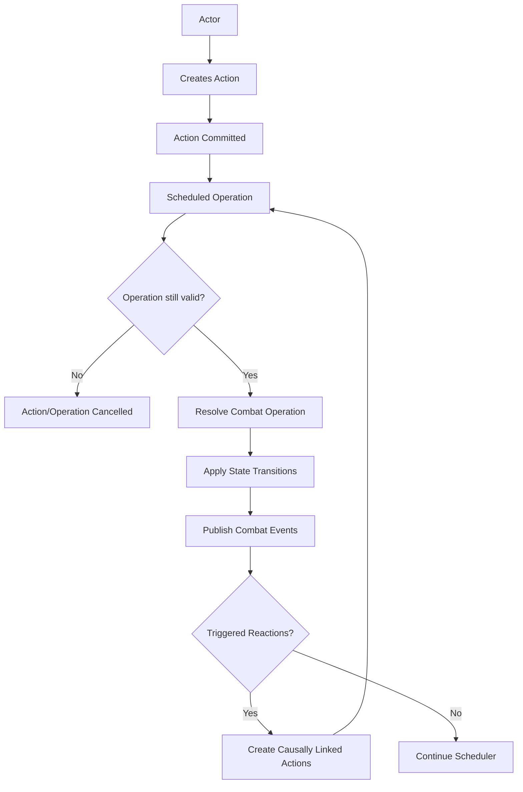

**Décision architecturale proposée \:** les événements sont des faits immuables. Ils ne sont pas utilisés indistinctement comme commandes, tâches programmées et résultats.

*Note d'ingénierie : cette distinction permet d'annuler un projectile encore en attente sans effacer les événements d'activation, de consommation de ressource ou de cooldown qui ont effectivement eu lieu.*

---

# SYS-002.D.13.1.1 - Combat Actor Model

## 3\. Taxonomie des acteurs

Je recommande de distinguer la nature d'un acteur de ses capacités.

| Type | Exemples | Caractéristiques |
|--------|--------|--------|
| `PRIMARY_COMBATANT` | Personnage joueur, héros adverse | PV, statistiques, actions, états |
| `ENEMY_COMBATANT` | Monstre, boss | PV, statistiques, actions, états |
| `PAL_ACTOR` | Acolyte déployé | Statistiques, attaques, propriétaire, emplacement |
| `SUMMONED_ACTOR` | Invocation autonome future | Contrat de durée et de propriétaire explicite |

Une invocation visuelle, comme les âmes de loup d'une compétence, ne devient pas automatiquement un `SUMMONED_ACTOR`\. Si elle n'a ni décisions autonomes ni cycle de vie propre, elle reste un effet d'action.

### 3.1 Capacités plutôt qu'hypothèses par type

Un acteur peut posséder \:

| Capacité | Rôle |
|--------|--------|
| `HEALTH` | PV, dégâts, mort |
| `TARGETABLE` | Peut être sélectionné comme cible |
| `ATTACK_SCHEDULER` | Produit ses propres échéances d'attaque |
| `SKILL_RESOURCES` | Possède des ressources de compétence |
| `COMBAT_STATUS` | Peut recevoir des buffs et débuffs |
| `OWNER_DEPENDENT_LIFECYCLE` | Dépend de l'état d'un propriétaire |
| `DEPLOYMENT_EFFECTS` | Contribue aux effets de déploiement |

Le modèle initial des Pals possède `ATTACK_SCHEDULER`, `COMBAT_STATUS` et `OWNER_DEPENDENT_LIFECYCLE`\.

Il ne leur attribue **pas automatiquement des PV indépendants ou la capacité d'être ciblés**\.

Nous évitons ainsi d'inventer une mécanique de mort individuelle des Pals qui n'a pas été établie dans notre GDD.

## 4\. Contrat de données proposé

```text
CombatActor
├── CombatId
├── ActorId
├── ActorKind
├── TeamId
├── OwnerActorId?
├── SourceEntityId
├── ClassId?
├── PalSlotId?
├── CapabilitySet
├── LifecycleState
├── Position
├── EffectiveStatistics
├── ActiveEffectInstanceIds[]
├── ResourceState?
├── AttackScheduleState?
└── ConfigurationSnapshotId
```

### 4.1 Identité et propriété

Nous devons distinguer trois identifiants.

**`ActorId`** désigne l'acteur qui existe dans l'instance de combat.

**`OwnerActorId`** désigne le combattant auquel un acteur dépendant est rattaché. Pour un Pal, c'est le personnage qui l'a déployé.

**`SourceEntityId`** permet de retrouver la définition ou l'instance persistante à partir de laquelle l'acteur a été construit.

Exemple \:

```text
ActorId = PAL_ACTOR_06
ActorKind = PAL_ACTOR
OwnerActorId = PLAYER_ACTOR_01
SourceEntityId = PAL_INSTANCE_824
PalSlotId = PAL_SLOT_06
```

Ces identifiants remplissent des fonctions différentes : l'identifiant persistant du Pal ne doit pas servir directement de clé d'ordonnancement d'un combat.

### 4.2 Convention de propriété proposée

Pour éviter toute ambiguïté \:

- Les combattants primaires n'ont pas de `OwnerActorId` \: la propriété est absente.
- Les Pals et invocations dépendantes référencent un propriétaire existant.
- La propriété ne change pas pendant un combat dans notre profil initial.
- Un propriétaire ne peut pas créer de cycle de propriété.
- Un Pal ne peut pas appartenir simultanément à deux combattants.

**Invariant `ACTOR-OWN-001` \:** les relations de propriété forment un graphe orienté sans cycle.

### 4.3 État de vie

Je propose \:

```text
ACTIVE
DEATH_PENDING
DEAD
REMOVED
```

`DEATH_PENDING` est nécessaire pour les réactions mortelles.

Un personnage à zéro PV n'est plus autorisé à engager une nouvelle action, mais les réactions immédiates déjà déclenchées peuvent encore être résolues avant la finalisation de sa mort.

`REMOVED` représente un acteur retiré de l'instance de combat, ce qui n'est pas équivalent à une mort.

Pour les Pals sans PV indépendants, leur disponibilité offensive dépend de l'état du propriétaire : ils peuvent être désactivés sans passer par un état de mort individuelle.

*Note d'ingénierie : un Pal doit pouvoir cesser d'agir à la mort de son propriétaire sans générer artificiellement six événements `ACTOR_DIED`\. Cela évite de déclencher à tort des passifs liés à la mort d'un acteur.*

---

# SYS-002.D.13.1.2 - Combat Action Model

## 5\. Qu'est-ce qu'une action ?

Une action est une **unité causale de gameplay**, qui peut produire un ou plusieurs impacts, effets et réactions.

Exemples \:

| Action | Opérations possibles | Nombre d'impacts |
|--------|--------|--------|
| Attaque normale Archer | Projectiles normaux | 1 ou 2 selon la branche |
| Combo Archer | Projectiles de combo | 1 ou 2 selon la branche |
| Compétence Mage | Météore, dégâts AoE, débuff | Plusieurs cibles |
| Contre-attaque Guerrier | Riposte dirigée vers l'attaquant | Selon son profil |
| Réflexion Warbringer | Dégâts de réaction AoE | Jusqu'à 5 cibles |
| Attaque normale Pal | Attaque du Pal | Selon le Pal |
| Combo Pal | Impacts de combo et éventuel bonus Supreme Spirit | Un ou plusieurs |
| Compétence Spirit Channeler | Loups spectraux, dégâts AoE, débuff | Plusieurs cibles |

**Un impact supplémentaire ne constitue pas nécessairement une nouvelle action.**

Cette distinction est indispensable pour empêcher les effets de dégâts supplémentaires de déclencher un combo ou une réflexion récursive.

## 6\. Modèle d'action proposé

```text
CombatAction
├── CombatId
├── ActionId
├── RootActionId
├── ParentActionId?
├── TriggerEventId?
├── ActorId
├── OwnerActorId?
├── ActionKind
├── OriginDefinitionId
├── State
├── RequestedAtUs
├── CommittedAtUs?
├── CompletedAtUs?
├── OffensiveSnapshotId?
├── TargetingContext
├── ResourceCommitRecordIds[]
├── ScheduledOperationIds[]
├── ChildActionIds[]
├── CancellationReason?
└── ConfigurationVersion
```

### Champs essentiels

| Champ | Signification |
|--------|--------|
| `ActionId` | Identité unique de l'action |
| `RootActionId` | Première action à l'origine de la chaîne causale |
| `ParentActionId` | Action ayant directement créé cette action |
| `TriggerEventId` | Fait précis ayant déclenché une réaction |
| `ActorId` | Acteur exécutant cette action |
| `OwnerActorId` | Propriétaire de l'acteur exécutant, s'il existe |
| `ActionKind` | Nature de l'action |
| `TargetingContext` | Sélecteur, cible initiale, position capturée et politique de repli |
| `OffensiveSnapshotId` | Référence offensive figée |
| `ConfigurationVersion` | Version exacte du contrat mécanique |

Le `RootActionId` est conservé dans toute une chaîne de réactions.

En revanche, chaque véritable action enfant possède un `ActionId` distinct.

### 6.1 Nature des actions

Je recommande la taxonomie suivante \:

```text
BASIC_ATTACK
COMBO_ATTACK
COUNTER_ATTACK
CLASS_SKILL
EQUIPPED_SKILL
PAL_BASIC_ATTACK
PAL_COMBO_ATTACK
PAL_SKILL
PASSIVE_REACTION
```

La réflexion Warbringer est une `PASSIVE_REACTION` portant une origine de dégâts spécifique.

Le bonus P4 Darklord et le bonus Supreme Spirit de 1 % des PV actuels sont des **composantes de dégâts**, pas des `PASSIVE_REACTION` autonomes.

Cette règle bloque une source importante de récursions involontaires.

---

## 7\. Cycle de vie d'une action

Je propose sept états.

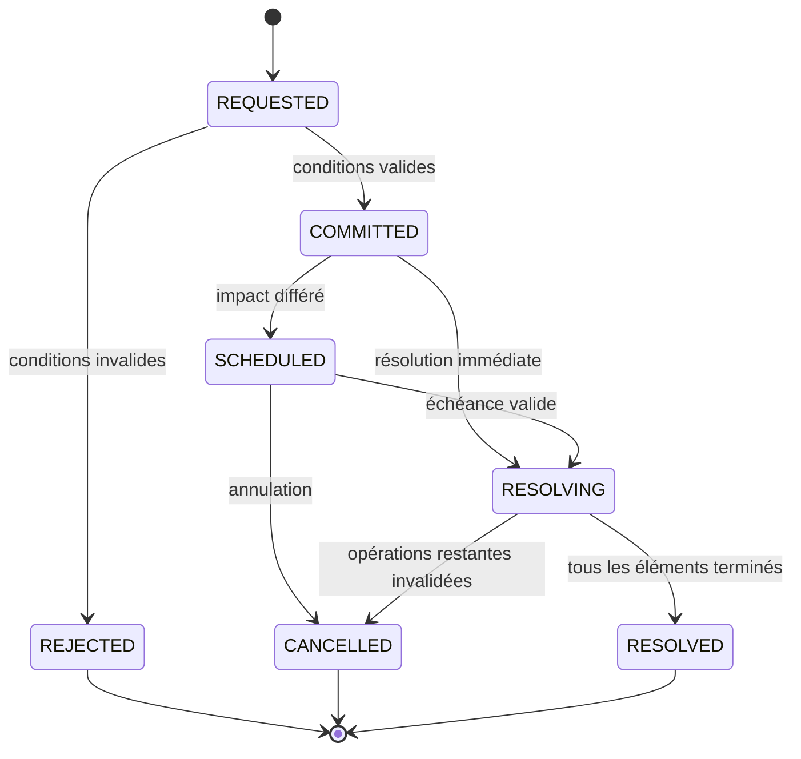

### 7.1 Sémantique des états

| État | Contrat |
|--------|--------|
| `REQUESTED` | Demande reçue, aucune activation engagée |
| `REJECTED` | Conditions invalides, aucune activation |
| `COMMITTED` | Activation acceptée, coûts et cooldown engagés |
| `SCHEDULED` | Une ou plusieurs opérations différées sont en attente |
| `RESOLVING` | Résolution d'au moins une opération de l'action |
| `RESOLVED` | Toutes les opérations attendues ont été traitées |
| `CANCELLED` | L'action ne produira plus de nouvelle résolution |

Une action composite peut alterner entre une phase de résolution d'impacts et une attente d'opérations restantes. Nous devrons donc traiter `SCHEDULED` comme l'état d'une action possédant encore du travail différé, pas comme la preuve qu'aucun impact n'a déjà été résolu.

Une annulation n'efface jamais les impacts antérieurs.

### 7.2 Convention importante : résolution partielle

Considérons une action de deux projectiles \:

- Le premier touche à `t = 100 ms`\.
- Le second doit toucher à `t = 200 ms`\.
- Le lanceur meurt à `t = 150 ms`\.

Si la politique de cette action impose l'annulation des impacts différés à la mort du lanceur \:

- Le premier impact reste enregistré.
- Le second est annulé.
- L'action termine avec un résultat **partiel**\.

Je recommande de distinguer \:

`ActionTerminalState = CANCELLED` et `ActionCompletionOutcome = PARTIALLY_RESOLVED`\.

Le statut terminal indique qu'aucune nouvelle opération n'est attendue. Le résultat explique ce qui s'est effectivement produit.

Cette distinction n'exige pas de supprimer les dégâts déjà appliqués.

### 7.3 Conservation des conséquences d'une activation

Une compétence engagée puis annulée avant impact a bien été activée.

Elle peut avoir \:

- Démarré son cooldown.
- Consommé une ressource.
- Installé un buff personnel.
- Armé une charge comme le P5 Darklord.

L'annulation de son impact **ne rembourse pas automatiquement** ces conséquences.

Un remboursement doit être prévu explicitement par le profil de compétence.

*Note d'ingénierie : `COMMITTED` doit représenter une frontière transactionnelle. Avant cet état, la demande peut être rejetée sans effet ; après cet état, seules les opérations restantes sont annulables, pas l'historique d'activation.*

---

# SYS-002.D.13.1.3 - Scheduled Operation Model

## 8\. Contrat des opérations programmées

Une opération programmée représente du travail qui n'a pas encore été exécuté.

```text
ScheduledOperation
├── OperationId
├── CombatId
├── ScheduledTimeUs
├── OperationKind
├── OriginActionId?
├── OriginEffectInstanceId?
├── RequiredActorId?
├── RequiredOwnerActorId?
├── TargetReference?
├── PhaseHint
├── Generation
├── Preconditions
├── ExecutionState
└── CancellationReason?
```

Les deux types d'origine sont nécessaires \:

- Une opération peut provenir d'une action : impact d'un météore.
- Une opération peut provenir d'une instance d'effet : expiration d'un bouclier, tick de régénération.

Elle peut également provenir directement du moteur, comme une échéance de décision automatique ou une transition globale de combat. Son origine reste alors identifiée par un contexte système explicite.

### 8.1 Opérations initialement nécessaires

| Opération | Exemple |
|--------|--------|
| `ACTION_IMPACT` | Impact différé d'un projectile |
| `ACTION_ACTIVATION_CHECK` | Vérifier si une compétence automatique peut être utilisée |
| `EFFECT_TICK` | Soin périodique de Martial Sage |
| `EFFECT_EXPIRATION` | Fin du bypass d'évasion Beastmaster |
| `COOLDOWN_READY_CHECK` | Nouvelle disponibilité d'une compétence |
| `RESOURCE_REGEN_TICK` | Régénération d'énergie Prophet |
| `COMBAT_LIFECYCLE_CHECK` | Finalisation d'un état de mort |

### 8.2 Une échéance n'est pas un résultat

Exemple : un météore est programmé pour `t = 1 000 000 µs`\.

À cette échéance, le moteur peut découvrir que son lanceur est mort.

L'opération est alors annulée.

Nous pouvons publier `SCHEDULED_OPERATION_CANCELLED`, mais jamais `SKILL_HIT` ou `DAMAGE_APPLIED` pour cet impact.

### 8.3 Invalidation par génération

Les effets rafraîchissables et les cooldowns modifiables doivent posséder un identifiant de génération.

Exemple \:

1. Un débuff est appliqué jusqu'à `t = 5 s`, génération 1.
2. Il est rafraîchi à `t = 3 s`, avec une nouvelle expiration à `t = 8 s`, génération 2.
3. L'ancienne échéance à `t = 5 s` est encore présente dans la file.
4. Le moteur constate que son identifiant de génération est obsolète.
5. Elle est ignorée sans faire expirer le débuff actif.

Le mécanisme couvre également les cooldowns réduits par Prophet P5.

*Note d'ingénierie : l'invalidation par génération préserve une file d'échéances simple et déterministe. Elle évite de devoir supprimer physiquement des opérations au milieu d'une file prioritaire, à condition que les opérations obsolètes soient identifiées sans ambiguïté.*

---

# SYS-002.D.13.1.4 - Combat Event Model

## 9\. Contrat d'événement

Un `CombatEvent` est un enregistrement immuable décrivant **un fait qui s'est produit dans une instance de combat**\.

Je propose l'enveloppe suivante \:

```text
CombatEvent
├── EventId
├── CombatId
├── TimestampUs
├── ExecutionOrdinal
├── EventKind
├── SourceActorId?
├── OwnerActorId?
├── TargetActorId?
├── ActionId?
├── RootActionId?
├── CausedByEventId?
├── EffectInstanceId?
├── DamageComponentId?
├── ConfigurationVersion
└── TypedPayload
```

### 9.1 Responsabilités des identifiants

| Champ | Usage |
|--------|--------|
| `EventId` | Identifier un fait de combat unique |
| `ExecutionOrdinal` | Conserver son ordre exact de publication |
| `SourceActorId` | Identifier l'acteur qui a effectivement produit le fait |
| `OwnerActorId` | Identifier le combattant responsable de l'acteur source |
| `TargetActorId` | Identifier l'acteur affecté, si applicable |
| `ActionId` | Relier le fait à son action |
| `RootActionId` | Remonter à l'action racine |
| `CausedByEventId` | Identifier le fait ayant directement provoqué cet événement |
| `EffectInstanceId` | Identifier l'instance d'effet concernée |
| `DamageComponentId` | Identifier la composante de dégâts concernée |
| `TypedPayload` | Transporter des données conformes au type d'événement |

Pour une attaque directe du personnage, `SourceActorId` et `OwnerActorId` désignent le même combattant.

Pour une attaque Pal, `SourceActorId` désigne le Pal et `OwnerActorId` son propriétaire.

Cette convention d'événement est différente du champ optionnel `CombatActor.OwnerActorId`, qui reste absent pour un acteur primaire.

### 9.2 Pourquoi distinguer source et propriétaire ?

Prenons un Prophet possédant un Pal capable d'étourdir.

Son P5 ne se déclenche que lorsqu'un étourdissement éligible est causé **directement par Prophet**, conformément au contrat précédemment validé.

| Événement | `SourceActorId` | `OwnerActorId` | P5 Prophet |
|--------|--------|--------|--------|
| Compétence du Prophet étourdit | Prophet | Prophet | Oui |
| Attaque normale du Prophet étourdit | Prophet | Prophet | Oui |
| Pal du Prophet étourdit | Pal | Prophet | Non |
| Allié distinct étourdit | Allié | Allié | Non |

Si nous utilisions uniquement `OwnerActorId`, les étourdissements des Pals pourraient activer P5 par erreur.

À l'inverse, Supreme Spirit doit reconnaître les combos de ses Pals : il recherche une source `PAL_ACTOR` dont le propriétaire est Supreme Spirit.

**Ces deux mécanismes prouvent que les deux identités sont nécessaires.**

---

## 10\. Catalogue initial d'événements

Je recommande de commencer avec les familles suivantes.

| Famille | Événements de domaine |
|--------|--------|
| Actions | `ACTION_COMMITTED`, `ACTION_REJECTED`, `ACTION_CANCELLED`, `ACTION_RESOLVED` |
| Touche | `HIT_CONFIRMED`, `HIT_EVADED`, `HIT_INVALIDATED` |
| Critiques | `CRITICAL_HIT_CONFIRMED` |
| Dégâts | `DAMAGE_APPLIED`, `DAMAGE_PREVENTED` |
| Boucliers | `SHIELD_ABSORBED`, `SHIELD_BROKEN`, `SHIELD_EXPIRED` |
| Contrôle | `STUN_NEW_APPLICATION`, `STUN_REFRESHED`, `STUN_EXPIRED` |
| Effets | `EFFECT_APPLIED`, `EFFECT_REFRESHED`, `EFFECT_EXPIRED` |
| Ressources | `RESOURCE_CHANGED`, `COOLDOWN_CHANGED`, `COOLDOWN_READY` |
| Vie | `HEALING_APPLIED`, `ACTOR_DEATH_PENDING`, `ACTOR_DIED` |
| Combat | `COMBAT_STARTED`, `COMBAT_FINALIZED` |

La nomenclature complète sera affinée lors des spécifications des systèmes producteurs.

### 10.1 Un événement ne doit pas mélanger plusieurs faits

Supposons une attaque critique entièrement absorbée par un bouclier.

Le moteur peut publier, dans l'ordre causal \:

```text
HIT_CONFIRMED
CRITICAL_HIT_CONFIRMED
SHIELD_ABSORBED
DAMAGE_PREVENTED
```

Il ne doit pas publier `DAMAGE_APPLIED` avec un montant positif, puisqu'aucun PV n'a été perdu.

En revanche, `CRITICAL_HIT_CONFIRMED` reste valable. L'Archer Sacred Hunter peut donc déclencher son P5 conformément au contrat approuvé.

### 10.2 Événements et traces de calcul

Je recommande de séparer \:

- **Événements de domaine** \: faits observables pouvant déclencher des passifs.
- **Traces de résolution** \: données diagnostiques expliquant les calculs intermédiaires.

Par exemple, la valeur brute d'un coefficient critique et chaque facteur de mitigation peuvent être consignés dans une trace, sans constituer chacun un nouvel événement susceptible de déclencher des réactions.

Cela permet de conserver des audits détaillés sans rendre le combat dépendant du niveau de journalisation.

*Note d'ingénierie : seuls les événements de domaine autorisés doivent alimenter les déclencheurs de gameplay. Activer un journal de diagnostic ne doit jamais modifier le résultat d'un combat.*

---

# SYS-002.D.13.1.5 - Causalité et actions parentes

## 11\. Graphe causal

Les événements et les actions ne forment pas uniquement une chronologie. Ils forment aussi un graphe de causalité.

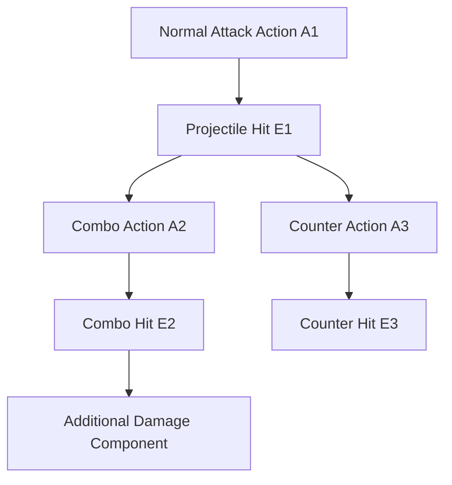

Dans cet exemple, A2 et A3 sont des actions distinctes causées par E1.

En revanche, la composante de dégâts supplémentaire issue de E2 n'est pas une action supplémentaire.

### 11.1 Relations proposées

Une nouvelle action déclenchée par une action existante possède \:

$$
ParentActionId = ActionId_{\mathrm{source}}
$$

Elle conserve \:

$$
RootActionId = RootActionId_{\mathrm{source}}
$$

Et précise le fait déclencheur \:

$$
TriggerEventId = EventId_{\mathrm{trigger}}
$$

Le graphe causal doit toujours être **acyclique**\.

Une action ne peut ni être sa propre parente ni avoir un descendant comme parent.

### 11.2 Exemple Archer Plume Monarch

Supposons deux projectiles normaux et deux projectiles de combo.

```text
A100 - BASIC_ATTACK
├── E101 - NORMAL_PROJECTILE_1_HIT
├── E102 - NORMAL_PROJECTILE_2_HIT
└── E103 - COMBO_PROC_SUCCEEDED
    └── A101 - COMBO_ATTACK
        ├── E104 - COMBO_PROJECTILE_1_HIT
        └── E105 - COMBO_PROJECTILE_2_HIT
```

Contrat \:

- A100 possède un seul tirage de combo.
- A101 possède un nouvel identifiant d'action.
- A101 conserve A100 comme racine.
- Les impacts de A101 ne peuvent pas générer de nouveau combo.
- Les critiques de chaque projectile restent indépendants.
- Le bonus P5 Sacred Hunter peut modifier les actions futures, mais pas rétroactivement le snapshot de A100.

Les identifiants ci-dessus sont illustratifs.

### 11.3 Exemple Warbringer

Une attaque normale ennemie touche Warbringer et produit un événement `HIT_CONFIRMED`\.

La réflexion est une action de réaction liée à cet événement.

```text
Enemy Basic Attack A200
└── Hit Confirmed E200
    └── Warbringer Reflection A201
        └── Reflection Damage Components
```

La réflexion ne peut pas déclencher une autre réflexion, même si sa cible possède une mécanique similaire.

La règle doit être explicite \:

`CanTriggerReflection = false`

pour les composantes de réflexion.

**Nous ne devons pas dépendre d'une limite de profondeur arbitraire pour arrêter la boucle.**

Une profondeur maximale reste utile comme garde-fou de validation, mais ne remplace pas les règles d'éligibilité.

### 11.4 Exemple Supreme Spirit

Une action de combo Pal produit deux impacts réussis.

```text
Pal Combo Action A300
├── Combo Hit E300
│   └── Awakening Proc Roll
│       └── Additional HP-Scaled Damage Component
└── Combo Hit E301
    └── No Additional Proc Roll
```

Un identifiant de déduplication propre à l'action protège le tirage \:

`(ActionId, SUPREME_SPIRIT_AWAKENING_PROC)`

Le moteur sait alors qu'un tirage a déjà eu lieu, même si plusieurs projectiles touchent.

---

## 12\. Déduplication des déclencheurs

Les quatre classes utilisent plusieurs notions de déclenchement qui ne doivent pas être uniformisées artificiellement.

| Mécanique | Unité de déclenchement |
|--------|--------|
| Archer - combo | Action normale parente |
| Sacred Hunter - P4 Vital Shot | Premier projectile normal admissible de l'action |
| Sacred Hunter - P5 Critical Momentum | Impact direct critique réussi |
| Prophet - P5 | Nouvelle application d'étourdissement par cible et action racine |
| Warbringer - réflexion | Impact normal ennemi déclencheur |
| Supreme Spirit - Éveil | Première touche admissible de l'action de combo Pal |
| Darklord - P5 | Activation effective d'une compétence |

Je recommande une clé de déduplication déclarée **par définition de déclencheur**, plutôt qu'une clé universelle.

```text
TriggerDeduplicationPolicy
├── TriggerDefinitionId
├── Scope
│   ├── PER_ROOT_ACTION
│   ├── PER_ACTION
│   ├── PER_IMPACT
│   ├── PER_ROOT_ACTION_AND_TARGET
│   └── PER_EFFECT_INSTANCE
├── EligibleEventKinds[]
├── EligibleDamageOrigins[]
└── ReentrancyPolicy
```

Par exemple, si nous dédupliquions tous les effets par `RootActionId`, les critiques de deux projectiles Archer pourraient déclencher Critical Momentum une seule fois. Cela contredirait la granularité de son contrat.

À l'inverse, si nous dédupliquions le bonus Supreme Spirit par impact, un combo multi-projectiles pourrait effectuer plusieurs tirages.

*Note d'ingénierie : la déduplication est une propriété du passif, pas du bus d'événements. Le moteur de causalité fournit les identifiants ; chaque mécanique déclare l'identité de son unité de déclenchement.*

---

# SYS-002.D.13.1.6 - Déterminisme et intégrité

## 13\. Identifiants et ordre d'exécution

Je recommande que tous les identifiants runtime soient uniques **dans leur instance de combat**\.

Ils ne doivent dépendre ni de l'adresse mémoire d'un objet, ni de son ordre de création dans Unity, ni d'un identifiant de thread.

| Identifiant | Règle proposée |
|--------|--------|
| `CombatId` | Identifie l'instance |
| `ActorId` | Stable pendant toute l'instance |
| `ActionId` | Unique par action |
| `EventId` | Unique par événement publié |
| `OperationId` | Unique par opération programmée |
| `EffectInstanceId` | Unique par instance d'effet |
| `DamageComponentId` | Unique par composante de dégâts |
| `ExecutionOrdinal` | Strictement croissant dans le journal des faits |

Les définitions structurelles, telles que `ClassId`, `PalDefinitionId` et `EffectDefinitionId`, restent distinctes des identifiants runtime.

### 13.1 Événements simultanés

Deux événements peuvent avoir le même `TimestampUs`\.

Ils ne peuvent pas avoir le même `ExecutionOrdinal`\.

Leurs relations causales doivent respecter \:

$$
CausedBy(E_2,E_1)
\implies
Ordinal(E_1)<Ordinal(E_2)
$$

Cette propriété est nécessaire, mais insuffisante pour fixer l'ordre général des événements simultanés.

Leurs priorités exactes seront spécifiées dans `SYS-002.D.13.3`\.

Nous conservons déjà les contraintes validées : expiration avant impact, compétence de classe prioritaire dans les collisions prévues et réactions immédiates résolues avant clôture.

### 13.2 Pas de retour vers une phase déjà exécutée

Une réaction créée pendant la résolution d'un impact ne doit pas provoquer l'exécution rétroactive d'une opération appartenant à une phase antérieure du même timestamp.

Elle doit être traitée selon une phase de réaction autorisée, tout en préservant l'ordre causal.

Ce principe empêchera les événements créés dynamiquement de perturber le scheduler.

---

## 14\. Contrat RNG

Le moteur de combat doit être reproductible à partir d'un état initial et d'une configuration identiques.

Je propose les champs diagnostiques suivants pour les décisions probabilistes \:

```text
RandomDecisionRecord
├── DecisionId
├── CombatId
├── SourceActionId
├── SourceImpactId?
├── ProbabilityDefinitionId
├── RngStreamId
├── DrawIndex
├── ThresholdBP
├── Outcome
└── ConfigurationVersion
```

Les tirages sont effectués uniquement lorsque leurs conditions d'éligibilité sont satisfaites.

Exemples \:

| Situation | Tirage RNG |
|--------|--------|
| Projectile sur cible déjà éliminée | Aucun jet d'évasion |
| Bypass Beastmaster actif | Aucun jet d'évasion |
| Projectile esquivé | Aucun jet critique ultérieur |
| Projectile réussi et critique autorisé | Jet critique |
| Premier impact réussi de combo Supreme Spirit | Jet d'Éveil à 40 % |
| Deuxième impact du même combo | Aucun nouveau jet d'Éveil |

Nous ne fixerons pas encore le choix entre un flux RNG unique et plusieurs flux déterministes indépendants. Cette décision appartient au contrat du scheduler et du moteur probabiliste.

Dans les deux cas, **le résultat ne doit pas dépendre de l'ordre d'itération non déterministe des objets**\.

*Note d'ingénierie : enregistrer l'identité des décisions probabilistes permet d'expliquer un résultat de combat sans confondre une variation légitime de RNG avec une modification accidentelle de l'ordre des événements.*

---

# SYS-002.D.13.1.7 - Invariants transversaux

## 15\. Invariants de référence proposés

| ID | Invariant |
|--------|--------|
| `COMBAT-INV-001` | Tout `ActorId` appartient à une unique instance de combat |
| `COMBAT-INV-002` | Le graphe de propriété des acteurs ne contient aucun cycle |
| `COMBAT-INV-003` | Une action engagée possède exactement un acteur source |
| `COMBAT-INV-004` | Une action enfant référence une action parente existante |
| `COMBAT-INV-005` | Une action ne peut pas être sa propre descendante |
| `COMBAT-INV-006` | Un fait de combat publié est immuable |
| `COMBAT-INV-007` | Une opération annulée ne produit pas d'impact réussi |
| `COMBAT-INV-008` | Une annulation ne supprime jamais des conséquences déjà résolues |
| `COMBAT-INV-009` | Un impact réussi n'implique pas nécessairement des dégâts positifs |
| `COMBAT-INV-010` | Un composant de dégâts supplémentaire ne crée pas automatiquement de nouvelle action |
| `COMBAT-INV-011` | Les déclencheurs sont dédupliqués selon leur propre politique |
| `COMBAT-INV-012` | Les événements causés par d'autres événements apparaissent après leur cause |
| `COMBAT-INV-013` | Les Pals conservent un lien explicite vers leur propriétaire |
| `COMBAT-INV-014` | Les Pals inactifs ne produisent aucun événement offensif |
| `COMBAT-INV-015` | Les actions déjà engagées utilisent leur snapshot offensif |
| `COMBAT-INV-016` | Les résultats restent reproductibles avec une configuration et un RNG identiques |
| `COMBAT-INV-017` | Les identifiants de définitions et les identifiants runtime restent distincts |
| `COMBAT-INV-018` | Une version de configuration est figée pour un combat |
| `COMBAT-INV-019` | Les opérations expirées ou invalidées ne modifient pas l'état actif |
| `COMBAT-INV-020` | Les effets hostiles sur une cible sont rattachés à une source identifiable |

### 15.1 Précondition des événements dérivés

Tout événement possède une origine traçable \:

`ACTION`, `EFFECT_INSTANCE` ou `COMBAT_SYSTEM`\.

Un `RootActionId` peut donc être absent pour une opération système autonome, comme un tick de régénération non causé par une attaque.

En revanche, **un événement dérivé ne peut pas être sans origine**\.

Cela évite de forcer artificiellement tous les effets périodiques à appartenir à une attaque initiale.

### 15.2 Précision sur les actions composites

Pour rendre le cycle de vie proposé totalement cohérent, une action composite devra conserver deux propriétés distinctes \:

- Son **état de contrôle**, qui indique si elle accepte encore de nouvelles résolutions.
- Le **nombre d'opérations en attente**, qui indique s'il reste des projectiles, impacts ou effets à traiter.

Après le premier impact d'une action multi-projectiles, celle-ci peut revenir de `RESOLVING` à `SCHEDULED` si d'autres opérations subsistent.

Une action ne devient terminale qu'une fois toutes ses opérations traitées ou invalidées.

Cette transition complète le diagramme de cycle de vie présenté précédemment.

---

# SYS-002.D.13.1.8 - Matrice de tests d'acceptation

## 16\. Tests du modèle d'acteurs

| Test | Scénario | Résultat attendu |
|--------|--------|--------|
| `D13-ACTOR-001` | Deux acteurs créés dans un combat | Identifiants distincts |
| `D13-ACTOR-002` | Six Pals Spirit Channeler | Six acteurs Pal rattachés au même propriétaire |
| `D13-ACTOR-003` | Pal du slot 6 rendu inactif | Aucun nouvel événement offensif |
| `D13-ACTOR-004` | Propriété Pal → propriétaire → Pal | Rejet du cycle |
| `D13-ACTOR-005` | Pal sans PV indépendants | Aucun événement de mort individuelle artificiel |
| `D13-ACTOR-006` | Reconstruction d'une même composition | Attribution déterministe des identifiants |

## 17\. Tests du modèle d'actions

| Test | Scénario | Résultat attendu |
|--------|--------|--------|
| `D13-ACTION-001` | Tentative de compétence sans ressource | `REJECTED`, aucun engagement |
| `D13-ACTION-002` | Compétence activée normalement | `COMMITTED` avant la programmation de l'impact |
| `D13-ACTION-003` | Lanceur étourdi après engagement | Impact différé conservé si son profil le prévoit |
| `D13-ACTION-004` | Lanceur mort avant impact | Annulation selon la politique validée |
| `D13-ACTION-005` | Premier projectile résolu, second annulé | Conséquences du premier conservées |
| `D13-ACTION-006` | Deux projectiles Archer | Une action normale parente |
| `D13-ACTION-007` | Combo Archer déclenché | Nouvelle action enfant |
| `D13-ACTION-008` | Combo Archer touche | Aucun nouveau combo récursif |
| `D13-ACTION-009` | Réflexion Warbringer | Action de réaction causale distincte |
| `D13-ACTION-010` | Bonus P4 Darklord | Composante de dégâts, pas nouvelle action |

## 18\. Tests des événements et de la causalité

| Test | Scénario | Résultat attendu |
|--------|--------|--------|
| `D13-EVENT-001` | Coup critique entièrement absorbé | `HIT_CONFIRMED` et `CRITICAL_HIT_CONFIRMED`, sans dégâts PV positifs |
| `D13-EVENT-002` | Même situation avec Sacred Hunter | P5 peut être déclenché |
| `D13-EVENT-003` | Pal de Prophet étourdit | Aucun déclenchement Prophet P5 |
| `D13-EVENT-004` | Prophet étourdit directement | Prophet P5 éligible |
| `D13-EVENT-005` | Un combo Pal frappe deux fois | Un seul tirage Supreme Spirit |
| `D13-EVENT-006` | Réflexion Warbringer atteint cinq cibles | Une action de réaction, cinq résolutions cibles au maximum |
| `D13-EVENT-007` | Deux événements simultanés | Horodatage identique, ordres d'exécution distincts |
| `D13-EVENT-008` | Événement enfant | L'événement parent apparaît avant lui |
| `D13-EVENT-009` | Expiration obsolète après refresh | Aucun effet sur l'instance active |
| `D13-EVENT-010` | Activation de la journalisation détaillée | Résultat de combat inchangé |
| `D13-EVENT-011` | Même combat rejoué | Même suite d'événements et même état final |
| `D13-EVENT-012` | Profil modifié après création du combat | Combat existant inchangé |

### Tests de propriétés

Au-delà des scénarios individuels, il faudra vérifier les propriétés générales suivantes \:

$$
\forall e,\quad EventId(e)\text{ est unique dans le combat}
$$

$$
\forall a,\quad a\text{ ne possède aucun ancêtre égal à }a
$$

$$
\forall e_1,e_2,\quad
CausedBy(e_2,e_1)\Rightarrow Ordinal(e_1)<Ordinal(e_2)
$$

$$
Cancelled(op)\Rightarrow
\text{aucun nouvel effet de cette opération}
$$

Ces propriétés constituent de bons candidats pour les futurs tests génératifs, sans nécessiter de valeurs de dégâts calibrées.

Les tests sont **spécifiés**, pas exécutés.

---

# SYS-002.D.13.1.9 - Résultat de l'audit

## 19\. Compatibilité avec les quatre classes

| Mécanique | Primitives nécessaires | Couverture du modèle |
|--------|--------|--------|
| Guerrier - contre-attaque | Action enfant, événement déclencheur | Couverte |
| Guerrier - réflexion | Réaction, origine de dégâts, déduplication | Couverte |
| Archer - multi-projectiles | Action parente, plusieurs opérations | Couverte |
| Archer - critiques successifs | Impacts et événements distincts | Couverte |
| Mage - compétence différée | Engagement et opération programmée | Couverte |
| Mage - suppression d'énergie | Effet temporel et événement de ressource | Couverte |
| Mage - réduction de cooldown | Événement de contrôle et échéance invalidable | Couverte |
| Darklord - dégâts traversant l'immunité | Composantes distinctes | Structure couverte ; calcul en `D.13.4` |
| Spirit Channeler - six Pals | Acteurs dépendants, slots, propriétaire | Couverte |
| Beastmaster - bonus dynamique | État propriétaire et snapshot offensif | Couverte |
| Supreme Spirit - synergies raciales | Configuration de déploiement versionnée | Couverte |
| Supreme Spirit - proc de combo | Action parente, premier impact réussi, déduplication | Couverte |

Aucune mécanique déjà validée n'impose de créer un moteur séparé pour l'une des quatre classes.

## 20\. Limites volontairement reportées

| Jalon futur | Contrat encore à détailler |
|--------|--------|
| `D.13.2` | Transitions d'action, annulations partielles, consommation des ressources |
| `D.13.3` | Ordre total du scheduler, collisions, réactions et stratégie RNG |
| `D.13.4` | Pipeline détaillé des dégâts et mitigation par composante |
| `D.13.5` | Modificateurs, snapshots et rafraîchissements d'effets |
| `D.13.6` | Intégration opérationnelle des six schedulers Pal |
| `D.13.7` | Finalisation des morts, annulation d'impacts et double KO |
| `D.13.8` | Matrice complète de tests interclasses |

Ces reports sont intentionnels. `D.13.1` fixe le langage commun du moteur ; les jalons suivants fixeront son fonctionnement détaillé.


---

## SYS-002.D.13.2 — Action Lifecycle

**Validation :** `SYS-002.D.13.2.10.1` · approbation propriétaire `T146` · spécification source `T145`. **Statut :** `functionally_specified`; implémentation `not_started`; tests `not_executed`.


# SYS-002.D.13.2 - Action Lifecycle Specification

Audit fonctionnel et contractuel - aucune implémentation

## 2\. Objectif du nouveau jalon

Nous devons maintenant répondre précisément à cinq questions \:

1. **Quand une action devient-elle irréversible ?**
2. Quand les ressources sont-elles consommées et les cooldowns démarrés ?
3. Quelles opérations subsistent après un étourdissement, une annulation ou une mort ?
4. Comment représenter une action dont certains impacts ont réussi et d'autres ont été annulés ?
5. Quand une action est-elle réellement terminée, notamment lorsqu'elle produit un combo, une réaction ou un effet temporaire ?

Une action n'est pas nécessairement un événement instantané.

Elle peut être engagée à un timestamp donné, produire plusieurs impacts successifs, déclencher d'autres actions et conserver des conséquences même si ses derniers impacts sont annulés.

**Principe directeur proposé : une action engagée ne peut pas être effacée rétroactivement. Seul son travail restant peut être invalidé.**

---

# SYS-002.D.13.2.1 - Cycle de vie formel

## 3\. Les sept états hérités de D.13.1

Nous conservons exactement les états déjà définis \:

| État | Signification |
|--------|--------|
| `REQUESTED` | Action demandée, mais non engagée |
| `REJECTED` | Demande refusée sans engagement |
| `COMMITTED` | Activation validée, conséquences d'engagement appliquées |
| `SCHEDULED` | Une ou plusieurs opérations restent programmées |
| `RESOLVING` | Une opération appartenant à l'action est en cours de résolution |
| `RESOLVED` | Toutes les opérations ont été traitées normalement |
| `CANCELLED` | Au moins une opération restante a été annulée et l'action est terminée |

`REJECTED`, `RESOLVED` et `CANCELLED` sont terminaux.

`COMMITTED` marque le point de non-retour de l'engagement, pas nécessairement le début des dégâts.

## 4\. Machine d'états proposée

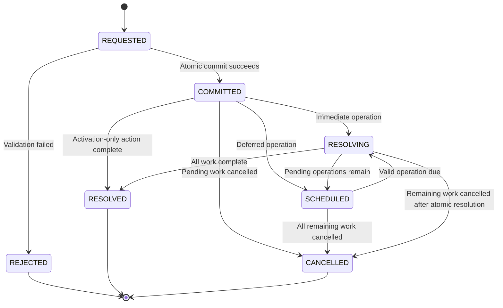

La transition `RESOLVING → SCHEDULED` est essentielle pour les actions multi-projectiles. Elle permet de résoudre un impact sans terminer prématurément l'action parente.

### 4.1 Interdictions

| Transition | Statut |
|--------|--------|
| `REJECTED → COMMITTED` | Interdite |
| `RESOLVED → SCHEDULED` | Interdite |
| `CANCELLED → RESOLVING` | Interdite |
| `COMMITTED → REQUESTED` | Interdite |
| `RESOLVING → REQUESTED` | Interdite |
| `SCHEDULED → REQUESTED` | Interdite |

Une action terminale ne peut pas être réactivée. Toute nouvelle tentative exige un nouvel `ActionId`\.

### 4.2 Invariants de terminalité

Je propose \:

$$
Terminal(a)\Rightarrow PendingOperations(a)=0
$$

Une action terminale ne doit posséder aucune opération encore exécutable.

Les anciennes entrées physiques de la file du scheduler peuvent subsister, mais elles doivent être marquées comme annulées ou invalidées par génération.

En outre \:

$$
Committed(a)\Rightarrow
\text{les conséquences d'engagement ne sont pas supprimées}
$$

L'échec d'un impact n'implique donc pas l'annulation du cooldown déjà démarré.

*Note d'ingénierie : l'état de l'action doit décrire sa progression logique, pas simplement la présence d'une échéance dans la file. Une entrée obsolète dans le scheduler ne doit jamais maintenir artificiellement une action active.*

---

# SYS-002.D.13.2.2 - Résultat et comptabilité d'une action

## 5\. Séparer état terminal et résultat effectif

Une action terminée peut avoir produit des résultats très différents.

Je propose de conserver deux propriétés \:

```text
ActionTerminalState
├── REJECTED
├── RESOLVED
└── CANCELLED

ActionCompletionOutcome
├── NO_EFFECT
├── FULLY_RESOLVED
├── PARTIALLY_RESOLVED
└── NO_IMPACT_CANCELLED
```

Les combinaisons doivent être contraintes.

| État terminal | Résultat admissible | Exemple |
|--------|--------|--------|
| `REJECTED` | Aucun engagement | Compétence sans énergie |
| `RESOLVED` | `FULLY_RESOLVED` | Attaque ayant terminé tous ses impacts |
| `RESOLVED` | `NO_EFFECT` | Tous les impacts ont été esquivés |
| `CANCELLED` | `PARTIALLY_RESOLVED` | Premier projectile résolu, second annulé |
| `CANCELLED` | `NO_IMPACT_CANCELLED` | Météore annulé avant impact |

**Précision \:** un projectile esquivé reste une opération normalement résolue. L'esquive ne constitue pas une annulation de l'action.

De même, un impact dont la cible est devenue invalide peut être classé `SKIPPED` au niveau de l'opération sans nécessairement annuler toute l'action parente.

## 6\. Compteurs de résolution

Je recommande que chaque action conserve les compteurs suivants \:

```text
ActionResolutionCounters
├── PlannedOperationCount
├── ExecutedOperationCount
├── SkippedOperationCount
├── CancelledOperationCount
├── PendingOperationCount
├── SuccessfulHitCount
├── FailedHitCount
└── PositiveDamageImpactCount
```

Les cinq premiers compteurs décrivent le traitement des opérations.

Les trois derniers décrivent les résultats de combat ; ils ne doivent pas servir à déterminer seuls la terminalité.

Invariant \:

$$
N_{\mathrm{planned}}
=
N_{\mathrm{executed}}
+
N_{\mathrm{skipped}}
+
N_{\mathrm{cancelled}}
+
N_{\mathrm{pending}}
$$

Cette égalité vaut pour les opérations appartenant directement à l'action, une fois toutes les opérations créées comptabilisées.

Les actions enfants possèdent leurs propres compteurs.

### 6.1 Pourquoi ne pas attendre tous les descendants ?

Une attaque normale Archer peut déclencher une action enfant de combo.

L'action normale parente peut devenir `RESOLVED` dès que ses propres projectiles et son tirage de combo sont terminés.

Elle n'a pas besoin d'attendre la fin de l'action enfant.

Le lien causal demeure accessible grâce à `RootActionId`, `ParentActionId` et `TriggerEventId`\.

Cette indépendance évite de conserver indéfiniment des actions parentes simplement parce qu'une réaction ou un effet dérivé reste actif.

*Note d'ingénierie : la durée de vie d'une action et celle de ses descendants causaux sont différentes. Les lier artificiellement compliquerait les annulations et la détection de fin de combat.*

---

# SYS-002.D.13.2.3 - Engagement atomique des actions

## 7\. Frontière transactionnelle : `COMMITTED`

Le passage `REQUESTED → COMMITTED` doit être une opération atomique sur l'état du combat.

Une demande ne doit jamais consommer de l'énergie sans engager l'action correspondante, ni démarrer un cooldown pour une activation rejetée.

### 7.1 Préconditions d'engagement

| Contrôle | Condition |
|--------|--------|
| Acteur | Existe et peut encore engager une action |
| Propriétaire | Actif, si l'action dépend de lui |
| Contrôle | L'acteur n'est pas empêché d'agir par un état applicable |
| Compétence | Débloquée et autorisée par sa configuration |
| Cooldown | Disponible |
| Ressource | Quantité suffisante, si une ressource est requise |
| Cible | Satisfait les conditions d'acquisition initiales |
| Concurrence | Aucun verrou logique incompatible avec l'action |
| Profil | Configuration exécutable valide |

La liste des contrôles dépend de la définition de l'action. Par exemple, une réaction passive peut ne nécessiter ni énergie ni cooldown.

### 7.2 Séquence atomique proposée

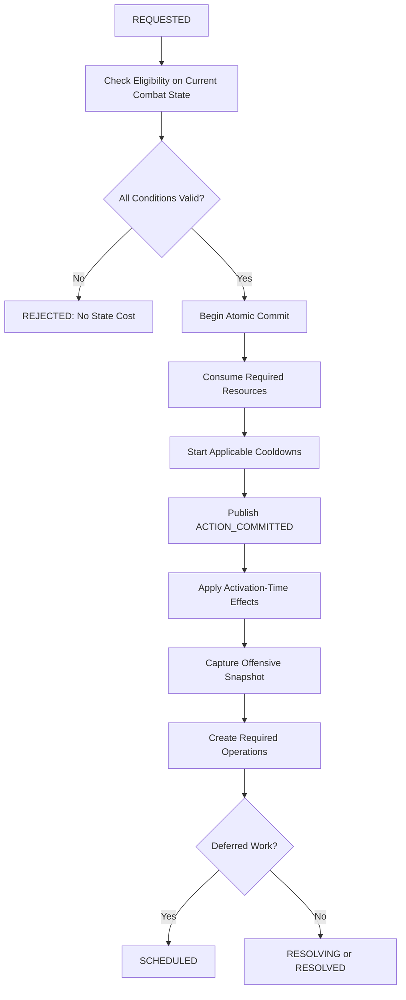

La validation et l'engagement s'effectuent sans laisser une autre action modifier les mêmes ressources entre ces deux étapes.

Si le commit échoue avant publication, aucune conséquence d'engagement n'est visible : la transaction est rejetée dans son ensemble.

Une erreur technique empêchant de construire les opérations exigées est une erreur d'intégrité de transaction, non un événement normal donnant lieu à un remboursement partiel.

### 7.3 Ressources et cooldowns

Je recommande les contrats suivants \:

| ID | Règle proposée |
|--------|--------|
| `LIFE-RESOURCE-001` | Les ressources requises sont vérifiées au moment du commit |
| `LIFE-RESOURCE-002` | Elles sont consommées exactement une fois |
| `LIFE-RESOURCE-003` | Un cooldown commence à l'engagement |
| `LIFE-RESOURCE-004` | Une demande rejetée n'engage ni coût ni cooldown |
| `LIFE-RESOURCE-005` | Un impact esquivé ne rembourse rien |
| `LIFE-RESOURCE-006` | Une action annulée après engagement ne rembourse rien automatiquement |
| `LIFE-RESOURCE-007` | Un remboursement exceptionnel exige une règle explicite |
| `LIFE-RESOURCE-008` | Une réduction ultérieure de cooldown agit sur l'échéance engagée |
| `LIFE-RESOURCE-009` | Une activation sans ressource énergétique conserve un engagement valide si son profil l'autorise |

Le contrat distingue ainsi trois événements \:

`RESOURCE_CHANGED`, `COOLDOWN_CHANGED` et `ACTION_COMMITTED`\.

Ils peuvent partager le même timestamp, mais conservent un ordre causal reproductible.

### 7.4 Exemple Mage : consommation d'énergie

Considérons une compétence hypothétique \:

- Énergie disponible : 80.
- Coût : 40.
- Cooldown : 6 secondes.
- Impact : 500 ms après activation.

À `t = 0` \:

1. La demande est autorisée.
2. L'énergie passe de 80 à 40.
3. Le cooldown est engagé jusqu'à `t = 6 s`\.
4. La compétence devient `COMMITTED`\.
5. Son impact est programmé à `t = 0,5 s`\.

Si le Mage meurt à `t = 0,3 s`, l'impact est annulé.

L'énergie consommée et l'événement de cooldown restent dans l'historique du combat.

Cette règle évite les remboursements implicites dépendant de l'ordre temporel.

### 7.5 Exemple Prophet : réduction d'un cooldown

À `t = 2 s`, la même compétence possède encore quatre secondes de cooldown.

Prophet produit trois nouveaux étourdissements éligibles.

Son P5 réduit le temps restant de \:

$$
3\times0.3=0.9s
$$

Le cooldown restant devient \:

$$
4-0.9=\boxed{3.1s}
$$

La nouvelle échéance est donc `t = 5,1 s`\.

L'échéance originale à `t = 6 s` devient obsolète et ne peut pas provoquer une seconde mise à disposition.

*Note d'ingénierie : le commit doit conserver les coûts effectivement appliqués sous forme de faits historiques. Le cooldown courant peut ensuite évoluer sans modifier l'instant de l'engagement initial.*

---

# SYS-002.D.13.2.4 - Impact différé et résolution partielle

## 8\. Deux niveaux de validité

Chaque opération d'impact doit vérifier deux ensembles de conditions distincts.

### Validité de l'action source

- L'action appartient au combat actif.
- Elle n'est pas terminale.
- L'opération n'a pas été annulée ou invalidée.
- La politique de survie de l'action est satisfaite.
- La dépendance éventuelle au propriétaire reste satisfaite.

### Validité de l'impact

- Une cible valide peut être résolue.
- La cible est encore attaquable.
- Le ciblage et les conditions de portée s'appliquent.
- Les règles d'esquive et d'immunité sont consultées selon la composante.
- L'impact n'a pas déjà été résolu.

**Un échec de validité de l'impact ne signifie pas nécessairement que l'action source est annulée.**

Par exemple, une cible déjà éliminée peut rendre un projectile `SKIPPED`, tandis qu'un deuxième projectile vers une autre cible demeure éligible.

## 9\. États des opérations programmées

Je recommande \:

```text
PENDING
EXECUTING
EXECUTED
SKIPPED
CANCELLED
STALE
```

| État | Signification |
|--------|--------|
| `PENDING` | Échéance future valide |
| `EXECUTING` | Opération prise en charge par une résolution atomique |
| `EXECUTED` | Traitement réalisé |
| `SKIPPED` | Précondition locale non satisfaite, sans annulation de l'action entière |
| `CANCELLED` | Politique d'annulation explicite appliquée |
| `STALE` | Ancienne génération, sans droit d'exécution |

**Précision comptable \:** pendant l'exécution, le compteur `EXECUTING` doit être inclus. L'invariant complet devient \:

$$
N_{\mathrm{planned}}
=
N_{\mathrm{executed}}
+
N_{\mathrm{skipped}}
+
N_{\mathrm{cancelled}}
+
N_{\mathrm{stale}}
+
N_{\mathrm{pending}}
+
N_{\mathrm{executing}}
$$

Les opérations déjà retirées de la file restent comptabilisées dans leur état terminal.

Cette égalité est le contrôle d'intégrité à utiliser pour les actions composites.

---

## 10\. Annulation d'une action multi-projectiles

Prenons une action Archer à deux projectiles.

**Scénario - résolution partielle**

1. t = 0 ms - Action engagée
   
   Deux impacts sont programmés. Coûts éventuels et snapshot offensif sont figés.
2. t = 100 ms - Premier projectile
   
   L'impact est exécuté et ses dégâts éventuels deviennent définitifs.
3. t = 150 ms - Mort du lanceur
   
   L'acteur ne peut plus engager de nouvelles actions. L'opération restante reçoit une annulation.
4. t = 200 ms - Deuxième échéance initiale
   
   Aucun nouvel impact n'est produit.

---

Résultat de l'action

État terminal **`CANCELLED`**

Résultat **`PARTIALLY_RESOLVED`**

Impacts exécutés **1**

Impacts annulés **1**

Les dégâts et événements produits par le premier impact ne sont pas annulés.

En revanche, le second projectile ne peut plus déclencher de critique, de combo, de vol de vie ou de réaction.

### 10.1 Annulation au milieu d'une résolution atomique

Si la mort du lanceur survient **pendant** la résolution atomique d'un impact, cet impact termine sa transaction conformément aux règles de causalité.

L'annulation s'applique aux opérations qui n'ont pas encore commencé leur résolution.

C'est notamment nécessaire pour les contre-attaques et réflexions déjà déclenchées.

### 10.2 Conséquences sur le combo Archer

Le tirage de combo de l'action normale demeure soumis au contrat de la branche \:

- Au moins un projectile normal admissible doit avoir touché.
- La cible doit encore satisfaire les conditions du combo.
- L'action parente ne doit pas avoir été annulée avant sa décision de combo.
- Une seule décision de combo est autorisée pour cette action.

**Convention proposée \:** une action annulée avant sa phase de décision de combo ne crée pas de nouveau combo, même si un projectile antérieur a touché.

Cette dernière règle précise le comportement des actions partiellement résolues. Elle doit être validée dans ce jalon, car le contrat Archer définissait déjà la condition de touche mais pas explicitement l'effet d'une annulation intermédiaire.

*Note d'ingénierie : la décision de combo doit être une étape causale identifiable de l'action parente. Elle ne doit pas être recalculée depuis le simple nombre de projectiles ayant touché après que l'action est devenue terminale.*

---

# SYS-002.D.13.2.5 - Politiques d'annulation

## 11\. Déclencheurs d'annulation

Il faut distinguer les causes de rejet avant engagement des causes d'annulation après engagement.

| Situation | Avant `COMMITTED` | Après `COMMITTED` |
|--------|--------|--------|
| Ressource insuffisante | `REJECTED` | Ne révoque pas l'action |
| Cooldown indisponible | `REJECTED` | Ne révoque pas l'action |
| Lanceur étourdi | `REJECTED` si l'action est bloquée | Impact engagé conservé par défaut |
| Lanceur mort | `REJECTED` | Impacts différés annulés selon politique |
| Propriétaire Pal mort | `REJECTED` | Impacts Pal non résolus annulés |
| Cible devenue invalide | `REJECTED` si cible requise | Impact ignoré ou repli de ciblage |
| Effet temporaire expiré | Peut modifier l'éligibilité | N'annule pas rétroactivement le snapshot |
| Combat finalisé | `REJECTED` | Travail non exécuté invalidé |

La mort du lanceur et celle du propriétaire restent deux conditions distinctes dans le modèle, même lorsqu'elles aboutissent à la même annulation.

## 12\. Politiques par définition d'opération

Je recommande que chaque opération porte une politique de survie.

| Politique | Sémantique |
|--------|--------|
| `CANCEL_ON_SOURCE_DEATH` | Annuler si l'acteur source meurt avant l'exécution |
| `CANCEL_ON_OWNER_DEATH` | Annuler si le propriétaire requis meurt |
| `PERSIST_AFTER_SOURCE_DEATH` | Autoriser l'opération malgré la mort de sa source |
| `REQUIRE_ACTIVE_EFFECT` | Autoriser uniquement si l'instance d'effet est toujours valide |
| `ALLOW_TRIGGERED_REACTION_COMPLETION` | Terminer une réaction immédiate déjà déclenchée |
| `CANCEL_ON_COMBAT_FINALIZATION` | Invalider les opérations lorsque le combat se termine |

Ces politiques ne sont pas toutes des modes mutuellement exclusifs. Une opération peut avoir plusieurs préconditions ; une exception doit être définie explicitement lorsqu'elles entrent en conflit.

### 12.1 Matrice initiale par catégorie

| Opération | Politique de référence |
|--------|--------|
| Projectile normal du personnage | `CANCEL_ON_SOURCE_DEATH` |
| Météore Mage différé | `CANCEL_ON_SOURCE_DEATH` |
| Impact AoE Archer différé | `CANCEL_ON_SOURCE_DEATH` |
| Impact de compétence Spirit Channeler | `CANCEL_ON_SOURCE_DEATH` |
| Attaque Pal différée | `CANCEL_ON_OWNER_DEATH` |
| Combo Pal différé | `CANCEL_ON_OWNER_DEATH` |
| Réflexion Warbringer déjà déclenchée | `ALLOW_TRIGGERED_REACTION_COMPLETION` |
| Contre-attaque immédiate déjà déclenchée | `ALLOW_TRIGGERED_REACTION_COMPLETION` |
| Tick d'effet périodique | Politique déclarée par l'instance d'effet |
| Expiration d'effet | Liée au cycle de vie de l'instance |

**Important \:** aucune règle générale ne permet de déduire automatiquement que tous les effets périodiques disparaissent à la mort de leur source.

Un débuff déjà appliqué est une instance d'effet sur sa cible. Sa persistance ou sa suppression doit être déclarée par son profil.

Cette question appartient principalement à `D.13.5 - Modifier & Snapshot Engine`\.

---

## 13\. Réactions immédiates et frappe létale

Le Guerrier impose un cas particulier : une attaque peut tuer un personnage tout en ayant déjà déclenché sa contre-attaque ou sa réflexion.

Nous avons validé le principe \:

`RESOLVE_TRIGGERED_REACTIONS_BEFORE_COMBAT_CLOSURE`

Je recommande le contrat suivant.

### 13.1 Réaction déclenchée avant la mort

Une réaction est admise si son événement déclencheur a été confirmé pendant la résolution atomique de l'impact source et si ses conditions d'éligibilité étaient satisfaites à ce moment.

Elle peut terminer sa résolution même si cet impact place ensuite le défenseur dans `DEATH_PENDING`\.

Il ne s'agit pas d'une autorisation générale d'agir après la mort.

La réaction appartient à la **chaîne causale déjà déclenchée**\.

### 13.2 Nouvelle action après la mort

Une nouvelle décision automatique d'attaque normale ou de compétence ne bénéficie pas de cette exception.

Un acteur `DEATH_PENDING` ou `DEAD` ne peut pas engager une nouvelle action offensive ordinaire.

Une réaction immédiate non déclenchée avant la transition létale ne peut pas être créée rétroactivement.

### 13.3 Exemple Warbringer

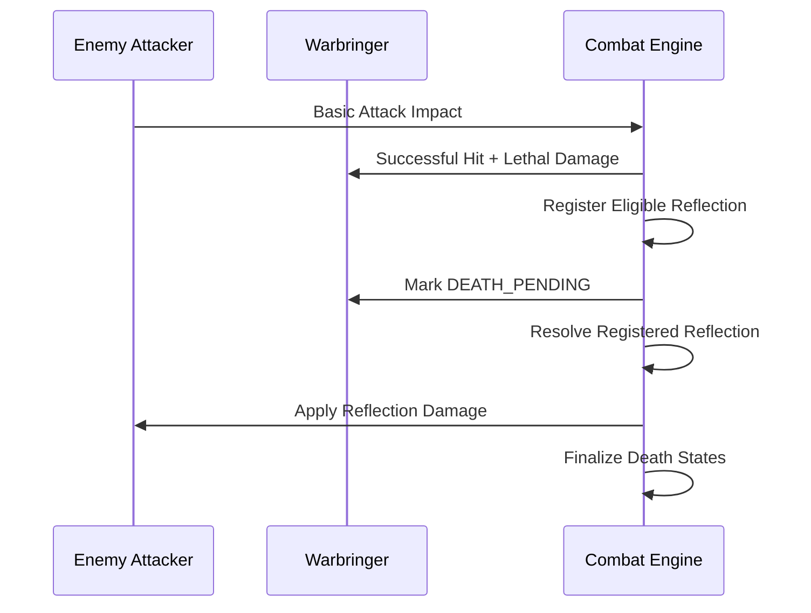

Si la réflexion élimine également l'attaquant, la fin de combat peut produire un double KO.

Si la réflexion n'était pas éligible, aucun nouvel événement ne sera inventé pour obtenir ce résultat.

*Note d'ingénierie : l'admissibilité d'une réaction doit être décidée pendant la transaction de l'impact déclencheur. La finalisation de la mort ne doit ni effacer une réaction déjà acceptée ni permettre une nouvelle recherche générale de réactions.*

---

# SYS-002.D.13.2.6 - Actions et effets persistants

## 14\. Une action terminée peut laisser des effets actifs

Le cycle de vie des effets est distinct de celui des actions.

Exemples \:

| Action | Fin de l'action | Conséquence pouvant subsister |
|--------|--------|--------|
| Météore Mage | Après impact AoE | Débuff de résistance |
| Compétence Prophet | Après son impact | Fenêtre de destruction des boucliers |
| Compétence Darklord | Après son impact | Bonus critique temporaire |
| Compétence Beastmaster | Après son impact | Bypass d'évasion Pal |
| Compétence Supreme Spirit | Après son impact | Fenêtre de déclenchement sur combos |
| Compétence Darklord déclenchant P5 | Après activation ou impact | Charge de prochaine attaque normale |
| Soin périodique Martial Sage | Action de création terminée | Instance de régénération avec ses propres échéances |

Une compétence dont le dernier impact a été résolu peut donc passer à `RESOLVED` même si ses buffs ou débuffs n'ont pas encore expiré.

### 14.1 Contrat de propriété des effets

Chaque instance conserve \:

```text
CombatEffectInstance
├── EffectInstanceId
├── EffectDefinitionId
├── OriginActionId?
├── SourceActorId
├── OwnerActorId
├── TargetActorId
├── StartTimeUs
├── ExpirationTimeUs?
├── Generation
├── PersistencePolicy
├── RefreshPolicy
└── LifecycleState
```

Il s'agit d'un **contrat d'interface proposé** pour le futur `D.13.5`, non de la spécification finale de ce sous-module.

L'`OriginActionId` reste disponible à des fins de provenance, même lorsque l'action correspondante est terminée.

### 14.2 Cas particulier d'une compétence annulée après activation

Supposons Prophet éveillé \:

1. Active sa compétence de classe.
2. Installe sa fenêtre de destruction de boucliers.
3. Programme le météore.
4. Meurt avant l'impact.

Le météore est annulé.

La fenêtre de bris de boucliers a toutefois réellement été créée à l'activation. Elle n'est pas effacée rétroactivement du journal.

Comme le propriétaire est mort, elle ne permet plus de produire de nouveaux impacts offensifs.

Son éventuelle suppression immédiate par nettoyage de l'état de combat reste une opération distincte, régie par la politique de durée de vie des effets.

Cette distinction préserve l'historique sans laisser un buff orphelin produire des actions après la mort.

---

# SYS-002.D.13.2.7 - Cohérence transactionnelle

## 15\. Journal des opérations engagées

Pour garantir qu'une activation possède des conséquences auditables, je recommande d'associer chaque engagement à un enregistrement transactionnel.

```text
ActionCommitRecord
├── CommitId
├── ActionId
├── ActorId
├── CommittedAtUs
├── ResourceDeltas[]
├── CooldownChanges[]
├── ActivationEffectIds[]
├── OffensiveSnapshotId?
├── CreatedOperationIds[]
├── CombatConfigurationVersion
└── CommitOrdinal
```

Toutes les conséquences appartiennent au même engagement logique.

Elles sont publiées seulement après réussite complète de la transaction.

Cette politique empêche un déclencheur de gameplay d'observer une consommation d'énergie alors que l'action correspondante n'a pas encore terminé son commit.

## 16\. Garanties de concurrence logique

| Situation | Contrat proposé |
|--------|--------|
| Deux compétences demandent la même énergie | Le premier commit valide consomme les ressources ; le second revérifie |
| Deux activations réclament le même cooldown | Une seule peut engager ce cooldown |
| Deux demandes au même timestamp | Ordre déterminé par le scheduler |
| Une demande devient invalide avant son commit | Rejet sans coût |
| Une action est engagée avant un étourdissement | L'impact déjà engagé suit sa politique de survie |
| Une réduction rend un cooldown disponible | Nouvelle activation uniquement dans une phase autorisée |
| Un effet déclenché crée une action enfant | Nouvel engagement et nouveau `ActionId` |
| Une réaction immédiate est déjà acceptée | Résolution avant clôture, selon sa causalité |

### 16.1 Un engagement, plusieurs conséquences

Le fait de programmer plusieurs impacts n'autorise jamais à consommer plusieurs fois le coût d'une compétence.

Une attaque normale à deux projectiles ne devient pas deux activations.

De même, le bonus de combo produit par Plume Monarch reste une action enfant explicitement déclenchée, et non une deuxième activation de l'attaque normale.

### 16.2 Frontières des snapshots

Je recommande la séquence commune \:

`ENGAGEMENT → EFFETS D'ACTIVATION → SNAPSHOT OFFENSIF → PROGRAMMATION`

Elle permet au premier météore de Darklord d'utiliser son bonus critique d'Éveil, puisque celui-ci est installé avant la capture offensive.

Une action enfant de combo possède son propre engagement et capture un snapshot distinct. Elle peut donc intégrer un buff apparu à la suite d'un impact de l'action parente.

*Note d'ingénierie : l'atomicité concerne l'engagement et ses conséquences immédiates. Elle ne signifie pas que toutes les opérations futures de l'action deviennent un seul événement indissociable.*

---

# SYS-002.D.13.2.8 - Compatibilité avec les quatre classes

## 17\. Audit interclasses

| Classe | Scénario critique | Résolution par le contrat |
|--------|--------|--------|
| Martial Sage | Soin périodique après l'action source | Effet autonome, durée de vie distincte |
| Warbringer | Réflexion d'une attaque létale | Réaction immédiate déjà déclenchée conservée |
| Sacred Hunter | Critique sous bouclier | Impact confirmé, événement critique conservé |
| Plume Monarch | Deux projectiles, un annulé | Action partiellement résolue |
| Prophet | Étourdissements réduisant les cooldowns | Modifications de disponibilité sans nouvel engagement automatique |
| Darklord | Compétence engagée puis annulée | Charge P5 installée à l'activation, pas effacée rétroactivement |
| Darklord | Bonus critique actif au premier météore | Installation avant snapshot |
| Beastmaster | Perte de PV pendant une attaque Pal | Action engagée conserve son ancien snapshot |
| Beastmaster | Propriétaire mort avant impact Pal | Opération Pal annulée |
| Supreme Spirit | Combo à plusieurs projectiles | Un tirage d'Éveil par action admissible |
| Supreme Spirit | Buff expiré avant le premier impact réussi | Aucun tirage d'Éveil |
| Spirit Channeler | Changement de classe hors combat | Nouvelle configuration à la prochaine instance |

### 17.1 Aucun conflit structurel détecté

Les contrats proposés permettent de représenter les mécaniques déjà validées sans modifier leurs identités fondamentales.

Deux précisions restent toutefois propres à `D.13.2` \:

- Une action partiellement résolue peut terminer en `CANCELLED`, sans annuler ses impacts antérieurs.
- Une action parentale peut terminer avant les actions enfants qu'elle a déclenchées.

Ces deux propriétés sont indispensables pour un moteur événementiel cohérent.

---

# SYS-002.D.13.2.9 - Tests d'acceptation

## 18\. Tests des transitions

| ID | Scénario | Résultat attendu |
|--------|--------|--------|
| `LIFE-STATE-T001` | Demande valide | `REQUESTED → COMMITTED` |
| `LIFE-STATE-T002` | Demande invalide | `REQUESTED → REJECTED` |
| `LIFE-STATE-T003` | Impact différé | `COMMITTED → SCHEDULED` |
| `LIFE-STATE-T004` | Impact arrivé à échéance | `SCHEDULED → RESOLVING` |
| `LIFE-STATE-T005` | Autres impacts en attente | `RESOLVING → SCHEDULED` |
| `LIFE-STATE-T006` | Dernier impact terminé | `RESOLVING → RESOLVED` |
| `LIFE-STATE-T007` | Annulation avant premier impact | `CANCELLED / NO_IMPACT_CANCELLED` |
| `LIFE-STATE-T008` | Annulation après un impact | `CANCELLED / PARTIALLY_RESOLVED` |
| `LIFE-STATE-T009` | Action terminale sollicitée à nouveau | Transition refusée |
| `LIFE-STATE-T010` | Toutes les opérations esquivées | `RESOLVED`, sans dégâts positifs |

## 19\. Tests des ressources et cooldowns

| ID | Scénario | Résultat attendu |
|--------|--------|--------|
| `LIFE-COMMIT-T001` | 80 énergie, coût 40 | 40 énergie après engagement |
| `LIFE-COMMIT-T002` | 30 énergie, coût 40 | Rejet et 30 énergie conservée |
| `LIFE-COMMIT-T003` | Deux demandes concurrentes pour 40 énergie disponibles | Une seule peut consommer les 40 |
| `LIFE-COMMIT-T004` | Activation engageant un cooldown de 6 s | Échéance initiale à `t + 6 s` |
| `LIFE-COMMIT-T005` | Mort avant impact | Pas de remboursement implicite |
| `LIFE-COMMIT-T006` | Impact esquivé | Coût et cooldown conservés |
| `LIFE-COMMIT-T007` | Réduction de cooldown Prophet | Ancienne échéance invalidée |
| `LIFE-COMMIT-T008` | Erreur pendant la préparation du commit | Aucune mutation partiellement visible |
| `LIFE-COMMIT-T009` | Action multi-projectiles | Un seul engagement de ressource |
| `LIFE-COMMIT-T010` | Buff d'activation avant snapshot | Snapshot inclut le buff |

## 20\. Tests des annulations et de la causalité

| ID | Scénario | Résultat attendu |
|--------|--------|--------|
| `LIFE-CANCEL-T001` | Stun après activation du météore | Impact maintenu |
| `LIFE-CANCEL-T002` | Mort du Mage avant impact | Impact annulé |
| `LIFE-CANCEL-T003` | Mort du propriétaire Pal | Impacts Pal non commencés annulés |
| `LIFE-CANCEL-T004` | Cible morte avant projectile | Opération ignorée selon son ciblage |
| `LIFE-CANCEL-T005` | Première composante déjà appliquée | Pas de rollback rétroactif |
| `LIFE-CANCEL-T006` | Réflexion Warbringer déjà déclenchée | Réaction terminée avant clôture |
| `LIFE-CANCEL-T007` | Nouvelle attaque après `DEATH_PENDING` | Engagement refusé |
| `LIFE-CANCEL-T008` | Ancienne échéance d'effet rafraîchi | Opération `STALE` |
| `LIFE-CANCEL-T009` | Action parente terminée, combo enfant en attente | Enfant causal conservé |
| `LIFE-CANCEL-T010` | Combat finalisé | Aucune nouvelle opération offensive autorisée |

## 21\. Tests d'intégrité

| ID | Propriété |
|--------|--------|
| `LIFE-INV-T001` | Une action terminale ne possède aucune opération exécutable |
| `LIFE-INV-T002` | Les compteurs d'opérations respectent leur somme de conservation |
| `LIFE-INV-T003` | Aucun coût d'engagement n'est consommé deux fois |
| `LIFE-INV-T004` | Aucune opération annulée ne publie ensuite un impact réussi |
| `LIFE-INV-T005` | Les événements déjà publiés restent immuables |
| `LIFE-INV-T006` | Une action enfant conserve sa causalité après la fin du parent |
| `LIFE-INV-T007` | Même état initial, même profil et même RNG : mêmes résultats |

**Statut des tests : `specified`, `not_executed`\.**

---

# SYS-002.D.13.2.10 - Synthèse des contrats proposés

## 22\. Décisions à intégrer

| ID | Contrat |
|--------|--------|
| `LIFE-001` | Sept états d'action, transitions strictement contrôlées |
| `LIFE-002` | Terminalité distincte du résultat effectif |
| `LIFE-003` | Compteurs d'opérations cohérents et vérifiables |
| `LIFE-004` | Engagement atomique des ressources, cooldowns et effets d'activation |
| `LIFE-005` | Rejet sans coût ni cooldown |
| `LIFE-006` | Absence de remboursement implicite après engagement |
| `LIFE-007` | Capture offensive après installation des buffs d'activation |
| `LIFE-008` | Résolution partielle possible, sans annulation rétroactive |
| `LIFE-009` | Opérations `EXECUTED`, `SKIPPED`, `CANCELLED` et `STALE` distinctes |
| `LIFE-010` | Annulation des opérations différées selon leur politique de survie |
| `LIFE-011` | Maintien des réactions immédiates déjà déclenchées |
| `LIFE-012` | Impossibilité d'engager une action ordinaire après `DEATH_PENDING` |
| `LIFE-013` | Durée de vie des effets indépendante de celle des actions |
| `LIFE-014` | Actions enfants indépendantes de la terminalité du parent |
| `LIFE-015` | Annulation avant la décision de combo empêchant la création du combo |
| `LIFE-016` | Versionnement et traçabilité de tous les engagements et annulations |

### Points volontairement réservés aux jalons suivants

`D.13.3` définira l'ordre total des phases et le calendrier des réactions, notamment les collisions au même timestamp.

`D.13.5` définira les durées de vie exactes des effets déjà appliqués lorsque leur source meurt, ainsi que leurs politiques de nettoyage.

`D.13.7` définira les transitions de mort, les conditions de double KO et la clôture globale d'un affrontement.

Ces dépendances ne constituent pas des blocages pour valider le modèle de cycle de vie ; elles utilisent les interfaces proposées.

---

## 23\. État du GDD

| Jalon | Statut |
|--------|--------|
| `SYS-002.D.12` - Quatre familles de classes | `functionally_specified` |
| `SYS-002.D.13.1` - Actors, Actions &amp; Events | `functionally_specified` |
| `SYS-002.D.13.2` - Action Lifecycle | `pending_validation` |
| `SYS-002.D.13.3` - Combat Scheduler | `not_started` |
| Implémentation Unity | `not_started` |
| Tests automatisés | `not_executed` |

---


---

## SYS-002.D.13.3 — Combat Scheduler

**Validation :** `SYS-002.D.13.3.9.1` · approbation propriétaire `T147` · spécification source `T146`. **Statut :** `functionally_specified`; implémentation `not_started`; tests `not_executed`.


# SYS-002.D.13.3 - Combat Scheduler Specification

## 1\. Objectif et contrat d'entrée

Le scheduler est le composant chargé de déterminer **quand** les opérations deviennent exécutables et **dans quel ordre** elles affectent le combat.

Il doit respecter trois propriétés fondamentales \:

1. Deux combats avec les mêmes états initiaux, profils et décisions aléatoires produisent exactement les mêmes transitions.
2. Aucun événement nouvellement créé ne peut être exécuté rétroactivement dans une phase déjà terminée.
3. Les réactions immédiates déjà déclenchées restent résolubles avant la clôture, sans permettre d'attaques ordinaires après la mort.

### Entrées requises

| Entrée | Contrat |
|--------|--------|
| `CombatConfigurationSnapshot` | Profils versionnés et figés pour l'affrontement |
| `CombatActorRegistry` | Acteurs, équipes, propriétaires et capacités |
| `CombatActionRegistry` | Actions et états validés par `D.13.2` |
| `ScheduledOperationQueue` | Échéances, priorités et générations |
| `CombatEffectRegistry` | Effets actifs, expirations et ticks |
| `CombatRandomContext` | Graine et politique RNG versionnée |
| `CombatLifecycleState` | État du combat, morts en attente et finalisation |

### Sorties

Le scheduler produit des transitions d'état autorisées et un journal ordonné de `CombatEvent`\.

Il ne calcule pas lui-même les coefficients de dégâts, les probabilités de critique ou les bonus de classe. Il orchestre les résolveurs responsables de ces opérations.

*Note d'ingénierie : le scheduler doit être indépendant de Unity `Update()`, de l'ordre des GameObjects et du framerate. Unity pourra piloter son avancement, mais ne déterminera pas l'ordre logique des combats.*

---

# SYS-002.D.13.3.1 - Modèle temporel

## 2\. Horloge logique

Je recommande de conserver l'unité validée : **la microseconde entière**\.

```text
CombatClock
├── CurrentTimeUs: int64
├── CurrentPhase
├── CurrentExecutionOrdinal
├── CurrentReactionChainId?
└── CombatTimeOriginUs
```

Les événements sont ordonnés par temps logique, et non par temps réel d'exécution sur l'appareil.

### Conventions proposées

| ID | Convention |
|--------|--------|
| `SCHED-TIME-001` | Horloge en entiers 64 bits, microsecondes |
| `SCHED-TIME-002` | Aucun retour à un timestamp antérieur |
| `SCHED-TIME-003` | Les durées sont quantifiées lors de la création de l'échéance |
| `SCHED-TIME-004` | Les intervalles d'effets sont semi-ouverts `[start, end)` |
| `SCHED-TIME-005` | Une échéance obsolète ne modifie jamais l'état |
| `SCHED-TIME-006` | Chaque événement publié possède un `ExecutionOrdinal` strictement croissant |

### Exemple d'expiration

Un bonus actif de `t = 0` à `t = 8 000 000 µs` est valable pour un impact à `t = 7 999 999 µs`, mais plus à `t = 8 000 000 µs`\.

Ce comportement reprend les décisions validées pour les quatre classes.

Il exclut toute dépendance à la précision flottante du moteur de rendu.

## 3\. Avancement événementiel

Je recommande un moteur à échéances discrètes \:

1. Identifier la prochaine échéance logique.
2. Avancer directement l'horloge vers cette échéance.
3. Exécuter toutes les phases applicables à cet instant.
4. Résoudre les réactions immédiates.
5. Contrôler les états de mort et les conditions de fin.
6. Passer à la prochaine échéance.

Une période sans événement ne nécessite donc pas de traitement de combat à chaque frame.

Les effets périodiques créent leurs propres échéances, tandis que les attaques et les compétences alimentent la file avec leurs futures opérations.

---

# SYS-002.D.13.3.2 - Ordre total des phases

## 4\. Audit de compatibilité avec les décisions antérieures

Nous avons déjà approuvé plusieurs priorités \:

- Expiration d'un effet avant un impact situé exactement à son échéance.
- Engagement de la compétence de classe avant une attaque normale disponible au même instant.
- Installation des buffs d'activation avant les snapshots offensifs.
- Impact de classe Spirit Channeler avant un impact Pal simultané.
- Résolution des réactions immédiates déjà déclenchées avant la clôture du combat.

Le scheduler doit réunir ces règles dans un ordre unique.

### 4.1 Les six phases proposées

| Phase | Nom | Responsabilité |
|--------|--------|--------|
| **0** | `EXPIRE_EFFECTS` | Expirer les effets arrivés à leur borne de fin et invalider les échéances obsolètes |
| **1** | `COMMIT_ACTIVATIONS` | Mettre à jour les disponibilités temporelles, traiter les ressources dues, choisir et engager les nouvelles actions |
| **2** | `RESOLVE_CLASS_IMPACTS` | Résoudre les impacts des compétences actives de classe |
| **3** | `RESOLVE_OTHER_IMPACTS` | Résoudre attaques normales, combos, impacts Pal et effets périodiques |
| **4** | `FLUSH_TRIGGERED_REACTIONS` | Vérifier qu'aucune réaction immédiate déjà admise ne reste en attente |
| **5** | `FINALIZE_COMBAT_STATE` | Finaliser les morts et déterminer si le combat continue |

Les six phases reprennent l'ordre proposé et déjà utilisé lors de l'audit final de Spirit Channeler.

### 4.2 Sous-ordre de la phase 1

La phase 1 nécessite une séparation interne \:

| Sous-phase | Opération |
|--------|--------|
| `1A - TIME_READINESS` | Régénérations de ressources arrivées à échéance, disponibilité des cooldowns et vérification des verrouillages |
| `1B - ACTION_SELECTION` | Sélection des actions automatiques autorisées |
| `1C - ACTION_COMMIT` | Engagement atomique, installation des effets d'activation et capture des snapshots |

La phase 0 a déjà expiré les suppressions de régénération et les autres effets terminant à cet instant.

Par exemple, si une suppression énergétique expire exactement lorsqu'un tick de régénération est dû, ce tick peut être autorisé : la suppression n'est plus active.

En revanche, un effet périodique infligeant des dégâts ou produisant un soin de combat appartient à la phase 3. Nous ne devons pas traiter les dégâts périodiques comme une simple opération de disponibilité.

### 4.3 Priorités d'engagement

À l'intérieur de `1B`, je recommande l'ordre suivant \:

| Priorité | Action |
|--------|--------|
| 0 | Compétence de classe automatique |
| 1 | Compétence active équipée automatique |
| 2 | Attaque normale du personnage |
| 3 | Attaque normale autonome d'un Pal |

Les actions appartenant à une même catégorie sont départagées par un ordre d'acteurs stable.

Cette priorité est une **convention proposée** pour les catégories qui n'avaient pas encore été ordonnées entre elles.

Les réactions passives ne participent pas à cette sélection : elles doivent être déclenchées par un événement causal, puis résolues dans leur chaîne de réaction.

### 4.4 Empêcher plusieurs actions ordinaires au même instant

Je recommande l'invariant \:

`MAX_ONE_NON_REACTION_COMMIT_PER_ACTOR_PER_TIMESTAMP`

Un Mage dont la compétence de classe et l'attaque normale deviennent disponibles au même timestamp engage d'abord sa compétence de classe.

L'attaque normale conserve son état de disponibilité, mais n'est pas engagée au même instant par une seconde décision automatique.

Elle pourra être réévaluée à la prochaine échéance de décision admissible, sous réserve des contraintes propres à l'acteur.

Les actions enfants, comme les combos et réactions, ne consomment pas ce quota d'action ordinaire.

*Note d'ingénierie : limiter les engagements automatiques par acteur et timestamp empêche un cooldown nul ou une activation gratuite de produire une boucle infinie sans avancement du temps.*

---

# SYS-002.D.13.3.3 - Réactions immédiates

## 5\. Problème identifié dans l'ordre des phases

Une simple file de phases ne suffit pas pour les réactions mortelles.

Considérons deux impacts prévus au même timestamp \:

1. Un Guerrier est frappé mortellement.
2. Le même Guerrier possède une réflexion déjà déclenchée par cette frappe.
3. Un autre projectile est également programmé au même instant.

Si toutes les réactions étaient reportées après tous les impacts de phase 3, le deuxième projectile pourrait modifier l'état du combat avant que la réflexion légitime du premier soit résolue.

Cela rendrait l'ordre causal difficile à contrôler.

### 5.1 Solution proposée : clôture réactive locale

Chaque résolution d'impact possède une sous-séquence atomique \:

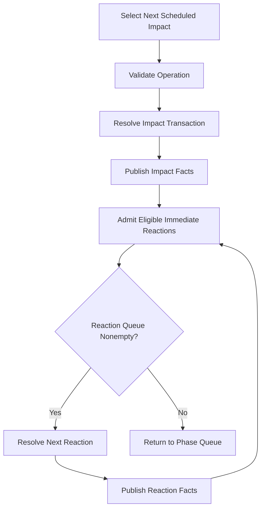

**La clôture des réactions immédiates intervient après chaque impact déclencheur, avant le prochain impact indépendant de la même phase.**

La phase 4 reste utile comme vérification finale d'intégrité : aucune réaction immédiate admissible ne doit subsister avant la finalisation des morts.

### 5.2 Admission et exécution : deux moments distincts

Je recommande deux étapes \:

**Admission.** Le résolveur de l'impact détermine quelles réactions sont autorisées, en utilisant l'état et le contexte de l'événement déclencheur.

**Exécution.** Les réactions admises sont exécutées selon l'ordre causal, même si l'acteur est passé entre-temps à `DEATH_PENDING`, à condition que leur profil autorise explicitement cette continuation.

Cela respecte la règle déjà validée pour les réflexions Warbringer et les contre-attaques immédiates.

### 5.3 Pas de récursion de pile

Le moteur doit utiliser une file logique de réactions, avec une identité causale explicite.

Une réaction peut produire un nouvel événement, mais cet événement n'autorise une nouvelle réaction que si son profil le permet.

Les interdictions précédemment validées restent prioritaires \:

- Une réflexion n'engendre pas une nouvelle réflexion.
- Un combo ne produit pas un combo récursif.
- Une composante de dégâts P4 Darklord ne génère pas une autre composante P4.
- Une composante supplémentaire Supreme Spirit ne produit pas de nouveau tirage d'Éveil.

Une limite technique de sécurité pourra signaler une chaîne anormale. Elle ne doit jamais remplacer les interdictions fonctionnelles.

### 5.4 Cas d'une double élimination

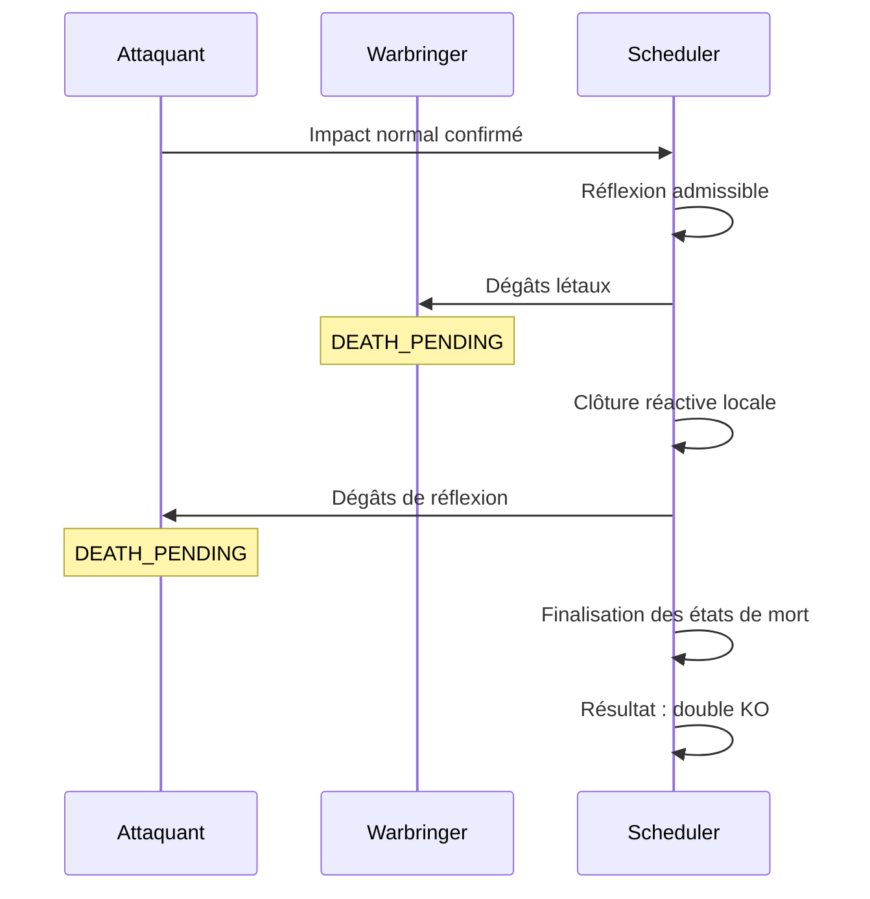

Les événements de réflexion déjà déclenchés sont préservés.

En revanche, aucune nouvelle attaque normale ne peut être engagée par Warbringer après son passage à `DEATH_PENDING`\.

*Note d'ingénierie : la clôture réactive locale empêche l'intercalation arbitraire d'un autre impact entre une cause et ses conséquences immédiates. Elle permet de respecter la règle de double KO sans traiter tous les impacts d'un timestamp comme réellement simultanés.*

---

# SYS-002.D.13.3.4 - Collisions au même timestamp

## 6\. Résolution séquentielle déterministe

Nous devons choisir entre deux modèles \:

| Modèle | Comportement |
|--------|--------|
| `SIMULTANEOUS_BATCH` | Tous les impacts d'une phase utilisent un même état initial, puis leurs conséquences sont appliquées ensemble |
| `SEQUENTIAL_ORDERED` | Chaque opération modifie l'état avant l'opération indépendante suivante |

Je recommande **`SEQUENTIAL_ORDERED`**, cohérent avec les contrats de réactions et d'annulations déjà validés.

Deux attaques ayant le même timestamp ne sont donc pas garanties de réussir toutes les deux.

Si la première élimine le lanceur de la seconde, l'opération encore en attente peut être annulée.

La possibilité d'un double KO résulte des réactions admissibles et non d'une hypothèse générale de simultanéité.

## 7\. Cas particulier des AoE : atomicité par opération

Une compétence AoE touche plusieurs cibles dans une même opération d'impact.

Il faut éviter qu'une réflexion déclenchée par la première cible interrompe arbitrairement la résolution sur les autres ennemis.

**Convention proposée - `SCHED-COLLISION-001`\.**

Une opération AoE entrée en phase de résolution termine son lot de cibles avant la clôture des réactions immédiates qu'elle a produites.

Le traitement interne suit l'ordre \:

1. Construire la liste des cibles éligibles à l'instant de l'impact.
2. Stabiliser l'ordre des cibles.
3. Résoudre chaque sous-impact et publier ses faits.
4. Enregistrer les réactions admissibles.
5. Terminer l'opération AoE.
6. Résoudre les réactions enregistrées avant la prochaine opération indépendante.

Les résistances, boucliers et états des cibles restent évalués au moment de leurs sous-impacts.

Si un sous-impact élimine une cible, sa nouvelle condition est visible pour les sous-impacts suivants. En revanche, une réaction qui attend la clôture de l'AoE n'interrompt pas le lot en cours.

*Note d'ingénierie : l'atomicité doit être définie au niveau de l'opération d'impact. Pour un projectile, l'opération est courte ; pour une AoE, elle peut contenir plusieurs résolutions de cible. L'unité transactionnelle doit être explicite.*

### 7.1 Ordre des cibles AoE

Je recommande \:

`PRIMARY_TARGET_FIRST_THEN_DISTANCE_THEN_ACTOR_ID`

- La cible principale, si elle est encore éligible, est prioritaire.
- Les autres cibles sont ordonnées par distance au centre de l'effet.
- Les égalités de distance sont départagées par `ActorId`\.
- Si la cible principale a disparu, le centre capturé à l'activation reste utilisable.

Pour les distances, le moteur emploiera la représentation spatiale déterministe définie dans le contrat de ciblage. Il ne doit pas dépendre de l'ordre des résultats d'une requête physique Unity.

## 8\. Ordre de sélection des opérations

La clé proposée pour une opération indépendante est \:

```text
ScheduledOperationOrderKey
├── ScheduledTimeUs
├── PhasePriority
├── ActionPriority
├── RootActionSequence
├── ActorSortKey
├── OperationOrdinal
└── OperationId
```

Tous ces champs doivent être stables et reproductibles.

`ActorSortKey` est attribué lors de la construction du combat, à partir de la composition et des identités logiques. Il n'est pas obtenu depuis l'adresse mémoire d'un acteur.

`OperationId` constitue le dernier critère de départage, et non un moyen de remplacer les priorités métier.

### 8.1 Collisions représentatives

| Collisions | Ordre proposé | Conséquence |
|--------|--------|--------|
| Expiration de buff et impact | Expiration puis impact | Le buff ne s'applique plus |
| Cooldown disponible et activation | Disponibilité puis engagement | Activation autorisée |
| Activation Mage et attaque normale du Mage | Compétence en premier | P5 Darklord peut être armé avant la prochaine attaque |
| Activation Beastmaster et engagement Pal | Compétence en premier | Buff d'Éveil installé avant le snapshot Pal |
| Impact Spirit Channeler et impact Pal | Impact de classe en premier | Le nouveau débuff Pal peut s'appliquer |
| AoE et réflexion | AoE complète, puis réflexion admise | Les autres sous-impacts AoE ne sont pas interrompus |
| Deux impacts Pal indépendants | Clé d'ordre stable | Le deuxième consulte l'état modifié par le premier |
| Mort du propriétaire et impact Pal en attente | Mort constatée avant exécution de l'impact | Impact Pal annulé |
| Réduction de cooldown Prophet et activation automatique | Réduction d'abord, nouvelle décision ultérieure | Pas de retour à la phase 1 |

---

# SYS-002.D.13.3.5 - Création d'opérations à l'instant courant

## 9\. Interdiction des retours de phase

Une opération peut être créée pendant la résolution d'un événement.

Exemple : un étourdissement appliqué en phase 3 réduit à zéro le cooldown d'une compétence Prophet.

La phase 1 de ce timestamp est déjà terminée.

Le moteur ne doit pas y revenir.

### Politique proposée

| Opération créée | Traitement |
|--------|--------|
| Phase future au même timestamp | Peut rejoindre cette phase |
| Phase actuelle, priorité encore admissible | Insérée après les opérations déjà prioritaires selon sa clé |
| Réaction immédiate déclenchée | Traitée dans la clôture réactive locale |
| Nouvelle activation après la fermeture de la phase 1 | Reportée à la prochaine échéance de décision |
| Opération demandant une phase déjà close | Report explicite ou erreur de configuration selon son type |

Pour une activation automatique rendue disponible tardivement, je recommande de programmer une nouvelle vérification au plus tôt à \:

$$
t_{\mathrm{next}}=t_{\mathrm{current}}+1\ \mu s
$$

Cette microseconde représente le prochain instant logique disponible ; elle n'est pas un délai d'animation.

Si l'acteur possède un verrou d'action ou une contrainte de cadence plus longue, cette contrainte prévaut.

### 9.1 Exemple Prophet

À `t = 5 s`, un météore étourdit trois cibles.

Ces étourdissements réduisent un cooldown équipé à zéro.

La compétence devient disponible à `t = 5 s`, mais ne peut pas être engagée rétroactivement pendant la phase 1.

Sans autre verrou, sa prochaine décision d'activation peut être programmée à `t = 5,000001 s`\.

Il ne faut ni la déclencher immédiatement à l'intérieur de l'impact ni attendre arbitrairement un cycle de rendu Unity.

### 9.2 Protection contre les boucles à temps nul

Je recommande trois garanties \:

- Un acteur ne peut engager qu'une action ordinaire par timestamp.
- Une opération ne peut pas reprogrammer indéfiniment une phase déjà exécutée au même timestamp.
- Les configurations capables de produire une boucle causale sans progression temporelle sont rejetées lors de leur validation.

Les limites techniques d'exécution doivent signaler une erreur déterministe si un profil invalide échappe aux vérifications. Elles ne doivent jamais arrêter silencieusement des réactions légitimes.

---

# SYS-002.D.13.3.6 - Politique RNG

## 10\. Deux stratégies possibles

Le moteur utilise des décisions probabilistes pour les esquives, critiques, combos, contre-attaques et déclenchements de passifs.

Deux architectures sont envisageables.

| Stratégie | Principe | Risque principal |
|--------|--------|--------|
| `GLOBAL_SEQUENTIAL_RNG` | Tous les systèmes consomment une suite pseudo-aléatoire commune | Ajouter un tirage modifie les résultats de toutes les décisions suivantes |
| `KEYED_DETERMINISTIC_RNG` | Chaque décision est identifiée et dérivée d'une graine de combat | Nécessite des identifiants de décision parfaitement stables |

Je recommande **`KEYED_DETERMINISTIC_RNG`**\.

Ce choix ne rend pas les combats moins aléatoires. Il rend les décisions aléatoires plus faciles à reproduire, isoler et auditer.

## 11\. Identité d'une décision probabiliste

Je propose le contrat suivant \:

```text
CombatRandomDecisionKey
├── CombatSeed
├── RngAlgorithmVersion
├── ActionId
├── ImpactId?
├── TriggerEventId?
├── DecisionKind
├── DecisionOrdinal
└── TargetActorId?
```

Exemples de `DecisionKind` \:

```text
EVASION_ROLL
BASIC_CRITICAL_ROLL
SKILL_CRITICAL_ROLL
PAL_CRITICAL_ROLL
COMBO_PROC_ROLL
COUNTER_PROC_ROLL
PASSIVE_PROC_ROLL
SUPREME_SPIRIT_AWAKENING_ROLL
```

Les identifiants de décision sont attribués selon une convention stable, indépendante du niveau de journalisation.

### 11.1 Contrat de probabilité

Les probabilités sont exprimées en points de base \:

$$
p_{\mathrm{BP}}\in[0,10000]
$$

Une décision probabiliste utilise une valeur uniforme entière $u$ dans l'intervalle $[0,9999]$\.

$$
Success\iff u<p_{\mathrm{BP}}
$$

Exemples \:

| Probabilité | Seuil | Résultat si $u=2499$ |
|--------|--------|--------|
| 10 % | 1 000 | Échec |
| 25 % | 2 500 | Succès |
| 40 % | 4 000 | Succès |
| 50 % | 5 000 | Succès |

La méthode de génération de $u$ devra produire une distribution uniforme sans biais de réduction modulo.

Le choix de l'algorithme pseudo-aléatoire sera versionné ; aucun algorithme spécifique n'est imposé dans ce jalon documentaire.

### 11.2 Une décision inéligible n'existe pas

C'est un point majeur.

| Situation | Décision RNG |
|--------|--------|
| Projectile sur cible déjà éliminée | Aucun jet d'évasion |
| Bypass d'évasion Beastmaster actif | Aucun jet d'évasion |
| Projectile esquivé | Aucun jet critique |
| Composante sans droit au critique | Aucun jet critique |
| Combo Pal sans impact réussi | Aucun tirage Supreme Spirit |
| Premier impact réussi du combo Pal | Un tirage Supreme Spirit |
| Deuxième impact réussi du même combo | Aucun nouveau tirage |
| Réflexion Warbringer sans probabilité | Aucun jet artificiel |

Avec un RNG identifié par décision, l'absence d'un jet d'évasion n'oblige pas à décaler la suite aléatoire des autres actions.

Cela permet de comparer plus facilement deux profils qui diffèrent seulement par le bypass d'évasion.

### 11.3 Une décision n'est jamais recalculée

Un `DecisionId` possède un résultat unique dans une instance de combat.

Si une opération est reprise par erreur ou rejouée pendant un audit, elle ne doit pas obtenir un nouveau résultat aléatoire.

Un nouveau tirage n'est légitime que si une nouvelle décision de gameplay existe avec une identité distincte.

**Invariant \:**

$$
SameSeed\land SameDecisionKey
\Rightarrow SameOutcome
$$

### 11.4 Tirages multiples d'un même type

Si une action produit deux projectiles, chacun possède un `ImpactId` différent.

Leur décision critique est donc différente, même si elle partage le même `ActionId`\.

À l'inverse, Supreme Spirit utilise une identité de décision rattachée à **l'action de combo Pal**, plutôt qu'à chacun de ses projectiles.

Ainsi, plusieurs impacts d'une même action ne créent pas plusieurs tirages d'Éveil.

*Note d'ingénierie : la stabilité des décisions RNG repose sur l'identité logique de leur cause. Elle ne doit jamais dépendre du nombre de messages de debug, du nombre de callbacks Unity ou d'un index global de tirages partagé entre toutes les classes.*

---

# SYS-002.D.13.3.7 - Déterminisme et reproductibilité

## 12\. Définition contractuelle

Je propose de définir un combat reproductible par les entrées suivantes \:

```text
DeterministicCombatInput
├── CombatEngineRulesetVersion
├── CombatConfigurationHash
├── InitialActorStateSnapshot
├── InitialEffectStateSnapshot
├── InitialScheduledOperations
├── CombatSeed
├── RngAlgorithmVersion
├── EventOrderingPolicyVersion
└── ExternalCommandSequence
```

La séquence de commandes externes inclut leurs timestamps logiques. Une commande externe reçue pendant un combat ne doit pas être appliquée à un instant décidé par la latence du système d'exploitation.

Si le combat est intégralement automatique, cette séquence peut être vide.

### 12.1 Définition d'équivalence

Deux exécutions possédant les mêmes entrées doivent produire \:

- La même séquence d'événements de domaine.
- Les mêmes identifiants et ordres logiques.
- Les mêmes décisions RNG éligibles.
- Les mêmes valeurs de PV, ressources, cooldowns et états d'effets.
- Les mêmes états terminaux et le même résultat d'affrontement.

Un horodatage réel de calcul, une durée d'exécution processeur ou un message de diagnostic ne fait pas partie de cette équivalence.

### 12.2 Risques de non-déterminisme

| Source potentielle | Politique proposée |
|--------|--------|
| Ordre d'itération des objets Unity | Jamais utilisé comme priorité |
| Ordre d'un dictionnaire non garanti | Tri canonique avant résolution |
| Callbacks asynchrones | Aucune modification directe de l'état de combat |
| Framerate | N'influence pas les timestamps logiques |
| Nombres flottants pour les échéances | Interdits pour l'horloge |
| Distances spatiales égales | Départage par identifiant stable |
| Plusieurs opérations au même temps | Clé d'ordre totale |
| Génération d'identifiants | Séquence déterministe par combat |
| Journalisation détaillée | Sans consommation RNG ni modification d'état |
| Changement de profil en cours de combat | Interdit |
| Anciennes échéances invalidées | Sans effet sur l'état |

### 12.3 Arithmétique et portabilité

Les paramètres temporels sont quantifiés avant leur utilisation.

Les probabilités et modificateurs sont typés en points de base ou dans des unités numériques explicites.

La politique d'arrondi des dégâts reste à figer dans `SYS-002.D.13.4`, mais elle devra faire partie du `CombatEngineRulesetVersion`\.

Le même combat ne doit pas changer de résultat parce qu'il est exécuté sur Android ARM64 plutôt que dans l'éditeur Unity sur une autre architecture.

### 12.4 Journal d'audit

Je recommande deux sorties distinctes \:

| Journal | Contenu |
|--------|--------|
| `DomainEventLog` | Faits de combat normatifs |
| `ResolutionTrace` | Calculs détaillés, décisions RNG, rejets, opérations obsolètes et diagnostics |

Le résultat de combat est déterminé uniquement par l'état et les opérations de domaine.

L'activation ou la désactivation de `ResolutionTrace` ne doit avoir aucun effet sur les décisions.

*Note d'ingénierie : le déterminisme ne signifie pas seulement « utiliser une graine RNG ». Il exige également un ordre total des événements, des identifiants stables, des calculs numériques reproductibles et une gestion explicite des commandes externes.*

---

# SYS-002.D.13.3.8 - Tests d'acceptation du scheduler

## 13\. Tests d'ordonnancement

| Test | Scénario | Résultat attendu |
|--------|--------|--------|
| `SCHED-ORDER-001` | Buff expirant exactement à l'impact | Buff inactif pour cet impact |
| `SCHED-ORDER-002` | Cooldown devenant disponible à `t` | Activation admissible en phase 1 |
| `SCHED-ORDER-003` | Suppression d'énergie expirant à `t`, tick de régénération à `t` | Régénération autorisée |
| `SCHED-ORDER-004` | Compétence de classe et attaque normale simultanément prêtes | Compétence engagée en premier |
| `SCHED-ORDER-005` | Activation Beastmaster et engagement d'une attaque Pal | Buff personnel installé avant le snapshot Pal |
| `SCHED-ORDER-006` | Impact Spirit Channeler et impact Pal à `t` | Le débuff de classe peut affecter l'impact Pal |
| `SCHED-ORDER-007` | Deux impacts Pal simultanés | Ordre stable, indépendamment de l'ordre des objets Unity |
| `SCHED-ORDER-008` | AoE déclenchant une réflexion | Tous les sous-impacts de l'AoE sont terminés avant sa clôture réactive |
| `SCHED-ORDER-009` | Réaction létale et autre impact en attente | Réaction résolue avant l'autre opération |
| `SCHED-ORDER-010` | Cooldown réduit à zéro après fermeture de phase 1 | Réévaluation à un timestamp ultérieur |

## 14\. Tests du traitement des réactions

| Test | Scénario | Résultat attendu |
|--------|--------|--------|
| `SCHED-REACT-001` | Attaque létale déclenchant Warbringer | Réflexion déjà admise terminée |
| `SCHED-REACT-002` | Réflexion frappant un autre Warbringer | Aucune réflexion récursive |
| `SCHED-REACT-003` | Combo Archer confirmé | Une seule action de combo |
| `SCHED-REACT-004` | Plusieurs projectiles de combo Archer | Aucun combo enfant supplémentaire |
| `SCHED-REACT-005` | Deux impacts réussis dans un combo Supreme Spirit | Un seul tirage d'Éveil |
| `SCHED-REACT-006` | Prophet applique trois nouveaux étourdissements | Trois réductions de cooldown éligibles |
| `SCHED-REACT-007` | Rafraîchissement d'un étourdissement | Aucune réduction supplémentaire |
| `SCHED-REACT-008` | Combat terminé après une réaction | Aucune réaction admissible laissée en attente |

## 15\. Tests RNG et déterminisme

| Test | Scénario | Résultat attendu |
|--------|--------|--------|
| `SCHED-RNG-001` | Même graine et même identité de décision | Même résultat |
| `SCHED-RNG-002` | Projectile esquivé | Aucun tirage critique |
| `SCHED-RNG-003` | Bypass Beastmaster actif | Aucun tirage d'évasion |
| `SCHED-RNG-004` | Deux projectiles différents | Deux identités de critique distinctes |
| `SCHED-RNG-005` | Combo Pal multi-projectiles | Une seule identité de proc Supreme Spirit |
| `SCHED-RNG-006` | Nouvelle journalisation diagnostique | Décisions inchangées |
| `SCHED-RNG-007` | Décision déjà résolue consultée à nouveau | Aucun nouveau résultat |
| `SCHED-RNG-008` | Seuil de 0 BP | Échec systématique |
| `SCHED-RNG-009` | Seuil de 10 000 BP | Succès systématique |
| `SCHED-RNG-010` | Même combat répété sur plateformes prises en charge | Même journal de domaine |

## 16\. Tests de sécurité temporelle

| Test | Scénario | Résultat attendu |
|--------|--------|--------|
| `SCHED-SAFE-001` | Opération demandant une phase déjà terminée | Aucun retour de phase |
| `SCHED-SAFE-002` | Ancienne expiration après rafraîchissement | Opération obsolète ignorée |
| `SCHED-SAFE-003` | Opération annulée après mort du lanceur | Aucun impact ultérieur |
| `SCHED-SAFE-004` | Action déjà engagée avant stun | Impact conservé selon son profil |
| `SCHED-SAFE-005` | Deux activations ordinaires du même acteur à `t` | Une seule autorisée |
| `SCHED-SAFE-006` | Configuration causant une boucle à temps nul | Rejet ou erreur déterministe |
| `SCHED-SAFE-007` | Modification du profil pendant le combat | Configuration initiale conservée |
| `SCHED-SAFE-008` | Opération AoE avec cibles à égale distance | Départage stable |
| `SCHED-SAFE-009` | Mort d'un propriétaire Pal au même timestamp qu'un impact Pal non commencé | Impact annulé si la mort est constatée en premier |
| `SCHED-SAFE-010` | Deux exécutions avec mêmes commandes et mêmes versions | Journal et état final identiques |

**Statut : `specified`, `not_executed`\.**

Ces tests couvrent le scheduler et ses interactions. Ils ne nécessitent pas que les coefficients de dégâts des quatre classes soient définitivement calibrés.

---

# SYS-002.D.13.3.9 - Synthèse de l'audit

## 17\. Contrats proposés

| ID | Contrat |
|--------|--------|
| `SCHED-001` | Horloge logique en microsecondes entières |
| `SCHED-002` | Exécution événementielle, sans dépendance au framerate |
| `SCHED-003` | Six phases ordonnées : expirations, engagements, impacts de classe, autres impacts, réactions résiduelles, finalisation |
| `SCHED-004` | Disponibilités temporelles traitées avant les engagements |
| `SCHED-005` | Priorité des compétences de classe sur les nouvelles actions normales et Pal |
| `SCHED-006` | Une seule activation ordinaire par acteur et timestamp |
| `SCHED-007` | Clôture des réactions immédiates après chaque opération d'impact |
| `SCHED-008` | Atomicité d'une opération AoE sur son ensemble de cibles |
| `SCHED-009` | Impacts indépendants résolus séquentiellement selon un ordre total |
| `SCHED-010` | Ordre stable des opérations et des cibles |
| `SCHED-011` | Aucun retour rétroactif vers une phase clôturée |
| `SCHED-012` | Nouvelle décision au prochain instant logique admissible |
| `SCHED-013` | Politique RNG déterministe par identité de décision |
| `SCHED-014` | Aucun tirage RNG pour une décision inéligible |
| `SCHED-015` | Résultat RNG unique et reproductible par décision |
| `SCHED-016` | Règles de calcul, ordre des événements et algorithme RNG versionnés |
| `SCHED-017` | Journal des événements de domaine distinct des traces diagnostiques |
| `SCHED-018` | Reproductibilité définie par l'ensemble des entrées initiales et des commandes |

### 17.1 Risque restant : équité des collisions

Un ordre totalement déterministe peut introduire un avantage systématique pour un acteur placé plus tôt dans la clé de priorité.

Dans le profil initial, cet avantage est acceptable comme convention d'exécution, mais il ne doit pas être confondu avec une garantie d'équité compétitive.

Pour le PvP, nous pourrons étudier une politique d'initiative alternée ou dérivée d'une graine, à condition qu'elle reste déterministe.

Cette politique appartient au futur audit des modes de combat et de leur équilibrage, et non à l'identité fondamentale des événements.

### 17.2 Points réservés aux jalons suivants

| Module | Sujet |
|--------|--------|
| `D.13.4` - Damage Resolution | Calcul exact des composantes, mitigations, arrondis, immunités et boucliers |
| `D.13.5` - Modifier &amp; Snapshot Engine | Invalidation des statistiques dérivées, durées de vie des effets et changements d'état |
| `D.13.6` - Pal Combat Integration | Cadences des Pals, engagement des attaques autonomes et contraintes d'action |
| `D.13.7` - Combat Lifecycle | Finalisation des morts, conditions de victoire et conséquences des doubles KO |
| `D.13.8` - Cross-Class Tests | Validation systématique des confrontations interclasses |

Le scheduler proposé n'exige pas de revenir sur les contrats `CORE-001-012` ou `LIFE-001-016`\.

---

# 18\. État du GDD

| Jalon | État |
|--------|--------|
| `SYS-002.D.12` - Quatre familles principales | `functionally_specified` |
| `SYS-002.D.13.1` - Combat Event Model | `functionally_specified` |
| `SYS-002.D.13.2` - Action Lifecycle | `functionally_specified` |
| `SYS-002.D.13.3` - Combat Scheduler | `pending_validation` |
| `SYS-002.D.13.4` - Damage Resolution | `not_started` |
| Implémentation | `not_started` |
| Tests | `not_executed` |


---

## SYS-002.D.13.4 — Damage Resolution Engine

**Validation :** `SYS-002.D.13.4.14.1` · approbation propriétaire `T148` · spécification source `T147`. **Statut :** `functionally_specified`; implémentation `not_started`; tests `not_executed`.


# SYS-002.D.13.4 - Damage Resolution Specification

Audit fonctionnel - aucune implémentation Unity ou C\#

## 1\. Objectif du jalon

Nous devons transformer les contrats offensifs et défensifs des quatre classes en **un pipeline unique de résolution des dégâts**\.

Ce pipeline doit pouvoir traiter une attaque ordinaire, un projectile de combo, une compétence, une réflexion ou un bonus proportionnel aux PV sans réimplémenter la logique de défense pour chaque origine.

L'audit couvre huit dimensions.

| Domaine | Question centrale |
|--------|--------|
| Origine des dégâts | Quel acteur et quelle action produisent les dégâts ? |
| Catégories | Quels bonus et résistances s'appliquent ? |
| Critiques | À quel moment le résultat critique est-il déterminé ? |
| Défense | Comment la statistique DEF réduit-elle les dégâts ? |
| Résistances | Comment les groupes défensifs se combinent-ils ? |
| Immunités | Quelles composantes peuvent traverser une protection ? |
| Boucliers | Quand et dans quel ordre absorbent-ils les dégâts ? |
| Dégâts proportionnels et arrondis | Quelle référence de PV utiliser et comment quantifier le résultat ? |

La formule officielle exacte de Défense de *Legend of Mushroom* n'étant pas établie dans notre référentiel, nous conserverons une fonction de mitigation versionnée plutôt que d'inventer un coefficient.

**Principe proposé : une composante de dégâts porte explicitement ses règles de calcul, mais toutes les composantes passent par le même résolveur.**

---

# SYS-002.D.13.4.1 - Taxonomie des dégâts

## 2\. Quatre dimensions indépendantes

L'audit des classes montre qu'un unique champ `DamageType` serait insuffisant.

Je recommande quatre axes distincts.

| Axe | Responsabilité | Exemple |
|--------|--------|--------|
| `ActionKind` | Action responsable | `PAL_COMBO_ATTACK` |
| `DamageOrigin` | Origine mécanique | `HP_SCALED_BONUS` |
| `ScalingProfile` | Statistiques offensives utilisées | `PAL_DAMAGE` |
| `DefenseProfile` | Protections et résistances consultées | `PAL_DAMAGE_RESISTANCE` |

À ces axes s'ajoutent des politiques indépendantes : esquive, critique, immunité, bouclier et déclenchement de réactions.

### 2.1 Pourquoi cette séparation est obligatoire

La réflexion Warbringer provient d'une réaction passive, mais son profil de référence peut utiliser des modificateurs `COUNTER_AOE`\.

Le bonus P4 Darklord provient d'une compétence, mais possède une autorisation particulière de contourner certaines immunités.

Le bonus d'Éveil Supreme Spirit provient d'un combo Pal, mais ne doit jamais provoquer un second combo ni un nouveau critique.

Ces mécanismes ne peuvent pas être correctement décrits par une simple catégorie « dégâts spéciaux ».

## 3\. Catalogue initial des origines

| Origine | Action source | Résistance principale | Critique indépendant |
|--------|--------|--------|--------|
| `OWNER_BASIC_DIRECT` | Attaque normale | Résistance aux attaques normales | Selon profil |
| `OWNER_COMBO_DIRECT` | Combo | Résistance aux combos | Selon profil |
| `OWNER_COUNTER_DIRECT` | Contre-attaque | Résistance aux contre-attaques | Selon profil |
| `OWNER_SKILL_DIRECT` | Compétence | Résistance aux compétences | Selon profil |
| `PAL_BASIC_DIRECT` | Attaque normale Pal | Résistance Pal | Selon profil |
| `PAL_COMBO_DIRECT` | Combo Pal | Résistance Pal | Selon profil |
| `PAL_SKILL_DIRECT` | Compétence Pal | Résistance Pal ou profil explicite | Selon profil |
| `PASSIVE_REFLECTION` | Réaction Warbringer | Profil de réflexion versionné | Non |
| `BASIC_HP_SCALED` | Vital Shot Sacred Hunter | Défense et résistance aux attaques normales | Non |
| `PAL_COMBO_HP_SCALED` | Éveil Supreme Spirit | Défense et résistance Pal | Non |
| `DARKLORD_P4_BONUS` | Compétence Darklord | Défense et résistance aux compétences | Non |
| `PERIODIC_EFFECT_DAMAGE` | Effet périodique | Défini par l'effet | Seulement si autorisé |

Cette table représente des **règles initiales proposées**, sauf lorsque les catégories découlent directement des contrats de classe déjà validés.

Une composante peut porter plusieurs tags défensifs si une capacité le demande explicitement. Le moteur ne les déduit pas automatiquement de son nom.

*Note d'ingénierie : l'origine détermine la causalité et l'éligibilité des passifs ; le profil défensif détermine les protections. Les confondre entraînerait notamment des réflexions récursives et des résistances appliquées à la mauvaise famille de dégâts.*

---

## 4\. Contrat d'une composante de dégâts

```text
DamageComponent
├── DamageComponentId
├── CombatId
├── RootActionId
├── ActionId
├── ImpactId
├── SourceActorId
├── OwnerActorId
├── TargetActorId
├── Origin
├── ScalingProfileId
├── DefenseProfileId
├── ReferenceValuePolicy
├── CriticalPolicy
├── EvasionPolicy
├── ImmunityPolicy
├── ShieldPolicy
├── ReactionEligibility
├── DependencyPolicy
├── ResolutionPriority
├── OffensiveSnapshotId
└── ConfigurationVersion
```

Les composantes d'un même impact peuvent partager une référence offensive et un résultat critique, tout en ayant des politiques d'immunité différentes.

### 4.1 Résultat d'une composante

Je recommande de conserver séparément \:

| Champ de résultat | Signification |
|--------|--------|
| `RawDamage` | Dégâts avant mitigation propre à la cible |
| `DamageAfterDefense` | Après réduction par DEF |
| `DamageAfterResistance` | Après les résistances éligibles |
| `DamageAfterOtherMitigation` | Après les autres réductions |
| `QuantizedDamage` | Montant entier présenté au système de boucliers |
| `ShieldAbsorbedDamage` | Montant effectivement absorbé |
| `HpDamageApplied` | PV effectivement perdus |
| `PreventedDamageReason` | Immunité, invulnérabilité ou autre blocage |
| `CriticalResultId` | Résultat critique utilisé, s'il existe |

Il ne faut pas confondre dégâts bruts, dégâts mitigés, dommages aux boucliers et perte effective de PV.

---

# SYS-002.D.13.4.2 - Pipeline de résolution

## 5\. Ordre général proposé

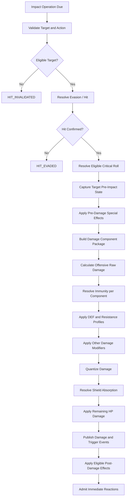

Ce diagramme décrit le pipeline logique. Les sous-impacts d'une AoE suivent l'atomicité déjà validée dans `SCHED-008`\.

### 5.1 Points de référence temporels

| Donnée | Instant retenu |
|--------|--------|
| ATQ et statistiques offensives | Engagement de l'action |
| Coefficients offensifs | Snapshot de l'action |
| Buffs offensifs appliqués à l'activation | Avant le snapshot |
| Éligibilité et esquive de la cible | À l'impact |
| Critique | Tirage à l'impact, selon le profil |
| PV actuels servant aux bonus proportionnels | Immédiatement avant l'impact éligible |
| DEF, résistances et immunités | À l'impact |
| Boucliers | État courant au moment de l'absorption |
| Nouveau débuff produit par l'impact | Après les dégâts de l'impact |

Un météore n'amplifie donc pas ses propres dégâts avec le débuff de résistance qu'il vient de créer.

En revanche, un impact ultérieur peut bénéficier de ce débuff.

## 6\. Touche, critique et dégâts : trois résultats distincts

Une touche confirmée n'implique pas une perte positive de PV.

| Situation | Touche confirmée | Critique possible | Dégâts PV possibles |
|--------|--------|--------|--------|
| Projectile esquivé | Non | Non | Non |
| Cible devenue invalide | Non | Non | Non |
| Projectile touchant un bouclier | Oui | Oui | Selon absorption |
| Projectile touchant sous immunité ordinaire | Oui | Oui | Non, sauf composante autorisée à traverser |
| Projectile touchant une cible sans protection | Oui | Oui | Oui |
| Cible en invulnérabilité absolue | Impact hostile bloqué | Aucun nouveau déclenchement hostile | Non |

La distinction entre une immunité ordinaire aux dégâts et `HARD_INVULNERABILITY` est conservée.

L'invulnérabilité absolue empêche aussi les effets hostiles et la destruction de boucliers. Une immunité aux dégâts ordinaire n'efface pas rétroactivement le résultat d'une touche ou d'un critique.

### 6.1 Conséquence pour Sacred Hunter

Un projectile critique confirmé déclenche `Critical Momentum`, même si \:

- Un bouclier absorbe l'intégralité des dégâts.
- Une immunité ordinaire empêche toute perte de PV.

L'événement `CRITICAL_HIT_CONFIRMED` reste valide.

Le bonus d'ATQ est installé **après la résolution de l'impact**, sans modifier son snapshot offensif.

### 6.2 Conséquence pour Supreme Spirit

Un combo Pal qui touche sous bouclier ou immunité peut effectuer son unique tirage d'Éveil.

Si le tirage réussit, sa composante de dégâts supplémentaires existe, mais elle reste soumise aux protections adverses.

Un déclenchement réussi peut donc produire zéro dégât effectif.

*Note d'ingénierie : les passifs doivent s'abonner à des événements précis comme `HIT_CONFIRMED`, `CRITICAL_HIT_CONFIRMED` ou `DAMAGE_APPLIED`\. Déclencher tous les passifs depuis une seule fonction de dégâts positifs serait incorrect pour plusieurs classes déjà validées.*

---

# SYS-002.D.13.4.3 - Critiques

## 7\. Trois propriétés indépendantes

Le système critique doit distinguer \:

| Propriété | Fonction |
|--------|--------|
| `CriticalChance` | Probabilité qu'un impact soit critique |
| `BaseCriticalDamageCoefficient` | Coefficient critique de référence |
| `CriticalDamageBonus` | Modificateurs appliqués à ce coefficient |

Les statistiques critiques du propriétaire, de ses compétences et de ses Pals sont séparées.

Une composante de dégâts peut également interdire les critiques ou hériter du résultat critique d'une autre composante.

## 8\. Contrat critique proposé

Pour un impact éligible \:

$$
P_{\mathrm{crit}}=
Clamp_{[0,1]}
\left(P_{\mathrm{base}}+\sum_i \Delta P_i\right)
$$

Le jet utilise l'identité de décision définie par `SCHED-013`\.

En cas de critique \:

$$
\boxed{
C_{\mathrm{crit}}
=
(C_{\mathrm{base}}+\Delta C_{\mathrm{base}})
\times M_{\mathrm{critical\ bonus}}
}
$$

Le Modifier Engine déterminera l'agrégation exacte des contributions appartenant à chaque groupe.

Une composante non critique utilise un facteur critique de 1.

### 8.1 Exemple Darklord

Supposons \:

- Coefficient critique de compétence de base : 150 %.
- P3 Darklord : +50 % dans le groupe de bonus critique.
- Éveil : +50 points au coefficient critique de base.

Alors \:

$$
C_{\mathrm{crit}}
=
(1.50+0.50)\times1.50
=\boxed{3.00}
$$

Un impact de compétence de 1 000 dégâts avant critique produit ainsi 3 000 dégâts bruts critiques.

Dans le profil P4 Darklord à 20 % \:

$$
D_{\mathrm{P4,raw}}=3000\times0.20=600
$$

La composante P4 reprend le résultat critique déjà calculé.

Elle ne multiplie pas à nouveau les 600 dégâts par 3.

### 8.2 Politiques des composantes

| Politique | Comportement |
|--------|--------|
| `ROLL_IF_ELIGIBLE` | Effectuer un jet critique propre à l'impact |
| `INHERIT_PARENT_RESULT` | Réutiliser le résultat critique déjà établi |
| `CRITICAL_DISABLED` | Aucun jet ni coefficient critique |

Les politiques sont sélectionnées par la définition des dégâts.

`BASIC_HP_SCALED`, `PAL_COMBO_HP_SCALED`, `DARKLORD_P4_BONUS` et `PASSIVE_REFLECTION` ne produisent pas de nouveau critique indépendant.

### 8.3 Critiques de zone

La règle déjà validée pour le Mage reste applicable : un jet par cible et par impact éligible, sans tirage commun automatique à toute l'AoE.

Les composantes supplémentaires peuvent hériter du résultat de cet impact.

*Note d'ingénierie : le résultat critique est une donnée de résolution réutilisable. Il ne doit pas être recalculé à chaque fois qu'une compétence crée une nouvelle composante de dégâts.*

---

# SYS-002.D.13.4.4 - Défense

## 9\. Formule exacte encore inconnue

Nous disposons de contrats de classe qui utilisent la DEF, mais pas d'une formule suffisamment fiable pour reproduire son comportement officiel.

Il serait incorrect d'affirmer, par exemple, que chaque point de DEF retire une quantité fixe de dégâts ou qu'une formule particulière est celle du jeu original.

Nous définissons donc \:

$$
\boxed{
D_{\mathrm{afterDEF}}
=
D_{\mathrm{raw}}\times
F_{\mathrm{DEF}}(A,T,P)
}
$$

Avec \:

- $A$ \: état offensif applicable.
- $T$ \: état défensif de la cible.
- $P$ \: profil de mitigation versionné.
- $F_{\mathrm{DEF}}$ \: facteur de mitigation déterminé par la formule sélectionnée.

### 9.1 Contrat d'interface

```text
DefenseMitigationProfile
├── ProfileId
├── FormulaVersion
├── AttackerStatInputs[]
├── TargetStatInputs[]
├── ArmorPenetrationPolicy
├── DefenseClampPolicy
├── DefenseIgnoringTags[]
├── QuantizationPolicyId
└── Provenance
```

Ce contrat permet de calibrer ultérieurement la formule sans modifier les événements et les catégories de dégâts.

### 9.2 Invariants proposés

| ID | Règle |
|--------|--------|
| `DMG-DEF-001` | La DEF effective est évaluée à l'impact |
| `DMG-DEF-002` | Les bonus de DEF déjà actifs sont pris en compte |
| `DMG-DEF-003` | Une pénétration de DEF n'est appliquée que si le profil l'autorise |
| `DMG-DEF-004` | Aucune formule de DEF n'est implicite |
| `DMG-DEF-005` | Un profil sans formule requise est non exécutable |
| `DMG-DEF-006` | Une composante ignorant la DEF doit le déclarer explicitement |

### 9.3 Cas Warbringer

La réflexion Warbringer utilise **60 % des dégâts théoriques d'une attaque normale avant les mitigations propres à sa cible initiale**, conformément au contrat de classe.

Elle ne doit pas être calculée depuis les PV réellement perdus par Warbringer.

Une attaque entièrement absorbée par un bouclier peut donc produire une réflexion éligible si la touche normale a réussi.

La réflexion utilise ensuite ses propres règles de mitigation contre chaque cible de son AoE.

*Note d'ingénierie : la référence offensive d'une réflexion doit être capturée avant la mitigation du défenseur. Utiliser les dégâts réellement subis rendrait cette mécanique dépendante des boucliers et immunités, contrairement au contrat Warbringer.*

---

# SYS-002.D.13.4.5 - Résistances et amplification des dégâts reçus

## 10\. Résistances par catégorie

Les résistances aux dégâts ne sont pas interchangeables.

| Groupe | Sources principalement concernées |
|--------|--------|
| `BASIC_ATTACK_RESISTANCE` | Attaques normales du propriétaire |
| `COMBO_DAMAGE_RESISTANCE` | Combos du propriétaire |
| `COUNTER_DAMAGE_RESISTANCE` | Contre-attaques et composantes explicitement rattachées |
| `SKILL_DAMAGE_RESISTANCE` | Compétences du propriétaire |
| `PAL_DAMAGE_RESISTANCE` | Attaques, combos et composantes Pal éligibles |
| `GENERIC_DAMAGE_REDUCTION` | Sources autorisées par son profil |

Le choix du groupe appartient au `DefenseProfile` de la composante.

Une attaque Pal n'hérite pas automatiquement de la résistance aux attaques normales du personnage simplement parce qu'elle constitue une attaque normale pour le Pal.

## 11\. Formule de résistance proposée

Pour un groupe défensif éligible \:

$$
R_{\mathrm{effective}}
=
Clamp_{[0,1]}
\left(
R_{\mathrm{base}}+
\sum_i\Delta R_i
\right)
$$

Le facteur associé est \:

$$
F_R=1-R_{\mathrm{effective}}
$$

Les contributions négatives réduisent la résistance.

### 11.1 Exemple Spirit Channeler

Une cible possède 30 % de résistance Pal.

La compétence de classe Spirit Channeler applique -40 points.

$$
R_{\mathrm{effective}}
=
Clamp_{[0,1]}(0.30-0.40)=0
$$

La résistance Pal n'amplifie donc pas les dégâts au-delà de leur référence dans ce profil.

Nous n'autorisons pas une résistance négative implicite.

### 11.2 Autres contrats de classes

| Source | Modification |
|--------|--------|
| Archer - compétence de classe | -40 points de résistance aux combos |
| Guerrier - compétence de classe éveillée | -40 points de résistance aux contre-attaques |
| Mage - compétence de classe | -20 points de résistance aux compétences |
| Spirit Channeler - compétence de classe | -40 points de résistance Pal |

Ces valeurs ont déjà été validées dans leurs profils respectifs.

Le résolveur partagé reçoit simplement une contribution négative au groupe ciblé.

## 12\. Résistance et dégâts reçus : opérations distinctes

Une variante documentaire de Spirit Channeler prévoit `PAL_DAMAGE_TAKEN_BONUS`\.

Elle n'utilise pas le groupe de résistance Pal.

Supposons 1 000 dégâts après Défense et 30 % de résistance.

| Situation | Calcul | Résultat |
|--------|--------|--------|
| Sans débuff | $1000\times0.70$ | 700 |
| Résistance -40 points | $1000\times1.00$ | 1 000 |
| Dégâts reçus +40 % | $1000\times0.70\times1.40$ | 980 |

Il est donc interdit de convertir automatiquement un bonus de dégâts reçus en réduction de résistance.

### 12.1 Convention d'agrégation proposée

Pour une composante ordinaire \:

$$
D_{\mathrm{mitigated}}
=
D_{\mathrm{raw}}
\times F_{\mathrm{DEF}}
\times F_{\mathrm{category\ resistances}}
\times F_{\mathrm{generic\ mitigation}}
\times M_{\mathrm{damage\ taken}}
$$

Les contributions d'un même groupe sont agrégées par le Modifier Engine. Les groupes différents sont composés selon le profil de calcul versionné.

Aucun groupe ne peut être appliqué deux fois.

Le modèle autorise des exceptions explicites, notamment l'ignorance de certaines résistances, mais pas de déductions automatiques à partir du nom d'une compétence.

*Note d'ingénierie : il faut conserver séparément les résistances et les amplifications de dégâts reçus. Leur fusion dans un unique pourcentage rendrait les profils historiques impossibles à reproduire fidèlement.*

---

# SYS-002.D.13.4.6 - Immunités

## 13\. Taxonomie proposée

Une immunité ne doit pas être représentée par un unique booléen global.

| Protection | Contrat |
|--------|--------|
| `DAMAGE_IMMUNITY` | Empêche les pertes de PV causées par les composantes ordinaires |
| `SKILL_DAMAGE_IMMUNITY` | Bloque les composantes de compétence concernées |
| `CONTROL_IMMUNITY` | Empêche les contrôles concernés, sans nécessairement empêcher les dégâts |
| `UNTARGETABLE` | Empêche la sélection ou la validation de la cible |
| `HARD_INVULNERABILITY` | Bloque les impacts hostiles et leurs effets, sauf exception expressément définie |

Le modèle distingue donc une protection contre les dégâts d'une protection contre la touche ou contre les effets de statut.

### 13.1 Politique de contournement

Chaque composante porte une politique explicite \:

```text
ImmunityPolicy
├── RESPECT_ALL
├── BYPASS_DAMAGE_IMMUNITY
├── BYPASS_SKILL_DAMAGE_IMMUNITY
└── BYPASS_DECLARED_IMMUNITY_SET
```

`BYPASS_DECLARED_IMMUNITY_SET` exige la liste exacte des immunités ignorées.

**Aucune de ces politiques ne contourne implicitement `HARD_INVULNERABILITY`\.**

## 14\. Cas Darklord P4

Le contrat Darklord est déjà approuvé \:

- La composante principale respecte l'immunité ordinaire.
- La composante P4 peut la traverser.
- La composante P4 conserve les autres mitigations.
- Son coefficient initial est de 20 %, avec une variante documentaire à 10 %.

### Exemple contrôlé

Une compétence Darklord critique produit \:

$$
D_{\mathrm{primary,raw}}=3000
$$

P4 à 20 % produit \:

$$
D_{\mathrm{P4,raw}}=600
$$

La cible possède `SKILL_DAMAGE_IMMUNITY`, mais P4 est autorisé à la contourner.

Pour cet exemple, supposons que la composante P4 subisse ensuite un facteur de Défense de 0,80 et une résistance éligible de 25 %.

$$
D_{\mathrm{P4,mitigated}}
=
600\times0.80\times0.75
=\boxed{360}
$$

| Composante | Dégâts bruts | Après immunité et mitigation |
|--------|--------|--------|
| Compétence principale | 3 000 | 0 |
| Bonus P4 | 600 | 360 |

La cible peut donc subir 360 dégâts avant bouclier, malgré l'immunité de compétence.

La compétence principale n'est pas rendue vulnérable rétroactivement.

### 14.1 Immunité et états hostiles

Une immunité aux dégâts ordinaire ne doit pas supprimer automatiquement un débuff de résistance appliqué sur une touche confirmée.

Le contrôle d'éligibilité du débuff appartient au moteur d'effets.

En revanche, `HARD_INVULNERABILITY` bloque également les effets hostiles de l'impact dans notre profil initial.

*Note d'ingénierie : l'immunité doit être évaluée par composante. Si elle était évaluée globalement avant la construction du paquet de dégâts, Darklord P4 ne pourrait pas fonctionner sans rendre la compétence entière immunité-perçante.*

---

# SYS-002.D.13.4.7 - Boucliers

## 15\. Boucliers comme instances indépendantes

Nous avons déjà validé la nécessité de conserver chaque bouclier sous forme d'instance.

Un personnage peut posséder plusieurs boucliers provenant de sources différentes.

Leur capacité totale ne suffit pas à représenter correctement leurs durées, leur renouvellement ou leur destruction sélective.

### 15.1 Contrat d'interface

```text
ShieldInstance
├── ShieldInstanceId
├── SourceActorId
├── OriginEffectInstanceId
├── TargetActorId
├── RemainingCapacity
├── AbsorptionPriority
├── AppliedAtUs
├── BreakPolicy
├── EligibleDamageProfiles[]
├── ExpirationTimeUs?
├── Generation
└── LifecycleState
```

### 15.2 Ordre d'absorption proposé

Les boucliers éligibles sont triés suivant \:

1. `AbsorptionPriority`\.
2. `AppliedAtUs`, du plus ancien au plus récent.
3. `ShieldInstanceId`, en dernier départage.

L'ordre d'absorption doit être versionné. Il ne doit pas dépendre de l'ordre d'itération des effets.

Les dégâts arrivent aux PV uniquement après épuisement ou contournement des boucliers applicables.

## 16\. Résolution d'une absorption

Prenons une composante de 700 dégâts mitigés et deux boucliers éligibles.

| Protection | Capacité initiale | Dégâts absorbés | Capacité finale |
|--------|--------|--------|--------|
| Bouclier A | 250 | 250 | 0 |
| Bouclier B | 300 | 300 | 0 |
| PV | - | 150 | -150 PV |

Le moteur publie les absorptions et la perte effective de PV séparément.

Le fait d'épuiser un bouclier par des dégâts ordinaires produit `SHIELD_DEPLETED_BY_DAMAGE`\.

Une destruction forcée produit `SHIELD_BROKEN`\.

Une fin naturelle produit `SHIELD_EXPIRED`\.

Ces trois causes ne sont pas équivalentes.

## 17\. Cas Prophet : destruction de boucliers

L'Éveil Prophet utilise `SHIELD_SHATTER`\.

Lorsqu'une attaque directe admissible touche pendant la fenêtre active \:

1. Le moteur vérifie le résultat de touche et les protections absolues.
2. Il sélectionne les boucliers portant `BreakPolicy = BREAKABLE`\.
3. Il détruit les instances concernées avant l'absorption des dégâts de cet impact.
4. Les boucliers non destructibles restent disponibles.
5. Les dégâts sont ensuite résolus normalement.

La capacité supprimée par `SHIELD_SHATTER` n'est **pas comptabilisée comme une perte de PV**, ni comme des dégâts effectifs.

### 17.1 Immunité ordinaire et bris de bouclier

Un point de frontière reste à préciser.

Je recommande que `SHIELD_SHATTER` puisse se produire sur une touche confirmée, même si la cible possède une simple immunité aux dégâts.

En effet, la destruction de bouclier est un effet hostile distinct de la perte de PV.

En revanche, `HARD_INVULNERABILITY` empêche le bris.

Cette règle est cohérente avec notre distinction entre touche, dégâts et effets hostiles, mais elle reste **une nouvelle convention à valider** dans `D.13.4`\.

*Note d'ingénierie : le Shield Resolver doit recevoir un ensemble de composantes déjà mitigées et des opérations de destruction explicites. Il ne doit jamais interpréter une capacité de bouclier détruite comme des dégâts infligés aux PV.*

---

# SYS-002.D.13.4.8 - Dégâts proportionnels aux PV

## 18\. Trois mécaniques déjà validées

Les dégâts proportionnels aux PV interviennent dans trois contrats de classe importants.

| Mécanique | Référence | Coefficient | Déclenchement |
|--------|--------|--------|--------|
| Sacred Hunter - Vital Shot | PV actuels de la cible avant impact | 1 % | 50 % de chance au premier projectile normal admissible |
| Martial Sage - bonus de contre-attaque éveillé | PV actuels de la cible avant impact | 1 % | Contre-attaques admissibles pendant la fenêtre d'Éveil |
| Supreme Spirit - Éveil | PV actuels de la cible avant impact | 1 % | 40 % de chance sur une action de combo Pal réussie |

La référence de Supreme Spirit suit le profil corrigé en septembre 2025. Les variantes anciennes utilisant les PV maximaux restent conservées séparément.

## 19\. Politique de référence

Nous définissons \:

$$
H_{\mathrm{reference}}
=
HP_{\mathrm{target,preimpact}}
$$

Puis \:

$$
D_{\mathrm{HP,raw}}=qH_{\mathrm{reference}}
$$

Pour $q=0.01$ \:

$$
D_{\mathrm{HP,raw}}=0.01H_{\mathrm{reference}}
$$

Cette valeur est calculée avant les mitigations et boucliers.

### 19.1 Exemple Supreme Spirit

Une cible possède 20 000 PV juste avant le premier impact de combo Pal admissible.

Le tirage de 40 % réussit.

$$
D_{\mathrm{HP,raw}}
=
20000\times0.01
=\boxed{200}
$$

Si le combo principal réduit ensuite les PV de la cible à 12 000, la référence du bonus reste 20 000.

Le bonus ne se recalcule pas à partir de 12 000 PV.

### 19.2 Plusieurs projectiles

Chaque projectile normal possède son propre instant d'impact.

Cependant, le bonus Supreme Spirit est déclenché une seule fois par action de combo Pal, lors de son premier impact réussi éligible.

Deuxième projectile ou non, la référence de ce déclenchement ne change plus.

Pour Sacred Hunter Vital Shot, la référence appartient au projectile normal admissible ayant déclenché le tirage P4.

## 20\. Priorité entre dégâts principaux et supplémentaires

Nous devons résoudre une subtilité importante.

Le contrat Sacred Hunter précise que son bonus Vital Shot ne doit plus infliger de dégâts effectifs si l'attaque principale a déjà éliminé la cible.

Le contrat Supreme Spirit précise que les PV de référence sont capturés avant l'impact.

Ces deux règles sont compatibles si nous distinguons **le calcul de la référence** et **l'application effective des dégâts**\.

### 20.1 Convention proposée

Un impact à plusieurs composantes possède un ordre stable \:

| Priorité | Composante |
|--------|--------|
| 0 | Dégâts principaux |
| 1 | Dégâts supplémentaires dépendant de l'impact principal |
| 2 | Autres composantes explicitement configurées |

Toutes les références pré-impact nécessaires sont capturées avant la résolution de la composante principale.

Les composantes sont ensuite appliquées dans leur ordre.

Si les dégâts principaux éliminent la cible, une composante supplémentaire peut conserver sa valeur brute calculée, mais son dégât effectif sur les PV est nul.

### 20.2 Exemple de frappe létale

Une cible possède 100 PV.

Un impact produit \:

- 150 dégâts principaux après mitigation.
- Un bonus proportionnel brut de 1 % des PV pré-impact, soit 1.

Le moteur applique \:

| Composante | Montant disponible | Perte de PV effective |
|--------|--------|--------|
| Principale | 150 | 100 |
| Supplémentaire | 1 | 0 |

Les PV finaux sont zéro, jamais -51.

La valeur brute du bonus reste vérifiable, mais elle n'est pas déclarée comme un dégât effectif.

### 20.3 Conditions particulières

Sacred Hunter dispose déjà d'une politique plus restrictive \:

`POST_PRIMARY_SURVIVAL_GATED`

La composante Vital Shot ne produit aucun dégât effectif lorsque sa composante principale a éliminé la cible.

Les composantes Darklord P4 et Supreme Spirit suivent le même principe général de non-application aux PV déjà épuisés, tout en conservant leurs propres conditions de déclenchement.

Aucune composante supplémentaire ne doit générer une nouvelle attaque, un critique indépendant ou un combo récursif sans autorisation explicite.

*Note d'ingénierie : capturer la référence avant l'impact évite les variations liées à l'ordre de calcul. Appliquer les pertes de PV dans un ordre stable évite, de son côté, les dégâts fantômes sur une cible déjà éliminée.*

---

# SYS-002.D.13.4.9 - Règles d'arrondi et arithmétique

## 21\. Une politique numérique commune est obligatoire

Les classes utilisent de nombreux pourcentages \:

- 0,1 % de vitesse d'attaque Pal.
- 1 % des PV actuels.
- 4 % de dégâts par tranche de PV manquants.
- 15 ou 25 points de probabilité critique.
- 20 ou 40 points de résistance.
- Multiplicateurs critiques et coefficients de compétence.

Les arrondis ne peuvent pas être laissés à la discrétion de chaque passif.

### 21.1 Recommandation : `FIXED_POINT_FLOOR_FINAL`

Je propose les règles suivantes.

| Propriété | Politique |
|--------|--------|
| PV et capacité de bouclier | Entiers non négatifs |
| Probabilités et bonus usuels | Points de base |
| Temps | Microsecondes entières |
| Calcul intermédiaire | Précision fixe déterministe suffisante |
| Arrondis intermédiaires de mitigation | Évités |
| Arrondi final des dégâts mitigés | Troncature vers le bas |
| Minimum implicite de dégâts | Aucun |
| Dépassement de capacité numérique | Erreur explicite |
| Dégâts effectifs sur les PV | Bornés par les PV disponibles |

Le choix de troncature est une **convention de conception proposée**\. Il ne constitue pas une règle officielle vérifiée du jeu d'origine.

## 22\. Arrondir une seule fois par composante

Supposons \:

- 1 000 dégâts bruts.
- Facteur de Défense de 0,80.
- Résistance de 30 %.
- Facteur de réduction générale de 0,90.

$$
D=
1000\times0.80\times0.70\times0.90
=\boxed{504}
$$

Si un bouclier absorbe ensuite 200 points \:

$$
D_{\mathrm{HP}}=504-200=\boxed{304}
$$

Les résultats sont \:

| Mesure | Valeur |
|--------|--------|
| Dégâts bruts | 1 000 |
| Dégâts mitigés | 504 |
| Bouclier absorbé | 200 |
| PV perdus | 304 |

Les facteurs 0,80 et 0,90 sont des données de test hypothétiques, pas une formule de DEF officielle.

### 22.1 Cas fractionnaire

Une composante de 101 dégâts subissant un facteur global de 0,75 donne \:

$$
D_{\mathrm{exact}}=75.75
$$

Avec `FIXED_POINT_FLOOR_FINAL` \:

$$
\boxed{D_{\mathrm{quantized}}=75}
$$

Nous n'arrondissons pas à chaque multiplication intermédiaire.

### 22.2 Granularité des composantes

L'arrondi doit se produire **par composante de dégâts définie**, après toutes ses mitigations applicables.

Deux composantes distinctes ne sont pas fusionnées arbitrairement.

Cela signifie que leur décomposition fait partie du profil de capacité.

Une compétence ne doit pas pouvoir changer ses dégâts simplement parce qu'un développeur a séparé une composante en plusieurs objets techniques équivalents.

Le validateur de profil devra donc exiger une décomposition canonique des composantes de dégâts.

### 22.3 Dégâts inférieurs à un point

Avec la politique proposée, une composante mitigée à 0,8 point produit zéro dégât quantifié.

Elle ne reçoit pas automatiquement un minimum de un point.

Cela n'empêche pas un événement `HIT_CONFIRMED` ou `CRITICAL_HIT_CONFIRMED` d'exister.

Un minimum garanti devra être déclaré explicitement par un profil si le jeu de référence en exige un.

## 23\. Dépassements numériques

Les valeurs devront supporter les coefficients très élevés et les statistiques de progression de l'idle RPG.

Je recommande d'exiger \:

`CHECKED_ARITHMETIC`

Les produits intermédiaires doivent disposer d'une plage de représentation suffisante, distincte des limites de stockage finales des PV.

La référence des tests numériques pourra utiliser une arithmétique exacte pour vérifier les résultats du moteur.

Aucun dépassement ne doit être converti silencieusement en valeur négative, zéro ou maximum artificiel.

*Note d'ingénierie : le point d'arrondi doit être une règle du moteur, pas une conséquence du type numérique utilisé. Cette convention est indispensable pour comparer des simulations exécutées sur Android et dans l'éditeur Unity.*

---

# SYS-002.D.13.4.10 - Contrats de résolution et événements

## 24\. Résultat complet d'un impact

Je recommande que le moteur produise un résultat structuré contenant les faits nécessaires aux passifs, aux tests et aux statistiques de combat.

```text
DamageImpactResult
├── ImpactId
├── ActionId
├── SourceActorId
├── OwnerActorId
├── TargetActorId
├── HitResult
├── CriticalResult
├── TargetPreImpactHp
├── ComponentResults[]
│   ├── DamageComponentId
│   ├── RawDamage
│   ├── MitigatedDamage
│   ├── QuantizedDamage
│   ├── ShieldAbsorbedDamage
│   ├── HpDamageApplied
│   ├── PreventionReasons[]
│   └── AppliedPolicies[]
├── ShieldEvents[]
├── TargetPostImpactHp
├── DeathPending
└── PublishedEventIds[]
```

Le résultat ne constitue pas lui-même un nouvel acteur ou une nouvelle action.

Il représente la résolution d'un impact déjà identifié par le modèle `D.13.1`\.

## 25\. Politique de publication des événements

| Situation | Événements attendus |
|--------|--------|
| Attaque esquivée | `HIT_EVADED` |
| Attaque valide, non critique | `HIT_CONFIRMED` |
| Attaque valide et critique | `HIT_CONFIRMED`, `CRITICAL_HIT_CONFIRMED` |
| Bouclier absorbant 100 dégâts | `SHIELD_ABSORBED` avec montant 100 |
| Bouclier épuisé par dégâts | `SHIELD_DEPLETED_BY_DAMAGE` |
| Bouclier détruit par Prophet | `SHIELD_BROKEN` |
| Dégâts entièrement bloqués par immunité | `DAMAGE_PREVENTED` |
| Perte effective de 200 PV | `DAMAGE_APPLIED` avec montant 200 |
| PV atteignant zéro | `ACTOR_DEATH_PENDING` selon le cycle de vie |

`DAMAGE_APPLIED` doit représenter une perte positive de PV.

Il n'est pas émis avec une quantité positive simplement parce qu'un bouclier a absorbé des dégâts.

### 25.1 Mort pendant une AoE

Nous conservons la convention du scheduler \:

- Les sous-impacts de l'opération AoE sont terminés dans l'ordre stable prévu.
- Les cibles atteignant zéro PV passent en `DEATH_PENDING`\.
- Les réactions immédiates admises pendant les sous-impacts sont conservées.
- La clôture réactive intervient après le lot AoE.
- La finalisation du combat intervient lorsque les réactions admissibles sont terminées.

Ainsi, une AoE n'est pas interrompue artificiellement par une réflexion déclenchée contre son premier sous-impact.

---

# SYS-002.D.13.4.11 - Audit consolidé des quatre classes

## 26\. Compatibilité des mécaniques validées

| Mécanique | Exigence | Résolution proposée |
|--------|--------|--------|
| Martial Sage - réduction des dégâts | Réduction générale de 15 % | Groupe défensif explicite |
| Martial Sage - bouclier | Absorption par instance | Shield Resolver |
| Martial Sage - dégâts de contre-attaque proportionnels aux PV | 1 % des PV actuels | Référence pré-impact |
| Warbringer - réflexion | 60 % des dégâts normaux théoriques | Référence offensive avant mitigation de la cible initiale |
| Warbringer - réaction létale | Résolution avant clôture | Événement causal et réaction admise |
| Sacred Hunter - P4 Vital Shot | Dégâts de base proportionnels aux PV | Composante supplémentaire avec condition de survie |
| Sacred Hunter - P5 | Critique même si bouclier absorbe | Événement critique indépendant des dégâts PV |
| Plume Monarch - projectiles multiples | Résultats indépendants | Impacts identifiés séparément |
| Prophet - bris de bouclier | Destruction avant absorption | `SHIELD_SHATTER` |
| Prophet - durée des compétences | Modification d'effet, pas des dégâts directement | Hors pipeline de dégâts |
| Darklord - P3 et Éveil | Groupes critiques distincts | Critical Resolver |
| Darklord - P4 | Bonus traversant certaines immunités | Immunité par composante |
| Beastmaster - P3 | Critique Pal +25 points | Statistique critique Pal |
| Beastmaster - P4 | \+10 points au coefficient Pal | Groupe de coefficient, pas de double multiplicateur |
| Beastmaster - P5 | Dégâts selon PV manquants | Bonus offensif dynamique capturé à l'engagement |
| Supreme Spirit - Éveil | 40 %, 1 % des PV actuels | Composante supplémentaire du combo Pal |
| Spirit Channeler - débuff | Résistance Pal -40 points | Groupe de résistance Pal |

### 26.1 Risques de double application

Le moteur doit notamment empêcher les erreurs suivantes.

| Erreur | Conséquence |
|--------|--------|
| Appliquer Darklord P3 aux dégâts P4 une deuxième fois | Critique artificiellement amplifié |
| Appliquer Beastmaster P4 au coefficient puis aux dégâts finaux | Double bonus de dégâts Pal |
| Recalculer les PV de référence après le coup principal | Bonus proportionnel dépendant incorrectement de l'ordre |
| Appliquer une immunité à tout le paquet Darklord | P4 devient inopérant |
| Appliquer le contournement d'immunité P4 à tout le paquet | Compétence principale anormalement puissante |
| Considérer un bouclier absorbé comme une perte de PV | Déclencheurs de dégâts effectifs incorrects |
| Produire un second critique pour un bonus proportionnel aux PV | Probabilités et dégâts excessifs |
| Compter un bouclier brisé comme des dégâts directs | Statistiques de combat erronées |

---

# SYS-002.D.13.4.12 - Invariants du moteur de dégâts

## 27\. Contrats proposés

| ID | Contrat |
|--------|--------|
| `DMG-001` | Les dégâts sont décomposés en composantes identifiées et typées |
| `DMG-002` | Origine, catégorie offensive, groupe de scaling et profil défensif sont séparés |
| `DMG-003` | Un impact confirme la touche avant la résolution des dégâts |
| `DMG-004` | Les critiques sont résolus avant les mitigations |
| `DMG-005` | Les composantes peuvent hériter d'un résultat critique sans nouveau tirage |
| `DMG-006` | La DEF utilise une formule versionnée, jamais implicite |
| `DMG-007` | Les résistances sont appliquées par groupe éligible |
| `DMG-008` | Les résistances du profil initial sont bornées entre 0 et 100 % |
| `DMG-009` | Les bonus de dégâts reçus sont distincts des réductions de résistance |
| `DMG-010` | Les immunités sont évaluées par composante |
| `DMG-011` | Le contournement d'immunité est explicite et limité aux catégories autorisées |
| `DMG-012` | L'invulnérabilité absolue protège contre les effets hostiles, sauf exception explicite |
| `DMG-013` | Les boucliers sont des instances indépendantes avec un ordre d'absorption stable |
| `DMG-014` | La destruction des boucliers précède leur absorption sur un impact admissible |
| `DMG-015` | Les pertes de capacité de bouclier sont distinctes des pertes de PV |
| `DMG-016` | Les dégâts proportionnels aux PV utilisent une référence pré-impact explicite |
| `DMG-017` | Les composantes d'un même impact suivent un ordre stable |
| `DMG-018` | Les dégâts supplémentaires ne produisent pas de critique ou de récursion implicite |
| `DMG-019` | Les calculs intermédiaires utilisent une arithmétique déterministe |
| `DMG-020` | La quantification initiale utilise `FIXED_POINT_FLOOR_FINAL` par composante |
| `DMG-021` | Les dégâts effectifs ne peuvent pas dépasser les PV disponibles |
| `DMG-022` | Les événements de touche, critique, bouclier et dégâts PV sont distincts |
| `DMG-023` | Le profil de dégâts, les formules et leurs politiques d'arrondi sont versionnés |
| `DMG-024` | Toute formule ou donnée indispensable manquante empêche l'exécution du profil |

---

# SYS-002.D.13.4.13 - Tests d'acceptation

## 28\. Tests de critiques et de mitigation

| Test | Scénario | Résultat attendu |
|--------|--------|--------|
| `DMG-CRIT-T001` | Impact non éligible aux critiques | Aucun tirage |
| `DMG-CRIT-T002` | Impact esquivé | Aucun critique |
| `DMG-CRIT-T003` | Critique absorbé par bouclier | Critique confirmé, zéro PV perdu si absorption totale |
| `DMG-CRIT-T004` | Critique sous immunité ordinaire | Critique confirmé, dégâts bloqués selon politique |
| `DMG-CRIT-T005` | Darklord P3 et Éveil | Coefficient critique correctement composé |
| `DMG-CRIT-T006` | Bonus P4 Darklord | Aucun second tirage critique |
| `DMG-DEF-T001` | Formule DEF absente | Profil rejeté |
| `DMG-DEF-T002` | DEF modifiée avant impact | Nouvelle DEF utilisée |
| `DMG-DEF-T003` | Bonus offensif après engagement | Snapshot déjà engagé inchangé |
| `DMG-RES-T001` | Résistance 30 %, débuff -40 points | Résistance effective 0 % |
| `DMG-RES-T002` | Résistance 30 %, dégâts reçus +40 % | Multiplicateur distinct |
| `DMG-RES-T003` | Résistance Pal appliquée aux dégâts de combo Pal | Applicable |
| `DMG-RES-T004` | Résistance Pal appliquée à une attaque normale du propriétaire | Non applicable par défaut |

## 29\. Tests des immunités et boucliers

| Test | Scénario | Résultat attendu |
|--------|--------|--------|
| `DMG-IMM-T001` | Immunité ordinaire, dégâts directs | Composante bloquée |
| `DMG-IMM-T002` | Immunité ordinaire, bonus Darklord P4 | Composante autorisée selon profil |
| `DMG-IMM-T003` | Invulnérabilité absolue | Aucun dégât ni effet hostile ordinaire |
| `DMG-IMM-T004` | Immunité aux dégâts sous une attaque critique | Résultat critique conservé |
| `DMG-SHIELD-T001` | Bouclier de 100, dégâts mitigés 80 | Bouclier restant 20 |
| `DMG-SHIELD-T002` | Bouclier de 100, dégâts mitigés 150 | Bouclier épuisé, perte de 50 PV si disponibles |
| `DMG-SHIELD-T003` | Deux boucliers | Absorption selon priorité stable |
| `DMG-SHIELD-T004` | Prophet détruit un bouclier destructible | `SHIELD_BROKEN` avant absorption |
| `DMG-SHIELD-T005` | Prophet frappe un bouclier protégé | Bouclier conservé |
| `DMG-SHIELD-T006` | Immunité bloquant tous les dégâts | Aucune capacité de bouclier consommée par ces dégâts |
| `DMG-SHIELD-T007` | Bouclier détruit par effet spécial | Pas de perte fictive de PV |

## 30\. Tests des dégâts proportionnels et des arrondis

| Test | Scénario | Résultat attendu |
|--------|--------|--------|
| `DMG-HP-T001` | Cible à 20 000 PV, bonus de 1 % | Référence brute 200 |
| `DMG-HP-T002` | Cible à 10 000 PV, bonus de 1 % | Référence brute 100 |
| `DMG-HP-T003` | Supreme Spirit, deux impacts de combo réussis | Un seul tirage de bonus |
| `DMG-HP-T004` | Premier impact du combo esquivé | Référence capturée au premier impact réussi suivant |
| `DMG-HP-T005` | Coup principal létal | Aucune perte de PV supplémentaire après zéro |
| `DMG-HP-T006` | Vital Shot sous Défense et bouclier | Les deux protections restent applicables |
| `DMG-HP-T007` | Réflexion Warbringer sous bouclier absorbant | Référence théorique conservée |
| `DMG-ROUND-T001` | Dégâts mitigés exacts 75,75 | 75 |
| `DMG-ROUND-T002` | Dégâts mitigés 0,8 | 0 |
| `DMG-ROUND-T003` | Plusieurs facteurs de mitigation | Pas d'arrondi après chaque facteur |
| `DMG-ROUND-T004` | Dépassement numérique | Erreur explicite |
| `DMG-ROUND-T005` | Même combat sur deux architectures | Même résultat quantifié |
| `DMG-ROUND-T006` | Deux composantes distinctes | Quantification conforme à leur décomposition canonique |

Ces tests sont définis, mais **aucun n'a été exécuté**\.

---

# SYS-002.D.13.4.14 - Résultat de l'audit

## 31\. État des contrats

| Domaine | Résultat |
|--------|--------|
| Séparation des catégories et origines | Contrat proposé |
| Pipeline commun | Contrat proposé |
| Résolution des critiques | Contrat proposé |
| Fonction de DEF | Interface définie, formule à calibrer |
| Résistances | Contrat proposé |
| Dégâts reçus et réduction de résistance | Séparation définie |
| Immunités | Contrat proposé |
| Boucliers | Contrat proposé |
| Dégâts proportionnels aux PV | Contrat proposé |
| Arrondis | `FIXED_POINT_FLOOR_FINAL` proposé |
| Tests | `specified`, `not_executed` |
| Implémentation | `not_started` |

### 31.1 Dépendances encore ouvertes

| Dépendance | Statut | Traitement prévu |
|--------|--------|--------|
| Formule officielle de DEF | `defense_calibration_pending` | Profil versionné, aucune formule implicite |
| Plafonds des dégâts proportionnels aux PV selon le mode | `damage_mode_calibration_pending` | Politique explicite par mode |
| Coefficients des compétences par classe | `calibration_pending` | Calibration distincte |
| Ordre précis des groupes du Modifier Engine | `modifier_contract_pending` | `SYS-002.D.13.5` |
| Durée de vie des effets après mort de la source | `effect_lifecycle_pending` | `SYS-002.D.13.5` |
| Politique numérique définitive du jeu d'origine | `reference_verification_pending` | Vérification expérimentale |

Ces dépendances ne nécessitent pas d'inventer une formule. Nous pouvons valider les interfaces et le comportement du résolveur tout en refusant l'exécution des profils incomplets.

## 32\. Points nouveaux nécessitant une validation explicite

Quatre conventions méritent une attention particulière \:

| Convention | Conséquence |
|--------|--------|
| Résistance minimale de 0 % | Un débuff ne crée pas implicitement de vulnérabilité supplémentaire sous zéro |
| `SHIELD_SHATTER` sous immunité ordinaire | Prophet peut briser un bouclier sur une touche confirmée, sauf protection absolue |
| Dégâts supplémentaires après les dégâts principaux | Les références pré-impact sont préservées, mais aucun dégât positif n'est appliqué à une cible déjà à zéro PV |
| Troncature finale par composante | Les dégâts fractionnaires sont quantifiés de manière stable et reproductible |

Ces règles sont cohérentes avec les classes déjà spécifiées, mais leur validation doit être explicite.

---


---

## SYS-002.D.13.5 — Modifier & Snapshot Engine

**Validation :** `SYS-002.D.13.5.12.1` · approbation propriétaire `T149` · spécification source `T148`. **Statut :** `functionally_specified`; implémentation `not_started`; tests `not_executed`.


# SYS-002.D.13.5 - Modifier &amp; Snapshot Engine Specification

Audit architectural et fonctionnel - aucune implémentation

## 2\. Objectif du jalon

Les quatre familles de classes utilisent déjà des dizaines de modificateurs : ATQ, DEF, APS, critique, dégâts de compétence, résistance, énergie, durée d'effet, probabilité d'esquive, effets de déploiement et dégâts liés aux PV manquants.

Le prochain contrat doit garantir que ces contributions produisent **un seul état statistique cohérent**, quelle que soit leur provenance.

Nous devons spécifier six responsabilités distinctes.

| Sous-système | Responsabilité |
|--------|--------|
| `ModifierRegistry` | Identifier les contributions actives |
| `ModifierAggregator` | Combiner les contributions par groupe |
| `StatResolver` | Calculer les statistiques effectives |
| `SnapshotResolver` | Figer les valeurs offensives au bon instant |
| `EffectLifecycleEngine` | Installer, rafraîchir, expirer et retirer les effets |
| `DependencyInvalidationEngine` | Recalculer uniquement les statistiques concernées |

Ces responsabilités appartiennent au même contrat fonctionnel, mais ne doivent pas être confondues.

**Principe directeur : une statistique effective est le résultat calculé de contributions identifiées, pas une valeur que chaque passif modifie directement et successivement.**

*Note d'ingénierie : modifier une statistique effective en place rend le résultat dépendant de l'ordre d'installation et de suppression des buffs. Reconstruire la valeur depuis les contributions actives évite les résidus après expiration, changement de classe ou recalcul.*

---

# SYS-002.D.13.5.1 - Modèle des modificateurs

## 3\. Une contribution possède une identité et une opération

Je propose le contrat suivant \:

```text
ModifierContribution
├── ModifierInstanceId
├── ModifierDefinitionId
├── SourceActorId
├── OwnerActorId
├── TargetActorId
├── OriginActionId?
├── OriginEffectInstanceId?
├── TargetStatId
├── ModifierGroupId
├── Operation
├── Magnitude
├── Unit
├── EvaluationPolicy
├── StackingPolicy
├── SourceScope
├── Priority
├── EligibilityPredicateId?
├── LifetimeBinding
└── ConfigurationVersion
```

Chaque champ remplit une fonction précise \:

| Champ | Utilité |
|--------|--------|
| `SourceActorId` | Identifie l'acteur réellement à l'origine du bonus |
| `OwnerActorId` | Conserve la propriété logique, notamment pour les Pals |
| `TargetActorId` | Indique quel acteur reçoit la contribution |
| `ModifierGroupId` | Définit avec quelles contributions le bonus se combine |
| `Operation` | Définit l'opération mathématique |
| `Magnitude` et `Unit` | Empêchent les conversions numériques ambiguës |
| `EvaluationPolicy` | Indique quand la magnitude est évaluée |
| `StackingPolicy` | Définit les doublons, cumuls et rafraîchissements |
| `LifetimeBinding` | Lie ou non la contribution à une instance d'effet |

Le registre conserve les contributions d'origine. Il ne réécrit pas la valeur de base de l'acteur.

## 4\. Opérations mathématiques proposées

| Opération | Sémantique | Exemple |
|--------|--------|--------|
| `FLAT_ADD` | Addition d'une quantité dans l'unité de la statistique | ATQ +100 |
| `BASE_PERCENT_ADD` | Bonus proportionnel agrégé dans un groupe | ATQ +12 % |
| `COEFFICIENT_POINTS_ADD` | Addition de points à un coefficient | Critique de base +20 points |
| `CHANCE_POINTS_ADD` | Addition de points de probabilité | Critique Pal +25 points |
| `GROUP_MULTIPLIER` | Multiplication par le facteur agrégé d'un groupe | Dégâts Pal +8 % |
| `OVERRIDE` | Remplacement explicite d'une valeur ou politique | Cas exceptionnels |
| `CLAMP` | Bornage à la frontière définie du calcul | Chance critique entre 0 et 100 % |

La différence entre les opérations est contractuelle.

Un bonus de +10 points au coefficient Pal n'est pas équivalent à une augmentation relative de 10 % de ce coefficient.

Un bonus de +15 points de critique n'est pas équivalent à une multiplication de la chance critique par 1,15.

Une configuration ne peut pas utiliser une valeur numérique sans déclarer son unité et son opération.

---

# SYS-002.D.13.5.2 - Groupes et ordre d'agrégation

## 5\. Groupes canoniques

Les groupes validés lors de la conception des classes doivent être conservés sous leur identité propre.

| Groupe | Sources représentatives | Opération |
|--------|--------|--------|
| `GLOBAL_ATTACK_PERCENT` | Mage P2 | Bonus relatif agrégé d'ATQ |
| `GLOBAL_DEFENSE_PERCENT` | Guerrier P2 | Bonus relatif agrégé de DEF |
| `OWNER_ATTACK_SPEED_PERCENT` | Archer P2 | Bonus relatif d'APS |
| `PAL_BASE_ATTACK_SPEED_PERCENT` | Spirit Channeler P2 | Bonus relatif de vitesse Pal |
| `SKILL_CRITICAL_CHANCE` | Mage P1 | Points de probabilité |
| `SKILL_CRITICAL_DAMAGE_BONUS` | Darklord P3 | Groupe multiplicatif critique |
| `BASE_SKILL_CRITICAL_DAMAGE` | Éveil Darklord | Points sur le coefficient critique de base |
| `PAL_CRITICAL_CHANCE` | Beastmaster P3 | Points de probabilité |
| `PAL_DAMAGE_COEFFICIENT_BONUS` | Beastmaster P4 | Points sur le coefficient Pal |
| `PAL_DAMAGE_BONUS` | Beastmaster P5 | Bonus relatif de dégâts Pal |
| `ACTIVE_SKILL_ENERGY_REGEN_PERCENT` | Prophet P3 | Bonus relatif de régénération |
| `ACTIVE_SKILL_DAMAGE_BONUS` | Prophet P4 | Bonus relatif des compétences équipées |
| `COMBO_DAMAGE_BONUS` | Plume Monarch P3 | Bonus relatif des dégâts de combo |
| `COMBO_RESISTANCE_REDUCTION` | Compétence Archer | Points de réduction de résistance |
| `COUNTER_RESISTANCE_REDUCTION` | Compétence Guerrier | Points de réduction de résistance |
| `SKILL_DAMAGE_RESISTANCE` | Débuff Mage | Statistique défensive |
| `PAL_DAMAGE_RESISTANCE` | Débuff Spirit Channeler | Statistique défensive |

Le catalogue définit également la **portée** de chaque groupe.

Par exemple, `PAL_DAMAGE_BONUS` peut modifier les dégâts admissibles des Pals, mais pas une attaque normale du personnage.

Les groupes de critique de compétence ne modifient pas les critiques ordinaires.

## 6\. Ordre d'agrégation proposé

Pour une statistique numérique ordinaire $X$, nous distinguons les additions plates, les bonus de base et les multiplicateurs de groupes.

Soit \:

- $X_0$ \: statistique de référence.
- $F_i$ \: contributions plates.
- $P_i$ \: bonus en points de base du groupe de pourcentage.
- $G_j$ \: groupes multiplicatifs applicables.

Le modèle général est \:

$$
X_{\mathrm{flat}}=X_0+\sum_iF_i
$$

$$
X_{\mathrm{base\ percent}}=
X_{\mathrm{flat}}
\left(1+\frac{\sum_i P_i}{10000}\right)
$$

$$
\boxed{
X_{\mathrm{effective}}
=
X_{\mathrm{base\ percent}}
\prod_j
\left(1+\frac{\sum_{k\in G_j}P_k}{10000}\right)
}
$$

Cette formule est **une structure d'agrégation de référence**, pas une obligation d'appliquer systématiquement toutes ses étapes à chaque statistique. Chaque `StatDefinition` désigne les étapes et groupes autorisés.

Les coefficients critiques et les probabilités ont leurs propres formules, déjà définies dans `D.13.4`\.

### 6.1 Règles de priorité

| Ordre | Opération |
|--------|--------|
| 1 | Charger les statistiques et coefficients de référence |
| 2 | Résoudre les amplifications portant sur les contributions sources |
| 3 | Recueillir les contributions éligibles |
| 4 | Résoudre les éventuels remplacements explicites |
| 5 | Agréger les additions plates |
| 6 | Agréger les bonus relatifs à la base |
| 7 | Composer les groupes multiplicatifs distincts |
| 8 | Appliquer les règles de bornage et de quantification de la statistique |
| 9 | Publier la nouvelle version des statistiques effectives |

Le moteur ne doit jamais arrondir arbitrairement entre deux multiplicateurs de dégâts. `DMG-020` impose une quantification finale par composante.

### 6.2 Gestion des remplacements

L'opération `OVERRIDE` exige une règle de priorité.

Je recommande `EXPLICIT_UNIQUE_OVERRIDE` \: si deux remplacements concurrents possèdent le même rang de priorité et ciblent la même propriété, la configuration est rejetée.

Nous n'autorisons pas une sélection implicite fondée sur l'ordre de chargement des effets.

Les remplacements de politique, comme le contournement d'évasion, sont toutefois à traiter par un résolveur de capacités, et non comme un remplacement numérique de la probabilité d'esquive.

### 6.3 Exemple Beastmaster

Supposons \:

- Coefficient de dégâts Pal initial : 300 %.
- P4 : +10 points.
- P5 : +8 % de dégâts Pal.

Nous obtenons \:

$$
C_{\mathrm{Pal}}=3.00+0.10=3.10
$$

$$
M_{\mathrm{PalDamage}}=1.08
$$

Pour une référence offensive de 1 000 \:

$$
D_{\mathrm{raw}}=1000\times3.10\times1.08
=\boxed{3348}
$$

P4 ne devient pas une deuxième augmentation finale de 10 %. P5 ne modifie pas le coefficient Pal de base.

### 6.4 Exemple Darklord

Le bonus temporaire d'Éveil est appliqué au coefficient critique de base ; le P3 permanent s'applique au groupe de bonus critique.

$$
C_{\mathrm{skillcrit}}
=
(C_{\mathrm{base}}+0.50)
\times1.50
$$

Avec $C_{\mathrm{base}}=1.50$ \:

$$
C_{\mathrm{skillcrit}}=\boxed{3.00}
$$

Les deux contributions ne sont pas fusionnées dans un simple « +100 % critique ».

*Note d'ingénierie : l'identité du groupe doit déterminer la formule, et non le nom du passif. Le moteur doit pouvoir recevoir une nouvelle source de bonus sans ajouter une branche conditionnelle pour chaque classe.*

---

# SYS-002.D.13.5.3 - Évaluation des modificateurs

## 7\. Trois politiques d'évaluation

Tous les bonus ne sont pas statiques.

Je recommande \:

| Politique | Comportement | Exemple |
|--------|--------|--------|
| `STATIC_WHILE_ELIGIBLE` | Valeur fixée par le profil tant que les conditions sont satisfaites | Mage P2, +12 % ATQ |
| `DYNAMIC_STATE_DERIVED` | Valeur recalculée depuis l'état courant | Beastmaster P5, PV manquants |
| `APPLICATION_SNAPSHOT` | Valeur calculée lors de la création de l'effet | Bouclier fondé sur les PV max à sa création |

Le dernier cas doit être déclaré explicitement. Une variation ultérieure des PV max ne modifie pas automatiquement la capacité initiale d'un bouclier dont la valeur a été capturée à sa création.

## 8\. Bonus dynamiques et événements de recalcul

Pour Beastmaster P5 \:

$$
k=
Clamp_{[0,10]}
\left(
\left\lfloor
\frac{10(HP_{\max}-HP)}{HP_{\max}}
\right\rfloor
\right)
$$

$$
Bonus_{\mathrm{PalDamage}}=0.04k
$$

Le moteur doit recalculer cette contribution lorsque les PV actuels ou maximaux du propriétaire changent.

| Transition | Conséquence |
|--------|--------|
| Perte de PV | Recalcul du bonus |
| Soin | Recalcul du bonus |
| Modification des PV max | Recalcul du bonus |
| Absorption uniquement par un bouclier | Aucun recalcul nécessaire |
| Nouvelle attaque Pal | Lecture du résultat effectif, pas réapplication de P5 |

### 8.1 Remplacement plutôt qu'accumulation

Si le bonus passe de +20 % à +8 % après un soin, le registre remplace **la magnitude effective de la même contribution dynamique**\.

Il ne conserve pas deux bonus distincts.

```text
DynamicModifierState
├── ModifierInstanceId
├── DependencyIds[]
├── LastEvaluatedStateRevision
├── EffectiveMagnitude
└── ModifierRevision
```

### 8.2 Gestion des dépendances

Je recommande un graphe de dépendances explicite.

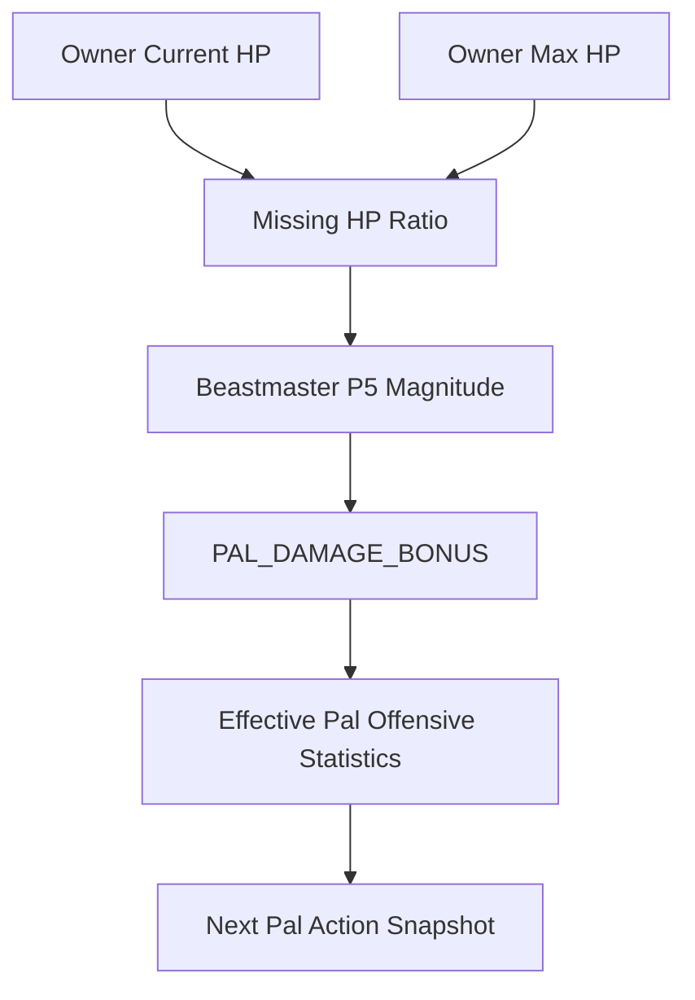

Lorsqu'une dépendance change, les valeurs concernées sont invalidées puis recalculées dans un ordre topologique déterministe.

Un cycle de dépendances non déclaré est une erreur de configuration.

### 8.3 Supreme Spirit P3 : amplifier la contribution source

Nous avons validé que P3 multiplie par 1,20 la magnitude numérique des effets natifs de déploiement éligibles.

Cette amplification s'effectue **avant l'agrégation des groupes de statistiques**\.

Exemple \:

Un Pal fournit naturellement +10 % ATQ au déploiement.

P3 transforme la contribution native en +12 %, puis cette contribution est agrégée une seule fois dans le groupe d'ATQ correspondant.

Le moteur ne multiplie pas par 1,20 la statistique ATQ finale.

Les bonus produits par P4 et P5 Supreme Spirit restent exclus de cette amplification, conformément à leur contrat validé.

*Note d'ingénierie : distinguer transformation d'une contribution et multiplication d'une statistique finale est indispensable pour éviter des effets récursifs et des bonus de déploiement amplifiés plusieurs fois.*

---

# SYS-002.D.13.5.4 - Offensive Snapshot Contract

## 9\. Rôle exact d'un snapshot

Un snapshot offensif capture les valeurs nécessaires à la résolution future d'une action, sans figer l'ensemble de l'état du combat.

Je recommande \:

```text
OffensiveSnapshot
├── SnapshotId
├── CombatId
├── ActionId
├── SourceActorId
├── OwnerActorId
├── CapturedAtUs
├── ActorStatRevision
├── ModifierSetRevision
├── ConfigurationVersion
├── EffectiveAttackStats
├── EligibleDamageCoefficients
├── CriticalChanceProfiles
├── CriticalDamageProfiles
├── OffensivePenetrationProfiles
├── OtherOffensiveModifiers
└── SnapshotHash
```

Le `SnapshotHash` sert à vérifier la reproductibilité ; il ne constitue pas une source de statistiques.

### 9.1 Capture après l'engagement

L'ordre approuvé par `LIFE-007` est conservé \:

1. Engagement atomique de l'action.
2. Installation des effets d'activation.
3. Calcul des statistiques offensives effectives.
4. Création du snapshot.
5. Programmation des impacts.

Une compétence engagée utilise donc ses propres buffs d'activation.

C'est indispensable pour l'Éveil Darklord : son premier météore bénéficie du bonus critique temporaire immédiatement installé.

## 10\. Quelles données sont figées ?

| Donnée | Politique |
|--------|--------|
| ATQ offensive du lanceur | Snapshot à l'engagement |
| Coefficients offensifs | Snapshot |
| Bonus de dégâts offensifs | Snapshot |
| Chance de critique admissible | Snapshot |
| Coefficient de dégâts critiques | Snapshot |
| Bonus dynamique Beastmaster P5 | Snapshot pour l'action Pal engagée |
| DEF de la cible | Dynamique à l'impact |
| Résistance de la cible | Dynamique à l'impact |
| Immunité de la cible | Dynamique à l'impact |
| Boucliers de la cible | Dynamique à l'impact |
| PV actuels servant de référence à un bonus | Capturés au pré-impact |
| Présence d'un buff de contournement d'évasion | Vérifiée à l'impact |
| Éligibilité de la cible | Vérifiée à l'impact |

Le jet de critique est effectué à l'impact, mais avec les probabilités et coefficients offensifs capturés dans le snapshot.

Cette distinction permet aux critiques d'être calculés au bon moment sans rendre leur puissance dépendante de buffs apparus après l'engagement.

### 10.1 Exemple : Archer Sacred Hunter

À `t = 0`, un Archer engage une attaque normale.

Son snapshot contient les statistiques offensives disponibles à cet instant.

À `t = 100 ms`, un projectile de cette attaque inflige un critique.

`Critical Momentum` est installé après l'impact.

L'attaque normale parente conserve son snapshot initial.

Si l'action parente déclenche ensuite une nouvelle action enfant de combo et que celle-ci est engagée après l'installation du buff, son snapshot peut inclure les +40 % d'ATQ de `Critical Momentum`\.

Cette règle respecte le contrat déjà validé pour l'Archer.

### 10.2 Exemple : Beastmaster

Un Pal engage une attaque avec +20 % de dégâts issus des PV manquants du propriétaire.

Avant l'impact, le propriétaire est soigné et son bonus P5 descend à +8 %.

L'attaque déjà engagée conserve +20 %.

La prochaine action Pal engagée capture +8 %.

### 10.3 Exemple : Prophet P4

Une compétence active équipée crée un effet temporaire.

La durée prolongée par P4 Prophet est calculée **lors de la création de l'instance d'effet**, et non simplement lors du snapshot offensif de l'action.

Ainsi \:

- La valeur offensive de la compétence est capturée à son engagement.
- La durée de l'effet produit est déterminée lors de son application.
- Une expiration ou un changement d'état entre ces deux moments ne modifie pas rétroactivement la valeur offensive déjà capturée.

Cette séparation est nécessaire parce que durée et dégâts ne possèdent pas obligatoirement le même instant d'évaluation.

## 11\. Snapshots des actions parentes et enfants

Une action enfant possède son propre snapshot.

| Action | Politique |
|--------|--------|
| Attaque normale | Capture unique à son engagement |
| Projectile issu de l'attaque | Utilise le snapshot parent |
| Combo enfant | Capture un nouveau snapshot à son propre engagement |
| Projectile du combo | Utilise le snapshot du combo |
| Réflexion immédiate | Utilise sa référence causale définie et les statistiques admissibles de la réaction |
| Composante bonus Darklord P4 | Réutilise la référence offensive et le résultat critique de son impact |
| Composante bonus Supreme Spirit | Capture les PV de cible pré-impact ; aucun nouveau snapshot offensif complet |

La réflexion Warbringer doit pouvoir conserver sa référence théorique d'attaque avant les défenses de la cible initiale. Elle ne recalcule pas arbitrairement cette référence après l'impact.

### 11.1 Invalidation des snapshots

**Un snapshot déjà créé n'est jamais modifié.**

Une variation de statistique invalide les *caches de statistiques effectives* nécessaires aux actions futures, mais ne détruit ni ne réécrit les snapshots existants.

Une action annulée conserve son snapshot à des fins de traçabilité.

*Note d'ingénierie : il faut distinguer invalidation d'un cache et invalidation d'un snapshot. Les caches peuvent être reconstruits ; les snapshots sont des faits historiques immuables associés à des actions engagées.*

---

# SYS-002.D.13.5.5 - Modèle des effets temporaires

## 12\. Une instance d'effet possède son propre cycle de vie

Les buffs et débuffs ne sont pas des actions. Ils sont des instances d'effets pouvant survivre à l'action qui les a créés.

Je recommande \:

```text
CombatEffectInstance
├── EffectInstanceId
├── EffectDefinitionId
├── CombatId
├── SourceActorId
├── OwnerActorId
├── TargetActorId
├── OriginActionId?
├── AppliedAtUs
├── RefreshedAtUs?
├── ExpirationTimeUs?
├── EffectGeneration
├── EffectState
├── StackKey
├── RefreshPolicy
├── MagnitudePolicy
├── SourceDeathPolicy
├── OwnerDeathPolicy
├── TargetDeathPolicy
├── TickPolicy?
├── ModifierInstanceIds[]
└── ConfigurationVersion
```

### 12.1 États proposés

```text
PENDING_APPLICATION
ACTIVE
EXPIRED
REMOVED
```

L'effet n'est considéré actif qu'après une application autorisée.

`EXPIRED` signifie qu'il a atteint sa borne temporelle.

`REMOVED` signifie qu'il a été supprimé pour une autre raison, par exemple un changement de configuration autorisé ou la mort du bénéficiaire.

Une application rejetée ne crée pas d'instance active.

### 12.2 Début et fin de validité

Un effet installé à $t_0$ avec une durée $d$ est actif sur \:

$$
[t_0,t_0+d)
$$

Il est inactif à son timestamp exact d'expiration.

Une durée égale à zéro n'autorise pas l'installation d'un buff temporaire dont les règles exigent une durée positive.

### 12.3 Événements associés

| Événement | Signification |
|--------|--------|
| `EFFECT_APPLIED` | Nouvelle instance active |
| `EFFECT_REFRESHED` | Instance existante renouvelée |
| `EFFECT_EXPIRED` | Fin naturelle de la durée |
| `EFFECT_REMOVED` | Suppression par une autre politique |
| `MODIFIER_MAGNITUDE_CHANGED` | Magnitude dynamique modifiée |
| `EFFECT_TICK_EXECUTED` | Échéance périodique effectivement traitée |

Les événements de diagnostic ne doivent pas créer de déclenchements de gameplay supplémentaires.

*Note d'ingénierie : le cycle de vie d'un effet est indépendant de celui de l'action qui l'a créé. Cette séparation permet à une compétence d'être `RESOLVED` alors que son débuff reste actif pendant plusieurs secondes.*

---

# SYS-002.D.13.5.6 - Réapplication et cumul

## 13\. Règles de stacking

Je recommande cinq politiques initiales.

| Politique | Comportement |
|--------|--------|
| `UNIQUE_SOURCE_REFRESH` | Une instance par source et cible admissibles ; une nouvelle application renouvelle l'instance |
| `UNIQUE_GLOBAL_REFRESH` | Une seule instance sur la cible, indépendamment de la source |
| `STACK_PER_SOURCE` | Plusieurs sources peuvent contribuer séparément |
| `STACK_WITH_LIMIT` | Plusieurs charges autorisées jusqu'à une limite explicite |
| `DYNAMIC_MAGNITUDE_REPLACEMENT` | Une contribution existante change de magnitude sans créer un nouveau buff |

Ces politiques ne signifient pas que tous les effets peuvent se cumuler.

Chaque `EffectDefinition` déclare une stratégie autorisée, puis le Modifier Engine agrège les contributions réellement présentes.

## 14\. Clé de source unique

Pour `UNIQUE_SOURCE_REFRESH`, je recommande une clé de la forme \:

$$
StackKey=
(Target,\ EffectDefinition,\ SourceScope,\ StackGroup)
$$

`SourceScope` est résolu depuis la définition \:

- `CASTER_ACTOR` \: identité de l'acteur émetteur.
- `OWNER_ACTOR` \: identité du propriétaire.
- `GLOBAL` \: une instance commune par cible et groupe.
- `EFFECT_INSTANCE` \: portée particulière explicitement définie.

L'`ActionId` n'entre pas par défaut dans cette clé.

Sinon, chaque nouvelle activation de la même compétence créerait une nouvelle instance au lieu de rafraîchir celle déjà présente.

### 14.1 Exemple : débuff Archer

Un Archer applique une réduction de résistance aux combos pendant cinq secondes.

À `t = 3 s`, il réapplique le même débuff.

Dans le contrat proposé \:

- Une seule instance reste active.
- Son délai d'expiration passe à `t = 8 s`\.
- Sa magnitude est remplacée par celle de la nouvelle application.
- Son identifiant de génération augmente.
- L'ancienne expiration à `t = 5 s` devient obsolète.

Il n'y a pas deux réductions simultanées de 40 points provenant de la même source.

### 14.2 Refresh et magnitude

Je recommande \:

`REFRESH_DURATION_AND_REPLACE_MAGNITUDE`

La nouvelle application fixe la nouvelle durée et la magnitude correspondant au contexte de cette application.

Cela évite de conserver indéfiniment une ancienne magnitude supérieure ou inférieure lorsque le profil de l'effet prévoit un recalcul.

Si une future capacité doit conserver la magnitude maximale ou empiler ses charges, elle utilisera une politique distincte et explicitement versionnée.

### 14.3 Même timestamp que l'expiration

Les expirations sont déjà prioritaires dans `SCHED-003`\.

Si un effet expire exactement à `t = 5 s` et qu'un impact produit une nouvelle application au même instant \:

1. L'ancienne instance expire.
2. Ses modificateurs sont retirés.
3. L'impact est résolu.
4. Une nouvelle instance peut être créée.

Il s'agit d'une nouvelle application, pas du rafraîchissement rétroactif d'une instance déjà expirée.

### 14.4 Effets périodiques

Un effet périodique possède à la fois une expiration et des échéances de ticks.

Je recommande de séparer deux règles \:

- **Rafraîchissement de la durée \:** la nouvelle expiration est calculée depuis le nouvel instant d'application.
- **Phase des ticks \:** elle est conservée par défaut, sauf profil autorisant explicitement son redémarrage.

Cette convention évite qu'un joueur produise artificiellement un tick supplémentaire immédiat en rafraîchissant un effet juste avant son échéance.

Pour une régénération périodique, P4 Prophet peut prolonger la fenêtre de ticks autorisés sans multiplier directement chaque tick par 1,40.

La gestion des ticks manqués sous suppression d'énergie conserve aussi le contrat validé : **aucun rattrapage rétroactif**\.

*Note d'ingénierie : un rafraîchissement n'est pas une deuxième application indépendante. L'identité de l'effet et la génération de son calendrier doivent rester cohérentes pour éviter doubles expirations, doubles ticks et cumuls invisibles.*

---

# SYS-002.D.13.5.7 - Durée de vie des effets après la mort

## 15\. Trois événements de mort à distinguer

Le cycle de vie validé dans `D.13.1` distingue \:

`ACTIVE → DEATH_PENDING → DEAD → REMOVED`

La mort d'un acteur ne doit pas automatiquement supprimer tous les effets dont il est la source.

Il faut distinguer \:

1. Les effets **sur l'acteur mort**\.
2. Les effets **produits par l'acteur mort sur d'autres cibles**\.
3. Les effets **dépendant du propriétaire mort**, notamment ceux appliqués aux Pals.

### 15.1 Politiques proposées

| Politique | Comportement |
|--------|--------|
| `REMOVE_ON_TARGET_DEATH` | Supprimer l'effet lors de la finalisation de la mort de son bénéficiaire |
| `REMOVE_ON_SOURCE_DEATH` | Supprimer l'effet lorsque sa source est définitivement morte |
| `REMOVE_ON_OWNER_DEATH` | Supprimer l'effet lorsque le propriétaire requis est définitivement mort |
| `PERSIST_UNTIL_EXPIRY` | Conserver l'effet jusqu'à son expiration, même si sa source meurt |
| `REMOVE_ON_COMBAT_END` | Supprimer l'effet lors de la finalisation du combat |

Ces politiques doivent être déclarées par `EffectDefinition`\.

Un effet peut cumuler plusieurs causes de nettoyage, mais elles ne doivent produire qu'une seule transition terminale.

## 16\. Convention de référence par catégorie

| Catégorie d'effet | Politique initiale proposée |
|--------|--------|
| Buff personnel du combattant | Retrait à la mort finalisée du bénéficiaire |
| Buff personnel d'Éveil | Retrait à la mort finalisée du bénéficiaire |
| Buff offensif hérité par les Pals | Retrait à la mort finalisée du propriétaire |
| Débuff temporaire appliqué à un ennemi | `PERSIST_UNTIL_EXPIRY`, tant que le combat continue |
| Dégâts périodiques déjà appliqués à une cible | Persistance selon le profil de l'effet |
| Bouclier sur une cible éliminée | Retrait lors du nettoyage de la cible |
| Charge P5 Darklord non consommée | Retrait à la mort du bénéficiaire ou à la fin du combat |
| Effet permanent de classe | Retrait au changement de configuration ou à la fin du combat |

### 16.1 Exemple : Mage mort après avoir appliqué un débuff

Un Mage applique un débuff de résistance aux dégâts de compétence sur un ennemi pendant huit secondes.

Deux secondes plus tard, le Mage meurt.

Avec la politique de référence proposée, le débuff peut rester actif jusqu'à son expiration, si l'affrontement se poursuit avec d'autres combattants.

Il ne nécessite pas que son action d'origine ou son lanceur reste vivant.

Cela ne contredit pas le contrat d'annulation du météore avant impact : **un impact non résolu** et **un débuff déjà appliqué** sont deux objets de cycle de vie différents.

### 16.2 Exemple : Beastmaster éliminé

Lorsque Beastmaster meurt \:

- Les futurs engagements Pal sont bloqués.
- Les impacts Pal non résolus sont annulés selon `SPIRIT-FINAL-006`\.
- Le buff temporaire de bypass d'évasion perd sa capacité d'agir.
- Les modificateurs liés au propriétaire sont retirés lors du nettoyage.
- Les événements déjà publiés et les réactions immédiates admises restent conservés.

Il n'est pas nécessaire d'attendre l'expiration naturelle de chaque buff pour interdire de nouvelles attaques Pal.

### 16.3 Mort en attente et réflexion Warbringer

Un point particulier découle du contrat Guerrier.

Warbringer peut subir une frappe létale et posséder une réflexion déjà admissible.

La séquence proposée est \:

1. Résoudre les dégâts de l'attaque reçue.
2. Mettre à jour les PV et les modificateurs dynamiques fondés sur les PV manquants.
3. Enregistrer les réactions admises.
4. Passer à `DEATH_PENDING` si les PV atteignent zéro.
5. Résoudre les réactions immédiates autorisées.
6. Finaliser la mort.
7. Nettoyer les effets selon leurs politiques.

Cela permet au bonus dynamique d'ATQ de Warbringer d'être mis à jour avant le calcul de sa réflexion déjà déclenchée, comme prévu par la spécification de cette classe.

Un acteur `DEATH_PENDING` n'est pas pour autant autorisé à engager une nouvelle attaque normale.

**Convention proposée : les effets ne sont pas supprimés prématurément pendant `DEATH_PENDING` si cela empêcherait une réaction déjà admise de se résoudre correctement.**

*Note d'ingénierie : le nettoyage des modificateurs à zéro PV, avant la clôture réactive locale, pourrait modifier rétroactivement les valeurs utilisées par une réaction létale. La transition de mort finalisée doit constituer la frontière de nettoyage.*

---

# SYS-002.D.13.5.8 - Effets non numériques et charges consommables

## 17\. Un effet n'est pas toujours un modificateur statistique

Certaines mécaniques des classes validées n'ajoutent pas un pourcentage à une statistique.

| Effet | Nature |
|--------|--------|
| Beastmaster - bypass d'évasion | Autorisation temporaire de contourner une vérification |
| Plume Monarch - bypass d'évasion | Autorisation temporaire |
| Prophet - destruction des boucliers | Capacité temporaire déclenchant un effet sur impact |
| Sacred Hunter - suppression d'énergie | Interdiction temporaire de régénération |
| Darklord - prochaine attaque normale renforcée | Charge consommable |
| Supreme Spirit - proc sur combo pendant huit secondes | Fenêtre d'éligibilité à un déclencheur |

Je recommande de séparer \:

`NUMERIC_MODIFIER`, `CAPABILITY_EFFECT`, `TRIGGER_WINDOW` et `CONSUMABLE_CHARGE`\.

Ces quatre catégories partagent le modèle temporel, mais pas nécessairement le même résolveur.

### 17.1 Priorité des capacités

Une autorisation de contournement d'évasion ne doit pas être traduite en +100 points d'ignore-évasion.

Une suppression d'énergie ne doit pas être traduite en -100 % de régénération.

Les politiques déjà validées sont maintenues \:

- Le bypass supprime la vérification d'esquive éligible.
- La suppression bloque la régénération normale, même avec un bonus Prophet.
- Le bris de bouclier intervient avant l'absorption des dégâts.
- L'immunité absolue conserve ses protections prioritaires.

### 17.2 Charge P5 Darklord

La charge P5 Darklord possède une valeur de +100 % pour la prochaine action normale.

Son cycle de vie proposé est \:

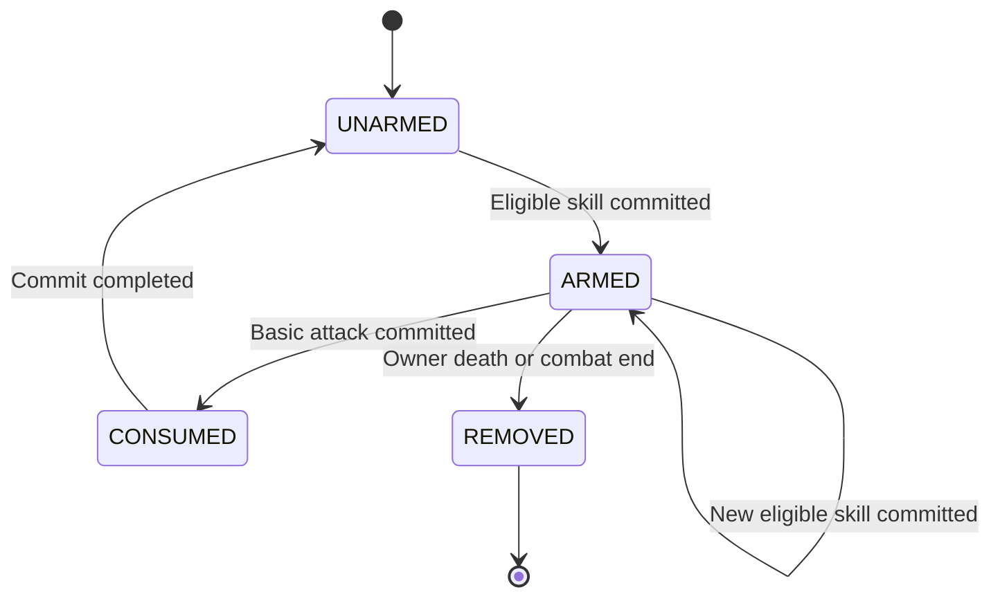

Au moment où l'attaque normale est engagée \:

1. Vérifier que la charge existe.
2. Construire le snapshot offensif de l'attaque avec le bonus de +100 %.
3. Marquer la charge comme consommée dans le même engagement atomique.
4. Conserver le snapshot, même si l'attaque est ensuite esquivée ou annulée.

Une charge consommée n'est pas restituée parce que l'attaque n'a infligé aucun dégât.

Cette convention résout la frontière entre consommation à l'engagement et capture du bonus avant sa disparition.

*Note d'ingénierie : une charge consommable doit être matérialisée dans le snapshot de l'action qui la consomme. Si elle était supprimée avant le calcul du snapshot, son bonus disparaîtrait ; si elle était supprimée après l'impact, elle pourrait renforcer plusieurs actions.*

---

# SYS-002.D.13.5.9 - Cohérence temporelle et priorités

## 18\. Ordre global des mutations

Le Modifier Engine doit respecter le scheduler déjà validé, sans introduire sa propre chronologie indépendante.

| Situation | Ordre imposé |
|--------|--------|
| Effet expirant et impact au même instant | Expiration, retrait des contributions, puis impact |
| Activation de compétence | Engagement, installation des buffs, puis snapshot offensif |
| Critique déclenchant un buff | Résolution de l'impact, puis installation du buff |
| Action enfant déclenchée après ce buff | Nouveau snapshot pouvant inclure le buff |
| Perte de PV déclenchant un bonus dynamique | Mise à jour des PV, recalcul du bonus pour les actions futures |
| Impact déjà engagé avant recalcul | Snapshot inchangé |
| Nouveau débuff appliqué par un impact | Actif pour les impacts suivants, pas rétroactivement pour le même impact |
| Mort avec réaction admise | Résolution de la réaction, puis nettoyage final des effets |

### 18.1 Exemple complet : Darklord

Un Darklord éveillé active sa compétence de classe à `t = 0`\.

Chronologie du bonus critique

1. **t = 0 - Engagement**
   
   Installation du bonus temporaire de +50 points au coefficient critique de base.
2. **t = 0 - Snapshot**
   
   La compétence capture les statistiques offensives incluant P3 et le bonus d'Éveil.
3. **t = 1 s - Impact**
   
   Le météore utilise son snapshot, puis les DEF, résistances, immunités et boucliers actuels des cibles.
4. **t = 10 s - Expiration**
   
   Le bonus critique personnel expire ; les prochaines compétences ne le capturent plus.

Si une compétence engagée à `t = 9,9 s` touche à `t = 10,2 s`, sa puissance critique offensive conserve le bonus capturé lors de son engagement.

En revanche, un bouclier apparu sur la cible à `t = 10,1 s` peut absorber les dégâts à `t = 10,2 s`\.

Ce comportement correspond exactement à la distinction déjà validée entre snapshot offensif et état défensif dynamique.

---

# SYS-002.D.13.5.10 - Invariants transversaux

## 19\. Catalogue des invariants

| ID | Invariant |
|--------|--------|
| `MOD-INV-001` | Les statistiques de base ne sont jamais modifiées directement par un buff |
| `MOD-INV-002` | Toute contribution possède une source et un groupe identifiables |
| `MOD-INV-003` | Chaque groupe possède une opération mathématique définie |
| `MOD-INV-004` | Une contribution ne peut être agrégée deux fois |
| `MOD-INV-005` | Les remplacements concurrents non départageables sont rejetés |
| `MOD-INV-006` | Les groupes critiques ordinaires, de compétence et Pal restent séparés |
| `MOD-INV-007` | Les contributions dynamiques remplacent leur magnitude précédente |
| `MOD-INV-008` | Les dépendances statistiques ne comportent aucun cycle non résolu |
| `MOD-INV-009` | Un snapshot offensif est immuable après sa création |
| `MOD-INV-010` | Les défenses adverses restent évaluées à l'impact |
| `MOD-INV-011` | Une expiration ne modifie pas un snapshot déjà capturé |
| `MOD-INV-012` | Un effet rafraîchi ne duplique pas ses contributions |
| `MOD-INV-013` | Une expiration d'ancienne génération est sans effet |
| `MOD-INV-014` | Une application à la borne exacte d'expiration crée une nouvelle instance |
| `MOD-INV-015` | Le nettoyage d'un effet retire exactement les contributions qu'il possède |
| `MOD-INV-016` | Les effets de déploiement natifs ne sont amplifiés qu'une fois par Supreme Spirit P3 |
| `MOD-INV-017` | Les capacités non numériques ne sont pas converties en bonus statistiques arbitraires |
| `MOD-INV-018` | Les charges consommables ne sont utilisées qu'une fois |
| `MOD-INV-019` | Une mort en attente ne supprime pas prématurément une réaction admise |
| `MOD-INV-020` | Le combat terminé ne conserve aucune contribution exécutable |
| `MOD-INV-021` | Les calculs respectent les unités et les groupes versionnés |
| `MOD-INV-022` | Des états et profils identiques produisent les mêmes statistiques effectives |

---

# SYS-002.D.13.5.11 - Matrice de tests d'acceptation

## 20\. Tests de l'agrégation

| Test | Scénario | Résultat attendu |
|--------|--------|--------|
| `MOD-GRP-T001` | ATQ 1 000, Mage P2 seul | ATQ effective 1 120 |
| `MOD-GRP-T002` | Deux bonus de même groupe +10 % et +20 % | Agrégation à +30 %, pas deux multiplicateurs indépendants |
| `MOD-GRP-T003` | Coefficient Pal 300 %, Beastmaster P4 | Coefficient 310 % |
| `MOD-GRP-T004` | Même Pal avec P5 à +8 % | Le coefficient et le bonus de dégâts restent distincts |
| `MOD-GRP-T005` | Darklord P3 et Éveil | Deux groupes critiques distincts |
| `MOD-GRP-T006` | Critique ordinaire du personnage | Aucun bonus de critique de compétence appliqué |
| `MOD-GRP-T007` | Deux remplacements incompatibles de même priorité | Configuration rejetée |
| `MOD-GRP-T008` | Réapplication d'une même contribution permanente | Aucune duplication |

## 21\. Tests des statistiques dynamiques

| Test | Scénario | Résultat attendu |
|--------|--------|--------|
| `MOD-DYN-T001` | Beastmaster à 50 % de PV | P5 fournit +20 % dégâts Pal |
| `MOD-DYN-T002` | Soin jusqu'à 75 % de PV | Bonus remplacé par +8 % |
| `MOD-DYN-T003` | Dégâts uniquement absorbés par bouclier | Bonus P5 inchangé |
| `MOD-DYN-T004` | Modification de PV max | Recalcul des tranches |
| `MOD-DYN-T005` | Deux pertes de PV sans franchir de seuil | Pas de contribution supplémentaire |
| `MOD-DYN-T006` | Supreme Spirit P3 sur déploiement ATQ +10 % | Contribution native transformée en +12 % |
| `MOD-DYN-T007` | Bonus racial P4 Supreme Spirit | Non amplifié par P3 |
| `MOD-DYN-T008` | Dépendances cycliques non autorisées | Profil rejeté |

## 22\. Tests des snapshots

| Test | Scénario | Résultat attendu |
|--------|--------|--------|
| `MOD-SNAP-T001` | Darklord active son météore éveillé | Bonus critique présent dans le snapshot |
| `MOD-SNAP-T002` | Buff offensif expire après engagement, avant impact | Snapshot inchangé |
| `MOD-SNAP-T003` | Résistance adverse expire avant impact | Nouvelle résistance utilisée |
| `MOD-SNAP-T004` | Sacred Hunter critique puis active Critical Momentum | Impact déclencheur inchangé |
| `MOD-SNAP-T005` | Combo Archer engagé après Critical Momentum | Nouveau snapshot autorisé à inclure le bonus |
| `MOD-SNAP-T006` | Beastmaster soigné après engagement Pal | Ancien snapshot conservé |
| `MOD-SNAP-T007` | Nouvelle attaque Pal après le soin | Nouvelle magnitude P5 capturée |
| `MOD-SNAP-T008` | Action annulée après snapshot | Snapshot conservé dans la trace causale |

## 23\. Tests des effets temporaires

| Test | Scénario | Résultat attendu |
|--------|--------|--------|
| `MOD-EFF-T001` | Buff de 5 s installé à `t=0` | Inactif à `t=5s` |
| `MOD-EFF-T002` | Refresh à `t=3s` pour 5 s | Expiration à `t=8s` |
| `MOD-EFF-T003` | Ancienne expiration à `t=5s` | Ignorée par génération |
| `MOD-EFF-T004` | Nouvelle application exactement à `t=5s` | Nouvelle instance après expiration |
| `MOD-EFF-T005` | Deux sources autorisées du même effet | Cumul uniquement selon politique |
| `MOD-EFF-T006` | Buff `UNIQUE_SOURCE_REFRESH` réappliqué | Une seule contribution active |
| `MOD-EFF-T007` | Effet périodique rafraîchi | Pas de tick immédiat artificiel |
| `MOD-EFF-T008` | Effet supprimé | Toutes ses contributions retirées une seule fois |

## 24\. Tests de mort et de consommation

| Test | Scénario | Résultat attendu |
|--------|--------|--------|
| `MOD-DEATH-T001` | Mage mort après application d'un débuff persistant | Débuff conservé selon son profil |
| `MOD-DEATH-T002` | Propriétaire Pal éliminé | Buffs Pal liés au propriétaire retirés lors du nettoyage |
| `MOD-DEATH-T003` | Warbringer reçoit une frappe létale avec réflexion admise | Réaction résolue avant nettoyage |
| `MOD-DEATH-T004` | Combat finalisé | Aucun effet exécutable résiduel |
| `MOD-CHARGE-T001` | Darklord utilise une compétence | Une charge P5 armée |
| `MOD-CHARGE-T002` | Trois compétences avant attaque normale | Une seule charge |
| `MOD-CHARGE-T003` | Attaque normale engagée | Bonus capturé puis charge consommée |
| `MOD-CHARGE-T004` | Attaque renforcée esquivée | Charge non restituée |
| `MOD-CHARGE-T005` | Darklord éliminé avec charge inutilisée | Charge retirée |

Ces tests constituent des critères d'acceptation documentaires. Aucun test C\# ou NUnit n'a été exécuté.

---

# SYS-002.D.13.5.12 - Résultat de l'audit

## 25\. Contrats proposés à la validation

| ID | Contrat |
|--------|--------|
| `MOD-001` | Modificateurs identifiés, typés et associés à une source |
| `MOD-002` | Agrégation calculée depuis les contributions, sans mutation cumulative des statistiques de base |
| `MOD-003` | Opérations mathématiques et unités explicites |
| `MOD-004` | Ordre stable : transformation des contributions, agrégation des groupes, composition, bornage |
| `MOD-005` | Groupes distincts pour les statistiques offensives, défensives, critiques, Pal et ressources |
| `MOD-006` | Rejet des remplacements de même priorité incompatibles |
| `MOD-007` | Politiques `STATIC_WHILE_ELIGIBLE`, `DYNAMIC_STATE_DERIVED` et `APPLICATION_SNAPSHOT` |
| `MOD-008` | Recalcul dynamique par graphe de dépendances acyclique |
| `MOD-009` | Amplification des effets natifs Supreme Spirit P3 avant agrégation, une seule fois |
| `MOD-010` | Snapshot offensif après les effets d'activation, immuable ensuite |
| `MOD-011` | Nouveau snapshot pour chaque action enfant autonome |
| `MOD-012` | Défenses, immunités et boucliers évalués à l'impact |
| `MOD-013` | Instances d'effets distinctes des actions qui les créent |
| `MOD-014` | Durées semi-ouvertes, expirations prioritaires |
| `MOD-015` | `UNIQUE_SOURCE_REFRESH` avec clé de source stable |
| `MOD-016` | Rafraîchissement remplaçant durée et magnitude, sans cumul implicite |
| `MOD-017` | Générations invalidant les anciennes échéances |
| `MOD-018` | Rafraîchissement périodique conservant sa phase de ticks par défaut |
| `MOD-019` | Persistance après mort explicitement définie par catégorie d'effet |
| `MOD-020` | Nettoyage après résolution des réactions mortelles admissibles |
| `MOD-021` | Capacités non numériques et charges consommables séparées des bonus statistiques |
| `MOD-022` | Charge Darklord P5 capturée et consommée atomiquement à l'engagement |
| `MOD-023` | Aucun recalcul rétroactif des actions déjà engagées |
| `MOD-024` | Profils de groupes, unités, durées et politiques d'effets versionnés |

## 26\. Compatibilité consolidée

| Famille | Risque principal | Couverture |
|--------|--------|--------|
| Guerrier | Réflexion létale et bonus dynamiques | Réévaluation avant réaction, nettoyage différé |
| Archer | Critiques successifs et snapshots parent/enfant | Snapshots indépendants, effets post-impact |
| Mage | Critiques d'Éveil, énergie, cooldowns et charges | Groupes séparés, effets temporels, consommation atomique |
| Spirit Channeler | Six Pals, déploiement, bonus selon PV et synergies | Contributions centralisées, dépendances, portée explicite |

Les quatre familles peuvent utiliser le même moteur de modificateurs.

Aucun besoin de moteur de statistiques indépendant pour une spécialisation n'a été identifié.

### Dépendances maintenues

| Élément | Statut |
|--------|--------|
| Formule exacte de DEF | `defense_calibration_pending` |
| Calibration des dégâts | `calibration_pending` |
| Niveaux P2-P4 Spirit Channeler | `unlock_calibration_pending` |
| Catalogue racial Supreme Spirit | `catalog_pending` |
| Validation des profils runtime complets | `pending_data_completion` |
| Implémentation | `not_started` |
| Tests | `not_executed` |

Ces éléments ne bloquent pas l'approbation des règles fonctionnelles du Modifier &amp; Snapshot Engine.

---


---

## SYS-002.D.13.6 — Pal Combat Integration

**Validation :** `SYS-002.D.13.6.11.1` · approbation propriétaire `T150` · spécification source `T149`. **Statut :** `functionally_specified`; implémentation `not_started`; tests `not_executed`.


# SYS-002.D.13.6 - Pal Combat Integration

Spécification fonctionnelle - aucune implémentation C\# ou Unity

## 1\. Objectif

L'intégration des Pals doit réutiliser les composants génériques déjà validés, sans créer un deuxième moteur de combat.

Le Pal est un acteur autonome pour ses attaques, ses décisions probabilistes et ses snapshots, mais dépendant de son propriétaire pour son déploiement, ses statistiques héritées et son autorisation de continuer à combattre.

L'audit porte sur les responsabilités suivantes \:

| Domaine | Contrat à établir |
|--------|--------|
| Déploiement | Création déterministe de 5 ou 6 acteurs Pal |
| Statistiques | Calcul individuel et héritage des bonus de classe |
| Cadence | Scheduler autonome et changement de vitesse sans réinitialisation |
| Actions | Engagement des attaques, projectiles et combos Pal |
| Ciblage | Sélection et invalidation des cibles |
| Passifs | Effets natifs, Beastmaster et Supreme Spirit |
| Temporalité | Snapshots, expirations, collisions et RNG |
| Cycle de vie | Mort du propriétaire, annulations et nettoyage |
| Validation | Invariants, tests et dépendances de catalogue |

Le module couvre uniquement les Pals **effectivement déployés**\. L'inventaire, l'obtention, les améliorations et les tirages d'acolytes appartiennent aux systèmes de progression et de collection.

*Note d'ingénierie : un Pal doit posséder un `ActorId` propre mais utiliser les mêmes contrats d'action, d'impact et d'événement qu'un personnage. Cela évite de devoir dupliquer les correctifs apportés au scheduler et au Damage Resolver.*

---

# SYS-002.D.13.6.1 - Déploiement et identité

## 2\. Construction des acteurs Pal

Le moteur construit les acteurs Pal à partir de la composition sauvegardée et de la capacité accordée par la classe active.

$$
N_{\mathrm{Pal,actifs}}
\leq Slots_{\mathrm{effective}}
$$

Dans notre configuration initiale \:

| Classe | Capacité maximale |
|--------|--------|
| Guerrier | 5 |
| Archer | 5 |
| Mage | 5 |
| Spirit Channeler et spécialisations | 6 |

P1 Spirit Channeler ajoute un emplacement une seule fois. Les promotions ne créent pas d'emplacements supplémentaires.

### 2.1 Contrat de création

```text
PalCombatActor
├── CombatId
├── ActorId
├── ActorKind = PAL_ACTOR
├── OwnerActorId
├── TeamId
├── SourcePalInstanceId
├── PalDefinitionId
├── PalSlotId
├── RaceTagIds[]
├── CapabilitySet
├── EffectiveStatRevision
├── AttackScheduleState
├── ActiveEffectInstanceIds[]
├── DeploymentEffectInstanceIds[]
├── LifecycleState
└── ConfigurationSnapshotId
```

Cette structure représente la spécialisation du contrat `CombatActor` déjà validé. Elle n'introduit pas une famille d'acteurs incompatible avec `D.13.1`\.

### 2.2 Distinction entre existence et activité

Nous conservons trois états conceptuels.

| État | Signification | Contribution au combat |
|--------|--------|--------|
| `OWNED` | Pal possédé dans l'inventaire | Aucune par défaut |
| `ASSIGNED` | Pal affecté à un emplacement sauvegardé | Aucune si emplacement inactif |
| `DEPLOYED_ACTIVE` | Pal construit comme acteur dans le combat | Attaques et effets éligibles |

Un Pal placé en `PAL_SLOT_06` reste sauvegardé lorsque le joueur passe au Mage, mais ne devient pas un acteur actif de ce combat.

Il ne contribue alors ni aux synergies raciales ni aux effets de déploiement.

### 2.3 Ordre de création proposé

1. Charger la configuration de combat figée.
2. Résoudre la classe et la capacité Pal.
3. Parcourir les emplacements par indice absolu croissant.
4. Écarter les emplacements vides ou inactifs.
5. Valider l'unicité de chaque `PalInstanceId`\.
6. Construire les acteurs Pal et leurs identifiants runtime.
7. Résoudre leurs races, statistiques et effets natifs.
8. Installer les passifs de classe et les synergies.
9. Initialiser les schedulers individuels.
10. Publier l'état initial de combat.

Le système n'effectue aucun compactage automatique des emplacements.

### 2.4 Capacités des Pals

Le profil initial distingue \:

| Capacité | Politique |
|--------|--------|
| Attaque autonome | Oui |
| Snapshot offensif | Oui |
| Critique et évasion offensifs | Selon les profils des attaques |
| Effets de déploiement | Selon la définition Pal |
| Possession de PV indépendants | Non, par défaut |
| Ciblage comme ennemi ordinaire | Non, par défaut |
| Compétence active Pal | Uniquement si une définition complète l'autorise |
| Application d'effets de contrôle sur le Pal | Uniquement si sa définition comporte cette capacité |
| Dépendance à un propriétaire | Obligatoire |

Il serait incorrect d'ajouter automatiquement des PV, une mort individuelle ou des compétences autonomes à tous les Pals.

**Convention proposée - `PAL-001` \:** le Pal est un acteur offensif autonome possédant un propriétaire immuable pendant le combat, sans réserve de PV indépendante dans le profil initial.

*Note d'ingénierie : la persistance concerne les affectations sauvegardées ; l'activité concerne les acteurs construits pour une instance de combat. Leur séparation empêche la perte du sixième Pal et les bonus provenant d'acolytes non déployés.*

---

# SYS-002.D.13.6.2 - Résolution des statistiques Pal

## 3\. Sources des statistiques

Chaque Pal possède un ensemble de caractéristiques effectives calculées à partir de contributions identifiées.

| Source | Exemple |
|--------|--------|
| Définition native du Pal | Statistiques de base, cadence et profil offensif |
| Progression permanente du Pal | Niveau, améliorations ou autres systèmes débloqués |
| Modificateurs globaux éligibles | Bonus applicables aux Pals du propriétaire |
| Passifs communs Spirit Channeler | Vitesse Pal, ignore-évasion |
| Passifs Beastmaster | Critique, coefficient de dégâts, dégâts selon PV manquants |
| Effets de déploiement | Bonus produits par les Pals actifs |
| Supreme Spirit P3 | Amplification des effets natifs de déploiement |
| Supreme Spirit P4/P5 | Bonus de position et de composition |
| Buffs temporaires | Contributions actives pendant le combat |

Chaque contribution conserve son groupe, son origine et son unité.

Les groupes statistiques du personnage ne sont pas assimilés automatiquement aux groupes Pal.

## 4\. Contrats de classe réutilisés

| Classe | Modificateur | Application |
|--------|--------|--------|
| Spirit Channeler P2 | Vitesse de base Pal +0,1 % | Avant les autres multiplicateurs de cadence |
| Spirit Channeler P2 | Ignore-évasion Pal +10 points | Impacts Pal éligibles |
| Beastmaster P3 | Critique Pal +25 points | Probabilité par impact éligible |
| Beastmaster P4 | Coefficient Pal +10 points | Composantes utilisant ce coefficient |
| Beastmaster P5 | \+4 % dégâts Pal par tranche de 10 % de PV manquants | Magnitude dynamique, snapshot à l'engagement |
| Supreme Spirit P3 | \+20 % sur les magnitudes des effets natifs | Avant agrégation des groupes |
| Supreme Spirit P4 | Effets des premiers emplacements | Selon l'ordre et l'Éveil |
| Supreme Spirit P5 | Synergies de races | Selon les Pals effectivement déployés |

### 4.1 Deux dimensions temporelles

Les synergies de Supreme Spirit sont déterminées depuis la **composition initiale figée**\.

En revanche, Beastmaster P5 dépend des PV actuels du propriétaire : sa magnitude peut évoluer pendant le combat.

Ce changement invalide les caches de statistiques Pal concernés, mais ne modifie pas les snapshots des attaques déjà engagées.

### 4.2 Compilation des effets de déploiement

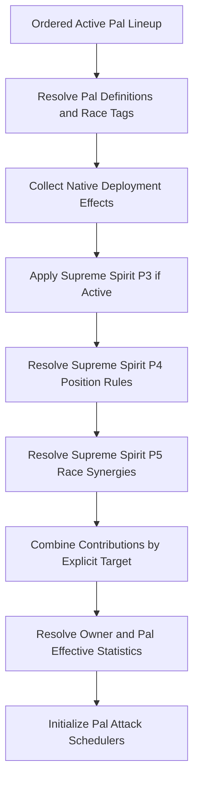

L'effet natif d'un Pal peut cibler le propriétaire, un ou plusieurs Pals, ou une autre catégorie autorisée par sa définition. **Le moteur ne suppose pas que tous les effets de déploiement bénéficient à tous les acolytes.**

Cette portée doit être déclarée par le catalogue.

Les règles raciales incomplètes de Supreme Spirit restent `catalog_pending`\. Elles ne reçoivent aucune magnitude fictive.

**Convention proposée - `PAL-002` \:** les effets de déploiement, les passifs et les bonus de composition sont transformés en contributions typées, puis agrégés par le Modifier Engine. Aucun bonus n'est directement incorporé aux statistiques permanentes des Pals.

*Note d'ingénierie : la compilation des effets doit précéder la création des premières échéances d'attaque. Un bonus de vitesse Pal provenant d'un déploiement doit influencer la première cadence, et pas seulement les cycles suivants.*

---

# SYS-002.D.13.6.3 - Scheduler autonome des Pals

## 5\. Une horloge d'attaque par Pal

Chaque Pal actif possède sa propre progression d'attaque.

Six Pals ne doivent pas partager un timer global qui les force à attaquer simultanément.

Je recommande un état individuel \:

```text
PalAttackScheduleState
├── PalActorId
├── AttackCycleId
├── LastProgressUpdateUs
├── AccumulatedAttackProgress
├── EffectiveAttackRate
├── NextReadyAtUs
├── ScheduledOperationId?
├── ScheduleGeneration
├── ActionLockUntilUs?
├── ControlPauseState
├── SchedulingState
└── ConfigurationVersion
```

La progression d'attaque est une quantité normalisée \:

$$
0\leq Progress<1
$$

Une progression de 1 correspond à un cycle d'attaque complet.

Pour une vitesse d'attaque $APS$ constante pendant un intervalle $\Delta t$ \:

$$
\Delta Progress=APS\times\frac{\Delta t_{\mu s}}{1\,000\,000}
$$

Lorsque la progression atteint 1, l'acteur devient admissible à une nouvelle attaque.

### 5.1 Politique de première attaque

Je recommande \:

`FIRST_ATTACK_AFTER_FULL_INTERVAL`

Au début du combat, chaque Pal commence avec une progression nulle.

Il ne reçoit pas d'attaque gratuite à `t = 0`, sauf si une définition spécifique déclare un comportement d'ouverture différent.

Pour un Pal possédant exactement une attaque par seconde \:

$$
t_{\mathrm{first}}=1\,000\,000\ \mu s
$$

### 5.2 Vitesse Spirit Channeler P2

Le profil déjà validé est \:

`GUIDE_PERCENT_0_1`

Pour un Pal possédant 1 attaque/s avant P2 \:

$$
APS'=1\times1.001=1.001
$$

Le premier cycle devient disponible au premier microsecond entier qui ne précède pas l'échéance mathématique \:

$$
t_{\mathrm{first}}
=
\left\lceil\frac{1\,000\,000}{1.001}\right\rceil
=
\boxed{999\,001\ \mu s}
$$

Le moteur ne doit pas arrondir chaque durée puis accumuler indéfiniment l'erreur.

Il conserve une progression de cycle en arithmétique déterministe et calcule les échéances depuis celle-ci.

La variante historique `PREVIEW_FLAT_0_1` reste versionnée et exclusive du profil initial.

## 6\. Modifier la vitesse en cours de cycle

Le point le plus important est de **préserver la progression déjà acquise**\.

Supposons qu'un Pal ait effectué 50 % de son cycle.

Un buff augmente ensuite sa vitesse d'attaque.

Deux stratégies sont possibles \:

| Stratégie | Conséquence |
|--------|--------|
| Réinitialiser le cycle | Le Pal perd ses 50 % de progression |
| Préserver la progression | Le Pal termine les 50 % restants à sa nouvelle vitesse |

Je recommande la seconde.

### 6.1 Contrat de recalcul

Lors d'une modification d'APS à l'instant $t$ \:

1. Calculer la progression acquise jusqu'à $t$ avec l'ancienne vitesse.
2. Conserver cette progression.
3. Recalculer l'APS effective.
4. Invalider l'ancienne échéance d'attaque par génération.
5. Calculer la nouvelle échéance à partir de la progression restante.
6. Conserver les engagements d'attaque déjà effectués.

La relation devient \:

$$
T_{\mathrm{remaining}}
=
\frac{1-Progress_{\mathrm{current}}}{APS_{\mathrm{new}}}
$$

Le résultat est converti en microsecondes avec un arrondi vers le futur, sans déclencher une attaque avant la fin mathématique du cycle.

### 6.2 Cas d'une expiration à l'instant de disponibilité

Le scheduler a déjà validé les expirations avant les nouveaux engagements.

Pour préserver une chronologie exacte \:

- La progression acquise sur l'intervalle précédent est d'abord arrêtée à l'instant d'expiration.
- L'ancien buff expire.
- L'APS est recalculée.
- La disponibilité du cycle est vérifiée.
- Une attaque peut être engagée en phase 1 si le cycle était effectivement terminé.

Un buff expirant à `t = 1 s` ne peut pas être utilisé pour accélérer une fraction de temps postérieure à `t = 1 s`\.

Inversement, l'expiration ne retire pas une progression déjà acquise avant cet instant.

### 6.3 Contrôle, étourdissement et retard

Le propriétaire étourdi n'interrompt pas les attaques de ses Pals.

Si une future définition autorise un contrôle directement appliqué à un Pal, je recommande \:

`PAUSE_ATTACK_PROGRESS_WHILE_BLOCKED`

La progression du Pal est figée pendant son incapacité d'attaque, puis reprise à la levée du contrôle.

Aucune file de plusieurs attaques « en retard » n'est accumulée.

La cadence doit également respecter la limite déjà validée d'une seule activation ordinaire par acteur et par timestamp.

### 6.4 Limites numériques

Un profil dont l'APS effective exigerait plus d'un engagement normal par microseconde est incompatible avec la granularité temporelle initiale.

Il doit être rejeté explicitement plutôt que produire une boucle à temps nul ou un plafonnement silencieux.

**Convention proposée - `PAL-003` \:** chaque Pal possède une progression d'attaque autonome, conservée lors des changements d'APS, avec invalidation générationnelle de ses anciennes échéances et absence de rattrapage automatique des cycles bloqués.

*Note d'ingénierie : une cadence modifiable doit être représentée comme une progression de cycle, pas simplement comme « prochain instant = instant courant + intervalle ». Cette distinction évite de perdre ou de dupliquer des attaques lors des changements de vitesse.*

---

# SYS-002.D.13.6.4 - Actions Pal, combos et projectiles

## 7\. Actions autorisées

Un Pal utilise les mêmes contrats `CombatAction` que les autres acteurs.

| Action | Nature | Origine |
|--------|--------|--------|
| `PAL_BASIC_ATTACK` | Action ordinaire autonome | Scheduler individuel |
| `PAL_COMBO_ATTACK` | Action enfant déclenchée | Action normale Pal éligible |
| `PAL_SKILL` | Action propre à une définition Pal | Compétence explicitement configurée |
| Effet natif de déploiement | Contribution ou effet | Initialisation de la composition |
| Dégâts supplémentaires Supreme Spirit | Composante de dégâts | Impact de combo Pal |

Une compétence Pal ne peut être programmée que si sa définition fournit une condition d'activation, un coût éventuel, un cooldown et des effets complets.

Aucune cadence de compétence Pal n'est inventée dans ce jalon.

## 8\. Cycle d'une attaque normale Pal

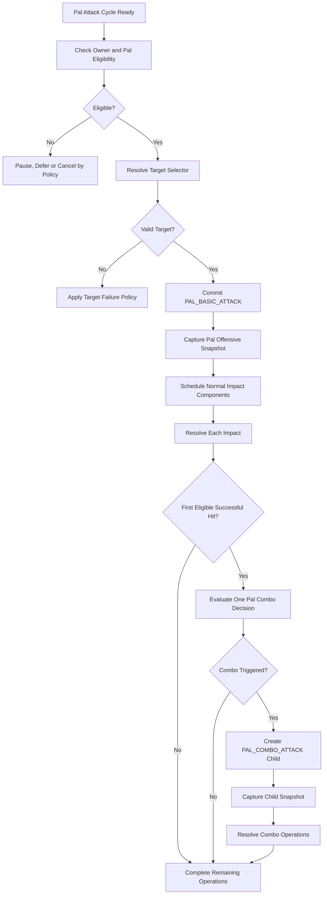

Le combo est une action enfant, pas un deuxième engagement ordinaire de la même attaque.

Il n'est donc pas soumis comme une nouvelle attaque autonome à la restriction `MAX_ONE_NON_REACTION_COMMIT_PER_ACTOR_PER_TIMESTAMP`\.

En revanche, il reste soumis à ses propres critères d'éligibilité, à ses politiques de déclenchement et aux interdictions de récursion.

### 8.1 Déclenchement d'un combo Pal

Je recommande les règles suivantes \:

| Propriété | Contrat |
|--------|--------|
| Source | `PAL_BASIC_ATTACK` éligible |
| Condition | Au moins un impact normal réussi, selon la définition Pal |
| Tirage | Un seul maximum par action normale parente |
| Chance | Valeur fournie par les statistiques et le profil Pal |
| Action enfant | `PAL_COMBO_ATTACK` |
| Snapshot enfant | Capturé au propre engagement du combo |
| Projectiles de combo | Impacts indépendants |
| Critique des projectiles | Un tirage par impact éligible |
| Combo récursif | Interdit |
| Nouvelle attaque normale | Non créée par le combo |

La chance de combo elle-même appartient aux statistiques et aux définitions Pal. **Ce jalon ne fixe pas de probabilité universelle pour tous les acolytes.**

### 8.2 Annulation d'une action parente

La règle `LIFE-015` s'applique \:

Si l'action normale Pal est annulée avant sa décision de combo, aucun combo enfant ne peut être créé rétroactivement.

En revanche, si le combo enfant est déjà engagé, la terminalité de l'action parente ne l'annule pas automatiquement.

Le combo enfant conserve ses propres opérations et les politiques de survie applicables au propriétaire.

### 8.3 Résultats offensifs des Pals

Les impacts Pal utilisent \:

- Les statistiques offensives du Pal source.
- Son `OffensiveSnapshot`\.
- Les défenses et boucliers actuels de sa cible.
- Les modificateurs Pal éligibles du propriétaire.
- Les conditions de contrôle et de bypass actives au moment défini.

Ils ne réutilisent pas automatiquement les probabilités de critique ou les coefficients de dégâts normaux du personnage.

**Convention proposée - `PAL-004` \:** les attaques et combos Pal suivent le modèle commun d'actions parentes, d'impacts enfants et de décisions RNG identifiées. Une seule décision de combo est autorisée par attaque normale Pal éligible.

*Note d'ingénierie : une attaque Pal doit pouvoir produire plusieurs impacts sans multiplier son coût temporel ni ses décisions de combo. Les projectiles restent indépendants pour l'évasion et le critique, mais partagent la causalité de leur action parente.*

---

# SYS-002.D.13.6.5 - Ciblage et validité des impacts

## 9\. Sélection des cibles

Le moteur Pal ne doit pas posséder un système de ciblage indépendant du `CombatTargetSelector`\.

Chaque action Pal déclare un profil \:

```text
PalTargetingProfile
├── TargetingProfileId
├── EligibleTargetCategories[]
├── TargetSelectionPolicyId
├── TargetSortPolicyId
├── TargetLockPolicy
├── InvalidTargetPolicy
├── RetargetPolicy
├── MaximumTargetCount
└── ConfigurationVersion
```

La politique exacte de priorité des ennemis devra être renseignée par les règles de ciblage du combat concerné.

Le modèle permet, par exemple, de déclarer une préférence pour la cible du propriétaire ou une sélection indépendante. **Aucune de ces préférences n'est supposée universelle.**

### 9.1 Verrouillage et disparition d'une cible

Je recommande comme convention initiale \:

`LOCK_ON_COMMIT_SKIP_IF_INVALID`

Une attaque Pal sélectionne sa cible à l'engagement.

Si cette cible disparaît avant l'impact \:

- L'impact est marqué `SKIPPED`\.
- Aucun jet d'évasion ni de critique n'est effectué.
- Aucun combo ni proc supplémentaire n'est créé.
- Les autres impacts valides de l'action peuvent continuer.
- Le Pal ne redirige pas automatiquement ce projectile vers une nouvelle cible.

Un éventuel comportement de redirection devra être déclaré par une autre politique, comme `RETARGET_ON_IMPACT`\.

### 9.2 Ciblage d'une AoE

La compétence commune Spirit Channeler conserve son contrat distinct : elle peut utiliser le centre spatial capturé lors de l'engagement si la cible principale disparaît.

Ce comportement n'autorise pas les projectiles Pal à changer de cible.

### 9.3 Ordre des cibles

Les égalités de priorité sont départagées par une clé stable du Combat Target Selector.

Ni l'ordre des GameObjects Unity, ni celui d'une collection non ordonnée ne peut déterminer la cible finale.

**Convention proposée - `PAL-005` \:** chaque action Pal possède un profil de ciblage explicite ; aucune redirection implicite n'est autorisée après engagement.

*Note d'ingénierie : le ciblage doit être déterministe et séparé de la résolution des dégâts. Une cible invalide ne doit pas consommer de RNG, ni provoquer un combo sur une autre cible choisie silencieusement.*

---

# SYS-002.D.13.6.6 - Interactions Beastmaster et Supreme Spirit

## 10\. Beastmaster : statistiques et Éveil

Les trois passifs propres à Beastmaster utilisent des primitives différentes.

| Mécanique | Composant partagé |
|--------|--------|
| P3 - Critique Pal +25 points | `ModifierAggregator` et `CriticalResolver` |
| P4 - Coefficient Pal +10 points | `ModifierAggregator` et `DamageResolver` |
| P5 - Bonus selon PV manquants | `DependencyInvalidationEngine` et `SnapshotResolver` |
| Éveil - Bypass de l'évasion pendant 10 s | `EffectLifecycleEngine` et `HitResolver` |

### 10.1 Recalcul de P5

Le P5 Beastmaster utilise \:

$$
Bonus=0.04
\left\lfloor
10\times\frac{HP_{\max}-HP_{\mathrm{current}}}{HP_{\max}}
\right\rfloor
$$

Avec les bornes déjà validées.

Le calcul est fait depuis les PV du **propriétaire**, pas ceux du Pal.

Quand le bonus change, tous les Pals déployés bénéficiaires reçoivent une nouvelle révision de statistiques effectives.

Leurs actions déjà engagées conservent leur ancien snapshot.

Le changement de bonus de dégâts **ne réinitialise pas leur cadence d'attaque**, puisqu'il ne modifie pas directement l'APS.

### 10.2 Bypass d'évasion

Pendant les dix secondes de l'Éveil, les impacts Pal éligibles ignorent la vérification d'évasion.

Le contrôle s'effectue à l'impact.

| Situation | Résolution |
|--------|--------|
| Bypass inactif | Ignore-évasion P2 de 10 points appliqué normalement |
| Bypass actif | Aucun jet d'évasion |
| Impact à l'instant exact d'expiration | Bypass inactif |
| Cible immunisée aux dégâts | Bypass possible, mais immunité toujours applicable |
| Pal non déployé | Aucun impact admissible |

Les statistiques offensives restent capturées à l'engagement. Le bypass demeure une capacité temporaire consultée à l'impact.

---

## 11\. Supreme Spirit : déploiement et déclenchement

### 11.1 Positions P4

Le système examine \:

- `PAL_SLOT_01` avant Éveil.
- `PAL_SLOT_01` et `PAL_SLOT_02` après Éveil.

Les emplacements sont absolus. Aucun compactage n'est autorisé.

Deux Pals appartenant à la même catégorie n'installent pas deux fois la même règle de position, sauf politique de cumul explicite.

### 11.2 Synergies P5

Les conditions raciales utilisent uniquement les instances actives.

Un Pal présent dans le sixième emplacement peut satisfaire une synergie lorsque ce slot est actif.

Deux races requises doivent être représentées par deux instances distinctes, même lorsqu'un Pal possède plusieurs tags raciaux, conformément au contrat déjà validé.

Les synergies sont déterminées avant l'initialisation des schedulers et restent attachées à la composition figée du combat.

### 11.3 Éveil Supreme Spirit

La référence retenue est \:

`PATCH_2025_CLARIFIED`

Pendant huit secondes après l'activation de la compétence de classe \:

- Seuls les combos Pal sont éligibles.
- Chaque action de combo Pal réussie bénéficie d'un seul tirage à 40 %.
- Le tirage intervient au premier impact de combo réussi pendant la fenêtre.
- Les dégâts supplémentaires valent 1 % des PV actuels pré-impact de la cible.
- La composante ne produit ni critique, ni nouvelle esquive, ni nouveau combo, ni nouveau déclenchement d'Éveil.

### 11.4 Exemple multi-projectiles

**Combo Pal - deux projectiles**

1. **Premier projectile : esquivé**
   
   L'action n'a pas encore produit de touche réussie. Aucun tirage d'Éveil n'est consommé.
2. **Deuxième projectile : touche**
   
   Le moteur vérifie que la fenêtre Supreme Spirit est encore active, puis effectue l'unique tirage de 40 % de cette action.
3. **Tirage réussi**
   
   Le moteur capture les PV actuels de la cible avant cet impact et crée la composante `PAL_COMBO_HP_SCALED`\.
4. **Résolution des dégâts**
   
   La composante principale et la composante supplémentaire suivent le Damage Resolver commun. Aucune nouvelle action de combo n'est créée.

Si le deuxième projectile arrive à l'instant exact d'expiration de la fenêtre, le tirage est interdit.

Un combo Pal engagé pendant la fenêtre ne conserve donc pas automatiquement le droit au proc après l'expiration.

### 11.5 Source et propriétaire

Pour ce combo \:

```text
SourceActorId = PAL_ACTOR_02
OwnerActorId  = SUPREME_SPIRIT_ACTOR
ActionKind    = PAL_COMBO_ATTACK
```

La condition d'Éveil vérifie à la fois l'origine Pal et son propriétaire.

Un combo effectué directement par Supreme Spirit ne doit pas être reconnu comme un combo Pal.

Un combo d'un Pal appartenant à un autre joueur n'est pas éligible non plus.

**Convention proposée - `PAL-006` \:** les passifs et Éveils Beastmaster/Supreme Spirit utilisent exclusivement les statistiques, sources, propriétaires et fenêtres temporelles déjà définis, sans créer de règles de combat Pal parallèles.

*Note d'ingénierie : l'identité de l'acteur source doit rester distincte de celle du propriétaire jusqu'au résultat final de l'impact. C'est ce qui empêche les bonus Pal de contaminer les attaques normales du joueur et inversement.*

---

# SYS-002.D.13.6.7 - Collisions temporelles et fin de combat

## 12\. Ordonnancement des attaques Pal

Le scheduler partagé impose déjà \:

- Expiration des effets en phase 0.
- Engagements automatiques en phase 1.
- Impacts de classe en phase 2.
- Autres impacts, dont les impacts Pal, en phase 3.
- Clôture réactive locale après les opérations déclenchantes.
- Finalisation du combat après les réactions admissibles.

Chaque Pal possède une identité stable pour départager ses opérations.

### 12.1 Exemple : débuff Spirit Channeler et impact Pal

Supposons \:

- Une compétence Spirit Channeler engagée à `t = 0`\.
- Son impact AoE prévu à `t = 250 ms`\.
- Un impact Pal également prévu à `t = 250 ms`\.

| Phase | Événement | Conséquence |
|--------|--------|--------|
| 0 | Expiration des effets arrivés à échéance | Mise à jour de l'état |
| 1 | Engagements automatiques admissibles | Nouvelles actions capturées |
| 2 | Impact des âmes de loup | Débuff de résistance Pal installé |
| 3 | Impact Pal | Résistance Pal réduite prise en compte |

Le Pal peut donc bénéficier du débuff installé au même timestamp, conformément à `SCHED-003`\.

La compétence de classe ne bénéficie pas de son propre débuff sur son impact initial.

### 12.2 Six attaques simultanément disponibles

Si les six Pals deviennent prêts à attaquer au même timestamp \:

- Le scheduler traite leur disponibilité dans un ordre stable.
- Chaque Pal peut engager au maximum une action normale à cet instant.
- Chaque action possède son propre `ActionId`\.
- Chaque impact conserve sa propre identité RNG.
- Le premier impact résolu peut modifier l'état défensif d'une cible pour les suivants.

Il ne s'agit pas d'une attaque groupée unique.

## 13\. Mort du propriétaire

Le contrat `SPIRIT-FINAL-006` reste prioritaire.

À partir du moment où le propriétaire passe à `DEATH_PENDING` \:

1. Aucune nouvelle attaque ordinaire Pal ne peut être engagée.
2. Les impacts Pal programmés, mais non commencés, sont annulés.
3. Les combos Pal déjà engagés suivent la même règle d'annulation de leurs impacts encore en attente.
4. Les réactions immédiates déjà admises restent régies par `LIFE-011`\.
5. Le nettoyage des effets intervient après clôture des réactions admissibles.

### 13.1 Cas de collision mortelle

Supposons qu'une AoE tue le propriétaire pendant la phase 2, alors que plusieurs impacts Pal sont programmés pour la phase 3 du même timestamp.

Les impacts Pal n'ont pas encore commencé.

Ils sont annulés.

Leur engagement antérieur peut rester dans le journal, mais il ne leur donne pas le droit de produire des dégâts après la transition létale du propriétaire.

### 13.2 Cas inverse

Un impact Pal est entièrement résolu avant qu'une opération indépendante n'élimine son propriétaire.

Ses dégâts restent acquis.

Les réactions déjà déclenchées par cet impact restent également conservées selon leurs politiques respectives.

La mort ne provoque aucun retour en arrière.

### 13.3 Pal et état de mort

Dans le profil initial, un Pal n'a pas de réserve de PV indépendante.

Il ne produit donc pas un événement `ACTOR_DIED` lorsque son propriétaire meurt.

Son état opérationnel devient indisponible, puis il est nettoyé lors de la finalisation.

Cela évite les événements de mort artificiels pouvant déclencher des passifs non prévus.

### 13.4 Effets déjà appliqués

Un débuff qu'un Pal a effectivement appliqué avant la mort de son propriétaire peut conserver sa durée de vie si sa définition indique `PERSIST_UNTIL_EXPIRY`\.

Un buff dépendant directement du propriétaire est supprimé selon `REMOVE_ON_OWNER_DEATH`\.

Ces politiques reprennent `MOD-019` et `MOD-020`\.

**Convention proposée - `PAL-007` \:** l'état du propriétaire contrôle l'autorisation des actions Pal, mais n'efface pas rétroactivement leurs événements ou effets déjà appliqués.

*Note d'ingénierie : le système doit annuler les opérations Pal depuis une condition de cycle de vie explicite, plutôt que détruire immédiatement les objets Pal. Leur suppression prématurée ferait disparaître les informations de provenance encore nécessaires aux réactions et au journal d'audit.*

---

# SYS-002.D.13.6.8 - Contrats de données et validation

## 14\. Profil Pal requis avant exécution

Je recommande que toute définition Pal active possède un profil suffisamment complet pour être utilisée en combat.

```text
PalCombatProfile
├── PalDefinitionId
├── ProfileVersion
├── RaceTagIds[]
├── BaseCombatStatistics
├── BasicAttackProfileId
├── BaseAttackRate
├── TargetingProfileId
├── ComboProfileId?
├── PalSkillProfileIds[]
├── NativeDeploymentEffectIds[]
├── ActorCapabilityProfileId
├── OwnerDependencyPolicy
├── Provenance
└── ValidationStatus
```

Les propriétés optionnelles ne créent aucune fonctionnalité par défaut.

Par exemple, l'absence de `ComboProfileId` signifie que le Pal ne dispose pas d'un mécanisme de combo activé par cette définition. Le moteur ne lui attribue pas une probabilité arbitraire.

### 14.1 Validation du profil runtime

| Contrôle | Résultat en cas d'erreur |
|--------|--------|
| `PalDefinitionId` inconnu | Rejet |
| Même `PalInstanceId` affecté à plusieurs emplacements actifs | Rejet |
| Capacité d'emplacement dépassée | Rejet |
| Propriétaire introuvable | Rejet |
| Profil d'attaque incomplet | Rejet |
| APS sans unité ou non valide | Rejet |
| Profil de cible requis absent | Rejet |
| Définition de combo utilisée mais incomplète | Rejet |
| Race nécessaire à une synergie non résolue | Rejet du profil concerné |
| Effet de déploiement sans magnitude requise | Rejet |
| Plusieurs profils de balance incompatibles | Rejet |

L'absence d'une synergie raciale non pertinente n'interdit pas nécessairement de valider un profil de combat qui ne l'utilise pas.

En revanche, un profil Supreme Spirit prétendant activer une synergie dont la formule est inconnue doit être rejeté.

**Convention proposée - `PAL-008` \:** seuls les profils Pal, passifs et synergies possédant des données obligatoires complètes peuvent produire des acteurs ou effets exécutables.

---

# SYS-002.D.13.6.9 - Invariants

## 15\. Invariants proposés pour l'intégration Pal

| ID | Invariant |
|--------|--------|
| `PAL-INV-001` | Chaque acteur Pal appartient à un propriétaire unique |
| `PAL-INV-002` | Chaque acteur Pal correspond à une instance déployée distincte |
| `PAL-INV-003` | Les emplacements inactifs ne produisent aucun acteur offensif |
| `PAL-INV-004` | Le sixième emplacement reste persistant après changement de classe |
| `PAL-INV-005` | La composition reste figée pendant un combat |
| `PAL-INV-006` | Chaque Pal possède sa propre progression d'attaque |
| `PAL-INV-007` | Un changement d'APS ne remet pas à zéro la progression déjà acquise |
| `PAL-INV-008` | Une échéance obsolète ne produit pas d'attaque |
| `PAL-INV-009` | Un Pal ne peut engager qu'une action ordinaire par timestamp |
| `PAL-INV-010` | Une action normale Pal produit au plus une décision de combo |
| `PAL-INV-011` | Un combo Pal ne produit pas récursivement un nouveau combo |
| `PAL-INV-012` | Chaque projectile éligible possède sa propre décision de critique |
| `PAL-INV-013` | Les snapshots offensifs Pal sont immuables après engagement |
| `PAL-INV-014` | Les buffs de classe utilisent leur portée Pal explicite |
| `PAL-INV-015` | Les effets natifs Supreme Spirit P3 sont amplifiés une seule fois |
| `PAL-INV-016` | Les bonus P4/P5 Supreme Spirit utilisent seulement les Pals actifs |
| `PAL-INV-017` | Le proc d'Éveil Supreme Spirit ne dépasse pas un tirage par combo admissible |
| `PAL-INV-018` | Les attaques normales du propriétaire ne déclenchent pas les effets réservés aux combos Pal |
| `PAL-INV-019` | Aucun impact Pal non commencé n'est résolu après la mort de son propriétaire |
| `PAL-INV-020` | Les événements et effets déjà appliqués ne sont pas supprimés rétroactivement |
| `PAL-INV-021` | Aucun ciblage ou retargeting implicite ne modifie une action engagée |
| `PAL-INV-022` | La même composition, les mêmes profils et le même RNG donnent des résultats reproductibles |

---

# SYS-002.D.13.6.10 - Tests d'acceptation

## 16\. Tests de déploiement

| ID | Scénario | Résultat attendu |
|--------|--------|--------|
| `PAL-DEP-T001` | Guerrier avec cinq Pals équipés | Cinq acteurs Pal actifs |
| `PAL-DEP-T002` | Spirit Channeler avec six Pals équipés | Six acteurs Pal actifs |
| `PAL-DEP-T003` | Passage Spirit Channeler → Mage | Sixième affectation conservée, Pal inactif |
| `PAL-DEP-T004` | Retour Mage → Spirit Channeler | Sixième Pal restauré |
| `PAL-DEP-T005` | Même instance Pal dans deux slots | Configuration rejetée |
| `PAL-DEP-T006` | Slot 1 vide, slot 2 occupé | Positions préservées |
| `PAL-DEP-T007` | Pal inactif doté d'un bonus racial | Aucune contribution |
| `PAL-DEP-T008` | Changement de composition pendant un combat | Combat en cours inchangé |

## 17\. Tests de cadence

| ID | Scénario | Résultat attendu |
|--------|--------|--------|
| `PAL-APS-T001` | Pal à 1 APS, sans bonus | Première attaque disponible à 1 000 000 µs |
| `PAL-APS-T002` | Même Pal, Spirit P2 +0,1 % seul | Première attaque à 999 001 µs |
| `PAL-APS-T003` | Buff APS reçu à 50 % du cycle | Progression conservée |
| `PAL-APS-T004` | Buff APS expiré à un instant de disponibilité | Progression acquise correctement préservée |
| `PAL-APS-T005` | Ancienne échéance après modification d'APS | Opération obsolète ignorée |
| `PAL-APS-T006` | Six Pals devenant prêts ensemble | Six décisions d'engagement indépendantes et ordonnées |
| `PAL-APS-T007` | Propriétaire étourdi | Cadences Pal non interrompues automatiquement |
| `PAL-APS-T008` | Pal directement contrôlé, si profil autorisé | Pause sans accumulation de plusieurs attaques |
| `PAL-APS-T009` | APS incompatible avec la résolution temporelle | Profil rejeté |

## 18\. Tests des attaques et combos

| ID | Scénario | Résultat attendu |
|--------|--------|--------|
| `PAL-ACT-T001` | Attaque normale Pal engagée | Snapshot Pal créé |
| `PAL-ACT-T002` | Impact Pal esquivé | Aucun critique ni combo déclenché par cet impact |
| `PAL-ACT-T003` | Premier impact normal réussi | Une décision de combo au maximum |
| `PAL-ACT-T004` | Deux projectiles normaux réussis | Pas de deuxième décision de combo |
| `PAL-ACT-T005` | Combo effectivement déclenché | Action enfant avec nouveau snapshot |
| `PAL-ACT-T006` | Deux projectiles de combo | Résultats critiques indépendants |
| `PAL-ACT-T007` | Combo Pal réussi | Aucun combo récursif |
| `PAL-ACT-T008` | Action normale annulée avant décision de combo | Aucun combo enfant créé |
| `PAL-ACT-T009` | Cible devenue invalide avant impact | Impact ignoré, sans RNG |
| `PAL-ACT-T010` | Profil Pal dépourvu de capacité de combo | Aucun combo généré |

## 19\. Tests Beastmaster

| ID | Scénario | Résultat attendu |
|--------|--------|--------|
| `PAL-BM-T001` | Chance critique Pal de base 15 % | 40 % avec P3 |
| `PAL-BM-T002` | Coefficient Pal 300 % | 310 % avec P4 |
| `PAL-BM-T003` | Propriétaire ayant perdu 50 % de ses PV | P5 = +20 % |
| `PAL-BM-T004` | Soin ramenant les PV à 75 % | P5 = +8 % |
| `PAL-BM-T005` | Soin après engagement d'une attaque Pal | Ancien snapshot inchangé |
| `PAL-BM-T006` | Éveil actif à l'impact | Aucun jet d'évasion Pal |
| `PAL-BM-T007` | Éveil expiré à l'instant de l'impact | Vérification d'évasion normale |
| `PAL-BM-T008` | Bypass actif contre une cible immunisée aux dégâts | Immunité toujours applicable |

## 20\. Tests Supreme Spirit

| ID | Scénario | Résultat attendu |
|--------|--------|--------|
| `PAL-SS-T001` | Effet natif ATQ +10 % | \+12 % après P3 |
| `PAL-SS-T002` | Bonus P4/P5 de classe | Non amplifié par P3 |
| `PAL-SS-T003` | Non éveillé, bonus de position | Slot 1 uniquement |
| `PAL-SS-T004` | Éveillé, bonus de position | Slots 1 et 2 |
| `PAL-SS-T005` | Synergie utilisant le slot 6 actif | Pal comptabilisé |
| `PAL-SS-T006` | Même règle raciale satisfaite plusieurs fois | Pas de double application sans politique explicite |
| `PAL-SS-T007` | Combo Pal entièrement esquivé | Aucun tirage d'Éveil |
| `PAL-SS-T008` | Premier projectile esquivé, second réussi | Tirage admissible au second |
| `PAL-SS-T009` | Deux impacts réussis du même combo | Un seul tirage |
| `PAL-SS-T010` | Proc réussi sur une cible à 20 000 PV | Référence brute de 200 |
| `PAL-SS-T011` | Impact exactement à 8 secondes | Aucun nouveau proc |
| `PAL-SS-T012` | Combo effectué par le propriétaire | Aucun proc Pal |
| `PAL-SS-T013` | Composante supplémentaire sous bouclier | Absorption normale |
| `PAL-SS-T014` | Synergie raciale incomplète | Profil concerné non exécutable |

## 21\. Tests de fin de combat

| ID | Scénario | Résultat attendu |
|--------|--------|--------|
| `PAL-LIFE-T001` | Propriétaire passe à `DEATH_PENDING` | Aucun nouvel engagement Pal |
| `PAL-LIFE-T002` | Projectile Pal en attente | Annulé |
| `PAL-LIFE-T003` | Impact Pal déjà résolu avant la mort | Dégâts conservés |
| `PAL-LIFE-T004` | AoE de classe tue le propriétaire avant la phase 3 | Impacts Pal non commencés annulés |
| `PAL-LIFE-T005` | Débuff Pal déjà appliqué | Suit sa politique de persistance |
| `PAL-LIFE-T006` | Mort du propriétaire | Aucun événement artificiel de mort de six Pals |
| `PAL-LIFE-T007` | Réaction immédiate déjà admise | Résolue conformément au scheduler |
| `PAL-LIFE-T008` | Combat finalisé | Aucun scheduler Pal encore actif |

Ces tests sont des **critères d'acceptation documentaires**, sans implémentation ni exécution.

---

# SYS-002.D.13.6.11 - Résultat de l'audit

## 22\. Contrats proposés à validation

| ID | Contrat |
|--------|--------|
| `PAL-001` | Les Pals sont des acteurs offensifs autonomes, dépendants d'un propriétaire |
| `PAL-002` | Les statistiques Pal et effets de déploiement utilisent les modificateurs partagés |
| `PAL-003` | Chaque Pal possède une progression d'attaque individuelle, conservée aux changements d'APS |
| `PAL-004` | Les attaques et combos Pal réutilisent les actions parentes, impacts enfants et RNG déterministes |
| `PAL-005` | Le ciblage Pal est explicite et aucun retargeting n'est implicite |
| `PAL-006` | Les passifs Beastmaster/Supreme Spirit utilisent les contrats partagés sans règles parallèles |
| `PAL-007` | Mort du propriétaire : annulation des actions Pal restantes, sans effacer les faits déjà produits |
| `PAL-008` | Les profils Pal et synergies incomplets ne peuvent pas produire de règles exécutables |

### 22.1 Décisions de conception nouvelles

Les règles suivantes ne sont pas des informations officiellement documentées sur *Legend of Mushroom*\. Elles constituent des conventions de notre adaptation \:

| Convention | Conséquence |
|--------|--------|
| Première attaque après un cycle complet | Aucun déclenchement gratuit à `t = 0` |
| Progression normalisée de cadence | Les buffs APS n'effacent pas le cycle déjà acquis |
| Contrôle direct d'un Pal | Progression mise en pause, sans accumulation de backlog |
| Ciblage initial verrouillé | Pas de redirection silencieuse d'un projectile |
| Combo Pal | Une décision par action normale éligible |
| Mort du propriétaire | Aucune attaque Pal différée nouvelle après `DEATH_PENDING` |

Elles sont compatibles avec `CORE`, `LIFE`, `SCHED`, `DMG` et `MOD`\.

### 22.2 Dépendances restant ouvertes

| Domaine | Statut |
|--------|--------|
| Catalogue complet des définitions Pal | `catalog_pending` |
| Races et synergies Supreme Spirit | `catalog_pending` |
| Cadences de base et profils d'attaque réels | `calibration_pending` |
| Chances et comportements de combo propres aux Pals | `calibration_pending` / `catalog_pending` |
| Niveaux de déblocage Spirit Channeler | `unlock_calibration_pending` |
| Formule de DEF | `defense_calibration_pending` |
| Implémentation | `not_started` |
| Tests automatisés | `not_executed` |

**Résultat \:** aucune incompatibilité structurelle majeure n'apparaît entre l'intégration Pal proposée et les cinq sous-modules précédemment validés.

---
