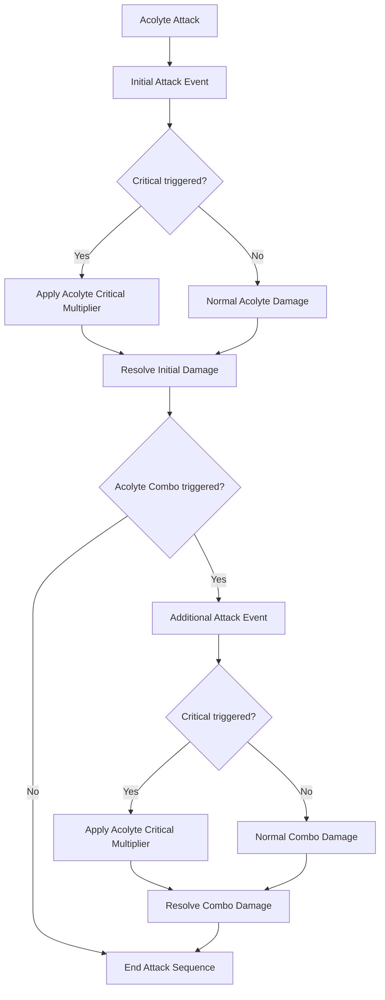

# Chapitre 07 — Dictionnaire des caractéristiques

**Autorité :** décisions expressément approuvées dans la conversation source. Les modèles obsolètes sont remplacés par les rectifications ultérieures ; les paramètres provisoires restent provisoires.

**Statut du chapitre :** `functionally_specified` pour ses spécifications validées ; aucune exécution de test ou implémentation ne découle de ce statut.

**Traçabilité :** 2 décision(s) du propriétaire. Toutes les références `Txxx` renvoient à `references/HISTORIQUE_SOURCE_ORIGINAL.md`.


## Registre détaillé des décisions approuvées


### SYS-002.D.7.1 · T021 · 18/11/2026 14:57:12

**Nature :** `EXIGENCE_OU_RECTIFICATION_PROPRIETAIRE` · **Ligne d’approbation source :** 6395 · **Ligne de formalisation :** 6408.

**Décision / prescription originale (texte intégral du propriétaire) :**

SYS-002.D.7.1 — Validation du référentiel : nature combo/critique acolyte = bonus ; attributs antagonistes = unknown ; dégâts critiques acolyte = unknown ; autres caractéristiques = Je vais donner plus de précision sur la synergie de ces deux attributs.
La synergie entre le combo d'acolyte et le coup critique d'acolyte repose sur la façon dont les compagnons (acolytes) infligent des dégâts.

Le combo d'acolyte :
Il donne une chance aux acolytes d'effectuer une attaque supplémentaire (un combo) après leur coup initial.
Le coup critique d'acolyte :
Il permet aux attaques des acolytes d'infliger des dégâts critiques (multipliés par vos dégâts de coup critique d'acolyte)
Lorsqu'un acolyte attaque, il peut déclencher un coup critique, puis éventuellement enchaîner avec un combo (qui peut lui aussi être critique selon les statistiques).
Pour qu'un build "acolyte" soit redoutable, il ne faut pas négliger l'attaque globale, car les dégâts de base des acolytes dépendent directement de notre puissance d'attaque générale et des multiplicateurs spécifiques (dégâts d'acolyte purs multipliés par vos bonus).. Formalise les décisions, finalise l'audit du Character Stats Engine et prépare la validation globale.


<details><summary>Formalisation technique de la décision ratifiée (extrait sourcé)</summary>

# 1. Formalisation GDD - SYS-002.D.7.1

(Décisions intégrées) (Version 1.1)

## 1.1 Nature des attributs d'acolytes

Les deux caractéristiques sont des bonus offensifs spécifiques aux acolytes.

| Attribut | Identifiant | Fonction |
|--------|--------|--------|
| Combo d'acolyte | `acolyte_combo_rate` | Augmente la chance de déclencher une attaque supplémentaire |
| Coup critique d'acolyte | `acolyte_critical_rate` | Permet aux attaques des acolytes de devenir critiques |
| Dégâts critiques d'acolyte | `acolyte_critical_damage` | Détermine le multiplicateur des dégâts critiques des acolytes |

Le troisième attribut est nouvellement identifié grâce à tes précisions. Il est ajouté au référentiel.

## 1.2 Fonctionnement du combo d'acolyte

Un acolyte effectue initialement une attaque.

Après cette attaque, un tirage détermine si un combo est déclenché.

$$
P_{\text{combo acolyte}}=
f(\text{acolyte\_combo\_rate})
$$

En cas de déclenchement, une attaque supplémentaire est générée.

Cette attaque supplémentaire :

- Produit son propre événement de dégâts.
- Peut déclencher un coup critique.
- Utilise les caractéristiques offensives applicables aux acolytes.
- Est soumise aux résistances et mécanismes défensifs de sa cible.

La formule exacte du taux de déclenchement reste à spécifier.

## 1.3 Fonctionnement du coup critique d'acolyte

Chaque attaque d'acolyte peut déclencher un coup critique.

Cela concerne :

- L'attaque initiale.
- L'attaque supplémentaire issue d'un combo.

Le multiplicateur critique utilise désormais un attribut dédié :

$$
M_{\text{acolyte crit}}=
f(\text{acolyte\_critical\_damage})
$$

Nous ne réutilisons pas automatiquement `critical_damage` ou `skill_critical_damage`.

Les formules et les éventuels attributs antagonistes restent à vérifier.

## 1.4 Séquence de combat d'un acolyte



Une distinction fondamentale est désormais établie : le combo et le critique sont deux mécanismes indépendants.

Un combo n'est pas nécessairement critique. Un critique ne déclenche pas nécessairement un combo.

---

# 2. Synergie entre ATQ générale et dégâts d'acolytes

C'est probablement le point le plus important de ta précision.

Les acolytes ne disposent pas nécessairement d'une puissance offensive entièrement indépendante de leur propriétaire.

Leur puissance dépend de l'ATQ générale du personnage.

## 2.1 Formule de dégâts de base

Je propose le modèle suivant :

$$
D_{\text{acolyte,base}}=
ATQ_{\text{final propriétaire}}
\times C_{\text{acolyte}}
$$

Avec :

- $ATQ_{\text{final propriétaire}}$ : puissance d'attaque finale du personnage.
- $C_{\text{acolyte}}$ : coefficient de base défini par l'acolyte.

Les dégâts spécifiques aux acolytes interviennent ensuite :

$$
D_{\text{acolyte}}=
D_{\text{acolyte,base}}
\times M_{\text{acolyte}}
$$

Où $M_{\text{acolyte}}$ représente les bonus spécifiques aux dégâts d'acolytes, résolus par le Modifier Resolver.

**Conséquence importante :** augmenter l'ATQ générale améliore les dégâts de base des acolytes, tandis qu'augmenter les dégâts d'acolytes améliore leur multiplicateur spécifique.

Ces deux investissements sont donc complémentaires.

## 2.2 Exemple numérique

Prenons un exemple fictif :

| Caractéristique | Valeur |
|--------|--------|
| ATQ finale du personnage | 10 000 |
| Coefficient de base acolyte | 0,50 |
| Bonus dégâts acolyte | \+40 % |

$$
D_{\text{base}}=10\,000\times0,50=5\,000
$$

$$
D_{\text{acolyte}}=5\,000\times1,40
$$

Dégâts de l'attaque initiale avant défense et critique

# 7 000

Si cette attaque déclenche un critique, le multiplicateur spécifique d'acolyte intervient ensuite.

## 2.3 Conséquence sur le Character Stats Engine

Le système doit impérativement conserver cette dépendance :

**Statistiques du personnage**

# ATQ finale

**Acolyte Damage Calculator**

Coefficient de base × dégâts spécifiques

**Initial Attack**

Calcul critique indépendant

**Combo Attack**

Calcul critique indépendant

Le calculateur d'acolytes consommera donc les snapshots du personnage. Il ne maintiendra pas une copie indépendante et potentiellement désynchronisée de son ATQ.

*Note d'ingénierie : le bonus `attack_bonus` est déjà incorporé dans `final_attack`. Il ne devra jamais être appliqué une seconde fois au calcul des dégâts des acolytes.*

---

# 3. Mise à jour du référentiel des attributs

L'ajout de `acolyte_critical_damage` porte le référentiel à :

# 4

Attributs basiques

# 57

Attributs avancés

# 4

Attributs finaux

---

**Total des définitions**

# 65

## 3.1 Répartition actualisée

| Famille | Nombre |
|--------|--------|
| Critiques et mécaniques de combat | 21 |
| Coefficients et compétences | 11 |
| Boss et acolytes | 8 |
| Guérison | 2 |
| Pénétration | 8 |
| Bonus globaux | 7 |
| **Total avancé** | **57** |

## 3.2 Attributs d'acolytes désormais identifiés

| Attribut | Statut |
|--------|--------|
| Combo d'acolyte | (Défini) |
| Coup critique d'acolyte | (Défini) |
| Dégâts critiques d'acolyte | (Ajouté) |
| Dégâts d'acolyte | (Défini) |
| Réduction dégâts d'acolyte | (Défini) |
| Pénétration d'acolyte | (Défini) |
| Anti-pénétration d'acolyte | (Défini) |
| Inspiration des acolytes | (Défini) |
| Résistance des acolytes | (Défini) |

Les attributs suivants ne sont pas ajoutés sans confirmation :

- `acolyte_combo_ignore`
- `acolyte_critical_ignore`
- `acolyte_critical_resistance`

---

</details>


### SYS-002.D.7.3 · T022 · 18/11/2026 15:25:55

**Nature :** `EXIGENCE_OU_RECTIFICATION_PROPRIETAIRE` · **Ligne d’approbation source :** 6864 · **Ligne de formalisation :** 6877.

**Décision / prescription originale (texte intégral du propriétaire) :**

SYS-002.D.7.3 — Validation globale : ATQ acolyte = final ; coefficient acolyte = individual ; critiques = per_hit ; enchaînement combo = single ; architecture = approve ; observations = Je vais rajouter une précision concernant les acolytes, qu'il faudra certainement approfondir plus tard.
Les acolytes sont des compagnons qui accompagnent et soutiennent le personnage dans ses combats (PvE ou PvP). 
Les acolytes possèdent également un niveau, allant du niveau 1 à 200.
Pour faire évoluer et monter en niveau les acolytes, il faut accumuler des doublons en effectuant des invocations d'acolyte.
Chaque acolyte possède des caractéristiques qui lui sont propres indépendamment des caractéristiques (que nous connaissons déjà) du personnage.
L'acolyte possède :
Coefficient de dégâts, Vitesse d'attaque, Coup critique, Dégâts critique, Combo, Coefficient de combo, Ignorance d'évasion.
Chaque acolyte possède également un effet de déploiement qui lui est propre (à définir plus tard).
Ils possèdent différents niveaux de rareté (rares, excellents, épiques, mythiques, etc.), les plus rares offrant des compétences uniques très puissantes (boucliers, soin, boosts massifs de stats etc.). Formalise les décisions, clôture l'audit architectural et établis le plan de spécification mathématique restant.


<details><summary>Formalisation technique de la décision ratifiée (extrait sourcé)</summary>

# 1. Formalisation GDD - SYS-002.D.7.3

(Architecture validée) (Version 1.2)

## 1.1 Décisions précédemment validées

| Élément | Décision |
|--------|--------|
| ATQ utilisée pour les dégâts des acolytes | `final_attack` du propriétaire |
| Coefficient de dégâts | Individuel à chaque acolyte |
| Déclenchement critique | Tirage indépendant par attaque |
| Déclenchement du combo | Un seul combo supplémentaire par attaque initiale |
| Architecture Character Stats Engine | Approuvée |

## 1.2 Nouvelles caractéristiques des acolytes

Nous introduisons une distinction fondamentale entre les caractéristiques propres à un acolyte et les caractéristiques de son propriétaire.

**Caractéristiques intrinsèques de l'acolyte :**

| Attribut | Identifiant technique |
|--------|--------|
| Coefficient de dégâts | `damage_coefficient` |
| Vitesse d'attaque | `attack_speed` |
| Coup critique | `critical_rate` |
| Dégâts critiques | `critical_damage` |
| Combo | `combo_rate` |
| Coefficient de combo | `combo_coefficient` |
| Ignorance d'évasion | `evasion_ignore` |

Ces sept caractéristiques appartiennent à la fiche individuelle de chaque acolyte.

Elles ne sont pas des attributs supplémentaires du personnage joueur.

**Caractéristiques du propriétaire influençant les acolytes :**

| Attribut | Identifiant |
|--------|--------|
| ATQ finale | `final_attack` |
| Dégâts d'acolyte | `acolyte_damage` |
| Combo d'acolyte | `acolyte_combo_rate` |
| Coup critique d'acolyte | `acolyte_critical_rate` |
| Dégâts critiques d'acolyte | `acolyte_critical_damage` |
| Pénétration d'acolyte | `acolyte_penetration` |

Cette séparation permet de conserver des acolytes différents tout en leur faisant bénéficier de la progression offensive du personnage.

---

# 2. Nouveau sous-système - Acolyte Engine

(Intégré à l'architecture)

Je propose de créer un sous-système autonome comprenant cinq composants.

**Acolyte Registry**

Définitions, rareté, statistiques intrinsèques et compétences propres

**Progression System**

Niveau 1 à 200, doublons et évolution

**Acolyte Stat Calculator**

Statistiques intrinsèques et bonus du propriétaire

**Acolyte Combat Engine**

Cadence, attaques initiales, combos et critiques

**Acolyte Skill &amp; Deployment System**

Effets de déploiement, soins, boucliers et compétences uniques

## 2.1 Acolyte Registry

Chaque acolyte disposera d'une définition statique.

Elle contiendra :

```text
AcolyteDefinition
│
├── id
├── name
├── rarity
├── base_stats
│   ├── damage_coefficient
│   ├── attack_speed
│   ├── critical_rate
│   ├── critical_damage
│   ├── combo_rate
│   ├── combo_coefficient
│   └── evasion_ignore
│
├── level_growth
├── deployment_effect
├── unique_skills
└── combat_configuration
```

Les définitions seront indépendantes des instances possédées par le joueur.

Ainsi, deux joueurs possédant le même acolyte auront accès à la même définition, mais pourront disposer de niveaux et de progressions différents.

## 2.2 Progression des acolytes

(Niveaux 1 à 200) (Progression par doublons)

Chaque acolyte possède un niveau individuel.

La progression repose sur l'accumulation de doublons obtenus par invocation.

Le système devra distinguer :

- L'acquisition initiale d'un acolyte.
- L'acquisition d'un doublon.
- Le stock de doublons disponibles.
- Les doublons consommés pour progresser.
- Le niveau actuel.
- Le niveau maximal autorisé.

La courbe de progression et le nombre de doublons nécessaires par niveau restent à déterminer.

Nous ne présumons pas qu'un doublon équivaut systématiquement à un niveau supplémentaire.

## 2.3 Rareté

Les catégories communiquées sont intégrées :

- Rare.
- Excellent.
- Épique.
- Mythique.
- Autres catégories éventuelles.

La rareté déterminera notamment :

- Les caractéristiques initiales.
- Les courbes de progression.
- Les compétences accessibles.
- Les effets de déploiement.
- Le potentiel de spécialisation.

Les compétences uniques des acolytes les plus rares pourront inclure :

| Catégorie | Exemple de fonctionnalité |
|--------|--------|
| Défensive | Génération de bouclier |
| Soutien | Récupération de PV |
| Offensive | Augmentation massive d'ATQ |
| Utilitaire | Bonus de vitesse ou réduction de cooldown |
| Hybride | Combinaison de plusieurs effets |

Ces exemples constituent des catégories de conception, pas des compétences définitivement attribuées à des acolytes.

---

# 3. Formalisation mathématique préliminaire des acolytes

Nous pouvons déjà établir les relations entre les différentes caractéristiques sans inventer les coefficients définitifs.

## 3.1 Dégâts de l'attaque initiale

$$
D_{\text{initial}}=
ATQ_{\text{final propriétaire}}
\times C_{\text{dégâts acolyte}}
\times M_{\text{bonus acolyte}}
$$

Où :

- $ATQ_{\text{final propriétaire}}$ : ATQ finale du personnage.
- $C_{\text{dégâts acolyte}}$ : coefficient individuel de l'acolyte.
- $M_{\text{bonus acolyte}}$ : multiplicateur issu des bonus spécifiques du propriétaire.

## 3.2 Dégâts du combo

$$
D_{\text{combo}}=
ATQ_{\text{final propriétaire}}
\times C_{\text{dégâts acolyte}}
\times C_{\text{combo}}
\times M_{\text{bonus acolyte}}
$$

Le coefficient de combo est propre à chaque acolyte.

## 3.3 Déclenchement critique

Chaque attaque effectue son propre tirage :

$$
P_{\text{crit acolyte}}=
f(CR_{\text{acolyte}},CR_{\text{propriétaire}})
$$

En cas de critique :

$$
D_{\text{critique}}=
D_{\text{normal}}\times M_{\text{crit acolyte}}
$$

Le multiplicateur dépendra des caractéristiques critiques de l'acolyte et du propriétaire.

La formule exacte reste à déterminer.

## 3.4 Déclenchement du combo

$$
P_{\text{combo acolyte}}=
f(CB_{\text{acolyte}},CB_{\text{propriétaire}})
$$

Une attaque initiale peut produire au maximum une attaque supplémentaire.

Le combo ne peut pas déclencher un autre combo.

## 3.5 Vitesse d'attaque

La vitesse d'attaque sera une caractéristique intrinsèque individuelle.

$$
T_{\text{attaque acolyte}}=
\frac{1\,000\,000}{AS_{\text{acolyte final}}}
$$

L'influence éventuelle de la vitesse d'attaque du propriétaire sur celle de ses acolytes reste à vérifier.

*Note d'ingénierie : le moteur d'acolytes utilisera un scheduler indépendant du personnage. Il pourra néanmoins partager le même gestionnaire temporel et le même générateur aléatoire déterministe.*

---

# 4. Mise à jour du référentiel global

Le référentiel du personnage reste composé de :

# 4

Attributs basiques

# 57

Attributs avancés

# 4

Attributs finaux

---

**Total du Character Stats Engine**

# 65

Les sept caractéristiques intrinsèques des acolytes sont gérées dans un référentiel distinct.

Le nombre de définitions du système global augmente donc sans polluer le référentiel des statistiques du personnage.

---

# 5. Clôture de l'audit architectural

(Audit architectural clôturé)

Les décisions suivantes sont désormais considérées comme acquises :

| Composant | État |
|--------|--------|
| Character Stats Engine | Architecture validée |
| Stat Registry | Architecture validée |
| Modifier Resolver | Architecture validée |
| Derived Stat Calculator | Architecture validée |
| Stat Snapshot | Architecture validée |
| Damage Calculator | Contrat architectural défini |
| Combat Scheduler | Architecture définie |
| Critical System | Architecture définie |
| Evasion System | Architecture définie |
| Acolyte Engine | Architecture intégrée |
| Acolyte Progression System | Architecture intégrée |
| Acolyte Skill System | Architecture intégrée |

La validation architecturale ne signifie pas que les formules de tous les composants sont terminées.

Nous passons maintenant à la spécification mathématique.

---

# 6. Plan de spécification mathématique restant

Je propose de structurer la suite en six grands blocs.

## Roadmap SYS-002.D

1. **SYS-002.D.8 - Mécaniques de combat restantes**
   
   (Prochaine étape)
   
   - Combo général.
   - Contre-attaque.
   - Étourdissement.
   - En vol.
   - Blocage.
   - Régénération.
   - Inspiration et résistance des acolytes.
2. **SYS-002.D.9 - Acolyte Engine**
   
   - Formules des sept caractéristiques individuelles.
   - Progression des statistiques par niveau.
   - Synergie avec les statistiques du propriétaire.
   - Cadence et déclenchement des attaques.
   - Combo et critique.
   - Dégâts et pénétration.
3. **SYS-002.D.10 - Acolyte Progression &amp; Skills**
   
   - Progression du niveau 1 à 200.
   - Conversion des doublons.
   - Rareté et évolution.
   - Effets de déploiement.
   - Compétences uniques.
   - Boucliers, soins et buffs.
4. **SYS-002.D.11 - Damage Calculator final**
   
   - Consolidation des formules.
   - Calibration de la constante K.
   - Normalisation des unités.
   - Ordre définitif des calculs.
   - Vérification des multiplicateurs.
5. **SYS-002.D.12 - Matrice de tests**
   
   - Tests unitaires mathématiques.
   - Tests de propriétés.
   - Tests de simultanéité.
   - Tests de cas limites.
   - Tests PvE et PvP.
   - Scénarios de référence.
6. **SYS-002.D.13 - Validation technique finale**
   
   - Contrats définitifs.
   - Dépendances intermodules.
   - Interfaces publiques.
   - Critères d'acceptation.
   - Autorisation d'implémentation.

## 6.1 Ordre de priorité

Je recommande de commencer par SYS-002.D.8 plutôt que de développer immédiatement les acolytes.

La raison est architecturale : les acolytes réutilisent plusieurs mécaniques fondamentales du moteur de combat, notamment les critiques, les résistances, les esquives, les combos et les calculs de dégâts.

Spécifier ces mécanismes une seule fois évitera de dupliquer les règles entre le personnage et ses compagnons.

---

</details>

