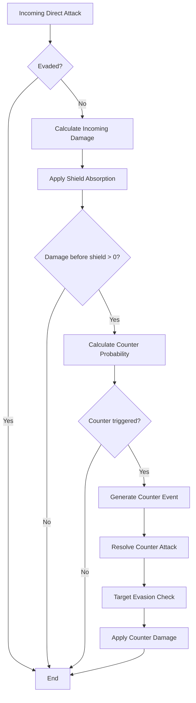
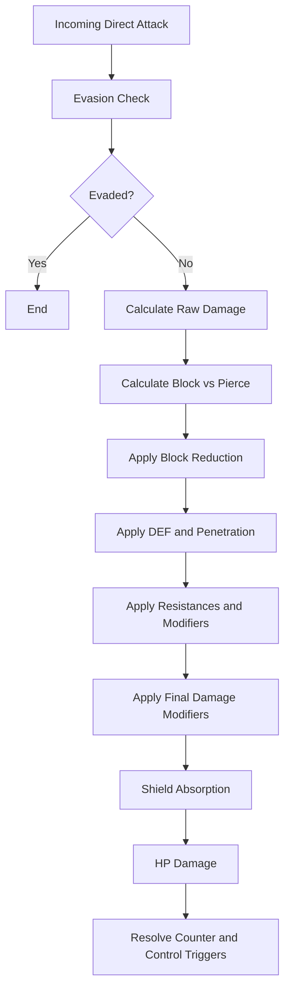

# Chapitre 08 — Combo, contre-attaque, contrôle, blocage et soins

**Autorité :** décisions expressément approuvées dans la conversation source. Les modèles obsolètes sont remplacés par les rectifications ultérieures ; les paramètres provisoires restent provisoires.

**Statut du chapitre :** `functionally_specified` pour ses spécifications validées ; aucune exécution de test ou implémentation ne découle de ce statut.

**Traçabilité :** 7 décision(s) du propriétaire. Toutes les références `Txxx` renvoient à `references/HISTORIQUE_SOURCE_ORIGINAL.md`.

## Registre détaillé des décisions approuvées

### SYS-002.D.8.1 · T024 · 18/11/2026 15:49:49

**Nature :** `APPROBATION_EXPLICITE` · **Ligne d’approbation source :** 7591 · **Ligne de formalisation :** 7596.

**Décision / prescription originale (texte intégral du propriétaire) :**

Validation SYS-002.D.8.1 : portée du combo = normal ; formule ignorance = subtract ; nombre de combos = single ; condition = landed ; temporalité = immediate ; base dégâts = attack_times_coefficient ; observations = Aucune. Formalise les décisions et poursuis avec SYS-002.D.8.2 — Contre-attaque.

Formalisation technique de la décision ratifiée (extrait sourcé)

# 1. Formalisation GDD - SYS-002.D.8.1

(Validé) (Version 1.0)

## 1.1 Décisions enregistrées

| Élément | Décision |
|--------|--------|
| Portée du déclenchement | Attaques normales uniquement |
| Calcul du taux | Soustraction directe |
| Nombre de combos | Un par attaque initiale |
| Condition | Attaque initiale non esquivée |
| Temporalité | Immédiatement après l'attaque initiale |
| Base des dégâts | ATQ finale × coefficient de combo |

## 1.2 Formules consolidées

Le taux de combo effectif est :

$$
C_{\text{effectif}}=
\max(0,C_{\text{attaquant}}-CI_{\text{défenseur}})
$$

La probabilité est ensuite plafonnée à 100 % pour le tirage.

Les dégâts de base sont :

$$
D_{\text{combo,base}}=
ATQ_{\text{final}}\times C_{\text{combo}}
$$

Le résultat passe ensuite par le `Damage Calculator`, avec le canal `COMBO`.

## 1.3 Séquence définitive

1. Une attaque normale est initiée.
2. Le système vérifie l'évasion.
3. Si l'attaque est esquivée, aucun combo n'est déclenché.
4. Si elle touche, les dégâts initiaux sont résolus.
5. Le système calcule la probabilité de combo.
6. Un tirage indépendant détermine son déclenchement.
7. Si le combo est déclenché, une attaque supplémentaire est créée.
8. Cette attaque dispose de son propre tirage critique et de son propre calcul de dégâts.
9. Elle ne peut pas déclencher un autre combo.

Une attaque de combo peut elle-même être esquivée par la cible.

Le cycle normal d'attaque n'est pas réinitialisé.

---

### SYS-002.D.8.2 · T025 · 18/11/2026 16:44:12

**Nature :** `APPROBATION_EXPLICITE` · **Ligne d’approbation source :** 7955 · **Ligne de formalisation :** 7965.

**Décision / prescription originale (texte intégral du propriétaire) :**

Validation SYS-002.D.8.2 : portée = direct ; condition = positive_damage ; ignorance = subtract ; nombre = per_event ; base dégâts = attack_coefficient ; critique = general ; évasion = yes ; temporalité = immediate ; observations = • Les attaques normales : Chaque attaque de base de l'adversaire lance un jet de probabilité selon votre taux de contre-attaque.
• Les attaques de combo : Chaque coup supplémentaire issu d'un combo ennemi compte comme une attaque distincte et peut déclencher une riposte.
• Les compétences actives : Les compétences qui infligent des dégâts directs à votre personnage activent également votre probabilité de contre-attaque.
• Les attaques d'acolytes : Les coups portés directement par les familiers adverses peuvent déclencher vos ripostes.
L'évasion (Esquive) : Si vous esquivez une attaque grâce à votre statistique d'évasion, la contre-attaque ne se déclenche pas dans les mécaniques standards, car vous n'avez pas été touché (sauf effet de classe très spécifique).
Les boucliers : Si vous absorbez un coup grâce à un bouclier, l'attaque est tout de même comptabilisée comme reçue et peut donc déclencher votre contre-attaque.. Formalise les décisions et poursuis avec SYS-002.D.8.3 — Étourdissement.

Formalisation technique de la décision ratifiée (extrait sourcé)

# 1. Formalisation GDD - SYS-002.D.8.2

(Validé) (Version 1.1)

## 1.1 Décisions enregistrées

| Élément | Décision |
|--------|--------|
| Portée | Toutes les attaques directes |
| Condition | Attaque reçue et non esquivée |
| Ignorance | Soustraction directe |
| Nombre | Une contre-attaque par événement |
| Base des dégâts | ATQ finale × coefficient de contre-attaque |
| Critique | Système critique général |
| Évasion | Possible sur la contre-attaque |
| Temporalité | Immédiatement après l'attaque reçue |
| Contre-attaque récursive | Interdite |

## 1.2 Précision sur les attaques éligibles

Les observations permettent de préciser la portée `direct`.

| Type d'attaque reçue | Contre-attaque possible |
|--------|--------|
| Attaque normale | Oui |
| Combo ennemi | Oui, chaque coup individuellement |
| Compétence directe | Oui |
| Attaque d'acolyte | Oui |
| Contre-attaque ennemie | Non |
| Dégâts périodiques | Non, sauf extension ultérieure |
| Dégâts indirects | Non |

Chaque coup d'une compétence multicoup constitue un événement distinct et peut donc effectuer son propre tirage.

## 1.3 Correction de la condition concernant les boucliers

La décision initiale `positive_damage` doit être précisée.

Un coup absorbé intégralement par un bouclier reste une attaque reçue.

Nous distinguons donc :

- `hit_confirmed` : l'attaque a effectivement touché.
- `evaded` : l'attaque a été esquivée.
- `shield_absorbed` : le bouclier a absorbé tout ou partie des dégâts.
- `hp_damage` : dégâts effectivement retirés aux PV.

La nouvelle condition est :

$$
\text{CounterEligible}=
\text{HitConfirmed}
\land
\neg\text{Evaded}
\land
(D_{\text{avant bouclier}}>0)
$$

Ainsi, une attaque entièrement absorbée par un bouclier peut déclencher une contre-attaque.

En revanche, une attaque esquivée ne le peut pas.

## 1.4 Formule consolidée

$$
CA_{\text{effectif}}=
\max(0,CA_{\text{défenseur}}-CAI_{\text{attaquant}})
$$

La probabilité est plafonnée à 100 % pour le tirage.

Les dégâts de la contre-attaque sont calculés à partir de l'ATQ finale de son propriétaire :

$$
D_{\text{contre,base}}=
ATQ_{\text{final}}\times C_{\text{contre}}
$$

Le résultat passe ensuite par le `Damage Calculator`, avec le canal `COUNTER`.

## 1.5 Séquence définitive

*Note d'ingénierie : le bouclier et les PV seront traités comme deux couches distinctes de réception des dégâts. La contre-attaque dépend de la confirmation du coup, pas exclusivement de la diminution des PV.*

---

### SYS-002.D.8.3 · T026 · 18/11/2026 17:38:40

**Nature :** `APPROBATION_EXPLICITE` · **Ligne d’approbation source :** 8318 · **Ligne de formalisation :** 8323.

**Décision / prescription originale (texte intégral du propriétaire) :**

Validation SYS-002.D.8.3 : signification stun_ignore = reduce ; portée = direct ; condition = landed ; actions bloquées = all_actions ; durée = effect_defined ; réapplication = refresh ; observations = Aucune. Formalise les décisions et poursuis avec SYS-002.D.8.4 — En vol.

Formalisation technique de la décision ratifiée (extrait sourcé)

# 1. Formalisation GDD - SYS-002.D.8.3

(Validé) (Version 1.0)

## 1.1 Décisions enregistrées

| Élément | Décision |
|--------|--------|
| Ignorance d'étourdissement | Réduction directe du taux adverse |
| Portée | Toutes les attaques directes |
| Condition | Attaque non esquivée |
| Actions bloquées | Toutes les actions offensives et défensives |
| Durée | Définie par l'effet |
| Réapplication | Actualisation de la durée |

## 1.2 Formule définitive

$$
S_{\text{effectif}}=
\max(0,S_{\text{attaquant}}-SI_{\text{défenseur}})
$$

$$
P_{\text{stun}}=\min(S_{\text{effectif}},100)
$$

Les valeurs sont exprimées en points de pourcentage.

## 1.3 Règles d'application

- Toutes les attaques directes peuvent provoquer un étourdissement.
- Une attaque esquivée ne peut pas provoquer d'étourdissement.
- Un bouclier n'empêche pas le déclenchement.
- L'effet bloque les nouvelles actions offensives et défensives.
- Les cooldowns continuent de progresser.
- Les buffs et debuffs continuent leur durée normale.
- Une nouvelle application actualise le timestamp d'expiration.
- L'effet ne se propage pas automatiquement aux compagnons du personnage.

Une question technique reste ouverte : l'interruption des compétences déjà en cours d'exécution. Elle sera traitée dans la matrice globale des contrôles.

*Note d'ingénierie : nous utiliserons un gestionnaire générique de contrôles (`ControlEffectManager`\) plutôt qu'un système indépendant pour chaque effet. L'étourdissement et l'état En vol partageront leur infrastructure sans nécessairement partager leurs conséquences.*

---

### SYS-002.D.8.4 · T027 · 18/11/2026 17:50:32

**Nature :** `APPROBATION_EXPLICITE` · **Ligne d’approbation source :** 8654 · **Ligne de formalisation :** 8667.

**Décision / prescription originale (texte intégral du propriétaire) :**

Validation SYS-002.D.8.4 : ignorance = subtract ; portée = direct ; effet = verify ; vulnérabilité = vulnerable ; durée = effect ; réapplication = refresh ; interaction étourdissement = coexist ; observations = Il faudrait changer le nom de cette caractéristique, je ne la trouve pas très clair au premier abord.
Le mécanisme d'en vol (ou lancement en l'air) est un effet de contrôle de foule qui projette brièvement la cible dans les airs, interrompant toutes ses actions.

Fonctionnement et effets en combat

• Interruption totale (Micro-étourdissement) : Lorsqu'un ennemi est projeté en vol, il est incapable d'attaquer, de déclencher des combos, de contre-attaquer ou d'activer ses compétences tant qu'il est en l'air.
• Durée très courte : Contrairement à l'étourdissement classique des Mages qui dure plusieurs secondes, le lancement en vol est très bref.
• Contre-mesure contre la résistance à l'étourdissement : Le lancement en vol est considéré comme une mécanique distincte de l'étourdissement. Il ignore la statistique de « Résistance à l'étourdissement » de l'adversaire, ce qui le rend redoutable en PvP.
• Réinitialisation des animations : En plus de faire gagner de précieuses fractions de seconde, la projection brise le rythme d'attaque de l'adversaire et retarde le rechargement de ses compétences actives.. Formalise les décisions et poursuis avec SYS-002.D.8.5 — Blocage.

Formalisation technique de la décision ratifiée (extrait sourcé)

# 1. Formalisation GDD - SYS-002.D.8.4

(Validé) (Version 1.1)

## 1.1 Changement de nomenclature

Le terme « En vol » est remplacé par **Projection aérienne**.

Ce nom décrit directement le mécanisme et évite de confondre l'état de la cible avec l'effet qui le provoque.

| Ancien nom | Nouveau nom | Identifiant technique |
|--------|--------|--------|
| En vol | Chance de projection aérienne | `air_launch_rate` |
| Ignorance d'en vol | Ignorance de projection aérienne | `air_launch_ignore` |

Les anciens identifiants `airborne_rate` et `airborne_ignore` sont abandonnés dans le référentiel canonique.

## 1.2 Décisions consolidées

| Élément | Décision |
|--------|--------|
| Calcul de l'ignorance | Soustraction directe |
| Portée | Toutes les attaques directes |
| Effet | Interruption totale des actions |
| Vulnérabilité | La cible reste attaquable |
| Durée | Très courte, définie par effet |
| Réapplication | Actualisation de la durée |
| Interaction avec étourdissement | Coexistence indépendante |
| Résistance à l'étourdissement | Ignorée |

## 1.3 Nature de la projection aérienne

La projection aérienne est un effet de contrôle de foule indépendant de l'étourdissement classique.

Ses propriétés sont les suivantes :

- Interruption immédiate des actions en cours.
- Impossibilité d'attaquer.
- Impossibilité de déclencher un combo.
- Impossibilité de contre-attaquer.
- Impossibilité d'activer une compétence.
- Durée très courte.
- Vulnérabilité conservée.
- Réinitialisation du rythme d'attaque.
- Retardement du rechargement des compétences actives.

### Distinction avec l'étourdissement

| Propriété | Étourdissement | Projection aérienne |
|--------|--------|--------|
| Contrôle complet | Oui | Oui |
| Durée | Plusieurs secondes possibles | Très courte |
| Résistance à l'étourdissement | À prendre en compte | Ignorée |
| Interruption des actions | Oui | Oui |
| Réinitialisation du rythme d'attaque | À définir | Oui |
| Retardement des cooldowns actifs | Non, progression normale | Oui |

## 1.4 Interaction avec le système temporel

La projection aérienne introduit une particularité importante par rapport à l'étourdissement.

Pendant sa durée :

1. L'animation d'attaque en cours est interrompue.
2. La progression de la cadence d'attaque est réinitialisée.
3. Les cooldowns des compétences actives sont temporairement suspendus.
4. À expiration, les cooldowns reprennent leur progression avec le temps restant.
5. Le personnage retrouve sa capacité d'action.

La règle de suspension des cooldowns constitue une exception spécifique à la projection aérienne. Elle ne modifie pas la règle générale validée dans SYS-002.D.5.2.

## 1.5 Nouvelle caractéristique identifiée : Résistance à l'étourdissement

Tu viens d'identifier une caractéristique qui ne figurait pas dans notre référentiel initial.

| Attribut | Identifiant |
|--------|--------|
| Résistance à l'étourdissement | `stun_resistance` |

(Ajouté au référentiel)

Cette caractéristique devra intervenir dans le calcul des étourdissements classiques.

La projection aérienne l'ignore entièrement.

Son interaction mathématique exacte avec `stun_rate` et `stun_ignore` sera spécifiée dans la matrice des résistances.

## 1.6 Mise à jour du référentiel

# 4

Attributs basiques

# 58

Attributs avancés

# 4

Attributs finaux

---

**Total des définitions**

# 66

*Note d'ingénierie : la projection aérienne sera enregistrée comme un effet de contrôle distinct. Le fait que deux effets bloquent les mêmes actions ne signifie pas qu'ils possèdent les mêmes règles temporelles ou les mêmes résistances.*

---

### SYS-002.D.8.5 · T028 · 18/11/2026 18:16:39

**Nature :** `APPROBATION_EXPLICITE` · **Ligne d’approbation source :** 9067 · **Ligne de formalisation :** 9079.

**Décision / prescription originale (texte intégral du propriétaire) :**

Validation SYS-002.D.8.5 : portée = direct ; ignorance = subtract ; conséquence = reduce ; quantité bloquée = fixed ; fréquence = per_hit ; effets secondaires = hit_effects ; ordre de calcul = before_defense ; observations = le blocage (Block) est une statistique défensive avancée qui permet de réduire une partie des dégâts subis lors d'une attaque directe, et s'oppose directement à la statistique de perforation (Pierce).

Fonctionnement en combat

• Réduction des dégâts subis : Lorsqu'un blocage s'active face à une attaque ennemie, il diminue considérablement les dégâts finaux que vous recevez, ce qui vous permet de survivre beaucoup plus longtemps face aux classes à gros dégâts (DPS).
• Opposition Blocage vs Perforation : Le système fonctionne par comparaison entre votre statistique de Blocage et la statistique de Perforation (Pierce) de l'adversaire. Plus votre blocage est supérieur à sa perforation, plus le déclenchement et l'efficacité de la réduction sont élevés.
• Interactions avec les autres mécaniques : Contrairement à l'évasion qui annule totalement le coup (et empêche la contre-attaque), le blocage laisse l'attaque vous toucher avec des dégâts réduits. Cela permet aux Guerriers d'encaisser le coup tout en continuant de déclencher leurs contre-attaques.
• Limites face aux dégâts spéciaux : Le blocage est très efficace contre les attaques classiques, mais son impact est beaucoup plus faible contre les dégâts indexés sur un pourcentage de vos PV maximum.. Formalise les décisions et poursuis avec SYS-002.D.8.6 — Régénération.

Formalisation technique de la décision ratifiée (extrait sourcé)

# 1. Formalisation GDD - SYS-002.D.8.5

(Validé) (Version 1.1)

## 1.1 Décisions enregistrées

| Élément | Décision |
|--------|--------|
| Portée | Toutes les attaques directes |
| Ignorance de blocage | Soustraction directe |
| Conséquence | Réduction des dégâts |
| Réduction de base | Valeur fixe configurable |
| Fréquence | Un tirage par coup |
| Effets secondaires | Conservés |
| Ordre d'application | Avant défense et pénétration |

## 1.2 Nouvelle interaction : Blocage contre Pénétration

Nous intégrons une relation directe entre :

- `block_rate` : blocage du défenseur.
- `penetration` : pénétration (Pierce) de l'attaquant.
- `block_ignore` : ignorance de blocage de l'attaquant.
- `anti_penetration` : anti-pénétration du défenseur.

Il faut conserver une distinction entre pénétration et ignorance de blocage : ce sont deux caractéristiques présentes dans le référentiel initial, même si elles interviennent toutes deux dans la résolution du blocage.

Le calcul proposé est :

$$
P_{\text{effective}}=
f(P_{\text{attaquant}},AP_{\text{défenseur}})
$$

Puis :

$$
B_{\text{marge}}=
\max(0,B_{\text{défenseur}}-
P_{\text{effective}}-
BI_{\text{attaquant}})
$$

La fonction de résolution de la pénétration reste celle du système SYS-002.D.2.

**Conséquence :** plus la marge entre le blocage et la pénétration est élevée, plus la probabilité et l'efficacité du blocage augmentent.

Nous ne fixons pas encore la fonction mathématique exacte de cette progression.

## 1.3 Nouvelle distinction : probabilité et efficacité

Le blocage possède désormais deux sorties mathématiques distinctes.

| Variable | Fonction |
|--------|--------|
| `block_probability` | Probabilité que le blocage se déclenche |
| `block_effectiveness` | Pourcentage des dégâts réduit lorsque le blocage réussit |

Je propose le modèle suivant :

$$
P_{\text{block}}=f(B_{\text{marge}})
$$

$$
R_{\text{block}}=g(B_{\text{marge}})
$$

La réduction effective sera ensuite adaptée au type de dégâts.

Pour les dégâts indexés sur les PV maximum, un coefficient spécifique réduira l'efficacité du blocage :

$$
R_{\text{block,HP\%}}=
R_{\text{block}}\times K_{\text{HP\%}}
$$

Avec un coefficient $K_{\text{HP\%}}$ inférieur à celui des attaques classiques.

Sa valeur reste à calibrer.

## 1.4 Interactions avec les autres mécaniques

| Mécanique | Conséquence |
|--------|--------|
| Évasion | Annule le coup, aucun blocage |
| Blocage | L'attaque touche avec des dégâts réduits |
| Contre-attaque | Peut toujours se déclencher |
| Étourdissement | Peut toujours se déclencher |
| Projection aérienne | Peut toujours se déclencher |
| Bouclier | Absorbe les dégâts restants |
| Dégâts en % des PV max | Efficacité du blocage réduite |

La condition de contre-attaque est donc confirmée : une attaque bloquée reste une attaque reçue et peut provoquer une riposte.

## 1.5 Ordre de résolution actualisé

Cette représentation fixe l'ordre général du blocage. Les positions exactes des contrôles secondaires et des boucliers seront consolidées dans SYS-002.D.11.

*Note d'ingénierie : le calculateur devra conserver le type de dégâts dans chaque événement. Une attaque basée sur un pourcentage des PV maximum ne doit pas utiliser aveuglément la même efficacité de blocage qu'une attaque physique classique.*

---

### SYS-002.D.8.6 · T029 · 18/11/2026 18:26:33

**Nature :** `APPROBATION_EXPLICITE` · **Ligne d’approbation source :** 9497 · **Ligne de formalisation :** 9509.

**Décision / prescription originale (texte intégral du propriétaire) :**

Validation SYS-002.D.8.6 : unité = max_hp ; fréquence = periodic ; ignorance = subtract ; portée ignorance = continuous ; interaction guérison = separate ; contrôles = continue ; cumul = independent ; observations = la régénération (Regen) permet de récupérer des points de vie (PV) de façon passive et continue chaque seconde durant un combat.

Fonctionnement et mécanismes

• Soin par seconde : Contrairement au vol de vie ou aux soins déclenchés par vos attaques, la régénération restaure automatiquement un pourcentage de vos PV maximum chaque seconde.
• Aucune condition d'action : Vous continuez de regagner de la vie même lorsque vous êtes étourdi (Stun), projeté en l'air ou incapable d'attaquer.
• Synergie avec les PV maximum : Plus votre réserve totale de PV est élevée, plus le montant réel de soins récupéré à chaque seconde est important.
• Limite d'efficacité (Anti-soin) : En PvP, l'efficacité de la régénération diminue à mesure que le combat s'éternise (réduction progressive des soins dans le temps) et peut être réduite par des effets « anti-soin » adverses.. Formalise les décisions et poursuis avec SYS-002.D.8.7 — Inspiration et résistance des acolytes.

Formalisation technique de la décision ratifiée (extrait sourcé)

# 1. Formalisation GDD — SYS-002.D.8.6

(Validé) (Version 1.1)

## 1.1 Décisions enregistrées

| Élément | Décision |
|--------|--------|
| Unité | Pourcentage des PV maximum par seconde |
| Fréquence | Périodique, toutes les secondes |
| Ignorance de régénération | Soustraction directe |
| Portée | Continue pendant le combat |
| Interaction avec la guérison | Indépendante |
| Étourdissement | Régénération maintenue |
| Projection aérienne | Régénération maintenue |
| Cumul des sources | Instances indépendantes et cumulatives |

## 1.2 Fonctionnement consolidé

La régénération est une récupération passive des PV qui intervient automatiquement chaque seconde pendant un combat.

Elle ne dépend :

- Ni des attaques effectuées.
- Ni des compétences activées.
- Ni des déplacements.
- Ni de la capacité du personnage à agir.

Elle reste active pendant les effets de contrôle.

## 1.3 Formule mathématique

Nous distinguons désormais trois niveaux de calcul.

**A. Régénération brute**

$$
H_{\text{brut}}=PV_{\max}\times R
$$

Où $R$ représente le taux de régénération par seconde.

**B. Régénération après ignorance**

$$
R_{\text{net}}=\max(0,R-RI)
$$

Où $RI$ représente l'ignorance de régénération adverse.

**C. Régénération effective en PvP**

$$
H_{\text{PvP}}(t)=PV_{\max}\times R_{\text{net}}\times F_{\text{PvP}}(t)
$$

Avec :

- $t$ : temps écoulé depuis le début du combat.
- $F_{\text{PvP}}(t)$ : coefficient de régénération PvP.
- Ce coefficient diminue progressivement pendant le combat.

La fonction exacte reste à déterminer.

En PvE, aucun mécanisme de diminution progressive n'est actuellement défini.

## 1.4 Introduction des effets anti-soin

Nous ajoutons un mécanisme distinct : `anti_heal_effect`.

Il ne constitue pas encore une nouvelle caractéristique permanente du personnage. Il s'agit d'un modificateur temporaire pouvant réduire la régénération reçue.

Le calcul général devient :

$$
H_{\text{effectif}}(t)=
PV_{\max}\times R_{\text{net}}
\times F_{\text{PvP}}(t)
\times M_{\text{anti-heal}}
$$

En l'absence d'effet anti-soin :

$$
M_{\text{anti-heal}}=1
$$

Les règles de cumul des effets anti-soin seront spécifiées ultérieurement.

## 1.5 Exemple numérique

Prenons un personnage fictif :

| Caractéristique | Valeur |
|--------|--------|
| PV maximum | 1 000 000 |
| Régénération | 2 % / seconde |
| Ignorance adverse | 0,5 % / seconde |
| Coefficient PvP | 0,75 |
| Réduction anti-soin | 20 % |

$$
H=1\,000\,000\times0,015\times0,75\times0,8
$$

Régénération effective par seconde

# 9 000 PV

Exemple illustratif, coefficients non calibrés sur le jeu officiel.

## 1.6 Règles complémentaires

- Les PV récupérés ne peuvent pas dépasser les PV maximum.
- Un personnage mort ne récupère pas de PV.
- Chaque source de régénération conserve sa propre durée.
- Les sources actives se cumulent.
- Les effets de contrôle ne suspendent pas la régénération.
- Les soins instantanés restent indépendants.
- La diminution progressive PvP est calculée à partir du temps de combat.

*Note d'ingénierie : le moteur conservera un accumulateur temporel indépendant du framerate. Les ticks seront déclenchés toutes les secondes de simulation. Les fractions de PV seront conservées dans les calculs intermédiaires pour éviter les pertes de précision cumulatives.*

---

### SYS-002.D.8.7 · T030 · 18/11/2026 18:53:18

**Nature :** `APPROBATION_EXPLICITE` · **Ligne d’approbation source :** 9841 · **Ligne de formalisation :** 9857.

**Décision / prescription originale (texte intégral du propriétaire) :**

Validation SYS-002.D.8.7 : inspiration = stats ; ignorance inspiration = reduce ; résistance = damage ; ignorance résistance = reduce ; portée = unknown ; modèle mathématique = unknown ; observations = la caractéristique d'inspiration des acolytes correspond à une attaque spéciale déclenchée par vos acolytes en plus de leurs attaques normales et de leurs compétences passives.
Mécanisme de déclenchement et effets
- Une attaque de groupe ou renforcée : Lorsqu'un acolyte déclenche son inspiration, il effectue une frappe spéciale dont les dégâts sont calculés à partir de votre statistique d'attaque globale et amplifiés par le multiplicateur d'inspiration d'acolyte.
- Condition d'activation : L'inspiration fonctionne sur un système de probabilité par attaque ou de jauge d'énergie liée aux coups portés par vos acolytes. Plus la vitesse d'attaque de vos acolytes est élevée, plus ils accumulent rapidement les conditions nécessaires pour déclencher cette inspiration.
- Synergie avec la classe Dompteur : La branche du Dompteur (Beast Master / Tamer) repose entièrement sur ce mécanisme. Ses compétences actives et ses passifs d'éveil augmentent directement le taux d'inspiration, les dégâts d'inspiration et permettent à tous vos acolytes équipés de déclencher simultanément un état d'excitation.
- Interaction avec les critiques et combos d'acolytes : Une attaque d'inspiration peut également bénéficier d'un coup critique d'acolyte, créant des pics de dégâts massifs en combat.

la statistique Ignorance de l'inspiration d'acolyte (Ignore Pal Inspire) est une caractéristique défensive de fin de jeu conçue pour réduire ou annuler les bonus d'inspiration des acolytes adverses. [[1](https://www.youtube.com/watch?v=SF8rWwtzfoo&t=294), [2](https://guidesbygrace.uk/divining)]
Fonctionnement en combat
- Contre-mesure directe : Elle s'oppose directement à la statistique d'Inspiration d'acolyte (Pal Inspire) de votre adversaire lors du calcul des dégâts. [[1](https://guidesbygrace.uk/divining)]
- Réduction des dégâts spéciaux des familiers : Lorsqu'un ennemi déclenche l'inspiration de ses acolytes, votre valeur d'ignorance soustrait ou diminue le multiplicateur appliqué à leurs attaques spéciales.
- Spécialisation anti-Dompteur : Cette statistique vise particulièrement la classe Dompteur (Beast Master / Tamer), ainsi que tous les joueurs qui misent sur des familiers à très gros dégâts.. Formalise les décisions et clôture SYS-002.D.8.

Formalisation technique de la décision ratifiée (extrait sourcé)

# 1. Formalisation GDD — SYS-002.D.8.7

(Validé fonctionnellement) (Version 1.1)

## 1.1 Inspiration des acolytes

**Identifiant :** `acolyte_inspiration`

La sélection initiale `inspiration = stats` est remplacée par la définition précisée dans les observations.

L'inspiration est une attaque spéciale déclenchée par les acolytes, en complément de leurs attaques normales.

Elle constitue un événement offensif distinct.

### Fonctionnement

Lorsqu'un acolyte remplit les conditions nécessaires, il peut déclencher une attaque d'inspiration.

Cette attaque :

- Utilise l'ATQ finale du propriétaire comme base de calcul.
- Applique un multiplicateur spécifique d'inspiration.
- Peut bénéficier des coups critiques d'acolyte.
- Est indépendante des attaques normales et des compétences passives.
- Peut être renforcée par les compétences et passifs de certaines classes.

### Formule conceptuelle

$$
D_{\text{inspiration,base}}=
ATQ_{\text{final propriétaire}}
\times C_{\text{inspiration}}
$$

Puis application des modificateurs applicables :

$$
D_{\text{inspiration}}=
D_{\text{inspiration,base}}
\times M_{\text{critique acolyte}}
\times M_{\text{défense cible}}
\times M_{\text{final}}
$$

Le multiplicateur d'inspiration et les éventuelles interactions supplémentaires restent à calibrer.

### Déclenchement

Deux mécanismes sont identifiés :

1. Probabilité indépendante à chaque attaque d'acolyte.
2. Accumulation d'une jauge d'énergie alimentée par les attaques.

La vitesse d'attaque des acolytes influence la fréquence à laquelle les conditions de déclenchement sont remplies.

Le modèle exact reste à déterminer.

### Synergie avec le Dompteur

La classe Dompteur (Beast Master / Tamer) possède une spécialisation autour de cette mécanique.

Ses compétences et passifs peuvent :

- Augmenter le taux de déclenchement.
- Augmenter les dégâts d'inspiration.
- Déclencher un état d'excitation collectif.
- Permettre à tous les acolytes équipés de bénéficier simultanément de cet état.

Nous introduisons donc un futur composant :

`AcolyteExcitementSystem`

Il sera chargé de gérer les effets collectifs appliqués aux acolytes.

## 1.2 Ignorance de l'inspiration des acolytes

**Identifiant :** `acolyte_inspiration_ignore`

(Fonction validée)

Il s'agit d'une caractéristique défensive destinée à réduire les dégâts spéciaux provenant de l'inspiration des acolytes adverses.

Elle s'oppose directement à l'inspiration adverse.

Son fonctionnement porte sur le multiplicateur de dégâts d'inspiration, et non sur la probabilité de déclenchement.

Modèle conceptuel :

$$
M_{\text{inspiration effectif}}=
f(M_{\text{inspiration attaquant}},
I_{\text{inspiration défenseur}})
$$

La fonction exacte reste à déterminer.

**Conséquence architecturale :** cette caractéristique doit être intégrée au calculateur des dégâts d'inspiration, et non au gestionnaire de déclenchement.

Elle constitue notamment une contre-mesure aux builds spécialisés Dompteur.

## 1.3 Résistance des acolytes

**Identifiant :** `acolyte_resistance`

(Fonction validée)

Cette caractéristique réduit les dégâts reçus provenant des acolytes adverses.

Elle intervient dans le calcul défensif des dégâts.

Le périmètre exact reste à déterminer : toutes les attaques d'acolytes, uniquement certaines catégories d'attaques ou certains événements particuliers.

## 1.4 Ignorance de résistance des acolytes

**Identifiant :** `acolyte_resistance_ignore`

Cette caractéristique réduit la résistance aux acolytes de la cible.

Modèle conceptuel :

$$
R_{\text{effective}}=
f(R_{\text{défenseur}},RI_{\text{attaquant}})
$$

Elle intervient dans le calcul des dégâts provenant des acolytes.

Son interaction exacte avec la pénétration d'acolyte reste à spécifier.

---

# 2. Référentiel des caractéristiques mis à jour

| Caractéristique | Fonction |
|--------|--------|
| Inspiration des acolytes | Déclenchement et puissance des attaques spéciales d'inspiration |
| Ignorance de l'inspiration | Réduction du multiplicateur d'inspiration adverse |
| Résistance des acolytes | Réduction des dégâts provenant des acolytes adverses |
| Ignorance de résistance | Réduction de la résistance adverse aux dégâts d'acolytes |

Il est important de conserver quatre caractéristiques distinctes.

L'inspiration et l'ignorance de l'inspiration interviennent dans une mécanique offensive spéciale.

La résistance et son ignorance interviennent dans la mitigation des dégâts provenant des acolytes.

---

# 3. Architecture définitive de SYS-002.D.8.7

**Acolyte Inspiration System**

Déclenchement des attaques spéciales

**Inspiration Trigger**

Probabilité ou jauge d'énergie

**Inspiration Damage**

ATQ propriétaire et multiplicateur

**Acolyte Damage Calculator**

Critiques, ignorance d'inspiration, résistance et pénétration

---

**Combat Event Resolution**

Application des dégâts et interactions avec le combat

Cette architecture conserve l'indépendance entre le déclenchement d'une inspiration et le calcul de ses dégâts.

*Note d'ingénierie : le déclenchement et la résolution des dégâts doivent être deux opérations séparées. Une modification de la résistance adverse ne doit jamais modifier artificiellement la fréquence de déclenchement de l'inspiration.*

---

