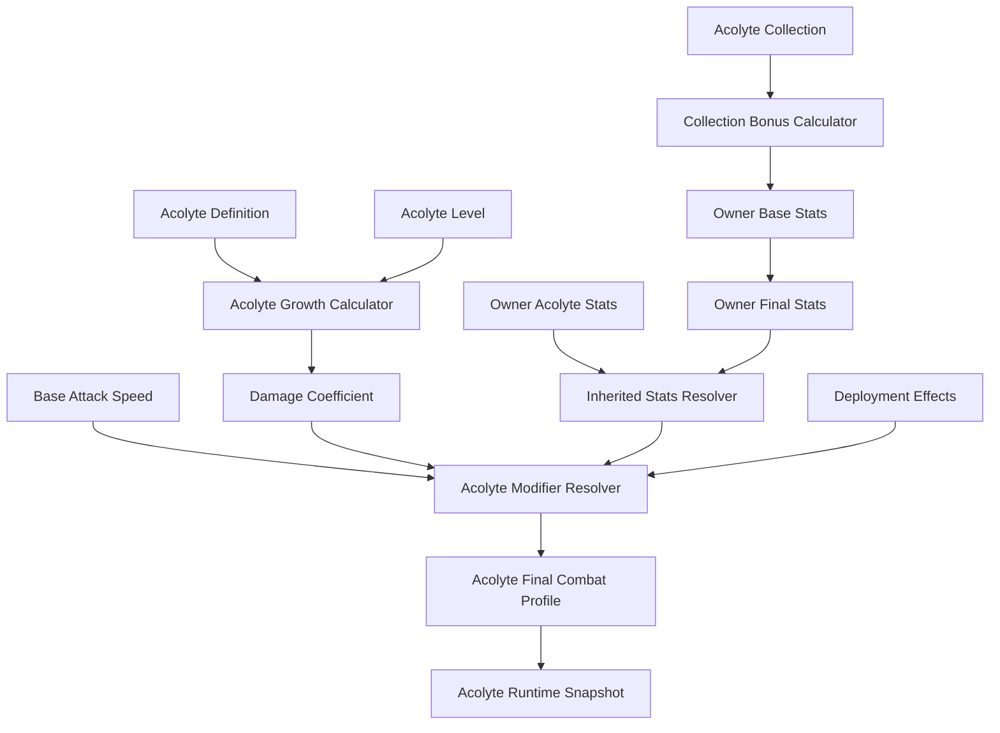

# Chapitre 09 — Acolytes — modèle et combat

**Autorité :** décisions expressément approuvées dans la conversation source. Les modèles obsolètes sont remplacés par les rectifications ultérieures ; les paramètres provisoires restent provisoires.

**Statut du chapitre :** `functionally_specified` pour ses spécifications validées ; aucune exécution de test ou implémentation ne découle de ce statut.

**Traçabilité :** 6 décision(s) du propriétaire. Toutes les références `Txxx` renvoient à `references/HISTORIQUE_SOURCE_ORIGINAL.md`.


## Registre détaillé des décisions approuvées


### SYS-002.D.9.1 · T032 · 18/11/2026 19:08:16

**Nature :** `APPROBATION_EXPLICITE` · **Ligne d’approbation source :** 10567 · **Ligne de formalisation :** 10592.

**Décision / prescription originale (texte intégral du propriétaire) :**

Validation SYS-002.D.9.1 : gestion instances = separate ; doublons = shared_balance ; progression niveaux = individual ; courbes = rarity_curve ; influence rareté = capabilities ; effets déploiement = on_deploy ; runtime = snapshot ; observations = Les acolytes (Pals) sont classés selon 8 niveaux de rareté standard (du plus commun au plus rare), auxquels s'ajoute une catégorie spéciale pour les événements exclusifs.

Les 8 raretés principales (du plus faible au plus puissant)

• Normal (Gris / Blanc) : Les acolytes de base obtenus dès le début du jeu, offrant de très faibles bonus.
• Unique (Vert) : La deuxième catégorie de départ, utile uniquement lors des toutes premières heures de progression.
• Bien / Supérieur (Bleu) : Permet d'obtenir les premiers petits effets passifs utiles en début de partie.
• Rare (Violet) : Introduit des effets de déploiement plus intéressants pour commencer à orienter votre style de jeu.
• Mythique (Orange) : Marque un cap important avec des bonus nettement plus élevés et des synergies de classe plus marquées.
• Épique (Rouge) : Des acolytes très puissants qui constituent la base des équipes de milieu et fin de jeu.
• Légendaire (Doré / Jaune) : Offrent des capacités passives majeures et de gros multiplicateurs de statistiques.
• Immortel (Rose / Arc-en-ciel) : Le rang ultime des invocations classiques, doté des meilleurs effets de combat et des plus hauts bonus passifs permanents.

Catégorie supplémentaire

• Exclusif / Collab (Spécial) : Certains acolytes spéciaux (comme ceux issus des collaborations ou événements temporaires) disposent de leur propre classement à part et ne s'obtiennent pas dans le portail d'invocation classique, comme le détaille le catalogue de Guides by Grace.

Ce qu'il faut savoir sur les raretés

• Double effet : Chaque acolyte possède un effet de déploiement (actif uniquement s'il est équipé dans votre équipe de 5) et un effet permanent (bonus d'ATQ, PV et DÉF actif dès que vous le possédez, même sans l'équiper).
• Probabilités d'invocation : Plus le niveau de votre portail d'invocation augmente grâce aux tirages, plus vos chances d'obtenir des raretés Épique, Légendaire et Immortel progressent.. Formalise les décisions dans le GDD et poursuis selon le protocole avec SYS-002.D.9.2 — Acolyte Progression System.


<details><summary>Formalisation technique de la décision ratifiée (extrait sourcé)</summary>

# 1. Formalisation GDD - SYS-002.D.9.1

(Validé) (Version 1.1)

## 1.1 Décisions architecturales

| Élément | Décision |
|--------|--------|
| Gestion des instances | Instances individuelles |
| Doublons | Solde partagé par type |
| Progression | Individuelle |
| Courbes | Dépendantes de la rareté |
| Influence de la rareté | Statistiques et compétences |
| Effets de déploiement | Conditionnés par l'équipement |
| Runtime | Snapshot actualisable |

## 1.2 Référentiel officiel des raretés

Nous intégrons huit niveaux de rareté standards, classés dans l'ordre suivant.

## Raretés standards

---

**Catégorie spéciale : Exclusif / Collaboration**

(Hors classement standard)

Les acolytes événementiels et issus de collaborations possèdent une classification indépendante. Ils ne sont pas automatiquement positionnés dans la hiérarchie des huit raretés.

Les couleurs sont des métadonnées visuelles. Elles ne doivent pas intervenir dans les calculs mathématiques.

Nous utiliserons deux champs distincts :

```text
rarity_track:
    STANDARD
    EXCLUSIVE

rarity_rank:
    1..8 ou NULL
```

Cette structure permet d'intégrer de futures raretés sans modifier le moteur de progression.

## 1.3 Double système d'effets

C'est une évolution importante du modèle.

Chaque acolyte possède deux catégories d'effets.

**A. Effet permanent - Collection Effect**

(Actif dès acquisition)

Le bonus est appliqué au propriétaire dès que l'acolyte est possédé, même s'il n'est pas équipé.

- Bonus d'ATQ.
- Bonus de PV.
- Bonus de DEF.
- Autres bonus éventuels à identifier.

---

**B. Effet de déploiement - Deployment Effect**

(Conditionné par l'équipement)

L'effet est disponible uniquement lorsque l'acolyte est équipé dans l'équipe active.

- Effets offensifs.
- Effets défensifs.
- Bonus de caractéristiques.
- Effets de soutien.
- Compétences particulières.

Le modèle de données devient :

```text
AcolyteDefinition
│
├── identity
├── rarity
├── base_stats
│
├── permanent_effect
│   ├── attack_bonus
│   ├── hp_bonus
│   └── defense_bonus
│
├── deployment_effect
│   ├── effect_id
│   ├── effect_type
│   ├── activation_condition
│   └── effect_configuration
│
├── progression
├── skills
└── combat_configuration
```

Les deux effets sont indépendants.

Un acolyte non équipé conserve donc ses bonus permanents.

## 1.4 Configuration de l'équipe

(5 emplacements confirmés)

Le `AcolyteLoadout` possède désormais cinq emplacements.

```text
AcolyteLoadout
│
├── owner_id
├── active_slots[5]
│   ├── slot_1
│   ├── slot_2
│   ├── slot_3
│   ├── slot_4
│   └── slot_5
│
└── configuration_status
```

Les bonus permanents sont calculés à partir de la collection possédée.

Les effets de déploiement sont calculés à partir des cinq emplacements actifs.

Il faudra ultérieurement déterminer si un même acolyte peut occuper plusieurs emplacements. Cette règle n'est pas encore connue.

## 1.5 Système d'invocation

Nous ajoutons une dépendance externe au modèle de progression.

Le niveau du portail d'invocation influence les probabilités d'obtention des différentes raretés.

Les probabilités des catégories Épique, Légendaire et Immortel augmentent avec le niveau du portail.

Il faut donc séparer :

- `AcolyteProgressionSystem` : progression des acolytes possédés.
- `SummonPortalSystem` : niveau du portail et probabilités d'invocation.

Le niveau du portail ne doit pas être confondu avec le niveau individuel d'un acolyte.

Les probabilités exactes et leur normalisation seront spécifiées dans un module d'invocation ultérieur.

---

</details>


### SYS-002.D.9.2 · T033 · 18/11/2026 19:20:51

**Nature :** `APPROBATION_EXPLICITE` · **Ligne d’approbation source :** 11027 · **Ligne de formalisation :** 11046.

**Décision / prescription originale (texte intégral du propriétaire) :**

Validation SYS-002.D.9.2 : gestion instances = one_per_type ; ressources = duplicates_only ; coût = rarity_table ; statistiques évolutives = all_seven ; courbes = piecewise ; montée de niveau = multi ; doublons niveau 200 = retain ; bonus permanents = unknown ; observations = Je vais clarifier :
un acolyte monte du niveau 1 au niveau 200 exclusivement en consommant des exemplaires identiques (doublons) obtenus lors de vos invocations au portail.

La montée en niveau (1 à 200) et consommation des doublons

• Déblocage initial : Le tout premier exemplaire tiré au portail débloque l'acolyte au niveau 1.
• Coût progressif en doublons : Pour passer au niveau supérieur, il faut accumuler un nombre précis de cartes du même acolyte. Ce coût commence très bas (2 ou 3 doublons aux tout premiers niveaux) et augmente progressivement par paliers jusqu'au niveau 200.
• Bouton « Amélioration rapide » : Dès que vous possédez assez de doublons pour un ou plusieurs paliers, un bouton d'amélioration globale permet de convertir automatiquement tous vos doublons disponibles en niveaux.
• Recyclage des doublons après le niveau 200 : Une fois qu'un acolyte atteint le niveau maximum (200), les doublons supplémentaires que vous continuez de tirer ne sont pas perdus. Le jeu les fusionne automatiquement pour générer des cartes d'acolytes de la rareté supérieure, ce qui accélère considérablement la montée des acolytes Mythiques, Légendaires et Immortels en fin de jeu.

L'évolution des caractéristiques à chaque niveau

• L'effet possédé (Bonus passif permanent) : À chaque niveau gagné, le pourcentage d'ATQ, de PV et de DÉF que l'acolyte confère à votre personnage augmente. Ce bonus s'applique en permanence à votre compte, même si l'acolyte n'est pas équipé dans votre équipe.
• Les dégâts directs en combat : Le multiplicateur de dégâts de base de l'acolyte augmente à chaque niveau, rendant ses attaques normales et ses attaques d'inspiration beaucoup plus puissantes sur le terrain.
• Ce qui n'évolue pas avec les niveaux : La vitesse d'attaque de base de l'acolyte ainsi que les valeurs numériques de son effet de déploiement (par exemple, +60 % de dégâts de combo pour la Pieuvre de Pirate ou +30 % de temps d'étourdissement pour le Renard Divin) restent fixes du niveau 1 au niveau 200, comme le montrent les fiches d'acolytes sur Mobi.gg.. Formalise les décisions dans le GDD et poursuis avec SYS-002.D.9.3 — Acolyte Stats Engine.


<details><summary>Formalisation technique de la décision ratifiée (extrait sourcé)</summary>

# 1. Formalisation GDD - SYS-002.D.9.2

(Validé) (Version 1.2)

## 1.1 Décisions consolidées

| Élément | Décision définitive |
|--------|--------|
| Déblocage | Premier exemplaire obtenu au niveau 1 |
| Instance de progression | Une par type d'acolyte |
| Ressource | Doublons identiques exclusivement |
| Coût | Table par rareté et niveau |
| Progression | Individuelle, niveaux 1 à 200 |
| Courbes | Par paliers |
| Amélioration rapide | Plusieurs niveaux en une opération |
| Niveau maximal | 200 |
| Doublons après niveau 200 | Fusion automatique vers la rareté supérieure |
| Bonus permanents | Évoluent avec le niveau |

### Correction du modèle d'instances

La décision `one_per_type` remplace la granularité initialement envisagée dans SYS-002.D.9.1.

Nous retenons désormais :

- Une seule fiche de progression par type d'acolyte possédé.
- Un compteur de doublons associé à ce type.
- Chaque invocation supplémentaire alimente ce compteur.
- Les doublons ne créent pas de nouvelles instances de progression.

Le `AcolyteRuntime` reste néanmoins une instance dynamique créée pour chaque acolyte déployé en combat.

## 1.2 Progression par doublons

Le premier exemplaire débloque l'acolyte au niveau 1.

Les exemplaires suivants alimentent son solde de doublons.

Le coût augmente progressivement en fonction du niveau et de la rareté.

$$
C(L,R)=\text{coût du passage de }L\text{ à }L+1
$$

Les premiers niveaux nécessitent approximativement deux ou trois doublons. Les coûts augmentent ensuite par paliers.

Aucune table numérique définitive ne sera inventée : les valeurs exactes seront intégrées à partir des données de référence.

## 1.3 Amélioration rapide

Le système doit calculer automatiquement le nombre maximal de niveaux accessibles avec le solde disponible.

$$
N_{\max}=
\max\left\{
n:
\sum_{i=0}^{n-1}C(L+i,R)
\leq D
\right\}
$$

Avec :

- $L$ : niveau actuel.
- $R$ : rareté.
- $D$ : solde de doublons.
- $N_{\max}$ : nombre de niveaux accessibles.

L'opération est transactionnelle :

1. Calcul des niveaux accessibles.
2. Calcul du coût total.
3. Vérification du solde.
4. Consommation des doublons.
5. Mise à jour du niveau.
6. Recalcul des caractéristiques.
7. Enregistrement de l'évolution.

Aucun doublon ne peut être consommé sans progression correspondante.

## 1.4 Recyclage après le niveau 200

(Nouvelle règle intégrée)

Lorsque l'acolyte atteint le niveau 200, les nouveaux doublons obtenus ne sont plus affectés à sa progression.

Ils sont automatiquement dirigés vers un système de fusion permettant d'obtenir des cartes d'acolytes de rareté supérieure.

Nous introduisons donc :

`AcolyteRarityFusionSystem`

Ce système devra gérer :

- La rareté source.
- La rareté cible.
- Le nombre de cartes nécessaires.
- Les éventuelles restrictions de conversion.
- Le traitement des acolytes exclusifs.
- La gestion des excédents.

Les ratios de fusion restent à spécifier.

## 1.5 Évolution des caractéristiques

C'est ici que ta clarification corrige une décision importante.

La sélection initiale `all_seven` est abandonnée.

Toutes les caractéristiques ne progressent pas nécessairement avec le niveau.

| Caractéristique | Progression 1-200 |
|--------|--------|
| Coefficient de dégâts | (Augmente) |
| Vitesse d'attaque | (Fixe) |
| Coup critique | À déterminer |
| Dégâts critiques | À déterminer |
| Combo | À déterminer |
| Coefficient de combo | À déterminer |
| Ignorance d'évasion | À déterminer |

Les valeurs fixes de base peuvent néanmoins être modifiées par des buffs ou effets de déploiement pendant le combat.

### Évolution des bonus permanents

Chaque niveau augmente également les bonus de collection :

- Bonus d'ATQ.
- Bonus de PV.
- Bonus de DEF.

Ces bonus sont actifs dès que l'acolyte est possédé, indépendamment de son équipement.

### Évolution des effets de déploiement

Les valeurs numériques des effets de déploiement restent fixes entre les niveaux 1 et 200.

Exemples communiqués :

- Pieuvre de Pirate : +60 % de dégâts de combo.
- Renard Divin : +30 % de durée d'étourdissement.

Ces valeurs ne sont pas multipliées automatiquement par le niveau de l'acolyte.

*Note d'ingénierie : le moteur doit posséder trois profils de croissance indépendants : statistiques intrinsèques, bonus permanents de collection et effets de déploiement. Cela évite qu'une évolution de niveau modifie accidentellement une compétence dont la valeur est censée rester fixe.*

---

# 2. Modèle de données actualisé

La structure de progression devient :

```text
AcolyteOwnership
│
├── owner_id
├── acolyte_definition_id
├── is_unlocked
├── acquisition_timestamp
│
├── progression
│   ├── current_level
│   ├── max_level = 200
│   └── progression_history
│
├── duplicate_balance
│
└── collection_effect
    ├── attack_bonus
    ├── hp_bonus
    └── defense_bonus
```

Le catalogue conserve les paramètres de croissance :

```text
AcolyteGrowthProfile
│
├── rarity
├── damage_coefficient_curve
├── collection_bonus_curve
├── critical_rate_growth
├── critical_damage_growth
├── combo_rate_growth
├── combo_coefficient_growth
└── evasion_ignore_growth
```

Les champs dont la progression n'est pas connue restent configurables et non présumés.

---

</details>


### SYS-002.D.9.3 · T034 · 18/11/2026 19:30:46

**Nature :** `APPROBATION_EXPLICITE` · **Ligne d’approbation source :** 11498 · **Ligne de formalisation :** 11519.

**Décision / prescription originale (texte intégral du propriétaire) :**

Validation SYS-002.D.9.3 : croissance des cinq caractéristiques = individual ; combinaison propriétaire/acolyte = explicit ; vitesse d'attaque = acolyte_only ; base bonus collection = base ; ciblage déploiement = per_effect ; actualisation snapshot = incremental ; cumul bonus collection = additive ; observations = Précision :
chaque caractéristique d'un acolyte possède sa propre règle d'évolution. Toutes les statistiques n'augmentent pas avec le niveau : certaines progressent linéairement, tandis que d'autres sont totalement figées ou dépendent uniquement de votre personnage principal.

Les caractéristiques qui évoluent avec le niveau (1 à 200)

• Le multiplicateur d'attaque de base (Dégâts de base) : C'est la statistique intrinsèque de combat qui augmente à chaque niveau gagné. Plus le niveau de l'acolyte est élevé, plus le pourcentage de votre attaque globale qu'il utilise pour frapper augmente.
• L'effet possédé (Bonus passif du compte) : À chaque montée de niveau, le pourcentage d'ATQ, de PV et de DÉF que l'acolyte apporte de manière permanente à votre personnage augmente progressivement.

Les caractéristiques intrinsèques fixes (qui n'évoluent pas avec le niveau)

• La vitesse d'attaque de base : Chaque acolyte possède une cadence de frappe propre (par exemple 1.0, 1.2 ou 1.5 attaque par seconde selon l'espèce) qui reste strictement identique du niveau 1 au niveau 200. Pour l'augmenter, il faut passer par la classe Dompteur d'Âmes, les reliques ou l'équipement.
• Les valeurs numériques du passif de déploiement : Les pourcentages ou durées inscrits dans la description du talent de l'acolyte (comme un bonus de dégâts de combo, un vol de vie ou un temps de contrôle) sont figés dès le niveau 1 et ne changent jamais avec les doublons.

Les caractéristiques héritées de votre personnage

• Critique, Combo, Inspiration et Ignore-évasion d'acolyte : Un acolyte ne possède pas sa propre réserve de ces statistiques qui monterait avec son niveau. Ses chances de déclencher un critique, un combo ou une inspiration dépendent uniquement des statistiques globales d'acolyte accumulées sur votre champignon (via la lampe magique, la recherche, les âmes martiales et les reliques).
• Les points de vie et la défense : Les acolytes ne peuvent pas être ciblés ni tués individuellement en combat. Ils n'ont donc aucune statistique intrinsèque de PV ou de résistance à faire évoluer.. Formalise les décisions dans le GDD et poursuis selon le protocole.


<details><summary>Formalisation technique de la décision ratifiée (extrait sourcé)</summary>

# 1. Formalisation GDD - SYS-002.D.9.3

(Validé) (Version 1.2)

## 1.1 Classification définitive des caractéristiques

Nous abandonnons le modèle dans lequel les sept caractéristiques intrinsèques progressaient potentiellement avec le niveau.

Les caractéristiques sont désormais réparties en trois catégories.

### A. Caractéristiques évolutives

(Progression niveau 1-200)

| Caractéristique | Identifiant | Évolution |
|--------|--------|--------|
| Coefficient de dégâts | `damage_coefficient` | Augmente à chaque niveau |
| Bonus permanent ATQ | `collection_attack_bonus` | Augmente avec le niveau |
| Bonus permanent PV | `collection_hp_bonus` | Augmente avec le niveau |
| Bonus permanent DEF | `collection_defense_bonus` | Augmente avec le niveau |

Le coefficient de dégâts détermine la proportion de l'ATQ finale du propriétaire utilisée par l'acolyte.

$$
D_{\text{base}}=ATQ_{\text{final propriétaire}}\times C_{\text{dégâts}}(L)
$$

Les bonus permanents augmentent les caractéristiques du propriétaire et restent actifs même lorsque l'acolyte n'est pas équipé.

### B. Caractéristiques intrinsèques fixes

(Valeurs fixes)

| Caractéristique | Identifiant | Règle |
|--------|--------|--------|
| Vitesse d'attaque | `base_attack_speed` | Fixe du niveau 1 au 200 |
| Valeurs des effets de déploiement | `deployment_effect_values` | Fixes du niveau 1 au 200 |

La vitesse d'attaque peut néanmoins être modifiée par :

- La classe Dompteur d'Âmes.
- Les reliques.
- L'équipement.
- Les effets ciblant explicitement les acolytes.

Les valeurs des effets de déploiement ne progressent pas avec les doublons.

### C. Caractéristiques héritées du propriétaire

(Dépendance au personnage principal)

Les acolytes ne possèdent pas de réserve individuelle pour ces caractéristiques.

| Caractéristique | Source |
|--------|--------|
| Coup critique d'acolyte | Statistiques globales du propriétaire |
| Dégâts critiques d'acolyte | Statistiques globales du propriétaire |
| Combo d'acolyte | Statistiques globales du propriétaire |
| Inspiration d'acolyte | Statistiques globales du propriétaire |
| Ignorance d'évasion d'acolyte | Statistiques globales du propriétaire |

Ces statistiques peuvent notamment provenir de la lampe magique, de la recherche, des âmes martiales et des reliques.

Le niveau de l'acolyte ne modifie pas directement ces caractéristiques.

## 1.2 Caractéristiques inexistantes individuellement

(Exclues du modèle intrinsèque)

Les acolytes ne possèdent pas de PV ni de DEF individuels.

La raison est fonctionnelle :

- Ils ne peuvent pas être ciblés individuellement.
- Ils ne peuvent pas être tués individuellement.
- Ils ne constituent pas des unités indépendantes disposant d'une barre de vie.

Attention à la distinction : leurs bonus permanents peuvent augmenter les PV et la DEF du propriétaire. Cela ne signifie pas qu'ils possèdent eux-mêmes ces caractéristiques.

## 1.3 Cas du coefficient de combo

Une caractéristique nécessite encore une clarification : `combo_coefficient`.

Elle figurait dans la liste initiale des caractéristiques propres aux acolytes, mais les nouvelles précisions ne déterminent pas explicitement si elle est :

- Fixe et intrinsèque à chaque acolyte.
- Héritée du propriétaire.
- Définie par une compétence ou un effet particulier.

Nous conservons donc cet attribut dans le référentiel, avec le statut `pending_classification`.

Aucune règle de progression ne lui sera attribuée arbitrairement.

---

# 2. Architecture définitive du Stats Engine

La structure du moteur est désormais la suivante :



## 2.1 Ordre obligatoire des calculs

1. Chargement des acolytes possédés.
2. Calcul des bonus permanents de collection.
3. Application additive des bonus ATQ, PV et DEF.
4. Calcul des statistiques finales du propriétaire.
5. Chargement des cinq acolytes équipés.
6. Calcul de leur coefficient de dégâts selon leur niveau.
7. Récupération des caractéristiques héritées du propriétaire.
8. Application des effets de déploiement.
9. Application des modificateurs explicites.
10. Construction des snapshots de combat.

Cette architecture interdit une dépendance circulaire entre l'ATQ du propriétaire et les dégâts des acolytes.

## 2.2 Contrat technique

```text
AcolyteFinalCombatProfile
│
├── identity
│   ├── instance_id
│   ├── definition_id
│   └── level
│
├── intrinsic_stats
│   ├── damage_coefficient
│   └── base_attack_speed
│
├── inherited_stats
│   ├── critical_rate
│   ├── critical_damage
│   ├── combo_rate
│   ├── inspiration_rate
│   └── evasion_ignore
│
├── derived_stats
│   ├── final_damage_coefficient
│   ├── final_attack_speed
│   └── effective_combat_modifiers
│
└── deployment_effects
    ├── active_effect_ids
    └── resolved_effect_values
```

Les bonus permanents de collection restent dans le système de statistiques du propriétaire. Ils ne sont pas dupliqués dans chaque profil de combat d'acolyte.

*Note d'ingénierie : les statistiques héritées doivent être référencées depuis le contexte du propriétaire, et non copiées dans les données persistantes de chaque acolyte. Cela garantit qu'une modification de la lampe magique ou des reliques peut actualiser les cinq profils de combat sans modifier les définitions individuelles.*

---

# 3. Clôture SYS-002.D.9.3

(Spécification fonctionnelle validée)

| Élément | État |
|--------|--------|
| Croissance du coefficient de dégâts | Défini |
| Croissance des bonus permanents | Défini |
| Vitesse d'attaque | Défini |
| Critique et dégâts critiques | Défini |
| Combo | Défini |
| Inspiration | Défini |
| Ignorance d'évasion | Défini |
| Absence de PV/DEF individuels | Défini |
| Cumul des bonus de collection | Défini |
| Effets de déploiement | Défini |
| Coefficient de combo | À classifier |

Le coefficient de combo reste un point ouvert, sans bloquer la spécification fonctionnelle générale.

---

</details>


### SYS-002.D.9.4 · T035 · 18/11/2026 19:40:55

**Nature :** `APPROBATION_EXPLICITE` · **Ligne d’approbation source :** 11949 · **Ligne de formalisation :** 11968.

**Décision / prescription originale (texte intégral du propriétaire) :**

Validation SYS-002.D.9.4 : participation = all_five ; scheduler = independent ; première attaque = immediate ; ciblage = owner_target ; changement de cible = immediate ; contrôles propriétaire = independent ; coefficient combo = unknown ; portée = per_acolyte ; observations = Précisions :
la gestion des cadences (vitesse d'attaque et fréquence des compétences) des acolytes en combat repose sur une séparation nette entre leurs attaques de base et leurs compétences passives à temps de recharge.

1. La cadence des attaques de base

• Rythme individuel et indépendant : Chaque acolyte attaque automatiquement selon sa propre vitesse d'attaque de base (exprimée en attaques par seconde). Vos 5 familiers n'attaquent pas de manière synchronisée par défaut, chacun suivant son propre compteur interne dès le début du combat.
• Calcul des modificateurs de vitesse : La vitesse d'attaque finale d'un acolyte est égale à sa vitesse de base multipliée par vos bonus globaux de Vitesse d'attaque d'acolyte (provenant de l'équipement, de la recherche, des âmes martiales et de la classe Dompteur).
• Impact sur les déclenchements : Plus cette cadence est rapide, plus l'acolyte effectue de frappes par seconde, ce qui augmente mécaniquement le nombre d'occasions de déclencher un Combo d'acolyte, un Critique d'acolyte ou la jauge d'Inspiration.
• Immunité aux contrôles de foule : Contrairement à votre personnage principal qui arrête de frapper lorsqu'il est étourdi (Stun) ou projeté en l'air (En vol), vos acolytes ne sont pas affectés par les contrôles ennemis et maintiennent leur cadence d'attaque en continu.

2. La gestion des compétences passives (Temps de recharge et seuils)

• Compétences à temps de recharge (Cooldown) : De nombreux acolytes possèdent un effet actif périodique (par exemple, infliger des dégâts de zone ou poser un bouclier toutes les X secondes). Cette cadence dépend uniquement du chronomètre du combat et n'est pas accélérée par la vitesse d'attaque de base de l'acolyte.
• Compétences déclenchées par le nombre de coups : Certains familiers (comme la Pieuvre de Pirate ou le Chaton) déclenchent un effet spécial toutes les X attaques normales (par exemple toutes les 3 ou 5 attaques). Pour ces acolytes précis, augmenter la vitesse d'attaque et le combo d'acolyte accélère directement la cadence de leurs effets spéciaux.
• Compétences liées à votre personnage : D'autres acolytes calquent leur rythme sur les actions de votre champignon (par exemple, déclencher un bonus après que votre personnage a utilisé une compétence active ou subi un coup).. Formalise les décisions dans le GDD et poursuis avec la prochaine spécification.


<details><summary>Formalisation technique de la décision ratifiée (extrait sourcé)</summary>

# 1. Formalisation GDD - SYS-002.D.9.4

(Validé fonctionnellement) (Version 1.1)

## 1.1 Décisions enregistrées

| Élément | Décision |
|--------|--------|
| Participation | Les cinq acolytes équipés |
| Cadence | Scheduler indépendant par acolyte |
| Première attaque | Immédiate |
| Ciblage | Cible du propriétaire |
| Changement de cible | Immédiat, sans réinitialisation de cadence |
| Contrôles du propriétaire | Sans incidence sur les acolytes |
| Coefficient de combo | Non déterminé |
| Portée | Individuelle par acolyte |

## 1.2 Cadence des attaques normales

Chaque acolyte dispose de sa propre vitesse d'attaque de base.

Cette caractéristique reste fixe du niveau 1 au niveau 200.

Cependant, elle peut être modifiée par les bonus globaux de vitesse d'attaque des acolytes.

Les sources identifiées sont :

- Équipement.
- Recherche.
- Âmes martiales.
- Classe Dompteur d'Âmes.

La formule devient :

$$
APS_{\text{final}} =
APS_{\text{base}}\times M_{\text{APS acolyte}}
$$

Avec :

- $APS_{\text{base}}$ : vitesse d'attaque intrinsèque.
- $M_{\text{APS acolyte}}$ : multiplicateur résultant des bonus globaux applicables.

Exemple :

| Paramètre | Valeur |
|--------|--------|
| Vitesse de base | 1,2 APS |
| Bonus global | \+25 % |
| Vitesse finale | 1,5 APS |

Chaque acolyte conserve son propre calendrier d'attaque.

### Gestion temporelle

Chaque scheduler possède :

```text
AcolyteAttackScheduler
│
├── acolyte_runtime_id
├── base_attack_speed
├── final_attack_speed
├── attack_interval
├── next_attack_at
├── attack_sequence_id
└── scheduler_state
```

$$
T_{\text{attaque}}=\frac{1}{APS_{\text{final}}}
$$

La première attaque est immédiate. Les suivantes respectent l'intervalle calculé.

## 1.3 Conséquences sur les déclenchements

Une augmentation de vitesse d'attaque augmente le nombre d'événements offensifs générés.

Cela augmente mécaniquement les occasions de déclencher :

- Critiques d'acolyte.
- Combos d'acolyte.
- Inspiration d'acolyte.

Il s'agit d'une augmentation du nombre de tentatives, et non d'une modification automatique de la probabilité individuelle de déclenchement.

Les probabilités restent déterminées par les caractéristiques applicables.

## 1.4 Immunité aux contrôles

(Règle validée)

Les acolytes ne sont pas affectés par les contrôles ennemis dans le modèle de combat standard.

Ils continuent donc :

- Leurs attaques normales.
- Leurs calendriers de compétences.
- Leurs compteurs de coups.
- Leurs mécanismes d'inspiration.

Cette règle est indépendante des contrôles appliqués au propriétaire.

## 1.5 Séparation des trois mécanismes temporels

C'est la principale évolution de cette spécification.

**A. Attaques normales**

(Attack Scheduler)

- Cadence déterminée par la vitesse d'attaque finale.
- Une première attaque immédiate.
- Répétition automatique.
- Compteur indépendant pour chaque acolyte.

---

**B. Compétences périodiques**

(Cooldown Scheduler)

- Déclenchement après un délai défini.
- Chronomètre indépendant de la vitesse d'attaque.
- Progression basée sur le temps de combat.
- Exemple : compétence toutes les 10 secondes.

---

**C. Compétences à seuil de coups**

(Hit Counter Scheduler)

- Déclenchement après un nombre déterminé d'attaques.
- Accumulation des événements éligibles.
- Accélération possible par la vitesse d'attaque.
- Accélération possible par les combos lorsque ceux-ci alimentent le compteur.

### Compétences liées au propriétaire

Une troisième catégorie de déclenchement est également confirmée :

`OWNER_EVENT_TRIGGER`

Certains effets réagissent directement aux événements du personnage principal.

Exemples :

- Activation d'une compétence active.
- Réception d'une attaque.
- Déclenchement d'un événement particulier.

Leur fonctionnement ne dépend pas du scheduler d'attaque de l'acolyte.

## 1.6 Architecture logicielle actualisée

```text
AcolyteCombatEngine
│
├── AttackScheduler
│   ├── initialize()
│   ├── calculate_attack_interval()
│   └── process_attack()
│
├── CooldownScheduler
│   ├── register_skill_cooldown()
│   ├── update_cooldowns()
│   └── trigger_ready_skills()
│
├── HitCounterScheduler
│   ├── register_attack_event()
│   ├── update_hit_counter()
│   └── evaluate_threshold()
│
├── OwnerEventListener
│   ├── on_owner_skill_used()
│   └── on_owner_damage_received()
│
├── TargetingSystem
│   ├── get_owner_target()
│   └── retarget_if_invalid()
│
└── CombatEventManager
    ├── emit_attack_event()
    ├── resolve_damage()
    └── update_runtime()
```

Chaque compétence déclarera explicitement son mode de déclenchement.

*Note d'ingénierie : il ne faut jamais déduire le déclenchement d'une compétence de la simple présence d'un événement d'attaque. Un cooldown ne doit pas être accéléré par l'APS, tandis qu'un compteur de coups doit pouvoir consommer les événements éligibles, y compris les combos lorsque la compétence le prévoit.*

---

# 2. Clôture fonctionnelle - SYS-002.D.9.4

(Validé fonctionnellement)

Les règles suivantes sont désormais acquises :

- Cinq acolytes attaquent indépendamment.
- Chaque attaque possède son propre calendrier.
- La vitesse de base est intrinsèque et fixe.
- Les bonus globaux de vitesse d'attaque des acolytes modifient leur cadence finale.
- Les acolytes sont immunisés aux contrôles standards.
- Les compétences possèdent leurs propres mécanismes temporels.
- Les compétences à seuil de coups peuvent exploiter les événements de combo.
- Les compétences liées au propriétaire écoutent ses événements de combat.

Deux éléments restent ouverts :

1. Classification mathématique du coefficient de combo.
2. Paramétrage individuel des compétences et de leurs événements éligibles, qui sera approfondi dans SYS-002.D.9.6.

---

</details>


### SYS-002.D.9.5 · T036 · 18/11/2026 19:51:54

**Nature :** `APPROBATION_EXPLICITE` · **Ligne d’approbation source :** 12498 · **Ligne de formalisation :** 12517.

**Décision / prescription originale (texte intégral du propriétaire) :**

Validation SYS-002.D.9.5 : déclenchement = per_acolyte ; événements éligibles = normal_combo ; portée jauge = unknown ; réinitialisation = unknown ; formule dégâts = unknown ; critiques = inherited_per_hit ; ignorance inspiration = subtract ; simultanéité = independent ; interaction combo = unknown ; excitation Dompteur = tamer_effect ; observations = Précisions : 
l'inspiration fonctionne par un double mécanisme probabiliste et cumulatif lié aux attaques normales de vos acolytes.

Les étapes du déclenchement

• Jet de probabilité sur attaque normale. À chaque attaque de base effectuée par un acolyte, le jeu réalise un tirage basé sur votre statistique de Taux d'inspiration d'acolyte (Pal Inspire Rate).
• Activation de l'état d'inspiration. Si le tirage réussit, l'acolyte entre instantanément en état d'inspiration et exécute une frappe spéciale dont les dégâts sont multipliés par votre statistique de Dégâts d'inspiration.
• Interdiction de chaîne (Non-récursivité). Une attaque déclenchée par l'inspiration ne peut pas déclencher un combo d'acolyte ni réactiver une nouvelle inspiration sur le même coup.
• Déclenchement forcé par compétences actives. La branche de classe Dompteur (Beast Master / Tamer) dispose de compétences actives et d'éveils qui court-circuitent le tirage aléatoire en forçant tous les acolytes équipés à entrer simultanément en état d'inspiration pendant une durée fixe.
• Résolution défensive (Opposition). Avant d'appliquer les dégâts finaux à l'ennemi, votre valeur d'inspiration est comparée à la statistique d'Ignorance de l'inspiration d'acolyte (Ignore Pal Inspire) de l'adversaire, ce qui réduit le taux de déclenchement effectif ou le multiplicateur de dégâts subis.

Facteurs qui accélèrent le déclenchement

• La vitesse d'attaque d'acolyte. Comme le tirage s'effectue uniquement sur les attaques de base, augmenter la cadence de frappe via les reliques ou l'équipement augmente directement le nombre de lancers de dés par seconde.
• Les Voies de divination (Divining Path). Cet arbre de progression tardif est la source principale permettant d'augmenter le taux brut d'inspiration et de contrer la résistance des tanks adverses.. Formalise les décisions dans le GDD et poursuis selon le protocole.


<details><summary>Formalisation technique de la décision ratifiée (extrait sourcé)</summary>

# 1. Formalisation GDD - SYS-002.D.9.5

(Validé fonctionnellement) (Version 1.2)

Les nouvelles observations permettent de trancher plusieurs points précédemment laissés ouverts.

La mécanique d'inspiration n'utilise pas nécessairement une jauge d'énergie. Son fonctionnement standard repose sur un tirage probabiliste réalisé à chaque attaque normale.

## 1.1 Modèle de déclenchement définitif

**Décision :** `PER_ACOLYTE_PROBABILITY_TRIGGER`

Chaque acolyte possède son propre mécanisme de déclenchement.

À chaque attaque normale, un tirage est effectué à partir du taux d'inspiration global du propriétaire.

$$
P(\text{inspiration})=f(I_{\text{inspiration}})
$$

Le résultat positif déclenche immédiatement une frappe spéciale.

Il faut distinguer deux notions :

- Le taux d'inspiration détermine la probabilité de déclenchement.
- Les dégâts d'inspiration déterminent la puissance de la frappe spéciale.

Nous ajoutons donc deux attributs distincts au référentiel :

| Attribut | Identifiant | Fonction |
|--------|--------|--------|
| Taux d'inspiration | `acolyte_inspiration_rate` | Probabilité de déclenchement |
| Dégâts d'inspiration | `acolyte_inspiration_damage` | Multiplicateur de dégâts |

Ces deux caractéristiques appartiennent au propriétaire et sont héritées par les acolytes.

## 1.2 Événements éligibles

(Règle corrigée)

Seules les attaques normales déclenchent le tirage standard d'inspiration.

| Événement | Déclenchement possible |
|--------|--------|
| Attaque normale | Oui |
| Attaque de combo | Non |
| Attaque d'inspiration | Non |
| Compétence périodique | Non |
| Compétence à seuil | Non, sauf déclenchement forcé spécifique |

Cette décision corrige la sélection initiale `normal_combo`.

Une attaque normale peut déclencher indépendamment un combo et une inspiration. Toutefois, les attaques supplémentaires générées par ces mécanismes ne peuvent pas relancer récursivement la chaîne.

## 1.3 Non-récursivité

Une frappe d'inspiration constitue un événement offensif autonome.

Elle ne peut pas :

- Déclencher un nouveau combo.
- Déclencher une nouvelle inspiration.
- Relancer sa propre chaîne d'événements.

Nous introduisons un champ obligatoire dans les événements de combat :

```text
CombatAttackEvent
│
├── event_id
├── source_acolyte_id
├── attack_type
├── parent_event_id
│
├── trigger_permissions
│   ├── can_trigger_combo
│   └── can_trigger_inspiration
│
└── damage_context
```

Pour une attaque d'inspiration :

```text
can_trigger_combo = false
can_trigger_inspiration = false
```

Cette règle garantit l'absence de récursion, même lorsque plusieurs systèmes offensifs sont actifs simultanément.

## 1.4 Influence de la vitesse d'attaque

La vitesse d'attaque augmente le nombre de tirages probabilistes par seconde.

Elle ne modifie pas directement le taux de réussite individuel.

Exemple purement illustratif :

| Paramètre | Acolyte A | Acolyte B |
|--------|--------|--------|
| APS | 1 | 2 |
| Taux d'inspiration | 20 % | 20 % |
| Tentatives par seconde | 1 | 2 |
| Inspirations moyennes par seconde | 0,2 | 0,4 |

L'augmentation de cadence double ici le nombre moyen de déclenchements.

Il ne s'agit pas d'une garantie de déclenchement à chaque intervalle : les résultats restent probabilistes.

La jauge d'énergie et sa réinitialisation deviennent donc non applicables au modèle standard retenu.

## 1.5 Déclenchement forcé - Dompteur

(Mécanisme confirmé)

Les compétences actives et éveils du Dompteur peuvent court-circuiter le tirage aléatoire.

Ils déclenchent un état d'inspiration collectif sur les cinq acolytes équipés, pendant une durée déterminée.

Nous distinguons désormais :

- `NORMAL_INSPIRATION` : déclenchement probabiliste individuel.
- `FORCED_INSPIRATION` : activation imposée par une compétence du Dompteur.

Le second mécanisme ne doit pas être traité comme cinq tirages probabilistes indépendants.

La durée, le nombre de frappes garanties et le comportement des attaques normales pendant cet état restent à calibrer.

## 1.6 Résolution défensive

La statistique `acolyte_inspiration_ignore` est conservée.

Nous devons néanmoins distinguer deux étapes potentielles :

1. Réduction du taux de déclenchement effectif.
2. Réduction du multiplicateur de dégâts d'inspiration.

Les observations confirment une opposition entre inspiration et ignorance de l'inspiration, mais ne permettent pas encore de déterminer avec certitude si l'ignorance agit sur la première étape, la seconde ou les deux.

La décision mathématique `subtract` est conservée, sans fixer prématurément son point d'application.

## 1.7 Critiques et simultanéité

Chaque frappe d'inspiration possède son propre tirage critique.

Elle utilise les caractéristiques héritées du propriétaire :

- Coup critique d'acolyte.
- Dégâts critiques d'acolyte.

Les déclenchements standards restent indépendants. Plusieurs acolytes peuvent donc déclencher leur inspiration au même instant.

Le Dompteur peut également provoquer une activation collective.

## 1.8 Sources des caractéristiques

Nous ajoutons les Voies de divination au référentiel des sources de statistiques.

| Source | Contribution identifiée |
|--------|--------|
| Voies de divination | Taux d'inspiration et opposition aux défenses |
| Équipement | Bonus de vitesse et caractéristiques associées |
| Reliques | Bonus de vitesse et caractéristiques associées |
| Âmes martiales | Statistiques globales d'acolytes |
| Classe Dompteur | Déclenchement forcé et renforcement de l'inspiration |

Les contributions exactes seront définies dans le Character Stats Engine.

# 2. Points restant à spécifier dans SYS-002.D.9.5

La spécification fonctionnelle est suffisamment avancée, mais quatre paramètres restent ouverts.

| Élément | État |
|--------|--------|
| Probabilité exacte de déclenchement | À calibrer |
| Formule des dégâts d'inspiration | À déterminer |
| Portée de l'ignorance de l'inspiration | À déterminer |
| Comportement exact de l'excitation forcée | À déterminer |

Ces points seront conservés dans le registre des décisions ouvertes. Ils ne bloquent pas la poursuite de l'architecture.

---

</details>


### SYS-002.D.9.6 · T037 · 18/11/2026 20:26:31

**Nature :** `APPROBATION_EXPLICITE` · **Ligne d’approbation source :** 13043 · **Ligne de formalisation :** 13048.

**Décision / prescription originale (texte intégral du propriétaire) :**

Validation SYS-002.D.9.6 : activation déploiement = while_equipped ; séparation effets/compétences = separate ; exécution = automatic ; déclenchement = per_skill ; cooldowns = independent ; ciblage = per_skill ; simultanéité = parallel ; cumul = modifier_engine ; déblocage = definition ; observations = Aucune. Formalise les décisions dans le GDD, clôture SYS-002.D.9 et prépare l'audit global de l'Acolyte Engine.


<details><summary>Formalisation technique de la décision ratifiée (extrait sourcé)</summary>

# 1. Formalisation GDD - SYS-002.D.9.6

(Validé) (Version 1.0)

## 1.1 Décisions définitives

| Élément | Décision |
|--------|--------|
| Activation des effets de déploiement | Tant que l'acolyte est équipé |
| Séparation effets/compétences | Deux systèmes distincts |
| Exécution des compétences | Automatique |
| Déclenchement | Configurable individuellement |
| Cooldowns | Indépendants par compétence |
| Ciblage | Défini individuellement |
| Exécution simultanée | Autorisée |
| Cumul des effets | Modifier Engine SYS-002.D.6 |
| Déblocage des compétences | Définition de l'acolyte |

## 1.2 Effets de déploiement

Un effet de déploiement est actif tant que son acolyte occupe un emplacement de l'équipe.

Il ne nécessite pas de déclenchement ponctuel.

Ses propriétés :

- Activation conditionnée par l'équipement.
- Valeurs fixes du niveau 1 au niveau 200.
- Ciblage configurable.
- Application par le Modifier Engine.
- Suppression lorsque l'acolyte n'est plus équipé.

Le système doit également gérer proprement les changements d'équipe pendant une session de jeu.

## 1.3 Compétences individuelles

Chaque acolyte possède un ensemble de compétences défini dans son catalogue.

Les compétences sont automatiquement exécutées lorsque leurs conditions sont satisfaites.

Chaque compétence dispose de son propre contrat :

```text
AcolyteAbilityDefinition
│
├── identity
│   ├── ability_id
│   └── acolyte_definition_id
│
├── activation
│   ├── trigger_type
│   ├── cooldown
│   ├── hit_threshold
│   └── activation_conditions
│
├── targeting
│   ├── target_scope
│   └── target_selection
│
├── effect
│   ├── effect_type
│   ├── effect_parameters
│   ├── duration
│   └── tick_interval
│
├── modifiers
│   ├── affected_attributes
│   ├── stacking_policy
│   └── priority
│
└── restrictions
    ├── activation_limit
    ├── reapplication_policy
    └── event_permissions
```

Les compétences ne sont pas codées individuellement dans le moteur. Elles sont décrites par des configurations interprétées par les composants spécialisés.

## 1.4 Indépendance des compétences

Plusieurs compétences peuvent fonctionner simultanément.

Exemple :

| Compétence | Déclenchement |
|--------|--------|
| Bouclier | Toutes les 12 secondes |
| Soin | Toutes les 8 secondes |
| Attaque de zone | Toutes les 5 attaques |
| Bonus offensif | Après utilisation d'une compétence du propriétaire |

Aucune de ces compétences ne doit modifier artificiellement le cooldown des autres.

Leur interaction passe par les règles de cumul du Modifier Engine.

## 1.5 Gestion des effets et réapplications

Toutes les compétences réutilisent les règles de SYS-002.D.6.

Cela implique notamment :

- Cumul additif lorsque la politique le prévoit.
- Gestion explicite des priorités.
- Expiration avant les nouvelles applications lorsque cette règle est applicable.
- Actualisation des effets `UNIQUE_SOURCE`.
- Rejet des conflits de priorité non résolus.
- Gestion explicite des valeurs négatives et des plafonds.

Chaque effet doit déclarer sa politique de cumul. Aucun comportement implicite ne sera accepté.

---

</details>

