# Chapitre 10 — Acolytes — progression, invocations et persistance

**Autorité :** décisions expressément approuvées dans la conversation source. Les modèles obsolètes sont remplacés par les rectifications ultérieures ; les paramètres provisoires restent provisoires.

**Statut du chapitre :** `functionally_specified` pour ses spécifications validées ; aucune exécution de test ou implémentation ne découle de ce statut.

**Traçabilité :** 35 décision(s) du propriétaire. Toutes les références `Txxx` renvoient à `references/HISTORIQUE_SOURCE_ORIGINAL.md`.

## Rectifications prioritaires

**Croissance des acolytes :** le modèle retenu ultérieurement est la croissance linéaire à incrément constant, par niveau individuel (T051–T052). Les courbes convexes / exponentielles proposées plus tôt ne constituent pas les règles actives.

**Fusion :** seules les cartes déjà débloquées par un tirage peuvent être candidates à la fusion (T065), même lorsqu'une ancienne formalisation évoquait tout le catalogue.


## Registre détaillé des décisions approuvées


### SYS-002.D.10.1 · T039 · 19/11/2026 16:24:43

**Nature :** `APPROBATION_EXPLICITE` · **Ligne d’approbation source :** 13897 · **Ligne de formalisation :** 13910.

**Décision / prescription originale (texte intégral du propriétaire) :**

Validation SYS-002.D.10.1 : acolytes identiques = unknown ; bonus collection = once_per_type ; recyclage niveau 200 = immediate ; profils exclusifs = explicit_profile ; emplacements vides = allowed ; multiplicité Runtime = per_slot ; observations = Précisions :
Il n'est pas possible d'équiper exactement le même acolyte plusieurs fois, mais vous pouvez équiper plusieurs acolytes d'une même famille (de raretés différentes).

Fonctionnement dans l'équipe de cinq

• Acolyte unique. Chaque carte d'acolyte possède un seul emplacement d'amélioration (les doublons tirés servent à monter son niveau) et ne peut occuper qu'une seule place dans votre formation.
• Familles d'acolytes (variantes de rareté). Une même espèce (comme les oiseaux, les cerfs, les chats ou les escargots) existe en plusieurs versions de rareté différente, et vous pouvez les placer ensemble dans votre équipe.
• Non-cumul des passifs identiques. Comme le soulignent les joueurs sur la communauté Reddit Legend of Mushroom, les effets passifs de la même famille ne se cumulent généralement pas et seul le bonus de l'acolyte ayant la plus haute statistique s'applique (à de rares exceptions près comme certains dragons).
• Priorité aux synergies. Il est donc préférable de varier les familles d'acolytes afin d'activer cinq bonus passifs distincts et adaptés à votre classe, comme détaillé dans le classement des acolytes sur Mobi.gg.. Formalise les décisions, corrige le modèle de données et poursuis l'audit SYS-002.D.10.1 jusqu'à sa clôture.


<details><summary>Formalisation technique de la décision ratifiée (extrait sourcé)</summary>

# 1. Formalisation GDD - SYS-002.D.10.1

(Validé) (Version 1.1)

## 1.1 Décisions consolidées

| Élément | Décision |
|--------|--------|
| Équipement d'un acolyte identique | Interdit |
| Équipement de variantes d'une même famille | Autorisé |
| Bonus de collection | Une fois par variante possédée |
| Recyclage au niveau 200 | Immédiat |
| Profils des acolytes exclusifs | Profil explicite |
| Emplacements vides | Autorisés |
| Runtime | Un par emplacement |
| Passifs familiaux identiques | Non cumulables par défaut |
| Sélection des passifs | Valeur effective la plus élevée |
| Exceptions familiales | Configurables explicitement |

## 1.2 Distinction entre acolyte et famille

Nous introduisons une distinction fondamentale entre deux identifiants.

- `acolyte_id` : identifie une carte précise, avec sa rareté et ses caractéristiques.
- `family_id` : identifie la famille biologique ou thématique à laquelle appartient cette carte.

Exemple conceptuel :

**Famille : Oiseaux**

[](https://mobi.gg/en/tips/legend-of-mushroom-avians-guide/)

**Oiseau Normal**

Variante A

[](https://note.com/ichiro2077/n/n0cee45b56e8f)

**Oiseau Épique**

Variante B

[](https://mobi.gg/en/tips/legend-of-mushroom-avians-guide/)

**Oiseau Légendaire**

Variante C

---

(Équipement autorisé)

Les trois variantes peuvent coexister dans la même équipe, puisqu'elles représentent trois cartes distinctes.

La contrainte d'unicité devient donc :

```text
UNIQUE(loadout_id, acolyte_id)
```

En revanche, aucune contrainte d'unicité ne doit être appliquée à `family_id`.

Cela permet d'équiper plusieurs variantes d'une même famille tout en interdisant d'équiper deux fois exactement la même carte.

## 1.3 Règle de non-cumul des passifs familiaux

(Règle fonctionnelle intégrée)

Nous introduisons un mécanisme de résolution des passifs familiaux.

Lorsque plusieurs acolytes équipés appartiennent à une même famille et possèdent un effet passif comparable, le moteur ne cumule pas automatiquement leurs bonus.

Il sélectionne celui dont la valeur effective est la plus élevée.

Exemple illustratif :

| Acolyte | Famille | Bonus de combo |
|--------|--------|--------|
| Acolyte A | Oiseaux | \+20 % |
| Acolyte B | Oiseaux | \+35 % |
| Acolyte C | Oiseaux | \+25 % |

Résultat :

$$
Bonus_{\text{combo effectif}}=\max(20,35,25)=35\%
$$

Le bonus effectif est donc de 35 %, et non de 80 %.

### Exceptions

Certaines familles, notamment certains dragons selon tes observations, peuvent posséder des passifs cumulables.

Nous ne coderons aucune exception directement dans le moteur.

Chaque effet possédera une politique de cumul explicite :

| Politique | Comportement |
|--------|--------|
| `FAMILY_MAX` | Seule la valeur la plus élevée de la famille est appliquée |
| `ADDITIVE` | Les bonus sont additionnés |
| `STACK` | Les effets sont appliqués indépendamment |
| `INDEPENDENT` | Les effets ne sont pas considérés comme concurrents |

La politique `FAMILY_MAX` sera la règle par défaut pour les passifs familiaux concernés.

Un identifiant de groupe permettra de comparer uniquement les effets de même nature. Deux passifs différents d'une même famille ne seront donc pas supprimés arbitrairement.

*Note d'ingénierie : la sélection doit s'effectuer sur la valeur effective du bonus, et non simplement sur la rareté. Un acolyte de rareté supérieure n'est pas nécessairement gagnant si son effet possède une valeur inférieure.*

---

# 2. Correction du modèle de données canonique

Nous apportons maintenant les modifications nécessaires aux structures précédentes.

## 2.1 AcolyteFamilyDefinition

Nouvelle entité permettant de représenter les familles.

```python
@dataclass(frozen=True)
class AcolyteFamilyDefinition:
    family_id: str
    family_name: str
```

Cette entité permet de regrouper les variantes d'une même espèce sans mélanger leurs identifiants individuels.

## 2.2 AcolyteDefinition

```python
@dataclass(frozen=True)
class AcolyteDefinition:
    acolyte_id: str
    family_id: str
    name: str

    rarity_track: str
    rarity_rank: int | None

    growth_profile_id: str

    base_damage_coefficient: float
    base_attack_speed: float
    attack_range: float

    permanent_effect_ids: tuple[str, ...]
    deployment_effect_ids: tuple[str, ...]
    ability_ids: tuple[str, ...]
```

Chaque variante de rareté possède sa propre définition.

Deux variantes d'une même famille partagent leur `family_id`, mais jamais leur `acolyte_id`.

## 2.3 AcolyteOwnership

La structure précédente reste valide.

```python
@dataclass
class AcolyteOwnership:
    owner_id: str
    acolyte_id: str

    current_level: int
    duplicate_balance: int

    unlocked: bool
    acquisition_timestamp: int
    progression_revision: int
```

Contrainte :

```text
UNIQUE(owner_id, acolyte_id)
```

Chaque variante possède donc sa propre progression et son propre solde de doublons.

## 2.4 AcolyteLoadout

La configuration conserve cinq emplacements fixes.

```python
@dataclass
class AcolyteLoadout:
    loadout_id: str
    owner_id: str
    slots: tuple["AcolyteLoadoutSlot", ...]
```

```python
@dataclass
class AcolyteLoadoutSlot:
    slot_id: int
    acolyte_id: str | None
```

Contraintes :

- Cinq emplacements maximum.
- Un emplacement peut être vide.
- Une carte exacte ne peut être équipée qu'une fois.
- Plusieurs variantes d'une même famille sont autorisées.
- Chaque acolyte équipé doit être possédé.

## 2.5 AcolyteEffectDefinition

Nous ajoutons les propriétés nécessaires à la résolution des passifs familiaux.

```python
@dataclass(frozen=True)
class AcolyteEffectDefinition:
    effect_id: str
    effect_type: str

    stacking_group_id: str | None
    stacking_scope: str
    stacking_policy: str

    comparison_metric: str | None

    target_scope: str
    effect_parameters: dict
```

Les champs importants sont :

- `stacking_group_id` : identifie les effets comparables.
- `stacking_scope` : détermine si le cumul s'effectue au niveau familial ou global.
- `stacking_policy` : définit le comportement de cumul.
- `comparison_metric` : définit la valeur utilisée pour sélectionner le meilleur effet.

Les exceptions sont définies dans les données, sans modification du moteur.

## 2.6 AcolyteFusionRuleDefinition

Nous ajoutons également une définition explicite des règles de fusion.

```python
@dataclass(frozen=True)
class AcolyteFusionRuleDefinition:
    fusion_rule_id: str

    source_acolyte_id: str
    target_acolyte_id: str

    source_quantity: int
    target_quantity: int

    conversion_policy: str
```

Le système pourra ainsi déterminer exactement quelle variante supérieure est produite et en quelle quantité.

Les ratios restent à calibrer.

---

# 3. Architecture de résolution des passifs familiaux

Nous ajoutons un composant spécialisé :

`FamilyPassiveResolver`

Son rôle est de détecter les effets concurrents et de sélectionner ceux qui doivent réellement être appliqués.

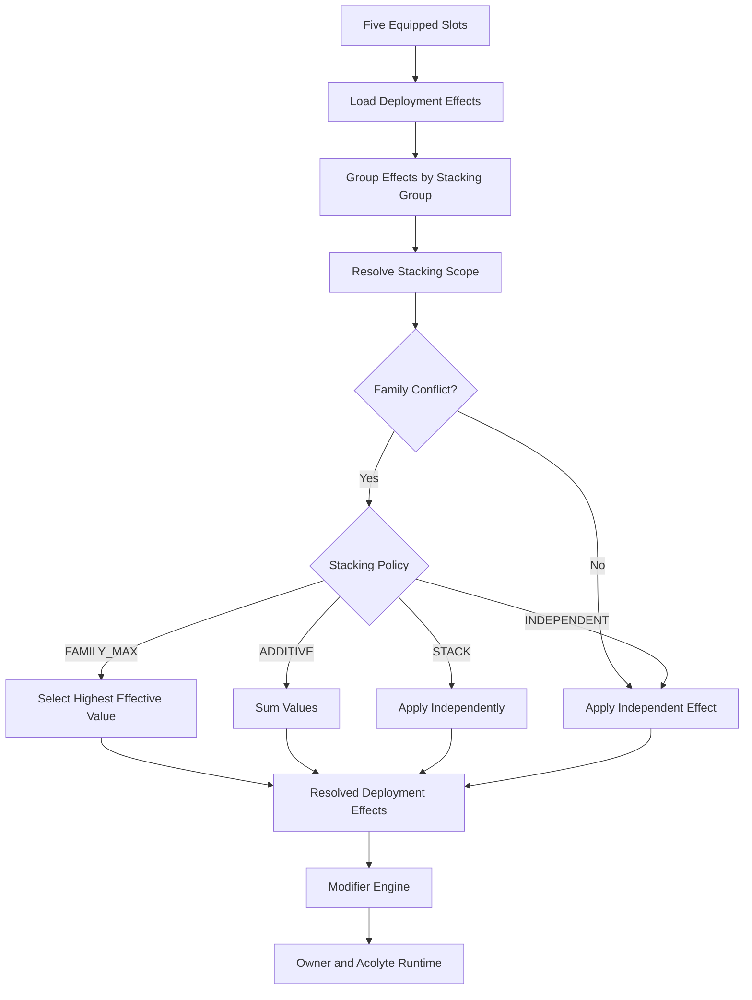

Le traitement est réalisé avant l'application finale des modificateurs au contexte de combat.

Le `FamilyPassiveResolver` ne modifie jamais les définitions originales.

---

# 4. Correction du traitement des doublons au niveau 200

(Règle immédiate confirmée)

Nous remplaçons le comportement initial de conservation par une conversion automatique.

Le processus devient :

1. Réception d'un nouvel exemplaire.
2. Identification de la variante concernée.
3. Vérification du niveau de l'acolyte.
4. Si niveau inférieur à 200 : ajout au solde de doublons.
5. Si niveau égal à 200 : déclenchement immédiat de la règle de fusion.
6. Création des cartes de rareté supérieure.
7. Enregistrement de la transaction.

L'opération doit être atomique et idempotente.

Une même acquisition ne peut jamais être convertie deux fois.

L'entité `AcolyteFusionLedger` conserve la trace de chaque conversion.

---

# 5. Audit des invariants

Les nouvelles observations permettent d'ajouter quatre contraintes.

| ID | Invariant | État |
|--------|--------|--------|
| INV-013 | Une carte exacte ne peut être équipée qu'une fois | Validé |
| INV-014 | Plusieurs variantes d'une même famille peuvent coexister | Validé |
| INV-015 | Les passifs familiaux utilisent une politique de cumul explicite | Validé |
| INV-016 | Les doublons d'un acolyte niveau 200 sont immédiatement convertis | Validé |

Les contraintes précédentes restent applicables.

## 5.1 Tests d'acceptation complémentaires

| ID | Scénario | Résultat attendu |
|--------|--------|--------|
| AT-015 | Équiper deux fois la même carte | Rejet |
| AT-016 | Équiper deux variantes de même famille | Acceptation |
| AT-017 | Deux passifs familiaux de 20 % et 35 % | Application de 35 % |
| AT-018 | Deux passifs de familles différentes | Application indépendante |
| AT-019 | Exception familiale `ADDITIVE` | Addition des valeurs |
| AT-020 | Acquisition d'un doublon au niveau 200 | Fusion immédiate |
| AT-021 | Réception répétée du même événement d'acquisition | Une seule conversion |

---

# 6. Résultat de l'audit SYS-002.D.10.1

**Data Model Audit** (Clôturé)

# 16 / 16

Invariants identifiés et formalisés

---

**Structures consolidées**

- Familles et variantes de rareté.
- Possession et progression.
- Configuration des cinq emplacements.
- Effets de collection et de déploiement.
- Compétences individuelles.
- Runtime par emplacement.
- Fusion et traçabilité.
- Résolution des passifs familiaux.
  
  ---
  
  **Conclusion**

Le modèle de données est architecturalement cohérent et suffisamment défini pour servir de contrat à l'implémentation.

Les valeurs numériques des courbes, les ratios de fusion et le catalogue exact des exceptions restent des données de configuration à renseigner, et non des défauts structurels du modèle.

---

</details>


### SYS-002.D.10.1 · T040 · 19/11/2026 16:34:17

**Nature :** `EXIGENCE_OU_RECTIFICATION_PROPRIETAIRE` · **Ligne d’approbation source :** 14383 · **Ligne de formalisation :** 14418.

**Décision / prescription originale (texte intégral du propriétaire) :**

Je veux rajouter d'autres précisions :

**les acolytes sont regroupés par espèces ou « familles » thématiques, chacune offrant un type de bonus passif spécifique à travers plusieurs paliers de rareté**.

Voici les principales familles d'acolytes et leurs effets associés en combat :

**Familles orientées attaque et critiques**

- **Oiseaux** (*Champignon Oiseau, Oiseau Anti-Pluie, Oiseau Azuré, Plumes de feu sombre*). Ils augmentent la vitesse d'attaque, les chances de combo ou les dégâts de combo.
- **Poules et Coqs** (*Poussin Éclos, Coq Combattant*). Ils renforcent les dégâts des attaques normales.
- **Cactus** (*Cactus Bébé, Cactus de Bête, Cactus dynamique*). Ils infligent des dégâts supplémentaires toutes les trois attaques normales.
- **Dragons** (*Dragon du Trésor, Dragon noir, Dragon de bonheur*). Ils améliorent les chances et les dégâts de coups critiques (attaques normales et compétences).
- **Pieuvres** (*Pieuvre de Pirate*). Elles augmentent les dégâts de combo et déclenchent des attaques supplémentaires tous les trois combos.

**Familles orientées compétences et contrôle**

- **Hydro-Elfes / Blobs** (*Hydro-Elfe Rose, Hydro-Elfe Belliqueux*). Ils accélèrent la régénération d'énergie des compétences actives.
- **Chats** (*Chaton, Chat Noir, Chat Magicien*). Ils prolongent la durée d'étourdissement des ennemis ou augmentent les dégâts de contre-attaque selon leur variante.
- **Escargots** (*Petit Escargot Jaune, Escargot Épineux, Escargot Vert*). Ils ralentissent la vitesse de déplacement et d'attaque des ennemis.
- **Elfes de Neige / Yétis** (*Pudding de Neige, Boulette de Neige, Elfe de Neige*). Ils réduisent la vitesse d'attaque des adversaires pour limiter les dégâts subis.

**Familles orientées survie et défense**

- **Cerfs** (*Jeune Cerf, Cerf à Cornes, Cerf aux Fleurs*). Ils réduisent les dégâts subis par votre personnage.
- **Pandas** (*Panda, Marteau de Panda, Panda d'Apprenti, Panda Messager*). Ils améliorent la régénération des points de vie (PV) en combat.
- **Tortues** (*Tortue Hipster*). Elles octroient des boucliers défensifs ou améliorent la résistance globale lorsque vos PV baissent.
- **Chiens** (*Chien Sautant, Chien Électronique*). Ils renforcent les dégâts et la survie liés à la contre-attaque.

*(Note : Des acolytes spéciaux issus d'événements ou de collaborations, comme les Renards, les Lézards ou les Paladins/Pals de collab, viennent compléter ces familles classiques.)*

Vous pouvez consulter la liste complète et les tier lists par classe sur [**Mobi.gg**](https://mobi.gg/fr/astuces/meilleurs-acolytes-legend-of-mushroom/) ou la base de données [**Guides by Grace**](https://guidesbygrace.uk/pals-database).


<details><summary>Formalisation technique de la décision ratifiée (extrait sourcé)</summary>

# 1. Addendum GDD - SYS-002.D.10.1

(Intégré) (Version 1.2)

Nous ajoutons une classification fonctionnelle des familles.

## 1.1 Taxonomie des familles

| Famille | Orientation | Effets principaux |
|--------|--------|--------|
| Oiseaux | Offensive | Vitesse d'attaque, combo |
| Poules / Coqs | Offensive | Dégâts d'attaque normale |
| Cactus | Offensive | Attaques supplémentaires périodiques |
| Dragons | Critique | Critique normal et compétence |
| Pieuvres | Combo | Dégâts de combo, attaques périodiques |
| Hydro-Elfes / Blobs | Support | Régénération d'énergie |
| Chats | Offensive / contrôle | Effets offensifs et contrôle à préciser |
| Escargots | Contrôle | Réduction de vitesse de déplacement |
| Elfes de Neige / Yétis | Contrôle | Réduction de vitesse d'attaque adverse |
| Cerfs | Défensive | Réduction des dégâts |
| Pandas | Défensive | Régénération des PV |
| Tortues | Défensive | Boucliers et survie conditionnelle |
| Chiens | Défensive / offensive | Contre-attaque et protection |
| Familles spéciales | Variable | Effets spécifiques aux événements et collaborations |

Cette classification est fonctionnelle : elle ne détermine ni la rareté ni la politique de cumul.

## 1.2 Vérification documentaire

La consultation de [Mobi.gg — Classement des acolytes](https://mobi.gg/fr/astuces/meilleurs-acolytes-legend-of-mushroom/?utm_source=chatgpt.com) permet de confirmer plusieurs correspondances et de préciser certains effets.

Exemples relevés dans le catalogue :

| Acolyte | Effet documenté |
|--------|--------|
| Champignon Oiseau | \+5 % vitesse d'ATQ |
| Oiseau Anti-Pluie | \+8 % vitesse d'ATQ |
| Oiseau Azuré | \+10 % vitesse d'ATQ |
| Cactus Bébé | Dégâts supplémentaires toutes les 3 attaques normales |
| Cactus Dynamique | Dégâts supplémentaires toutes les 3 attaques normales |
| Pieuvre de Pirate | \+60 % dégâts de combo et attaque supplémentaire toutes les 3 combos |
| Hydro-Elfe Rose | \+5 % régénération d'énergie des compétences actives |
| Cerf aux Fleurs | \+10 % réduction des dégâts |
| Panda d'Apprenti | \+30 % régénération des PV |
| Tortue Hipster | Bouclier conditionné par les PV, avec cooldown |

\[[Meilleurs acolytes Legend of Mushroom : le classement](https://mobi.gg/fr/astuces/meilleurs-acolytes-legend-of-mushroom/?utm_source=chatgpt.com)\]

Quelques différences méritent d'être enregistrées :

- Les effets documentés des chats comprennent notamment des explosions offensives. Les effets d'étourdissement que tu mentionnes nécessitent une vérification individuelle.
- Les escargots documentés ralentissent principalement le déplacement ennemi. La réduction de vitesse d'attaque est notamment associée aux Elfes de Neige.
- Le Chien Électronique renforce les dégâts de contre-attaque et permet une récupération de PV lors de ces attaques. Le Chien Sautant améliore quant à lui les effets de bouclier.
- Plumes de feu sombre possède un effet de dégâts supplémentaires indexé sur les PV actuels de la cible dans le catalogue consulté.

\[[Meilleurs acolytes Legend of Mushroom : le classement](https://mobi.gg/fr/astuces/meilleurs-acolytes-legend-of-mushroom/?utm_source=chatgpt.com)\]

Ces différences ne justifient pas de supprimer tes observations. Elles doivent être conservées comme données à vérifier individuellement, car les catalogues communautaires peuvent évoluer ou ne pas couvrir toutes les variantes.

Concernant les acolytes exclusifs, [Guides by Grace — Pals Database](https://guidesbygrace.uk/pals-database?utm_source=chatgpt.com) propose notamment un catalogue spécifique aux acolytes d'événements et de collaborations. Il complète le référentiel, mais ne constitue pas à lui seul un catalogue exhaustif des acolytes standards. \[[Database - Pals \| Discover Top Pals – Boost Your Game — Legend of Mushroom](https://guidesbygrace.uk/pals-database?utm_source=chatgpt.com)\]

---

# 2. Évolution du modèle de données

Nous ajoutons une entité supplémentaire : `AcolyteEffectLineage`.

Elle permet de regrouper les effets équivalents provenant de différentes variantes d'une famille.

L'architecture distingue désormais quatre dimensions.

**1. Family**

Identification de l'espèce.

Exemple : `BIRD`.

---

**2. Variant**

Identification de la carte et de sa rareté.

Exemple : `BIRD_AZURE`.

---

**3. Effect Lineage**

Identification de la mécanique commune.

Exemple : `BIRD_ATTACK_SPEED`.

---

**4. Stacking Policy**

Règle de résolution.

Exemple : `FAMILY_MAX`.

## 2.1 Nouveau contrat

```python
@dataclass(frozen=True)
class AcolyteEffectLineage:
    effect_lineage_id: str
    family_id: str
    effect_archetype: str
    comparable_attribute: str
    stacking_scope: str
    default_stacking_policy: str
```

Chaque effet individuel conserve sa propre définition :

```python
@dataclass(frozen=True)
class AcolyteEffectDefinition:
    effect_id: str
    acolyte_id: str

    effect_lineage_id: str | None

    effect_type: str
    trigger_type: str
    target_scope: str

    parameters: dict

    stacking_policy: str
    stacking_priority: int
```

## 2.2 Nouvelle règle de cumul

La règle précédemment validée est affinée.

**Deux effets appartenant à la même famille ne sont pas nécessairement concurrents.**

Ils doivent partager une même lignée d'effet pour être comparés selon `FAMILY_MAX`.

Exemple :

| Effet | Famille | Lignée | Résolution |
|--------|--------|--------|--------|
| \+10 % vitesse d'ATQ | Oiseaux | Attack Speed | Concurrent |
| \+15 % vitesse d'ATQ | Oiseaux | Attack Speed | Concurrent |
| \+20 % dégâts de combo | Oiseaux | Combo Damage | Indépendant |
| \+10 % réduction dégâts | Cerfs | Damage Reduction | Indépendant |

La résolution devient :

$$
E_{\text{effectif}}=
\max(E_1,E_2,\ldots,E_n)
$$

Uniquement pour les effets partageant une même lignée et une même portée de cumul.

Les exceptions utilisent une politique explicitement configurée.

---

# 3. Registre des données à constituer

Pour chaque variante d'acolyte, nous devons désormais enregistrer les propriétés suivantes :

| Propriété | Exemple |
|--------|--------|
| Identifiant | `CACTUS_BABY` |
| Famille | `CACTUS` |
| Rareté | `RARE` |
| Orientation | `OFFENSIVE` |
| Lignée d'effet | `PERIODIC_NORMAL_ATTACK_DAMAGE` |
| Déclenchement | `EVERY_N_NORMAL_ATTACKS` |
| Seuil | 3 |
| Type de dégâts | À déterminer |
| Valeur | À renseigner |
| Politique de cumul | À déterminer |

Cette structure permettra de construire progressivement un catalogue exhaustif sans modifier le moteur de combat à chaque ajout.

---

</details>


### SYS-002.D.10.2.1 · T042 · 19/11/2026 16:47:37

**Nature :** `APPROBATION_EXPLICITE` · **Ligne d’approbation source :** 15172 · **Ligne de formalisation :** 15197.

**Décision / prescription originale (texte intégral du propriétaire) :**

Validation SYS-002.D.10.2.1 : courbe de coûts = stepwise ; monotonie coûts = non_decreasing  monotonie caractéristiques = non_decreasing ; coefficient combo = unknown ; profils de croissance = individual_reusable ; précision numérique = full_precision ; observations = Précisions :
La progression des acolytes (et des compétences) suit un modèle mathématique par paliers sur 200 niveaux, combinant un coût en doublons croissant et une courbe de croissance des statistiques qui s'accélère fortement à haut niveau.

1. Structure des coûts en doublons (Niveaux 1 à 200)

• Progression par paliers. Le nombre de copies (doublons) requises pour monter d'un niveau augmente par tranches de niveaux plutôt que de façon strictement linéaire à chaque niveau.
• Premiers niveaux (1 à 50). Les premiers paliers ne demandent que 2 à 5 doublons par niveau, ce qui permet de monter rapidement les raretés communes (Gris, Vert, Bleu) via les invocations.
• Milieu de courbe (51 à 150). Le coût grimpe progressivement par tranches (passant autour de 10, 15, puis 20 à 30 doublons par niveau), créant le premier goulot d'étranglement sur les raretés Violet et Jaune.
• Derniers paliers (151 à 200). Les ultimes niveaux exigent plusieurs dizaines de doublons par niveau (pouvant atteindre 40 à 50 copies sur les derniers paliers), portant le total cumulé à plusieurs milliers de copies pour atteindre le niveau 200.

2. Courbe de croissance des statistiques (Effet possédé vs équipé)

• Double impact statistique. Chaque niveau gagné augmente à la fois les dégâts de base de l'acolyte en combat et son bonus passif « Possédé » (PV, Attaque ou Défense globale), qui s'applique à votre personnage même lorsque l'acolyte n'est pas dans votre équipe de cinq.
• Accélération exponentielle. Contrairement au bonus passif spécial de l'acolyte (qui reste fixe quelle que soit la montée de niveau, par exemple le taux de combo ou la réduction de dégâts), le bonus « Possédé » suit une courbe exponentielle.
• Rentabilité des hauts niveaux. Un gain de niveau entre 150 et 200 apporte un saut statistique beaucoup plus massif qu'entre les niveaux 1 et 50, ce qui explique pourquoi les acolytes de rareté inférieure (Gris, Vert, Bleu) au niveau 180+ surpassent largement en statistiques passives un acolyte Rouge/Immortel de niveau 10.

3. Mécanique de recyclage au niveau 200 (Synthèse rapide)

• Plafond atteint. Une fois qu'un acolyte atteint le niveau 200 (MAX), ses doublons ne sont plus perdus.
• Conversion à taux fixe (3 pour 1). Comme le montrent les guides de progression sur YouTube, chaque tranche de 3 doublons supplémentaires d'un acolyte niveau 200 est convertie automatiquement (via le bouton Synthèse rapide / Quick Enhance) en 1 exemplaire aléatoire de la rareté immédiatement supérieure (3 Gris = 1 Vert, 3 Verts = 1 Bleu, etc.).
• Effet boule de neige. Ce système transforme progressivement tous vos tirages communs en progression vers les raretés Rouge et Rose/Immortel, rendant l'accumulation de tickets pour les événements Sprint d'acolytes particulièrement rentable sur le long terme.. Formalise les décisions dans le GDD, établis les contrats mathématiques définitifs et poursuis le protocole SYS-002.D.10.2.1.


**Source technique :** réponse consécutive et proposition précédant cette validation, consultables dans l’historique original. Aucun extrait automatique n’a été retenu faute de délimitation non ambiguë.


### SYS-002.D.10.2.1 · T043 · 19/11/2026 16:54:28

**Nature :** `EXIGENCE_OU_RECTIFICATION_PROPRIETAIRE` · **Ligne d’approbation source :** 15627 · **Ligne de formalisation :** 15643.

**Décision / prescription originale (texte intégral du propriétaire) :**

Précisions :

**Non, les compétences individuelles des acolytes n'ont pas de progression indépendante de niveau 1 à 200.** Un acolyte ne possède qu'une seule jauge de niveau globale (de 1 à 200) qui affecte uniquement ses dégâts de base et son bonus passif « Possédé ». 

**Distinction entre le niveau de l'acolyte et son effet**

- **Un seul niveau global par acolyte.** Vous améliorez l'acolyte dans son ensemble via ses doublons, sans jamais avoir à monter une compétence séparée sur sa fiche.
- **Effet de déploiement fixe.** Le bonus spécial d'un acolyte lorsqu'il est équipé dans l'équipe (par exemple l'augmentation du taux de combo, la durée d'étourdissement ou la régénération de PV) reste identique du niveau 1 au niveau 200.
- **Évolution liée au niveau global.** Monter de niveau (de 1 à 200) augmente uniquement le multiplicateur de dégâts des attaques de l'acolyte en combat ainsi que son bonus permanent « Possédé » (PV, Attaque ou Défense).
- **Ne pas confondre avec les compétences du personnage.** Les **compétences actives** de votre champignon (équipées dans les 5 emplacements de sorts) suivent quant à elles une progression séparée de niveau 1 à 200 via leurs propres tirages et doublons.

Pour approfondir le fonctionnement des tirages et des améliorations, vous pouvez consulter le guide dédié sur [**Guides by Grace**](https://guidesbygrace.uk/pals-skills).


<details><summary>Formalisation technique de la décision ratifiée (extrait sourcé)</summary>

# 1. Addendum GDD - SYS-002.D.10.2.1

(Décision validée) (Version 1.2)

## 1.1 Contrat définitif de progression des acolytes

| Élément | Évolution avec le niveau |
|--------|--------|
| Multiplicateur de dégâts de base | Oui |
| Bonus possédé ATQ | Oui |
| Bonus possédé PV | Oui |
| Bonus possédé DEF | Oui |
| Vitesse d'attaque intrinsèque | Non |
| Critique d'acolyte | Non, hérité |
| Dégâts critiques d'acolyte | Non, hérité |
| Combo d'acolyte | Non, hérité |
| Coefficient de combo intrinsèque | Inconnu |
| Inspiration d'acolyte | Non, héritée |
| Ignorance d'évasion | Non, héritée |
| Effet de déploiement | Non |
| Compétences individuelles | Non |

La progression possède donc exactement quatre sorties statistiques évolutives confirmées.

## 1.2 Contrat de progression des compétences du personnage

Les compétences actives du personnage constituent un système distinct.

| Propriété | Acolytes | Compétences du personnage |
|--------|--------|--------|
| Niveau | 1-200 | 1-200 |
| Ressources | Doublons d'acolyte | Doublons de compétence |
| Invocation | Portail d'acolytes | Portail de compétences |
| Progression | Individuelle par variante | Individuelle par compétence |
| Effets spéciaux | Fixes | À spécifier séparément |
| Progression statistique | Dégâts et bonus possédés | Paramètres propres à la compétence |

Cette séparation sera conservée jusque dans les structures persistantes et les services de progression.

# 2. Correction du modèle mathématique

Une précision structurelle doit être apportée à la précédente formalisation.

Les trois bonus ATQ, PV et DEF constituent les catégories possibles de bonus possédé. Ils ne doivent pas nécessairement tous évoluer simultanément sur chaque acolyte.

Nous retenons donc :

$$
\text{AcolyteGrowth}(L)=
\begin{cases}
K_{\text{dégâts}}(L)\\
B_{\text{possédé}}(L)
\end{cases}
$$

Avec :

$$
B_{\text{possédé}}\in\{B_{\text{ATQ}},B_{\text{PV}},B_{\text{DEF}}\}
$$

Chaque définition d'acolyte précise la caractéristique concernée.

Le contrat devient :

```python
@dataclass(frozen=True)
class AcolyteGrowthProfile:
    growth_profile_id: str
    damage_coefficient_curve_id: str
    owned_bonus_curve_id: str
    max_level: int = 200
```

Le type de bonus possédé est défini dans la fiche de l'acolyte, et non dans une règle universelle de progression.

# 3. Architecture des deux moteurs

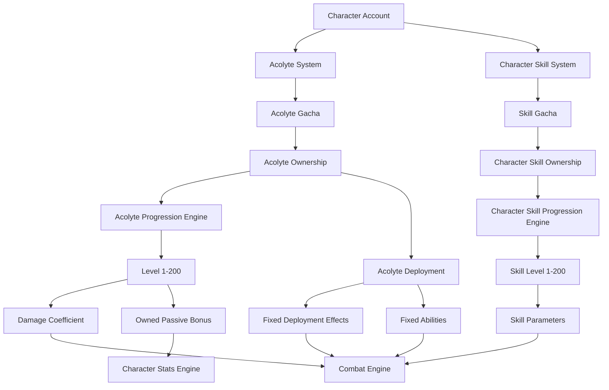

La séparation des portails d'invocation est également cohérente avec la documentation de Guides by Grace, qui distingue explicitement le portail des acolytes de celui des compétences. \[[Pals &amp; Skills — Legend of Mushroom](https://guidesbygrace.uk/pals-skills?utm_source=chatgpt.com)\]

*Note d'ingénierie : aucun état de progression ne doit être partagé entre les deux moteurs. Une acquisition de doublon d'acolyte ne peut jamais modifier le niveau d'une compétence du personnage, et inversement.*

# 4. Mise à jour du registre des décisions

| ID | Décision | État |
|--------|--------|--------|
| PROG-009 | Niveau global unique par acolyte | (Validé) |
| PROG-010 | Deux catégories de sorties évolutives | (Validé) |
| PROG-011 | Effets de déploiement fixes | (Validé) |
| PROG-012 | Compétences d'acolytes sans progression propre | (Validé) |
| PROG-013 | Progression indépendante des compétences du personnage | (Validé) |
| PROG-014 | Portails et ressources distincts | (Validé) |

# 5. État de SYS-002.D.10.2.1

**Spécification mathématique** (Contrat fonctionnel défini)

- [x] Coûts par paliers.
- [x] Monotonie des coûts.
- [x] Croissance linéaire par segments des dégâts.
- [x] Croissance exponentielle des bonus possédés.
- [x] Effets de déploiement fixes.
- [x] Progression globale unique.
- [x] Fusion automatique 3:1.
- [x] Séparation des compétences du personnage.
- [ ] Calibration numérique des courbes.
- [ ] Vérification des ratios et exceptions de fusion.

La spécification fonctionnelle est consolidée. La calibration numérique reste ouverte.

# 6. SYS-002.D.10.2.1.C - Calibration des coûts

Nous pouvons maintenant construire les profils numériques.

Je propose de commencer par les coûts en doublons, avant de travailler sur les courbes statistiques.

Les huit raretés standards sont concernées :

1. Normal
2. Unique
3. Supérieur
4. Rare
5. Mythique
6. Épique
7. Légendaire
8. Immortel

Les acolytes exclusifs disposeront de profils explicitement configurés.

**Première décision de calibration :** les trois grandes plages de progression (1-50, 51-150 et 151-200) doivent-elles être communes aux huit raretés, avec des coûts différents selon la rareté, ou chaque rareté doit-elle pouvoir disposer de ses propres frontières de paliers ?

Cette décision déterminera la structure définitive de `AcolyteDuplicateCostProfile`.

</details>


### SYS-002.D.10.2.1 · T044 · 19/11/2026 17:00:09

**Nature :** `EXIGENCE_OU_RECTIFICATION_PROPRIETAIRE` · **Ligne d’approbation source :** 15862 · **Ligne de formalisation :** 15887.

**Décision / prescription originale (texte intégral du propriétaire) :**

Précisions : 

**Dans la pratique (et comme observé dans *Legend of Mushroom*), les paliers de niveaux sont communs à toutes les raretés, mais chaque rareté possède sa propre échelle de coûts en doublons et ses propres taux de chute pour équilibrer la progression.**

Si vous concevez un système similaire (game design) ou cherchez à comprendre la logique mathématique derrière cette structure, voici pourquoi les paliers communs avec coûts différenciés s'imposent face aux paliers variables :

**1. Pourquoi garder des frontières de paliers communes (1–50, 51–150, 151–200)**

- **Lisibilité et repères cognitifs.** Le joueur assimile rapidement qu'un cap (comme le niveau 50, 100 ou 150) marque un changement de rythme universel, quelle que soit la carte consultée.
- **Alignement des courbes de puissance.** Garder les mêmes seuils permet de synchroniser les pics de statistiques passives (« Possédé ») entre les raretés communes et les raretés mythiques, facilitant l'équilibrage global du jeu.
- **Simplicité d'implémentation et de maintenance.** Une seule table de tranches de niveaux évite de multiplier les formules complexes et réduit les risques d'erreurs d'équilibrage lors de l'ajout d'une nouvelle rareté.

**2. Comment différencier les raretés sans changer les paliers**

- **Multiplicateur de coût par rareté.** Bien que les tranches de niveaux soient identiques, le nombre de doublons requis par niveau est ajusté selon la rareté (une rareté Commune demandera plus de copies par palier pour compenser sa grande abondance au tirage, tandis qu'une rareté Immortelle/Rose demandera moins de copies mais avec un taux d'invocation infime).
- **Taux d'obtention (Gacha) comme levier principal.** C'est la probabilité de tirage (par exemple 50 % pour le Gris contre 0,05 % pour le Rose) qui crée naturellement le ralentissement sur les hautes raretés, sans avoir besoin de déplacer les frontières de paliers.
- **Mécanique de conversion (3 pour 1).** Des frontières communes permettent aux raretés inférieures d'atteindre le plafond (niveau 200) en premier afin d'alimenter les raretés supérieures via la synthèse automatique.

**3. Quand envisager des frontières propres à chaque rareté**

- **Cas d'un plafonnement progressif.** Des frontières spécifiques ne sont pertinentes que si les raretés inférieures sont bloquées à un niveau maximum inférieur (par exemple : Gris bloqué au niveau 100, Vert au niveau 150, Rouge au niveau 200), ce qui n'est pas le cas ici puisque toutes les cartes montent jusqu'au niveau 200.


**Source technique :** réponse consécutive et proposition précédant cette validation, consultables dans l’historique original. Aucun extrait automatique n’a été retenu faute de délimitation non ambiguë.


### SYS-002.D.10.2.1.C.2 · T045 · 19/11/2026 17:08:35

**Nature :** `APPROBATION_EXPLICITE` · **Ligne d’approbation source :** 16172 · **Ligne de formalisation :** 16185.

**Décision / prescription originale (texte intégral du propriétaire) :**

Validation SYS-002.D.10.2.1.C.2 : sous-paliers = shared ; multiplicateur = global ; courbe de référence = lookup ; fusion Immortel = terminal ; observations = Précisions :
Oui, au sommet de la rareté Immortelle (Rose), il n'existe plus de palier supérieur vers lequel fusionner. Une fois qu'un acolyte ou une compétence (celles du personnage) Immortelle atteint le niveau 200 (MAX), les doublons supplémentaires s'accumulent dans votre inventaire sans conversion automatique.

Gestion des doublons au plafond Immortel

• Arrêt de la chaîne de synthèse. La mécanique de fusion (3 doublons de niveau 200 contre 1 exemplaire aléatoire de la rareté supérieure) s'arrête dès que les cartes Rouges (Mythiques/Exotiques) fusionnent vers les cartes Roses (Immortelles).
• Conservation dans l'inventaire. Les copies excédentaires d'un acolyte Immortel déjà au niveau 200 restent stockées en réserve sur sa fiche, car le jeu ne propose pas de rareté supérieure invocables dans le portail classique.
• Intérêt stratégique continu. Même lorsqu'un ou plusieurs Immortels atteignent le niveau maximum, les fusions issues des raretés inférieures continuent d'alimenter les autres acolytes Immortels qui ne sont pas encore niveau 200.
• Utilité pour les événements. Continuer à invoquer et fusionner des doublons reste rentable durant les événements de type Sprint d'acolytes ou de compétences, car les points sont attribués au nombre de tirages effectués et non à l'utilisation des doublons.. Formalise les décisions et poursuis la calibration mathématique.


<details><summary>Formalisation technique de la décision ratifiée (extrait sourcé)</summary>

# 1. Formalisation GDD - SYS-002.D.10.2.1.C.2

(Validé) (Version 1.4)

| Paramètre | Décision |
|--------|--------|
| Grandes phases | Communes aux raretés |
| Sous-paliers | Communs aux raretés |
| Multiplicateur | Global par rareté |
| Courbe de référence | Lookup table |
| Monotonie | Non décroissante |
| Arrondi | Ceiling |
| Fusion standard | 3:1 |
| Rareté terminale | Immortel |
| Doublons Immortels au niveau 200 | Conservation |
| Fusion des Immortels maxés | Désactivée |

## 1.1 Chaîne de rareté

La progression des raretés est représentée par un ordre canonique :

$$
R_1 \rightarrow R_2 \rightarrow \dots \rightarrow R_8
$$

Avec :

$$
R_8=\text{IMMORTAL}
$$

Le moteur utilisera les identifiants et rangs de rareté, jamais les couleurs ou les appellations visuelles pour déterminer la rareté supérieure.

Cela évite notamment les ambiguïtés entre les appellations Mythique, Épique et Exotique.

# 2. Gestion des doublons au niveau maximal

Nous distinguons désormais trois situations.

**Cas A - Rareté non terminale, niveau inférieur à 200**

(Progression normale)

Les doublons alimentent le solde de progression.

---

**Cas B - Rareté non terminale, niveau 200**

(Fusion automatique)

Chaque groupe de trois doublons génère un exemplaire aléatoire de la rareté supérieure.

---

**Cas C - Rareté Immortelle, niveau 200**

(Conservation)

Les doublons supplémentaires sont stockés dans une réserve dédiée. Aucune fusion n'est déclenchée.

Cette règle s'applique aux deux domaines.

| Situation | Acolyte | Compétence |
|--------|--------|--------|
| Niveau inférieur à 200 | Progression | Progression |
| Niveau 200, rareté intermédiaire | Fusion 3:1 | Fusion 3:1 |
| Niveau 200, Immortel | Conservation | Conservation |
| Utilisation des doublons excédentaires | Réserve | Réserve |

Les deux systèmes conservent leurs propres inventaires, tables de coûts, probabilités et historiques.

## 2.1 Extension du modèle de données

Nous ajoutons un compteur spécifique aux ressources excédentaires :

```python
@dataclass
class ProgressionOwnership:
    owner_id: str
    item_id: str

    current_level: int

    duplicate_balance: int
    terminal_duplicate_balance: int

    progression_revision: int
```

Règles :

- `duplicate_balance` : doublons utilisables pour progresser.
- `terminal_duplicate_balance` : doublons conservés lorsque le niveau 200 et la rareté terminale sont atteints.

Le compteur terminal ne participe jamais à un calcul de progression ou de fusion.

## 2.2 Suivi des événements d'invocation

Une précision importante concerne les événements Sprint.

Le système de comptabilisation des tirages doit être indépendant de celui des doublons.

Nous ajoutons :

`GachaPullLedger`

Chaque invocation génère un événement enregistré avant toute opération de progression ou de fusion.

Ainsi :

$$
Points_{\text{événement}}=
f(N_{\text{tirages}})
$$

et non :

$$
f(N_{\text{doublons consommés}})
$$

La fusion et l'amélioration ne peuvent donc pas modifier rétroactivement les points attribués aux tirages.

---

</details>


### SYS-002.D.10.2.1.C.3 · T046 · 19/11/2026 17:15:32

**Nature :** `APPROBATION_EXPLICITE` · **Ligne d’approbation source :** 16589 · **Ligne de formalisation :** 16594.

**Décision / prescription originale (texte intégral du propriétaire) :**

Validation SYS-002.D.10.2.1.C.3 : sous-paliers = approve ; coûts de référence = approve ; rareté de référence = normal_one ; ordre des multiplicateurs = non_increasing ; observations = Aucune. Formalise les décisions et poursuis avec la calibration des huit multiplicateurs de rareté.


**Source technique :** réponse consécutive et proposition précédant cette validation, consultables dans l’historique original. Aucun extrait automatique n’a été retenu faute de délimitation non ambiguë.


### SYS-002.D.10.2.1.C.4 · T047 · 19/11/2026 17:26:48

**Nature :** `APPROBATION_EXPLICITE` · **Ligne d’approbation source :** 16812 · **Ligne de formalisation :** 16846.

**Décision / prescription originale (texte intégral du propriétaire) :**

Validation SYS-002.D.10.2.1.C.4 : multiplicateurs = approve ; statut calibration = provisional ; observations = Précisions :
Dans Legend of Mushroom, les probabilités de gacha d'obtention des acolytes et des compétences évoluent selon le niveau de la machine d'invocation (de 1 à 15), atteignant un maximum de 0,04 % (1 chance sur 2 500) pour la rareté Immortelle.

1. Évolution des taux selon le niveau d'invocation (1 à 15)

Chaque tirage effectué fait progresser une jauge d'expérience propre au portail (Acolytes ou Compétences) afin de débloquer de meilleures probabilités :
• Niveaux 1 à 8 (Début de partie). Les chances se concentrent quasi exclusivement sur les raretés Grise (Commune), Verte et Bleue, avec l'apparition progressive du Violet et du Jaune.
• Niveaux 9 à 12 (Milieu de partie). Les raretés Orange et Rouge (Exotique/Mythique) deviennent accessibles, tandis que la rareté Rose (Immortelle) s'ouvre autour du niveau 11-12 avec un taux initial de 0,01 % (1 chance sur 10 000).
• Niveau 13. Le taux d'obtention d'un Immortel double pour passer à 0,02 % (1 chance sur 5 000).
• Niveau 15 (Plafond maximum). La machine atteint son rendement maximal avec 0,04 % de chance pour un Immortel (1 chance sur 2 500), environ 0,2 % à 0,5 % pour le Rouge, et une forte réduction du taux de cartes Grises au profit des raretés Bleues, Violettes et Jaunes.

2. Probabilité de cibler une carte précise

• Partage équitable au sein d'une rareté. Lorsqu'un tirage tombe sur une rareté donnée, le jeu sélectionne aléatoirement l'une des cartes disponibles dans ce palier (par exemple, avec 3 à 5 compétences Immortelles dans le portail classique, obtenir une compétence précise représente environ 15 % à 33 % de chance une fois le palier Rose déclenché).
• Absence de « Pity » classique. Contrairement à d'autres jeux gacha, les machines à pinces standards d'acolytes et de compétences n'ont pas de compteur de garantie (pity) fixe : chaque tirage est indépendant, bien que les grands nombres et la synthèse (3 pour 1) lissent les résultats sur la durée.

3. Autres portails et optimisation des tirages

• Invocations d'Âmes Martiales. Les cristaux d'âme suivent une table différente, avec un taux d'environ 0,4 % pour une âme rouge/LR de haut rang, compensé par un système de garantie et d'essence d'âme.
• Tirages groupés avantageux. Utiliser l'option x35 tirages ne coûte que 30 tickets (soit environ 14 % de tirages gratuits en plus), et le niveau 15 débloque l'option x999

Atteindre le niveau 15 d'invocation demande plusieurs dizaines de milliers de tirages cumulés (avec des paliers de 3 000 à plus de 10 000 tirages par niveau sur la fin), mais il est tout à fait possible d'obtenir et de monter des cartes Immortelles gratuitement grâce au recyclage des doublons et aux événements hebdomadaires.

1. Progression des niveaux de machine (1 à 15)

Chaque tirage effectué rapporte 1 point d'expérience à la machine concernée (Acolytes ou Compétences) :
• Niveaux 1 à 8 (Montée rapide). Les premiers paliers ne demandent que quelques dizaines à quelques centaines de tirages (par exemple 50, 100, 200, 400 tirages) pour débloquer progressivement les raretés Bleue, Violette, Jaune et Orange.
• Niveaux 9 à 11 (Transition vers le Mythique). Chaque niveau exige entre 1 000 et 2 500 tirages, débloquant la rareté Rouge (Exotique/Mythique) autour du niveau 6-9 selon le portail.
• Niveau 12 (Ouverture des Immortels). Il faut 3 000 tirages supplémentaires depuis le niveau 11 pour atteindre le niveau 12, seuil où les cartes Roses (Immortelles) apparaissent enfin à 0,01 %, comme illustré dans les sessions de tirages sur YouTube.
• Niveaux 13 à 15 (Plafond de rendement). Les trois derniers paliers requièrent entre 5 000 et 15 000 tirages par niveau pour faire grimper le taux Immortel à 0,02 % (niveau 13), 0,03 % (niveau 14), puis 0,04 % (niveau 15).. Formalise les décisions, calcule les profils définitifs et poursuis SYS-002.D.10.2.1.


<details><summary>Formalisation technique de la décision ratifiée (extrait sourcé)</summary>

# 1. Formalisation GDD - SYS-002.D.10.2.1.C.4

(Validé) (Calibration provisoire)

Les huit multiplicateurs sont acceptés avec les valeurs suivantes :

| Rareté | Multiplicateur |
|--------|--------|
| Normal | 1,00 |
| Unique | 0,90 |
| Supérieur | 0,80 |
| Rare | 0,70 |
| Mythique | 0,60 |
| Épique | 0,50 |
| Légendaire | 0,40 |
| Immortel | 0,30 |

La fonction de coût reste :

$$
C(R,L)=\lceil B(L)\times M_R\rceil
$$

Les multiplicateurs sont acceptés comme paramètres de notre modèle, mais leur calibration économique reste provisoire jusqu'à l'intégration complète des probabilités d'invocation.

## 1.1 Profils de coûts calculés

Voici les coûts effectifs obtenus après application des multiplicateurs et de l'arrondi supérieur.

Chaque valeur représente le coût d'un niveau à l'intérieur du palier correspondant.

| Rareté | P01 | P02 | P03 | P04 | P05 | P06 |
|--------|--------|--------|--------|--------|--------|--------|
| Normal | 2 | 3 | 4 | 5 | 10 | 15 |
| Unique | 2 | 3 | 4 | 5 | 9 | 14 |
| Supérieur | 2 | 3 | 4 | 4 | 8 | 12 |
| Rare | 2 | 3 | 3 | 4 | 7 | 11 |
| Mythique | 2 | 2 | 3 | 3 | 6 | 9 |
| Épique | 1 | 2 | 2 | 3 | 5 | 8 |
| Légendaire | 1 | 2 | 2 | 2 | 4 | 6 |
| Immortel | 1 | 1 | 2 | 2 | 3 | 5 |

| Rareté | P07 | P08 | P09 | P10 | P11 | Total |
|--------|--------|--------|--------|--------|--------|--------|
| Normal | 20 | 30 | 40 | 45 | 50 | **4 275** |
| Unique | 18 | 27 | 36 | 41 | 45 | **3 885** |
| Supérieur | 16 | 24 | 32 | 36 | 40 | **3 445** |
| Rare | 14 | 21 | 28 | 32 | 35 | **3 040** |
| Mythique | 12 | 18 | 24 | 27 | 30 | **2 585** |
| Épique | 10 | 15 | 20 | 23 | 25 | **2 170** |
| Légendaire | 8 | 12 | 16 | 18 | 20 | **1 730** |
| Immortel | 6 | 9 | 12 | 14 | 15 | **1 325** |

P01 à P11 désignent les onze sous-paliers validés. Les totaux comptabilisent les 199 améliorations nécessaires pour atteindre le niveau 200.

Ces profils sont mathématiquement cohérents.

---

# 2. Nouvelle spécification - Gacha Machine Engine

(SYS-002.D.10.2.1.D - Ouverture)

Nous introduisons un moteur indépendant pour gérer les machines d'invocation.

Il existe deux instances distinctes :

- `ACOLYTE_GACHA`
- `CHARACTER_SKILL_GACHA`

Chaque machine possède son propre niveau, son expérience et ses probabilités de tirage.

## 2.1 Contrat fonctionnel

| Propriété | Décision |
|--------|--------|
| Niveau initial | 1 |
| Niveau maximal | 15 |
| Expérience par tirage | 1 XP |
| Progression | Automatique |
| Machine acolytes | Indépendante |
| Machine compétences | Indépendante |
| Probabilités | Dépendantes du niveau |
| Garantie classique (Pity) | Absente |
| Sélection dans une rareté | Équitable |
| Option x35 | 35 tirages pour 30 tickets |
| Option x999 | Débloquée au niveau 15 |

La progression du portail ne doit jamais être confondue avec la progression des cartes.

Par exemple, atteindre le niveau 15 de la machine à acolytes ne signifie pas que les acolytes possédés progressent automatiquement.

## 2.2 Architecture proposée

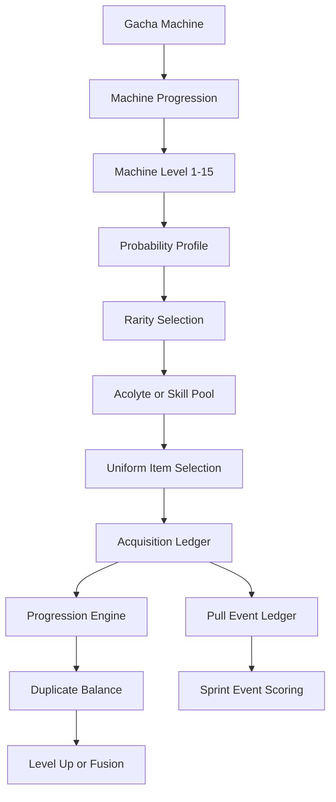

Le `GachaMachineEngine` ne doit pas directement améliorer les cartes.

Il produit des acquisitions. Les moteurs de progression et de fusion traitent ensuite ces acquisitions.

# 3. Progression des machines - niveaux 1 à 15

## 3.1 Expérience nécessaire

Chaque tirage rapporte un point d'expérience :

$$
XP_{\text{machine}}=N_{\text{tirages}}
$$

Les seuils communiqués permettent d'établir le référentiel suivant.

| Niveau | XP supplémentaire indicative | État |
|--------|--------|--------|
| 1-8 | Dizaines à centaines | À calibrer |
| 9 | 1 000-2 500 | Indicatif |
| 10 | 1 000-2 500 | Indicatif |
| 11 | 1 000-2 500 | Indicatif |
| 12 | 3 000 | Observé |
| 13 | 5 000-15 000 | Indicatif |
| 14 | 5 000-15 000 | Indicatif |
| 15 | 5 000-15 000 | Indicatif |

Les exemples de 50, 100, 200 et 400 tirages concernent les premiers paliers, mais leur attribution exacte aux niveaux n'est pas encore établie.

### Conséquence mathématique

Entre les niveaux 11 et 15, la progression nécessite approximativement :

$$
XP_{11\rightarrow15}
=3000+3\times[5000,15000]
$$

$$
\boxed{18000\leq XP\leq48000}
$$

Cette plage est indicative et devra être calibrée séparément pour les deux machines.

## 3.2 Contrat de données

```python
@dataclass
class GachaMachineState:
    owner_id: str
    machine_id: str

    machine_type: str
    current_level: int
    accumulated_xp: int

    progression_revision: int

@dataclass(frozen=True)
class GachaMachineLevel:
    machine_type: str
    level: int
    xp_required: int

@dataclass(frozen=True)
class GachaProbabilityProfile:
    machine_type: str
    machine_level: int
    rarity_probabilities: dict[str, float]
```

Les seuils d'expérience seront configurés séparément pour chaque type de machine.

---

# 4. Calibration des probabilités d'invocation

C'est ici que tes observations apportent les informations les plus intéressantes.

## 4.1 Probabilités Immortelles

Nous disposons de quatre points de référence précis.

**Évolution du taux Immortel**

| **Niveau 12** | 0,01 % |
|--------|--------|
| **Niveau 13** | 0,02 % |
| **Niveau 14** | 0,03 % |
| **Niveau 15** | 0,04 % |

Nous retenons le niveau 12 comme seuil d'apparition des Immortels, conformément à ta précision la plus détaillée.

Pour les niveaux 1 à 11 :

$$
P(\text{Immortel})=0
$$

À partir du niveau 12, le taux augmente selon les valeurs du tableau.

## 4.2 Probabilité d'obtenir une carte précise

Tu indiques que la sélection à l'intérieur d'une rareté est équitable.

Nous définissons :

$$
P(A_i\mid R)=\frac{1}{N_R}
$$

Où $N_R$ représente le nombre de cartes disponibles dans la rareté.

La probabilité totale devient :

$$
\boxed{P(A_i)=\frac{P(R)}{N_R}}
$$

Prenons trois à cinq cartes Immortelles disponibles.

| Niveau machine | Taux Immortel | Chance d'une carte précise |
|--------|--------|--------|
| 12 | 0,01 % | 0,002-0,00333 % |
| 13 | 0,02 % | 0,004-0,00667 % |
| 14 | 0,03 % | 0,006-0,01000 % |
| 15 | 0,04 % | 0,008-0,01333 % |

La probabilité conditionnelle d'obtenir une carte précise après avoir déclenché la rareté Immortelle est donc de 20 à 33,33 % pour un pool de trois à cinq cartes.

Attention : les 15 % mentionnés dans tes observations supposeraient un pool de sept cartes environ. Ce point reste à vérifier.

## 4.3 Espérance de tirages

En l'absence de Pity, le nombre moyen de tirages nécessaire pour obtenir un Immortel est :

$$
E[N]=\frac{1}{p}
$$

| Niveau | Taux Immortel | Espérance |
|--------|--------|--------|
| 12 | 0,01 % | 10 000 |
| 13 | 0,02 % | 5 000 |
| 14 | 0,03 % | 3 333 |
| 15 | 0,04 % | 2 500 |

Ces nombres sont des espérances, pas des garanties.

À 0,04 %, après 2 500 tirages effectués au même niveau, la probabilité d'obtenir au moins un Immortel est d'environ 63,2 %.

La probabilité d'obtenir zéro Immortel reste donc d'environ 36,8 %.

---

# 5. Absence de Pity et indépendance des tirages

La décision fonctionnelle est la suivante :

$$
P(X_n\mid X_1,\ldots,X_{n-1})=P(X_n)
$$

À niveau de machine constant, chaque tirage est indépendant.

Il n'existe aucun compteur de garantie qui augmente progressivement les probabilités après une série de résultats négatifs.

En revanche, la progression de la machine modifie les probabilités lorsqu'un nouveau niveau est atteint.

Il faut donc distinguer :

- Indépendance des tirages à niveau constant.
- Évolution déterministe des probabilités lors d'une montée de niveau.

## 5.1 Probabilités des autres raretés

Les informations disponibles permettent de définir des contraintes, mais pas une table complète.

| Niveau | Distribution connue |
|--------|--------|
| 1-8 | Forte concentration sur les raretés communes |
| 9-11 | Progression des raretés supérieures |
| 12 | Immortel : 0,01 % |
| 13 | Immortel : 0,02 % |
| 14 | Immortel : 0,03 % |
| 15 | Immortel : 0,04 % ; Rouge : environ 0,2-0,5 % |

Les autres probabilités restent à renseigner.

Il existe également une divergence dans tes observations concernant le déblocage des raretés Orange et Rouge : une première description situe leur apparition entre les niveaux 9 et 12, tandis qu'une autre évoque le Rouge dès les niveaux 6 à 9.

Nous ne fixerons pas artificiellement un seuil avant d'avoir une observation précise.

---

# 6. Tirages groupés et événements

## 6.1 Option x35

Nous enregistrons :

$$
35\text{ tirages}=30\text{ tickets}
$$

Cela représente :

$$
\frac{35-30}{35}\times100
=14,29\%
$$

d'économie par rapport au prix de 35 tirages individuels.

Le joueur reçoit néanmoins 35 résultats et, selon la règle d'expérience par tirage :

$$
XP_{\text{gagné}}=35
$$

## 6.2 Option x999

Déblocage au niveau 15.

Le coût exact en tickets et les modalités d'exécution restent à documenter.

## 6.3 Sprint d'invocation

Le `GachaPullLedger` devra enregistrer chaque tirage individuellement, même lorsqu'il provient d'une invocation groupée.

Les événements Sprint comptabilisent les tirages effectués, indépendamment de l'utilisation ultérieure des doublons.

Une fusion ne génère donc pas rétroactivement de points d'invocation.

## 6.4 Âmes Martiales

Nous excluons explicitement les invocations d'Âmes Martiales de ce moteur.

Elles possèdent :

- Leur propre table de probabilités.
- Leur propre ressource.
- Leur propre système de garantie.
- Leur propre mécanisme d'essence.

Elles feront l'objet d'une spécification séparée.

---

</details>


### SYS-002.D.10.2.1.D.1 · T048 · 19/11/2026 17:31:13

**Nature :** `APPROBATION_EXPLICITE` · **Ligne d’approbation source :** 17550 · **Ligne de formalisation :** 17555.

**Décision / prescription originale (texte intégral du propriétaire) :**

Validation SYS-002.D.10.2.1.D.1 : ordre XP/tirage = before_xp ; tirages groupés = sequential ; sélection pool = uniform_available ; profils XP = independent ; observations = Aucune. Formalise les décisions, clôture les contrats mathématiques disponibles et poursuis SYS-002.D.10.2.1.


<details><summary>Formalisation technique de la décision ratifiée (extrait sourcé)</summary>

# SYS-002.D.10.2.1.D.1 — Validation et clôture des contrats Gacha

(Décisions validées) (Version 1.1)

Les quatre décisions sont intégrées. Elles rendent le comportement temporel des invocations déterministe, y compris lorsque plusieurs tirages sont exécutés dans une même opération.

## 1. Formalisation des décisions

| Paramètre | Décision validée |
|--------|--------|
| Ordre XP/tirage | `before_xp` |
| Tirages groupés | `sequential` |
| Sélection des cartes | `uniform_available` |
| Profils XP | `independent` |

### 1.1 Ordre de résolution d'un tirage

La séquence est désormais strictement définie :

1. Lecture du niveau actuel de la machine.
2. Chargement de la distribution de probabilités correspondant à ce niveau.
3. Tirage de la rareté.
4. Sélection uniforme d'une carte disponible dans cette rareté.
5. Enregistrement de l'acquisition.
6. Attribution d'un point d'expérience à la machine.
7. Vérification du franchissement éventuel d'un seuil.
8. Actualisation du niveau de machine.

Exemple :

**Machine actuellement au niveau 11**

1. **Tirage N**
   
   Probabilités du niveau 11 utilisées.
2. **Attribution de l'expérience**
   
   La machine reçoit 1 XP et atteint le seuil du niveau 12.
3. **Actualisation**
   
   La machine passe au niveau 12.
4. **Tirage N+1**
   
   Les probabilités du niveau 12 sont désormais utilisées.

Cette séquence évite toute ambiguïté concernant le tirage qui provoque le changement de niveau.

### 1.2 Tirages groupés séquentiels

Une opération x35 correspond à 35 résolutions individuelles.

$$
XP_{\text{gagnée}}=35
$$

Si un seuil de niveau est franchi pendant l'opération, les tirages suivants utilisent immédiatement les nouvelles probabilités.

Il n'existe aucun snapshot des probabilités au début du groupe.

Même principe pour x999, disponible à partir du niveau 15.

### 1.3 Sélection uniforme

Pour une rareté donnée :

$$
P(A_i\mid R)=\frac{1}{N_R}
$$

La population utilisée est celle des cartes effectivement disponibles dans le pool concerné au moment du tirage.

Les cartes indisponibles ne participent pas à la sélection.

### 1.4 Indépendance des machines

Les machines possèdent des états entièrement distincts.

| État | Acolytes | Compétences |
|--------|--------|--------|
| Niveau | Indépendant | Indépendant |
| Expérience | Indépendante | Indépendante |
| Probabilités | Profil propre | Profil propre |
| Historique des tirages | Séparé | Séparé |
| Ressources | Tickets dédiés | Tickets dédiés |

Aucune progression d'une machine ne modifie l'autre.

---

# 2. Contrats mathématiques désormais clôturés

Il faut distinguer les contrats dont les fonctions sont complètement définies de ceux dont les paramètres numériques restent incomplets.

## 2.1 Duplicate Cost Engine

(Contrat mathématique clôturé)

Les huit profils de coûts sont calculables.

| Rareté | Multiplicateur | Coût total niveau 1 → 200 |
|--------|--------|--------|
| Normal | 1,00 | 4 275 |
| Unique | 0,90 | 3 885 |
| Supérieur | 0,80 | 3 445 |
| Rare | 0,70 | 3 040 |
| Mythique | 0,60 | 2 585 |
| Épique | 0,50 | 2 170 |
| Légendaire | 0,40 | 1 730 |
| Immortel | 0,30 | 1 325 |

Les valeurs sont exactes pour la table de référence et les multiplicateurs provisoires validés.

Les 1 592 transitions individuelles ont été déterminées mathématiquement.

Les propriétés suivantes sont garanties :

- Coûts strictement positifs.
- Coûts entiers.
- Monotonie non décroissante.
- Frontières communes.
- Absence de niveaux inaccessibles.
- Niveau maximal égal à 200.

## 2.2 Fusion Engine

(Contrat fonctionnel clôturé)

$$
Q=\left\lfloor\frac{N}{3}\right\rfloor
$$

$$
R=N\bmod3
$$

- Fusion 3:1 pour les raretés non terminales, lorsque la carte source est niveau 200.
- Sélection aléatoire dans le pool supérieur autorisé.
- Conservation des reliquats.
- Conservation des doublons Immortels au niveau 200.
- Aucun débordement vers une rareté inexistante.

La règle de conservation au sommet de la rareté s'applique aux acolytes et aux compétences.

Les tables de coûts des compétences restent indépendantes de celles des acolytes.

## 2.3 Gacha Resolution Engine

(Contrat de résolution clôturé)

Les fonctions suivantes sont définies :

$$
P(R\mid L_{\text{machine}})
$$

$$
P(A_i\mid R)=\frac{1}{N_R}
$$

$$
XP_{\text{machine}}=N_{\text{tirages}}
$$

Les tirages sont indépendants en l'absence de Pity, à niveau de machine constant.

La résolution séquentielle permet une évolution des probabilités à l'intérieur d'un tirage groupé.

**Limite :** le contrat de résolution est clôturé, mais la table complète des probabilités et les seuils exacts d'expérience des machines ne le sont pas encore.

# 3. Registre des paramètres Gacha

Les observations sont intégrées comme contraintes de calibration.

## 3.1 Probabilités Immortelles

(Valeurs de référence intégrées)

| Niveau machine | Probabilité Immortel |
|--------|--------|
| 1–11 | 0 % |
| 12 | 0,01 % |
| 13 | 0,02 % |
| 14 | 0,03 % |
| 15 | 0,04 % |

Ces valeurs s'appliquent indépendamment aux deux machines, sous réserve de confirmation que leurs tables officielles sont effectivement identiques.

## 3.2 Paramètres encore non calibrés

| Paramètre | État |
|--------|--------|
| Probabilités Normal à Légendaire, niveaux 1–15 | À renseigner |
| Probabilités exactes Rouge, niveaux 9–15 | À renseigner |
| XP nécessaire par niveau de machine | À renseigner |
| Nombre de cartes par rareté | À documenter |
| Probabilités des bannières spéciales | À documenter |
| Coût exact x999 | À documenter |
| Tables de compétences | Indépendantes, à calibrer |

Une contrainte mathématique est impérative :

$$
\boxed{\sum_{R}P(R\mid L)=1}
$$

La somme des probabilités de toutes les raretés doit être exactement égale à 100 %.

Nous ne pouvons donc pas compléter artificiellement les probabilités manquantes à partir du seul taux Immortel.

---

</details>


### SYS-002.D.10.2.1.E.1 · T049 · 19/11/2026 17:43:43

**Nature :** `APPROBATION_EXPLICITE` · **Ligne d’approbation source :** 17958 · **Ligne de formalisation :** 17963.

**Décision / prescription originale (texte intégral du propriétaire) :**

Validation SYS-002.D.10.2.1.E.1 : points d'ancrage = shared_5  croissance bonus possédés = piecewise_exponential ; nombre de bonus possédés = single_type ; valeurs initiales = first_anchor_positive ; observations = Aucune. Formalise les décisions et poursuis avec la construction mathématique des courbes de croissance.


**Source technique :** réponse consécutive et proposition précédant cette validation, consultables dans l’historique original. Aucun extrait automatique n’a été retenu faute de délimitation non ambiguë.


### SYS-002.D.10.2.1 · T051 · 19/11/2026 17:55:54

**Nature :** `EXIGENCE_OU_RECTIFICATION_PROPRIETAIRE` · **Ligne d’approbation source :** 18706 · **Ligne de formalisation :** 18728.

**Décision / prescription originale (texte intégral du propriétaire) :**

**Il n'existe pas de base de données publique listant les valeurs numériques exactes niveau par niveau (1, 50, 100, 150, 200) de chaque acolyte**, mais nous disposons de la structure complète d'une fiche type et des formules exactes qui régissent sa progression.

Voici toutefois comment se présente une **fiche technique complète d'acolyte** et comment évoluent ses deux valeurs chiffrées sur les paliers demandés :

**1. Anatomie d'une fiche d'acolyte**

Sur la carte d'un acolyte en jeu, on retrouve quatre éléments distincts :

- **Rareté et niveau actuel (1 à 200).** Indique le palier de couleur (de Gris à Rose/Immortel) et l'avancement vers le plafond.
- **Effet de déploiement (Statique).** Le bonus spécial actif uniquement lorsque l'acolyte est équipé dans l'équipe de cinq (par exemple : *Vitesse d'attaque +15 %* ou *Dégâts de combo +25 %*), dont la valeur est identique au niveau 1 et au niveau 200.
- **Coefficient de dégâts en combat (Évolutif).** Le pourcentage de l'attaque de votre personnage que l'acolyte inflige à chacune de ses propres attaques basiques (par exemple : *Inflige 45 % de votre ATQ en dégâts* au niveau 1).
- **Bonus « Possédé » (Évolutif et cumulatif).** Le pourcentage permanent d'ATQ, de PV ou de DÉF ajouté à votre personnage, actif en permanence même si l'acolyte reste dans votre inventaire.

**2. Courbe d'évolution sur les paliers (1, 50, 100, 150, 200)**

- **Progression linéaire par niveau.** Contrairement au coût en doublons qui grimpe par paliers, le **bonus « Possédé »** et le **coefficient de dégâts** augmentent d'un incrément fixe à chaque niveau gagné (selon la rareté de la carte).
- **Écart d'échelle selon la rareté.** Une carte **Grise (Commune)** démarre avec un bonus possédé très faible (environ **+0,1 %** au niveau 1) pour atteindre environ **+20 % à +40 %** au niveau 200, tandis qu'une carte **Rose (Immortelle)** démarre beaucoup plus haut (plusieurs pourcents dès le niveau 1) pour dépasser les **+1 000 %** au niveau 200.
- **Impact en combat (Formule de dégâts).** Comme l'expliquent les analyses mathématiques de la communauté sur [**YouTube**](https://www.youtube.com/watch?v=Vzg0jcmNF9k), les dégâts réels infligés par un acolyte se calculent en multipliant votre **Attaque finale** par le **coefficient de dégâts de l'acolyte**, puis par vos multiplicateurs dédiés (*Dégâts d'acolyte*, *Taux critique d'acolyte* et *Dégâts critiques d'acolyte*, essentiels pour la classe Dompteur).


**Source technique :** réponse consécutive et proposition précédant cette validation, consultables dans l’historique original. Aucun extrait automatique n’a été retenu faute de délimitation non ambiguë.


### SYS-002.D.10.2.1 · T052 · 19/11/2026 17:58:54

**Nature :** `APPROBATION_EXPLICITE` · **Ligne d’approbation source :** 19069 · **Ligne de formalisation :** 19074.

**Décision / prescription originale (texte intégral du propriétaire) :**

Oui je valide


**Source technique :** réponse consécutive et proposition précédant cette validation, consultables dans l’historique original. Aucun extrait automatique n’a été retenu faute de délimitation non ambiguë.


### SYS-002.D.10.2.1.E.8 · T053 · 19/11/2026 18:01:13

**Nature :** `APPROBATION_EXPLICITE` · **Ligne d’approbation source :** 19279 · **Ligne de formalisation :** 19284.

**Décision / prescription originale (texte intégral du propriétaire) :**

Validation SYS-002.D.10.2.1.E.8 : politique de calibration = soft ; ordre de puissance = expected ; réutilisation des profils = same_rarity ; observations = Aucune. Formalise les décisions et clôture la spécification mathématique de l'Acolyte Progression Engine.


<details><summary>Formalisation technique de la décision ratifiée (extrait sourcé)</summary>

# SYS-002.D.10.2.1.E.8 — Formalisation et clôture

(Validé) (Spécification clôturée)

Les trois décisions sont intégrées au GDD.

| Paramètre | Décision définitive |
|--------|--------|
| Politique de calibration | `soft` |
| Ordre de puissance des raretés | `expected` |
| Réutilisation des profils | `same_rarity` |

## 1. Règles définitives de calibration

### 1.1 Soft Constraints

Les plages de calibration constituent des références, pas des contraintes bloquantes.

- Un profil conforme est accepté.
- Un profil hors des plages attendues génère un avertissement.
- Une valeur vérifiée dans le jeu officiel peut être conservée même si elle sort des plages estimées.
- Aucune valeur observée ne doit être modifiée artificiellement pour satisfaire une hypothèse.

### 1.2 Expected Rarity Ordering

La puissance doit globalement progresser avec la rareté.

Cependant, nous n'imposons pas :

$$
K_{\text{Immortel}}>K_{\text{Légendaire}}
$$

pour chaque comparaison individuelle.

L'ordre est une tendance attendue à l'échelle des profils.

Pour les bonus possédés, les comparaisons doivent porter sur une même caractéristique : ATQ avec ATQ, PV avec PV et DEF avec DEF.

### 1.3 Same Rarity Profile Reuse

Un profil peut être partagé entre plusieurs acolytes, à condition qu'ils appartiennent à la même rareté.

$$
R(A_i)=R(A_j)
$$

et :

$$
Profile(A_i)=Profile(A_j)
$$

La réutilisation entre raretés différentes est interdite, même lorsque les paramètres numériques sont identiques.

---

# 2. Acolyte Progression Engine — Architecture finale

(Contrat mathématique clôturé)

Le moteur est désormais constitué de quatre sous-systèmes.

**Acolyte Progression Engine**

Orchestrateur de progression

**Duplicate Cost Engine**

Coûts des niveaux 1–200

**Fusion Engine**

Synthèse 3:1

**Growth Engine**

Coefficient et bonus possédé

**Profile Registry**

Profils individuels réutilisables

---

**Outputs**

Statistiques de combat et contributions à la collection

Le Gacha Machine Engine reste un système externe qui fournit les acquisitions.

Le Collection Bonus Engine consomme les contributions calculées par le Growth Engine.

# 3. Contrats mathématiques définitifs

## 3.1 Progression par doublons

Pour un acolyte de rareté $R$, actuellement au niveau $L$ :

$$
C(R,L)=\lceil B(L)\times M_R\rceil
$$

Les coûts de référence sont les onze sous-paliers validés.

| Rareté | Multiplicateur | Total niveau 200 |
|--------|--------|--------|
| Normal | 1,00 | 4 275 |
| Unique | 0,90 | 3 885 |
| Supérieur | 0,80 | 3 445 |
| Rare | 0,70 | 3 040 |
| Mythique | 0,60 | 2 585 |
| Épique | 0,50 | 2 170 |
| Légendaire | 0,40 | 1 730 |
| Immortel | 0,30 | 1 325 |

Multiplicateurs acceptés, calibration économique toujours provisoire.

Le moteur doit permettre l'amélioration rapide, en consommant successivement les coûts des niveaux jusqu'à épuisement du solde ou atteinte du niveau 200.

## 3.2 Fusion

$$
N_{\text{fusion}}=\left\lfloor\frac{D}{3}\right\rfloor
$$

$$
D_{\text{restant}}=D\bmod3
$$

Conditions :

- Acolyte non terminal au niveau 200 : fusion autorisée.
- Trois doublons : un exemplaire aléatoire de la rareté supérieure.
- Reliquat inférieur à trois : conservation.
- Immortel niveau 200 : conservation intégrale des doublons.

## 3.3 Croissance du coefficient de dégâts

$$
\boxed{K(L)=K_0+(L-1)\Delta K}
$$

Avec :

$$
K_0>0,\quad\Delta K>0
$$

## 3.4 Croissance du bonus possédé

$$
\boxed{B(L)=B_0+(L-1)\Delta B}
$$

Avec :

$$
B_0>0,\quad\Delta B>0
$$

Les deux fonctions utilisent une progression linéaire à incrément constant.

Les cinq niveaux de référence sont conservés :

$$
L\in\{1,50,100,150,200\}
$$

Ils servent à contrôler les profils et non à définir des segments de croissance.

---

# 4. Contrat définitif des profils

Chaque profil contient :

| Champ | Fonction |
|--------|--------|
| `profile_id` | Identifiant du profil |
| `rarity_id` | Rareté associée |
| `damage_base` | Coefficient initial |
| `damage_increment` | Incrément par niveau |
| `owned_bonus_base` | Bonus possédé initial |
| `owned_bonus_increment` | Incrément par niveau |

Chaque fiche d'acolyte référence un profil et possède un seul type de bonus permanent :

`ATK`, `HP` ou `DEF`.

Les profils sont réutilisables uniquement au sein de leur rareté.

## 4.1 Statistiques concernées

| Caractéristique | Évolution avec le niveau |
|--------|--------|
| Coefficient de dégâts de base | Oui |
| Bonus possédé | Oui |
| Vitesse d'attaque de base | Non |
| Effet de déploiement | Non |
| Critique d'acolyte | Non, hérité du propriétaire |
| Dégâts critiques d'acolyte | Non, hérité du propriétaire |
| Combo d'acolyte | Non, hérité du propriétaire |
| Inspiration d'acolyte | Non, statistique globale |
| Ignorance d'évasion d'acolyte | Non, statistique globale |

Les effets de déploiement restent identiques du niveau 1 au niveau 200.

---

# 5. Intégration aux moteurs existants

Deux sorties doivent être produites.

**Sortie A — Combat**

$$
D_{\text{base}}=ATQ_{\text{final propriétaire}}\times K(L)
$$

Le résultat est transmis au Damage Calculation Engine.

Les critiques, combos, inspirations et autres mécanismes suivent les règles déjà validées dans SYS-002.D.8 et SYS-002.D.9.

**Sortie B — Collection**

$$
Contribution_i=B_i(L_i)
$$

Le Collection Bonus Engine reçoit la contribution et applique ses propres règles d'agrégation.

Le Growth Engine ne décide pas si deux bonus familiaux peuvent se cumuler. Cette responsabilité appartient au moteur de collection.

---

# 6. Audit final et statut

</details>


### SYS-002.D.10.2.2.1 · T055 · 19/11/2026 18:13:28

**Nature :** `APPROBATION_EXPLICITE` · **Ligne d’approbation source :** 19935 · **Ligne de formalisation :** 19940.

**Décision / prescription originale (texte intégral du propriétaire) :**

Validation SYS-002.D.10.2.2.1 : bonus possédés = additive_unique ; effets familiaux = max_group ; exceptions = explicit ; effets différents = independent ; observations = Aucune. Formalise les décisions et poursuis avec les contrats mathématiques du Collection Bonus Engine.


<details><summary>Formalisation technique de la décision ratifiée (extrait sourcé)</summary>

# SYS-002.D.10.2.2.1 - Formalisation des décisions

(Validé) (Version 1.0)

Les quatre décisions sont intégrées au GDD.

| Paramètre | Décision |
|--------|--------|
| Bonus possédés | `additive_unique` |
| Effets familiaux | `max_group` |
| Exceptions | `explicit` |
| Effets différents | `independent` |

Une précision importante concernant la décision antérieure `once_per_type` :

Elle signifie désormais qu'un bonus possédé est comptabilisé une seule fois par acolyte distinct (`acolyte_id`\), et non une seule fois par famille.

Ainsi, deux variantes de rareté différentes d'une même famille contribuent toutes les deux aux bonus permanents.

---

</details>


### SYS-002.D.10.2.2.5 · T056 · 19/11/2026 18:19:16

**Nature :** `APPROBATION_EXPLICITE` · **Ligne d’approbation source :** 20436 · **Ligne de formalisation :** 20441.

**Décision / prescription originale (texte intégral du propriétaire) :**

Validons le modèle A


<details><summary>Formalisation technique de la décision ratifiée (extrait sourcé)</summary>

# SYS-002.D.10.2.2.5 - Validation du modèle A

(Décision validée)

Les bonus permanents de collection rejoignent les groupes additifs existants du Character Stats Engine.

Ils ne constituent ni un multiplicateur indépendant ni un multiplicateur final.

## 1. Formalisation GDD

Pour chaque caractéristique $s$, nous définissons :

$$
C_s=\sum_{i\in\mathcal A_s}B_i(L_i)
$$

Puis :

$$
\boxed{
B_s^{total}=B_s^{autres\ sources}+C_s
}
$$

Les autres sources comprennent notamment :

- Équipement.
- Compétences.
- Reliques.
- Recherche.
- Progression.
- Collection d'acolytes.

### Exemple : bonus d'ATQ

| Source | Bonus |
|--------|--------|
| Équipement | \+10 % |
| Compétences | \+15 % |
| Reliques | \+8 % |
| Recherche | \+12 % |
| Collection d'acolytes | \+25 % |
| **Total** | **\+70 %** |

$$
B_{ATQ}^{total}=10+15+8+12+25=70\%
$$

Le bonus de collection est donc intégré au cumul additif existant.

## 2. Intégration dans le calcul des statistiques

Le Character Stats Engine reste responsable de l'application des modificateurs.

Pour illustrer le fonctionnement :

$$
ATQ_{\text{pré-final}}=
(ATQ_{\text{base}}+ATQ_{\text{plat}})
\times(1+B_{ATQ}^{total})
$$

Les autres groupes de modificateurs sont ensuite appliqués selon les règles explicites de SYS-002.D.6.

Les contraintes finales restent appliquées au dernier stade.

**Règles impératives :**

- Aucun multiplicateur indépendant pour la collection.
- Aucun cumul multiplicatif entre bonus de même groupe.
- Aucun arrondi intermédiaire.
- Une contribution par acolyte distinct.
- Les bonus possédés restent actifs indépendamment de l'équipement.

---

# 3. Contrat technique d'intégration

Nous ajoutons une source de modification dédiée :

`COLLECTION_BONUS`

Elle produit trois contributions :

```python
collection_modifiers = {
    "ATK_BONUS": Decimal("0.25"),
    "HP_BONUS": Decimal("0.18"),
    "DEF_BONUS": Decimal("0.12"),
}
```

Ces valeurs sont illustratives.

Le Modifier Engine les enregistre dans les groupes correspondants.

Le Collection Bonus Engine ne modifie jamais directement les statistiques finales.

*Note d'ingénierie : conserver une source identifiable permet de tracer précisément la contribution des acolytes, de reconstruire les snapshots et de corriger une progression sans recalculer manuellement les autres sources.*

</details>


### SYS-002.D.10.2.2.6 · T057 · 19/11/2026 18:21:02

**Nature :** `APPROBATION_EXPLICITE` · **Ligne d’approbation source :** 20661 · **Ligne de formalisation :** 20666.

**Décision / prescription originale (texte intégral du propriétaire) :**

Je valide le modèle C


<details><summary>Formalisation technique de la décision ratifiée (extrait sourcé)</summary>

# SYS-002.D.10.2.2.6 - Formalisation et validation du modèle C

(Validé) (Contrat intégré au GDD)

Le modèle hybride avec validation devient la politique officielle de synchronisation du `Collection Bonus Engine`.

## 1. Principe architectural

La règle fondamentale est la suivante :

**L'inventaire constitue la source de vérité. Les snapshots constituent des données dérivées destinées à accélérer les calculs.**

Par conséquent :

- L'inventaire détermine quels acolytes sont possédés.
- Les niveaux enregistrés déterminent leurs contributions.
- Les profils de croissance déterminent les valeurs calculées.
- Les snapshots conservent les résultats précédemment calculés.
- Un snapshot invalide est reconstruit depuis les données sources.

Un snapshot ne peut jamais devenir une source de vérité indépendante.

## 2. Contrat des snapshots

Nous conservons deux snapshots indépendants.

### 2.1 Owned Bonus Snapshot

Contient les bonus permanents ATQ, PV et DEF.

Ses dépendances sont :

| Référence | Fonction |
|--------|--------|
| `inventory_revision` | Version de l'inventaire |
| `growth_profiles_revision` | Version des profils de croissance |
| `collection_rules_revision` | Version des règles d'agrégation |
| `calculation_version` | Version de l'algorithme |

### 2.2 Family Passive Snapshot

Contient les effets de déploiement actifs.

Ses dépendances sont :

| Référence | Fonction |
|--------|--------|
| `equipment_revision` | Version de l'équipe équipée |
| `deployment_definitions_revision` | Version des effets |
| `stacking_rules_revision` | Version des règles de cumul |
| `calculation_version` | Version de l'algorithme |

Les deux snapshots peuvent être reconstruits indépendamment.

## 3. Contrat de données

Chaque snapshot doit conserver ses métadonnées de validation.

```python
from dataclasses import dataclass
from decimal import Decimal

@dataclass(frozen=True)
class OwnedBonusSnapshot:
    owner_id: str

    total_atk_bonus: Decimal
    total_hp_bonus: Decimal
    total_def_bonus: Decimal

    inventory_revision: int
    inventory_fingerprint: str

    growth_profiles_revision: int
    collection_rules_revision: int

    calculation_version: str
    snapshot_revision: int
    checksum: str

@dataclass(frozen=True)
class FamilyPassiveSnapshot:
    owner_id: str

    active_effects: tuple

    equipment_revision: int
    equipment_fingerprint: str

    deployment_definitions_revision: int
    stacking_rules_revision: int

    calculation_version: str
    snapshot_revision: int
    checksum: str
```

Le checksum garantit l'intégrité du contenu enregistré. Les fingerprints permettent de vérifier que les données sources correspondent bien à celles utilisées lors du calcul.

## 4. Algorithme de chargement

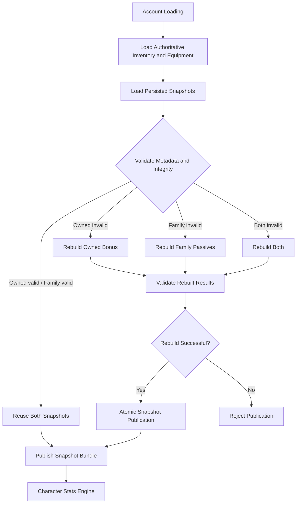

### 4.1 Conditions de validation

Un snapshot est accepté uniquement si :

1. Son propriétaire correspond au compte chargé.
2. Sa version de schéma est compatible.
3. Ses révisions sources correspondent.
4. Son fingerprint correspond aux données autoritaires.
5. Son checksum est valide.
6. Sa version de calcul est compatible.
7. Ses valeurs numériques sont valides.
8. Ses contributions ne contiennent pas de doublons d'identifiants.

Si une condition échoue, le snapshot concerné est reconstruit.

### 4.2 Échec de reconstruction

Si une reconstruction échoue :

- Aucun snapshot partiellement calculé n'est publié.
- L'ancien snapshot invalide n'est pas utilisé comme résultat courant.
- Le moteur signale une erreur de cohérence.
- Les statistiques dérivées restent indisponibles jusqu'à résolution.

Cette politique évite de masquer une corruption de données.

---

# 5. SYS-002.D.10.2.2.6.1 - Gestion des événements

Nous définissons maintenant le comportement lors des modifications en cours de session.

| Événement | Owned Snapshot | Family Snapshot |
|--------|--------|--------|
| Acquisition d'un acolyte | Incrémental | Inchangé |
| Montée de niveau | Incrémental | Inchangé |
| Fusion | Incrémental si nouvel acolyte débloqué | Selon changement d'équipe |
| Équipement | Inchangé | Reconstruction |
| Déséquipement | Inchangé | Reconstruction |
| Modification du profil de croissance | Reconstruction | Inchangé |
| Modification d'un effet | Inchangé | Reconstruction |
| Modification des règles familiales | Selon règles concernées | Reconstruction |
| Connexion | Validation | Validation |

Les mises à jour incrémentales restent le fonctionnement normal.

Les reconstructions complètes constituent le mécanisme de réconciliation.

## 6. Cohérence transactionnelle

Chaque modification doit respecter une séquence atomique :

1. Vérification de l'état initial.
2. Vérification des ressources.
3. Modification de l'inventaire ou de l'équipe.
4. Incrémentation de la révision correspondante.
5. Actualisation du snapshot concerné.
6. Validation des résultats.
7. Publication atomique du nouvel état.

Un identifiant unique d'événement est conservé afin qu'une même opération ne puisse pas être appliquée deux fois.

En cas de modification concurrente de la source pendant un calcul, la publication est rejetée et le calcul est repris depuis la dernière révision.

*Note d'ingénierie : les snapshots sont publiés sous forme d'un ensemble cohérent. Le Character Stats Engine ne doit jamais consommer une combinaison de résultats provenant de révisions incompatibles.*

---

</details>


### SYS-002.D.10.2.2.7 · T058 · 19/11/2026 18:23:39

**Nature :** `APPROBATION_EXPLICITE` · **Ligne d’approbation source :** 20950 · **Ligne de formalisation :** 20955.

**Décision / prescription originale (texte intégral du propriétaire) :**

Je valide également


<details><summary>Formalisation technique de la décision ratifiée (extrait sourcé)</summary>

# SYS-002.D.10.2.2.7 - Mutation &amp; Transaction Engine

(Validé) (Modèle C adopté)

Le modèle hybride devient la politique officielle du `Collection Bonus Engine`.

Les trois mécanismes sont désormais complémentaires :

1. Transactions synchrones pour garantir l'intégrité des mutations.
2. Journalisation durable des événements pour assurer la traçabilité et la reprise.
3. Actualisation incrémentale des snapshots, avec reconstruction complète en cas d'incohérence.

## 1. Contrat architectural définitif

### 1.1 Hiérarchie des données

| Composant | Responsabilité | Autorité |
|--------|--------|--------|
| Acolyte Inventory | Acolytes possédés, niveaux, doublons | Source de vérité |
| Equipped Team | Composition de l'équipe | Source de vérité |
| Event Journal | Historique des mutations | Journal durable |
| Owned Bonus Snapshot | Bonus permanents calculés | Donnée dérivée |
| Family Passive Snapshot | Effets de déploiement calculés | Donnée dérivée |
| Transaction Outbox | Publication des événements | File durable |

Le journal d'événements ne remplace pas l'inventaire comme source de vérité.

Les snapshots ne peuvent jamais modifier directement les données sources.

### 1.2 Séquence transactionnelle

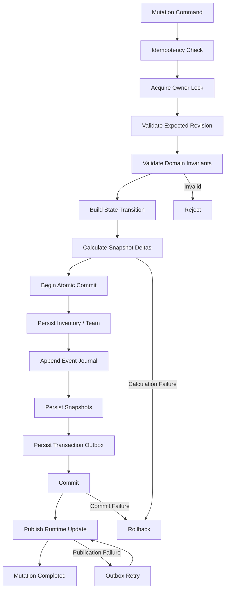

**Règle fondamentale :** aucune mutation n'est considérée comme validée avant le commit durable de la transaction.

## 2. Contrat des événements

Chaque mutation produit un événement identifiable.

| Événement | Déclencheur |
|--------|--------|
| `ACOLYTE_UNLOCKED` | Premier exemplaire obtenu |
| `DUPLICATE_BALANCE_CHANGED` | Acquisition ou consommation de doublons |
| `ACOLYTE_LEVEL_CHANGED` | Amélioration |
| `ACOLYTE_FUSION_RESOLVED` | Fusion 3:1 |
| `TEAM_SLOT_CHANGED` | Modification de l'équipe |
| `COLLECTION_SNAPSHOT_REBUILT` | Reconstruction complète |

Chaque événement contient :

- `event_id`
- `command_id`
- `owner_id`
- `aggregate_revision`
- `event_sequence`
- `event_type`
- `schema_version`
- `payload`
- `configuration_revision`

Les événements sont append-only : un événement validé n'est jamais modifié ou supprimé.

## 3. Garanties transactionnelles

Les règles suivantes deviennent obligatoires.

| Garantie | Mécanisme |
|--------|--------|
| Atomicité | Transaction ACID |
| Idempotence | Identifiant unique de commande |
| Concurrence | Verrou par propriétaire et contrôle de révision |
| Ordonnancement | Séquence monotone des événements |
| Cohérence | Validation des invariants avant commit |
| Traçabilité | Journal append-only |
| Reprise | Transaction Outbox |
| Réconciliation | Reconstruction depuis les données sources |

### 3.1 Idempotence

Une même commande ne doit jamais être appliquée deux fois.

Exemple :

Un joueur effectue une amélioration rapide, mais sa connexion est interrompue avant réception de la réponse.

Il renvoie la même commande.

Le moteur retrouve son `command_id` et retourne le résultat initial sans consommer une seconde fois les doublons.

### 3.2 Gestion de la concurrence

Chaque mutation vérifie la révision attendue.

$$
Revision_{\text{command}}=Revision_{\text{current}}
$$

Si cette condition échoue, la commande est rejetée pour conflit de révision.

Le client doit récupérer l'état actualisé avant de réessayer.

### 3.3 Gestion des événements aléatoires

Pour les fusions produisant un acolyte aléatoire, le résultat du tirage doit être enregistré dans l'événement validé.

Une nouvelle tentative de la même commande ne doit jamais effectuer un nouveau tirage.

Cela garantit qu'une interruption réseau ne peut pas modifier le résultat d'une fusion.

## 4. Comportement par opération

| Opération | Owned Snapshot | Family Snapshot |
|--------|--------|--------|
| Déblocage | Actualisation | Inchangé |
| Acquisition doublon existant | Inchangé | Inchangé |
| Amélioration | Actualisation | Inchangé |
| Fusion avec nouvel acolyte débloqué | Actualisation | Inchangé |
| Fusion vers acolyte déjà possédé | Inchangé | Inchangé |
| Équipement | Inchangé | Actualisation |
| Déséquipement | Inchangé | Actualisation |

Les mutations d'inventaire et d'équipe sont traitées dans des transactions atomiques.

L'amélioration rapide consomme uniquement les coûts des niveaux intégralement atteignables.

## 5. Gestion des défaillances

| Situation | Comportement |
|--------|--------|
| Ressources insuffisantes | Rejet sans mutation |
| Révision incorrecte | Rejet sans mutation |
| Erreur de calcul | Rollback |
| Échec du commit | Rollback |
| Échec de publication Runtime | Reprise via Outbox |
| Snapshot corrompu | Reconstruction |
| Reconstruction impossible | Refus de publication |
| Événement déjà traité | Ignoré grâce à l'idempotence |

Une publication Runtime échouée ne remet pas en cause une transaction déjà validée. L'Outbox conserve le travail restant jusqu'à sa livraison.

---

# 6. Audit final du Collection Bonus Engine

</details>


### SYS-002.D.10.3.1 · T059 · 19/11/2026 18:30:25

**Nature :** `APPROBATION_EXPLICITE` · **Ligne d’approbation source :** 21245 · **Ligne de formalisation :** 21250.

**Décision / prescription originale (texte intégral du propriétaire) :**

Validation du modèle A


<details><summary>Formalisation technique de la décision ratifiée (extrait sourcé)</summary>

# SYS-002.D.10.3.1 - Probability Resolution Engine

(Modèle A validé) (Spécification en cours)

Le modèle à tables de probabilités indépendantes est officiellement intégré au GDD.

Chaque portail possède ses propres tables de probabilités, indépendamment de l'autre portail.

## 1. Architecture retenue

Nous distinguons deux instances :

**Acolyte Summoning Portal**

# Level 1-15

15 tables de probabilités indépendantes

**Skill Summoning Portal**

# Level 1-15

15 tables de probabilités indépendantes

---

**Probability Resolution Engine**

Sélection de rareté et sélection individuelle

Les deux portails possèdent :

- Leur propre expérience cumulée.
- Leur propre niveau d'invocation.
- Leur propre progression vers le niveau 15.
- Leurs propres tables de probabilités.
- Leur propre catalogue de cartes disponibles.

Une invocation d'acolyte ne fait donc jamais progresser le portail de compétences, et inversement.

---

# 2. SYS-002.D.10.3.1.1 - Rarity Probability Tables

## 2.1 Structure des tables

Chaque portail possède 15 tables explicites.

Chaque table contient les probabilités des huit raretés classiques.

| Identifiant | Rareté | Couleur |
|--------|--------|--------|
| `NORMAL` | Normal | Gris |
| `UNIQUE` | Unique | Vert |
| `SUPERIOR` | Supérieur | Bleu |
| `RARE` | Rare | Violet |
| `MYTHIC` | Mythique | Orange |
| `EPIC` | Épique | Rouge |
| `LEGENDARY` | Légendaire | Jaune |
| `IMMORTAL` | Immortel | Rose |

La catégorie Exclusive/Collab possède un traitement séparé. Elle n'appartient pas automatiquement au catalogue des invocations classiques.

## 2.2 Exemple de structure

Voici une table illustrative pour le portail d'acolytes au niveau 15.

| Rareté | Probabilité |
|--------|--------|
| Normal | 40 % |
| Unique | 25 % |
| Supérieur | 18 % |
| Rare | 10 % |
| Mythique | 4 % |
| Épique | 2 % |
| Légendaire | 0,96 % |
| Immortel | 0,04 % |
| **Total** | **100 %** |

Exemple fictif de répartition. Seul le taux Immortel de 0,04 % provient des observations communiquées. Les autres valeurs ne sont pas des données officielles.

## 2.3 Données connues sur les Immortels

Nous pouvons déjà enregistrer quatre points de référence :

| Niveau du portail | Probabilité Immortel |
|--------|--------|
| 12 | 0,01 % |
| 13 | 0,02 % |
| 14 | 0,03 % |
| 15 | 0,04 % |

Les probabilités des niveaux 1 à 11 restent à documenter.

Ces valeurs constituent actuellement des observations provisoires, pas une calibration officielle complète.

---

# 3. SYS-002.D.10.3.1.2 - Rarity Selection Algorithm

Une invocation se déroule en deux étapes distinctes.

**Étape 1 - Sélection de la rareté**

Le moteur effectue un tirage probabiliste à partir de la table correspondant au niveau actuel du portail.

$$
R\sim P(R\mid Portal,Level)
$$

**Étape 2 - Sélection de la carte**

Une fois la rareté déterminée, le moteur sélectionne uniformément une carte parmi les cartes disponibles de cette rareté.

Si une rareté possède $N$ cartes disponibles :

$$
\boxed{
P(Card_i)=\frac{P(R)}{N}
}
$$

Exemple :

- Probabilité Mythique : 10 %.
- Nombre de cartes Mythiques disponibles : 5.

Chaque carte possède alors :

$$
P(Card_i)=\frac{10\%}{5}=2\%
$$

Cette règle reprend la décision `uniform_available` validée précédemment.

Les catalogues doivent être versionnés pour garantir la reproductibilité des résultats.

---

# 4. SYS-002.D.10.3.1.3 - Probability Resolution Sequence

Nous intégrons les décisions précédentes :

- XP par invocation : 1.
- XP avant tirage : `before_xp`.
- Tirages groupés : `sequential`.
- Sélection des cartes : `uniform_available`.
- Progressions XP : `independent`.
- Pity classique : absent.

La séquence devient :

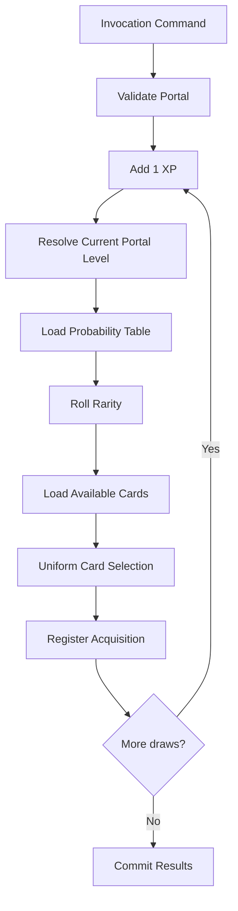

### Conséquence importante des tirages groupés

Supposons que le portail possède suffisamment d'expérience pour atteindre le niveau 12 après le premier tirage.

Le tirage suivant utilisera la table du niveau 12.

Les tirages groupés ne sont donc pas calculés comme un unique événement probabiliste.

Chaque tirage possède son propre état de portail.

Cela permet de franchir plusieurs niveaux de machine au cours d'une seule invocation groupée.

---

# 5. Contrat de données

La structure de configuration proposée :

```python
from dataclasses import dataclass
from decimal import Decimal
from typing import Mapping

@dataclass(frozen=True)
class RarityProbabilityTable:
    portal_id: str
    portal_level: int

    probabilities: Mapping[str, Decimal]

    catalog_revision: int
    table_revision: int

@dataclass(frozen=True)
class SummoningPortalState:
    portal_id: str

    total_xp: int
    current_level: int

    revision: int

@dataclass(frozen=True)
class SummoningResult:
    portal_id: str

    resolved_level: int
    selected_rarity: str
    selected_card_id: str

    table_revision: int
    catalog_revision: int
```

Les probabilités sont conservées en `Decimal`, sans arrondi intermédiaire.

Le résultat conserve les versions des configurations utilisées lors du tirage.

---

# 6. SYS-002.D.10.3.1.4 - Invariants du Probability Engine

| ID | Invariant | Comportement |
|--------|--------|--------|
| PROB-001 | Une table par niveau et portail | Obligatoire |
| PROB-002 | Huit raretés classiques explicites | Obligatoire |
| PROB-003 | Somme des probabilités | À définir |
| PROB-004 | Probabilité négative | Interdite |
| PROB-005 | Carte indisponible | Exclue du pool |
| PROB-006 | Rareté positive sans carte disponible | Rejet |
| PROB-007 | Sélection individuelle | Uniforme |
| PROB-008 | Niveau maximum | 15 |
| PROB-009 | XP des portails | Indépendante |
| PROB-010 | Pity classique | Absent |

---

# 7. SYS-002.D.10.3.1.5 - Validation des règles de normalisation

Il reste à déterminer comment le moteur traite les tables de probabilités.

Trois décisions sont nécessaires.

**1. Somme des probabilités**

- A - Strictement égale à 100 %. Toute table incorrecte est rejetée.
- B - Inférieure ou égale à 100 %. Le reliquat représente une possibilité de tirage sans récompense.

Je recommande A.

**2. Rareté indisponible**

- A - Une rareté indisponible doit avoir une probabilité de zéro.
- B - Le moteur redistribue automatiquement sa probabilité aux autres raretés.

Je recommande A. La redistribution automatique modifierait les probabilités officielles.

**3. Précision numérique**

- A - Précision décimale complète, sans arrondi intermédiaire.
- B - Précision limitée à six décimales.

Je recommande A, conformément aux décisions précédentes sur la précision numérique.

**Décisions proposées**

| Paramètre | Choix recommandé |
|--------|--------|
| Normalisation | `strict_100` |
| Rareté indisponible | `zero_probability` |
| Précision | `full_precision` |

**Validation attendue : SYS-002.D.10.3.1.5.**

Après validation, nous poursuivrons avec `SYS-002.D.10.3.2 - Portal XP Progression Engine`, qui définira précisément les seuils d'expérience des quinze niveaux et les transitions entre niveaux.

</details>


### SYS-002.D.10.3.1.5 · T060 · 19/11/2026 18:33:12

**Nature :** `APPROBATION_EXPLICITE` · **Ligne d’approbation source :** 21567 · **Ligne de formalisation :** 21572.

**Décision / prescription originale (texte intégral du propriétaire) :**

Je valide cette recommendaion


<details><summary>Formalisation technique de la décision ratifiée (extrait sourcé)</summary>

# SYS-002.D.10.3.1.5 - Formalisation et clôture

(Validé) (Contrat intégré au GDD)

Les trois décisions sont désormais définitives.

| Paramètre | Décision |
|--------|--------|
| Normalisation | `strict_100` |
| Rareté indisponible | `zero_probability` |
| Précision numérique | `full_precision` |

## 1. Contrats mathématiques

### 1.1 Normalisation stricte

Pour chaque portail $P$ et chaque niveau $L$ :

$$
\boxed{\sum_{r\in R}P(r\mid P,L)=1}
$$

Avec :

$$
R=\{NORMAL,UNIQUE,SUPERIOR,RARE,
MYTHIC,EPIC,LEGENDARY,IMMORTAL\}
$$

Une table dont la somme diffère de 100 % est rejetée.

Aucune normalisation automatique n'est autorisée.

### 1.2 Raretés indisponibles

$$
N_r=0\Rightarrow P(r)=0
$$

Si une rareté possède une probabilité positive mais aucune carte disponible, la configuration est rejetée.

Aucune redistribution automatique de cette probabilité n'est effectuée.

### 1.3 Précision

Toutes les probabilités utilisent `Decimal`.

Aucun arrondi intermédiaire n'est autorisé.

### 1.4 Sélection des cartes

Pour une rareté comportant $N_r$ cartes disponibles :

$$
P(Card_i)=\frac{P(r)}{N_r}
$$

Une carte obtenue reste dans le pool d'invocation : les doublons sont possibles et les cartes ne sont pas retirées du catalogue après un tirage.

---

</details>


### SYS-002.D.10.3.2.4 · T061 · 19/11/2026 18:36:32

**Nature :** `APPROBATION_EXPLICITE` · **Ligne d’approbation source :** 21909 · **Ligne de formalisation :** 21914.

**Décision / prescription originale (texte intégral du propriétaire) :**

Validation SYS-002.D.10.3.2.4 : stockage des seuils = cumulative_lookup ; expérience niveau 15 = retain_xp ; observations = Aucune. Formalise les décisions et poursuis selon le protocole.


<details><summary>Formalisation technique de la décision ratifiée (extrait sourcé)</summary>

# SYS-002.D.10.3.2.4 - Formalisation et clôture

(Validé) (Spécification clôturée)

Les décisions sont intégrées au GDD.

| Paramètre | Décision |
|--------|--------|
| Stockage des seuils | `cumulative_lookup` |
| XP au niveau 15 | `retain_xp` |
| XP par tirage | \+1 |
| Ordre XP/tirage | `before_xp` |
| Tirages groupés | `sequential` |
| Portails | `independent` |
| Niveau maximum | 15 |

## 1. Contrat mathématique définitif

Chaque portail possède une table de seuils cumulatifs :

$$
T_P=\{T_1,T_2,\ldots,T_{15}\}
$$

Avec :

$$
T_1=0
$$

$$
T_{l+1}>T_l
$$

Le niveau courant est déterminé par :

$$
\boxed{
L_P(X)=\min\left(15,\max\{l:T_l\leq X\}\right)
}
$$

L'expérience totale évolue ainsi :

$$
X_{n+1}=X_n+1
$$

Au niveau 15 :

$$
L_P(X)=15 \quad \forall X\geq T_{15}
$$

L'expérience continue de s'accumuler sans réinitialisation.

Elle ne modifie plus les probabilités tant que le plafond reste fixé à 15.

## 2. Source de vérité

L'expérience cumulée constitue la donnée autoritaire.

Le niveau courant est une donnée dérivée des seuils configurés.

```python
@dataclass(frozen=True)
class SummoningPortalState:
    portal_id: str
    total_xp: int
    current_level: int
    threshold_revision: int
    state_revision: int
```

Une modification de la table de seuils impose une nouvelle validation du niveau dérivé.

## 3. Tests d'acceptation

| ID | Test | Résultat |
|--------|--------|--------|
| XP-001 | XP initial | 0 |
| XP-002 | Un tirage | \+1 XP |
| XP-003 | Franchissement de seuil | Nouveau niveau immédiat |
| XP-004 | Tirage groupé | Résolution séquentielle |
| XP-005 | Niveau 15 | XP conservée |
| XP-006 | Dépassement du seuil 15 | Niveau maintenu à 15 |
| XP-007 | Portails indépendants | Aucune contamination |
| XP-008 | Seuils invalides | Configuration rejetée |

La spécification `SYS-002.D.10.3.2` est clôturée.

---

</details>


### SYS-002.D.10.3.3.4 · T062 · 19/11/2026 18:42:27

**Nature :** `APPROBATION_EXPLICITE` · **Ligne d’approbation source :** 22266 · **Ligne de formalisation :** 22271.

**Décision / prescription originale (texte intégral du propriétaire) :**

Validation SYS-002.D.10.3.3.4 : atomicité = durable_sequential ; gestion tickets = reserve_full ; sélection fusion = uniform_available ; observations = Aucune. Formalise les décisions et poursuis selon le protocole.


<details><summary>Formalisation technique de la décision ratifiée (extrait sourcé)</summary>

# SYS-002.D.10.3.3.4 - Formalisation des décisions

(Validé) (Contrat transactionnel adopté)

Les trois décisions sont intégrées au GDD.

| Paramètre | Décision |
|--------|--------|
| Atomicité | `durable_sequential` |
| Gestion des tickets | `reserve_full` |
| Sélection des fusions | `uniform_available` |

## 1. Durable Sequential - Contrat transactionnel

Une invocation groupée est désormais composée d'une transaction parent et de plusieurs transactions enfants.

- La transaction parent gère la réservation et le suivi global.
- Chaque transaction enfant correspond à un tirage individuel.
- Chaque tirage validé est définitivement enregistré.
- Une erreur sur un tirage n'annule pas les tirages précédemment validés.
- La reprise commence au prochain tirage non validé.

### Séquence d'un tirage individuel

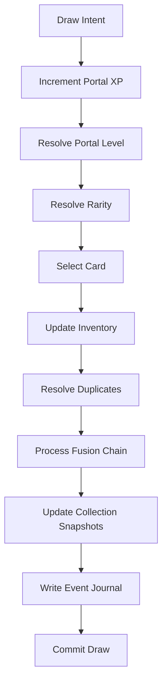

Toutes ces opérations sont atomiques à l'échelle du tirage.

Une interruption avant le commit annule uniquement les modifications de ce tirage.

Un identifiant `draw_id` unique garantit l'idempotence.

Les résultats aléatoires et les versions des configurations utilisées sont conservés afin de rendre les reprises reproductibles.

## 2. Reserve Full - Gestion des tickets

La réservation intervient avant le premier tirage.

$$
Tickets_{\text{available}}
\geq Tickets_{\text{required}}
$$

Si cette condition est satisfaite :

1. Le coût total est réservé.
2. Les tickets réservés deviennent indisponibles pour les autres commandes.
3. Chaque tirage consomme sa quote-part de réservation.
4. La somme des consommations correspond exactement au tarif de l'offre.
5. La réservation est soldée à la fin de l'invocation.

Les offres promotionnelles possèdent leur propre configuration tarifaire.

Exemple :

$$
35\text{ tirages}=30\text{ tickets}
$$

Le moteur conserve le coût total de 30 tickets et répartit comptablement la consommation entre les 35 tirages, sans arrondi susceptible de modifier le coût final.

En cas d'interruption technique, le reliquat de réservation est conservé pour permettre la reprise.

## 3. Uniform Available - Fusion 3:1

La sélection des cartes fusionnées est uniforme dans un catalogue spécifique de fusion.

Pour $N$ cartes éligibles :

$$
P(Card_i)=\frac{1}{N}
$$

Cette sélection est indépendante des probabilités des portails d'invocation.

Nous introduisons un attribut :

`fusion_eligible`

Les acolytes exclusifs et les collaborations sont exclus par défaut, sauf configuration explicite.

### Règles de fusion

| Condition | Comportement |
|--------|--------|
| Carte niveau inférieur à 200 | Doublons conservés |
| Carte niveau 200 | Fusion automatique par groupes de 3 |
| Fusion obtenue | Carte de rareté supérieure |
| Carte supérieure déjà possédée | Ajout d'un doublon |
| Carte supérieure déjà niveau 200 | Nouvelle vérification de fusion |
| Immortel niveau 200 | Doublons conservés |

La chaîne de fusion est exécutée immédiatement et se poursuit tant qu'une nouvelle fusion est possible.

Les portails Acolytes et Compétences possèdent des catalogues et des inventaires distincts. La mécanique 3:1 s'applique aux deux catégories.

---

</details>


### SYS-002.D.10.3.4.1 · T063 · 19/11/2026 18:47:23

**Nature :** `APPROBATION_EXPLICITE` · **Ligne d’approbation source :** 22550 · **Ligne de formalisation :** 22555.

**Décision / prescription originale (texte intégral du propriétaire) :**

Validation SYS-002.D.10.3.4.1 : niveau initial après fusion = level_one ; gestion des doublons = manual ; observations = Aucune. Formalise les décisions et poursuis selon le protocole.


<details><summary>Formalisation technique de la décision ratifiée (extrait sourcé)</summary>

# SYS-002.D.10.3.4.1 - Formalisation des décisions

(Validé) (Contrats intégrés au GDD)

Les deux décisions sont désormais définitives.

| Paramètre | Décision |
|--------|--------|
| Niveau initial après fusion | `level_one` |
| Gestion des doublons | `manual` |

## 1. Acquisition d'une nouvelle carte

Toute carte obtenue pour la première fois, que ce soit par invocation ou par fusion, commence au niveau 1.

$$
L_{\text{new}}=1
$$

Son niveau ne dépend jamais :

- Du niveau de la carte ayant produit la fusion.
- Du nombre de doublons consommés.
- Du niveau des autres cartes de sa famille.
- Du niveau du portail d'invocation.

Une nouvelle acquisition initialise une fiche indépendante.

## 2. Gestion des doublons

Nous distinguons trois situations.

| État de la carte | Traitement |
|--------|--------|
| Niveau 1 à 199 | Conservation des doublons |
| Niveau 200, rareté inférieure à Immortel | Synthèse automatique par groupes de 3 |
| Niveau 200, rareté Immortel | Conservation définitive des doublons |

Pour une carte inférieure au niveau 200 :

$$
D_{\text{new}}=D_{\text{current}}+1
$$

Aucune amélioration automatique n'est déclenchée.

L'amélioration rapide reste une fonctionnalité distincte du système de progression.

## 3. Traitement des doublons excédentaires au niveau 200

Une règle importante est ajoutée : lorsqu'une carte atteint le niveau 200, ses doublons déjà accumulés sont immédiatement examinés.

Exemple :

- Niveau actuel : 199.
- Doublons accumulés : 5.
- Amélioration : niveau 200.
- Fusion immédiate : 3 doublons consommés.
- Solde restant : 2 doublons.

$$
D_{\text{restant}}=5-(3\times1)=2
$$

Le mécanisme fonctionne également lorsqu'une fusion produit une carte déjà possédée et niveau 200.

---

# 4. Contrat mathématique de fusion

Soit :

- $D$ : solde de doublons.
- $k$ : nombre de fusions réalisables.
- $R$ : rareté actuelle.

Pour une carte niveau 200 :

$$
k=\left\lfloor\frac{D}{3}\right\rfloor
$$

$$
D_{\text{restant}}=D\bmod3
$$

Chaque fusion produit une carte de rareté immédiatement supérieure.

$$
R_{\text{résultat}}=NextRarity(R)
$$

La chaîne de rareté est :

$$
NORMAL\rightarrow UNIQUE\rightarrow SUPERIOR
$$

$$
\rightarrow RARE\rightarrow MYTHIC\rightarrow EPIC
$$

$$
\rightarrow LEGENDARY\rightarrow IMMORTAL
$$

`IMMORTAL` constitue un état terminal.

Les fusions sont exécutées successivement jusqu'à ce qu'aucune fusion supplémentaire ne soit possible.

# 5. Contrat de données définitif

Le modèle d'inventaire est consolidé autour d'un enregistrement unique par carte possédée.

```python
@dataclass
class OwnedCard:
    owner_id: str
    card_id: str

    rarity_id: str
    level: int

    duplicate_balance: int

    growth_profile_id: str
    inventory_revision: int
```

Contraintes :

- Un seul enregistrement par combinaison `owner_id + card_id`.
- `level` compris entre 1 et 200.
- `duplicate_balance` supérieur ou égal à zéro.
- Les doublons ne créent jamais de nouvelles fiches.
- Une carte fusionnée conserve son identité propre.
- Le profil de croissance est associé à la carte, pas à la carte ayant produit la fusion.

## 5.1 Algorithme de distribution

Le traitement d'une récompense suit désormais cet ordre :

```python

def distribute_reward(owner_id, card_id):
    card = inventory.find(owner_id, card_id)

    if card is None:
        inventory.create(
            owner_id=owner_id,
            card_id=card_id,
            level=1,
            duplicate_balance=0,
        )
        emit("CARD_UNLOCKED", owner_id, card_id)
        return

    card.duplicate_balance += 1
    emit("DUPLICATE_ADDED", owner_id, card_id)

    if card.level < 200:
        return

    if card.rarity_id == "IMMORTAL":
        return

    process_fusion_chain(owner_id, card)

def process_fusion_chain(owner_id, card):
    while (
        card.level == 200
        and card.rarity_id != "IMMORTAL"
        and card.duplicate_balance >= 3
    ):
        card.duplicate_balance -= 3

        next_rarity = next_rarity_of(card.rarity_id)

        result = select_uniform_fusion_card(next_rarity)

        emit("FUSION_RESOLVED", owner_id, result.card_id)

        distribute_fusion_result(owner_id, result.card_id)

def distribute_fusion_result(owner_id, card_id):
    card = inventory.find(owner_id, card_id)

    if card is None:
        inventory.create(
            owner_id=owner_id,
            card_id=card_id,
            level=1,
            duplicate_balance=0,
        )
        emit("CARD_UNLOCKED", owner_id, card_id)
        return

    card.duplicate_balance += 1
    emit("FUSION_DUPLICATE_ADDED", owner_id, card_id)

    if card.level == 200:
        process_fusion_chain(owner_id, card)
```

*Note d'ingénierie : cet algorithme décrit les transitions métier. En production, toutes les opérations de fusion doivent être exécutées dans la transaction enfant du tirage, avec journalisation des résultats aléatoires et protection contre les traitements récursifs non bornés.*

## 5.2 Actualisation des snapshots

| Opération | Owned Bonus Snapshot | Family Passive Snapshot |
|--------|--------|--------|
| Nouvelle acquisition d'acolyte | Actualisation | Inchangé |
| Doublon d'acolyte | Inchangé | Inchangé |
| Nouvelle acquisition de compétence | Inchangé | Inchangé |
| Fusion produisant un nouvel acolyte | Actualisation | Inchangé |
| Fusion produisant un doublon | Inchangé | Inchangé |
| Amélioration d'acolyte | Actualisation | Inchangé |

Les cartes obtenues par fusion ne sont jamais automatiquement équipées.

---

</details>


### SYS-002.D.10.3.4.2 · T064 · 19/11/2026 18:50:33

**Nature :** `APPROBATION_EXPLICITE` · **Ligne d’approbation source :** 22884 · **Ligne de formalisation :** 22889.

**Décision / prescription originale (texte intégral du propriétaire) :**

Validation SYS-002.D.10.3.4.2 : catalogue = portal_catalog  exclusifs = explicit_only. Formalise les décisions et poursuis selon le protocole.


**Source technique :** réponse consécutive et proposition précédant cette validation, consultables dans l’historique original. Aucun extrait automatique n’a été retenu faute de délimitation non ambiguë.


### SYS-002.D.10.3.4.2 · T065 · 19/11/2026 18:55:35

**Nature :** `EXIGENCE_OU_RECTIFICATION_PROPRIETAIRE` · **Ligne d’approbation source :** 23244 · **Ligne de formalisation :** 23249.

**Décision / prescription originale (texte intégral du propriétaire) :**

Je veux corriger un point, si une carte d'acolyte ou de compétence n'a pas été débloqué par le tirage, elle ne peut pas être obtenue par la fusion


<details><summary>Formalisation technique de la décision ratifiée (extrait sourcé)</summary>

# Correction GDD - SYS-002.D.10.3.4.2

(Correction intégrée)

Cette précision modifie une règle fondamentale du moteur de fusion. La décision précédente `all_catalog_entries` est remplacée.

**Nouvelle règle : une fusion ne peut produire qu'une carte que le joueur a déjà débloquée au moins une fois grâce à une invocation du portail correspondant.**

Une fusion ne permet donc jamais de débloquer une nouvelle carte.

## 1. Nouvelle règle d'éligibilité

Une carte est éligible à la fusion si toutes les conditions suivantes sont satisfaites :

1. Elle appartient au catalogue du portail concerné.
2. Elle possède la rareté immédiatement supérieure.
3. Elle a déjà été obtenue par invocation par le joueur.
4. Elle est autorisée pour la fusion.
5. Elle respecte les restrictions relatives aux cartes exclusives.

Le nouvel ensemble de candidats est :

$$
\mathcal C_{p,r}=
\left\{
c\in Catalog_p\mid
Rarity(c)=r
\land DrawUnlocked(p,c)
\land Eligible(c)
\right\}
$$

Où :

- $p$ représente le joueur et le portail.
- $r$ représente la rareté recherchée.
- `DrawUnlocked` indique que la carte a déjà été débloquée par invocation.

## 2. Conséquence sur le fonctionnement des fusions

**Cas A - Carte déjà débloquée par invocation**

(Éligible)

Le joueur possède déjà cette carte. La fusion ajoute un doublon à son inventaire.

---

**Cas B - Carte jamais obtenue par invocation**

(Non éligible)

Même si elle appartient au catalogue et possède la bonne rareté, elle ne peut pas être sélectionnée.

---

**Cas C - Aucune carte éligible dans la rareté supérieure**

(Fusion suspendue)

Les trois doublons ne sont pas consommés. Ils restent conservés dans l'inventaire jusqu'à ce qu'une carte éligible soit débloquée par invocation.

## 3. Nouveau comportement mathématique

Pour une fusion 3:1 :

$$
N=|\mathcal C_{p,r}|
$$

Si :

$$
N=0
$$

Alors :

$$
D_{\text{consommés}}=0
$$

Si :

$$
N>0
$$

Alors :

$$
P(c_i)=\frac{1}{N}
$$

La carte sélectionnée reçoit un doublon supplémentaire.

$$
D_{c_i}'=D_{c_i}+1
$$

**Aucune création de nouvelle fiche d'acolyte ou de compétence n'est autorisée par une fusion.**

## 4. Gestion des fusions en attente

Un nouveau mécanisme est nécessaire.

Lorsqu'un joueur débloque une carte par invocation, le moteur réévalue les fusions précédemment bloquées.

Exemple :

1. Le joueur possède un acolyte Normal niveau 200.
2. Il possède trois doublons supplémentaires.
3. Aucune carte Unique n'a encore été débloquée par invocation.
4. La fusion reste bloquée.
5. Le joueur invoque un acolyte Unique pour la première fois.
6. Cette carte devient éligible.
7. Le moteur réévalue les fusions en attente.
8. La fusion Normal → Unique peut désormais être exécutée.

Les doublons précédemment conservés ne sont jamais perdus.

## 5. Modifications du modèle de données

Nous ajoutons une information de provenance persistante.

```python
@dataclass
class OwnedCard:
    owner_id: str
    card_id: str

    rarity_id: str
    level: int

    duplicate_balance: int

    unlocked_by_draw: bool
    first_draw_event_id: str | None

    growth_profile_id: str
    inventory_revision: int
```

Invariant :

```python
unlocked_by_draw = True
```

Uniquement après une acquisition directe par invocation.

Une fusion ne peut jamais modifier ce champ de `False` à `True`.

## 6. Mise à jour des décisions validées

| Paramètre | Ancienne décision | Nouvelle décision |
|--------|--------|--------|
| Catalogue | `portal_catalog` | Inchangé |
| Cartes candidates | `all_catalog_entries` | `unlocked_only` |
| Exclusifs | `explicit_only` | Inchangé |
| Sélection | `uniform_available` | Inchangé |
| Nouvelle carte par fusion | Autorisée | Interdite |
| Doublons sans candidat | Fusion rejetée | Conservation en attente |

## 7. Tests d'acceptation supplémentaires

| ID | Scénario | Résultat attendu |
|--------|--------|--------|
| FUS-009 | Carte jamais invoquée | Exclue |
| FUS-010 | Carte déjà invoquée | Éligible |
| FUS-011 | Carte débloquée sur un autre portail | Exclue |
| FUS-012 | Catalogue sans candidat débloqué | Doublons conservés |
| FUS-013 | Nouveau déblocage par invocation | Réévaluation des fusions |
| FUS-014 | Fusion d'une carte déjà possédée | Ajout d'un doublon |
| FUS-015 | Fusion créant une nouvelle fiche | Interdite |
| FUS-016 | Carte exclusive non autorisée | Exclue |

---

# 8. État actualisé de SYS-002.D.10.3.4.2

(Modèle corrigé)

La règle de fusion est désormais cohérente avec une progression fondée sur le déblocage préalable des cartes par invocation.

Cette correction s'applique aux deux portails :

- Acolyte Summoning Portal.
- Skill Summoning Portal.

Elle ne modifie pas les règles de progression, les coûts 3:1, les probabilités d'invocation ou les niveaux des cartes.

**Le catalogue de fusion ne permet plus de découvrir des cartes : il permet uniquement de renforcer celles que le joueur a déjà découvertes.**

</details>


### SYS-002.D.10.3.5.1 · T066 · 19/11/2026 18:59:29

**Nature :** `APPROBATION_EXPLICITE` · **Ligne d’approbation source :** 23472 · **Ligne de formalisation :** 23477.

**Décision / prescription originale (texte intégral du propriétaire) :**

Validation SYS-002.D.10.3.5.1 : moment du débit = charge_on_start ; interruption = resume_required. Formalise les décisions et poursuis l'audit global du Summoning Engine.


<details><summary>Formalisation technique de la décision ratifiée (extrait sourcé)</summary>

# SYS-002.D.10.3.5.1 - Formalisation de la facturation

(Validé) (Contrat intégré au GDD)

Les décisions sont définitives.

| Paramètre | Décision |
|--------|--------|
| Réservation | `reserve_full` |
| Moment du débit | `charge_on_start` |
| Interruption | `resume_required` |
| Atomicité des tirages | `durable_sequential` |
| Remboursement automatique après démarrage | Non |

## 1. Cycle de vie financier

Nous distinguons désormais trois opérations.

**Étape 1 - Réservation**

À la validation de la commande :

- Vérification du solde disponible.
- Réservation du coût total de l'offre.
- Blocage des tickets réservés pour les autres opérations.

Aucun tirage n'est encore effectué.

**Étape 2 - Débit**

Juste avant le premier tirage :

- Conversion de la réservation en débit définitif.
- Passage du lot à l'état `PROCESSING`.
- Enregistrement de la date et de la référence de facturation.

Le débit et le changement d'état sont atomiques.

**Étape 3 - Distribution**

Les tirages sont exécutés individuellement.

Chaque tirage validé est définitivement enregistré. Une interruption ne remet jamais en cause les résultats précédents.

## 2. Machine à états

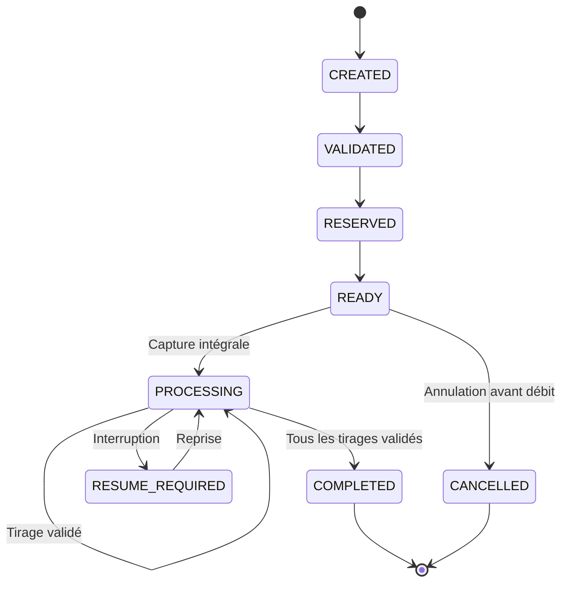

### 2.1 Règles de reprise

Exemple : une invocation de 35 tirages.

| État | Valeur |
|--------|--------|
| Tirages demandés | 35 |
| Tickets débités | 30 |
| Tirages validés | 24 |
| Tirages restants | 11 |
| Nouveaux tickets à débiter | 0 |

La reprise commence au tirage 25.

Aucun des 24 premiers tirages ne peut être rejoué.

Une impossibilité technique permanente entraîne le gel du lot et une réconciliation administrative. Aucun remboursement automatique n'est déclenché.

## 3. Comptabilité des offres

Le coût est enregistré au niveau du lot.

Par exemple :

$$
Cost(35)=30\text{ tickets}
$$

Il n'existe aucune obligation de répartir artificiellement ce coût entre les 35 tirages.

Le registre financier conserve :

- `batch_id`
- `offer_id`
- `reserved_amount`
- `captured_amount`
- `draw_count`
- `completed_draw_count`
- `next_draw_index`
- `billing_status`

---

# 4. Correction complémentaire - Cohérence du Fusion Engine

L'audit révèle une conséquence importante de ta précédente correction.

La décision `level_one` de SYS-002.D.10.3.4.1 doit être interprétée différemment.

Puisqu'une fusion ne peut plus débloquer une nouvelle carte, elle ne peut plus créer une nouvelle fiche de niveau 1.

La règle définitive devient :

| Opération | Résultat |
|--------|--------|
| Première acquisition par invocation | Nouvelle carte niveau 1 |
| Doublon obtenu par invocation | \+1 doublon |
| Fusion vers une carte déjà débloquée | \+1 doublon |
| Carte obtenue par fusion | Niveau existant conservé |
| Carte jamais débloquée par invocation | Fusion interdite |

La décision `level_one` reste applicable aux acquisitions initiales par invocation, mais devient sans objet pour les fusions.

Le précédent algorithme qui créait une fiche lorsque la carte fusionnée était absente est donc invalidé.

**Nouvel invariant :**

$$
Fusion(c)\Rightarrow DrawUnlocked(c)=True
$$

Aucune exception.

## 4.1 Gestion d'une fusion bloquée

Un cas doit être traité explicitement.

Exemple :

- Acolyte Normal niveau 200.
- 6 doublons disponibles.
- Aucune carte Unique débloquée par invocation.

Le moteur ne peut pas effectuer les deux fusions.

Il conserve les 6 doublons.

(Fusion en attente)

Lorsque des cartes Unique deviennent éligibles, le moteur peut réexaminer les fusions en attente.

Cette dernière règle nécessite encore une validation explicite.

---

</details>


### SYS-002.D.10.3.5.3 · T067 · 19/11/2026 19:05:21

**Nature :** `APPROBATION_EXPLICITE` · **Ligne d’approbation source :** 23775 · **Ligne de formalisation :** 23780.

**Décision / prescription originale (texte intégral du propriétaire) :**

Validation du modèle A


<details><summary>Formalisation technique de la décision ratifiée (extrait sourcé)</summary>

# SYS-002.D.10.3.5.3 - Formalisation du modèle A

(Validé) (Automatisation adoptée)

La réévaluation automatique des fusions en attente devient la règle officielle.

## 1. Déclenchement de la réévaluation

L'événement déclencheur est :

`CARD_DRAW_UNLOCKED`

Il est émis lorsqu'un joueur obtient pour la première fois une carte par invocation.

Le moteur lance alors une réévaluation des cartes suivantes :

$$
\mathcal F=
\left\{
c\mid
Level(c)=200
\land Duplicates(c)\geq3
\land Rarity(c)\neq IMMORTAL
\right\}
$$

Pour chaque carte, le moteur vérifie l'existence d'au moins une destination éligible dans la rareté supérieure.

Si aucune destination n'existe, les doublons restent intacts.

## 2. Séquence de traitement

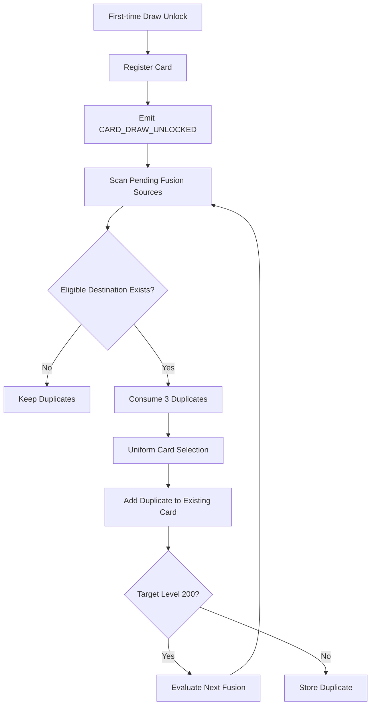

La réévaluation s'effectue dans la transaction du tirage ayant provoqué le déblocage.

Si le traitement technique échoue, la transaction est reprise sans rejouer le tirage déjà validé.

## 3. Invariants définitifs

| ID | Règle |
|--------|--------|
| FUS-017 | Déblocage initial par invocation uniquement |
| FUS-018 | Réévaluation automatique après nouveau déblocage |
| FUS-019 | Fusion immédiate si les conditions sont réunies |
| FUS-020 | Conservation des doublons si aucun candidat |
| FUS-021 | Aucun déblocage par fusion |
| FUS-022 | Aucun niveau transmis par fusion |
| FUS-023 | Conservation du niveau de la carte destination |
| FUS-024 | Immortel niveau 200 : aucune fusion supérieure |

La règle `level_one` reste applicable exclusivement à une première acquisition par invocation.

Une fusion ajoute toujours un doublon à une carte déjà débloquée.

---

</details>


### SYS-002.D.10.3.5.4 · T068 · 19/11/2026 19:07:20

**Nature :** `APPROBATION_EXPLICITE` · **Ligne d’approbation source :** 23965 · **Ligne de formalisation :** 23970.

**Décision / prescription originale (texte intégral du propriétaire) :**

Je valide le modèle A


<details><summary>Formalisation technique de la décision ratifiée (extrait sourcé)</summary>

# SYS-002.D.10.3.5.4 - Formalisation du Fusion Scheduler

(Validé) (Modèle A adopté)

La politique d'ordonnancement déterministe devient définitive.

## 1. Règles d'ordonnancement

Les sources de fusion sont classées selon deux critères successifs :

1. Rareté source croissante, de Normal à Légendaire.
2. Identifiant `card_id` croissant pour départager les cartes de même rareté.

Chaque fusion est exécutée individuellement.

Après chaque fusion, le moteur réévalue les conditions d'éligibilité et reconstruit l'ordre de traitement.

### 1.1 Exemple

État initial :

| Carte | Rareté | Niveau | Doublons |
|--------|--------|--------|--------|
| Acolyte A | Normal | 200 | 6 |
| Acolyte B | Normal | 200 | 3 |
| Acolyte C | Unique | 200 | 6 |
| Acolyte D | Rare | 200 | 3 |

Le moteur traite les cartes dans l'ordre :

1. Acolyte A.
2. Acolyte B.
3. Acolyte C.
4. Acolyte D.

Les cartes obtenues par fusion peuvent elles-mêmes devenir des sources de fusion si elles sont déjà niveau 200 et possèdent trois doublons.

## 2. Contrat de traitement

$$
Priority(c)=(RarityIndex(c),card\_id(c))
$$

Une carte est éligible comme source lorsque :

$$
Level(c)=200
$$

$$
Duplicates(c)\geq3
$$

$$
Rarity(c)\neq IMMORTAL
$$

Et qu'au moins une carte destination éligible existe dans la rareté supérieure.

Le traitement s'effectue jusqu'à épuisement des possibilités.

### 2.1 Pseudocode de référence

```python
def process_fusion_scheduler(owner_id):
    while True:
        eligible_sources = find_eligible_fusion_sources(owner_id)

        eligible_sources.sort(
            key=lambda card: (
                rarity_index(card.rarity_id),
                card.card_id,
            )
        )

        source = next(
            (
                card
                for card in eligible_sources
                if has_unlocked_fusion_destination(
                    owner_id,
                    next_rarity_of(card.rarity_id),
                )
            ),
            None,
        )

        if source is None:
            return

        execute_single_fusion(owner_id, source)

        # Recalcul complet après chaque fusion.
        # Les nouvelles possibilités sont immédiatement prises en compte.
```

*Note d'ingénierie : l'ordre des sources est déterministe, mais le choix de la carte destination reste aléatoire et uniforme. Chaque résultat aléatoire est persisté pour garantir la reprise sans nouveau tirage.*

## 3. Invariants supplémentaires

| ID | Règle |
|--------|--------|
| FUS-025 | Priorité à la rareté la plus basse |
| FUS-026 | Départage par `card_id` |
| FUS-027 | Une fusion par itération |
| FUS-028 | Réévaluation après chaque fusion |
| FUS-029 | Aucun traitement des cartes Immortelles comme sources |
| FUS-030 | Aucune destination non débloquée |
| FUS-031 | Conservation des doublons non consommés |

---

# 4. Clôture de l'audit architectural du Summoning Engine

</details>


### SYS-002.D.10.3.6.1 · T069 · 19/11/2026 19:10:07

**Nature :** `APPROBATION_EXPLICITE` · **Ligne d’approbation source :** 24276 · **Ligne de formalisation :** 24281.

**Décision / prescription originale (texte intégral du propriétaire) :**

Validation SYS-002.D.10.3.6.1 : stratégie de tests = all_layers ; RNG = injectable_rng ; persistance = crash_recovery. Formalise les décisions, complète le plan de tests et prépare la validation finale du Summoning Engine.


<details><summary>Formalisation technique de la décision ratifiée (extrait sourcé)</summary>

# SYS-002.D.10.3.6.1 - Formalisation de la stratégie de tests

(Validé) (Stratégie de tests adoptée)

Les trois décisions sont intégrées au GDD.

| Paramètre | Décision |
|--------|--------|
| Stratégie | `all_layers` |
| Générateur aléatoire | `injectable_rng` |
| Persistance | `crash_recovery` |

## 1. Architecture de validation

Nous adoptons cinq niveaux de validation complémentaires.

**L1 - Unit Tests**

(Obligatoire)

Vérification isolée des fonctions mathématiques, règles probabilistes, calculs XP, sélection et fusion.

---

**L2 - Component Tests**
Vérification de chaque moteur indépendamment : Probability Engine, Portal XP Engine, Billing Engine, Inventory Engine et Fusion Engine.

---

**L3 - Integration Tests**
Vérification des interactions entre les différents moteurs, notamment les transactions et les mises à jour d'inventaire.

---

**L4 - End-to-End Tests**
Simulation de scénarios complets depuis la commande d'invocation jusqu'à la distribution des récompenses et aux fusions.

---

**L5 - Recovery &amp; Resilience Tests**
Simulation d'interruptions à chaque étape critique, reprise des transactions et vérification de l'intégrité des données.

*Note d'ingénierie : les tests unitaires constituent la base de confiance mathématique. Les tests de récupération vérifient ensuite que cette confiance subsiste lorsque le système est interrompu à n'importe quel moment.*

---

# 2. RNG - Injectable Random Number Generator

La génération aléatoire doit être isolée du reste de l'architecture.

Nous définissons un contrat unique :

```python
class RandomGenerator(Protocol):

    def next_uint(self) -> int:
        ...

    def randbelow(self, upper_bound: int) -> int:
        ...

    def weighted_choice(
        self,
        weights: list[int],
    ) -> int:
        ...
```

Trois implémentations sont prévues.

| Implémentation | Utilisation |
|--------|--------|
| `SeededRNG` | Tests déterministes |
| `SecureRNG` | Exécution réelle |
| `ScriptedRNG` | Scénarios de tests imposant des résultats précis |

### 2.1 Garanties attendues

- Deux exécutions avec le même seed et la même séquence d'appels produisent les mêmes résultats.
- La sélection uniforme ne présente aucun biais de modulo.
- Les probabilités sont calculées à partir de poids entiers.
- Les tirages de rareté et les sélections de cartes utilisent des opérations distinctes.
- Les résultats aléatoires validés sont persistés.

Les probabilités ne seront pas manipulées directement avec des nombres flottants.

Nous utiliserons une représentation entière normalisée :

$$
\sum_{i=1}^{n}W_i=W_{\text{total}}
$$

Cette représentation permet de vérifier exactement les distributions.

### 2.2 Tests RNG

| ID | Test | Résultat |
|--------|--------|--------|
| RNG-001 | Même seed, même séquence | Résultats identiques |
| RNG-002 | Seed différent | Séquences indépendantes |
| RNG-003 | Borne inférieure | Résultat valide |
| RNG-004 | Borne supérieure | Résultat strictement inférieur |
| RNG-005 | Poids nuls | Aucun résultat associé |
| RNG-006 | Tous les poids égaux | Sélection uniforme |
| RNG-007 | Distribution pondérée | Respect des poids |
| RNG-008 | Reprise après interruption | Aucun nouveau tirage aléatoire pour un résultat déjà validé |

Des simulations statistiques complémentaires vérifieront les distributions sur de grands échantillons. Elles serviront de contrôles de cohérence, sans remplacer les tests déterministes.

---

# 3. Crash Recovery - Contrat de persistance

C'est le point le plus important de cette stratégie.

Nous devons garantir que chaque transaction possède un état durable et récupérable.

## 3.1 Frontières transactionnelles

Un tirage individuel comprend les opérations suivantes :

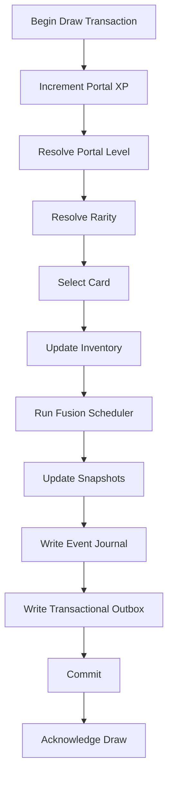

Toutes les opérations jusqu'au commit appartiennent à une transaction atomique.

Deux résultats sont possibles :

- Crash avant commit : rollback complet du tirage.
- Crash après commit : le tirage est considéré comme définitivement validé.

Un nouvel essai ne doit jamais reproduire les effets d'un tirage déjà validé.

## 3.2 Matrice de fault injection

Nous allons injecter artificiellement une interruption après chaque opération.

| ID | Point d'interruption | Résultat attendu |
|--------|--------|--------|
| REC-001 | Avant réservation | Aucun changement |
| REC-002 | Après réservation | Réservation récupérable |
| REC-003 | Avant débit | Aucun débit |
| REC-004 | Après débit | Lot payé et récupérable |
| REC-005 | Après incrément XP | Rollback si non commité |
| REC-006 | Après résolution rareté | Rollback si non commité |
| REC-007 | Après sélection carte | Rollback si non commité |
| REC-008 | Après modification inventaire | Rollback si non commité |
| REC-009 | Pendant fusion | Rollback du tirage complet |
| REC-010 | Après journalisation | Rollback si non commité |
| REC-011 | Après commit | Reprise sans duplication |
| REC-012 | Avant accusé de réception | Reconnaissance du commit existant |

Une attention particulière sera accordée au scénario :

**Débit effectué, mais aucun tirage encore validé.**

Le système doit reconnaître que le lot est déjà payé et reprendre le premier tirage sans débiter une seconde fois.

## 3.3 Idempotence

Chaque commande possède un identifiant unique.

Chaque tirage possède également un identifiant unique :

$$
draw\_id=(batch\_id,index)
$$

Une contrainte d'unicité en base de données empêche la validation multiple du même tirage.

Les événements externes sont distribués avec une outbox transactionnelle. Les consommateurs doivent être idempotents, car la livraison d'un événement peut être répétée.

---

</details>


### SYS-002.D.10.3.6.3 · T070 · 19/11/2026 19:14:43

**Nature :** `APPROBATION_EXPLICITE` · **Ligne d’approbation source :** 24853 · **Ligne de formalisation :** 24858.

**Décision / prescription originale (texte intégral du propriétaire) :**

Je valide A


<details><summary>Formalisation technique de la décision ratifiée (extrait sourcé)</summary>

# SYS-002.D.10.3.6.3 - Formalisation de la décision

(Validé) (Ruleset Snapshot adopté)

La politique `batch_pinned` est désormais définitive.

## 1. Contrat Ruleset Snapshot

Chaque invocation groupée reçoit une configuration immuable avant la réservation des ressources.

Le snapshot est créé lors de la transition :

`VALIDATED → RESERVED`

Il contient les versions suivantes :

| Configuration | Version figée |
|--------|--------|
| Probability Tables | Oui |
| Portal XP Thresholds | Oui |
| Card Catalog | Oui |
| Rarity Hierarchy | Oui |
| Fusion Policies | Oui |
| Fusion Eligibility Rules | Oui |
| Offer Pricing | Oui |
| Growth Profiles | Oui |
| RNG Algorithm | Oui |
| Engine Rules | Oui |

Chaque lot conserve notamment :

```python
@dataclass(frozen=True)
class BatchRulesetSnapshot:
    ruleset_id: str
    ruleset_hash: str

    probability_revision: str
    xp_threshold_revision: str
    catalog_revision: str
    rarity_revision: str
    fusion_revision: str
    pricing_revision: str
    growth_revision: str
    rng_algorithm_revision: str
    engine_revision: str
```

Le snapshot est immuable pendant toute la durée du lot.

## 2. Configuration figée vs état dynamique

Une distinction importante est ajoutée.

Le snapshot fige les règles du jeu, mais pas la progression du joueur.

| Donnée | Comportement |
|--------|--------|
| Tables probabilistes | Figées |
| Seuils XP | Figés |
| Catalogue | Figé |
| Prix de l'offre | Figé |
| Politique de fusion | Figée |
| XP cumulée du portail | Dynamique |
| Cartes débloquées | Dynamique |
| Doublons | Dynamiques |
| Niveaux des cartes | Dynamiques |
| Inventaire | Dynamique |

Cela permet notamment de conserver le comportement suivant :

Un joueur débloque une nouvelle carte pendant un lot de 35 invocations. Cette carte devient immédiatement éligible aux fusions ultérieures du même lot, sous réserve des règles de fusion figées dans son snapshot.

La configuration reste immuable ; la progression du joueur continue.

## 3. Nouveaux invariants

| ID | Invariant |
|--------|--------|
| INV-SUM-005 | Immutable Batch Ruleset |
| INV-SUM-006 | No Mixed Configuration Revisions |
| INV-SUM-007 | Snapshot Persistence |
| INV-SUM-008 | Dynamic Player State |
| INV-SUM-009 | Historical Ruleset Retention |

Une ancienne version de configuration ne peut être supprimée tant qu'un lot dépend encore de celle-ci.

Si une version nécessaire devient indisponible, le lot est placé en quarantaine. Le moteur ne substitue jamais silencieusement une nouvelle configuration.

---

# 4. Clôture des tests Ruleset Snapshot

Six nouveaux tests sont ajoutés.

| ID | Scénario | Résultat attendu |
|--------|--------|--------|
| SNAP-001 | Création du lot | Snapshot enregistré |
| SNAP-002 | Modification des probabilités pendant le lot | Ancienne version conservée |
| SNAP-003 | Modification du catalogue | Ancien catalogue conservé |
| SNAP-004 | Reprise après interruption | Même snapshot |
| SNAP-005 | Version historique indisponible | Quarantaine |
| SNAP-006 | Modification du tarif | Prix initial conservé |

La stratégie de tests `all_layers`, le `injectable_rng` et le `crash_recovery` restent inchangés.

---

</details>


### SYS-002.D.10.3.7.1 · T071 · 19/11/2026 19:50:42

**Nature :** `APPROBATION_CONTEXTUELLE` · **Ligne d’approbation source :** 25119 · **Ligne de formalisation :** 25124.

**Décision / prescription originale (texte intégral du propriétaire) :**

Oui


<details><summary>Formalisation technique de la décision ratifiée (extrait sourcé)</summary>

# SYS-002.D.10.3.7.1 - Formalisation du Serialized FIFO

(Validé) (Modèle A adopté)

La politique `serialized_fifo` est désormais définitive.

## 1. Contrat d'exécution

La sérialisation est définie par la combinaison :

$$
QueueKey=(owner\_id,portal\_id)
$$

Cela signifie :

- Un seul lot actif par joueur et par portail.
- Plusieurs lots peuvent attendre dans la file.
- Les lots sont exécutés dans leur ordre d'acceptation.
- Les tirages d'un même lot sont exécutés séquentiellement.
- Deux portails différents peuvent fonctionner simultanément.
- Deux joueurs différents peuvent invoquer simultanément sur le même portail.

## 2. Gestion de la file

Chaque commande reçoit un numéro de séquence durable et strictement croissant.

| Propriété | Règle |
|--------|--------|
| Ordonnancement | FIFO |
| Priorité | Ordre d'acceptation |
| Exécution simultanée même portail | Interdite |
| Exécution simultanée portails différents | Autorisée |
| Réorganisation des commandes | Interdite |
| Reprise après interruption | Prioritaire |
| Suppression d'un lot payé | Interdite |

Le numéro de séquence est attribué atomiquement à l'enregistrement de la commande.

## 3. Architecture d'exécution

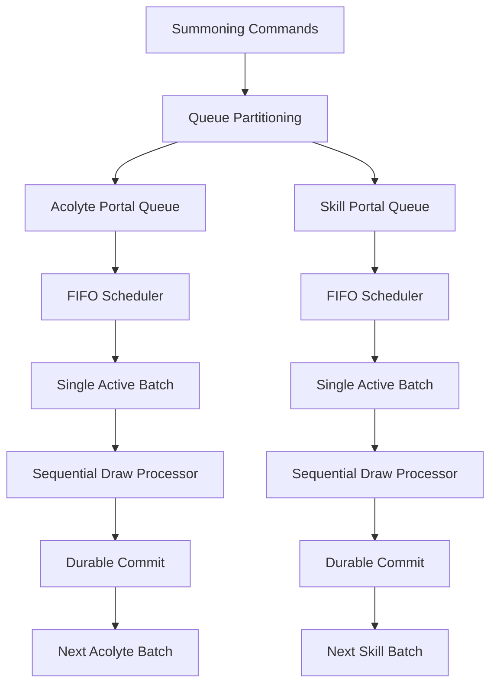

Les deux files sont indépendantes.

## 4. Gestion des interruptions

Une interruption ne permet jamais à un lot suivant de dépasser un lot précédent.

Exemple :

| Lot | État |
|--------|--------|
| Batch 001 | `RESUME_REQUIRED` |
| Batch 002 | `QUEUED` |
| Batch 003 | `QUEUED` |

Le Scheduler reprend obligatoirement le Batch 001.

Une fois celui-ci terminé, le Batch 002 peut démarrer.

Si un lot entre en quarantaine pour une erreur irrécupérable, la file concernée reste bloquée jusqu'à réconciliation.

## 5. Protection contre les exécutions concurrentes

Le Scheduler utilise :

- Un verrou par partition `owner_id + portal_id`.
- Un lease d'exécution.
- Un fencing token pour invalider les anciens workers.
- Un identifiant unique par tirage.
- Une validation transactionnelle avant progression de la file.

Un worker dont le lease a expiré ne peut plus valider de modifications, même s'il reprend son exécution tardivement.

*Note d'ingénierie : le fencing token est essentiel. Un simple verrou temporel ne suffit pas à empêcher un ancien worker de modifier l'inventaire après une reprise par un autre processus.*

## 6. Interaction avec les Ruleset Snapshots

Chaque lot conserve son propre snapshot.

Un lot en attente ne récupère jamais automatiquement une nouvelle configuration.

En revanche, l'expérience du portail reste dynamique.

Exemple :

- Batch 001 : snapshot R1.
- Batch 002 : snapshot R2.
- Batch 001 termine et fait progresser le portail.
- Batch 002 démarre avec le niveau XP actualisé, mais utilise toujours ses seuils et probabilités R2.

Cette distinction est désormais contractuelle.

## 7. Tests supplémentaires

| ID | Scénario | Résultat attendu |
|--------|--------|--------|
| FIFO-001 | Deux lots même portail | Ordre d'acceptation |
| FIFO-002 | Trois lots même portail | Exécution séquentielle |
| FIFO-003 | Deux portails différents | Exécution parallèle |
| FIFO-004 | Deux joueurs différents | Exécution parallèle |
| FIFO-005 | Crash du premier lot | Blocage des suivants |
| FIFO-006 | Reprise du premier lot | Aucun doublon |
| FIFO-007 | Deux workers concurrents | Un seul worker valide |
| FIFO-008 | Expiration du lease | Ancien worker invalidé |
| FIFO-009 | Configuration modifiée | Snapshots préservés |
| FIFO-010 | Deux commandes simultanées | Séquence durable déterministe |

---

</details>


### SYS-002.D.10.3 · T072 · 19/11/2026 19:54:18

**Nature :** `APPROBATION_CONTEXTUELLE` · **Ligne d’approbation source :** 25344 · **Ligne de formalisation :** 25349.

**Décision / prescription originale (texte intégral du propriétaire) :**

Parfait


<details><summary>Formalisation technique de la décision ratifiée (extrait sourcé)</summary>

# SYS-002.D.10.3 — Summoning Engine

(APPROVED — Architecture validée)

La validation globale est enregistrée.

Le module est désormais clôturé au niveau architectural et fonctionnel.

**Livrables validés :**

- Probability Resolution Engine
- Portal XP Progression Engine
- Summoning Transaction Engine
- Batch Billing Engine
- Reward Distribution Engine
- Duplicate &amp; Fusion Engine
- Fusion Scheduler
- RNG Architecture
- Crash Recovery
- Ruleset Snapshot
- Integration &amp; Acceptance Testing
- FIFO Scheduler

## État du projet

| Phase | Statut |
|--------|--------|
| Architecture fonctionnelle | (Terminée) |
| Contrats métier | (Validés) |
| Contrats mathématiques | (Spécifiés) |
| Calibration numérique | (À réaliser) |
| Conception technique détaillée | (Prochaine étape) |
| Implémentation | En attente |

</details>


### SYS-002.D.10.4.1 · T074 · 19/11/2026 20:09:40

**Nature :** `APPROBATION_EXPLICITE` · **Ligne d’approbation source :** 25639 · **Ligne de formalisation :** 25644.

**Décision / prescription originale (texte intégral du propriétaire) :**

Validation du modèle A


<details><summary>Formalisation technique de la décision ratifiée (extrait sourcé)</summary>

# SYS-002.D.10.4.1 - Modular Monolith

(APPROVED) (Spécification clôturée)

Le modèle A est officiellement adopté.

### Décisions intégrées au GDD

| Paramètre | Décision |
|--------|--------|
| Architecture globale | `modular_monolith` |
| Organisation métier | `domain_driven_modules` |
| Architecture interne | `ports_and_adapters` |
| Communication intermodules | `explicit_interfaces` |
| Persistance | `shared_database` |
| Transactions | `local_atomic_transactions` |
| Interface graphique | `presentation_decoupled` |

### Structure architecturale retenue

```text
src/
├── Game.Client/
│
├── Modules/
│   ├── Summoning/
│   ├── Acolytes/
│   ├── Skills/
│   ├── Character/
│   ├── Combat/
│   ├── Economy/
│   └── Equipment/
│
├── Shared/
│   ├── Domain/
│   ├── Events/
│   └── Contracts/
│
├── Infrastructure/
│   ├── Persistence/
│   ├── Random/
│   ├── Configuration/
│   └── Transactions/
│
└── Tests/
    ├── Unit/
    ├── Integration/
    ├── EndToEnd/
    └── Recovery/
```

Chaque module possède ses propres entités, services métier, interfaces et tests. Aucun module ne manipule directement les tables internes d'un autre module.

---

</details>


### SYS-002.D.10.4.2.1 · T076 · 19/11/2026 20:16:19

**Nature :** `APPROBATION_CONTEXTUELLE` · **Ligne d’approbation source :** 25916 · **Ligne de formalisation :** 25921.

**Décision / prescription originale (texte intégral du propriétaire) :**

Très bien faisons comme ça alors dans un premier temps


<details><summary>Formalisation technique de la décision ratifiée (extrait sourcé)</summary>

# SYS-002.D.10.4.2.1 - Validation de la stack technologique

(APPROVED) (Décision enregistrée)

La proposition est adoptée comme configuration initiale du projet.

| Paramètre | Décision |
|--------|--------|
| Plateforme cible | `android_only` |
| Environnement de développement | `pc` |
| Moteur graphique | `unity_6` |
| Langage | `csharp` |
| Architecture | `modular_monolith` |
| Persistance | `sqlite` |
| Configuration | `json_versioned` |
| Exécution | `standalone_offline` |
| Extensibilité | `cross_platform_preserved` |

Cette décision ne verrouille pas définitivement le projet sur Android. L'architecture conservera la possibilité d'ajouter d'autres plateformes ultérieurement.

</details>


### SYS-002.D.10.4.2.2 · T077 · 19/11/2026 20:43:18

**Nature :** `APPROBATION_EXPLICITE` · **Ligne d’approbation source :** 26194 · **Ligne de formalisation :** 26199.

**Décision / prescription originale (texte intégral du propriétaire) :**

Je valide. En parallèle j'ai installé Unity


<details><summary>Formalisation technique de la décision ratifiée (extrait sourcé)</summary>

# SYS-002.D.10.4.2.2 - Validation technologique

(APPROVED)

La stack technologique est officiellement validée.

L'installation d'Unity permettra de réaliser les premiers contrôles techniques directement dans l'éditeur. Nous ne commencerons toutefois pas à développer les moteurs métier avant d'avoir verrouillé leur architecture logicielle.

Une correction est également apportée à notre précédente proposition : les scripts destinés à être compilés par Unity doivent être placés sous `Assets/` ou dans un package Unity, et non dans un dossier `Core/` indépendant à la racine. \[[Default project directories • Project configuration • 6000.0](https://docs.unity.com/en-us/engine/6000.0/manual/get-started/project-configuration/default-directories?utm_source=chatgpt.com); [Creating assembly assets • Organize scripts into assemblies • 6000.6](https://docs.unity.com/en-us/engine/6000.6/manual/programming-environment/script-compilation/assembly-definition-files/assembly-definitions-creating?utm_source=chatgpt.com)\]

---

</details>


### SYS-002.D.10.4.2.3 · T078 · 19/11/2026 20:53:38

**Nature :** `APPROBATION_EXPLICITE` · **Ligne d’approbation source :** 26493 · **Ligne de formalisation :** 26499.

**Décision / prescription originale (texte intégral du propriétaire) :**

Je valide le modèle A.
Je souhaite apporter des informations concernant le système d'obtention des équipements ainsi que les équipements en eux même, sauf si tu possède déjà ces informations?


<details><summary>Formalisation technique de la décision ratifiée (extrait sourcé)</summary>

# SYS-002.D.10.4.2.3 — Validation

(APPROVED) (Modèle A adopté)

Nous conservons les cinq assemblies partagés par couche, avec une séparation des modules métier par namespaces et contrats explicites.

---

</details>

