# Chapitre 11 — Équipement et Lampe Magique

**Autorité :** décisions expressément approuvées dans la conversation source. Les modèles obsolètes sont remplacés par les rectifications ultérieures ; les paramètres provisoires restent provisoires.

**Statut du chapitre :** `functionally_specified` pour ses spécifications validées ; aucune exécution de test ou implémentation ne découle de ce statut.

**Traçabilité :** 31 décision(s) du propriétaire. Toutes les références `Txxx` renvoient à `references/HISTORIQUE_SOURCE_ORIGINAL.md`.


## Registre détaillé des décisions approuvées


### SYS-002.D.11.1 · T080 · 19/11/2026 21:11:23

**Nature :** `EXIGENCE_OU_RECTIFICATION_PROPRIETAIRE` · **Ligne d’approbation source :** 26650 · **Ligne de formalisation :** 26689.

**Décision / prescription originale (texte intégral du propriétaire) :**

Système d'obtention de l'équipement :

**La Lampe Magique est le moteur central de votre progression dans *Legend of Mushroom*.** Elle fonctionne selon une boucle d'équipement et de recyclage qui fait évoluer à la fois le niveau de votre personnage et la rareté des objets générés. 

---

**1. Condensé des mécanismes de la Lampe Magique**

- **Double moteur de progression.** Le **niveau de votre champignon** fixe la puissance brute (statistiques de base) des objets générés, tandis que le **niveau de la lampe** contrôle la probabilité d'obtenir des raretés élevées.
- **Boucle de recyclage (Or et EXP).** Chaque charge de lampe génère une pièce d'équipement aléatoire. Vous l'équipez si elle est meilleure, ou vous la vendez instantanément pour gagner de **l'expérience** (montée de niveau du personnage) et des **pièces d'or** (indispensables pour améliorer la lampe). 
- **Segments d'amélioration.** Monter la lampe d'un niveau nécessite d'acheter plusieurs segments avec votre or, suivis d'un temps de construction réductible via des tickets d'accélération ou des publicités. 
- **Automatisation (Auto-Lamp).** Débloqué au **niveau 16 de personnage**, le mode automatique fait tourner la lampe en arrière-plan et s'arrête uniquement lorsqu'une pièce correspond à vos critères de rareté et de statistiques secondaires. 
- **Tirages multiples et bannissement.** Aux niveaux de lampe **16, 20 et 24**, vous débloquez l'ouverture simultanée de **6, 8 puis 10 lampes** à la fois. Aux niveaux **12, 20 et 26**, la fonction *Adjust* permet de bloquer jusqu'à **3 affixes indésirables**. 
- **Sources principales de lampes.** Vous obtenez vos charges via le coffre AFK (jusqu'à **1 080/jour**), le donjon *Voleur de lampe* (jusqu'à **2 500/jour**), la campagne, l'arène et la boutique de clan.

---

**2. Mécanisme des niveaux de rareté de la lampe**

- **Élimination par le bas et déblocage par le haut.** Au niveau 1, la lampe ne génère que les raretés de base (*Normal, Unique, Bien*). À chaque montée de niveau, les pourcentages des raretés inférieures diminuent jusqu'à disparaître complètement de la table de tirage, libérant de la place pour les paliers supérieurs.
- **Conditions spéciales en fin de jeu.** Les très hautes raretés (**Aurous** et **Éternel**) demandent à la fois un niveau de lampe élevé (niveaux 20 à 26+) et la validation d'une condition de progression affichée sur l'écran d'amélioration de la lampe.
- **Échelle complète des 10 raretés d'équipement.** Plus le palier obtenu est élevé, plus les multiplicateurs de statistiques et le nombre d'affixes secondaires augmentent : 

| **Palier** | **Rareté (Jeu)**           | **Couleur / Aspect**     | **Apparition et rôle dans la progression**                                    |
| ---------- | -------------------------- | ------------------------ | ----------------------------------------------------------------------------- |
| **1 à 3**  | **Normal / Unique / Bien** | Gris / Vert clair / Vert | Raretés de départ (lampes niveaux 1 à 5) ; disparaissent vite des tirages.    |
| **4 à 5**  | **Rare / Mythique**        | Bleu / Violet            | Début et milieu de partie ; introduisent les premiers bonus secondaires.      |
| **6 à 7**  | **Épique / Légendaire**    | Jaune / Orange           | Débloqués autour des niveaux 8 à 12 ; base solide pour spécialiser sa classe. |
| **8**      | **Immortel** (*Immortal*)  | Rouge                    | Haut de tableau classique (lampes 15+) avec de forts bonus d'affixes.         |
| **9**      | **Suprême / Aurous**       | Rose / Arc-en-ciel       | Paliers avancés (lampes 20+) ; déblocage conditionnel pour *Aurous*.          |
| **10**     | **Éternel** (*Eternal*)    | Rouge-Or / Cosmique      | Rareté ultime des très hauts niveaux de lampe (26+) avec les stats maximales. |

*(Note : Ouvrir 10 lampes d'un coup en mode automatique applique exactement les mêmes pourcentages de rareté que l'ouverture 1 par 1, sans aucun malus de probabilité.)* 

Si tu as des questions pour l'amélioration demande moi afin que je puisse te donner plus de précision.


<details><summary>Formalisation technique de la décision ratifiée (extrait sourcé)</summary>

# SYS-002.D.11.1 - Equipment Acquisition Engine

(Collecte des spécifications en cours)

Tes informations permettent déjà de définir une bonne partie de l'architecture. La Lampe Magique est un système particulièrement intéressant parce qu'elle combine génération aléatoire, progression économique, progression du personnage et gestion automatisée de l'inventaire.

Je formalise les premiers mécanismes.

## 1. SYS-002.D.11.1.1 - Lamp Generation System

### 1.1 Les deux axes de progression

Nous avons deux variables indépendantes qui influencent directement la génération des équipements.

**Niveau du personnage**

(Influence les statistiques)

Détermine la puissance brute des équipements générés.

---

**Niveau de la Lampe Magique**

(Influence les probabilités)

Détermine les probabilités d'obtention des différentes raretés et les possibilités de génération.

Ces deux paramètres ne doivent jamais être confondus dans le modèle mathématique.

Nous pouvons formaliser la génération ainsi :

$$
P(R=r)=f(L_{\text{lampe}},C)
$$

$$
Stats_{\text{base}}=g(L_{\text{personnage}},r)
$$

Avec :

- $R$ : rareté obtenue.
- $C$ : conditions de progression.
- $r$ : rareté de l'équipement.

Les fonctions exactes seront définies lors de la calibration.

### 1.2 Référentiel des raretés

Nous créons un référentiel indépendant de celui des acolytes.

**Échelle des 10 raretés d'équipement**

Les identifiants internes seront indépendants des traductions françaises et anglaises.

### 1.3 Progression des probabilités

Nous retenons les règles suivantes :

- Les raretés inférieures perdent progressivement leurs probabilités.
- Certaines raretés disparaissent totalement des tables.
- Les raretés supérieures deviennent accessibles à certains niveaux.
- Aurous et Éternel possèdent des conditions de déblocage supplémentaires.
- Les tables probabilistes dépendent exclusivement du niveau de lampe et des conditions correspondantes.

Les niveaux 20 à 26+ constituent une zone de déblocage avancée, mais nous ne fixerons pas encore les seuils exacts.

### 1.4 Génération des équipements

Chaque charge consommée produit un équipement aléatoire.

Le traitement métier est le suivant :

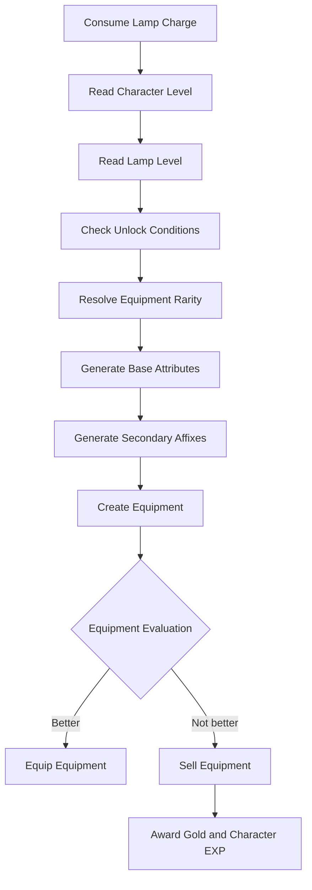

Le critère exact de comparaison entre deux équipements reste à définir.

---

## 2. SYS-002.D.11.1.2 - Lamp Features

Nous enregistrons les déblocages fonctionnels.

| Niveau de lampe | Fonctionnalité |
|--------|--------|
| 12 | Adjust |
| 16 | Auto-Lamp et ouverture ×6 |
| 20 | Adjust et ouverture ×8 |
| 24 | Ouverture ×10 |
| 26 | Adjust |

La fonction Adjust permet de bannir jusqu'à trois affixes indésirables.

Les capacités exactes à chaque palier restent à préciser.

### 2.1 Auto-Lamp

(Déblocage au niveau 16 du personnage)

Le système fonctionne selon une boucle automatisée :

1. Consommer une charge.
2. Générer un équipement.
3. Évaluer ses caractéristiques.
4. Vérifier les critères configurés.
5. Continuer ou arrêter.

Nous créerons ultérieurement un `AutoLampController` indépendant du générateur d'équipements.

### 2.2 Sources de charges

| Source | Quantité quotidienne maximale |
|--------|--------|
| Coffre AFK | 1 080 |
| Donjon Voleur de lampe | 2 500 |
| Campagne | À déterminer |
| Arène | À déterminer |
| Boutique de clan | À déterminer |

Ces quantités seront conservées comme données de référence à confirmer.

---

## 3. SYS-002.D.11.1.3 - Lamp Progression System

Nous avons identifié une boucle économique distincte :

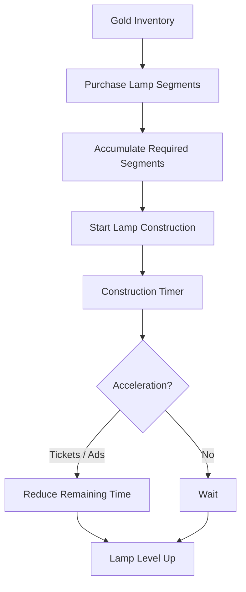

Deux ressources interviennent :

- Or : achat des segments.
- Tickets d'accélération ou publicités : réduction du temps de construction.

Nous devrons spécifier les coûts, les quantités de segments, les durées et les éventuelles limites de construction.

---

# 4. Premiers contrats fonctionnels

| ID | Contrat | Décision initiale |
|--------|--------|--------|
| EQ-ACQ-001 | Niveau personnage | Détermine la puissance brute |
| EQ-ACQ-002 | Niveau lampe | Détermine les probabilités |
| EQ-ACQ-003 | Raretés | 10 niveaux ordonnés |
| EQ-ACQ-004 | Génération | Une charge = un équipement |
| EQ-ACQ-005 | Raretés indisponibles | Probabilité nulle |
| EQ-ACQ-006 | Conditions Aurous/Éternel | Déblocage conditionnel |
| EQ-ACQ-007 | Vente | Attribution d'or et d'EXP |
| EQ-ACQ-008 | Auto-Lamp | Déblocage personnage niveau 16 |
| EQ-ACQ-009 | Tirages multiples | ×6, ×8, ×10 |
| EQ-ACQ-010 | Adjust | Bannissement jusqu'à 3 affixes |

Ces contrats constituent une première formalisation, pas encore une validation définitive.

---

# 5. SYS-002.D.11.1.4 - Première clarification : Adjust

Il existe une ambiguïté importante dans les niveaux de déblocage de cette fonctionnalité.

Tu indiques que Adjust est disponible aux niveaux 12, 20 et 26, avec une capacité maximale de trois affixes.

**Comment évolue précisément cette capacité ?**

Modèle A - Capacité progressive : 1 affixe au niveau 12, 2 au niveau 20 et 3 au niveau 26.

Modèle B - Trois affixes disponibles dès le niveau 12 ; les niveaux 20 et 26 apportent d'autres améliorations.

Autre fonctionnement.

[Valider]

Une fois cette règle clarifiée, nous poursuivrons avec la progression de la lampe et la génération des équipements.

*Point d'architecture à conserver : Equipment Acquisition Engine et Summoning Engine auront des responsabilités distinctes. La Lampe Magique ne sera pas implémentée comme un simple portail d'invocation réutilisant les règles des acolytes.*

</details>


### SYS-002.D.11.1.4 · T081 · 19/11/2026 21:24:14

**Nature :** `APPROBATION_EXPLICITE` · **Ligne d’approbation source :** 26918 · **Ligne de formalisation :** 26923.

**Décision / prescription originale (texte intégral du propriétaire) :**

SYS-002.D.11.1.4 — Validation Adjust : progressive. Formalise et poursuis.


<details><summary>Formalisation technique de la décision ratifiée (extrait sourcé)</summary>

# SYS-002.D.11.1.4 — Formalisation de Adjust

(Validé) (GDD actualisé)

La capacité de bannissement des affixes progresse par paliers.

| Niveau de lampe | Capacité de bannissement |
|--------|--------|
| 1–11 | 0 affixe |
| 12–19 | 1 affixe |
| 20–25 | 2 affixes |
| 26+ | 3 affixes |

### Contrats fonctionnels

- `ADJUST-001` : déblocage initial au niveau 12.
- `ADJUST-002` : capacité augmentée au niveau 20.
- `ADJUST-003` : capacité maximale atteinte au niveau 26.
- `ADJUST-004` : maximum de trois affixes bannis simultanément.
- `ADJUST-005` : capacité déterminée par le niveau actuel de la lampe.

La persistance des affixes bannis et leur application exacte pendant la génération restent à préciser ultérieurement.

---

</details>


### SYS-002.D.11.1.5.1 · T082 · 19/11/2026 21:29:51

**Nature :** `EXIGENCE_OU_RECTIFICATION_PROPRIETAIRE` · **Ligne d’approbation source :** 27000 · **Ligne de formalisation :** 27027.

**Décision / prescription originale (texte intégral du propriétaire) :**

**L'amélioration d'un niveau de lampe fonctionne par paliers intermédiaires (segments) achetés avec de l'or, suivis d'un minuteur de construction obligatoire avant de passer au niveau suivant.**

Voici le fonctionnement exact de chacun des quatre points :

**1. Nombre de segments par niveau**

- **Nombre variable selon le palier.** Chaque niveau de lampe est divisé en un certain nombre de segments (généralement entre **3 et 5 segments** selon le niveau), et ce nombre augmente à mesure que vous progressez vers les hauts niveaux. [[1](https://www.youtube.com/watch?v=_QSsOBihZb0\&t=36)]
- **Exemple concret.** Au niveau 23, la barre de progression se divise en plusieurs segments individuels (coûtant chacun plus d'un million d'or) avant de pouvoir déclencher le passage au niveau 24. [[1](https://www.youtube.com/watch?v=5i-Nyacw4go\&t=537), [2](https://www.youtube.com/watch?v=_QSsOBihZb0\&t=36)]

**2. Achat individuel des segments avec de l'or**

- **Paiement segment par segment.** Vous n'avez pas besoin d'économiser la totalité du coût d'un niveau en une seule fois : vous achetez chaque segment individuellement dès que vous disposez de la somme d'or requise. [[1](https://www.youtube.com/watch?v=_QSsOBihZb0\&t=36), [2](https://guidesbygrace.uk/gear-lamp)]
- **Progression enregistrée.** Chaque clic remplit une fraction de la jauge d'amélioration de la lampe et retire immédiatement l'or correspondant de votre réserve.

**3. Déclenchement du temps de construction**

- **Démarrage uniquement à 100 %.** Le minuteur de construction ne se lance qu'une fois **tous les segments du niveau actuel achetés** (lorsque la jauge est pleine).
- **Accélération du délai.** Pendant ce temps d'attente (qui passe de quelques minutes au début à plusieurs heures ou jours à haut niveau), vous continuez d'utiliser votre lampe au niveau actuel, et vous pouvez réduire le minuteur grâce aux **tickets d'accélération** (*Speed-up coupons*) ou aux **publicités quotidiennes**.

**4. Accumulation de segments à l'avance**

- **Impossible d'accumuler sur plusieurs niveaux.** Le jeu bloque l'achat de nouveaux segments dès que la barre du niveau en cours est remplie et que le compte à rebours est lancé.
- **Gestion des réserves.** Vous devez attendre la fin du minuteur (ou le terminer avec des accélérateurs) pour valider le niveau supérieur et débloquer l'accès aux segments du niveau suivant. [[1](https://www.youtube.com/watch?v=_QSsOBihZb0\&t=36)]


<details><summary>Formalisation technique de la décision ratifiée (extrait sourcé)</summary>

# SYS-002.D.11.1.5.1 - Lamp Segment Progression

(Mécanisme formalisé) (Validation en attente)

Les quatre mécanismes sont suffisamment documentés pour établir le premier contrat fonctionnel du Lamp Progression Engine.

## 1. Fonctionnement général

La progression est organisée autour de deux phases distinctes :

1. Acquisition des segments avec de l'or.
2. Construction temporisée après acquisition complète.

### 1.1 Acquisition des segments

Chaque niveau possède sa propre configuration.

| Paramètre | Règle |
|--------|--------|
| Nombre de segments | Variable, généralement 3 à 5 |
| Coût | Défini individuellement par segment |
| Paiement | Individuel |
| Déduction de l'or | Immédiate |
| Progression | Persistante |
| Achat anticipé | Interdit |

Le modèle mathématique sera fondé sur une table de configuration :

$$
Segments(L)=N_L
$$

$$
Cost(L,i)=C_{L,i}
$$

Avec :

- $L$ : niveau actuel de la lampe.
- $N_L$ : nombre de segments requis.
- $i$ : numéro du segment.
- $C_{L,i}$ : coût en or du segment.

Le coût total du niveau sera :

$$
CostTotal(L)=\sum_{i=1}^{N_L}C_{L,i}
$$

Nous conserverons les coûts individuels plutôt que d'imposer artificiellement une progression linéaire.

## 2. Machine à états

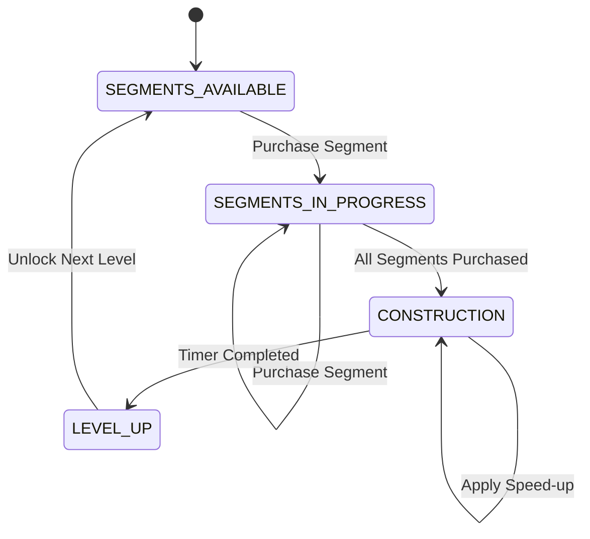

### 2.1 Règles fondamentales

- Chaque achat débite immédiatement l'or.
- Les segments achetés sont conservés.
- Le minuteur ne démarre qu'à 100 %.
- Aucun segment du niveau suivant ne peut être acheté pendant la construction.
- La lampe reste utilisable pendant la construction.
- Les équipements générés pendant cette période utilisent le niveau actuel de la lampe.
- Les tickets d'accélération et publicités réduisent le temps restant.
- Le prochain niveau devient accessible après la fin effective de la construction.

## 3. Contrats fonctionnels

| ID | Contrat | Décision |
|--------|--------|--------|
| LAMP-PROG-001 | Nombre de segments | `variable_lookup` |
| LAMP-PROG-002 | Achat | `individual_purchase` |
| LAMP-PROG-003 | Paiement | `immediate_gold_deduction` |
| LAMP-PROG-004 | Progression | `persistent` |
| LAMP-PROG-005 | Déclenchement construction | `all_segments_purchased` |
| LAMP-PROG-006 | Achat anticipé | `forbidden` |
| LAMP-PROG-007 | Utilisation pendant construction | `allowed` |
| LAMP-PROG-008 | Accélération | `speedup_or_ad` |
| LAMP-PROG-009 | Progression simultanée | `single_level_construction` |

## 4. Architecture technique envisagée

Le `Lamp Progression Engine` sera indépendant du `Equipment Acquisition Engine`.

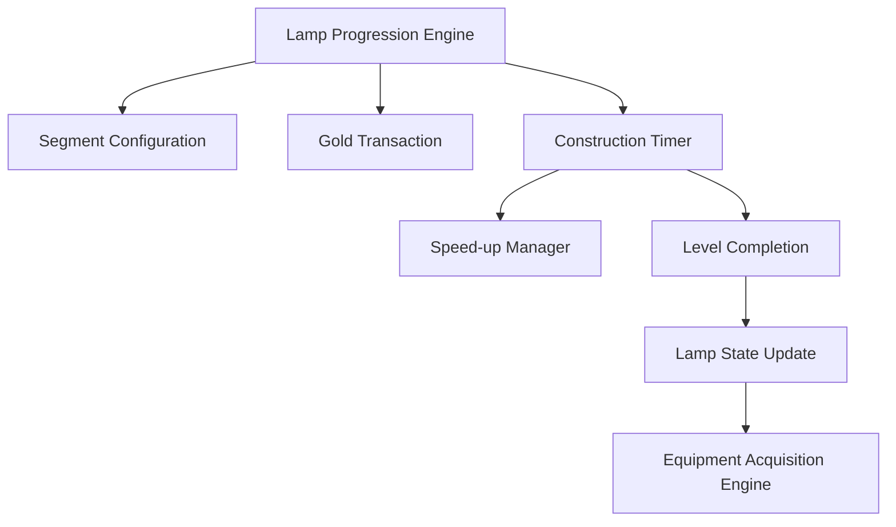

Le niveau de lampe sera une donnée partagée en lecture, mais sa modification restera sous la responsabilité exclusive du Lamp Progression Engine.

*Note d'ingénierie : séparer le minuteur de la génération des équipements évite qu'une amélioration en cours modifie accidentellement les probabilités d'un équipement généré avant la fin de la construction.*

---

</details>


### SYS-002.D.11.1.5.2 · T083 · 19/11/2026 21:33:05

**Nature :** `APPROBATION_EXPLICITE` · **Ligne d’approbation source :** 27188 · **Ligne de formalisation :** 27193.

**Décision / prescription originale (texte intégral du propriétaire) :**

C'est le modèle A


<details><summary>Formalisation technique de la décision ratifiée (extrait sourcé)</summary>

# SYS-002.D.11.1.5.2 — Validation de la finalisation automatique

(Validé) (Modèle A adopté)

La décision est intégrée au GDD.

### Contrat définitif

| Paramètre | Décision |
|--------|--------|
| Fin du minuteur | `automatic` |
| Validation manuelle | `not_required` |
| Augmentation du niveau | `automatic` |
| Déblocage des segments suivants | `immediate` |
| Utilisation de la lampe pendant construction | `allowed` |

### Règles complémentaires

1. À expiration du minuteur, le niveau de lampe augmente automatiquement.
2. Les segments du niveau suivant deviennent immédiatement accessibles.
3. L'événement de finalisation ne peut être traité qu'une seule fois.
4. Les équipements générés avant la finalisation utilisent l'ancien niveau de lampe.
5. Les équipements générés après la finalisation utilisent le nouveau niveau.

*Note d'ingénierie : la finalisation doit être idempotente. Une reprise après fermeture de l'application ne doit jamais provoquer deux augmentations de niveau.*

---

</details>


### SYS-002.D.11.1.6 · T084 · 19/11/2026 21:35:51

**Nature :** `EXIGENCE_OU_RECTIFICATION_PROPRIETAIRE` · **Ligne d’approbation source :** 27262 · **Ligne de formalisation :** 27289.

**Décision / prescription originale (texte intégral du propriétaire) :**

**Dans *Legend of Mushroom*, le minuteur de la lampe suit une progression exponentielle allant de quelques secondes à plusieurs jours, que vous pouvez réduire grâce aux tickets d'accélération (5 minutes chacun), aux publicités quotidiennes et à l'aide de votre clan.**

**1. Évolution de la durée de construction**

- **Début de partie (Niveaux 1 à 10).** Les premiers délais sont très courts, passant de quelques secondes à quelques dizaines de minutes.
- **Milieu de partie (Niveaux 11 à 20).** La durée grimpe progressivement de plusieurs heures à plus d'une journée complète par palier.
- **Haut niveau (Niveaux 21 à 28+).** Le minuteur devient un véritable goulot d'étranglement, atteignant **plusieurs jours complets** à partir du niveau 24 (nécessitant plus de 1 200 tickets d'accélération pour être passé instantanément, comme le soulignent les joueurs sur [**Reddit Legend of Mushroom**](https://www.reddit.com/r/LegendOfMushroomGame/comments/1crdw6g/had_the_game_a_couple_weeks_and_im_just_realizing/)).

**2. Tickets d'accélération (*Speed-Up Coupons*)**

- **Valeur unitaire fixe.** Chaque ticket d'accélération standard retire exactement **5 minutes** au compte à rebours en cours.
- **Cumul illimité.** Les tickets sont entièrement cumulables : un bouton dédié sur la fenêtre du minuteur permet d'utiliser d'un seul coup le nombre exact de tickets nécessaires pour terminer l'amélioration (ou de vider votre stock).
- **Double usage.** Comme le rappelle [**Pocket Gamer**](https://www.pocketgamer.com/legend-of-mushroom/guide/), ces mêmes tickets servent également à accélérer les recherches technologiques (notamment lors de l'événement *Tech Rush*).

**3. Publicités quotidiennes et aide de Clan**

- **Quota et réduction des publicités.** Vous disposez d'un quota quotidien d'environ **4 publicités** sur le minuteur de la lampe, chacune retirant **30 minutes** (soit **2 heures** de réduction gratuite par jour au total, ou un simple clic si vous possédez le pass sans pub).
- **Aide gratuite de la Famille (Clan).** En plus des publicités, vous pouvez solliciter l'aide des membres de votre clan via le bouton d'assistance sur le minuteur pour grappiller gratuitement plusieurs minutes supplémentaires à chaque niveau.

**4. Fonctionnement hors ligne (Jeu fermé)**

- **Écoulement continu.** *Legend of Mushroom* étant un jeu idle connecté en permanence aux serveurs, **le minuteur continue de s'écouler en temps réel** lorsque l'application est complètement fermée ou en arrière-plan.
- **Validation au retour.** Si le délai arrive à zéro pendant votre absence, l'amélioration s'achève automatiquement et votre lampe passe immédiatement au niveau supérieur dès votre reconnexion.


<details><summary>Formalisation technique de la décision ratifiée (extrait sourcé)</summary>

# SYS-002.D.11.1.6 - Construction Timer &amp; Acceleration System

(Spécification en cours)

Les informations permettent de formaliser le fonctionnement temporel et les trois mécanismes d'accélération.

## 1. SYS-002.D.11.1.6.1 - Construction Timer

### 1.1 Évolution des durées

La durée de construction suit une progression fortement croissante, décrite comme exponentielle.

| Palier | Comportement |
|--------|--------|
| Niveaux 1-10 | Quelques secondes à plusieurs dizaines de minutes |
| Niveaux 11-20 | Plusieurs heures à plus d'une journée |
| Niveaux 21-23 | Durées très importantes |
| Niveaux 24-28+ | Plusieurs jours |

Nous retiendrons une table de référence plutôt qu'une formule exponentielle imposée.

$$
T(L)=DurationLookup(L)
$$

Cette décision permet de reproduire précisément les durées du jeu officiel lorsque nous disposerons des valeurs.

À titre de contrôle :

$$
1200\times 5=6000\text{ minutes}
$$

Soit 100 heures, ou 4 jours et 4 heures.

Cela confirme la cohérence de l'ordre de grandeur communiqué pour les niveaux élevés.

### 1.2 Comportement du minuteur

Les règles suivantes sont retenues :

- Démarrage automatique lorsque tous les segments sont achetés.
- Écoulement continu en temps réel.
- Fonctionnement indépendant de l'utilisation de la lampe.
- Persistance du temps restant après fermeture de l'application.
- Finalisation automatique à expiration.
- Déblocage immédiat du niveau suivant.

## 2. SYS-002.D.11.1.6.2 - Speed-Up Coupons

(Règles fonctionnelles établies)

Chaque ticket possède une valeur fixe :

$$
V_{\text{ticket}}=300\text{ secondes}
$$

L'utilisation de plusieurs tickets est additive :

$$
T_{\text{réduit}}=N_{\text{tickets}}\times300
$$

Le temps restant devient :

$$
T_{\text{final}}=\max(0,T_{\text{initial}}-T_{\text{réduit}})
$$

Le nombre minimal de tickets nécessaires pour terminer instantanément :

$$
N_{\text{required}}=
\left\lceil\frac{T_{\text{remaining}}}{300}\right\rceil
$$

### Contrats fonctionnels

| Paramètre | Décision |
|--------|--------|
| Valeur unitaire | 5 minutes |
| Cumul | Additif |
| Utilisation multiple | Autorisée |
| Utilisation partielle | Autorisée |
| Dépense maximale | Stock disponible |
| Utilisation dans d'autres systèmes | Recherche technologique |
| Débit | Immédiat et atomique |

**Point architectural :** les tickets appartiennent à l'Economy Engine. Le Lamp Progression Engine et le Technology Research Engine utilisent la même ressource. Il n'existe donc pas deux inventaires indépendants de tickets.

## 3. SYS-002.D.11.1.6.3 - Publicités quotidiennes

(Calibration provisoire)

| Paramètre | Valeur |
|--------|--------|
| Quota quotidien | 4 publicités |
| Réduction unitaire | 30 minutes |
| Réduction quotidienne | 2 heures |
| Coût en tickets | 0 |

Le contrat mathématique :

$$
T_{\text{réduit}}=N_{\text{ads}}\times1800
$$

Avec :

$$
0\leq N_{\text{ads}}\leq4
$$

La possibilité de remplacer les publicités par une simple validation grâce à un pass sans publicité sera représentée par un système d'entitlements.

Le quota, sa réinitialisation et les éventuelles exceptions restent configurables.

## 4. SYS-002.D.11.1.6.4 - Clan Assistance

L'aide du clan constitue une troisième source de réduction.

Nous savons actuellement que :

- Elle est gratuite.
- Elle est sollicitée depuis l'interface du minuteur.
- Plusieurs minutes peuvent être retirées.
- Elle intervient sur chaque niveau de lampe.

Nous ne connaissons pas encore la quantité exacte de temps retirée ni les limites de sollicitations.

Nous ne fixerons donc aucune valeur arbitraire.

---

# 5. Architecture technique du Timer Engine

Le composant sera indépendant de Unity.

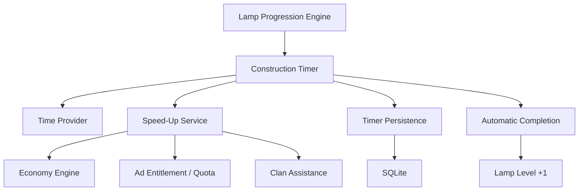

### 5.1 Modèle de données proposé

```csharp
public sealed class LampConstruction
{
    public Guid ConstructionId { get; set; }

    public int SourceLevel { get; set; }

    public int TargetLevel { get; set; }

    public DateTimeOffset StartedAtUtc { get; set; }

    public DateTimeOffset EndsAtUtc { get; set; }

    public long InitialDurationSeconds { get; set; }

    public ConstructionStatus Status { get; set; }
}
```

Le temps restant est calculé :

$$
T_{\text{remaining}}=
\max(0,EndsAtUtc-NowUtc)
$$

Les accélérations modifient `EndsAtUtc` et sont enregistrées dans un journal transactionnel.

*Note d'ingénierie : stocker une échéance absolue plutôt qu'un compteur décrémenté chaque seconde permet de reprendre correctement la construction après fermeture ou redémarrage de l'application.*

### 5.2 Gestion hors ligne

Une subtilité concerne notre architecture précédemment validée : `standalone_offline`.

Puisque nous n'avons pas prévu de serveur, je propose d'utiliser une horloge locale UTC persistée.

Au lancement :

1. Lecture de l'échéance enregistrée.
2. Lecture de l'heure actuelle.
3. Calcul du temps écoulé.
4. Si l'échéance est dépassée, finalisation automatique.
5. Sinon, reprise du compte à rebours.

La progression logique est continue, même si l'application est fermée. La mise à jour physique de l'état sera effectuée au prochain lancement si Android a interrompu le processus.

Limite connue : sans serveur de temps autoritaire, une modification manuelle de l'horloge du téléphone peut influencer la progression.

---

# 6. SYS-002.D.11.1.6.5 - Validation de la source temporelle

Nous devons maintenant verrouiller le mécanisme de référence temporelle.

**Modèle A - Horloge locale UTC**

(Recommandation)

- Persistance de l'échéance UTC.
- Écoulement pendant la fermeture de l'application.
- Reprise automatique au lancement.
- Fonctionnement entièrement hors ligne.
- Sensibilité aux modifications manuelles de l'horloge.

---

**Modèle B - Serveur de temps**

- Heure de référence fournie par un serveur.
- Progression fiable même après fermeture.
- Résistance aux modifications de l'horloge locale.
- Nécessite une infrastructure réseau et un backend.

Je recommande le modèle A, cohérent avec notre décision de développer une application personnelle autonome.

**Valides-tu le modèle A pour la gestion temporelle de la Lampe Magique ?**

Après cette validation, nous traiterons précisément les règles d'aide du clan, puis nous pourrons clôturer la spécification du système d'amélioration de la lampe.

</details>


### SYS-002.D.11.1.6.5 · T085 · 19/11/2026 21:39:16

**Nature :** `APPROBATION_EXPLICITE` · **Ligne d’approbation source :** 27560 · **Ligne de formalisation :** 27565.

**Décision / prescription originale (texte intégral du propriétaire) :**

Je valide le modèle A


<details><summary>Formalisation technique de la décision ratifiée (extrait sourcé)</summary>

# SYS-002.D.11.1.6.5 — Validation de la source temporelle

(Validé) (Modèle A adopté)

La gestion temporelle reposera sur une horloge locale UTC.

### Décisions intégrées au GDD

| Paramètre | Décision |
|--------|--------|
| Source temporelle | `local_utc` |
| Écoulement hors ligne | `continuous` |
| Persistance | `absolute_timestamp` |
| Reprise | `automatic_reconciliation` |
| Finalisation | `automatic` |
| Dépendance serveur | `none` |
| Tolérance aux changements d'horloge | `known_limitation` |

### Règles techniques complémentaires

- L'échéance de construction est persistée dans SQLite.
- Le minuteur n'a pas besoin d'être actualisé chaque seconde en base.
- Au lancement de l'application, le temps restant est recalculé.
- Une construction expirée est automatiquement finalisée.
- Une construction active reprend son décompte.

*Note d'ingénierie : l'horloge locale n'est pas une source temporelle infalsifiable. Une modification manuelle de l'heure peut modifier la progression. Cette limitation est acceptée dans notre architecture personnelle sans serveur.*

---

</details>


### SYS-002.D.11.1.7 · T086 · 19/11/2026 21:45:32

**Nature :** `EXIGENCE_OU_RECTIFICATION_PROPRIETAIRE` · **Ligne d’approbation source :** 27646 · **Ligne de formalisation :** 27673.

**Décision / prescription originale (texte intégral du propriétaire) :**

**L'aide de la Famille (Clan) fonctionne par requête unique par amélioration en cours, permettant à vos alliés de réduire gratuitement votre minuteur de construction ou de recherche technologique tout en gagnant des points de contribution**.

Voici le fonctionnement exact de chacun des quatre points dans *Legend of Mushroom* :

**1. Limite par membre (Une aide par allié)**

- **Une seule contribution par membre et par requête.** Chaque membre de votre Famille ne peut cliquer qu'une seule fois sur votre demande d'assistance dans l'onglet d'aide du clan.
- **Récompense pour l'aidant.** Comme expliqué dans les guides sur le système familial sur [**YouTube**](https://www.youtube.com/watch?v=O618QuvVAmw), chaque allié qui clique sur « Aider » reçoit en retour des **points de contribution familiale** (utilisables dans la boutique de famille, soumise à un plafond quotidien de gains d'aide).

**2. Durée retirée par assistance**

- **Réduction fixe (ou pourcentage encadré) par clic.** Chaque aide validée par un membre retire immédiatement une portion fixe du temps restant sur le minuteur (généralement **1 % du temps total de construction avec un minimum fixe de quelques minutes** selon le niveau du bâtiment/lampe).
- **Impact concret sur les longs minuteurs.** Sur les améliorations de lampe dépassant 24 à 72 heures, cumuler l'ensemble des aides de votre famille permet d'économiser plusieurs heures complètes sans dépenser de tickets d'accélération.

**3. Nombre maximal d'assistances par niveau**

- **Plafond lié au niveau de la Famille.** Il existe bien un **nombre maximal d'aides reçues par construction**, déterminé par le niveau de votre Famille (par exemple **10 à 20+ assistances maximum** selon le rang du clan).
- **Clôture automatique de la requête.** Une fois ce plafond atteint (ou lorsque le minuteur tombe à zéro), votre demande disparaît automatiquement de la liste d'entraide de la Famille.

**4. Renouvellement de la demande pour une même construction**

- **Une seule demande par minuteur.** Vous ne pouvez publier qu'**une seule demande d'aide** pour un même cycle d'amélioration de lampe ou de technologie.
- **Exception en cas de changement de clan.** Le bouton d'aide ne réapparaît pas sur un minuteur déjà sollicité, et quitter ou rejoindre une nouvelle Famille en cours de construction ne permet pas de relancer une seconde vague d'aides sur le même palier.


<details><summary>Formalisation technique de la décision ratifiée (extrait sourcé)</summary>

# SYS-002.D.11.1.7 - Clan Assistance System

(Mécanismes fonctionnels formalisés) (Calibration restante)

Les quatre règles sont intégrées au GDD. Nous pouvons également en tirer une décision architecturale importante : l'assistance du clan ne doit pas être propre à la Lampe Magique.

Elle constitue un mécanisme transversal utilisable par plusieurs systèmes de progression.

## 1. Contrat fonctionnel

### 1.1 Gestion des demandes

Chaque construction ou recherche possède une demande d'assistance unique.

| Paramètre | Règle |
|--------|--------|
| Demandes par construction | 1 |
| Aides par membre et par demande | 1 |
| Nombre maximal d'aides | Dépend du niveau du clan |
| Renouvellement de demande | Interdit |
| Changement de clan | Ne réinitialise pas la demande |
| Expiration | Automatique lorsque le minuteur atteint zéro |

Chaque demande possède un identifiant unique associé à l'opération concernée.

### 1.2 Calcul de la réduction temporelle

Nous retenons provisoirement le modèle suivant :

$$
Reduction_{\text{help}}=
\max(T_{\min},0.01\times T_{\text{initial}})
$$

Avec :

- $T_{\min}$ : réduction minimale configurable.
- $T_{\text{initial}}$ : durée initiale de construction.
- 1 % : réduction indicative par assistance.

Le temps restant devient :

$$
T_{\text{remaining}}=
\max(0,T_{\text{remaining}}-Reduction_{\text{help}})
$$

La réduction ne peut jamais produire un temps négatif.

(Calibration provisoire)

Le pourcentage exact, le minimum et la règle d'arrondi devront être confirmés.

### 1.3 Plafond d'assistance

Le nombre maximal d'aides dépend du niveau de la Famille.

$$
MaxAssistance=Lookup(FamilyLevel)
$$

Les exemples communiqués indiquent environ 10 à 20 aides ou davantage selon le rang du clan.

Nous utiliserons une table configurable plutôt qu'une formule arbitraire.

### 1.4 Récompenses des aidants

Chaque assistance validée attribue des points de contribution familiale à son auteur.

Ces points :

- Sont attribués au membre qui aide.
- Alimentent sa contribution familiale.
- Peuvent être dépensés dans la boutique du clan.
- Sont soumis à un plafond quotidien de gains.

Le système de récompenses devra donc communiquer avec l'Economy Engine.

---

## 2. Machine à états

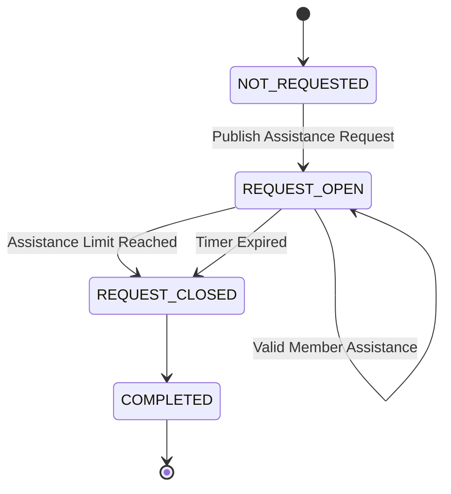

### Invariants

| ID | Règle |
|--------|--------|
| CLAN-001 | Une seule demande par construction |
| CLAN-002 | Un membre ne peut aider qu'une fois |
| CLAN-003 | Plafond déterminé par le niveau du clan |
| CLAN-004 | Assistance limitée au temps restant |
| CLAN-005 | Changement de clan sans réinitialisation |
| CLAN-006 | Fermeture automatique à expiration |
| CLAN-007 | Attribution des contributions aux aidants |
| CLAN-008 | Respect du plafond quotidien de contribution |

---

# 3. Architecture technique

Je propose de créer un module transversal :

`Construction Assistance Engine`

Il pourra être utilisé par :

- Lamp Progression Engine.
- Technology Research Engine.
- Éventuellement d'autres systèmes de construction temporisée.

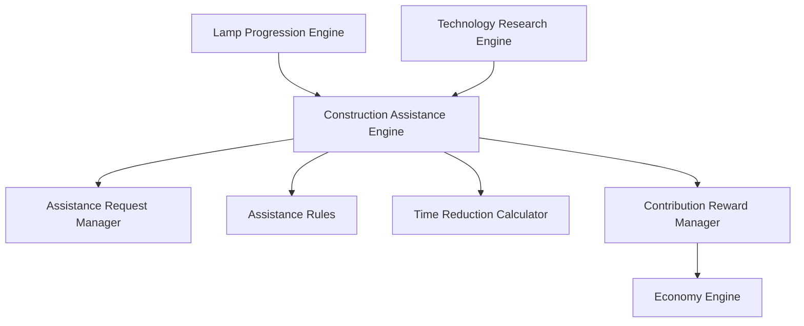

Le moteur gère les règles communes, tandis que chaque système conserve la responsabilité de son propre minuteur.

*Note d'ingénierie : cette séparation évite de dupliquer les règles d'assistance dans plusieurs moteurs et permettra de faire évoluer indépendamment les mécanismes de construction et de recherche.*

---

# 4. SYS-002.D.11.1.7.1 - Point architectural important : fonctionnement hors ligne

Nous devons maintenant résoudre une incompatibilité potentielle.

Notre application est actuellement définie comme :

- Personnelle.
- Android uniquement.
- Autonome.
- Sans dépendance obligatoire à un serveur.

Or, le système de clan nécessite normalement plusieurs joueurs réels.

Je propose deux possibilités.

**Modèle A - Simulation locale du clan**

(Recommandation)

Nous créons un système de membres virtuels.

- Membres simulés pouvant apporter leur aide.
- Limites d'assistance identiques au jeu officiel.
- Réduction temporelle calculée selon les mêmes règles.
- Simulation des contributions familiales.
- Aucun serveur nécessaire.

---

**Modèle B - Assistance désactivée**

Le système de clan est conservé dans l'architecture, mais aucune assistance n'est appliquée dans notre version personnelle.

Les minuteurs reposent uniquement sur les tickets et les publicités.

**Je recommande le modèle A**, car il permet de reproduire les mécanismes du jeu officiel sans introduire prématurément une infrastructure multijoueur.

## 5. Validation SYS-002.D.11.1.7.1

**Quel modèle souhaites-tu retenir ?**

Modèle A - Simulation locale du clan.

Modèle B - Assistance désactivée dans la version personnelle.

[Valider]

Les valeurs numériques exactes des aides et les plafonds de contribution resteront des paramètres de calibration, indépendamment de cette décision.

</details>


### SYS-002.D.11.1.7.1 · T087 · 19/11/2026 21:49:18

**Nature :** `APPROBATION_EXPLICITE` · **Ligne d’approbation source :** 27882 · **Ligne de formalisation :** 27887.

**Décision / prescription originale (texte intégral du propriétaire) :**

Validation SYS-002.D.11.1.7.1 : modèle = simulation. Formalise la décision et poursuis la spécification.


<details><summary>Formalisation technique de la décision ratifiée (extrait sourcé)</summary>

# SYS-002.D.11.1.7.1 — Clan Simulation System

(APPROVED) (Décision intégrée au GDD)

Le modèle A est officiellement adopté : **simulation locale d'une Famille composée de membres virtuels**.

Cette décision permet de reproduire les interactions du système officiel sans infrastructure multijoueur.

## 1. Architecture fonctionnelle

Le `Construction Assistance Engine` sera responsable de la simulation des assistances.

Il disposera de quatre composants.

| Composant | Responsabilité |
|--------|--------|
| `VirtualClanManager` | Gestion de la Famille simulée |
| `AssistanceRequestManager` | Création et suivi des demandes |
| `VirtualMemberSimulator` | Simulation des membres aidants |
| `ContributionRewardManager` | Gestion des points de contribution |

## 2. Contrats métier définitifs

| ID | Paramètre | Décision |
|--------|--------|--------|
| CLAN-SIM-001 | Mode | `local_simulation` |
| CLAN-SIM-002 | Membres | `virtual_members` |
| CLAN-SIM-003 | Niveau de Famille | `configurable` |
| CLAN-SIM-004 | Plafond d'assistance | `family_level_lookup` |
| CLAN-SIM-005 | Aide par membre | `once_per_request` |
| CLAN-SIM-006 | Demandes | `one_per_construction` |
| CLAN-SIM-007 | Changement de clan | `no_reset` |
| CLAN-SIM-008 | Récompenses | `virtual_member_contribution` |
| CLAN-SIM-009 | Plafond quotidien | `per_member` |
| CLAN-SIM-010 | Expiration | `automatic` |

### 2.1 Gestion des assistances

Chaque assistance doit respecter les conditions suivantes :

1. La demande est toujours ouverte.
2. Le membre virtuel n'a pas déjà participé.
3. Le plafond d'assistance n'est pas atteint.
4. Le minuteur possède encore du temps restant.

L'opération est atomique : réduction du minuteur, attribution des points et enregistrement de l'assistance doivent être réalisés ensemble.

### 2.2 Modèle mathématique

Nous conservons la formule provisoire :

$$
R_{\text{aide}}=\max(R_{\min},0.01T_0)
$$

$$
T_{n+1}=\max(0,T_n-R_{\text{aide}})
$$

Avec :

- $T_0$ : durée initiale de construction.
- $T_n$ : temps restant avant l'assistance.
- $R_{\min}$ : réduction minimale.

La calibration exacte reste ouverte.

### 2.3 Persistance

Chaque assistance sera enregistrée avec :

- Identifiant de la demande.
- Identifiant du membre virtuel.
- Horodatage UTC.
- Temps retiré.
- Points de contribution attribués.

Une contrainte d'unicité sur `(RequestId, MemberId)` empêchera les doubles assistances.

*Note d'ingénierie : l'identifiant de demande doit être lié au cycle de construction et non au clan. Cela garantit qu'un changement de Famille ne permet pas de réinitialiser artificiellement les assistances.*

---

</details>


### SYS-002.D.11 · T088 · 19/11/2026 22:02:08

**Nature :** `APPROBATION_EXPLICITE` · **Ligne d’approbation source :** 28058 · **Ligne de formalisation :** 28097.

**Décision / prescription originale (texte intégral du propriétaire) :**

Je choisis le modèle B.

Je répond en détaillant la première question :
Dans Legend of Mushroom, la Lampe Magique génère aléatoirement des pièces pour 10 emplacements d'équipement standards répartis autour de votre personnage.

1. Les 10 emplacements générés par la Lampe Magique

Chaque tirage de lampe attribue l'objet à l'un des 10 emplacements suivants :
Colonne de gauche (Offensif et haut du corps)
• Arme (Weapon). Détermine l'apparence visuelle de votre attaque en combat et apporte un fort bonus d'Attaque de base.
• Casque / Chapeau (Helmet / Hat). Protège la tête de votre champignon.
• Lunettes / Masque (Glasses / Mask). Accessoire facial offrant des statistiques de base et secondaires.
• Épaulières (Shoulderpads). Renforce la défense et les points de vie.
• Armure / T-shirt (Armor / T-shirt). Pièce principale du torse.
Colonne de droite (Défensif et bas du corps)
• Brassards / Protège-bras (Armpad). Protège les avant-bras.
• Gants (Gloves). Équipement des mains.
• Ceinture (Belt). Renforce la taille et les statistiques globales.
• Pantalon / Genouillères (Pants / Kneepads). Pièce d'armure des jambes.
• Chaussures / Bottes (Shoes / Boots). Complète l'ensemble de base.
(Note : Vous pouvez enregistrer plusieurs préréglages d'équipement directement sur la fiche de personnage afin d'alterner rapidement entre vos ensembles PvP et PvE sans avoir à retrier vos pièces).

2. Caractéristiques communes à ces 10 emplacements

• Statistiques de base identiques. Contrairement à d'autres RPG où l'arme ne donne que de l'attaque et l'armure que de la défense, chaque pièce des 10 emplacements octroie simultanément un gain de PV, d'Attaque (ATQ) et de Défense (DÉF).
• Statistiques secondaires (Affixes). À partir des raretés intermédiaires, chaque emplacement peut obtenir jusqu'à 2 statistiques secondaires aléatoires (Combo, Coup Critique, Contre-attaque, Étourdissement, Coup critique de compétence, Combo d'Acolyte, Coup critique d'acolyte,  Régénération, Evasion) qui définissent l'efficacité réelle de votre classe.
• Amélioration indépendante des emplacements. Grâce au Fourneau Magique, vous renforcez le niveau de chaque emplacement lui-même avec des Pierres d'arcane et des Cristaux divins. Ce bonus d'amélioration reste attaché à l'emplacement même lorsque vous remplacez la pièce d'équipement tirée à la lampe.

3. Les équipements spéciaux (Hors Lampe Magique)

En parallèle de ces 10 emplacements classiques, votre personnage dispose de trois catégories d'équipement supplémentaires qui ne s'obtiennent jamais via la lampe :
• Les Reliques (6 emplacements). Masques, Fossiles, Trésors, Statues, Colliers et Livres, obtenus dans la boutique de reliques via le donjon Caverne flamboyante.
• L'Accessoire dorsal (1 emplacement). Les queues (Raton laveur, Loup, Renard), débloquées et améliorées grâce aux plumes du donjon Épreuve des ténèbres.
• Les Artefacts et Montures. Équipés dans des emplacements dédiés et débloqués via des événements ou des conditions de progression spécifiques.
Pour vérifier rapidement si une nouvelle pièce tirée à la lampe améliore votre équipement actuel selon vos affixes, vous pouvez utiliser l'outil comparateur disponible sur AllClash ou consulter le récapitulatif de progression sur Guides by Grace.


<details><summary>Formalisation technique de la décision ratifiée (extrait sourcé)</summary>

# SYS-002.D.11 - Equipment System Specification

Deux décisions et ensembles de règles supplémentaires sont maintenant intégrés au référentiel.

(Clan Model B - Approved) (Equipment Taxonomy - Formalisée)

# 1. SYS-002.D.11.1.7.2 - Progressive Virtual Clan Assistance

Le modèle B est adopté.

Les membres virtuels ne répondent pas tous immédiatement. Chaque membre possède un profil de disponibilité et un délai de réponse.

## 1.1 Contrat fonctionnel

| Paramètre | Décision |
|--------|--------|
| Simulation | `progressive` |
| Réponse des membres | `scheduled` |
| Délai de réponse | `member_profile` |
| Assistance par membre | `once_per_request` |
| Nombre maximal | `family_level_lookup` |
| Récompenses | `contribution_points` |
| Fonctionnement hors ligne | `local_utc` |
| Persistance des réponses | `persistent` |
| Changement de clan | `no_reset` |

### Cycle de fonctionnement

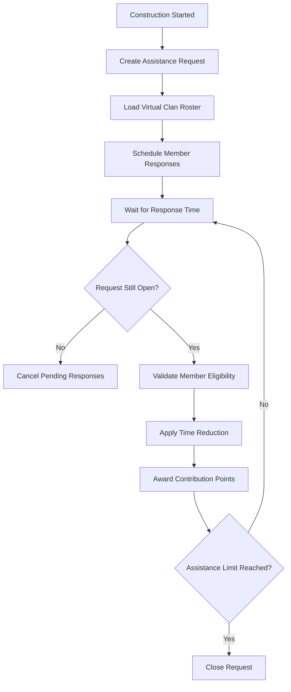

Les réponses programmées seront traitées à partir de l'horloge UTC. Si l'application est fermée, les réponses dont l'échéance est dépassée seront réconciliées au prochain lancement.

*Note d'ingénierie : nous enregistrerons les échéances individuelles des membres plutôt que de simuler artificiellement un compteur global. Cela garantit une reprise déterministe après interruption.*

Les distributions de délais et les profils de disponibilité restent à calibrer.

---

# 2. SYS-002.D.11.1.8 - Equipment Item Taxonomy

(Référentiel fonctionnel établi)

Nous distinguons désormais trois catégories d'équipements.

## 2.1 Équipements standards - Magic Lamp Equipment

La Lampe Magique génère des pièces destinées à dix emplacements.

## Les 10 emplacements standards

[](https://mmostats.com/game/legend-of-mushroom)

**01 - Arme**

Weapon

[](https://mobi.gg/de/tipps/legend-of-mushroom-anfanger-guide/)

**02 - Casque**

Helmet

[](https://www.orooroktgameblog.net/entry/2024/08/13/065836)

**03 - Lunettes**

Glasses

[](https://guiadojogo.com/melhor-build-de-arqueiro-no-legend-of-mushroom/)

**04 - Épaulières**

Shoulderpads

[](https://legend-of-mushroom.en.uptodown.com/windows)

**05 - Armure**

Armor\*\*

[](https://kingshotdata.com/heroes/generation-3-heroes/)

**06 - Protège-bras**

Armpads

[](https://altema.jp/kinokodensetsu/status)

**07 - Gants**

Gloves

[](https://forum.gamer.com.tw/C.php?bsn=78957&snA=317)

**08 - Ceinture**

Belt

[](https://www.orooroktgameblog.net/entry/2024/03/25/093058)

**09 - Pantalon**

Pants

[](https://news.bittopup.com/news/taka-live-how-to-spend-450k-gold-rush-coins-complete-2026-guide)

**10 - Chaussures**

Shoes

Chaque emplacement ne peut accueillir qu'une seule pièce à la fois.

La distribution des dix emplacements lors des tirages reste à déterminer : nous ne supposerons pas qu'elle est uniforme.

## 2.2 Caractéristiques de base

(Règle établie)

Chaque pièce des dix emplacements apporte simultanément trois caractéristiques :

| Caractéristique | Identifiant |
|--------|--------|
| Points de vie | `hp` |
| Attaque | `attack` |
| Défense | `defense` |

Le modèle de données devra donc systématiquement contenir ces trois valeurs.

```text
EquipmentBaseStats
├── hp
├── attack
└── defense
```

Les coefficients numériques dépendant du niveau du personnage et de la rareté seront spécifiés dans l'Equipment Stats Engine.

## 2.3 Caractéristiques secondaires - Affixes

Nous enregistrons actuellement neuf caractéristiques candidates :

| Affixe | Identifiant métier |
|--------|--------|
| Combo | `combo` |
| Coup critique | `critical_rate` |
| Contre-attaque | `counterattack_rate` |
| Étourdissement | `stun` |
| Coup critique de compétence | `skill_critical_rate` |
| Combo d'acolyte | `acolyte_combo` |
| Coup critique d'acolyte | `acolyte_critical_rate` |
| Régénération | `regeneration` |
| Évasion | `evasion` |

Le nombre d'affixes dépend de la rareté.

Nous retenons pour l'instant :

- Les raretés initiales peuvent ne posséder aucun affixe.
- Les raretés intermédiaires introduisent des affixes.
- Une pièce peut posséder jusqu'à deux affixes secondaires selon les règles communiquées.

Les seuils précis restent à spécifier.

---

# 3. SYS-002.D.11.1.9 - Équipements spéciaux

Les équipements hors Lampe Magique appartiennent au même univers métier, mais possèdent des sources d'obtention indépendantes.

**A. Reliques - 6 emplacements**

[](https://guidesbygrace.uk/archer-1)

- Masques
- Fossiles
- Trésors
- Statues
- Colliers
- Livres

Acquisition : boutique de reliques et donjon Caverne flamboyante.

---

**B. Accessoire dorsal - 1 emplacement**

[](https://altema.jp/kinokodensetsu/hahei)

[](https://www.talkandroid.com/461896-back-accessory-guide-legend-of-mushroom/)

Acquisition : Épreuve des ténèbres, avec des plumes.

---

**C. Artefacts et montures**

[](https://guidesbygrace.uk/complete-lom-guide)

[](https://www.deconstructoroffun.com/blog/2024/4/15/the-magic-of-legend-of-mushroom)

[](https://www.talkandroid.com/460550-best-mounts-legend-of-mushroom-2/)

[](https://www.talkandroid.com/460550-best-mounts-legend-of-mushroom-2/)

[](https://www.talkandroid.com/460550-best-mounts-legend-of-mushroom-2/)

[](https://guidesbygrace.uk/mount-details)

[](https://www.deconstructoroffun.com/blog/2024/4/15/the-magic-of-legend-of-mushroom)

[](https://www.gamemakers.com/p/legend-of-mushroom-hits-a-new-high)

[](https://altema.jp/kinokodensetsu/norimono)

Acquisition : événements et conditions spécifiques de progression.

Le nombre exact d'emplacements et les règles de progression restent à documenter.

### Décision architecturale

Nous conserverons des catégories distinctes :

```text
Equipment
├── LampEquipment
├── Relics
├── BackAccessories
├── Artifacts
└── Mounts
```

Leurs systèmes d'acquisition ne seront pas fusionnés artificiellement dans le Magic Lamp Engine.

---

# 4. SYS-002.D.11.2 - Equipment Progression Engine

Une information particulièrement importante concerne le Fourneau Magique.

## 4.1 Amélioration attachée à l'emplacement

(Règle établie)

L'amélioration concerne l'emplacement et non la pièce d'équipement.

Conséquence :

- L'emplacement possède son propre niveau d'amélioration.
- L'amélioration est indépendante de l'équipement actuellement installé.
- Remplacer une pièce ne réinitialise pas l'amélioration.
- Les ressources utilisées sont les Pierres d'arcane et les Cristaux divins.

Nous distinguons donc deux entités :

```text
EquipmentSlot
├── SlotType
├── EquippedItemId
└── EnhancementState
    ├── EnhancementLevel
    ├── ArcaneStonesInvested
    └── DivineCrystalsInvested
```

Et :

```text
EquipmentItem
├── ItemId
├── SlotType
├── Rarity
├── BaseStats
└── SecondaryAffixes
```

Cette séparation est fondamentale pour éviter de perdre la progression lorsqu'un équipement est remplacé.

*Note d'ingénierie : l'amélioration doit être persistée dans l'état de l'emplacement. Elle ne doit jamais être copiée dans l'objet EquipmentItem lors de son équipement.*

## 4.2 Préréglages

Nous enregistrons également la présence de plusieurs configurations d'équipement.

Le modèle devra permettre de conserver plusieurs préréglages et de changer rapidement de configuration, notamment entre PvE et PvP.

Le nombre maximal de préréglages et leur périmètre exact restent inconnus.

---

# 5. État du GDD

| Spécification | État |
|--------|--------|
| Clan Assistance | (Validée architecturalement) |
| 10 emplacements standards | (Documentés) |
| Statistiques de base | (Documentées) |
| Affixes | (À calibrer) |
| Équipements spéciaux | (Catégories définies) |
| Fourneau Magique | (Principe validé) |
| Préréglages | (À approfondir) |

---

# 6. SYS-002.D.11.1.10 - Affix Generation Rules

Nous devons maintenant déterminer précisément comment les raretés influencent les affixes.

C'est une décision importante : elle conditionnera le générateur aléatoire, le fonctionnement d'Adjust et le comparateur d'équipements.

**Première question : comment évolue le nombre d'affixes selon la rareté ?**

Je souhaite connaître le nombre d'affixes pour chacune des dix raretés, même si tu ne disposes que d'informations approximatives.

Nous établirons ensuite une table de référence commune à toutes les pièces des dix emplacements, sauf exception propre à certains équipements.

</details>


### SYS-002.D.11.1.10 · T089 · 19/11/2026 22:10:37

**Nature :** `EXIGENCE_OU_RECTIFICATION_PROPRIETAIRE` · **Ligne d’approbation source :** 28460 · **Ligne de formalisation :** 28488.

**Décision / prescription originale (texte intégral du propriétaire) :**

Dans *Legend of Mushroom*, **le nombre d'affixes (statistiques secondaires soulignées) plafonne très rapidement à 2 maximum sur l'ensemble des équipements de la Lampe Magique**. [[1](https://www.allclash.com/best-setup-for-mage-class-mushroom-in-legend-of-mushroom/)]

Contrairement à d'autres RPG où les raretés ultimes empilent 4 ou 5 lignes bonus, les 10 raretés de *Legend of Mushroom* plafonnent dès le palier *Bien* (*Well*) et font évoluer **la puissance des pourcentages** ainsi que **la probabilité d'obtenir ces affixes** plutôt que leur quantité.

**1. Nombre d'affixes par rareté (Paliers 1 à 10)**

| **Palier** | **Rareté (Jeu)**             | **Nombre d'affixes** | **Évolution des statistiques secondaires**                                                                     |
| ---------- | ---------------------------- | -------------------- | -------------------------------------------------------------------------------------------------------------- |
| **1**      | **Normal** (*Normal*)        | **0 affixe**         | Uniquement les statistiques de base (PV, ATQ, DÉF).                                                            |
| **2**      | **Unique** (*Unique*)        | **0 à 1 affixe**     | Apparition occasionnelle d'une première statistique secondaire faible.                                         |
| **3**      | **Bien** (*Well*)            | **1 à 2 affixes**    | Plafond atteint : il est déjà possible de tirer 2 affixes sur une pièce verte.                                 |
| **4**      | **Rare** (*Rare*)            | **2 affixes**        | Deux statistiques secondaires garanties avec des valeurs en hausse.                                            |
| **5**      | **Mythique** (*Mythic*)      | **2 affixes**        | Deux statistiques secondaires ; pourcentages renforcés.                                                        |
| **6**      | **Épique** (*Epic*)          | **2 affixes**        | Deux statistiques secondaires ; début de l'optimisation de classe.                                             |
| **7**      | **Légendaire** (*Legendary*) | **2 affixes**        | Deux statistiques secondaires ; pourcentages nettement plus élevés.                                            |
| **8**      | **Immortel** (*Immortal*)    | **2 affixes**        | Deux statistiques secondaires ; très forts multiplicateurs de combat.                                          |
| **9**      | **Suprême / Aurous**         | **2 affixes**        | Deux statistiques secondaires ; *Aurous* exige une condition spécifique d'affixe de classe pour être débloqué. |
| **10**     | **Éternel** (*Eternal*)      | **2 affixes**        | Deux statistiques secondaires aux valeurs maximales du jeu ; déblocage conditionné comme *Aurous*.             |

**2. Ce qui change réellement entre les raretés 3 et 10**

- **Le plafond fixe de 2 lignes.** Comme le montre le vérificateur d'équipement sur [**AllClash**](https://www.allclash.com/best-setup-for-mage-class-mushroom-in-legend-of-mushroom/), chaque pièce d'armure ou arme ne possède jamais plus de **2 bonus secondaires soulignés** (Combo, Critique, Contre-attaque, Étourdissement, Évasion ou Régénération). [[1](https://www.allclash.com/best-setup-for-mage-class-mushroom-in-legend-of-mushroom/)]
- **L'échelle des pourcentages.** À niveau de personnage égal, une pièce *Bien* (palier 3) confère environ **+0,5 %** par affixe, tandis qu'une pièce *Suprême*, *Aurous* ou *Éternel* (paliers 9 et 10) dépasse plusieurs pourcents par ligne, générant un écart massif une fois cumulé sur les **10 emplacements d'équipement**. [[1](https://www.allclash.com/best-setup-for-mage-class-mushroom-in-legend-of-mushroom/)]
- **Les affixes exclusifs aux très hauts paliers (Aurous et Éternel).** En fin de jeu, le déblocage des raretés *Aurous* et *Éternel* est lié à des affixes avancés spécifiques à votre classe, et la fonction *Adjust* de la lampe permet de bannir jusqu'à 3 affixes indésirables pour sécuriser ces deux emplacements. [[1](https://guidesbygrace.uk/gear-lamp)]


<details><summary>Formalisation technique de la décision ratifiée (extrait sourcé)</summary>

# SYS-002.D.11.1.10 - Affix Generation Rules

(Règles quantitatives formalisées) (Calibration en cours)

Cette précision modifie un aspect important de notre générateur : **la rareté ne permet pas d'obtenir davantage d'affixes après le palier Bien. Elle améliore essentiellement leur qualité et leur sélection.**

## 1. SYS-002.D.11.1.10.1 - Affix Count by Rarity

La table de référence est désormais établie.

| Palier | Rareté | Nombre d'affixes |
|--------|--------|--------|
| 1 | Normal | 0 |
| 2 | Unique | 0 à 1 |
| 3 | Bien | 1 à 2 |
| 4 | Rare | 2 |
| 5 | Mythique | 2 |
| 6 | Épique | 2 |
| 7 | Légendaire | 2 |
| 8 | Immortel | 2 |
| 9 | Suprême / Aurous | 2 |
| 10 | Éternel | 2 |

### Contrat mathématique

On définit :

$$
N_{\text{affixes}}=f(R)
$$

Avec :

$$
N_{\text{affixes}}=
\begin{cases}
0 & R=1\\
\{0,1\} & R=2\\
\{1,2\} & R=3\\
2 & 4\leq R\leq10
\end{cases}
$$

Les probabilités de distribution pour les raretés Unique et Bien restent à calibrer.

**Invariant :**

$$
0\leq N_{\text{affixes}}\leq2
$$

Aucun équipement standard généré par la Lampe Magique ne peut dépasser deux affixes secondaires.

## 2. SYS-002.D.11.1.10.2 - Affix Value Scaling

Nous distinguons désormais trois mécanismes.

| Mécanisme | Influence |
|--------|--------|
| Nombre d'affixes | Rareté |
| Valeur numérique des affixes | Rareté et paramètres de génération à préciser |
| Probabilité de sélection d'un affixe | Table probabiliste à définir |

### Modèle mathématique proposé

$$
V_{\text{affixe}}=
Lookup(R,A,L)
$$

Où :

- $R$ : rareté.
- $A$ : type d'affixe.
- $L$ : niveau du personnage.

La dépendance exacte au niveau du personnage reste à vérifier.

Nous imposons néanmoins une propriété de calibration :

$$
V(R_{i+1},A)\geq V(R_i,A)
$$

À conditions de comparaison identiques, la valeur attendue d'un affixe ne doit pas diminuer lorsque la rareté augmente.

Les valeurs numériques exactes seront stockées dans des tables versionnées, et non dispersées dans le code.

## 3. SYS-002.D.11.1.10.3 - Advanced Rarity Requirements

Les raretés Aurous et Éternel introduisent une condition supplémentaire.

**Palier 9 - Suprême / Aurous**

- Déblocage conditionné.
- Condition liée à un affixe spécifique à la classe.
- Accès dépendant de la progression du joueur.

---

**Palier 10 - Éternel**

- Déblocage conditionné.
- Conditions avancées similaires à Aurous.
- Valeurs d'affixes parmi les plus élevées.

Nous modéliserons cette mécanique avec un système de conditions indépendant :

```text
RarityUnlockCondition
├── TargetRarity
├── RequiredClass
├── RequiredAffixes
├── ProgressionRequirements
└── IsUnlocked
```

Attention : une condition de déblocage ne signifie pas automatiquement que l'affixe requis sera présent sur chaque équipement obtenu.

Cette distinction sera conservée dans le GDD.

## 4. SYS-002.D.11.1.10.4 - Adjust Integration

La génération des affixes devra intégrer le système Adjust déjà spécifié.

Rappel des capacités :

| Niveau de lampe | Affixes bannissables |
|--------|--------|
| 1-11 | 0 |
| 12-19 | 1 |
| 20-25 | 2 |
| 26+ | 3 |

Le générateur devra respecter les exclusions avant de sélectionner les affixes.

$$
Pool_{\text{eligible}}=
Pool_{\text{available}}-Pool_{\text{banned}}
$$

La sélection finale devra respecter :

- Le nombre d'affixes autorisé par rareté.
- Les conditions de déblocage.
- Les exclusions Adjust.
- Les poids de sélection applicables.

Nous ne fixerons pas encore l'ordre exact des tirages ni les règles de repli lorsque le pool disponible est insuffisant.

---

# 5. État du sous-système

| Spécification | État |
|--------|--------|
| Nombre maximal d'affixes | (Validé) |
| Distribution par rareté | (Validée) |
| Valeurs numériques | (À calibrer) |
| Poids de sélection | (À définir) |
| Conditions Aurous/Éternel | (À approfondir) |
| Intégration Adjust | (Contrat défini) |

---

# 6. SYS-002.D.11.1.10.5 - Unicité des affixes

Il reste une règle importante à déterminer avant de verrouiller le générateur.

**Lorsqu'un équipement possède deux affixes, les deux doivent-ils obligatoirement être différents ?**

**Modèle A - Affixes distincts**

Une même caractéristique ne peut apparaître qu'une seule fois sur une pièce.

**Modèle B - Doublons autorisés**

Une pièce peut obtenir deux fois le même type d'affixe.

[Valider]

Cette décision déterminera notamment si le générateur utilise un tirage sans remise ou avec remise.

Ensuite, nous pourrons spécifier le pool d'affixes, les pondérations de sélection et la génération complète d'une pièce d'équipement.

</details>


### SYS-002.D.11.1.10.5 · T090 · 19/11/2026 22:15:33

**Nature :** `APPROBATION_EXPLICITE` · **Ligne d’approbation source :** 28706 · **Ligne de formalisation :** 28711.

**Décision / prescription originale (texte intégral du propriétaire) :**

SYS-002.D.11.1.10.5 — Validation : unicité des affixes = distinct. Formalise et poursuis.


<details><summary>Formalisation technique de la décision ratifiée (extrait sourcé)</summary>

# SYS-002.D.11.1.10.5 — Affix Uniqueness

(APPROVED) (Contrat formalisé)

Le modèle A est adopté : **deux affixes d'un même équipement doivent obligatoirement être de types différents.**

## 1. Règles métier

| Règle | Décision |
|--------|--------|
| Doublons d'affixes sur une pièce | Interdits |
| Sélection de deux affixes | Sans remise |
| Valeurs numériques | Générées individuellement |
| Même affixe sur plusieurs pièces | Autorisé |
| Nombre maximal | 2 |
| Unicité | Par équipement |

Exemple :

**Équipement valide** (Valide)

- Combo : +2,5 %
- Coup critique : +3,2 %
  
  ---
  
  **Équipement invalide** (Rejeté)
- Combo : +2,5 %
- Combo : +3,8 %

Cette restriction ne s'applique pas entre différents équipements. Plusieurs pièces peuvent donc apporter du Combo.

## 2. Contrat mathématique

Soit $P$ le pool d'affixes éligibles après application des restrictions.

Pour générer deux affixes :

$$
A_1\in P
$$

$$
A_2\in P\setminus\{A_1\}
$$

Avec :

$$
A_1\neq A_2
$$

Le générateur effectue donc une sélection sans remise.

Les valeurs numériques sont ensuite générées individuellement :

$$
V_1=f(R,L,A_1)
$$

$$
V_2=f(R,L,A_2)
$$

La pondération des sélections reste indépendante de cette règle d'unicité.

## 3. Contrats techniques

| ID | Contrat | Valeur |
|--------|--------|--------|
| AFFIX-UNQ-001 | Unicité | `per_item` |
| AFFIX-UNQ-002 | Sélection | `without_replacement` |
| AFFIX-UNQ-003 | Comparaison | `affix_type_id` |
| AFFIX-UNQ-004 | Valeurs | `independent_generation` |
| AFFIX-UNQ-005 | Doublons inter-équipements | `allowed` |
| AFFIX-UNQ-006 | Validation | `reject_duplicate_type` |

*Note d'ingénierie : l'unicité doit être imposée au niveau du domaine métier, pas uniquement dans l'interface utilisateur. Un équipement invalide ne doit jamais pouvoir être persisté.*

---

</details>


### SYS-002.D.11.1.10.7 · T092 · 19/11/2026 22:34:02

**Nature :** `EXIGENCE_OU_RECTIFICATION_PROPRIETAIRE` · **Ligne d’approbation source :** 28927 · **Ligne de formalisation :** 28950.

**Décision / prescription originale (texte intégral du propriétaire) :**

**Dans *Legend of Mushroom*, la probabilité d'apparition des affixes secondaires suit une distribution uniforme (équiprobable) à l'intérieur du bassin d'affixes actifs, et c'est uniquement la mécanique de bannissement qui modifie ces chances en augmentant le niveau de la Lampe Magique.**

Contrairement aux raretés d'équipement dont les taux exacts sont affichés en jeu, le jeu ne favorise pas un attribut secondaire par rapport à un autre lors d'un tirage standard. [[1](https://www.youtube.com/watch?v=3HAAYhYqQlw), [2](https://theriagames.com/guide/legend-of-mushroom-beginner-guide/)]

**1. Équiprobabilité des affixes standards**

- **Aucune pondération cachée.** Lorsqu'une pièce d'équipement génère ses deux statistiques secondaires (Combo, Coup Critique, Contre-attaque, Étourdissement, Coup critique de compétence, Combo d'Acolyte, Coup critique d'acolyte,  Régénération, Evasion), chaque statistique disponible dans le pool possède la même probabilité de sortir.
- **Biais de perception des joueurs.** L'impression de tirer plus souvent des statistiques inutiles vient simplement du fait que sur 9 statistiques possibles, seule une combinaison précise de **2 affixes** correspond parfaitement à votre classe (par exemple *Critique + Combo* pour Archer ou *Critique + Contre-attaque* pour Guerrier).
- **Indépendance des tirages.** Comme le confirme la communauté sur [**Reddit**](https://www.reddit.com/r/LegendofMushroom/comments/1e6whkx/lamps_chances_of_rarity/), ouvrir les lampes une par une ou par lots en mode automatique applique exactement les mêmes tirages aléatoires sans aucune modification de probabilité. [[1](https://www.reddit.com/r/LegendofMushroom/comments/1e6whkx/lamps_chances_of_rarity/)]

**2. Impact réel du niveau de la Lampe Magique**

- **Les probabilités de base n'évoluent pas.** Passer la lampe du niveau 5 au niveau 25 augmente uniquement la **rareté** de l'objet et la **valeur en pourcentage** de l'affixe, mais ne modifie pas la fréquence naturelle d'apparition d'un affixe donné. [[1](https://www.alucare.fr/legend-of-mushroom-lampe-familiers-et-montures/), [2](https://theriagames.com/guide/legend-of-mushroom-beginner-guide/)]
- **Le seul levier de probabilité (Fonction *Adjust*).** Le niveau de la lampe influence vos chances uniquement via le déblocage progressif des emplacements d'exclusion (niveaux de lampe **12, 20 et 26**). [[1](https://guidesbygrace.uk/gear-lamp)]
- **Calcul du gain mathématique.** En réduisant le bassin de 9 affixes possibles à seulement 6 grâce aux **3 bannissements** du niveau 26, la **probabilité d'obtenir votre paire exacte de 2,78 % (1 chance sur 36) à 6,67 % (1 chance sur 15)**. Cela représente un **gain mathématique multiplié par 2,4** sur chaque pièce tirée.

**3. Cas particulier des raretés ultimes (Aurous et Éternel)**

- **Affixes de classe conditionnels.** Comme l'indique le guide [**Guides by Grace**](https://guidesbygrace.uk/gear-lamp), l'obtention des pièces *Aurous* et *Éternel* en très haut niveau de lampe est soumise à des conditions d'affixes spécifiques liés à votre spécialisation de classe, ce qui oriente naturellement le tirage final vers des statistiques adaptées à votre archétype une fois ces paliers débloqués. [[1](https://guidesbygrace.uk/gear-lamp)]


<details><summary>Formalisation technique de la décision ratifiée (extrait sourcé)</summary>

# SYS-002.D.11.1.10.7 - Affix Probability Distribution

(Modèle A retenu) (GDD v1.7)

Les précisions permettent de retenir une **distribution uniforme des affixes, avec sélection sans remise et modification du pool par Adjust**.

La distribution uniforme constitue notre règle de conception. Elle reste une hypothèse sur le fonctionnement exact du jeu officiel : les sources consultées confirment l'existence du bannissement et l'absence de pénalité de rareté liée aux tirages groupés, mais ne démontrent pas l'absence de pondérations internes des affixes. \[[Gear &amp; Lamp — Legend of Mushroom](https://guidesbygrace.uk/gear-lamp?utm_source=chatgpt.com); [Lamps Chances of Rarity : r/LegendofMushroom](https://www.reddit.com/r/LegendofMushroom/comments/1e6whkx/lamps_chances_of_rarity/?utm_source=chatgpt.com)\]

## 1. Contrat mathématique

Nous définissons le pool standard :

$$
\mathcal A=\{a_1,a_2,\ldots,a_9\}
$$

Chaque affixe possède une probabilité identique d'être sélectionné parmi les candidats restants.

Pour un équipement possédant deux affixes :

$$
P(A_1=a_i)=\frac{1}{n}
$$

$$
P(A_2=a_j\mid A_1=a_i)=\frac{1}{n-1}
$$

Avec $a_i\neq a_j$ et $n$ le nombre d'affixes disponibles.

Puisque l'ordre des deux affixes n'a aucune importance :

$$
\boxed{P(\{a_i,a_j\})=\frac{1}{\binom n2}}
$$

Cette formule garantit une distribution uniforme des paires non ordonnées.

## 2. Impact mathématique d'Adjust

Les trois niveaux de déblocage validés précédemment sont conservés.

| Niveau lampe | Affixes bannis | Pool restant | Chance d'une paire précise |
|--------|--------|--------|--------|
| 1-11 | 0 | 9 | 2,78 % |
| 12-19 | 1 | 8 | 3,57 % |
| 20-25 | 2 | 7 | 4,76 % |
| 26+ | 3 | 6 | 6,67 % |

Le gain obtenu entre zéro et trois bannissements est :

$$
\frac{\binom92}{\binom62}=\frac{36}{15}=\boxed{2,4}
$$

Ton calcul est correct.

Il existe néanmoins deux conditions essentielles : l'équipement doit effectivement générer deux affixes, et aucun des deux affixes recherchés ne doit être banni.

Pour les raretés Unique et Bien, dont le nombre d'affixes est variable, il faut multiplier cette probabilité par la probabilité de générer deux affixes. Pour Unique, qui ne peut en générer qu'un, la probabilité d'une paire est nulle.

---

# 3. SYS-002.D.11.1.10.7.1 - Affix Generation Pipeline

Le générateur doit respecter l'ordre suivant.

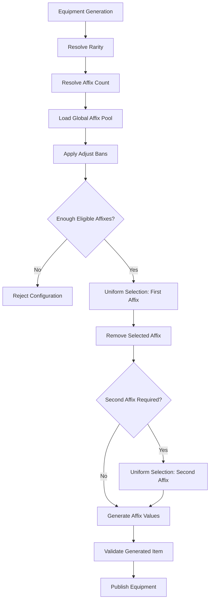

### Contrats de génération

| ID | Règle |
|--------|--------|
| AFFIX-PROB-001 | Pool global commun aux dix emplacements |
| AFFIX-PROB-002 | Neuf affixes standards dans la configuration initiale |
| AFFIX-PROB-003 | Probabilité uniforme |
| AFFIX-PROB-004 | Sélection sans remise |
| AFFIX-PROB-005 | Adjust appliqué avant sélection |
| AFFIX-PROB-006 | Aucune compensation par pondération |
| AFFIX-PROB-007 | Nombre d'affixes défini par la rareté |
| AFFIX-PROB-008 | Tirages indépendants entre équipements |
| AFFIX-PROB-009 | Tirages multiples sans pénalité |
| AFFIX-PROB-010 | Générateur aléatoire injectable |

*Note d'ingénierie : le pool doit être versionné et configurable. L'ajout d'un nouvel affixe doit modifier les probabilités combinatoires automatiquement, sans nécessiter de changement du code de sélection.*

## 4. Probabilité d'obtenir un équipement recherché

La probabilité d'obtenir une combinaison précise ne suffit pas à déterminer la rareté réelle de l'objet recherché.

Nous devons combiner plusieurs événements.

Pour un équipement possédant exactement deux affixes :

$$
\boxed{
P(\text{résultat})=
P(R)\times P(S\mid R)\times
P(N=2\mid R)\times
P(\{A,B\}\mid R,S,N=2)
}
$$

Avec :

- $R$ : rareté souhaitée.
- $S$ : emplacement souhaité.
- $N$ : nombre d'affixes générés.
- $A,B$ : paire recherchée.

Dans le modèle uniforme standard, le dernier terme vaut $1/\binom n2$, si la paire reste éligible.

Cela permettra ultérieurement de calculer le nombre moyen de lampes nécessaires pour obtenir une pièce correspondant à un build.

Il faudra également intégrer les seuils minimaux de valeurs statistiques, puisque deux équipements possédant les mêmes affixes peuvent avoir des valeurs différentes.

---

# 5. Cas particulier : Aurous et Éternel

(Mécanisme à distinguer)

La documentation de [Guides by Grace — Gear &amp; Lamp](https://guidesbygrace.uk/gear-lamp?utm_source=chatgpt.com) confirme l'existence de conditions de déblocage pour Aurous et Éternel, mais ne précise pas suffisamment si ces conditions influencent directement le tirage des affixes ou seulement l'accès aux raretés. \[[Gear &amp; Lamp — Legend of Mushroom](https://guidesbygrace.uk/gear-lamp?utm_source=chatgpt.com)\]

Ces deux fonctionnements auraient des conséquences mathématiques très différentes.

</details>


### SYS-002.D.11.1.10.8 · T093 · 19/11/2026 22:38:48

**Nature :** `APPROBATION_EXPLICITE` · **Ligne d’approbation source :** 29178 · **Ligne de formalisation :** 29183.

**Décision / prescription originale (texte intégral du propriétaire) :**

Validation SYS-002.D.11.1.10.8 : conditions Aurous/Eternel = unlock_only ; observations = Aucune. Formalise les décisions dans le GDD et poursuis la spécification du Magic Lamp Equipment Generation Engine.


<details><summary>Formalisation technique de la décision ratifiée (extrait sourcé)</summary>

# SYS-002.D.11.1.10.8 - Advanced Rarity Eligibility

(VALIDÉ - Modèle A : `unlock_only`)

La décision est intégrée au GDD. Les raretés **Aurous (palier 9)** et **Éternel (palier 10)** possèdent des conditions de déblocage, mais leur génération d'affixes suit les mêmes règles que les autres raretés une fois qu'elles deviennent accessibles.

## 1. Contrat fonctionnel définitif

| ID | Règle | Décision |
|--------|--------|--------|
| RAR-001 | Déblocage des raretés avancées | Conditionnel |
| RAR-002 | Conditions de déblocage | Configurables |
| RAR-003 | Affixe de classe obligatoire | Non |
| RAR-004 | Pool d'affixes | Universel |
| RAR-005 | Distribution des affixes | Uniforme |
| RAR-006 | Doublons d'affixes | Interdits |
| RAR-007 | Exclusions Adjust | Appliquées normalement |
| RAR-008 | Génération hors conditions | Interdite |

Les conditions exactes de déblocage restent à calibrer. Nous ne présumons pas qu'elles reposent exclusivement sur le niveau de lampe ou sur une classe particulière.

### Invariant métier

Pour une rareté $R$ :

$$
Eligible(R,P)=
\begin{cases}
1 & \text{si les conditions sont satisfaites}\\
0 & \text{sinon}
\end{cases}
$$

Où $P$ représente l'état de progression du joueur.

Si `Eligible(R, P) = false`, cette rareté ne peut pas être attribuée par la lampe.

Une fois la rareté accessible, aucune contrainte supplémentaire n'est imposée à ses affixes.

*Note d'ingénierie : le déblocage intervient avant le tirage de rareté. Il ne doit pas être implémenté comme une validation tardive des affixes, car cela introduirait un biais statistique et des tirages rejetés.*

---

</details>


### SYS-002.D.11.1.11.1 · T094 · 19/11/2026 22:42:37

**Nature :** `APPROBATION_EXPLICITE` · **Ligne d’approbation source :** 29446 · **Ligne de formalisation :** 29451.

**Décision / prescription originale (texte intégral du propriétaire) :**

Validation SYS-002.D.11.1.11.1 : distribution des raretés verrouillées = normalized. Formalise la décision dans le GDD et poursuis le Magic Lamp Equipment Generation Engine.


<details><summary>Formalisation technique de la décision ratifiée (extrait sourcé)</summary>

# SYS-002.D.11.1.11.1 - Rarity Probability Normalization

(APPROVED) (GDD actualisé)

Le modèle `normalized` est adopté.

Les raretés verrouillées sont retirées du pool de tirage. Leurs probabilités sont redistribuées proportionnellement entre toutes les raretés accessibles.

## 1. Contrat mathématique définitif

Soit :

- $R$ : ensemble des dix raretés.
- $E$ : ensemble des raretés actuellement accessibles.
- $w_i$ : poids initial de la rareté $i$.

La probabilité effective devient :

$$
P(R_i)=
\begin{cases}
\dfrac{w_i}{\sum_{j\in E}w_j} & R_i\in E\\[6pt]
0 & R_i\notin E
\end{cases}
$$

### Exemple numérique

Considérons une table simplifiée :

| Rareté | Poids initial | Accessible |
|--------|--------|--------|
| Normal | 50 % | Oui |
| Unique | 30 % | Oui |
| Bien | 15 % | Oui |
| Rare | 5 % | Non |

Le total accessible est de 95 %.

Après normalisation :

| Rareté | Probabilité effective |
|--------|--------|
| Normal | 52,6316 % |
| Unique | 31,5789 % |
| Bien | 15,7895 % |
| Rare | 0 % |

La somme est toujours égale à 100 %.

### Invariants

| ID | Contrainte |
|--------|--------|
| RAR-NORM-001 | Les raretés verrouillées ne peuvent pas être tirées |
| RAR-NORM-002 | Somme des probabilités = 1 |
| RAR-NORM-003 | Conservation des rapports entre poids accessibles |
| RAR-NORM-004 | Aucun reroll nécessaire |
| RAR-NORM-005 | Déblocage immédiatement pris en compte |
| RAR-NORM-006 | Configuration sans poids accessible positif = invalide |

La table originale n'est jamais modifiée : seule sa distribution effective est recalculée.

*Note d'ingénierie : la normalisation est une transformation à l'exécution. Les poids de référence doivent rester immuables afin de garantir la reproductibilité des simulations et des tests statistiques.*

---

</details>


### SYS-002.D.11.1.11.2 · T095 · 19/11/2026 22:48:33

**Nature :** `EXIGENCE_OU_RECTIFICATION_PROPRIETAIRE` · **Ligne d’approbation source :** 29672 · **Ligne de formalisation :** 29685.

**Décision / prescription originale (texte intégral du propriétaire) :**

**Oui, chacun des 10 emplacements d'équipement dispose d'une probabilité uniforme de 10 % (1 chance sur 10) lors d'un tirage de la Lampe Magique.**

Contrairement aux raretés dont les pourcentages sont pondérés et affichés dans le tableau de la lampe, la sélection de l'emplacement obéit à un tirage aléatoire pur et équitable :

**1. Distribution uniforme entre les 10 emplacements**

- **Équiprobabilité parfaite (10 %).** Lorsqu'une charge de lampe génère un objet, le jeu tire d'abord la rareté selon la table de probabilités de votre niveau de lampe, puis sélectionne l'un des **10 emplacements** (Arme, Casque, Lunettes, Épaulières, Armure, Brassards, Gants, Ceinture, Pantalon, Chaussures) avec une probabilité identique de **10 %** chacun. [[1](https://www.deconstructoroffun.com/blog/2024/4/15/the-magic-of-legend-of-mushroom), [2](https://www.youtube.com/watch?v=3HAAYhYqQlw\&t=29)]
- **Aucune pondération par pièce.** L'arme n'est pas plus rare que les bottes ou la ceinture, et le niveau de la lampe ne modifie jamais la répartition entre les emplacements.
- **Indépendance des tirages.** Comme le confirment les analyses de fonctionnement de la lampe sur [**Deconstructor of Fun**](https://www.deconstructoroffun.com/blog/2024/4/15/the-magic-of-legend-of-mushroom) et les retours de la communauté sur [**Reddit Legend of Mushroom**](https://www.reddit.com/r/LegendofMushroom/comments/1e6whkx/lamps_chances_of_rarity/), chaque tirage est totalement indépendant du précédent, qu'il soit effectué manuellement ou par lots via le mode automatique. [[1](https://www.deconstructoroffun.com/blog/2024/4/15/the-magic-of-legend-of-mushroom), [2](https://www.reddit.com/r/LegendofMushroom/comments/1e6whkx/lamps_chances_of_rarity/)]


<details><summary>Formalisation technique de la décision ratifiée (extrait sourcé)</summary>

# SYS-002.D.11.1.11.2 - Equipment Slot Distribution

(APPROVED) (Contrat mathématique définitif)

La distribution uniforme des dix emplacements est officiellement adoptée.

## 1. Décisions intégrées au GDD

| Paramètre | Décision |
|--------|--------|
| Nombre d'emplacements | 10 |
| Distribution | `uniform` |
| Probabilité individuelle | 10 % |
| Influence du niveau de lampe | `none` |
| Influence de la rareté | `none` |
| Influence du niveau personnage | `none` |
| Dépendance entre tirages | `independent` |
| Tirages groupés | `sequential_independent` |
| Système de garantie | `none` |
| Ordre de sélection | `rarity_then_slot` |

### 1.1 Contrat mathématique

Soit :

$$
S=\{s_1,s_2,\ldots,s_{10}\}
$$

La probabilité de sélection de chaque emplacement est :

$$
\boxed{P(s_i)=\frac{1}{10}=0.1}
$$

La probabilité conjointe d'obtenir une rareté donnée et un emplacement donné est :

$$
P(R_i,S_j)=P(R_i)\times 0.1
$$

Cette relation garantit l'indépendance entre les deux mécanismes.

### 1.2 Invariants

- Aucun emplacement ne bénéficie d'une priorité.
- Aucun emplacement ne devient moins fréquent avec la progression.
- Les tirages précédents ne modifient pas les probabilités suivantes.
- Les ouvertures groupées reproduisent exactement les mêmes règles que les ouvertures individuelles.
- Les dix emplacements sont toujours présents dans le pool.

*Note d'ingénierie : la sélection d'emplacement utilisera une opération uniforme indépendante du tirage de rareté. Nous éviterons notamment de dériver le choix de l'emplacement à partir du résultat précédent.*

---

# 2. Contrats techniques

```text
EquipmentSlotDistribution
├── DistributionType: Uniform
├── SlotCount: 10
├── SlotProbability: 0.10
├── RarityDependency: None
├── LampLevelDependency: None
├── CharacterLevelDependency: None
├── HistoricalDependency: None
└── BatchProcessing: SequentialIndependent
```

Les dix identifiants techniques seront :

```text
weapon
helmet
glasses
shoulderpads
armor
armpads
gloves
belt
pants
shoes
```

### 2.1 Tests obligatoires

| Test | Vérification |
|--------|--------|
| Distribution unitaire | Chaque emplacement possède 10 % |
| Indépendance | Les résultats précédents ne modifient pas le suivant |
| Indépendance rareté/emplacement | Aucun biais conditionnel |
| Tirage groupé | Même distribution que les tirages individuels |
| RNG injectable | Reproduction déterministe des résultats de test |
| Test statistique | Test du Chi-deux sur les dix catégories |

---

</details>


### SYS-002.D.11.1.12.1 · T096 · 19/11/2026 22:53:15

**Nature :** `APPROBATION_EXPLICITE` · **Ligne d’approbation source :** 29868 · **Ligne de formalisation :** 29873.

**Décision / prescription originale (texte intégral du propriétaire) :**

Validation SYS-002.D.11.1.12.1 : génération des statistiques de base = random_range. Formalise et poursuis la spécification.


<details><summary>Formalisation technique de la décision ratifiée (extrait sourcé)</summary>

# SYS-002.D.11.1.12.1 - Equipment Base Stats Generation

(APPROVED) (Modèle B adopté)

La génération aléatoire dans une plage de valeurs est officiellement intégrée au GDD.

Deux équipements possédant le même emplacement, la même rareté et étant générés au même niveau de personnage peuvent donc présenter des caractéristiques différentes.

## 1. Contrat fonctionnel

| Paramètre | Décision |
|--------|--------|
| Génération | `random_range` |
| Statistiques concernées | `hp`, `attack`, `defense` |
| Dépendance au niveau personnage | `enabled` |
| Dépendance à la rareté | `enabled` |
| Dépendance à l'emplacement | `configurable` |
| Bornes numériques | `configurable_lookup` |
| Génération individuelle | `per_equipment` |
| RNG | `injectable_rng` |
| Reproductibilité | `seeded_generation` |
| Fourneau Magique | `separate_calculation` |

La distinction entre statistiques intrinsèques et améliorations d'emplacement est maintenue.

## 2. Modèle mathématique

Pour chaque statistique $X$ :

$$
X\in[X_{\min},X_{\max}]
$$

Les bornes dépendent du contexte :

$$
(X_{\min},X_{\max})=
Lookup(C,R,S,X)
$$

Avec :

- $C$ : niveau du personnage.
- $R$ : rareté de l'équipement.
- $S$ : emplacement.
- $X$ : statistique concernée.

La génération est représentée par :

$$
X\sim D(L,U)
$$

La distribution $D$ reste à déterminer. Nous ne supposons pas encore une distribution uniforme.

### 2.1 Configuration des plages

Nous utiliserons une structure indépendante des formules de génération :

```text
EquipmentStatRangeProfile
├── ProfileId
├── Rarity
├── CharacterLevelRange
├── SlotType
└── StatRanges
    ├── HP
    │   ├── Minimum
    │   └── Maximum
    ├── Attack
    │   ├── Minimum
    │   └── Maximum
    └── Defense
        ├── Minimum
        └── Maximum
```

Cette architecture permet de modifier les plages numériques sans modifier le générateur.

*Note d'ingénierie : les plages doivent être versionnées. Un changement d'équilibrage ne doit pas modifier rétroactivement les caractéristiques des équipements déjà générés.*

## 3. Invariants de génération

| ID | Invariant |
|--------|--------|
| BASE-001 | Chaque équipement possède trois statistiques de base |
| BASE-002 | Chaque statistique respecte ses bornes |
| BASE-003 | Les valeurs sont générées à la création |
| BASE-004 | Un équipement existant ne subit aucun nouveau tirage |
| BASE-005 | Le RNG est injectable |
| BASE-006 | Les améliorations d'emplacement sont indépendantes |
| BASE-007 | Les plages invalides empêchent la génération |

---

</details>


### SYS-002.D.11.1.12.2 · T097 · 19/11/2026 23:02:00

**Nature :** `APPROBATION_EXPLICITE` · **Ligne d’approbation source :** 30047 · **Ligne de formalisation :** 30052.

**Décision / prescription originale (texte intégral du propriétaire) :**

Modèle A


<details><summary>Formalisation technique de la décision ratifiée (extrait sourcé)</summary>

# SYS-002.D.11.1.12.2 - Statistical Independence

(APPROVED) (Modèle A adopté)

Le modèle A est officiellement intégré au GDD : **les PV, l'ATQ et la DÉF sont générés par trois tirages aléatoires indépendants.**

## 1. Décisions formalisées

| Paramètre | Décision |
|--------|--------|
| Génération PV | `independent_draw` |
| Génération ATQ | `independent_draw` |
| Génération DÉF | `independent_draw` |
| Facteur de qualité commun | `none` |
| Corrélation imposée | `none` |
| Plages numériques | `per_stat` |
| Distribution individuelle | `pending` |
| RNG | `injectable_rng` |
| Reproductibilité | `seeded_generation` |

## 2. Contrat mathématique

Pour un contexte de génération donné :

$$
C=(CharacterLevel,Rarity,Slot)
$$

Nous définissons trois variables aléatoires :

$$
HP\sim D_{HP}(L_{HP},U_{HP})
$$

$$
ATK\sim D_{ATK}(L_{ATK},U_{ATK})
$$

$$
DEF\sim D_{DEF}(L_{DEF},U_{DEF})
$$

L'indépendance implique :

$$
\boxed{
P(HP,ATK,DEF\mid C)=
P(HP\mid C)\cdot
P(ATK\mid C)\cdot
P(DEF\mid C)
}
$$

Il n'existe donc aucun mécanisme de qualité globale qui synchronise les trois statistiques.

Un équipement peut parfaitement obtenir :

- Des PV proches du maximum.
- Une ATQ proche du minimum.
- Une DÉF proche du maximum.

C'est un résultat valide.

## 3. Architecture technique

```text
EquipmentBaseStatsGenerator
│
├── GenerateHP()
│   └── HPDistribution
│
├── GenerateAttack()
│   └── AttackDistribution
│
└── GenerateDefense()
    └── DefenseDistribution
```

Chaque générateur possède :

- Ses propres bornes.
- Sa propre distribution.
- Son propre tirage.
- Ses propres règles de validation.

*Note d'ingénierie : les trois distributions doivent être indépendantes conditionnellement au contexte de génération. Aucun coefficient de qualité commun ne doit être introduit implicitement lors d'une future refonte.*

---

</details>


### SYS-002.D.11.1.12.3 · T098 · 19/11/2026 23:05:02

**Nature :** `EXIGENCE_OU_RECTIFICATION_PROPRIETAIRE` · **Ligne d’approbation source :** 30213 · **Ligne de formalisation :** 30218.

**Décision / prescription originale (texte intégral du propriétaire) :**

c'est une distribution uniforme


<details><summary>Formalisation technique de la décision ratifiée (extrait sourcé)</summary>

# SYS-002.D.11.1.12.3 — Uniform Distribution

(APPROVED) (Contrat mathématique validé)

La distribution uniforme est adoptée pour les trois statistiques de base.

## 1. Décisions intégrées au GDD

| Paramètre | Décision |
|--------|--------|
| Distribution PV | `uniform` |
| Distribution ATQ | `uniform` |
| Distribution DÉF | `uniform` |
| Tirages | `independent` |
| Bornes | `inclusive` |
| Pondération | `none` |
| Facteur de qualité | `none` |
| RNG | `injectable_rng` |

## 2. Contrat mathématique

Pour chaque caractéristique $X$, nous définissons :

$$
X\sim U(L_X,U_X)
$$

Dans le cas de valeurs entières :

$$
P(X=x)=\frac{1}{U_X-L_X+1}
$$

Pour chaque valeur entière comprise entre les bornes, la probabilité est identique.

Les trois tirages sont indépendants :

$$
P(HP,ATK,DEF)=
P(HP)\cdot P(ATK)\cdot P(DEF)
$$

### Invariants

- Minimum et maximum inclus.
- Toutes les valeurs représentables dans la plage sont équiprobables.
- Aucun biais vers les valeurs intermédiaires.
- Aucun biais vers les valeurs maximales.
- Les trois statistiques sont générées indépendamment.
- Aucun nouveau tirage lors de l'équipement ou du remplacement d'une pièce.

*Note d'ingénierie : le générateur utilisera un échantillonnage uniforme sans biais modulo. La précision numérique sera définie explicitement afin de garantir la reproductibilité des résultats.*

---

# 3. État actuel de l'Equipment Base Stats Engine

| Spécification | État |
|--------|--------|
| Génération aléatoire | (Validée) |
| Indépendance des statistiques | (Validée) |
| Distribution uniforme | (Validée) |
| Bornes numériques | (À calibrer) |
| Dépendance au niveau personnage | (À formaliser) |
| Dépendance à la rareté | (À formaliser) |
| Précision numérique | (À déterminer) |

</details>


### SYS-002.D.11.1.12.4 · T099 · 20/11/2026 10:21:00

**Nature :** `APPROBATION_EXPLICITE` · **Ligne d’approbation source :** 30319 · **Ligne de formalisation :** 30338.

**Décision / prescription originale (texte intégral du propriétaire) :**

Modèle A.

Précisions :

**Les valeurs plates de PV, ATQ et DÉF affichées sur les équipements dans *Legend of Mushroom* sont toujours des nombres entiers.** Le jeu n'affiche jamais de décimales pour les statistiques de base plates, que ce soit sur la fiche de l'objet ou dans l'écran de comparaison de la Lampe Magique.

**1. Affichage en nombres entiers et grands nombres**

- **Arrondi à l'entier sur l'équipement.** Lors du calcul interne à partir du niveau d'objet, de la rareté et de l'emplacement, le jeu arrondit systématiquement le résultat pour afficher un **nombre entier exact** sur la carte de l'objet (ex. `ATQ +12 450`, `PV +98 200`, `DÉF +4 120`).
- **Notation abrégée à haut niveau.** Dès que les valeurs dépassent les dizaines de milliers ou les millions en milieu/fin de jeu, l'interface bascule sur des suffixes abrégés (**K** pour mille, **M** pour million, **B** pour milliard, **T** pour billion, puis AA, AB, etc.) avec deux décimales d'affichage (par exemple `14.52M` = `14 520 000`), mais la valeur brute sous-jacente reste un entier.

**2. Distinction avec les statistiques en pourcentage**

- **Les affixes et bonus utilisent des décimales.** Contrairement aux valeurs plates (PV, ATQ, DÉF), les **affixes secondaires** de l'équipement (ex. `Combo +3.45 %`, `Critique +2.8 %`) ainsi que les bonus passifs des acolytes, reliques ou statues comportent régulièrement **1 à 2 décimales**.
- **Calcul en combat.** Lors de l'application des multiplicateurs en pourcentage sur les statistiques entières de base, le moteur de combat effectue les calculs en virgule flottante avant d'afficher des **dégâts entiers** à l'écran.


<details><summary>Formalisation technique de la décision ratifiée (extrait sourcé)</summary>

# SYS-002.D.11.1.12.4 - Numeric Precision &amp; Quantization

(VALIDÉ) (Modèle A - Integer-only)

Le modèle A est adopté : **les trois statistiques de base des équipements sont des nombres entiers, générés et conservés sans décimales.**

Tes précisions permettent également de formaliser une séparation importante entre la valeur réelle, sa représentation visuelle et son utilisation dans les calculs de combat.

## 1. Contrat des statistiques numériques

| Élément | Représentation | Exemple |
|--------|--------|--------|
| PV de l'équipement | Entier | `98200` |
| ATQ de l'équipement | Entier | `12450` |
| DÉF de l'équipement | Entier | `4120` |
| Affixe Combo | Pourcentage décimal | `3.45 %` |
| Affixe Critique | Pourcentage décimal | `2.80 %` |
| Affichage abrégé | Texte formaté | `14.52M` |
| Dégâts affichés | Entier | `157840` |

### Règles métier

| ID | Règle |
|--------|--------|
| BASE-NUM-001 | Les PV, ATQ et DÉF sont des entiers |
| BASE-NUM-002 | Les trois valeurs sont générées indépendamment |
| BASE-NUM-003 | Chaque tirage suit une distribution uniforme discrète |
| BASE-NUM-004 | Les bornes minimale et maximale sont incluses |
| BASE-NUM-005 | Les valeurs originales sont conservées sans perte |
| BASE-NUM-006 | La notation K/M/B/T n'affecte pas les calculs |
| BASE-NUM-007 | Les affixes sont représentés séparément des statistiques plates |
| BASE-NUM-008 | Le moteur de combat conserve la précision intermédiaire avant l'arrondi final |

---

# 2. Génération uniforme discrète

Pour chaque statistique $X$ :

$$
X \sim \mathcal U_{\mathbb Z}(L_X,U_X)
$$

Où $L_X$ et $U_X$ sont des bornes entières inclusives.

Pour tout entier $x$ appartenant à cette plage :

$$
P(X=x)=\frac{1}{U_X-L_X+1}
$$

**Conséquence technique importante :** nous tirerons directement un entier uniforme plutôt que de générer un flottant puis de l'arrondir.

Ces deux approches ne sont pas strictement équivalentes : arrondir une valeur continue uniforme peut sous-représenter les bornes.

Notre choix respecte exactement les deux décisions précédentes : `random_range` et `uniform`.

---

# 3. Séparation entre valeur réelle et affichage

EXEMPLE D'UNE STATISTIQUE D'ÉQUIPEMENT

**Valeur persistée**

# 14 523 847

Entier exact utilisé par le moteur de jeu

Affichage complet

## 14 523 847

Affichage abrégé

## 14.52M

Le système d'affichage appliquera des suffixes selon la magnitude :

| Suffixe | Échelle |
|--------|--------|
| K | $10^3$ |
| M | $10^6$ |
| B | $10^9$ |
| T | $10^{12}$ |
| AA, AB, etc. | Table de suffixes configurable |

La notation abrégée est uniquement une transformation visuelle. La valeur exacte ne doit jamais être reconstruite à partir d'une chaîne telle que `14.52M`, car cela entraînerait une perte de précision.

### Choix de représentation interne

Les valeurs d'un idle RPG peuvent devenir extrêmement élevées. Il serait risqué de limiter arbitrairement les statistiques à un `int` 32 bits.

Je propose une abstraction `GameInteger`, reposant sur `BigInteger` pour les valeurs susceptibles de dépasser les capacités de `long`.

Dans SQLite, les valeurs dépassant la plage des entiers 64 bits seraient sérialisées sous forme de chaînes décimales exactes, puis restaurées sans conversion en flottant.

*Note d'ingénierie : aucun `float` ou `double` ne doit intervenir dans la sérialisation ou le formatage des statistiques géantes. Une conversion prématurée pourrait perdre des chiffres significatifs.*

---

# 4. Affixes et calculs de combat

Nous distinguons trois niveaux.

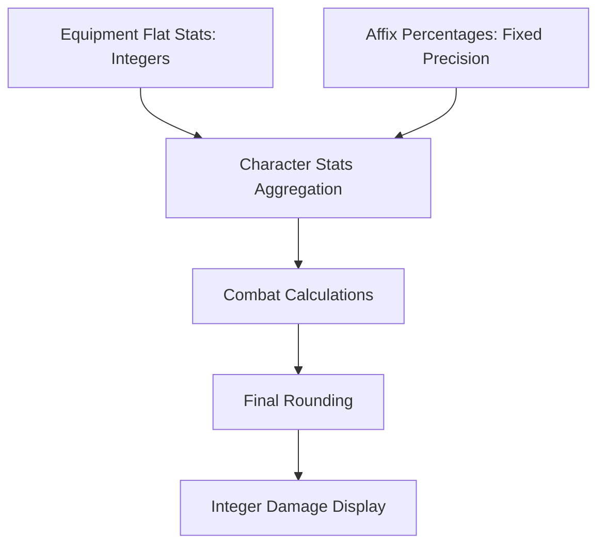

Pour les affixes exprimés avec deux décimales, une représentation en points de base est adaptée :

$$
3.45\%=345\text{ points de base}
$$

$$
1\text{ point de base}=0.01\%
$$

Cela évite les erreurs de représentation binaire lors de l'agrégation des bonus.

Dans notre moteur, les calculs pourront employer une arithmétique fixe ou rationnelle à précision contrôlée, puis appliquer la règle d'arrondi final déjà établie dans le Combat Engine.

Ainsi, nous reproduisons le comportement fonctionnel attendu sans dépendre des limites de précision d'un flottant pour les valeurs très élevées.

---

</details>


### SYS-002.D.11.1.12.5 · T100 · 20/11/2026 10:42:24

**Nature :** `APPROBATION_EXPLICITE` · **Ligne d’approbation source :** 30524 · **Ligne de formalisation :** 30529.

**Décision / prescription originale (texte intégral du propriétaire) :**

Validation SYS-002.D.11.1.12.5 : modèle de plages des statistiques par emplacement = same. Formalise la décision dans le GDD et poursuis la spécification.


<details><summary>Formalisation technique de la décision ratifiée (extrait sourcé)</summary>

# SYS-002.D.11.1.12.5 - Equipment Base Stat Ranges

(VALIDÉ - Modèle A : `same`)

La décision est intégrée au GDD : **les dix emplacements standards de la Lampe Magique utilisent exactement les mêmes plages de statistiques de base, à niveau de personnage et rareté identiques.**

Cette validation simplifie notre `Equipment Base Stats Engine` : l'emplacement détermine où l'objet peut être équipé, mais n'influence pas les valeurs de PV, ATQ ou DÉF générées.

## 1. Contrat fonctionnel définitif

| ID | Paramètre | Décision |
|--------|--------|--------|
| BASE-SLOT-001 | Plages par emplacement | `shared` |
| BASE-SLOT-002 | Modificateurs propres aux emplacements | `none` |
| BASE-SLOT-003 | Dépendance au niveau personnage | `enabled` |
| BASE-SLOT-004 | Dépendance à la rareté | `enabled` |
| BASE-SLOT-005 | Génération | `uniform_discrete` |
| BASE-SLOT-006 | Corrélation PV / ATQ / DÉF | `independent` |
| BASE-SLOT-007 | Précision des statistiques | `integer` |
| BASE-SLOT-008 | Remplacement d'équipement | `no_reroll` |

### Conséquences métier

Une arme, un casque et des chaussures générés dans les mêmes conditions possèdent les mêmes plages de valeurs possibles.

Cela ne signifie pas que leurs statistiques obtenues seront identiques : chaque pièce effectue trois nouveaux tirages indépendants.

L'emplacement peut toujours déterminer l'apparence de la pièce et son emplacement sur le personnage.

---

## 2. Formalisation mathématique

Nous pouvons supprimer la variable `Slot` de la résolution des plages.

Ancienne définition :

$$
Bounds_X=Lookup(C,R,S,X)
$$

Nouvelle définition validée :

$$
\boxed{Bounds_X=Lookup(C,R,X)}
$$

Avec :

- $C$ : niveau du personnage au moment de la génération.
- $R$ : rareté de l'objet.
- $X$ : statistique concernée, parmi PV, ATQ et DÉF.

Pour chaque statistique :

$$
X\sim\mathcal U_{\mathbb Z}
\left(L_X(C,R),U_X(C,R)\right)
$$

Les trois générations restent indépendantes.

Nous obtenons également, pour tout emplacement $S$ :

$$
P(X=x\mid C,R,S)=P(X=x\mid C,R)
$$

**Le choix d'emplacement n'introduit donc aucun biais dans les statistiques de base.**

---

## 3. Architecture simplifiée

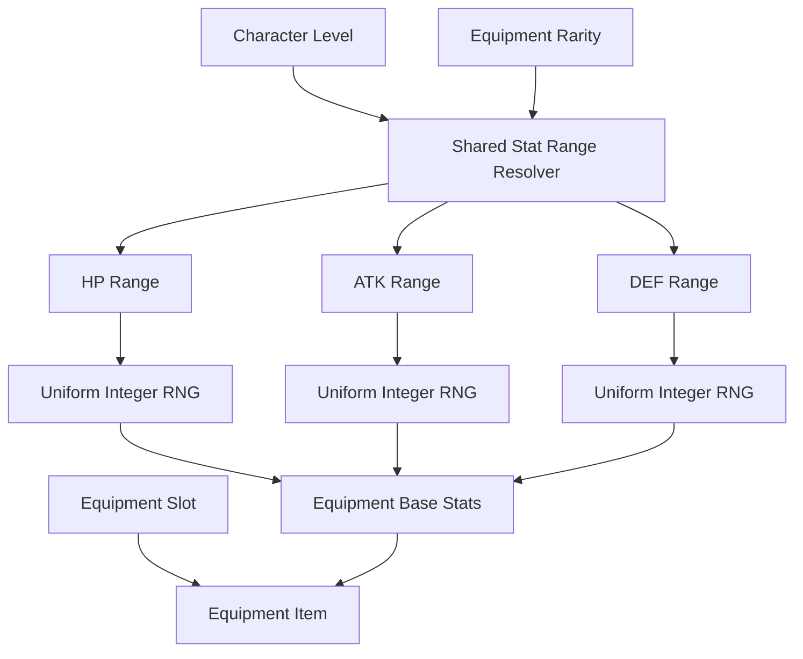

### Structure de configuration

```text
EquipmentBaseStatProfile
├── CharacterLevel
├── Rarity
├── HP
│   ├── Minimum
│   └── Maximum
├── Attack
│   ├── Minimum
│   └── Maximum
└── Defense
    ├── Minimum
    └── Maximum
```

La configuration ne possède plus de champ `SlotType`.

Un seul profil couvre les dix emplacements à niveau de personnage et rareté identiques.

*Note d'ingénierie : cette décision évite de maintenir dix tables de statistiques redondantes. Elle réduit également le risque de divergences accidentelles entre les emplacements lors des changements d'équilibrage.*

---

## 4. Tests de conformité

| Test | Résultat attendu |
|--------|--------|
| Même niveau, même rareté, emplacements différents | Bornes identiques |
| Même niveau, même rareté, plusieurs générations | Tirages indépendants |
| Changement d'emplacement | Aucune modification de distribution |
| Changement de rareté | Résolution du profil correspondant |
| Changement de niveau personnage | Résolution du profil correspondant |
| Remplacement d'une pièce existante | Statistiques intrinsèques inchangées |
| Génération aux bornes | Minimum et maximum acceptés |

Les essais statistiques seront réalisés séparément sur PV, ATQ et DÉF pour vérifier l'uniformité discrète.

---

</details>


### SYS-002.D.11.1.12.6 · T101 · 20/11/2026 10:44:21

**Nature :** `APPROBATION_EXPLICITE` · **Ligne d’approbation source :** 30748 · **Ligne de formalisation :** 30753.

**Décision / prescription originale (texte intégral du propriétaire) :**

Validation SYS-002.D.11.1.12.6 : modèle de progression des plages statistiques = anchors. Formalise la décision dans le GDD et poursuis la spécification des coefficients de rareté et du niveau du personnage.


<details><summary>Formalisation technique de la décision ratifiée (extrait sourcé)</summary>

# SYS-002.D.11.1.12.6 - Character Level &amp; Rarity Scaling

(VALIDÉ - Modèle C : `anchors`)

Le modèle **Tables d'ancrage et interpolation** est intégré au GDD.

Les plages de PV, ATQ et DÉF seront calculées à partir de niveaux de référence configurables. Les niveaux intermédiaires seront obtenus par interpolation, puis la rareté modifiera les bornes de génération.

Cette décision concerne exclusivement les statistiques intrinsèques des équipements générés par la Lampe Magique.

## 1. Architecture mathématique retenue

Le calcul est décomposé en trois étapes indépendantes.

1. **Résolution du niveau du personnage**
   
   Détermination des bornes de référence à partir des deux points d'ancrage encadrant le niveau.
2. **Application du coefficient de rareté**
   
   Transformation des bornes de référence selon la rareté obtenue.
3. **Génération aléatoire**
   
   Tirage uniforme discret, indépendant pour les PV, l'ATQ et la DÉF.

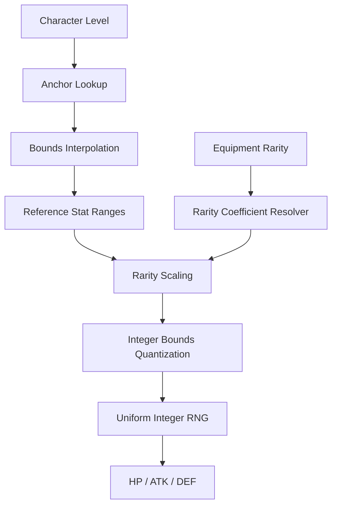

---

## 2. SYS-002.D.11.1.12.6.1 - Character Level Anchors

### 2.1 Structure des données

Chaque point d'ancrage représente un niveau de personnage et les plages de référence des trois statistiques.

```text
EquipmentLevelAnchor
├── CharacterLevel
├── HP
│   ├── Minimum
│   └── Maximum
├── Attack
│   ├── Minimum
│   └── Maximum
└── Defense
    ├── Minimum
    └── Maximum
```

Les ancrages seront ordonnés par niveau croissant.

Ils devront respecter les contraintes suivantes :

| ID | Invariant |
|--------|--------|
| ANCHOR-001 | Chaque niveau d'ancrage est unique |
| ANCHOR-002 | Les niveaux sont strictement croissants |
| ANCHOR-003 | Chaque ancrage possède les trois statistiques |
| ANCHOR-004 | `Minimum ≤ Maximum` |
| ANCHOR-005 | Les bornes sont positives ou nulles |
| ANCHOR-006 | Aucun niveau pris en charge ne reste sans couverture |

La densité des points d'ancrage reste configurable. Nous ne fixerons pas arbitrairement un ancrage tous les 5 ou 10 niveaux.

### 2.2 Interpolation

Pour un personnage de niveau $L$, nous recherchons deux ancrages :

$$
L_a\leq L\leq L_b
$$

Le coefficient d'interpolation est :

$$
t=\frac{L-L_a}{L_b-L_a}
$$

Pour chaque statistique $X$, nous interpolons séparément ses bornes.

$$
Min_X(L)=Min_X(L_a)+t[Min_X(L_b)-Min_X(L_a)]
$$

$$
Max_X(L)=Max_X(L_a)+t[Max_X(L_b)-Max_X(L_a)]
$$

Cette interpolation est linéaire **entre deux ancrages**, sans imposer une croissance linéaire globale.

**Exemple illustratif - ATQ**

Valeurs fictives, uniquement pour expliquer le mécanisme.

| Personnage niveau 10 | ATQ 100-150 |
|--------|--------|
| Personnage niveau 20 | ATQ 300-450 |
| Personnage niveau 15 | ATQ 200-300 |

Au niveau 15, $t=0.5$. Les deux bornes sont donc interpolées à mi-chemin.

### 2.3 Gestion des niveaux hors ancrages

Pour éviter les extrapolations incontrôlées :

- Une valeur correspondant exactement à un ancrage utilise les bornes définies.
- Une valeur comprise entre deux ancrages utilise l'interpolation.
- Une valeur hors de la plage couverte nécessite une configuration explicite.

Aucune extrapolation automatique n'est activée à ce stade.

*Note d'ingénierie : la couverture des ancrages sera vérifiée au chargement de la configuration, avant toute génération. Un équipement ne doit jamais être créé à partir de bornes estimées silencieusement.*

---

# 3. SYS-002.D.11.1.12.6.2 - Rarity Scaling

(Spécification ouverte)

Nous avons désormais les plages de référence déterminées par le niveau du personnage.

Il faut définir comment les dix raretés transforment ces plages.

Le modèle générique est :

$$
Bounds_X(L,R)=Scale_R(Bounds_X(L))
$$

Avec :

- $L$ : niveau du personnage.
- $R$ : rareté.
- $X$ : PV, ATQ ou DÉF.

Les coefficients de rareté seront indépendants du niveau de la lampe : ce dernier détermine les probabilités d'obtenir les raretés, pas directement la puissance intrinsèque d'une pièce une fois sa rareté fixée.

## 3.1 Trois modèles de coefficients

**Modèle A - Coefficient unique par rareté**

Chaque rareté possède un seul coefficient commun aux PV, à l'ATQ et à la DÉF.

$$
Min_X(L,R)=Min_X(L)\times M_R
$$

$$
Max_X(L,R)=Max_X(L)\times M_R
$$

Ce modèle conserve les proportions entre statistiques et la dispersion relative des valeurs.

---

**Modèle B - Coefficients distincts par statistique**

Chaque rareté possède trois coefficients :

$$
M_{R,HP},\quad M_{R,ATK},\quad M_{R,DEF}
$$

Chaque coefficient s'applique aux deux bornes de sa statistique.

Cela permet, par exemple, qu'une rareté améliore davantage les PV que l'ATQ.

---

**Modèle C - Coefficients distincts par borne et statistique**

Chaque rareté possède six coefficients :

$$
M^{min}_{R,X},\quad M^{max}_{R,X}
$$

Ce modèle permet de modifier non seulement la puissance, mais également la largeur des plages.

Une rareté supérieure pourrait ainsi posséder des statistiques plus fortes et une variance différente.

### Comparaison architecturale

| Critère | A | B | C |
|--------|--------|--------|--------|
| Coefficients par rareté | 1 | 3 | 6 |
| Préserve les proportions PV/ATQ/DÉF | Oui | Non nécessairement | Non nécessairement |
| Permet des bonus spécifiques à une statistique | Non | Oui | Oui |
| Permet de modifier la dispersion relative | Non | Non | Oui |
| Complexité de calibration | Faible | Modérée | Élevée |

**Recommandation : modèle A**, en l'absence de valeurs officielles montrant que les raretés affectent différemment les trois statistiques.

Il répond à notre objectif actuel : un moteur cohérent, calibrable et sans paramètres artificiellement introduits.

---

## 4. SYS-002.D.11.1.12.6.3 - Ordre des opérations

L'ordre proposé est le suivant :

$$
\boxed{
\text{Ancrages}
\rightarrow
\text{Interpolation}
\rightarrow
\text{Coefficient de rareté}
\rightarrow
\text{Bornes entières}
\rightarrow
\text{Tirage uniforme}
}
$$

La quantification intermédiaire reste à préciser.

Pour l'instant, nous conservons les bornes interpolées avec une précision exacte ou contrôlée, puis effectuons une unique conversion en entiers après application du coefficient de rareté.

Cette approche évite l'accumulation de plusieurs erreurs d'arrondi.

La politique exacte - plancher, plafond ou arrondi au plus proche - sera validée séparément.

---

# 5. Impact sur les équipements existants

Une fois générée, la pièce conserve ses valeurs intrinsèques.

Exemple : un équipement obtenu au niveau 50 ne verra pas ses statistiques augmenter lorsque le personnage atteindra le niveau 60.

| Événement | Statistiques de l'objet existant |
|--------|--------|
| Niveau du personnage augmente | Inchangées |
| Niveau de lampe augmente | Inchangées |
| Tables d'ancrage mises à jour | Inchangées |
| Pièce équipée | Inchangées |
| Fourneau Magique amélioré | Objet inchangé, contribution finale modifiée |

Les nouvelles générations utiliseront les paramètres actifs au moment de leur tirage.

*Note d'ingénierie : les objets conserveront leurs statistiques générées plutôt qu'une référence dynamique aux tables. C'est indispensable pour assurer la stabilité des inventaires entre deux versions d'équilibrage.*

---

# 6. Validation SYS-002.D.11.1.12.6.2

**Quel modèle de coefficients de rareté souhaites-tu adopter ?**

A - Un coefficient unique par rareté (recommandé)

B - Trois coefficients par rareté, un par statistique

C - Six coefficients par rareté, minimum et maximum distincts

[Valider le modèle de rareté]

Ce choix fixera la dernière dimension structurelle du calcul des plages. Les étapes suivantes porteront sur les contraintes de croissance entre niveaux et raretés, puis sur la calibration numérique des dix paliers.

</details>


### SYS-002.D.11.1.12.6.2 · T102 · 20/11/2026 10:48:34

**Nature :** `APPROBATION_EXPLICITE` · **Ligne d’approbation source :** 31040 · **Ligne de formalisation :** 31045.

**Décision / prescription originale (texte intégral du propriétaire) :**

Validation SYS-002.D.11.1.12.6.2 : coefficients de rareté = single. Formalise la décision dans le GDD et poursuis avec les contraintes de croissance, la quantification des bornes et les tables de calibration.


<details><summary>Formalisation technique de la décision ratifiée (extrait sourcé)</summary>

# SYS-002.D.11.1.12.6.2 - Rarity Scaling Model

(VALIDÉ - Modèle A : `single`)

Le GDD adopte **un coefficient multiplicateur unique par rareté**, appliqué aux bornes minimales et maximales des trois statistiques de base : PV, ATQ et DÉF.

Nous pouvons désormais spécifier les contraintes de croissance, la quantification en entiers et la structure des tables de calibration.

## 1. Contrat mathématique définitif

Pour une statistique $X$, un niveau de personnage $L$ et une rareté $R$ :

$$
B_X(L)=[Min_X(L),Max_X(L)]
$$

Ces bornes de référence proviennent de l'interpolation entre les ancrages.

Chaque rareté possède un unique coefficient $M_R$.

Les bornes après application de la rareté sont :

$$
\boxed{
\begin{aligned}
Min_X(L,R)&=Min_X(L)\times M_R\\
Max_X(L,R)&=Max_X(L)\times M_R
\end{aligned}
}
$$

Le même coefficient s'applique aux six bornes : minima et maxima de PV, ATQ et DÉF.

Cela préserve les proportions théoriques des plages, mais pas nécessairement les proportions des statistiques obtenues sur une pièce, puisque les trois tirages restent indépendants.

### Contrats validés

| ID | Règle | Valeur |
|--------|--------|--------|
| RAR-SCALE-001 | Modèle | `single_multiplier` |
| RAR-SCALE-002 | Nombre de coefficients | 1 par rareté |
| RAR-SCALE-003 | Statistiques affectées | PV, ATQ, DÉF |
| RAR-SCALE-004 | Bornes affectées | Minimum et maximum |
| RAR-SCALE-005 | Dépendance à l'emplacement | Aucune |
| RAR-SCALE-006 | Dépendance au niveau de lampe | Aucune |
| RAR-SCALE-007 | Application | Avant le tirage uniforme |

*Note d'ingénierie : un coefficient par rareté simplifie la calibration et garantit que les trois caractéristiques utilisent la même règle de progression. L'équilibrage des proportions PV/ATQ/DÉF s'effectuera principalement dans les tables d'ancrage.*

---

</details>


### SYS-002.D.11.1.12.6.4 · T103 · 20/11/2026 10:59:00

**Nature :** `APPROBATION_EXPLICITE` · **Ligne d’approbation source :** 31372 · **Ligne de formalisation :** 31377.

**Décision / prescription originale (texte intégral du propriétaire) :**

Validation SYS-002.D.11.1.12.6.4 : quantification des bornes = inward. Formalise cette décision dans le GDD, puis soumets les contraintes de croissance à validation avant de commencer la calibration numérique.


<details><summary>Formalisation technique de la décision ratifiée (extrait sourcé)</summary>

# SYS-002.D.11.1.12.6.4 - Bounds Quantization

(VALIDÉ - Modèle A : `inward`)

La décision est intégrée au GDD : **les bornes théoriques des statistiques sont converties en entiers par quantification intérieure avant tout tirage aléatoire.**

Nous pouvons maintenant soumettre les contraintes de croissance à validation.

## 1. Contrat mathématique définitif

Pour chaque statistique $X\in\{HP,ATK,DEF\}$, nous disposons de deux bornes théoriques après interpolation et application du coefficient de rareté :

$$
L_X^*=Min_X(Level)\times M_R
$$

$$
U_X^*=Max_X(Level)\times M_R
$$

La quantification intérieure donne :

$$
\boxed{
L_X=\lceil L_X^*\rceil
\qquad
U_X=\lfloor U_X^*\rfloor
}
$$

Le tirage final est ensuite :

$$
\boxed{X\sim\mathcal U_{\mathbb Z}(L_X,U_X)}
$$

Chaque valeur entière de la plage, bornes incluses, possède exactement la même probabilité.

### Exemples de quantification

| Bornes théoriques | Bornes entières | Résultat |
|--------|--------|--------|
| $$105,2 ; 189,7$$ | $$106 ; 189$$ | Valide |
| $$100 ; 200$$ | $$100 ; 200$$ | Valide |
| $$125,1 ; 125,9$$ | Aucune valeur entière | Rejeté |
| $$150 ; 150$$ | $$150 ; 150$$ | Valide |

Une configuration produisant $L_X>U_X$ est invalide.

**Aucune correction silencieuse ni aucun nouveau tirage ne seront effectués.**

## 2. Règles d'implémentation

| ID | Règle | Statut |
|--------|--------|--------|
| QUANT-001 | Quantification intérieure | (Validé) |
| QUANT-002 | Plafond pour la borne minimale | (Validé) |
| QUANT-003 | Plancher pour la borne maximale | (Validé) |
| QUANT-004 | Quantification après interpolation et multiplication | (Validé) |
| QUANT-005 | Tirage uniforme entier inclusif | (Validé) |
| QUANT-006 | Plage entière vide rejetée | (Validé) |
| QUANT-007 | Intermédiaires calculés avec précision exacte | (Validé) |

### Ordre d'exécution

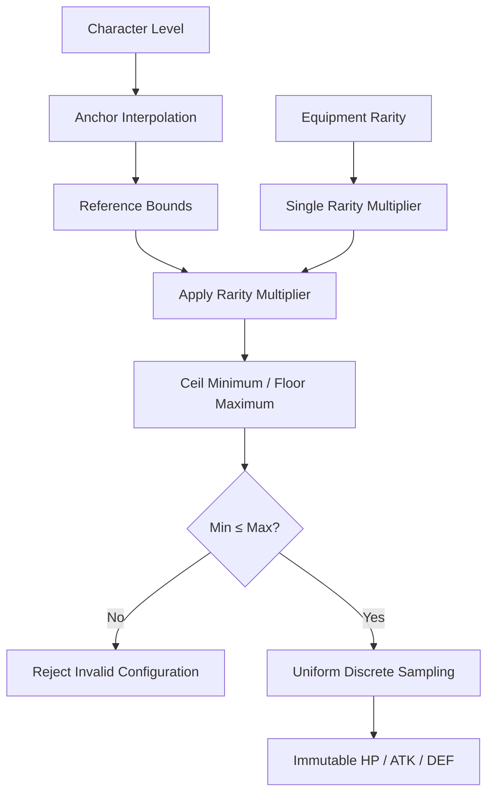

*Note d'ingénierie : les coefficients de rareté seront représentés par des valeurs décimales exactes ou rationnelles. L'interpolation et la multiplication s'effectueront avant toute conversion en entier afin d'éviter une accumulation d'erreurs d'arrondi.*

---

</details>


### SYS-002.D.11.1.12.6.3 · T104 · 20/11/2026 11:09:03

**Nature :** `APPROBATION_EXPLICITE` · **Ligne d’approbation source :** 31614 · **Ligne de formalisation :** 31619.

**Décision / prescription originale (texte intégral du propriétaire) :**

Validation SYS-002.D.11.1.12.6.3 : contraintes de croissance = strict. Formalise la décision dans le GDD et passe à la calibration numérique des tables d'ancrage et des dix coefficients de rareté.


<details><summary>Formalisation technique de la décision ratifiée (extrait sourcé)</summary>

# SYS-002.D.11.1.12.6.3 - Growth Constraints

(VALIDÉ - Modèle A : `strict`)

Le GDD adopte définitivement des **contraintes de croissance strictes** pour les statistiques de base des équipements de la Lampe Magique.

Le moteur rejettera toute configuration dont les bornes de statistiques ou les coefficients de rareté régressent.

## 1. Contrats métier validés

| ID | Paramètre | Décision |
|--------|--------|--------|
| GROWTH-001 | Croissance selon le niveau personnage | Non décroissante |
| GROWTH-002 | Croissance selon la rareté | Non décroissante |
| GROWTH-003 | Coefficient Normal | Exactement `1` |
| GROWTH-004 | Coefficients de rareté | Strictement positifs |
| GROWTH-005 | Paliers de progression | Autorisés |
| GROWTH-006 | Régressions | Rejet de configuration |
| GROWTH-007 | Validation | Au chargement de la configuration |
| GROWTH-008 | Correction automatique de données invalides | Interdite |

### 1.1 Croissance des ancrages

Pour chaque statistique $X\in\{HP,ATK,DEF\}$, et pour deux niveaux d'ancrage successifs $L_i<L_{i+1}$ :

$$
\boxed{
\begin{aligned}
Min_X(L_{i+1})&\geq Min_X(L_i)\\
Max_X(L_{i+1})&\geq Max_X(L_i)
\end{aligned}
}
$$

Les six séries numériques sont validées indépendamment.

L'interpolation linéaire entre deux ancrages monotones conserve cette propriété.

### 1.2 Croissance des coefficients de rareté

Nous retenons :

$$
\boxed{
1=M_1\leq M_2\leq\cdots\leq M_{10}
}
$$

L'égalité entre deux coefficients reste autorisée.

Une rareté supérieure garantit des **bornes non inférieures**, mais ne garantit pas un meilleur tirage que chaque équipement de rareté inférieure.

### 1.3 Quantification et intégrité

L'ordre de calcul précédemment validé reste inchangé :

$$
\text{Ancrages}\rightarrow\text{Interpolation}
\rightarrow\text{Rareté}\rightarrow
\text{Quantification intérieure}\rightarrow\text{RNG}
$$

Pour chaque statistique :

$$
L_X=\lceil Min_X(L)\times M_R\rceil
$$

$$
U_X=\lfloor Max_X(L)\times M_R\rfloor
$$

Le moteur exige $L_X\leq U_X$. Les contraintes de monotonie ne suffisent pas à elles seules à garantir cette condition : une plage trop étroite peut devenir vide après quantification.

*Note d'ingénierie : le validateur doit vérifier non seulement les ancrages et les coefficients, mais aussi les plages entières résultantes sur tous les niveaux pris en charge et les dix raretés. Une configuration numériquement monotone peut néanmoins être inutilisable.*

---

</details>


### SYS-002.D.11.1.12.7.2 · T105 · 20/11/2026 18:23:12

**Nature :** `APPROBATION_EXPLICITE` · **Ligne d’approbation source :** 31898 · **Ligne de formalisation :** 31903.

**Décision / prescription originale (texte intégral du propriétaire) :**

Validation SYS-002.D.11.1.12.7.2 : stratégie de calibration = provisional. Formalise la décision dans le GDD et poursuis la spécification avec les tests de calibration, puis les règles de génération des valeurs numériques des affixes.


<details><summary>Formalisation technique de la décision ratifiée (extrait sourcé)</summary>

# SYS-002.D.11.1.12.7.2 - Numerical Calibration Strategy

(VALIDÉ - `provisional`)

La calibration numérique `equipment_base_stats_v0.1` est officiellement adoptée comme **profil provisoire de développement**.

Cette décision permet de poursuivre la conception et les tests du `MagicLampEquipmentGenerationEngine` sans attendre une reconstitution complète des valeurs de *Legend of Mushroom*.

## 1. Décision intégrée au GDD

| ID | Paramètre | Décision |
|--------|--------|--------|
| CAL-STRAT-001 | Stratégie | `provisional` |
| CAL-STRAT-002 | Profil actif initial | `equipment_base_stats_v0.1` |
| CAL-STRAT-003 | Provenance | `designed` |
| CAL-STRAT-004 | Niveaux couverts | 1-200 |
| CAL-STRAT-005 | Raretés couvertes | 10 |
| CAL-STRAT-006 | Interpolation | Linéaire entre ancrages |
| CAL-STRAT-007 | Coefficients de rareté | Un multiplicateur commun aux trois statistiques |
| CAL-STRAT-008 | Contraintes de croissance | Strictes |
| CAL-STRAT-009 | Quantification | Intérieure |
| CAL-STRAT-010 | Remplacement du profil | Par version de configuration |
| CAL-STRAT-011 | Modification rétroactive des objets | Interdite |

Le niveau 200 correspond uniquement à la couverture du profil initial, et non à une limite définitive de progression.

### 1.1 Tables numériques retenues

Les dix ancrages de niveau sont conservés aux niveaux :

`1, 10, 20, 40, 60, 80, 100, 120, 150, 200`

Les coefficients provisoires sont également conservés sans modification :

| Rareté | Coefficient |
|--------|--------|
| Normal | 1,00 |
| Unique | 1,18 |
| Bien | 1,40 |
| Rare | 1,70 |
| Mythique | 2,05 |
| Épique | 2,50 |
| Légendaire | 3,05 |
| Immortel | 3,75 |
| Suprême / Aurous | 4,60 |
| Éternel | 5,70 |

Ces coefficients sont désormais utilisables dans les tests et simulations. Ils ne sont pas assimilés à des mesures officielles.

### 1.2 Gestion des versions

Chaque équipement généré conservera :

- Ses trois statistiques entières définitives.
- Le niveau du personnage utilisé pour sa génération.
- Sa rareté.
- La version de configuration.
- Un identifiant de tirage unique.

Lorsqu'un nouveau profil remplacera `v0.1`, les équipements déjà créés resteront inchangés. Seules les nouvelles générations utiliseront les nouveaux paramètres.

*Note d'ingénierie : une version de configuration constitue une frontière de reproductibilité. Un test de génération ne doit jamais dépendre implicitement de la dernière table disponible.*

---

</details>


### SYS-002.D.11.1.13.2 · T106 · 20/11/2026 18:27:17

**Nature :** `APPROBATION_EXPLICITE` · **Ligne d’approbation source :** 32248 · **Ligne de formalisation :** 32253.

**Décision / prescription originale (texte intégral du propriétaire) :**

Validation SYS-002.D.11.1.13.2 : dépendance des valeurs d'affixes = rarity_only. Formalise la décision dans le GDD et poursuis avec la distribution numérique des valeurs, leurs contraintes de croissance et les tests statistiques.


<details><summary>Formalisation technique de la décision ratifiée (extrait sourcé)</summary>

# SYS-002.D.11.1.13.2 - Affix Value Dependency

(VALIDÉ - `rarity_only`)

La décision est intégrée au GDD.

La valeur numérique d'un affixe dépend exclusivement de deux paramètres :

- Sa rareté.
- Son type.

Elle ne dépend pas du niveau du personnage.

La relation est donc :

$$
\boxed{V=f(R,A)}
$$

Avec $R$ la rareté et $A$ le type d'affixe.

### Contrat fonctionnel

| ID | Paramètre | Décision |
|--------|--------|--------|
| AFFIX-DEP-001 | Dépendance à la rareté | Oui |
| AFFIX-DEP-002 | Dépendance au type | Oui |
| AFFIX-DEP-003 | Dépendance au niveau personnage | Non |
| AFFIX-DEP-004 | Dépendance au niveau de lampe | Non directe |
| AFFIX-DEP-005 | Dépendance à l'emplacement | Non, dans le modèle retenu |
| AFFIX-DEP-006 | Calibration | Par couple rareté/type |

Le niveau de lampe influence indirectement les valeurs obtenues en modifiant les probabilités d'apparition des raretés, mais ne modifie pas la distribution d'un affixe à rareté et type identiques.

---

</details>


### SYS-002.D.11.1.13.3 · T107 · 20/11/2026 18:30:49

**Nature :** `APPROBATION_EXPLICITE` · **Ligne d’approbation source :** 32649 · **Ligne de formalisation :** 32654.

**Décision / prescription originale (texte intégral du propriétaire) :**

Validation SYS-002.D.11.1.13.3 : distribution numérique des affixes = uniform. Formalise la décision dans le GDD, soumets les contraintes de croissance à validation, puis prépare la calibration provisoire des 90 profils affixe/rareté.


<details><summary>Formalisation technique de la décision ratifiée (extrait sourcé)</summary>

# SYS-002.D.11.1.13.3 - Affix Magnitude Distribution

(VALIDÉ - `uniform`)

Le GDD adopte définitivement une distribution uniforme discrète pour la génération des valeurs numériques des affixes.

Chaque valeur entière autorisée possède exactement la même probabilité d'être sélectionnée.

## 1. Contrat mathématique définitif

Pour un affixe donné $A$ et une rareté $R$ :

$$
V_{R,A}\sim\mathcal U_{\mathbb Z}
(V_{\min},V_{\max})
$$

Avec :

$$
V=V_{\min}+K\times Step
$$

Et :

$$
K\sim\mathcal U_{\mathbb Z}
\left(0,\frac{V_{\max}-V_{\min}}{Step}\right)
$$

### Paramètres verrouillés

| ID | Paramètre | Valeur |
|--------|--------|--------|
| AFFIX-DIST-001 | Distribution | `uniform_discrete` |
| AFFIX-DIST-002 | Unité | Basis points |
| AFFIX-DIST-003 | Précision | 0,01 % |
| AFFIX-DIST-004 | Pas numérique | 1 BP |
| AFFIX-DIST-005 | Bornes | Inclusives |
| AFFIX-DIST-006 | Dépendance | Rareté + type |
| AFFIX-DIST-007 | Niveau personnage | Sans influence |
| AFFIX-DIST-008 | Tirages successifs | Indépendants |

Exemple :

Un affixe Combo disposant d'une plage de 36 à 72 BP possède 37 valeurs possibles.

$$
P(V=v)=\frac{1}{37}
$$

Chaque valeur a donc une probabilité de 2,7027 %.

*Note d'ingénierie : le générateur utilisera un tirage entier uniforme sans biais modulo. La sélection du type d'affixe et celle de sa magnitude resteront deux opérations indépendantes.*

---

</details>


### SYS-002.D.11.1.13.4 · T108 · 20/11/2026 18:56:53

**Nature :** `APPROBATION_EXPLICITE` · **Ligne d’approbation source :** 33054 · **Ligne de formalisation :** 33059.

**Décision / prescription originale (texte intégral du propriétaire) :**

Je valide


<details><summary>Formalisation technique de la décision ratifiée (extrait sourcé)</summary>

# SYS-002.D.11.1.13.4 - Affix Growth Constraints

(VALIDÉ - `strict`)

Les contraintes de croissance des affixes sont désormais intégrées définitivement au GDD.

La validation porte sur les règles structurelles, et non sur l'exactitude des valeurs numériques provisoires.

## 1. Contrats définitifs

| ID | Règle | Décision |
|--------|--------|--------|
| AFFIX-GROW-001 | Minimum non décroissant | Validé |
| AFFIX-GROW-002 | Maximum non décroissant | Validé |
| AFFIX-GROW-003 | Valeurs strictement positives | Validé |
| AFFIX-GROW-004 | Minimum inférieur ou égal au maximum | Validé |
| AFFIX-GROW-005 | Pas numérique | 1 BP |
| AFFIX-GROW-006 | Alignement des bornes | Obligatoire |
| AFFIX-GROW-007 | Chevauchement des plages | Autorisé |
| AFFIX-GROW-008 | Croissance de la largeur | Libre |
| AFFIX-GROW-009 | Indépendance entre familles | Validée |
| AFFIX-GROW-010 | Profils indisponibles | Inactifs |

**Précision importante :** `strict` désigne ici une application stricte des validations. La monotonie reste non décroissante et autorise donc les égalités.

## 2. Statut de la calibration

**affix\_values\_v0.1**

Nombre de profils potentiels **90**

Profils actifs hors Normal **81**

Profils Normal désactivés **9**

Provenance `designed`

Distribution `uniform_discrete`

---

(Calibration numérique provisoire)

Les valeurs restent modifiables avant leur approbation définitive.

---

</details>


### SYS-002.D.11.1.14.1 · T109 · 20/11/2026 19:24:17

**Nature :** `APPROBATION_EXPLICITE` · **Ligne d’approbation source :** 33318 · **Ligne de formalisation :** 33323.

**Décision / prescription originale (texte intégral du propriétaire) :**

Oui je valide


<details><summary>Formalisation technique de la décision ratifiée (extrait sourcé)</summary>

# SYS-002.D.11.1.14.1 - Adjust Configuration Persistence

(VALIDÉ - `persistent_global`)

La décision est intégrée au GDD.

La configuration Adjust est désormais **persistante, globale et propre au profil du joueur**.

Elle reste active jusqu'à sa modification explicite par le joueur.

## 1. Contrat définitif

| ID | Règle | Décision |
|--------|--------|--------|
| ADJUST-PERSIST-001 | Persistance | `persistent_global` |
| ADJUST-PERSIST-002 | Portée | Toutes les pièces générées par la Lampe |
| ADJUST-PERSIST-003 | Durée | Jusqu'à modification |
| ADJUST-PERSIST-004 | Conservation hors ligne | Obligatoire |
| ADJUST-PERSIST-005 | Modification de la liste | Immédiatement enregistrée |
| ADJUST-PERSIST-006 | Application | Prochaine génération |
| ADJUST-PERSIST-007 | Modification rétroactive | Interdite |
| ADJUST-PERSIST-008 | Ouverture groupée | Configuration figée au démarrage |
| ADJUST-PERSIST-009 | Historique | Version de configuration conservée |

La portée concerne exclusivement les dix emplacements standards générés par la Lampe Magique. Les reliques, montures, accessoires dorsaux et autres systèmes restent indépendants.

## 2. Modèle de données

```text
PlayerAdjustConfiguration
├── PlayerId
├── BannedAffixIds[]
├── ConfigurationRevision
└── UpdatedAtUtc
```

Contraintes :

- Identifiants d'affixes uniques.
- Maximum de trois exclusions.
- Nombre d'exclusions inférieur ou égal au nombre d'emplacements débloqués.
- Aucun identifiant inconnu.
- Sauvegarde atomique de la configuration.

Chaque modification incrémente `ConfigurationRevision`.

### Gestion des générations groupées

Au démarrage d'une ouverture groupée, le moteur capture une copie immuable de la configuration.

Exemple :

```text
BatchGenerationContext
├── BatchId
├── CharacterLevel
├── LampLevel
├── AdjustRevision
├── BannedAffixSnapshot[]
└── PendingEquipmentCount
```

Si le joueur modifie ses exclusions pendant une ouverture groupée, les modifications ne concernent que la prochaine opération.

*Note d'ingénierie : le snapshot évite qu'une même ouverture groupée produise des équipements selon deux configurations Adjust différentes.*

---

# 3. Correction mathématique importante - Probabilités des affixes

Je corrige une subtilité dans les tableaux précédents.

La probabilité de sélectionner un affixe lors d'un tirage individuel n'est pas identique à sa probabilité d'apparaître dans une pièce possédant deux affixes.

Pour un bassin de $n$ affixes et une sélection de $k$ affixes distincts :

$$
P(A\text{ présent dans la pièce})=\frac{k}{n}
$$

La probabilité d'obtenir une paire précise est :

$$
P(\{A,B\})=\frac{1}{\binom nk}
$$

Pour deux affixes :

| Exclusions | Bassin | Présence d'un affixe précis | Paire précise |
|--------|--------|--------|--------|
| 0 | 9 | 22,22 % | 2,78 % |
| 1 | 8 | 25,00 % | 3,57 % |
| 2 | 7 | 28,57 % | 4,76 % |
| 3 | 6 | 33,33 % | 6,67 % |

Ces résultats supposent une sélection uniforme sans remise et deux affixes effectivement générés.

---

# 4. Clôture fonctionnelle du Adjust Engine

**SYS-002.D.11.1.14** (Contrat fonctionnel clôturé)

---

Déblocage progressif (Validé)

Trois exclusions maximum (Validé)

Sélection uniforme (Validé)

Absence de doublons (Validé)

Persistance globale (Validé)

Snapshot des ouvertures groupées (Validé)

Tests d'intégration (À implémenter)

Le contrat fonctionnel est fermé. La clôture technique nécessitera l'exécution des tests.

---

</details>


### SYS-002.D.11.1.15.1 · T110 · 20/11/2026 20:01:40

**Nature :** `APPROBATION_EXPLICITE` · **Ligne d’approbation source :** 33614 · **Ligne de formalisation :** 33619.

**Décision / prescription originale (texte intégral du propriétaire) :**

Validation SYS-002.D.11.1.15.1 : distribution du nombre d'affixes = weighted_lookup. Formalise la décision dans le GDD et poursuis l'audit mathématique complet du Magic Lamp Equipment Generation Engine.


<details><summary>Formalisation technique de la décision ratifiée (extrait sourcé)</summary>

# SYS-002.D.11.1.15.1 - Affix Count Distribution

(VALIDÉ - `weighted_lookup`)

Le GDD adopte une table de probabilités pondérées pour déterminer le nombre d'affixes générés sur chaque équipement.

Le nombre d'affixes dépend exclusivement de la rareté obtenue. Il ne dépend ni du niveau du personnage, ni du niveau de la lampe, ni de la configuration Adjust.

## 1. Contrat mathématique

Nous définissons :

$$
Q(R,k)=P(\text{nombre d'affixes}=k\mid R)
$$

Chaque rareté possède une table de poids entière.

La probabilité effective est :

$$
\boxed{
Q(R,k)=\frac{W_{R,k}}{\sum_j W_{R,j}}
}
$$

Où $W_{R,k}$ représente le poids associé au nombre d'affixes $k$.

Le moteur utilise un tirage entier uniforme dans la somme des poids, puis sélectionne l'entrée correspondante par intervalles cumulés.

Cette méthode évite les erreurs de précision des probabilités flottantes.

## 2. Contraintes par rareté

| Rareté | Nombre autorisé | Distribution |
|--------|--------|--------|
| Normal | 0 | Déterministe |
| Unique | 0 ou 1 | Pondérée |
| Bien | 1 ou 2 | Pondérée |
| Rare | 2 | Déterministe |
| Mythique | 2 | Déterministe |
| Épique | 2 | Déterministe |
| Légendaire | 2 | Déterministe |
| Immortel | 2 | Déterministe |
| Suprême | 2 | Déterministe |
| Éternel | 2 | Déterministe |

Les poids numériques des raretés Unique et Bien restent à calibrer. Je ne leur attribue pas de probabilités arbitraires.

### Structure de configuration

```text
AffixCountProfile
├── Rarity
├── AllowedCounts[]
│   ├── AffixCount
│   └── Weight
├── ConfigurationVersion
└── Provenance
```

### Invariants

- Aucun nombre d'affixes interdit ne peut être présent dans une table.
- La somme des poids doit être strictement positive.
- Les poids sont des entiers non négatifs.
- Une table déterministe ne possède qu'une seule entrée de poids non nul.
- Une table pondérée est versionnée.
- Aucun nouveau tirage n'est effectué pour corriger un résultat valide.

---

# 3. Correction de l'audit probabiliste

L'adoption de `weighted_lookup` entraîne une précision importante concernant nos calculs précédents.

La probabilité d'obtenir un affixe donné dans une pièce dépend maintenant du nombre d'affixes effectivement générés.

Posons :

- $n$ : taille du bassin après Adjust.
- $q_0$ : probabilité de générer zéro affixe.
- $q_1$ : probabilité d'en générer un.
- $q_2$ : probabilité d'en générer deux.

Nous avons :

$$
q_0+q_1+q_2=1
$$

Les valeurs non autorisées pour une rareté sont simplement nulles.

### Probabilité de présence d'un affixe précis

$$
\boxed{
P(A)=\frac{q_1+2q_2}{n}
}
$$

### Probabilité d'obtenir une paire précise

$$
\boxed{
P(\{A,B\})=
\frac{q_2}{\binom n2}
}
$$

Ces formules tiennent compte simultanément de la distribution du nombre d'affixes et de leur sélection uniforme sans remise.

### Conséquence pour Adjust

Avec trois exclusions :

$$
n=9-3=6
$$

Pour les raretés générant systématiquement deux affixes :

$$
P(A)=\frac{2}{6}=33.33\%
$$

$$
P(\{A,B\})=\frac{1}{15}=6.67\%
$$

Pour les raretés Unique et Bien, les probabilités dépendront de leurs poids respectifs.

---

</details>


### SYS-002.D.11.1.17.1 · T111 · 20/11/2026 20:33:35

**Nature :** `APPROBATION_EXPLICITE` · **Ligne d’approbation source :** 34136 · **Ligne de formalisation :** 34141.

**Décision / prescription originale (texte intégral du propriétaire) :**

Validation SYS-002.D.11.1.17.1 : architecture de configuration Unity = hybrid. Formalise la décision, définis les contrats des composants C# et prépare le plan d'implémentation du Magic Lamp Equipment Generation Engine.


**Source technique :** réponse consécutive et proposition précédant cette validation, consultables dans l’historique original. Aucun extrait automatique n’a été retenu faute de délimitation non ambiguë.

