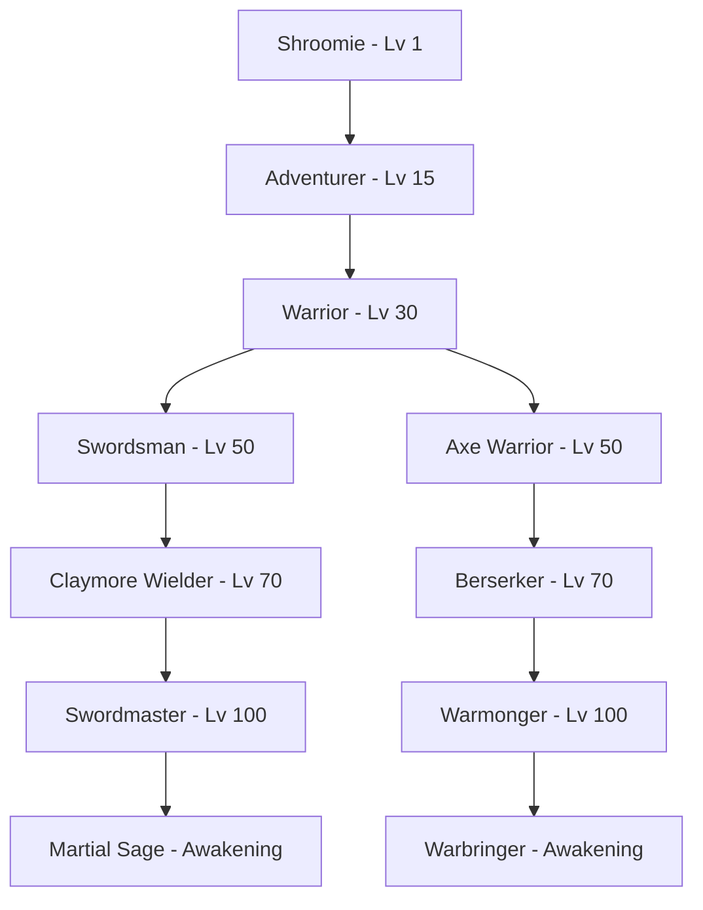
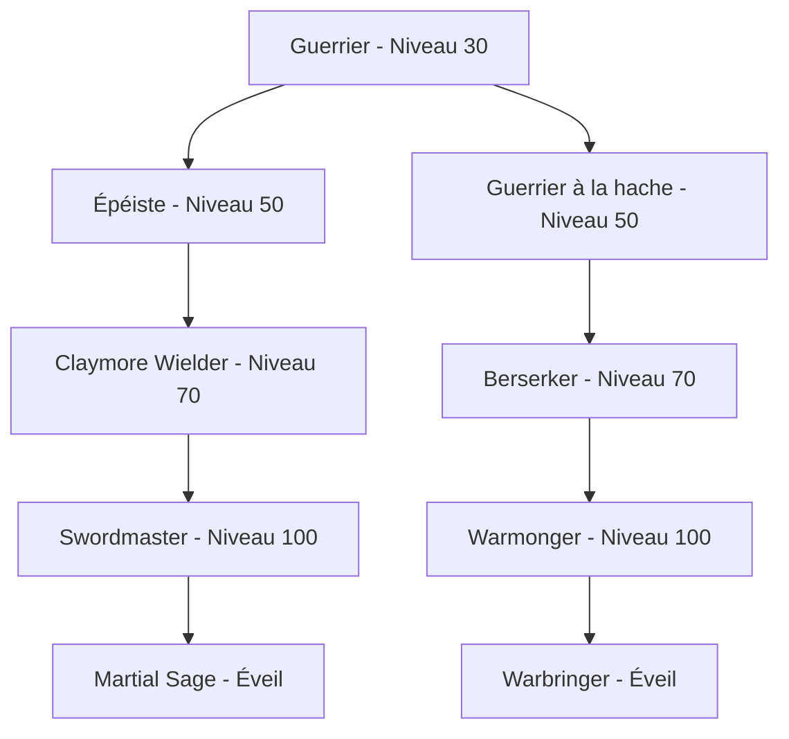
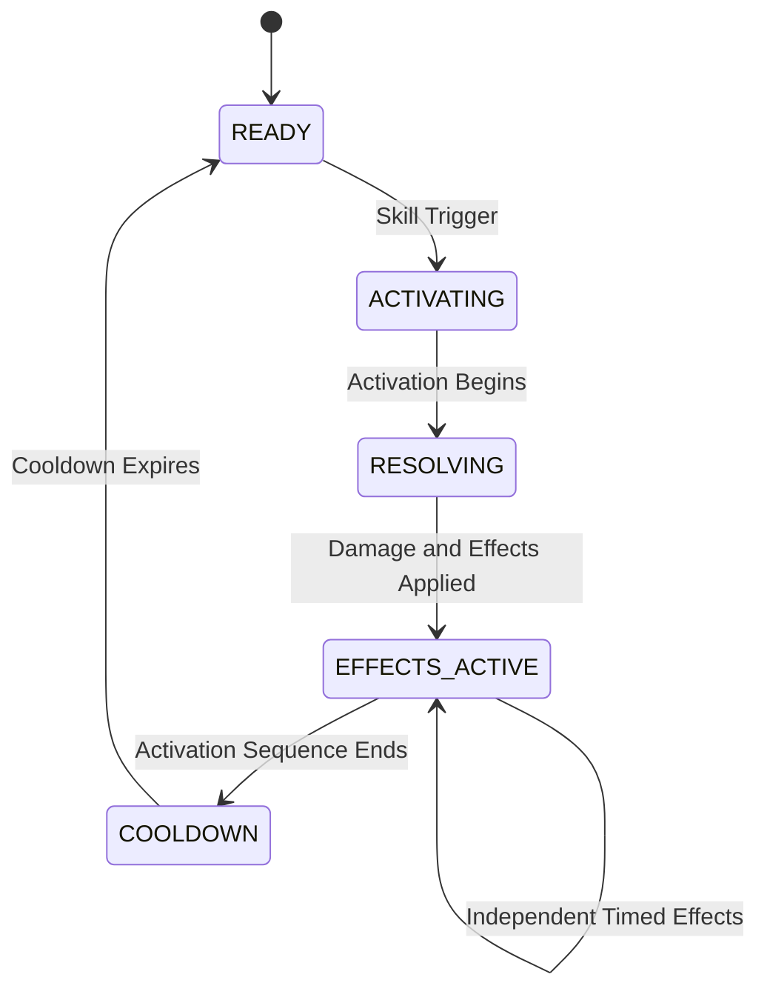

# Chapitre 12 — Classes, spécialisations, compétences et Éveils

**Autorité :** décisions expressément approuvées dans la conversation source. Les modèles obsolètes sont remplacés par les rectifications ultérieures ; les paramètres provisoires restent provisoires.

**Statut du chapitre :** `functionally_specified` pour ses spécifications validées ; aucune exécution de test ou implémentation ne découle de ce statut.

**Traçabilité :** 31 décision(s) du propriétaire. Toutes les références `Txxx` renvoient à `references/HISTORIQUE_SOURCE_ORIGINAL.md`.


## Registre détaillé des décisions approuvées


### SYS-002.D.12.1 · T113 · 20/11/2026 21:10:02

**Nature :** `EXIGENCE_OU_RECTIFICATION_PROPRIETAIRE` · **Ligne d’approbation source :** 35560 · **Ligne de formalisation :** 35565.

**Décision / prescription originale (texte intégral du propriétaire) :**

Je souhaite rester assez fidèle avec l'originale mais tout en nous laissant libre de modifier certaines mécaniques si nécessaire ou plus cohérent.


<details><summary>Formalisation technique de la décision ratifiée (extrait sourcé)</summary>

# SYS-002.D.12.1 - Design Philosophy &amp; Fidelity Policy

(VALIDÉ - `faithful_adaptive`)

Nous retenons donc une approche de **reproduction fidèle avec adaptation contrôlée**.

L'objectif est de retrouver l'expérience, les mécaniques et la logique de progression de *Legend of Mushroom*, tout en construisant un jeu techniquement cohérent, maintenable et équilibré.

Nous ne chercherons ni à reproduire aveuglément chaque détail, ni à réinventer le jeu.

## 1. Règles de conception désormais adoptées

Je distingue trois catégories.

| Catégorie | Traitement |
|--------|--------|
| `faithful` | Reproduction du fonctionnement original lorsqu'il est suffisamment documenté |
| `adaptive` | Modification contrôlée lorsqu'une mécanique peut être améliorée ou simplifiée sans dénaturer l'expérience |
| `original` | Nouvelle mécanique lorsque le projet nécessite une fonctionnalité absente de l'original |

### 1.1 Conditions d'adaptation

Une modification ne sera jamais introduite silencieusement.

Chaque adaptation devra documenter :

1. Le fonctionnement original.
2. Le problème identifié.
3. La modification proposée.
4. La justification technique ou ludique.
5. Les systèmes impactés.
6. Les conséquences sur l'équilibrage.
7. La décision de validation.

Nous conserverons également une distinction entre quatre niveaux de fiabilité des informations :

- `verified` : observé directement en jeu ou confirmé par une source fiable.
- `reported` : information communiquée par toi, mais pas encore vérifiée indépendamment.
- `inferred` : déduction à partir des mécaniques connues.
- `designed` : décision propre à notre projet.

Cette distinction est particulièrement importante pour les tables mathématiques que nous avons déjà construites. Les profils numériques provisoires resteront `designed` jusqu'à leur calibration.

---

# 2. Premier état des lieux du jeu original

J'ai également commencé à confronter les informations disponibles sur les classes et la progression actuelle du jeu.

Un point mérite notre attention : les guides publics ne sont pas tous cohérents.

### 2.1 Progression du personnage rapportée

Un guide actualisé en novembre 2026 rapporte notamment les jalons suivants : \[[Legend of Mushroom Leveling Guide](https://www.mmodude.com/leveling-guides/legend-of-mushroom-leveling-guide/?utm_source=chatgpt.com); [Classes Legend of Mushroom : guide complet](https://mobi.gg/fr/astuces/classes-legend-of-mushroom/?utm_source=chatgpt.com)\]

| Niveau | Évolution rapportée |
|--------|--------|
| 1-14 | Champignon initial |
| 15 | Première évolution : Aventurier |
| 30 | Choix de classe principale |
| 50 | Choix d'une branche |
| 70 | Évolution supplémentaire |
| 100 | Nouvelle évolution et Éveil |
| 120+ | Progression avancée et Ascension de classe |

Le même guide rapporte un plafond de niveau 220. Ce point devra être vérifié en jeu avant d'étendre notre calibration statistique, actuellement limitée au niveau 200. \[[Legend of Mushroom Leveling Guide](https://www.mmodude.com/leveling-guides/legend-of-mushroom-leveling-guide/?utm_source=chatgpt.com)\]

Autre élément important : l'expérience du personnage provient principalement de la vente des équipements inutilisés obtenus avec la Lampe Magique, et non de l'élimination des monstres. Cela devra être intégré dans le Character Progression Engine. \[[Legend of Mushroom Leveling Guide](https://www.mmodude.com/leveling-guides/legend-of-mushroom-leveling-guide/?utm_source=chatgpt.com)\]

### 2.2 Arbre des classes : une ambiguïté à résoudre
[](https://www.bluestacks.com/ko/blog/game-guides/legend-of-the-mushroom-brave-3000-free-draws/lmbf-beginner-guide-ko.html)

[](https://guiadojogo.com/legend-of-mushroom-classes/)

[](https://www.pocketgamer.com/legend-of-mushroom/best-builds/)

[](https://www.pocketgamer.com/legend-of-mushroom/guide/)

[](https://twinfinite.net/guides/maple-rush-tier-list-best-classes/)

[](https://en.18183.com/4408383.html)

[](https://www.breakflip.com/guides/25939.html)

Les sources présentent une divergence :

- Certains guides décrivent trois classes principales : Guerrier, Archer et Mage.
- D'autres présentent également le Dompteur d'Âmes / Spirit Channeler comme quatrième branche principale. \[[Classes Legend of Mushroom : guide complet](https://mobi.gg/fr/astuces/classes-legend-of-mushroom/?utm_source=chatgpt.com); [Legend of Mushroom Class Guide :: Final Hive](https://finalhive.com/legend-of-mushroom/guides/class-guide?utm_source=chatgpt.com); [Legend of Mushroom Leveling Guide](https://www.mmodude.com/leveling-guides/legend-of-mushroom-leveling-guide/?utm_source=chatgpt.com)\]

Nous ne devons pas figer arbitrairement l'une de ces versions.

Notre architecture permettra donc d'ajouter ou de retirer des branches sans modifier le fonctionnement interne du moteur.

Par ailleurs, le jeu dispose de systèmes avancés d'Ascension et de Fusion de classes, qui ajoutent notamment des passifs et des compétences supplémentaires. Nous devrons les inclure dans notre périmètre de conception, même si leur implémentation intervient plus tard. \[[Class Ascension — Legend of Mushroom](https://guidesbygrace.uk/class-ascension?utm_source=chatgpt.com)\]

---

# 3. Nouveau système : Character Progression &amp; Class Engine

Je propose de séparer ce domaine en quatre sous-moteurs.

**SYS-002.D.12 - Character Systems**

**12.1 - Character Progression Engine**

Niveau, expérience, évolution, plafonds et conditions de déblocage.

**12.2 - Class Evolution Engine**

Classes, branches, évolutions, spécialisations et ascensions.

**12.3 - Character Attribute Engine**

Statistiques fondamentales, dérivées et agrégation des bonus.

**12.4 - Skill &amp; Loadout Engine**

Compétences actives, passives, équipements de compétences et préréglages.

Ces quatre moteurs alimenteront ensuite le Combat Engine.

## 4. Ordre de travail proposé

Je souhaite commencer par le Character Progression Engine, avant de détailler les classes.

Pourquoi ?

Parce que les classes sont conditionnées par la progression du personnage. Il faut donc connaître précisément les niveaux d'évolution, les conditions de déblocage et les mécanismes d'expérience avant de construire l'arbre de classes.

Nous suivrons ce protocole :

1. Reconstituer la progression originale.
2. Définir les données et les formules.
3. Identifier les éventuelles divergences entre sources.
4. Formaliser les contrats mathématiques.
5. Te soumettre les décisions structurantes.
6. Valider le système avant de passer au suivant.

La campagne principale sera spécifiée après les systèmes de personnage, de compétences, de combat et d'ennemis. Elle sera ensuite intégrée à l'ensemble, sans être oubliée.

---

# 5. Première collecte d'informations

Pour éviter de construire une architecture sur des informations contradictoires, j'aimerais commencer par l'écran d'évolution du personnage.

**Peux-tu me transmettre une capture d'écran de ton écran Classe / Évolution dans Legend of Mushroom ?**

Idéalement, une capture montrant les classes disponibles et les prochains paliers d'évolution.

Cela nous permettra de prendre ton client de jeu comme référence principale, puis de compléter les informations manquantes avec les sources documentaires.

Nous ne commencerons pas le développement Unity avant d'avoir terminé cette phase de conception globale.

</details>


### SYS-002.D.12.2 · T114 · 20/11/2026 23:05:07

**Nature :** `EXIGENCE_OU_RECTIFICATION_PROPRIETAIRE` · **Ligne d’approbation source :** 35768 · **Ligne de formalisation :** 35837.

**Décision / prescription originale (texte intégral du propriétaire) :**

Je n'ai pas de capture d'écran, le rendu est pas assez clair et compréhensible.

Je vais faire un listing des différentes informations :

Dans *Legend of Mushroom*, **tous les joueurs débutent en tant que Champignon (*Shroomie*) au niveau 1, évoluent en Aventurier (*Adventurer*) au niveau 15, puis choisissent au niveau 30 l'une des 4 classes principales** (Combattant/Guerrier, Archer, Mage ou Dompteur/Channeler), chacune se divisant en deux branches spécialisées au niveau 50 jusqu'à l'**Éveil** (et la Transcendance en très haut niveau). [[1](https://www.bluestacks.com/blog/game-guides/legend-of-the-mushroom-brave-3000-free-draws/lotmb-classes-guide-en.html), [2](https://mobi.gg/en/tips/legend-of-mushroom-class/), [3](https://www.youtube.com/watch?v=NagLq0be1SY\&t=1)]

Voici l'arbre complet des classes et de leurs évolutions successives (Niveaux 30 → 50 → 70 → 100 → Éveil) : [[1](https://www.bluestacks.com/blog/game-guides/legend-of-the-mushroom-brave-3000-free-draws/lotmb-classes-guide-en.html)]

**1. Branche Combattant / Guerrier (*Warrior*) — Mêlée, PV et Contre-attaque**

- **Niveau 30 :** Combattant / Guerrier (*Warrior*) [[1](https://www.bluestacks.com/blog/game-guides/legend-of-the-mushroom-brave-3000-free-draws/lotmb-classes-guide-en.html), [2](https://mobi.gg/fr/astuces/classes-legend-of-mushroom/)]
- **Branche A (Défense, boucliers et résistance) :**
  - **Niveau 50 :** Épéiste (*Swordsman*)
  - **Niveau 70 :** Porteur de Claymore / Grand Maître de l'Épée (*Claymore Wielder*)
  - **Niveau 100 :** Maître d'armes / Tête de l'Épée (*Swordmaster*)
  - **Éveil :** Saint Martial (*Martial Sage*) [[1](https://www.bluestacks.com/blog/game-guides/legend-of-the-mushroom-brave-3000-free-draws/lotmb-classes-guide-en.html), [2](https://mobi.gg/fr/astuces/classes-legend-of-mushroom/)]
- **Branche B (Dégâts bruts et contre-attaque) :**
  - **Niveau 50 :** Guerrier à la hache / Samouraï à la hache (*Axe Warrior*)
  - **Niveau 70 :** Berserker (*Berserker*)
  - **Niveau 100 :** Belliciste / Seigneur de guerre (*Warmonger*)
  - **Éveil :** Porteur de guerre / Divin (*Warbringer*) [[1](https://www.bluestacks.com/blog/game-guides/legend-of-the-mushroom-brave-3000-free-draws/lotmb-classes-guide-en.html), [2](https://mobi.gg/fr/astuces/classes-legend-of-mushroom/), [3](https://mobi.gg/en/tips/legend-of-mushroom-class/)]

**2. Branche Archer (*Archer*) — Distance, Combo et Coups Critiques**

- **Niveau 30 :** Archer (*Archer*) [[1](https://www.bluestacks.com/blog/game-guides/legend-of-the-mushroom-brave-3000-free-draws/lotmb-classes-guide-en.html)]
- **Branche A (Coups critiques et rafales à l'arc) :**
  - **Niveau 50 :** Tireur d'ombre (*Shadow Sniper*)
  - **Niveau 70 :** Tireur d'élite (*Sharpshooter / Marksman*)
  - **Niveau 100 :** Chasseur d'ombre (*Shadowhunter*)
  - **Éveil :** Chasseur sacré (*Sacred Hunter*) [[1](https://www.bluestacks.com/blog/game-guides/legend-of-the-mushroom-brave-3000-free-draws/lotmb-classes-guide-en.html), [2](https://www.bluestacks.com/fr/blog/game-guides/legend-of-the-mushroom-brave-3000-free-draws/lotmb-tier-list-fr.html), [3](https://mobi.gg/en/tips/legend-of-mushroom-class/), [4](https://www.bluestacks.com/fr/blog/game-guides/legend-of-the-mushroom-brave-3000-free-draws/lotmb-classes-guide-fr.html)]
- **Branche B (Vitesse d'attaque et combos à l'arbalète) :**
  - **Niveau 50 :** Arbalétrier du vent (*Wind Crossbower*)
  - **Niveau 70 :** Double arbalétrier (*Dual Crossbower*)
  - **Niveau 100 :** Dieu des flèches (*Arrowgod*)
  - **Éveil :** Monarque des panaches (*Plume Monarch*) [[1](https://www.bluestacks.com/blog/game-guides/legend-of-the-mushroom-brave-3000-free-draws/lotmb-classes-guide-en.html), [2](https://www.bluestacks.com/fr/blog/game-guides/legend-of-the-mushroom-brave-3000-free-draws/lotmb-tier-list-fr.html), [3](https://www.bluestacks.com/fr/blog/game-guides/legend-of-the-mushroom-brave-3000-free-draws/lotmb-classes-guide-fr.html)]

**3. Branche Mage (*Mage*) — Compétences, Étourdissement et Soins**

- **Niveau 30 :** Mage (*Mage*) [[1](https://www.bluestacks.com/blog/game-guides/legend-of-the-mushroom-brave-3000-free-draws/lotmb-classes-guide-en.html)]
- **Branche A (Contrôle, étourdissement et régénération) :**
  - **Niveau 50 :** Guérisseur (*Healer*)
  - **Niveau 70 :** Chronomancien (*Chronomancer*)
  - **Niveau 100 :** Guide sacré (*Holy Guide*)
  - **Éveil :** Prophète (*Prophet*) [[1](https://www.bluestacks.com/blog/game-guides/legend-of-the-mushroom-brave-3000-free-draws/lotmb-classes-guide-en.html), [2](https://www.bluestacks.com/fr/blog/game-guides/legend-of-the-mushroom-brave-3000-free-draws/lotmb-tier-list-fr.html)]
- **Branche B (Dégâts critiques de compétences) :**
  - **Niveau 50 :** Lanceur de sorts (*Spellcaster*)
  - **Niveau 70 :** Prêtre des tempêtes (*Storm Priest*)
  - **Niveau 100 :** Évêque (*Bishop*)
  - **Éveil :** Seigneur des ténèbres (*Darklord*) [[1](https://www.bluestacks.com/blog/game-guides/legend-of-the-mushroom-brave-3000-free-draws/lotmb-classes-guide-en.html)]

**4. Branche Dompteur / Canaliseur d'esprits (*Spirit Channeler*) — Dégâts d'acolytes**

- **Niveau 30 :** Canaliseur d'esprits (*Spirit Channeler*) [[1](https://www.bluestacks.com/blog/game-guides/legend-of-the-mushroom-brave-3000-free-draws/lotmb-classes-guide-en.html)]
- **Branche A (Renforcement des acolytes et vitesse) :**
  - **Niveau 50 :** Dompteur de bêtes (*Beast Tamer*)
  - **Niveau 70 :** Chasseur d'âmes (*Soul Hunter*)
  - **Niveau 100 :** Maître des âmes animales (*Beastsoul Master*)
  - **Éveil :** Maître des bêtes (*Beastmaster*) [[1](https://www.bluestacks.com/blog/game-guides/legend-of-the-mushroom-brave-3000-free-draws/lotmb-classes-guide-en.html)]
- **Branche B (Invocations et dégâts sur la durée) :**
  - **Niveau 50 :** Mage squelette (*Skeleton Mage*)
  - **Niveau 70 :** Berger des esprits (*Spirit Shepherd*)
  - **Niveau 100 :** Maître nécromancien (*Necro Master*)
  - **Éveil :** Esprit suprême (*Supreme Spirit*) [[1](https://www.bluestacks.com/blog/game-guides/legend-of-the-mushroom-brave-3000-free-draws/lotmb-classes-guide-en.html)]

*(Note : Vous pouvez changer librement de classe et d'évolution à tout moment en jeu moyennant **4 000 diamants**, ce qui permet par exemple de monter avec un Mage en début de partie avant de basculer vers un Archer ou un Guerrier à haut niveau).* [[1](https://www.allclash.com/the-best-class-for-you-in-legend-of-mushroom/), [2](https://www.youtube.com/watch?v=B1xrmB_Sfhc)]


<details><summary>Formalisation technique de la décision ratifiée (extrait sourcé)</summary>

# SYS-002.D.12.2 - Character Class &amp; Evolution System

(Arbre des classes intégré au GDD)

Les informations fournies permettent de définir précisément la structure des classes de notre RPG. J'ai également recoupé les principales branches avec les guides BlueStacks, Mobi.gg et AllClash : les quatre archétypes, leurs spécialisations et leurs évolutions sont cohérents avec les descriptions disponibles. \[[Legend of Mushroom Class Guide – Learn About all the Evolutions](https://www.bluestacks.com/blog/game-guides/legend-of-the-mushroom-brave-3000-free-draws/lotmb-classes-guide-en.html?utm_source=chatgpt.com); [Legend of Mushroom classes: complete guide](https://mobi.gg/en/tips/legend-of-mushroom-class/?utm_source=chatgpt.com); [The Best Class (For You) in Legend of Mushroom](https://www.allclash.com/THE-BEST-CLASS-FOR-YOU-IN-LEGEND-OF-MUSHROOM/?utm_source=chatgpt.com)\]

Nous conserverons les appellations anglaises comme références documentaires, mais **les identifiants internes seront indépendants des noms affichés**. Nous pourrons ainsi renommer les classes dans notre univers original.

Une correction de mon précédent état des lieux : les mécaniques de combat, notamment les dégâts, les critiques, les combos, le scheduling, les effets temporaires et les acolytes, ont déjà fait l'objet de spécifications approfondies dans `SYS-002.D.1` à `D.10`. Il reste surtout à les relier aux classes et à préciser les compétences propres à chaque spécialisation.

## 1. SYS-002.D.12.2.1 - Character Evolution Milestones

Nous retenons les paliers suivants :

1. **Niveau 1 - Champignon**
   
   Classe initiale commune : `SHROOMIE`.
2. **Niveau 15 - Aventurier**
   
   Première évolution commune : `ADVENTURER`.
3. **Niveau 30 - Choix d'archétype**
   
   Guerrier, Archer, Mage ou Canaliseur d'esprits.
4. **Niveau 50 - Spécialisation**
   
   Deux branches possibles par archétype, soit huit voies.
5. **Niveau 70 - Deuxième évolution**
   
   Progression dans la spécialisation choisie.
6. **Niveau 100 - Troisième évolution**
   
   Nouvelle forme et nouvelles capacités.
7. **Éveil - Awakening**
   
   Forme évoluée de chaque spécialisation. Les conditions exactes d'accès seront spécifiées séparément.
8. **Progression avancée - Transcendance / Ascension**
   
   Systèmes distincts à documenter, sans supposer qu'ils constituent simplement un niveau supplémentaire du même arbre.

Le niveau du personnage débloque les possibilités d'évolution, mais nous ne supposons pas encore que chaque évolution s'effectue automatiquement sans intervention du joueur.

---

## 2. SYS-002.D.12.2.2 - Référentiel complet des classes

Nous définissons quatre archétypes principaux et huit spécialisations finales.

[](https://www.linkedin.com/posts/laurataranto_gamedev-mobilegames-legendofmushroom-activity-7191820934394044416-tJbi)

**Guerrier - `WARRIOR`**

Mêlée · PV · Défense · Contre-attaque

| Palier | Branche A | Branche B |
|--------|--------|--------|
| 50 | Épéiste | Guerrier à la hache |
| 70 | Claymore Wielder | Berserker |
| 100 | Swordmaster | Warmonger |
| Éveil | Martial Sage | Warbringer |

---

[](https://www.niaogebiji.com/article-674989-1.html)

**Archer - `ARCHER`**

Distance · Combo · Critique · Vitesse d'attaque

| Palier | Branche A | Branche B |
|--------|--------|--------|
| 50 | Shadow Sniper | Wind Crossbower |
| 70 | Sharpshooter | Dual Crossbower |
| 100 | Shadowhunter | Arrowgod |
| Éveil | Sacred Hunter | Plume Monarch |

---

[](https://guiadojogo.com/legend-of-mushroom-classes/)

**Mage - `MAGE`**

Compétences · Contrôle · Étourdissement · Soins

| Palier | Branche A | Branche B |
|--------|--------|--------|
| 50 | Healer | Spellcaster |
| 70 | Chronomancer | Storm Priest |
| 100 | Holy Guide | Bishop |
| Éveil | Prophet | Darklord |

---

[](https://x.com/legendofmush/status/1830563824124231922)

**Canaliseur d'esprits - `SPIRIT_CHANNELER`**

Acolytes · Invocations · Renforcement · Effets spéciaux

| Palier | Branche A | Branche B |
|--------|--------|--------|
| 50 | Beast Tamer | Skeleton Mage |
| 70 | Soul Hunter | Spirit Shepherd |
| 100 | Beastsoul Master | Necro Master |
| Éveil | Beastmaster | Supreme Spirit |

Les huit spécialisations ont désormais chacune un chemin d'évolution déterminé après le choix effectué au niveau 50.

Le catalogue comprend donc **38 nœuds d'évolution** : deux formes communes, quatre archétypes et huit nœuds à chacun des quatre paliers spécialisés (50, 70, 100 et Éveil).

---

# 3. SYS-002.D.12.2.3 - Class Evolution Engine

La structure des classes doit être définie à partir de données configurables, et non d'une succession de conditions codées en dur.

### Modèle métier proposé

```text
ClassDefinition
├── ClassId
├── ParentClassId
├── ArchetypeId
├── SpecializationId
├── EvolutionTier
├── MinimumCharacterLevel
├── AdditionalUnlockConditions[]
├── ClassTags[]
├── GrantedPassiveEffectIds[]
├── GrantedActiveSkillIds[]
├── AttributeModifiers[]
├── CapabilityModifiers[]
└── PresentationId
```

Chaque classe possède un parent explicite.

Cela permettra au moteur de reconstruire une lignée complète, par exemple :



Le même schéma s'appliquera aux trois autres archétypes.

### Règles proposées

| ID | Contrat |
|--------|--------|
| CLASS-EVO-001 | Une seule classe principale active |
| CLASS-EVO-002 | Une seule spécialisation active |
| CLASS-EVO-003 | Évolution uniquement vers un descendant autorisé |
| CLASS-EVO-004 | Vérification des prérequis avant transition |
| CLASS-EVO-005 | Persistance de la lignée choisie |
| CLASS-EVO-006 | Aucun nouveau tirage des équipements lors d'une évolution |
| CLASS-EVO-007 | Recalcul des caractéristiques après changement |
| CLASS-EVO-008 | Compétences et passifs attribués par leurs définitions |
| CLASS-EVO-009 | Éveil géré par une condition distincte du simple niveau |

*Note d'ingénierie : le choix au niveau 50 constitue un embranchement structurel. Les évolutions suivantes référencent la branche choisie, ce qui évite des combinaisons de classes incompatibles.*

---

# 4. SYS-002.D.12.2.4 - Class Skills &amp; Passive Effects

C'est désormais **notre principal chantier de conception**.

Les classes ne doivent pas se réduire à des multiplicateurs de statistiques. Elles modifient aussi les règles du combat.

Les guides distinguent les compétences actives propres aux classes et des passifs qui apparaissent à différents paliers. Certains effets peuvent être débloqués à des niveaux intermédiaires, sans changement du nom de classe. \[[Legend of Mushroom classes: complete guide](https://mobi.gg/en/tips/legend-of-mushroom-class/?utm_source=chatgpt.com); [The Latest Legend Of Mushroom Leaks](https://theriagames.com/guide/legend-of-mushroom-leaks/?utm_source=chatgpt.com)\]

Nous devrons donc modéliser séparément :

| Élément | Responsabilité |
|--------|--------|
| `ClassActiveSkill` | Compétence automatique propre à la classe |
| `ClassPassiveEffect` | Effet permanent ou conditionnel |
| `ClassLevelUnlock` | Déblocage à un niveau donné |
| `ClassEvolution` | Changement de forme ou de spécialisation |
| `AwakeningEffect` | Amélioration liée à l'Éveil |
| `ClassCapabilityModifier` | Modification d'une règle du jeu |

### Exemples d'intégration

Le Guerrier pourra attribuer des bonus de contre-attaque, de résistance ou de bouclier au Modifier Engine.

L'Archer pourra modifier les caractéristiques de combo, de critique ou les événements d'attaque normale.

Le Mage pourra agir sur les compétences, leurs dégâts, leurs critiques, l'étourdissement et la régénération.

Le Canaliseur d'esprits pourra modifier les dégâts des acolytes, leur vitesse d'attaque, leurs effets de déploiement ou leur capacité d'équipe.

**Les effets exacts et leurs valeurs ne sont pas encore validés.** Nous les documenterons classe par classe, en distinguant les passifs permanents des compétences temporaires.

---

## 5. Point architectural découvert : le sixième emplacement d'acolyte

(Révision nécessaire de SYS-002.D.9)

Cette nouvelle étude révèle une interaction importante avec notre Acolyte Engine.

Nous avions initialement défini cinq emplacements d'acolytes.

Or, le Canaliseur d'esprits bénéficie d'un emplacement supplémentaire selon Mobi.gg et les descriptions de l'introduction de cette classe. \[[Legend of Mushroom classes: complete guide](https://mobi.gg/en/tips/legend-of-mushroom-class/?utm_source=chatgpt.com); [The Latest Legend Of Mushroom Leaks](https://theriagames.com/guide/legend-of-mushroom-leaks/?utm_source=chatgpt.com)\]

Nous devons donc remplacer la constante de capacité par une règle dynamique.

### Contrat proposé

$$
MaxPalSlots=BasePalSlots+ClassBonusSlots
$$

Avec :

$$
BasePalSlots=5
$$

Et, pour le Canaliseur d'esprits :

$$
ClassBonusSlots=1
$$

Le résultat serait donc six emplacements.

Les autres classes conserveraient cinq emplacements, sauf bonus explicite supplémentaire.

Cette règle doit être traitée comme une **révision de capacité de déploiement**, pas comme une modification du catalogue des acolytes ni de leur progression individuelle.

*Note d'ingénierie : la taille de l'équipe ne doit pas être codée en dur dans le Pal Scheduler. Le scheduler doit itérer sur les emplacements effectivement actifs, quelle que soit leur quantité.*

Un changement de classe devra également gérer le cas où un personnage passe de six emplacements actifs à cinq, sans détruire l'acolyte précédemment équipé.

---

# 6. SYS-002.D.12.2.5 - Class Switching System

(Contrat initial établi)

Le changement de classe pour **4 000 diamants** est documenté par plusieurs guides. Le personnage conserve son niveau général, tandis que sa progression de classe est réinitialisée afin de sélectionner un nouveau chemin d'évolution. \[[Legend of Mushroom reroll guide: change class easily\!](https://mobi.gg/en/tips/legend-of-mushroom-reroll-guide/?utm_source=chatgpt.com); [Legend Of Mushroom Best Class Guide](https://theriagames.com/guide/legend-of-mushroom-best-class-guide/?utm_source=chatgpt.com); [Question about changing classes : r/LegendOfMushroomGame](https://www.reddit.com/r/LegendOfMushroomGame/comments/1f7365a/question_about_changing_classes/?utm_source=chatgpt.com)\]

### Fonctionnement cible

| Paramètre | Règle |
|--------|--------|
| Changement de classe | Autorisé |
| Coût de référence | 4 000 diamants |
| Niveau du personnage | Conservé |
| Expérience du personnage | Conservée |
| Inventaire d'équipements | Conservé |
| Collection d'acolytes | Conservée |
| Compétences possédées | Conservées |
| Classe active | Remplacée |
| Branche de spécialisation | À sélectionner de nouveau |
| Bonus de classe | Recalculés |
| Investissements d'Éveil | Règle de remboursement à préciser |

Les joueurs rapportent notamment que les ressources investies dans certains niveaux d'Éveil peuvent être remboursées lors d'un changement de classe. Cette règle nécessite encore une validation spécifique avant d'être intégrée à notre économie. \[[Question about changing classes : r/LegendOfMushroomGame](https://www.reddit.com/r/LegendOfMushroomGame/comments/1f7365a/question_about_changing_classes/?utm_source=chatgpt.com)\]

### Contrat transactionnel

Un changement de classe doit être atomique : le joueur ne peut pas perdre les diamants sans que le changement soit enregistré.

Le moteur devra également invalider les anciens effets de classe et reconstruire les bonus de la nouvelle lignée. Cela évitera les cumuls incorrects de passifs après plusieurs changements de spécialisation.

---

# 7. Impact sur les autres systèmes du GDD

| Système existant | Impact |
|--------|--------|
| Character Progression | Déblocages aux niveaux 15, 30, 50, 70 et 100 |
| Modifier Engine | Nouveaux modificateurs de classe |
| Combat Scheduler | Capacités actives propres aux classes |
| Acolyte Engine | Capacité potentielle de six emplacements |
| Skill Engine | Compétences actives et passives propres aux classes |
| Equipment Engine | Affixes inchangés, pertinence différente selon la classe |
| Economy Engine | Coût de changement de classe |
| Loadout Engine | Préréglages liés aux spécialisations |
| Adventure Campaign | Difficulté équilibrée selon les classes |
| Save System | Persistance des choix et évolutions |

Nous conserverons une seule définition des attributs dans le Character Attribute Engine. Les classes, les équipements et les acolytes contribueront à ce modèle commun.

---

# 8. État de validation du Character Class System

| Sous-système | État |
|--------|--------|
| Champignon → Aventurier | Documenté |
| Quatre archétypes | Documentés |
| Huit spécialisations | Documentées |
| Évolutions niveau 70 et 100 | Documentées |
| Formes d'Éveil | Répertoriées |
| Compétences actives | À détailler |
| Compétences passives | À détailler |
| Conditions d'Éveil | À déterminer |
| Transcendance / Ascension | À étudier |
| Changement de classe | Contrat initial défini |
| Bonus de sixième acolyte | À confirmer dans le GDD |

---

</details>


### SYS-002.D.12.3 · T115 · 21/11/2026 17:09:43

**Nature :** `EXIGENCE_OU_RECTIFICATION_PROPRIETAIRE` · **Ligne d’approbation source :** 36209 · **Ligne de formalisation :** 36249.

**Décision / prescription originale (texte intégral du propriétaire) :**

Dans *Legend of Mushroom*, **la branche Guerrier (*Warrior*) repose sur une compétence active de classe évolutive (qui inflige des dégâts de zone et amplifie la contre-attaque sur les ennemis touchés) ainsi que sur l'empilement progressif de 5 compétences passives aux paliers 30, 50, 70 et 100, culminant avec l'Éveil**.

---

**1. Évolution de la Compétence Active de Classe**

Contrairement aux 5 emplacements de compétences invocables au gacha, la compétence active propre à votre classe s'améliore automatiquement à chaque promotion :

- **Niveau 30 (Combattant / Guerrier) :** Inflige des dégâts physiques de zone (AoE) devant vous et augmente légèrement les dégâts subis par les cibles.
- **Niveaux 50, 70 et 100 (Épéiste → Maître d'armes / Guerrier à la hache → Belliciste) :** Le multiplicateur de dégâts de zone augmente à chaque palier, et la compétence applique un débuff de **5 secondes** qui augmente les **dégâts de contre-attaque subis par les ennemis à portée de +60 %** (ou réduit leur résistance aux dégâts de contre-attaque de 40 % selon les équilibrages de patch), comme détaillé sur [**BlueStacks**](https://www.bluestacks.com/fr/blog/game-guides/legend-of-the-mushroom-brave-3000-free-draws/lotmb-classes-guide-fr.html).
- **Éveil – Branche Tank (*Saint Martial / Martial Sage*) :** La durée du débuff de contre-attaque passe de 5 à **8 secondes**, chaque contre-attaque inflige des dégâts bonus basés sur les PV actuels de la cible, et vous régénérez continuellement **15 % de vos PV max pendant 5 secondes**.
- **Éveil – Branche DPS (*Porteur de guerre / Warbringer*) :** La durée du débuff passe également à **8 secondes**, et pendant **5 secondes**, vos contre-attaques **projettent les cibles dans les airs** (interrompant leurs actions) tout en convertissant une partie de votre Défense en Attaque et inversement.

---

**2. Progression des Compétences Passives par Palier**

À chaque changement de rang, votre personnage conserve ses passifs précédents et débloque un nouveau passif permanent (pour un total de **5 passifs actifs simultanément** au niveau 100) :

**Tronc commun (Niveau 30)**

- **Passif 1 (Combattant) :** Augmente le **taux de contre-attaque** de base (+15 % à +30 %) et les **dégâts de contre-attaque** (+30 %).

**Branche A — Tank, Boucliers et Survie (*Épéiste → Claymore → Maître d'armes → Saint Martial*)**

- **Niveau 50 (*Épéiste*) :** **Passif 2** — Augmente la **Défense globale de +30 %**.
- **Niveau 70 (*Porteur de Claymore*) :** **Passif 3** — Octroie une **réduction des dégâts subis de +15 %** en permanence.
- **Niveau 100 (*Maître d'armes / Swordmaster*) :** **Passifs 4 et 5** — Restaure automatiquement **8 % des PV max toutes les 5 secondes** et génère toutes les 10 secondes un **bouclier absorbant 8 % des PV max pendant 5 secondes** (comme analysé dans les guides de build sur [**YouTube**](https://www.youtube.com/watch?v=bAHltPlzOlM)).
- **Éveil (*Saint Martial*) :** Renforce l'ensemble des statistiques de survie (PV, Défense, Résistance critique) et amplifie les soins et boucliers générés.

**Branche B — Dégâts Bruts et Contre-attaque (*Guerrier à la hache → Berserker → Belliciste → Porteur de guerre*)**

- **Niveau 50 (*Guerrier à la hache*) :** **Passif 2** — Augmente l'**Attaque globale** et la **Défense** de base.
- **Niveau 70 (*Berserker*) :** **Passif 3** — Octroie un **bonus d'Attaque proportionnel aux PV manquants** (environ +3 % d'ATQ pour chaque tranche de 10 % de PV perdus), transformant les fins de combat en rafales dévastatrices.
- **Niveau 100 (*Belliciste / Warmonger*) :** **Passifs 4 et 5** — Augmente massivement le **multiplicateur de dégâts de contre-attaque**, renforce la Défense et ajoute un bonus de dégâts supplémentaires lorsque vos PV passent sous un certain seuil, comme détaillé dans les builds sur [**YouTube**](https://www.youtube.com/watch?v=pfHjIFNRC9c).
- **Éveil (*Porteur de guerre / Warbringer*) :** Débloque la synergie d'éveil convertissant mutuellement l'Attaque et la Défense lors de l'activation de la compétence de classe.


<details><summary>Formalisation technique de la décision ratifiée (extrait sourcé)</summary>

# SYS-002.D.12.3 - Warrior Class Specification

(Architecture de classe formalisée)

Les informations permettent de définir les deux spécialisations du Guerrier, leurs compétences de classe, leurs effets passifs et leurs interactions avec les moteurs de combat déjà spécifiés.

**Un point important ressort de la vérification des sources : certaines valeurs et certains niveaux de déblocage diffèrent entre les guides.** Nous allons donc conserver ton référentiel comme base de conception, tout en distinguant les mécaniques confirmées des paramètres qui nécessitent un arbitrage.

## 1. Identité et progression du Guerrier

[](https://game-head.com/en/legend-of-mushroom-warrior-build-guide-for-martial-sage-warbringer/)

**Branche A - Martial Sage**

Tank · Défense · Boucliers · Régénération · Contre-attaque

[](https://www.talkandroid.com/449338-best-builds-legend-of-mushroom/)

**Branche B - Warbringer**

DPS · Contre-attaque · Dégâts croissants · Contrôle

### Arbre d'évolution



Le Guerrier repose sur trois mécanismes centraux : **survivre aux attaques, déclencher des contre-attaques et augmenter leur efficacité**.

Les deux branches utilisent les mêmes systèmes de base mais privilégient des stratégies différentes.

---

## 2. Audit documentaire : divergences détectées

Les différences observées ne sont pas seulement terminologiques.

| Mécanique | Informations fournies | Autres sources |
|--------|--------|--------|
| Débuff de compétence | \+60 % de dégâts de contre-attaque subis | Certains guides indiquent -40 % de résistance aux contre-attaques |
| Régénération Tank | 8 % des PV max toutes les 5 s | Mobi.gg indique 4 % toutes les 5 s |
| Bouclier Tank | 8 % des PV max toutes les 10 s | Plusieurs guides indiquent 5 % des PV max |
| Passif de défense | \+15 % de réduction des dégâts | D'autres sources indiquent +10 % |
| Déblocage des passifs | Niveaux 30, 50, 70 et 100 | Certains guides mentionnent aussi le niveau 40 |
| Warbringer Éveil | Projection et conversion ATQ/DÉF | D'autres descriptions évoquent un bonus de vitesse et de DÉF |

Ces divergences apparaissent notamment entre les versions française et anglaise du guide BlueStacks, Mobi.gg et Pro Game Guides. \[[Legend of Mushroom – Le Guide Complet de Toutes les Classes](https://www.bluestacks.com/fr/blog/game-guides/legend-of-the-mushroom-brave-3000-free-draws/lotmb-classes-guide-fr.html?utm_source=chatgpt.com); [Legend of Mushroom classes: complete guide](https://mobi.gg/en/tips/legend-of-mushroom-class/?utm_source=chatgpt.com); [Legend of Mushroom Class Guide – Learn About all the Evolutions](https://www.bluestacks.com/blog/game-guides/legend-of-the-mushroom-brave-3000-free-draws/lotmb-classes-guide-en.html?utm_source=chatgpt.com); [Legend of Mushroom Tier List - Best Classes](https://progameguides.com/legend-of-mushroom/legend-of-mushroom-tier-list-best-classes/?utm_source=chatgpt.com)\]

Il existe aussi une évolution plus récente : une analyse de septembre 2026 décrit un **sixième passif de Martial Sage** associé à l'Ascension de classe. Nous devons donc distinguer les cinq passifs de la progression classique des passifs supplémentaires de systèmes avancés. \[[Class Ascension - Theory Crafting Builds — Legend of Mushroom](https://guidesbygrace.uk/updates/september-09-2026-theory?utm_source=chatgpt.com)\]

**Décision de conception proposée :** retenir cinq emplacements de passifs de classe dans le système de progression standard, avec un mécanisme extensible pour les capacités d'Ascension. Leur calendrier exact de déblocage reste à valider.

---

# 3. SYS-002.D.12.3.1 - Warrior Class Active Skill

La compétence active de classe constitue une capacité autonome, distincte des cinq emplacements de compétences obtenues au gacha.

Nous la modéliserons avec l'identifiant logique :

`WARRIOR_CLASS_ACTIVE`

Chaque évolution sélectionne une version de cette compétence, avec ses propres paramètres.

### 3.1 Contrat fonctionnel

| Propriété | Règle |
|--------|--------|
| Déclenchement | Automatique |
| Emplacement | Dédié à la classe |
| Consommation d'un emplacement gacha | Non |
| Cibles | Ennemis présents dans la zone |
| Type d'attaque | Compétence de zone |
| Dégâts | Coefficient dépendant du rang |
| Effet secondaire | Vulnérabilité aux contre-attaques |
| Durée avant Éveil | 5 secondes |
| Durée après Éveil | 8 secondes |
| Cooldown | À documenter |
| Taille de zone | À documenter |

La durée de cinq secondes avant l'Éveil et de huit secondes après l'Éveil apparaît également dans les descriptions BlueStacks. \[[Legend of Mushroom – Le Guide Complet de Toutes les Classes](https://www.bluestacks.com/fr/blog/game-guides/legend-of-the-mushroom-brave-3000-free-draws/lotmb-classes-guide-fr.html?utm_source=chatgpt.com); [Legend of Mushroom Class Guide – Learn About all the Evolutions](https://www.bluestacks.com/blog/game-guides/legend-of-the-mushroom-brave-3000-free-draws/lotmb-classes-guide-en.html?utm_source=chatgpt.com)\]

Les coefficients précis de dégâts seront configurables par rang. Nous ne supposerons pas qu'une progression de niveau implique nécessairement une augmentation du coefficient si les données ne la confirment pas.

## 3.2 Structure métier

```text
ClassActiveSkillDefinition
├── SkillId
├── ClassId
├── EvolutionTier
├── Damage
│   ├── DamageCategory
│   ├── AttackCoefficient
│   └── TargetSelectionRule
├── AreaOfEffect
│   ├── Shape
│   └── Range
├── CounterVulnerability
│   ├── EffectType
│   ├── MagnitudeBP
│   ├── DurationMicroseconds
│   └── StackingPolicy
├── CooldownMicroseconds
└── AdditionalEffects[]
```

La séparation des effets évite de créer un moteur propre au Guerrier : le système doit réutiliser le `Damage Resolution Engine`, le `Modifier Engine` et le `Combat Scheduler`.

*Note d'ingénierie : une évolution de classe remplace la définition de compétence active. Elle ne crée pas une deuxième compétence exécutée parallèlement à l'ancienne.*

---

# 4. SYS-002.D.12.3.2 - Warrior Passive Engine

## 4.1 Tronc commun

Le passif commun du Guerrier est conservé dans ses deux spécialisations.

| Passif | Effet | Valeur de référence |
|--------|--------|--------|
| `WARRIOR_COUNTER_MASTERY` | Augmente la probabilité de contre-attaque | \+15 à +30 %, à calibrer |
| Même passif | Augmente le coefficient de dégâts de contre-attaque | \+30 %, rapporté |

Une description de Pro Game Guides indique notamment +30 % au taux de contre-attaque et +30 % au coefficient associé. \[[Legend of Mushroom Tier List - Best Classes](https://progameguides.com/legend-of-mushroom/legend-of-mushroom-tier-list-best-classes/?utm_source=chatgpt.com)\]

Nous devrons déterminer si ces deux augmentations sont des additions à des caractéristiques existantes ou des multiplicateurs, conformément à notre Modifier Engine.

## 4.2 Branche A - Martial Sage

(Profil Tank)

| Rang | Passif proposé | Mécanique | Statut |
|--------|--------|--------|--------|
| 30 | Counter Mastery | Contre-attaque améliorée | Commun |
| 50 | Iron Defense | DÉF +30 % | Rapporté |
| 70 | Damage Resistance | Réduction des dégâts subis | Valeur à arbitrer |
| 100 - P4 | Regeneration | Soin périodique | Valeur à arbitrer |
| 100 - P5 | Guardian Shield | Bouclier périodique | Valeur à arbitrer |

Pour respecter notre modèle de cinq passifs, le profil initial suit ces cinq attributions. Le calendrier sera indépendant de la structure des évolutions afin de pouvoir intégrer ultérieurement les passifs observés au niveau 40.

### Régénération périodique

Avec les valeurs de ton référentiel :

$$
Heal(t)=0.08\times HP_{\max}(t)
$$

Toutes les cinq secondes.

Il faudra préciser à terme si la valeur des PV maximaux est recalculée au déclenchement, ce que je recommande pour rester compatible avec les buffs dynamiques.

### Bouclier périodique

Valeurs de ton référentiel :

$$
ShieldAmount=0.08\times HP_{\max}
$$

- Intervalle : 10 secondes.
- Durée du bouclier : 5 secondes.
- Source : passif de classe.

Nous conserverons séparément l'intervalle, la durée et le montant absorbable.

Les sources documentaires présentent également des profils à 4 % de régénération et 5 % de bouclier ; ces valeurs ne sont donc pas encore figées. \[[Legend of Mushroom classes: complete guide](https://mobi.gg/en/tips/legend-of-mushroom-class/?utm_source=chatgpt.com)\]

## 4.3 Branche B - Warbringer

(Profil DPS / Contre-attaque)

| Rang | Passif proposé | Mécanique |
|--------|--------|--------|
| 30 | Counter Mastery | Contre-attaque améliorée |
| 50 | Offensive Fortitude | Bonus ATQ et DÉF |
| 70 | Desperation | ATQ supplémentaire selon les PV perdus |
| 100 - P4 | Counter Devastation | Bonus au coefficient de contre-attaque |
| 100 - P5 | Last Stand | Bonus de dégâts à faible santé |

Les valeurs exactes des passifs 50 et 100 restent à calibrer.

### Desperation - Bonus lié aux PV manquants

Ton référentiel indique environ +3 % d'ATQ pour chaque tranche complète de 10 % de PV perdus.

Une première représentation possible est :

$$
MissingHP=1-\frac{HP_{\text{current}}}{HP_{\max}}
$$

$$
ATKBonus=
0.03\times
\left\lfloor\frac{MissingHP}{0.10}\right\rfloor
$$

Ce fonctionnement par paliers n'est pas encore validé : une progression continue serait également possible.

Une source Mobi.gg rapporte un effet d'ATQ croissante de 3 % par tranche de 10 % de PV perdus, mais le situe à un autre moment de la progression. \[[Legend of Mushroom classes: complete guide](https://mobi.gg/en/tips/legend-of-mushroom-class/?utm_source=chatgpt.com)\]

*Note d'ingénierie : les bonus dépendant des PV actuels doivent être recalculés sur les événements de modification des PV. Ils ne doivent pas déclencher une boucle de recalcul des PV maximaux si d'autres effets dépendent de l'ATQ.*

---

# 5. SYS-002.D.12.3.3 - Awakening Effects

Les effets d'Éveil constituent des extensions de la compétence active et du profil passif.

## 5.1 Martial Sage

**Éveil défensif**

| Effet | Paramètre |
|--------|--------|
| Compétence AoE | Conservée et renforcée |
| Débuff de contre-attaque | 8 secondes |
| Dégâts supplémentaires de contre-attaque | Selon PV actuels de la cible |
| Régénération temporaire | 15 % des PV max sur 5 secondes, selon le référentiel fourni |
| Bonus de survie | À calibrer |

### Dégâts supplémentaires selon les PV de la cible

Nous avons besoin d'une catégorie dédiée :

`TARGET_CURRENT_HP_BONUS_DAMAGE`

Le calcul générique serait :

$$
D_{\text{bonus}}=\alpha\times HP_{\text{target,current}}
$$

Le guide anglais BlueStacks indique un coefficient de 1 % pour cet effet. \[[Legend of Mushroom Class Guide – Learn About all the Evolutions](https://www.bluestacks.com/blog/game-guides/legend-of-the-mushroom-brave-3000-free-draws/lotmb-classes-guide-en.html?utm_source=chatgpt.com)\]

Nous pourrons donc utiliser $\alpha=0.01$ dans un profil provisoire, sous réserve de vérifier les règles de plafonnement sur les boss.

Il faudra également spécifier si ces dégâts additionnels sont appliqués avant ou après le reste de la contre-attaque.

### Régénération d'Éveil

L'indication « 15 % pendant cinq secondes » peut signifier :

- 15 % des PV max restaurés au total sur cinq secondes ;
- ou un taux de régénération de 15 % à une fréquence particulière pendant cinq secondes.

Ces interprétations produisent des résultats très différents. Nous conserverons donc une durée de cinq secondes, mais laisserons la distribution du soin à préciser.

## 5.2 Warbringer

**Éveil offensif**

| Effet | Paramètre |
|--------|--------|
| Compétence AoE | Conservée et renforcée |
| Débuff de contre-attaque | 8 secondes |
| Projection conditionnelle | Fenêtre de 5 secondes |
| Conversion ATQ/DÉF | Valeurs à déterminer |
| Bonus offensifs temporaires | À calibrer |

### Projection des cibles

La projection utilisera l'effet `KNOCKUP` déjà spécifié dans le Combat Engine.

Elle interrompt les actions de la cible et suit les règles de suspension et de reprise définies pour ce type de contrôle.

Le déclenchement envisagé est :

```text
Warbringer Awakening Activated
    ↓
Counter-Knockup Window Active
    ↓
Owner Counterattack Triggered
    ↓
Counterattack Hits Target
    ↓
Apply Knockup If Eligible
```

Cette séquence constitue une proposition de conception à partir de ton référentiel, pas encore une règle définitivement vérifiée.

### Conversion ATQ/DÉF

La conversion bidirectionnelle doit éviter toute dépendance circulaire.

Je propose de capturer les caractéristiques avant conversion :

$$
ATK_0=ATK_{\text{snapshot}}
$$

$$
DEF_0=DEF_{\text{snapshot}}
$$

Puis d'appliquer les deux bonus indépendamment :

$$
ATK'=ATK_0+\alpha DEF_0
$$

$$
DEF'=DEF_0+\beta ATK_0
$$

Les coefficients $\alpha$ et $\beta$ restent inconnus.

Cette formulation n'est pas encore une mécanique validée : elle documente le contrat mathématique nécessaire si nous conservons cette conversion.

*Note d'ingénierie : une conversion ATQ↔DÉF calculée à partir des statistiques déjà converties pourrait produire une boucle de rétroaction. Les deux calculs doivent utiliser le même snapshot initial.*

---

# 6. Intégration avec le Combat Engine existant

Nous avons déjà prévu la plupart des mécanismes requis.

| Mécanique Guerrier | Composant existant | Travail restant |
|--------|--------|--------|
| Dégâts AoE | Damage Resolution | Définition des cibles et coefficients |
| Bonus contre-attaque | Modifier Engine | Règle de cumul |
| Contre-attaque | Counterattack Engine | Effets conditionnels de classe |
| Réduction dégâts | Resistance System | Valeurs et groupe de modificateurs |
| Régénération | Regeneration Engine | Profils de classe |
| Bouclier | Shield System | Montant, durée, empilement |
| Projection | Knockup Engine | Fenêtre d'activation |
| Bonus selon PV perdus | Dynamic Modifier | Recalcul sur changement de PV |
| Conversion ATQ/DÉF | Attribute Aggregation | Snapshot et ordre d'application |
| Compétence automatique | Combat Scheduler | Cooldown et cadence |

Nous ne créerons donc pas dix nouveaux systèmes. Les classes composeront les mécanismes déjà existants.

---

# 7. Machine d'états de la compétence active



**Précision d'implémentation :** ce diagramme décrit le cycle logique de la compétence, mais les effets temporaires et le cooldown ne sont pas réellement séquentiels. Ils possèdent leurs propres échéances.

Le cooldown commence à l'activation, conformément au contrat du Combat Scheduler déjà établi. Il peut donc s'écouler pendant la durée d'un débuff.

Les événements seront ordonnés par horodatage logique, puis par priorité de résolution définie dans le scheduler.

---

# 8. État du Warrior Class System

| Élément | État |
|--------|--------|
| Arbre de progression | Documenté |
| Identité des deux branches | Documentée |
| Compétence active dédiée | Contrat défini |
| Cinq passifs classiques | Structure proposée |
| Valeurs des passifs | Calibration ouverte |
| Éveil Martial Sage | Effets recensés, à arbitrer |
| Éveil Warbringer | Effets recensés, à arbitrer |
| Durée et coefficient du débuff | Ambiguïté prioritaire |
| Cooldown de classe | À déterminer |
| Interactions Combat Engine | Identifiées |
| Tests automatisés | Non implémentés |

---

# 9. SYS-002.D.12.3.4 - Sémantique du débuff de contre-attaque

C'est la première décision à prendre, car elle conditionne directement le calcul des dégâts.

Les deux variantes documentées ne sont **pas mathématiquement équivalentes**.

### Modèle A - Vulnérabilité aux contre-attaques de +60 %

La cible reçoit 60 % de dégâts de contre-attaque supplémentaires, via un modificateur dédié.

$$
D'=D_{\text{counter,after resistance}}\times1.60
$$

### Modèle B - Réduction de résistance de 40 points de pourcentage

On soustrait 40 points de pourcentage à la résistance aux dégâts de contre-attaque de la cible, selon des limites de résistance à définir.

$$
R'_{\text{counter}}=R_{\text{counter}}-0.40
$$

Puis on recalcule la résistance effective dans le moteur de dégâts.

### Exemple comparatif

Pour 1 000 dégâts de contre-attaque avant résistance et une résistance initiale de 20 % :

| Situation | Dégâts après résistance |
|--------|--------|
| Sans débuff | 800 |
| Modèle A : +60 % après résistance | 1 280 |
| Modèle B : résistance réduite de 40 points, si les résistances négatives sont autorisées | 1 200 |

Cet exemple montre pourquoi nous ne devons pas utiliser indifféremment les deux formulations.

### Validation

SYS-002.D.12.3.4 - Quel modèle retenir ?

**A - Vulnérabilité +60 %**

Bonus de dégâts de contre-attaque subis, appliqué après la résistance.

**B - Réduction de résistance de 40 points**

Modification directe de la résistance spécifique aux contre-attaques.

**C - Modèle configurable par version (recommandé)**

Les deux mécaniques sont prises en charge, mais une seule est active dans un profil d'équilibrage donné. Le profil initial utilisera A.

[Valider SYS-002.D.12.3.4]

Une fois ce choix validé, nous poursuivrons avec les contrats individuels des passifs, leur cumul, leurs événements de déclenchement et leurs valeurs numériques. Les systèmes Archer, Mage et Canaliseur d'esprits suivront le même protocole.

</details>


### SYS-002.D.12.3.4 · T116 · 21/11/2026 17:14:46

**Nature :** `APPROBATION_EXPLICITE` · **Ligne d’approbation source :** 36725 · **Ligne de formalisation :** 36730.

**Décision / prescription originale (texte intégral du propriétaire) :**

Validation SYS-002.D.12.3.4 : modèle de débuff Guerrier = configurable. Formalise la décision dans le GDD et poursuis la spécification des cinq passifs de chaque branche, en distinguant leurs valeurs confirmées de celles à calibrer.


<details><summary>Formalisation technique de la décision ratifiée (extrait sourcé)</summary>

# SYS-002.D.12.3.4 - Warrior Counter Debuff Configuration

(VALIDÉ - `configurable`)

La décision est intégrée au GDD : **le moteur de combat prendra en charge deux interprétations du débuff de contre-attaque du Guerrier, mais une seule pourra être active dans un profil d'équilibrage donné.**

Le profil initial utilisera le modèle A, conformément à la décision précédente.

## 1. Contrat définitif du débuff

| Paramètre | Décision |
|--------|--------|
| Mode | `configurable` |
| Mode initial | `COUNTER_DAMAGE_TAKEN_MULTIPLIER` |
| Valeur initiale | \+60 % |
| Mode alternatif | `COUNTER_RESISTANCE_REDUCTION` |
| Valeur alternative | -40 points de pourcentage |
| Durée standard | 5 secondes |
| Durée après Éveil | 8 secondes |
| Cibles | Ennemis touchés par la compétence de zone |
| Application | Via le Modifier Engine |
| Empilement | Régi par une politique explicite |
| Changement de mode | Par version de configuration |

### Mode A - Vulnérabilité

$$
D_{\text{counter,final}}
=
D_{\text{counter,post-resistance}}\times1.60
$$

La vulnérabilité appartient à une famille dédiée aux dégâts de contre-attaque subis, appliquée après leur résistance.

### Mode B - Réduction de résistance

$$
R_{\text{counter,effective}}
=
R_{\text{counter,base}}-0.40
$$

Le résultat est ensuite transmis à la formule de résistance aux contre-attaques déjà définie par le Combat Engine.

Nous n'ajoutons aucun plafonnement implicite supplémentaire.

### 1.1 Contrat de configuration

```text
WarriorCounterDebuffProfile
├── ProfileId
├── ProfileVersion
├── EffectMode
│   ├── COUNTER_DAMAGE_TAKEN_MULTIPLIER
│   └── COUNTER_RESISTANCE_REDUCTION
├── MagnitudeBP
├── StandardDurationMicroseconds
├── AwakenedDurationMicroseconds
├── StackingGroupId
├── StackingPolicy
└── SourceSkillId
```

Les valeurs en points de base sont :

| Configuration | Valeur stockée |
|--------|--------|
| Vulnérabilité +60 % | `6000 BP` |
| Réduction de résistance de 40 points | `4000 BP` |

La signification de `MagnitudeBP` dépend explicitement du mode. Les deux modes ne peuvent pas être activés simultanément par une même occurrence de la compétence.

### 1.2 Gestion des effets déjà actifs

Je propose que chaque instance de débuff conserve sa version de configuration au moment de son application.

Si le profil change entre deux sessions ou versions du jeu :

- Un combat en cours utilise la configuration capturée à son démarrage.
- Un nouveau combat utilise la nouvelle version.
- Aucun effet actif ne change de signification pendant son exécution.
- Les tests de non-régression peuvent reproduire les deux comportements.

*Note d'ingénierie : les deux variantes doivent être modélisées comme deux opérations distinctes du Damage Resolution Engine. Un simple changement de coefficient dans une formule commune ne suffirait pas, car leur ordre d'application est différent.*

---

</details>


### SYS-002.D.12.3.7 · T117 · 21/11/2026 17:17:56

**Nature :** `APPROBATION_EXPLICITE` · **Ligne d’approbation source :** 37206 · **Ligne de formalisation :** 37211.

**Décision / prescription originale (texte intégral du propriétaire) :**

Validation SYS-002.D.12.3.7 : profil des passifs Guerrier = patch_reference. Formalise la décision dans le GDD puis poursuis la spécification individuelle des déclencheurs, du cumul, du scheduling et des effets d'Éveil des deux branches.


<details><summary>Formalisation technique de la décision ratifiée (extrait sourcé)</summary>

# SYS-002.D.12.3.7 - Warrior Passive Reference Profile

**Décision validée : `patch_reference`.**

Le GDD adopte le profil Guerrier issu du rééquilibrage de septembre 2024 comme référence initiale de notre adaptation.

Cette décision remplace la répartition antérieure des passifs et fixe les cinq paliers standards :

$$
\boxed{30\rightarrow40\rightarrow50\rightarrow70\rightarrow100}
$$

Les valeurs numériques sont intégrées à un profil versionné `warrior_passives_patch_v0.1`, de provenance `reported_patch`. Elles sont retenues pour notre jeu, sans prétendre qu'elles représentent nécessairement les valeurs du client officiel actuel.

## 1. Référentiel des dix passifs

Les deux spécialisations partagent P1 et P2. Chaque branche possède ensuite trois passifs exclusifs.

| Palier | Martial Sage - Tank | Warbringer - DPS |
|--------|--------|--------|
| P1 · Niv. 30 | Contre-attaque +30 points ; coefficient de base +30 points | Identique |
| P2 · Niv. 40 | Défense globale +30 % | Identique |
| P3 · Niv. 50 | Réduction des dégâts subis +15 % | Dégâts de contre-attaque +140 % |
| P4 · Niv. 70 | Régénération : 8 % PV max / 5 s | Renvoi : 60 % des dégâts d'attaque normale de référence |
| P5 · Niv. 100 | Bouclier : 8 % PV max / 10 s, durée 5 s | ATQ +3 % par tranche complète de 10 % de PV perdus |

Les modifications de régénération, de bouclier, de résistance et de renvoi sont bien décrites dans les notes de rééquilibrage publiées par Theria Games. Les valeurs de +140 % et +3 % figurent également dans le référentiel Mobi.gg. \[[The Latest Legend Of Mushroom Leaks](https://theriagames.com/guide/legend-of-mushroom-leaks/?utm_source=chatgpt.com); [Legend of Mushroom classes: complete guide](https://mobi.gg/en/tips/legend-of-mushroom-class/?utm_source=chatgpt.com)\]

Le niveau 40 débloque donc un passif sans créer une nouvelle évolution visuelle du personnage.

### Contrats de classe

| ID | Décision |
|--------|--------|
| `WAR-PASS-001` | Cinq passifs standards par lignée |
| `WAR-PASS-002` | P1 et P2 communs aux deux branches |
| `WAR-PASS-003` | P3, P4 et P5 propres à la spécialisation |
| `WAR-PASS-004` | Les passifs antérieurs restent actifs après promotion |
| `WAR-PASS-005` | Aucun cumul entre anciennes et nouvelles versions d'un même passif |
| `WAR-PASS-006` | Les passifs d'Ascension restent hors de ce référentiel |
| `WAR-PASS-007` | Chaque valeur numérique est modifiable par configuration versionnée |

**Important :** le profil du débuff de compétence active précédemment validé demeure `configurable`, avec +60 % de vulnérabilité aux contre-attaques comme mode initial. Il ne doit pas être confondu avec les bonus passifs du Guerrier.

---

</details>


### SYS-002.D.12.3.11.1 · T118 · 21/11/2026 17:21:50

**Nature :** `APPROBATION_EXPLICITE` · **Ligne d’approbation source :** 37697 · **Ligne de formalisation :** 37702.

**Décision / prescription originale (texte intégral du propriétaire) :**

Validation SYS-002.D.12.3.11.1 : profils d'Éveil Guerrier = configurable. Formalise la décision dans le GDD. Poursuis avec les conditions exactes de déclenchement, le ciblage des buffs, les règles de rafraîchissement et les paramètres temporels restants.


<details><summary>Formalisation technique de la décision ratifiée (extrait sourcé)</summary>

# SYS-002.D.12.3.11.1 - Warrior Awakening Profiles

(VALIDÉ - `configurable`)

Le GDD adopte **deux profils d'Éveil indépendants et mutuellement exclusifs** pour Martial Sage et Warbringer.

Le profil rééquilibré devient la référence active initiale. Le profil historique reste disponible pour les simulations, les comparaisons d'équilibrage et les adaptations futures.

## 1. Contrat définitif

| ID | Règle | Décision |
|--------|--------|--------|
| AWK-PROFILE-001 | Architecture | `configurable_profiles` |
| AWK-PROFILE-002 | Profil initial | `PATCH_REFERENCE` |
| AWK-PROFILE-003 | Profil alternatif | `LEGACY` |
| AWK-PROFILE-004 | Cumul entre profils | Interdit |
| AWK-PROFILE-005 | Sélection | Par version de configuration |
| AWK-PROFILE-006 | État durant le combat | Snapshot immuable |
| AWK-PROFILE-007 | Évolution du personnage | Une seule spécialisation active |
| AWK-PROFILE-008 | Compatibilité | Combat Engine et Modifier Engine existants |

Chaque branche possède ses propres définitions de compétence, d'effets et de paramètres.

```text
WarriorAwakeningConfiguration
├── ConfigurationVersion
├── ActiveProfileId
│   ├── PATCH_REFERENCE
│   └── LEGACY
├── MartialSageProfile
├── WarbringerProfile
├── TemporalRules
├── StackingRules
└── CalibrationMetadata
```

Les profils ne sont pas fusionnés à l'exécution.

*Note d'ingénierie : changer de profil doit remplacer la totalité de la définition de compétence d'Éveil, et non ajouter ou retirer ponctuellement certains effets. Cela évite de conserver accidentellement une ancienne capacité.*

## 2. Comparaison des profils d'Éveil

| Classe | Historique - `LEGACY` | Rééquilibré - `PATCH_REFERENCE` |
|--------|--------|--------|
| Martial Sage | Vulnérabilité aux contre-attaques +60 % pendant 8 s ; régénération de 15 % des PV max sur 5 s | Résistance aux dégâts de contre-attaque -40 points pendant 8 s ; dégâts additionnels de 1 % des PV actuels de la cible |
| Warbringer | Vulnérabilité aux contre-attaques +30 % pendant 8 s ; projection lors des contre-attaques durant 5 s | Résistance aux dégâts de contre-attaque -40 points pendant 8 s ; vitesse d'attaque +30 % et Défense personnelle +50 % pendant 8 s |

Ces descriptions sont celles présentées dans les notes de rééquilibrage, également reprises pour les formes rééquilibrées dans des guides de classes. \[[The Latest Legend Of Mushroom Leaks](https://theriagames.com/guide/legend-of-mushroom-leaks/?utm_source=chatgpt.com); [Legend of Mushroom Class Guide – Learn About all the Evolutions](https://www.bluestacks.com/blog/game-guides/legend-of-the-mushroom-brave-3000-free-draws/lotmb-classes-guide-en.html?utm_source=chatgpt.com)\]

### Distinction avec notre décision précédente

Nous avions validé `SYS-002.D.12.3.4` : un débuff configurable, dont la première valeur de référence était **\+60 % de vulnérabilité**.

Nous conserverons cette capacité dans le moteur. Toutefois, le nouveau profil `PATCH_REFERENCE` décrit un effet différent, à savoir **-40 points de résistance aux contre-attaques**.

Pour éviter une contradiction dans le GDD :

- Le contrat général prend en charge les deux opérations.
- Le profil historique utilise la vulnérabilité.
- Le profil rééquilibré utilise la réduction de résistance.
- Le choix du mode appartient à la définition de la compétence et non à une constante globale.

Cette résolution est une précision de configuration, pas un changement des deux opérations mathématiques déjà validées.

---

</details>


### SYS-002.D.12.3.15.1 · T119 · 21/11/2026 17:24:15

**Nature :** `APPROBATION_EXPLICITE` · **Ligne d’approbation source :** 38070 · **Ligne de formalisation :** 38075.

**Décision / prescription originale (texte intégral du propriétaire) :**

Validation SYS-002.D.12.3.15.1 : ciblage du bonus de vitesse d'attaque Warbringer = configurable. Formalise la décision dans le GDD, puis poursuis avec la validation des déclencheurs de réflexion, des règles de rafraîchissement et des premières échéances périodiques.


<details><summary>Formalisation technique de la décision ratifiée (extrait sourcé)</summary>

# SYS-002.D.12.3.15.1 - Warbringer Attack Speed Targeting

(VALIDÉ - `configurable`)

La décision est intégrée au GDD. **Le ciblage du bonus de vitesse d'attaque de Warbringer est défini par son profil de compétence**, sans règle codée en dur dans le Combat Engine.

Le profil rééquilibré initial utilise les ennemis touchés. Une variante ciblant les alliés reste disponible.

## 1. Contrat définitif

| ID | Paramètre | Décision |
|--------|--------|--------|
| `WAR-TARGET-001` | Architecture | `configurable_target_selector` |
| `WAR-TARGET-002` | Ciblage initial | `HIT_ENEMIES` |
| `WAR-TARGET-003` | Variante | `ALLIES_IN_RANGE` |
| `WAR-TARGET-004` | Bonus de vitesse d'attaque | \+30 % |
| `WAR-TARGET-005` | Durée | 8 secondes |
| `WAR-TARGET-006` | Bonus de Défense | \+50 % sur Warbringer |
| `WAR-TARGET-007` | Sélection du profil | Au démarrage du combat |
| `WAR-TARGET-008` | Cumul entre variantes | Interdit |

Les notes de rééquilibrage décrivent une augmentation de la vitesse d'attaque des cibles à portée, tandis que certaines présentations de classes évoquent les alliés. Le ciblage configurable permet de conserver ces deux lectures sans ambiguïté dans notre adaptation. \[[The Latest Legend Of Mushroom Leaks](https://theriagames.com/guide/legend-of-mushroom-leaks/?utm_source=chatgpt.com); [Legend of Mushroom tier list for the Best Classes](https://www.bluestacks.com/blog/game-guides/legend-of-the-mushroom-brave-3000-free-draws/lotmb-tier-list-en.html?utm_source=chatgpt.com)\]

### Configuration métier

```text
WarbringerAwakeningTargeting
├── ProfileId
├── AttackSpeedTargetSelector
│   ├── HIT_ENEMIES
│   └── ALLIES_IN_RANGE
├── AttackSpeedBonusBP = 3000
├── AttackSpeedDurationUs = 8000000
├── DefenseTargetSelector = SELF
├── DefenseBonusBP = 5000
├── DefenseDurationUs = 8000000
└── ConfigurationVersion
```

Le sélecteur choisi produit une liste de cibles déterminée au moment de la résolution de la compétence.

Il ne s'agit pas d'une aura permanente qui affecterait automatiquement toutes les unités entrant ultérieurement dans la zone.

### Interaction avec le Combat Scheduler

L'augmentation de vitesse d'attaque utilise notre règle déjà validée de modification dynamique de l'APS.

Lorsqu'un combattant reçoit +30 % de vitesse d'attaque, le scheduler conserve la progression relative de son attaque en cours et recalcule sa prochaine échéance.

Lorsque le bonus expire, il procède au recalcul inverse, sans remettre artificiellement la cadence à zéro.

*Note d'ingénierie : le ciblage doit être résolu avant l'application des modificateurs. Le Combat Scheduler ne doit pas connaître la classe Warbringer ; il reçoit uniquement une modification d'APS pour les combattants effectivement concernés.*

---

</details>


### SYS-002.D.12.3.15.5 · T120 · 21/11/2026 17:27:34

**Nature :** `APPROBATION_EXPLICITE` · **Ligne d’approbation source :** 38375 · **Ligne de formalisation :** 38380.

**Décision / prescription originale (texte intégral du propriétaire) :**

Validation SYS-002.D.12.3.15.5 : déclenchement réflexion = hit ; rafraîchissement = unique ; premières échéances périodiques = delayed. Formalise les trois décisions dans le GDD et poursuis l'audit des mécaniques Guerrier restantes, notamment la catégorisation des dégâts réfléchis, leur valeur de référence et les dégâts proportionnels aux PV de Martial Sage.


<details><summary>Formalisation technique de la décision ratifiée (extrait sourcé)</summary>

# SYS-002.D.12.3.15.5 - Warrior Combat Contracts

(VALIDÉ - Trois décisions intégrées au GDD)

Nous verrouillons les trois contrats suivants pour les deux spécialisations du Guerrier.

| ID | Mécanique | Décision |
|--------|--------|--------|
| `WAR-REF-001` | Déclenchement du renvoi | `ON_ELIGIBLE_BASIC_ATTACK_HIT` |
| `WAR-STACK-001` | Rafraîchissement des effets | `UNIQUE_SOURCE_REFRESH` |
| `WAR-TIME-001` | Première activation périodique | `DELAYED_FIRST_TICK` |

Ces décisions s'appliquent au profil `warrior_passives_patch_v0.1`, en conservant les valeurs numériques précédemment validées.

## 1. Renvoi de dégâts : déclenchement sur frappe

Le quatrième passif de Warbringer est déclenché lorsqu'une attaque normale éligible atteint sa cible, **même si aucun PV n'est perdu**.

| Situation | Déclenchement |
|--------|--------|
| Attaque normale réussie sur Warbringer | Oui |
| Attaque normale absorbée par un bouclier | Oui |
| Attaque normale reçue sous immunité | Oui |
| Attaque normale totalement esquivée | Non |
| Attaque normale sur une invocation alliée ciblable et éligible | Oui |
| Compétence offensive non classée `BASIC_ATTACK` | Non |
| Dégâts de renvoi | Non |

Une attaque dirigée vers une invocation alliée ne devient pas automatiquement une attaque contre Warbringer. Le passif doit explicitement autoriser cette catégorie de cible.

**Invariant :** un même événement de frappe ne peut déclencher qu'une seule réflexion par propriétaire du passif.

## 2. Rafraîchissement : `UNIQUE_SOURCE_REFRESH`

La même source ne peut pas empiler plusieurs occurrences identiques d'un effet temporaire.

Lors d'une nouvelle application :

$$
Expiration_{\text{nouvelle}}=t_{\text{application}}+Durée
$$

La magnitude reste inchangée et l'ancienne échéance d'expiration est invalidée.

La clé de suivi logique est :

$$
(\text{SourceActor},\text{SourceEffect},\text{TargetActor},\text{StackingGroup})
$$

Deux sources distinctes restent indépendantes ; leurs éventuelles interactions passent par les règles de cumul du Modifier Engine.

Cette politique concerne notamment les débuffs de contre-attaque, les bonus temporaires d'Éveil et les fenêtres de capacités conditionnelles. Le bouclier périodique de Martial Sage conserve sa règle distincte de remplacement par source.

## 3. Première échéance : `DELAYED_FIRST_TICK`

Calendrier validé - Martial Sage

Régénération : 8 % PV max toutes les 5 s

Bouclier : 8 % PV max, durée 5 s, toutes les 10 s

Le premier soin intervient à **5 secondes**, le premier bouclier à **10 secondes**. Aucun des deux effets n'est exécuté à `t=0`.

Leur programmation utilise le temps logique du Combat Scheduler :

$$
T_n=T_{\text{combat start}}+n\Delta t,\quad n\geq1
$$

La cadence ne dérive donc pas avec le temps d'exécution des événements. L'étourdissement du personnage ne suspend pas ces passifs, et tous les événements périodiques en attente sont annulés à la fin du combat.

*Note d'ingénierie : les tâches planifiées doivent être associées au contexte du combat. Un événement provenant d'un combat terminé ne doit jamais pouvoir s'exécuter lors d'un combat suivant.*

---

</details>


### SYS-002.D.12.3.19.1 · T121 · 21/11/2026 17:31:10

**Nature :** `APPROBATION_EXPLICITE` · **Ligne d’approbation source :** 38913 · **Ligne de formalisation :** 38918.

**Décision / prescription originale (texte intégral du propriétaire) :**

Validation SYS-002.D.12.3.19.1 : catégorie des dégâts réfléchis = versioned. Formalise la décision dans le GDD, puis poursuis avec la définition de la valeur d'attaque normale de référence, la politique AoE et la mitigation des dégâts proportionnels aux PV de Martial Sage.


<details><summary>Formalisation technique de la décision ratifiée (extrait sourcé)</summary>

# SYS-002.D.12.3.19.1 - Versioned Reflection Damage Classification

(VALIDÉ - `versioned`)

Le GDD adopte une **classification versionnée des dégâts réfléchis de Warbringer**. Une occurrence de dégâts possède une seule catégorie de calcul active, déterminée par son profil de configuration.

Cette décision complète le profil `warrior_passives_patch_v0.1` sans modifier les règles précédemment validées : déclenchement sur frappe normale réussie, y compris sous bouclier ou immunité ; coefficient de réflexion de 60 % ; absence de récursion.

## 1. Référentiel des catégories

| Profil | Catégorie de calcul | État |
|--------|--------|--------|
| `PATCH_REFERENCE` | `COUNTER_AOE` | Active initialement |
| `LEGACY` | `SKILL_DAMAGE` | Disponible |
| `CUSTOM_REFLECTION` | `REFLECT_DAMAGE` | Extension originale |

Les notes de rééquilibrage de 2024 confirment le passage d'une réflexion basée sur 160 % des dégâts de compétence à une réflexion basée sur 60 % des dégâts d'attaque normale actuels. Elles ne démontrent toutefois pas, à elles seules, que la nouvelle réflexion doit recevoir tous les multiplicateurs de contre-attaque : nous retenons cette dernière classification comme **choix de conception de notre profil initial**, et non comme reproduction mathématique certifiée du jeu officiel. \[[The Latest Legend Of Mushroom Leaks](https://theriagames.com/guide/legend-of-mushroom-leaks/?utm_source=chatgpt.com)\]

### Invariants

| ID | Contrat |
|--------|--------|
| `WAR-DMG-001` | La catégorie est résolue depuis le profil de compétence |
| `WAR-DMG-002` | Une occurrence possède exactement une catégorie de calcul |
| `WAR-DMG-003` | L'origine reste toujours `PASSIVE_REFLECTION` |
| `WAR-DMG-004` | L'événement n'est jamais une nouvelle attaque normale |
| `WAR-DMG-005` | L'événement ne déclenche aucune nouvelle réflexion |
| `WAR-DMG-006` | La catégorie ne change pas pendant la résolution |
| `WAR-DMG-007` | Le profil est capturé au démarrage du combat |
| `WAR-DMG-008` | Aucun multiplicateur déjà consommé n'est appliqué une seconde fois |

Nous devons notamment séparer trois propriétés qui ne sont pas interchangeables :

```text
DamageEvent
├── Origin = PASSIVE_REFLECTION
├── Reference = CURRENT_BASIC_ATTACK_DAMAGE
├── ScalingCategory = COUNTER_AOE
├── HitCategory = REFLECTED_HIT
├── ProcPolicy = NO_REFLECTION_CHAIN
└── ConfigurationProfile = PATCH_REFERENCE
```

`ScalingCategory` détermine les bonus et résistances utilisés. `Origin` et `HitCategory` déterminent les événements de combat que les dégâts peuvent déclencher.

*Note d'ingénierie : réutiliser les multiplicateurs de contre-attaque ne doit pas transformer une réflexion en événement `COUNTERATTACK_HIT`. Sans cette distinction, le renvoi pourrait déclencher les effets de Martial Sage, de nouveaux renvois ou des passifs conditionnés à une véritable contre-attaque.*

---

</details>


### SYS-002.D.12.3.19.5 · T122 · 21/11/2026 17:34:41

**Nature :** `APPROBATION_EXPLICITE` · **Ligne d’approbation source :** 39446 · **Ligne de formalisation :** 39451.

**Décision / prescription originale (texte intégral du propriétaire) :**

Validation SYS-002.D.12.3.19.5 : contrat de résolution des dégâts Guerrier = proposed. Formalise la décision et poursuis l'audit des paramètres encore ouverts du Guerrier, notamment le rayon AoE, les limites de cibles, les cooldowns et les coefficients de compétence, avant de préparer sa clôture fonctionnelle.


<details><summary>Formalisation technique de la décision ratifiée (extrait sourcé)</summary>

# SYS-002.D.12.3.19.5 - Warrior Damage Resolution Contracts

(VALIDÉ - `proposed`)

Le GDD adopte définitivement les trois contrats de résolution suivants pour le Guerrier.

| ID | Mécanique | Contrat validé |
|--------|--------|--------|
| `WAR-DMG-009` | Référence du renvoi Warbringer | `CURRENT_BASIC_ATTACK_DAMAGE_PRE_TARGET` |
| `WAR-DMG-010` | Moment du calcul | Après la résolution du coup reçu et la mise à jour des statistiques réactives |
| `WAR-DMG-011` | Coefficient du renvoi | 60 % |
| `WAR-AOE-001` | Géométrie du renvoi | Zone centrée sur l'attaquant ayant déclenché le passif |
| `WAR-AOE-002` | Résolution des cibles | Base offensive commune, mitigation indépendante |
| `MS-DMG-001` | Bonus Martial Sage | 1 % des PV actuels de la cible avant impact |
| `MS-DMG-002` | Défense et résistances | Applicables |
| `MS-DMG-003` | Boucliers et immunité | Respectés |
| `MS-DMG-004` | Critique indépendant | Interdit |
| `MS-DMG-005` | Multiplicateurs offensifs supplémentaires | Non réappliqués |
| `MS-DMG-006` | Plafond particulier contre les boss | Aucun dans le profil initial |

La catégorie des dégâts réfléchis reste celle précédemment validée : `COUNTER_AOE` pour le profil rééquilibré, `SKILL_DAMAGE` pour l'historique et `REFLECT_DAMAGE` pour une adaptation originale.

## 1. Formules mathématiques retenues

### Warbringer - P4

$$
B(t)=ATK_{\mathrm{eff}}(t)\times C_{\mathrm{basic}}(t)\times M_{\mathrm{basic}}(t)
$$

$$
\boxed{D_{\mathrm{reflect,base}}=0.60B(t)}
$$

La référence inclut les modifications d'ATQ déjà intervenues, dont `Desperation`, mais pas les défenses ou résistances de la cible.

Le profil `COUNTER_AOE` applique ensuite les groupes de contre-attaque éligibles, sans réappliquer ceux déjà intégrés dans $B(t)$.

### Martial Sage - Éveil

$$
\boxed{
D_{\mathrm{HP,raw}}=
0.01\times HP_{\mathrm{target,pre-impact}}
}
$$

Ce montant est ensuite réduit par le pipeline de mitigation validé. Le bonus fait partie de la contre-attaque initiale, sans créer un nouveau coup ni un nouveau déclenchement de passif.

**Ces règles sont désormais figées au niveau fonctionnel.** Les paramètres de portée, de fréquence et de puissance de la compétence active restent à calibrer.

---

</details>


### SYS-002.D.12.3.24.1 · T123 · 21/11/2026 17:38:13

**Nature :** `APPROBATION_EXPLICITE` · **Ligne d’approbation source :** 39902 · **Ligne de formalisation :** 39907.

**Décision / prescription originale (texte intégral du propriétaire) :**

Validation SYS-002.D.12.3.24.1 : stratégie de calibration Guerrier = provisional. Formalise la décision dans le GDD, finalise les contrats fonctionnels restants du Guerrier et prépare son passage à l'état functionally_specified avant de commencer l'Archer.


<details><summary>Formalisation technique de la décision ratifiée (extrait sourcé)</summary>

# SYS-002.D.12.3.24.1 - Warrior Provisional Calibration

**Décision validée : `provisional`.**

Le GDD adopte le profil `warrior_combat_provisional_v0.1`, destiné aux premières simulations et à la validation des comportements de combat.

Cette décision ne modifie pas les passifs, les effets d'Éveil ni les formules précédemment validées.

## 1. Paramètres désormais retenus

| ID | Paramètre | Valeur |
|--------|--------|--------|
| `WAR-CAL-001` | Rayon du renvoi Warbringer | 2 unités logiques |
| `WAR-CAL-002` | Maximum de cibles du renvoi | 5 |
| `WAR-CAL-003` | Centre du renvoi | Position de l'attaquant déclencheur |
| `WAR-CAL-004` | Rayon de la compétence active | 3 unités logiques |
| `WAR-CAL-005` | Limite de cibles de la compétence | Toutes les cibles éligibles dans la zone |
| `WAR-CAL-006` | Cooldown de compétence | 12 secondes |
| `WAR-CAL-007` | Disponibilité initiale | Début du combat |
| `WAR-CAL-008` | Délai activation → impact | 250 millisecondes |
| `WAR-CAL-009` | Coefficients de dégâts par évolution | Calibration séparée |

Provenance : `designed`. Statut : `approved_provisional`. Ces valeurs ne sont pas présentées comme des mesures officielles de Legend of Mushroom.

### Conversion en unités techniques

| Paramètre | Valeur interne |
|--------|--------|
| Cooldown | `12_000_000 µs` |
| Délai d'impact | `250_000 µs` |
| Durée du débuff standard | `5_000_000 µs` |
| Durée du débuff éveillé | `8_000_000 µs` |
| Fenêtre de projection historique | `5_000_000 µs` |

Les distances utilisent les coordonnées logiques à précision fixe retenues pour le Combat Engine, jamais directement des positions graphiques Unity.

### Contrôle mathématique

Pour une portée circulaire de rayon $R$, une cible est éligible lorsque :

$$
(x_t-x_c)^2+(y_t-y_c)^2\leq R^2
$$

La frontière est inclusive. La sélection est effectuée sur un snapshot des positions au moment de l'impact.

Les unités logiques et l'échelle d'affichage seront paramétrées séparément.

*Note d'ingénierie : les paramètres de calibration restent des données JSON. Leur changement ne doit pas nécessiter de modification de la logique C\# ni affecter un combat déjà commencé.*

---

</details>


### SYS-002.D.12.3 · T124 · 21/11/2026 17:41:19

**Nature :** `APPROBATION_EXPLICITE` · **Ligne d’approbation source :** 40298 · **Ligne de formalisation :** 40303.

**Décision / prescription originale (texte intégral du propriétaire) :**

Je valide


<details><summary>Formalisation technique de la décision ratifiée (extrait sourcé)</summary>

# SYS-002.D.12.3 - Warrior Class Specification

(VALIDÉ - `functionally_specified`)

Les trois dernières conventions d'exécution sont officiellement intégrées au GDD.

## 1. Décisions finales

| ID | Mécanique | Contrat validé |
|--------|--------|--------|
| `WAR-ACT-009` | Acquisition des cibles | Utilisation du sélecteur principal du Combat Engine |
| `WAR-ACT-010` | Résolution de l'AoE | Détermination des cibles à l'impact |
| `WAR-ACT-011` | Délai d'impact provisoire | 250 ms après activation |
| `WAR-ACT-012` | Cible principale disparue | Dernière position capturée à l'activation |
| `WAR-REF-010` | Critique indépendant du renvoi | Interdit |
| `WAR-REF-011` | Combo déclenché par le renvoi | Interdit |
| `WAR-REF-012` | Nouveau jet d'esquive du renvoi | Interdit |
| `WAR-REF-013` | Réactions récursives | Interdites |
| `WAR-FATAL-001` | Réaction déclenchée par une frappe mortelle | Résolue avant la clôture du combat |
| `WAR-FATAL-002` | Double élimination | Transmise au moteur de rencontre |

Ces règles terminent la spécification fonctionnelle standard du Guerrier, y compris ses deux spécialisations, ses passifs et les comportements fondamentaux de son Éveil.

## 2. Statut définitif du module

**Spécification fonctionnelle** (`functionally_specified`)

**Calibration numérique** (`calibration_pending`)

**Implémentation C\# / Unity** (`not_started`)

**Tests automatisés** (`not_executed`)

Les coefficients de dégâts encore inconnus, certains paramètres du profil historique et l'équilibrage final seront traités pendant la calibration. Ils ne bloquent plus la conception des autres classes.

**SYS-002.D.12.3 est clôturé sur le plan fonctionnel.**

---

</details>


### SYS-002.D.12.4.1 · T125 · 21/11/2026 17:44:17

**Nature :** `APPROBATION_EXPLICITE` · **Ligne d’approbation source :** 40455 · **Ligne de formalisation :** 40460.

**Décision / prescription originale (texte intégral du propriétaire) :**

Oui je valide


<details><summary>Formalisation technique de la décision ratifiée (extrait sourcé)</summary>

# SYS-002.D.12.4.1 - Archer Passive Skill Mapping

(VALIDÉ - `reference_provisional`)

La cartographie des cinq passifs de l'Archer est officiellement intégrée au GDD.

Nous retenons les niveaux **30, 40, 50, 70 et 100**, avec deux passifs communs et trois passifs propres à chaque spécialisation.

Cette organisation est cohérente avec les descriptions de Mobi.gg et Pro Game Guides. \[[Classes Legend of Mushroom : guide complet](https://mobi.gg/fr/astuces/classes-legend-of-mushroom/?utm_source=chatgpt.com); [Legend of Mushroom Tier List - Best Classes](https://progameguides.com/legend-of-mushroom/legend-of-mushroom-tier-list-best-classes/?utm_source=chatgpt.com)\]

## 1. Référentiel des passifs

| Niveau | Sacred Hunter - Critique | Plume Monarch - Combo |
|--------|--------|--------|
| **30 - P1** | Combo +30 % | Combo +30 % |
| **40 - P2** | Vitesse d'attaque +15 %, ignore-évasion +10 % | Identique |
| **50 - P3** | Dégâts critiques +70 % | Dégâts de combo +140 % |
| **70 - P4** | Attaques normales : 50 % de chance d'infliger des dégâts supplémentaires équivalant à 1 % des PV actuels de la cible | Projectiles multiples lors d'un combo |
| **100 - P5** | Après un critique : ATQ +40 % pendant 1 seconde | Projectiles multiples lors d'une attaque normale |

Les valeurs correspondent au profil documentaire retenu. Une divergence subsiste sur le nombre exact de projectiles supplémentaires de Plume Monarch : Mobi.gg décrit deux flèches lors des combos et attaques normales, tandis que Pro Game Guides évoque davantage de projectiles supplémentaires. \[[Classes Legend of Mushroom : guide complet](https://mobi.gg/fr/astuces/classes-legend-of-mushroom/?utm_source=chatgpt.com); [Legend of Mushroom Tier List - Best Classes](https://progameguides.com/legend-of-mushroom/legend-of-mushroom-tier-list-best-classes/?utm_source=chatgpt.com)\]

**Cette divergence ne modifie pas la validation de la cartographie P1-P5.** Elle sera traitée lors de la spécification du système de projectiles.

### Références de configuration

| Identifiant | Valeur |
|--------|--------|
| `archer_passives_reference_v0.1` | Profil de référence |
| `ARCH-PASS-001` | P1 commun : combo |
| `ARCH-PASS-002` | P2 commun : APS et ignore-évasion |
| `ARCH-PASS-003` | P3 propre à la branche |
| `ARCH-PASS-004` | P4 propre à la branche |
| `ARCH-PASS-005` | P5 propre à la branche |

Les effets sont hérités lors des évolutions. Le joueur ne perd pas P1 ou P2 lorsqu'il débloque une spécialisation avancée.

---

</details>


### SYS-002.D.12.4.5 · T126 · 21/11/2026 17:46:44

**Nature :** `APPROBATION_EXPLICITE` · **Ligne d’approbation source :** 40917 · **Ligne de formalisation :** 40922.

**Décision / prescription originale (texte intégral du propriétaire) :**

Validation SYS-002.D.12.4.5 : sémantique des passifs communs Archer = additive. Formalise la décision et poursuis avec le modèle probabiliste des projectiles multiples de Plume Monarch, le nombre exact de projectiles, les critiques et les interactions avec les combos.


<details><summary>Formalisation technique de la décision ratifiée (extrait sourcé)</summary>

# SYS-002.D.12.4.5 - Archer Common Passive Semantics

(VALIDÉ - `additive`)

Le GDD adopte officiellement la sémantique additive pour les deux premiers passifs de l'Archer.

Le tronc commun est désormais spécifié sur le plan fonctionnel. Nous pouvons passer au principal mécanisme de Plume Monarch : **la génération de plusieurs projectiles par attaque normale et par combo**.

## 1. Décision intégrée au GDD

| ID | Passif | Valeur | Comportement validé |
|--------|--------|--------|--------|
| `ARCH-COM-001` | P1 - Combo Mastery | \+30 points de pourcentage | Contribution additive au taux de combo |
| `ARCH-COM-002` | P2 - Rapid Precision | \+15 % APS | Contribution au groupe de vitesse d'attaque |
| `ARCH-COM-003` | P2 - Rapid Precision | \+10 points de pourcentage | Réduction de l'évasion effective adverse |
| `ARCH-COM-004` | Disponibilité | Niveaux 30 et 40 | Passifs communs aux deux branches |
| `ARCH-COM-005` | Persistance | Aucun ajout permanent aux statistiques | Contributions reconstruites depuis la classe active |

### Taux de combo

$$
P_{\text{combo}}=
Clamp_{[0,1]}
\left(C_{\text{base}}+\sum_i \Delta C_i\right)
$$

La contribution de P1 est `3000 BP`. Les résistances adverses et les autres règles du Combo Engine sont ensuite appliquées selon son contrat existant.

### Vitesse d'attaque

Le passif P2 contribue `1500 BP` au groupe `ATTACK_SPEED_PERCENT`.

Lorsqu'il est seul dans son groupe :

$$
APS_{\text{effective}}=APS_{\text{base}}\times1.15
$$

Les bonus provenant d'autres groupes continuent d'utiliser les règles de composition déjà validées.

### Ignore-évasion

$$
E_{\text{effective}}=
Clamp_{[0,1]}
(E_{\text{target}}-I_{\text{attacker}})
$$

Avec `I_attacker` incluant les dix points accordés par P2.

Par exemple, contre 25 % d'évasion et sans autre modificateur, l'évasion effective devient 15 %, soit une probabilité de toucher de 85 %.

*Note d'ingénierie : les trois contributions appartiennent à des groupes distincts. L'augmentation d'APS modifie la fréquence des attaques, celle du combo modifie une probabilité et l'ignore-évasion modifie la résolution des impacts. Aucune ne doit être convertie implicitement en multiplicateur de dégâts.*

---

</details>


### SYS-002.D.12.4.12.1 · T127 · 21/11/2026 17:51:44

**Nature :** `APPROBATION_EXPLICITE` · **Ligne d’approbation source :** 41584 · **Ligne de formalisation :** 41589.

**Décision / prescription originale (texte intégral du propriétaire) :**

Validation SYS-002.D.12.4.12.1 : modèle multi-projectiles Archer = reference. Formalise la décision dans le GDD, définis les coefficients et politiques de dégâts par projectile, puis poursuis la spécification des compétences actives et des Éveils Sacred Hunter et Plume Monarch.


<details><summary>Formalisation technique de la décision ratifiée (extrait sourcé)</summary>

# SYS-002.D.12.4.12.1 - Archer Multi-Projectile System

(VALIDÉ - `reference`)

Le GDD adopte le modèle multi-projectiles de référence pour la branche **Wind Crossbower → Dual Crossbower → Arrowgod → Plume Monarch**.

Les trois règles structurantes sont désormais figées :

1. Deux projectiles **au total** par combo à partir du niveau 70.
2. Deux projectiles **au total** par attaque normale à partir du niveau 100.
3. Un seul tirage de combo par attaque normale parente, avec esquive et critique indépendants pour chaque projectile.

Les descriptions de Mobi.gg et d'AllClash correspondent à cette progression. \[[Legend of Mushroom classes: complete guide](https://mobi.gg/en/tips/legend-of-mushroom-class/?utm_source=chatgpt.com); [The Best Class (For You) in Legend of Mushroom](https://www.allclash.com/THE-BEST-CLASS-FOR-YOU-IN-LEGEND-OF-MUSHROOM/?utm_source=chatgpt.com)\]

## 1. Contrats intégrés au GDD

| ID | Règle | Décision |
|--------|--------|--------|
| `ARCH-PROJ-011` | Modèle retenu | `TOTAL_PROJECTILE_COUNT` |
| `ARCH-PROJ-012` | Niveau 30-50 | 1 projectile normal et 1 par combo |
| `ARCH-PROJ-013` | Niveau 70 | 1 projectile normal, 2 par combo |
| `ARCH-PROJ-014` | Niveau 100 et Éveil | 2 projectiles normaux, 2 par combo |
| `ARCH-PROJ-015` | Déclenchement du combo | Une fois par attaque parente éligible |
| `ARCH-PROJ-016` | Condition de combo | Au moins un projectile normal ayant touché |
| `ARCH-PROJ-017` | Esquive | Jet indépendant par projectile |
| `ARCH-PROJ-018` | Critique | Jet indépendant par projectile ayant touché |
| `ARCH-PROJ-019` | Combo récursif | Interdit |
| `ARCH-PROJ-020` | Nouveau cycle APS pour un projectile supplémentaire | Interdit |
| `ARCH-PROJ-021` | Redirection automatique sur une autre cible | Désactivée |
| `ARCH-PROJ-022` | Coefficients de dégâts | Configurables par type de projectile |

Le système utilise des actions parentes et des impacts enfants. Le nombre de projectiles n'est jamais utilisé comme substitut à la vitesse d'attaque.

### Progression consolidée

| Évolution | Niveau | Tirs normaux | Tirs de combo |
|--------|--------|--------|--------|
| Archer | 30 | 1 | 1 |
| Wind Crossbower | 50 | 1 | 1 |
| Dual Crossbower | 70 | 1 | 2 |
| Arrowgod | 100 | 2 | 2 |
| Plume Monarch | Éveil | 2 | 2 |

*Note d'ingénierie : le modèle de tir doit être résolu depuis la classe active à la création de l'action. Il ne faut pas additionner successivement les projectiles des passifs P4 et P5, puisque leurs effets concernent deux catégories d'actions différentes.*

---

</details>


### SYS-002.D.12.4.19.1 · T128 · 21/11/2026 17:55:15

**Nature :** `APPROBATION_EXPLICITE` · **Ligne d’approbation source :** 42268 · **Ligne de formalisation :** 42273.

**Décision / prescription originale (texte intégral du propriétaire) :**

Validation SYS-002.D.12.4.19.1 : coefficients des projectiles Archer = full. Formalise la décision dans le GDD, puis poursuis la validation détaillée des compétences actives et des effets d'Éveil Sacred Hunter et Plume Monarch, notamment le débuff de combo, la suppression d'énergie et l'ignore-évasion.


<details><summary>Formalisation technique de la décision ratifiée (extrait sourcé)</summary>

# SYS-002.D.12.4.19.1 - Archer Projectile Damage Calibration

(VALIDÉ - `FULL_PER_PROJECTILE`)

Le GDD adopte officiellement le modèle **100 % des dégâts de référence par projectile** pour les attaques normales et les combos de la branche Arbalétrier.

Cette décision complète le modèle à deux projectiles précédemment validé et fixe le premier profil numérique de simulation.

## 1. Contrat définitif

| ID | Paramètre | Valeur validée |
|--------|--------|--------|
| `ARCH-DMG-001` | Modèle | `FULL_PER_PROJECTILE` |
| `ARCH-DMG-002` | Coefficient projectile normal | 100 % |
| `ARCH-DMG-003` | Coefficient projectile de combo | 100 % |
| `ARCH-DMG-004` | Représentation numérique | `10000 BP` par projectile |
| `ARCH-DMG-005` | Répartition des dégâts | Calcul indépendant par projectile |
| `ARCH-DMG-006` | Esquive | Un jet par projectile |
| `ARCH-DMG-007` | Critique | Un jet par projectile ayant touché |
| `ARCH-DMG-008` | Tirage de combo | Un maximum par action normale |
| `ARCH-DMG-009` | Bonus combo P3 | \+140 %, uniquement sur les dégâts de combo |
| `ARCH-DMG-010` | Provenance | `designed`, `approved_provisional` |

La calibration est enregistrée dans :

`archer_projectiles_simulation_v0.1`

Les coefficients restent versionnables dans les fichiers JSON. Leur valeur initiale est néanmoins fixée à 100 %, et aucune distribution aléatoire n'intervient dans leur sélection.

### Formules adoptées

Pour un projectile normal :

$$
D_{B,i}^{raw}
=
B_{\text{reference}}\times\frac{10000}{10000}
$$

Pour un projectile de combo :

$$
D_{C,j}^{raw}
=
C_{\text{reference}}\times\frac{10000}{10000}
$$

Les multiplicateurs de catégorie sont appliqués ensuite par le Modifier Engine, sans duplication.

À partir du niveau 100, si les deux projectiles normaux atteignent leur cible et qu'aucune mitigation n'intervient, la contribution brute totale est :

$$
D_{B,total}=2B_{\text{reference}}
$$

De même, un combo à deux projectiles produit :

$$
D_{C,total}=2C_{\text{reference}}
$$

avant application des bonus de combo, critiques et résistances.

**Précision :** les dégâts individuels sont calculés sur le même snapshot offensif de l'action parente, mais chaque projectile conserve sa propre résolution défensive.

*Note d'ingénierie : le nombre de projectiles et les coefficients de dégâts sont deux dimensions indépendantes. Les dégâts sont additionnés après résolution des impacts ; ils ne sont jamais multipliés une deuxième fois par le nombre de projectiles.*

---

</details>


### SYS-002.D.12.4.23.1 · T129 · 21/11/2026 17:59:47

**Nature :** `APPROBATION_EXPLICITE` · **Ligne d’approbation source :** 42824 · **Ligne de formalisation :** 42829.

**Décision / prescription originale (texte intégral du propriétaire) :**

Validation SYS-002.D.12.4.23.1 : compétences actives et Éveils Archer = reference. Formalise la décision dans le GDD, puis poursuis l'audit des passifs Sacred Hunter P3/P4/P5, des paramètres de déclenchement et des dernières règles de scheduling avant clôture fonctionnelle de l'Archer.


<details><summary>Formalisation technique de la décision ratifiée (extrait sourcé)</summary>

# SYS-002.D.12.4.23.1 - Archer Active Skills &amp; Awakening

(VALIDÉ - `reference`)

Le GDD adopte le profil de référence pour les compétences actives et les Éveils de **Sacred Hunter** et **Plume Monarch**.

La décision concerne trois mécaniques : le débuff de résistance aux combos, la suppression de régénération d'énergie et le contournement de l'évasion.

## 1. Contrats intégrés au GDD

| ID | Mécanique | Décision définitive |
|--------|--------|--------|
| `ARCH-ACT-001` | Compétence active | Compétence de classe automatique, indépendante du gacha |
| `ARCH-ACT-002` | Débuff initial | Réduction de résistance aux combos de 40 points |
| `ARCH-ACT-003` | Durée standard | 5 secondes |
| `ARCH-ACT-004` | Durée après Éveil | 8 secondes |
| `ARCH-ACT-005` | Application du débuff | Ennemis effectivement touchés |
| `ARCH-ACT-006` | Rafraîchissement | `UNIQUE_SOURCE_REFRESH` |
| `ARCH-SH-001` | Éveil Sacred Hunter | `SKILL_ENERGY_REGEN_SUPPRESSION` |
| `ARCH-SH-002` | Durée de suppression | 4 secondes |
| `ARCH-SH-003` | Énergie déjà accumulée | Conservée |
| `ARCH-SH-004` | Cooldowns indépendants | Non affectés |
| `ARCH-SH-005` | Régénération perdue pendant l'effet | Aucun rattrapage |
| `ARCH-PM-001` | Éveil Plume Monarch | `EVASION_CHECK_BYPASS` |
| `ARCH-PM-002` | Durée du bypass | 10 secondes |
| `ARCH-PM-003` | Attaques éligibles | Attaques normales et projectiles de combo du propriétaire |
| `ARCH-PM-004` | Acolytes | Non affectés |
| `ARCH-PM-005` | Boucliers, Défense et immunité | Toujours applicables |

Le profil initial est enregistré sous :

`archer_class_active_reference_v0.1`

**Statut :** `approved_reference`, avec coefficients AoE, cooldown et portée encore en `calibration_pending`.

### 1.1 Débuff de combo

$$
R_{\text{combo,modified}}=R_{\text{combo,base}}-0.40
$$

Les 40 points représentent une réduction de résistance, pas une augmentation directe de 40 % des dégâts.

La durée commence à l'impact réussi. Une nouvelle application provenant de la même source renouvelle la durée sans cumuler sa magnitude.

### 1.2 Éveil Sacred Hunter

Pendant quatre secondes, les sources de régénération d'énergie admissibles de l'ennemi touché ne produisent plus d'énergie.

Une compétence disposant déjà de suffisamment d'énergie reste activable si son cooldown et ses autres conditions le permettent.

### 1.3 Éveil Plume Monarch

Pendant dix secondes, les attaques normales et les projectiles de combo du propriétaire ignorent le contrôle d'esquive.

Il s'agit d'un bypass de la vérification, et non de l'ajout artificiel de 100 points d'ignore-évasion.

*Note d'ingénierie : ces trois effets réutilisent les moteurs existants de résistance, de ressources de compétence et d'esquive. Les classes fournissent des définitions d'effets ; elles ne possèdent pas leurs propres algorithmes de résolution.*

---

</details>


### SYS-002.D.12.4.29.1 · T130 · 21/11/2026 18:06:35

**Nature :** `APPROBATION_EXPLICITE` · **Ligne d’approbation source :** 43396 · **Ligne de formalisation :** 43401.

**Décision / prescription originale (texte intégral du propriétaire) :**

Validation SYS-002.D.12.4.29.1 : passifs Sacred Hunter = versioned. Formalise cette décision dans le GDD, puis finalise les règles temporelles et l'audit fonctionnel de l'Archer en vue de son passage à functionally_specified.


<details><summary>Formalisation technique de la décision ratifiée (extrait sourcé)</summary>

# SYS-002.D.12.4.29.1 - Sacred Hunter Passive Profiles

**Décision validée : `versioned`.**

Le GDD adopte deux versions mutuellement exclusives du troisième passif de Sacred Hunter. Le profil rééquilibré devient la référence initiale ; le profil historique reste disponible pour les simulations et comparaisons.

Les contrats P4 et P5 précédemment proposés sont également adoptés : déclenchement, ordre d'exécution, mitigation et rafraîchissement.

## 1. Décision formalisée

| ID | Mécanique | Décision |
|--------|--------|--------|
| `ARCH-SH-P3-001` | Architecture P3 | `versioned_profiles` |
| `ARCH-SH-P3-002` | Profil initial | `PATCH_REFERENCE` |
| `ARCH-SH-P3-003` | Profil historique | `LEGACY` |
| `ARCH-SH-P3-004` | Cumul entre profils | Interdit |
| `ARCH-SH-P3-005` | Activation | Branche critique à partir du niveau 50 |
| `ARCH-SH-P3-006` | Conservation après évolution | Oui |
| `ARCH-SH-P3-007` | Changement de profil | Par configuration versionnée |
| `ARCH-SH-P3-008` | Modification pendant un combat | Interdite |

### Profils numériques

| Profil | Effet | Valeur stockée |
|--------|--------|--------|
| `LEGACY` | Bonus aux dégâts critiques | \+70 % = `7000 BP` |
| `PATCH_REFERENCE` | Augmentation du coefficient critique de base | \+20 points = `2000 BP` |

La modification de +70 % vers +20 % du critique de base figure dans les notes de rééquilibrage de septembre 2024. La source étant un aperçu de mise à jour, nous enregistrons son contenu comme référence documentaire historique, sans affirmer qu'il représente nécessairement le client actuel. \[[Les dernières fuites de la légende des champignons](https://theriagames.com/fr/guide/legend-of-mushroom-leaks/?utm_source=chatgpt.com); [The Latest Legend Of Mushroom Leaks](https://theriagames.com/guide/legend-of-mushroom-leaks/?utm_source=chatgpt.com)\]

## 2. Sémantique mathématique de P3

### Profil historique

La contribution rejoint le groupe :

`CRITICAL_DAMAGE_BONUS`

$$
B_{\text{critical}}'=B_{\text{critical}}+0.70
$$

Elle utilise ensuite les règles d'agrégation et d'application du Modifier Engine.

### Profil rééquilibré

La contribution rejoint :

`BASE_CRITICAL_DAMAGE`

$$
C_{\text{critical,base}}'
=
C_{\text{critical,base}}+0.20
$$

Exemple avec un coefficient critique de base hypothétique de 150 % :

$$
1.50+0.20=\boxed{1.70}
$$

L'augmentation de 20 points constitue **la sémantique choisie pour notre adaptation**. Le texte du rééquilibrage ne permet pas, à lui seul, de prouver que le moteur original procède exactement ainsi.

Le coefficient critique de base est modifié avant l'application des groupes de bonus critiques additionnels.

### Invariants P3

- Un seul profil actif par combattant.
- Aucun cumul entre +70 % historique et +20 points rééquilibrés.
- Aucune modification du taux de critique : P3 agit exclusivement sur les dégâts.
- Une évolution de classe conserve le passif sans dupliquer sa contribution.
- Le changement de classe retire le modificateur avant de reconstruire les statistiques.
- La version active est capturée au début du combat.

Nous conservons le passif P3 de la branche critique dès le niveau 50. Son effet est hérité jusqu'à Sacred Hunter ; le nom du profil d'Éveil ne crée pas un deuxième passif.

*Note d'ingénierie : les deux profils doivent correspondre à deux définitions de modificateurs différentes, pas à une unique valeur numérique interchangeable. Leurs groupes et leur ordre d'application ne sont pas les mêmes.*

---

</details>


### SYS-002.D.12.4.34.1 · T131 · 21/11/2026 18:10:00

**Nature :** `APPROBATION_EXPLICITE` · **Ligne d’approbation source :** 44023 · **Ligne de formalisation :** 44028.

**Décision / prescription originale (texte intégral du propriétaire) :**

je valide


<details><summary>Formalisation technique de la décision ratifiée (extrait sourcé)</summary>

# SYS-002.D.12.4.34.1 - Archer Functional Closure

(VALIDÉ - `functionally_specified`)

Le GDD intègre officiellement les dernières conventions d'exécution de l'Archer. La spécification fonctionnelle des deux branches, **Sacred Hunter** et **Plume Monarch**, est désormais clôturée.

## 1. Contrats finaux validés

| ID | Paramètre | Contrat |
|--------|--------|--------|
| `ARCH-FINAL-001` | Cooldown de compétence | 12 secondes, provisoire |
| `ARCH-FINAL-002` | Délai activation → impact | 250 ms, provisoire |
| `ARCH-FINAL-003` | Rayon AoE | 3 unités logiques, provisoire |
| `ARCH-FINAL-004` | Nombre de cibles | Toutes les cibles éligibles dans la zone |
| `ARCH-FINAL-005` | Ciblage | Cible principale ; sélection de zone à l'impact |
| `ARCH-FINAL-006` | Cible initiale disparue | Dernière position capturée à l'activation |
| `ARCH-FINAL-007` | Étourdissement après activation | N'annule pas l'impact déjà engagé |
| `ARCH-FINAL-008` | Mort du lanceur avant impact | Annule l'impact |
| `ARCH-FINAL-009` | Critique sous bouclier ou immunité | Déclenche P5 si l'impact et le critique sont confirmés |
| `ARCH-FINAL-010` | Expiration simultanée à un impact | Expiration prioritaire |
| `ARCH-FINAL-011` | Réapplication d'effet | `UNIQUE_SOURCE_REFRESH` |
| `ARCH-FINAL-012` | Coefficient AoE absent | Profil exécutable rejeté à la validation |

Les paramètres numériques provisoires sont enregistrés dans `archer_combat_provisional_v0.1`, avec la provenance `designed`.

### Ordre temporel

Un lancement à $t=0$ suit les échéances suivantes :

- `0 µs` : activation et démarrage du cooldown.
- `250_000 µs` : résolution de l'impact et application des effets sur les ennemis touchés.
- `12_000_000 µs` : nouvelle disponibilité théorique de la compétence, sous réserve des conditions d'activation.

Les fenêtres d'Éveil déjà validées restent inchangées : quatre secondes de suppression d'énergie pour Sacred Hunter et dix secondes de contournement d'évasion pour Plume Monarch.

## 2. Statut consolidé

| Sous-système | Spécification | Calibration |
|--------|--------|--------|
| Guerrier | `functionally_specified` | `calibration_pending` |
| Archer | `functionally_specified` | `calibration_pending` |

Les deux modules sont indépendants des coefficients AoE encore inconnus. Leur implémentation Unity et leurs tests automatisés restent à réaliser.

**Jalon clôturé : `SYS-002.D.12.4`.**

---

</details>


### SYS-002.D.12.5.3 · T132 · 21/11/2026 18:12:49

**Nature :** `APPROBATION_CONTEXTUELLE` · **Ligne d’approbation source :** 44208 · **Ligne de formalisation :** 44213.

**Décision / prescription originale (texte intégral du propriétaire) :**

Oui


<details><summary>Formalisation technique de la décision ratifiée (extrait sourcé)</summary>

# SYS-002.D.12.5.3 - Mage Passive Mapping

**Décision validée : `reference_provisional`.**

La cartographie des cinq passifs du Mage est intégrée au GDD comme base documentaire. Le profil `PATCH_REFERENCE` sera privilégié lorsqu'un rééquilibrage est identifié ; les anciennes mécaniques resteront disponibles dans `LEGACY`.

Les effets P3, P4 et P5 ne sont pas encore validés individuellement.

## 1. Cartographie consolidée

| Passif | Niveau | Prophet | Darklord |
|--------|--------|--------|--------|
| P1 | 30 | Critique de compétence +15 % | Identique |
| P2 | 40 | ATQ +12 % | Identique |
| P3 | 50 | Régénération d'énergie +20 % | Dégâts critiques de compétence +50 % |
| P4 | 70 | Durée des compétences +40 %, dégâts +10 % | Dégâts supplémentaires de compétence, formule à préciser |
| P5 | 100 | Réduction de cooldown de 0,3 s par étourdissement éligible | Prochaine attaque normale renforcée de +100 % après une compétence active |

Cette structure est corroborée par Mobi.gg et Pro Game Guides, avec certaines divergences historiques sur les effets des spécialisations. \[[Classes Legend of Mushroom : guide complet](https://mobi.gg/fr/astuces/classes-legend-of-mushroom/?utm_source=chatgpt.com); [Legend of Mushroom Tier List - Best Classes](https://progameguides.com/legend-of-mushroom/legend-of-mushroom-tier-list-best-classes/?utm_source=chatgpt.com); [Legend of Mushroom classes: complete guide](https://mobi.gg/en/tips/legend-of-mushroom-class/?utm_source=chatgpt.com)\]

### Enregistrement dans le GDD

```text
mage_passives_reference_v0.1
├── status = reference_provisional
├── initial_balance_profile = PATCH_REFERENCE
├── historical_profile = LEGACY
├── shared_passives = [P1, P2]
├── prophet_passives = [P3, P4, P5]
├── darklord_passives = [P3, P4, P5]
└── implementation_status = not_started
```

L'héritage est celui déjà utilisé pour le Guerrier et l'Archer : deux passifs communs, puis trois passifs propres à la branche choisie.

---

</details>


### SYS-002.D.12.5.6.1 · T133 · 21/11/2026 18:16:58

**Nature :** `APPROBATION_EXPLICITE` · **Ligne d’approbation source :** 44559 · **Ligne de formalisation :** 44564.

**Décision / prescription originale (texte intégral du propriétaire) :**

Je valide


<details><summary>Formalisation technique de la décision ratifiée (extrait sourcé)</summary>

# SYS-002.D.12.5.6.1 - Mage Common Passives

**Décision validée : `additive`.**

Les deux passifs communs du Mage sont officiellement intégrés au GDD. Ils s'appliquent à la branche Prophet comme à la branche Darklord.

## 1. Contrats définitifs

| ID | Passif | Règle validée |
|--------|--------|--------|
| `MAGE-P1-001` | P1 - Critique de compétence | \+15 points de pourcentage |
| `MAGE-P1-002` | Groupe | `SKILL_CRITICAL_CHANCE` |
| `MAGE-P1-003` | Granularité | Un jet par impact de compétence éligible |
| `MAGE-P1-004` | Attaques normales, combos, contre-attaques | Exclues |
| `MAGE-P1-005` | Dégâts des acolytes | Exclus |
| `MAGE-P2-001` | P2 - ATQ | \+12 % |
| `MAGE-P2-002` | Groupe | `GLOBAL_ATTACK_PERCENT` |
| `MAGE-P2-003` | Application | Statistique ATQ effective du propriétaire |
| `MAGE-P2-004` | Autres bonus d'ATQ | Agrégation par le Modifier Engine |
| `MAGE-P2-005` | Dégâts indépendants de l'ATQ | Aucune amplification automatique |

Les deux passifs sont permanents tant que la lignée Mage est active. Leur contribution est construite depuis le profil de classe et retirée au changement de classe.

Pour P1 :

$$
P_{\mathrm{skillcrit}}
=
Clamp_{[0,1]}
\left(P_{\mathrm{base}}+0.15+\sum_i\Delta_i\right)
$$

Pour P2, lorsqu'il est le seul bonus d'ATQ :

$$
ATK_{\mathrm{effective}}=ATK_{\mathrm{base}}\times1.12
$$

Aucun changement n'est apporté aux règles déjà établies de critique, de snapshot offensif ou de composition des modificateurs.

**Statut : `SYS-002.D.12.5.4 = functionally_specified`.**

---

</details>


### SYS-002.D.12.5.11.1 · T134 · 21/11/2026 18:24:48

**Nature :** `APPROBATION_EXPLICITE` · **Ligne d’approbation source :** 45157 · **Ligne de formalisation :** 45162.

**Décision / prescription originale (texte intégral du propriétaire) :**

Validation SYS-002.D.12.5.11.1 : contrats des passifs Prophet = reference. Formalise la décision dans le GDD, puis poursuis l'audit des passifs Darklord P3/P4/P5, de l'immunité aux dégâts et des critiques de compétence.


<details><summary>Formalisation technique de la décision ratifiée (extrait sourcé)</summary>

# SYS-002.D.12.5.11.1 - Prophet Passive Contracts

**Décision validée : `reference`.**

Les passifs P3, P4 et P5 de Prophet sont intégrés au GDD. Leurs règles fonctionnelles sont désormais figées, tandis que les variantes historiques restent disponibles uniquement là où elles sont documentées.

## 1. Enregistrement des contrats Prophet

| ID | Passif | Contrat validé |
|--------|--------|--------|
| `MAGE-PRO-P3-001` | P3 - Régénération d'énergie | \+20 % dans `PATCH_REFERENCE` |
| `MAGE-PRO-P3-002` | Version historique | \+30 % dans `LEGACY` |
| `MAGE-PRO-P3-003` | Périmètre | Régénération des compétences actives équipées utilisant l'énergie |
| `MAGE-PRO-P3-004` | Suppression d'énergie | Prioritaire sur le bonus de régénération |
| `MAGE-PRO-P4-001` | P4 - Extension de durée | \+40 % dans `PATCH_REFERENCE`, +50 % dans `LEGACY` |
| `MAGE-PRO-P4-002` | Bonus de dégâts | \+10 % dans `PATCH_REFERENCE`, +30 % dans `LEGACY` |
| `MAGE-PRO-P4-003` | Blitz Assault | Durée non prolongée ; bonus offensif conservé |
| `MAGE-PRO-P4-004` | Effets périodiques | Échéances supplémentaires autorisées, sans double multiplication |
| `MAGE-PRO-P5-001` | P5 - Réduction de cooldown | -300 000 µs par nouvel étourdissement réussi |
| `MAGE-PRO-P5-002` | Déclencheur | `STUN_NEW_APPLICATION` causé directement par Prophet |
| `MAGE-PRO-P5-003` | Étourdissements AoE | Une réduction par cible nouvellement étourdie |
| `MAGE-PRO-P5-004` | Rafraîchissement d'un étourdissement existant | Aucun nouveau déclenchement |
| `MAGE-PRO-P5-005` | Cooldowns concernés | Compétences actives équipées uniquement |
| `MAGE-PRO-P5-006` | Cooldown minimum | Zéro, sans crédit négatif |
| `MAGE-PRO-P5-007` | Compétence nouvellement disponible | Activation différée jusqu'à la prochaine phase d'activation du scheduler |

Le profil initial est nommé :

`prophet_passives_patch_v0.1`

La validation de P5 impose aussi une déduplication par `(RootActionId, TargetActorId)` : les différentes notifications internes d'un même étourdissement ne peuvent pas réduire plusieurs fois les cooldowns.

### Exemple de contrôle

Une compétence du Prophet applique un nouvel étourdissement à trois ennemis.

$$
\Delta CD_{\text{total}}=3\times0.3s=0.9s
$$

Chaque compétence active équipée et actuellement en cooldown reçoit une réduction maximale de 0,9 seconde pour cet événement, sans devenir négative.

Un simple allongement de ces étourdissements par P4 ne déclenche aucune réduction supplémentaire.

**Statut : `SYS-002.D.12.5.7-11 = functionally_specified`.**

La branche Prophet possède maintenant ses cinq passifs spécifiés. Sa compétence active d'Éveil reste à auditer avant clôture de la spécialisation.

---

</details>


### SYS-002.D.12.5.19.1 · T135 · 21/11/2026 18:35:32

**Nature :** `APPROBATION_EXPLICITE` · **Ligne d’approbation source :** 45728 · **Ligne de formalisation :** 45733.

**Décision / prescription originale (texte intégral du propriétaire) :**

Validation SYS-002.D.12.5.19.1 : passifs Darklord = versioned. Formalise la décision, puis poursuis l'audit des compétences actives et des Éveils Prophet et Darklord, notamment la destruction des boucliers, le bonus temporaire de critique de compétence et les profils temporels.


<details><summary>Formalisation technique de la décision ratifiée (extrait sourcé)</summary>

# SYS-002.D.12.5.19.1 - Darklord Passive Contracts

**Décision validée : `versioned`.**

Les passifs P3, P4 et P5 de Darklord sont intégrés au GDD. La branche dispose désormais de ses cinq passifs spécifiés sur le plan fonctionnel.

## 1. Contrats définitifs

| ID | Passif | Règle validée |
|--------|--------|--------|
| `MAGE-DARK-P3-001` | P3 - Critique de compétence | \+50 % de dégâts critiques de compétence |
| `MAGE-DARK-P3-002` | Groupe | `SKILL_CRITICAL_DAMAGE_BONUS` |
| `MAGE-DARK-P3-003` | Chance critique | Inchangée par P3 |
| `MAGE-DARK-P4-001` | P4 - Architecture | Profils mutuellement exclusifs |
| `MAGE-DARK-P4-002` | Profil initial | `PATCH_2024` |
| `MAGE-DARK-P4-003` | `PATCH_2024` | Composante supplémentaire de 20 % |
| `MAGE-DARK-P4-004` | `GUIDE_10` | Composante supplémentaire de 10 % |
| `MAGE-DARK-P4-005` | `LEGACY_LOW_HP` | Ancienne mécanique conditionnée aux PV de la cible |
| `MAGE-DARK-P4-006` | Immunité | Seule la composante supplémentaire contourne l'immunité ordinaire |
| `MAGE-DARK-P4-007` | Autres protections | Défense, résistances, boucliers et invulnérabilité absolue restent applicables |
| `MAGE-DARK-P4-008` | Critique | Réutilisation du résultat de la compétence, sans second tirage |
| `MAGE-DARK-P5-001` | P5 - Déclencheur | Activation effective d'une compétence active du propriétaire |
| `MAGE-DARK-P5-002` | Effet | Prochaine attaque normale : +100 % de dégâts |
| `MAGE-DARK-P5-003` | Charges | Une seule, non cumulable |
| `MAGE-DARK-P5-004` | Consommation | À l'engagement de la prochaine action normale |
| `MAGE-DARK-P5-005` | Attaque esquivée | Charge consommée |
| `MAGE-DARK-P5-006` | Durée | Jusqu'à consommation ou fin du combat |
| `MAGE-DARK-P5-007` | Combo | Non renforcé directement |

Les profils `PATCH_2024`, `GUIDE_10` et `LEGACY_LOW_HP` ne peuvent jamais contribuer simultanément aux dégâts.

## 2. Séparation du critique et de l'immunité

Le calcul validé de P4 comporte deux composantes :

$$
D_{\mathrm{primary}}=D_{\mathrm{skill,raw}}
$$

$$
D_{\mathrm{P4}}=qD_{\mathrm{skill,raw}}
$$

Avec $q=0.20$ dans le profil initial et $q=0.10$ dans `GUIDE_10`.

La référence est capturée après les modificateurs offensifs et le résultat critique, mais avant la mitigation propre à la cible.

La composante principale respecte l'immunité aux dégâts. La composante P4 peut la contourner, sans ignorer les autres protections.

Le comportement sélectif est un **contrat d'adaptation validé**. Les notes de rééquilibrage indiquent un bonus de 20 % ignorant l'immunité, tandis qu'un guide ultérieur rapporte 10 %, sans détailler entièrement le pipeline de dégâts. \[[The Latest Legend Of Mushroom Leaks](https://theriagames.com/guide/legend-of-mushroom-leaks/?utm_source=chatgpt.com); [Legend of Mushroom classes: complete guide](https://mobi.gg/en/tips/legend-of-mushroom-class/?utm_source=chatgpt.com)\]

### Invariants

- Aucun nouveau jet critique pour P4.
- Aucun nouveau déclenchement de P4 depuis sa propre composante.
- Aucun cumul entre variantes de P4.
- Aucun transfert de l'effet P5 aux projectiles de combo.
- Aucun renforcement des attaques d'acolytes.
- Aucun changement de profil en cours de combat.

**Statut : `SYS-002.D.12.5.12-19 = functionally_specified`.**

La clôture de la branche Darklord reste conditionnée à la spécification de sa compétence d'Éveil, distincte de ses passifs permanents.

---

</details>


### SYS-002.D.12.5.25.1 · T136 · 21/11/2026 18:38:33

**Nature :** `APPROBATION_EXPLICITE` · **Ligne d’approbation source :** 46344 · **Ligne de formalisation :** 46349.

**Décision / prescription originale (texte intégral du propriétaire) :**

Validation SYS-002.D.12.5.25.1 : compétences actives et Éveils Mage = versioned. Formalise la décision dans le GDD, puis réalise l'audit final des dernières interactions et prépare le passage du Mage à functionally_specified avant le Spirit Channeler.


<details><summary>Formalisation technique de la décision ratifiée (extrait sourcé)</summary>

# SYS-002.D.12.5.25.1 - Mage Active Skills &amp; Awakening

**Décision validée : `versioned`.**

Le GDD adopte les compétences actives et les Éveils du Mage selon une architecture versionnée, avec `PATCH_REFERENCE` comme profil initial.

La spécification des deux branches, **Prophet** et **Darklord**, est désormais complète au niveau des mécaniques principales. Il reste à verrouiller les dernières conventions transversales avant de déclarer le Mage `functionally_specified`.

## 1. Contrats officiellement intégrés

| ID | Mécanique | Décision validée |
|--------|--------|--------|
| `MAGE-ACT-010` | Compétence de classe | Météore AoE, indépendant des compétences gacha |
| `MAGE-ACT-011` | Profil initial | `PATCH_REFERENCE` |
| `MAGE-ACT-012` | Débuff initial | -20 points de résistance aux dégâts de compétence |
| `MAGE-ACT-013` | Durée standard | 5 secondes |
| `MAGE-ACT-014` | Durée après Éveil | 8 secondes |
| `MAGE-ACT-015` | Profil historique | `LEGACY_STUN`, allongement des étourdissements reçus de 30 % |
| `MAGE-ACT-016` | Réapplication du débuff | `UNIQUE_SOURCE_REFRESH` |
| `MAGE-PRO-AWK-012` | Éveil Prophet | Destruction des boucliers destructibles lors des impacts directs |
| `MAGE-PRO-AWK-013` | Durée initiale | 8 secondes |
| `MAGE-PRO-AWK-014` | Variante documentaire | 10 secondes |
| `MAGE-DARK-AWK-011` | Éveil Darklord | \+50 points au coefficient critique de compétence de base |
| `MAGE-DARK-AWK-012` | Durée | 10 secondes |
| `MAGE-DARK-AWK-013` | Cumul avec P3 | Autorisé, groupes de modificateurs distincts |
| `MAGE-TIME-001` | Cooldown initial de simulation | 12 secondes |
| `MAGE-TIME-002` | Délai d'impact initial | 1 seconde |
| `MAGE-TIME-003` | Rayon AoE initial | 3 unités logiques |
| `MAGE-TIME-004` | Nombre de cibles | Toutes les cibles éligibles dans la zone |

Les trois derniers paramètres numériques sont de provenance `designed`, statut `approved_provisional`.

Les coefficients de dégâts AoE restent en `calibration_pending`.

### Provenance documentaire

Les notes de rééquilibrage de 2024 indiquent explicitement le passage de l'allongement des étourdissements à une réduction de résistance aux dégâts de compétence pour Prophet et Darklord. \[[The Latest Legend Of Mushroom Leaks](https://theriagames.com/guide/legend-of-mushroom-leaks/?utm_source=chatgpt.com)\]

Pour le bris de bouclier de Prophet, Mobi.gg rapporte huit secondes, contre dix secondes dans le guide BlueStacks. Le GDD conserve donc les deux variantes sans les mélanger. \[[Legend of Mushroom classes: complete guide](https://mobi.gg/en/tips/legend-of-mushroom-class/?utm_source=chatgpt.com); [Legend of Mushroom tier list for the Best Classes](https://www.bluestacks.com/blog/game-guides/legend-of-the-mushroom-brave-3000-free-draws/lotmb-tier-list-en.html?utm_source=chatgpt.com)\]

## 2. Profils de configuration

```text
mage_class_active_patch_v0.1
├── ClassSkill
│   ├── DamageCategory = CLASS_SKILL_AOE
│   ├── ResistanceDebuff = SKILL_DAMAGE_RESISTANCE
│   ├── ResistanceReductionBP = 2000
│   ├── StandardDebuffDurationUs = 5_000_000
│   └── AwakenedDebuffDurationUs = 8_000_000
│
├── ProphetAwakening
│   ├── Effect = BREAK_BREAKABLE_SHIELDS_ON_DIRECT_HIT
│   ├── DurationUs = 8_000_000
│   └── AlternateDurationUs = 10_000_000
│
├── DarklordAwakening
│   ├── Effect = BASE_SKILL_CRITICAL_DAMAGE_MODIFIER
│   ├── MagnitudeBP = 5000
│   └── DurationUs = 10_000_000
│
└── ProvisionalCombatCalibration
    ├── CooldownUs = 12_000_000
    ├── ImpactDelayUs = 1_000_000
    ├── AreaRadius = 3
    ├── MaxTargets = ALL_ELIGIBLE
    └── SkillDamageCoefficientBP = CALIBRATION_REQUIRED
```

Les profils historiques sont enregistrés séparément. Une instance de combat utilise un seul ensemble cohérent de versions, capturé à son démarrage.

*Note d'ingénierie : le versionnement doit couvrir l'ensemble du profil de classe, pas seulement les coefficients. Sinon, il serait possible d'activer accidentellement un débuff historique et un Éveil rééquilibré dans une combinaison jamais définie.*

---

</details>


### SYS-002.D.12.5.29.1 · T137 · 21/11/2026 18:41:36

**Nature :** `APPROBATION_EXPLICITE` · **Ligne d’approbation source :** 46793 · **Ligne de formalisation :** 46798.

**Décision / prescription originale (texte intégral du propriétaire) :**

Validation SYS-002.D.12.5.29.1 : clôture fonctionnelle Mage approuvée. Enregistre SYS-002.D.12.5 = functionally_specified avec calibration_pending, not_started et not_executed. Passe ensuite à SYS-002.D.12.6 — Spirit Channeler : commence par l'audit documentaire de son arbre de progression, ses deux branches et la cartographie P1–P5, notamment les emplacements d'acolytes.


<details><summary>Formalisation technique de la décision ratifiée (extrait sourcé)</summary>

# SYS-002.D.12.5.29.1 - Mage Functional Closure

**Décision validée : clôture fonctionnelle du Mage.**

Le GDD intègre les quatre conventions finales concernant les priorités temporelles, les actions simultanées, les impacts différés et les réactions mortelles.

## 1. Statut officiel du module Mage

| Propriété | État enregistré |
|--------|--------|
| `ModuleId` | `SYS-002.D.12.5` |
| `FunctionalStatus` | `functionally_specified` |
| `CalibrationStatus` | `calibration_pending` |
| `ImplementationStatus` | `not_started` |
| `TestStatus` | `not_executed` |
| `InitialProfile` | `PATCH_REFERENCE` |
| `HistoricalProfiles` | Conservés et versionnés |

Les conventions validées deviennent :

- Les expirations sont prioritaires sur les nouveaux impacts au même timestamp.
- La compétence de classe est prioritaire lorsqu'elle est disponible simultanément avec une attaque normale.
- Un étourdissement après activation ne supprime pas un impact déjà engagé ; la mort du lanceur avant cet impact l'annule.
- Les réactions immédiates déjà déclenchées sont résolues avant la clôture du combat.

Les deux spécialisations **Prophet** et **Darklord** sont fonctionnellement spécifiées. Les coefficients AoE encore inconnus ne seront pas remplacés par des valeurs implicites.

Avancement de la conception des classes

---

</details>


### SYS-002.D.12.6.7.1 · T138 · 21/11/2026 18:50:10

**Nature :** `APPROBATION_EXPLICITE` · **Ligne d’approbation source :** 47214 · **Ligne de formalisation :** 47219.

**Décision / prescription originale (texte intégral du propriétaire) :**

Validation SYS-002.D.12.6.7.1 : cartographie Spirit Channeler = provisional. Formalise la décision dans le GDD, puis audite précisément P1 et P2 : emplacements d'acolytes, persistance, vitesse d'attaque de base et ignore-évasion.


<details><summary>Formalisation technique de la décision ratifiée (extrait sourcé)</summary>

# SYS-002.D.12.6.7.1 - Spirit Channeler Passive Mapping

**Décision validée : `provisional`.**

La cartographie de Spirit Channeler est officiellement intégrée au GDD comme **base documentaire provisoire**, sans figer les niveaux de déblocage encore incertains.

## 1. Décisions enregistrées

| ID | Domaine | Contrat |
|--------|--------|--------|
| `SPIRIT-MAP-001` | Arbre d'évolution | Beastmaster / Supreme Spirit |
| `SPIRIT-MAP-002` | Passifs | Deux passifs communs P1/P2, trois propres à chaque spécialisation |
| `SPIRIT-MAP-003` | P1 | Un emplacement d'acolyte supplémentaire |
| `SPIRIT-MAP-004` | Capacité standard | 5 acolytes |
| `SPIRIT-MAP-005` | Capacité Spirit Channeler | 6 acolytes |
| `SPIRIT-MAP-006` | Héritage | Le bonus P1 est conservé après spécialisation, sans duplication |
| `SPIRIT-MAP-007` | P2 | Bonus de vitesse d'attaque de base et d'ignore-évasion des acolytes |
| `SPIRIT-MAP-008` | Niveaux P2-P4 | Configurables, validation documentaire en attente |
| `SPIRIT-MAP-009` | Statut | `reference_provisional` |

La progression documentaire retenue est :

```text
Spirit Channeler - niveau 30
│
├── Beast Tamer - niveau 50
│   └── Soul Hunter - niveau 70
│       └── Beastsoul Master - niveau 100
│           └── Beastmaster - Éveil
│
└── Skeleton Mage - niveau 50
    └── Spirit Shepherd - niveau 70
        └── Necro Master - niveau 100
            └── Supreme Spirit - Éveil
```

La distinction entre **niveau d'évolution** et **niveau de déblocage d'un passif** reste explicite. Le passage au niveau 50 ne prouve pas, à lui seul, que P3 s'active exactement à ce niveau.

Nous conservons notamment les niveaux 30, 45, 60, 80 et 100 rapportés dans la prépublication de septembre 2024 comme références historiques à vérifier. \[[The Latest Legend Of Mushroom Leaks](https://theriagames.com/guide/legend-of-mushroom-leaks/?utm_source=chatgpt.com)\]

**Statut du jalon : `SYS-002.D.12.6.7.1 = validated`.**

---

</details>


### SYS-002.D.12.6.13.1 · T139 · 21/11/2026 19:00:20

**Nature :** `APPROBATION_EXPLICITE` · **Ligne d’approbation source :** 47805 · **Ligne de formalisation :** 47810.

**Décision / prescription originale (texte intégral du propriétaire) :**

Validation SYS-002.D.12.6.13.1 : passifs communs Spirit Channeler = versioned. Formalise la décision dans le GDD, puis poursuis avec l'audit des passifs Beastmaster P3/P4/P5, des statistiques critiques des Pals et des dégâts liés aux PV manquants du propriétaire.


<details><summary>Formalisation technique de la décision ratifiée (extrait sourcé)</summary>

# SYS-002.D.12.6.13.1 - Spirit Channeler Common Passives

**Décision validée : `versioned`.**

Les passifs communs P1 et P2 de Spirit Channeler sont intégrés au GDD. Le système conserve les variantes documentaires de vitesse d'attaque, mais utilise initialement le profil `GUIDE_PERCENT_0_1`.

## 1. Contrats P1/P2 définitifs

| ID | Mécanique | Contrat validé |
|--------|--------|--------|
| `SPIRIT-P1-001` | Capacité Pal | \+1 emplacement |
| `SPIRIT-P1-002` | Capacité totale initiale | 6 Pals actifs |
| `SPIRIT-P1-003` | Héritage | Bonus unique conservé dans les deux branches |
| `SPIRIT-P1-004` | Changement de classe | Conservation du sixième Pal affecté |
| `SPIRIT-P1-005` | Emplacement inactif | Aucune contribution au combat |
| `SPIRIT-P1-006` | Retour à Spirit Channeler | Réactivation de l'affectation enregistrée |
| `SPIRIT-P2-001` | Vitesse d'attaque Pal initiale | \+0,1 % |
| `SPIRIT-P2-002` | Groupe | `PAL_BASE_ATTACK_SPEED_PERCENT` |
| `SPIRIT-P2-003` | Valeur interne | `10 BP` |
| `SPIRIT-P2-004` | Profil alternatif | `PREVIEW_FLAT_0_1` |
| `SPIRIT-P2-005` | Ignore-évasion Pal | \+10 points de pourcentage |
| `SPIRIT-P2-006` | Portée | Pals actifs appartenant au joueur |
| `SPIRIT-P2-007` | APS du personnage | Non affectée |
| `SPIRIT-P2-008` | Niveaux de déblocage P2-P4 | Configurables, non encore confirmés |

La configuration initiale est :

```text
spirit_common_passives_v0.1
├── Status = FUNCTIONALLY_APPROVED
├── P1
│   ├── AdditionalPalSlots = 1
│   └── InactiveSlotPolicy = PRESERVE_ASSIGNMENTS
│
├── P2
│   ├── ActiveSpeedProfile = GUIDE_PERCENT_0_1
│   ├── BaseAttackSpeedBonusBP = 10
│   ├── AlternateProfile = PREVIEW_FLAT_0_1
│   ├── PalIgnoreEvasionBP = 1000
│   └── EligibleActors = DEPLOYED_OWNER_PALS
│
└── UnlockRules
    └── P2ToP4 = CONFIGURATION_REQUIRED
```

Les règles P1/P2 sont validées, mais le niveau exact d'activation de P2 reste un paramètre requis. Aucun niveau ne sera introduit silencieusement dans le runtime.

### Invariants

- Les promotions Beastmaster et Supreme Spirit ne dupliquent jamais P1.
- Les emplacements inactifs restent sauvegardés mais ne fournissent ni attaques ni synergies.
- P2 modifie la cadence et l'ignore-évasion des Pals, pas celles du personnage.
- Les statistiques des Pals sont recalculées au changement de classe.
- Les deux profils de vitesse sont exclusifs et identifiés par leur version.
- Le calcul du combat utilise les statistiques Pal après installation de leurs modificateurs.

*Note d'ingénierie : la séparation entre composition sauvegardée, capacité active et statistiques calculées évite toute perte de données lors d'un changement de classe et empêche le sixième Pal inactif de contribuer aux dégâts.*

**Statut : `SYS-002.D.12.6.8-13 = functionally_specified`, avec `unlock_calibration_pending` pour P2.**

---

</details>


### SYS-002.D.12.6.21.1 · T140 · 21/11/2026 19:05:52

**Nature :** `APPROBATION_EXPLICITE` · **Ligne d’approbation source :** 48512 · **Ligne de formalisation :** 48517.

**Décision / prescription originale (texte intégral du propriétaire) :**

Validation SYS-002.D.12.6.21.1 : passifs Beastmaster P3/P4/P5 = guide. Formalise la décision dans le GDD, puis poursuis avec l'audit des passifs Supreme Spirit P3/P4/P5 : effets de déploiement, ordre des emplacements, races des acolytes et synergies de composition.


<details><summary>Formalisation technique de la décision ratifiée (extrait sourcé)</summary>

# SYS-002.D.12.6.21.1 - Beastmaster Passive Validation

**Décision validée : `guide`.**

Les passifs P3, P4 et P5 de Beastmaster sont intégrés au GDD. Leurs règles fonctionnelles sont désormais approuvées, avec un coefficient P4 versionné.

## 1. Contrats définitifs Beastmaster

| ID | Passif | Règle validée |
|--------|--------|--------|
| `SPIRIT-BM-P3-001` | P3 - Critique Pal | \+25 points de probabilité |
| `SPIRIT-BM-P3-002` | Granularité | Un tirage critique par impact Pal éligible |
| `SPIRIT-BM-P3-003` | Bénéficiaires | Tous les Pals actifs du propriétaire |
| `SPIRIT-BM-P4-001` | P4 - Coefficient Pal | \+10 points au coefficient de dégâts |
| `SPIRIT-BM-P4-002` | Profil initial | `GUIDE_STATIC_10` |
| `SPIRIT-BM-P4-003` | Profil alternatif | `PREVIEW_2024_10_TO_20` |
| `SPIRIT-BM-P4-004` | P4 après Éveil, profil initial | \+10 points, inchangé |
| `SPIRIT-BM-P4-005` | P4 après Éveil, profil alternatif | \+20 points, remplaçant +10 |
| `SPIRIT-BM-P5-001` | P5 - Dégâts selon PV manquants | \+4 % par tranche complète de 10 % |
| `SPIRIT-BM-P5-002` | Référence | PV actuellement manquants du propriétaire |
| `SPIRIT-BM-P5-003` | Soins | Réduction dynamique du bonus |
| `SPIRIT-BM-P5-004` | Cumul | `DYNAMIC_MAGNITUDE_REPLACEMENT` |
| `SPIRIT-BM-P5-005` | Dégâts absorbés par bouclier | Aucun changement de P5 |

Le profil initial devient :

`beastmaster_passives_guide_v0.1`

Le profil historique alternatif reste disponible pour comparaison, sans cumul entre les deux valeurs de P4.

### Formules retenues

$$
P_{\mathrm{PalCrit}}=
Clamp_{[0,1]}(P_{\mathrm{base}}+0.25+\text{autres contributions})
$$

$$
C_{\mathrm{Pal}}'=C_{\mathrm{Pal}}+0.10
$$

$$
k=\left\lfloor\frac{10(HP_{\max}-HP_{\mathrm{current}})}{HP_{\max}}\right\rfloor
$$

$$
M_{\mathrm{PalDamage}}=1+0.04k
$$

Le calcul de $k$ est borné entre 0 et 10, avec $HP_{\max}>0$.

Les calculs utilisent les statistiques effectives et des seuils entiers exacts. P5 ne conserve aucun historique des blessures précédentes.

**Statut : `SYS-002.D.12.6.14-21 = functionally_specified`.**

Les niveaux de déblocage P2-P4 restent en `unlock_calibration_pending`. La compétence active et l'Éveil de Beastmaster seront audités séparément.

---

</details>


### SYS-002.D.12.6.29.1 · T141 · 21/11/2026 19:13:05

**Nature :** `APPROBATION_EXPLICITE` · **Ligne d’approbation source :** 49147 · **Ligne de formalisation :** 49152.

**Décision / prescription originale (texte intégral du propriétaire) :**

Validation SYS-002.D.12.6.29.1 : passifs Supreme Spirit P3/P4/P5 = reference. Formalise la décision dans le GDD, puis poursuis avec l'audit de la compétence active commune Spirit Channeler et des Éveils Beastmaster et Supreme Spirit, en tenant compte de la clarification de septembre 2025 sur les combos et les PV actuels.


<details><summary>Formalisation technique de la décision ratifiée (extrait sourcé)</summary>

# SYS-002.D.12.6.29.1 - Supreme Spirit Passive Contracts

**Décision validée : `reference`.**

Les passifs P3, P4 et P5 de Supreme Spirit sont intégrés à la spécification du GDD. Leurs mécanismes et leurs politiques de résolution sont approuvés. Le catalogue exhaustif des effets raciaux demeure un chantier distinct.

## 1. Contrats définitifs Supreme Spirit

| ID | Passif | Contrat validé |
|--------|--------|--------|
| `SPIRIT-SS-P3-001` | P3 - Effets de déploiement | Magnitudes numériques éligibles augmentées de 20 % |
| `SPIRIT-SS-P3-002` | Sources éligibles | `NATIVE_PAL_DEPLOYMENT` uniquement |
| `SPIRIT-SS-P3-003` | Effets P4/P5 | Exclus de l'amplification P3 |
| `SPIRIT-SS-P3-004` | Application | Une seule transformation de magnitude, sans réamplification |
| `SPIRIT-SS-P4-001` | P4 avant Éveil | Examine `PAL_SLOT_01` |
| `SPIRIT-SS-P4-002` | P4 après Éveil | Examine `PAL_SLOT_01` et `PAL_SLOT_02` |
| `SPIRIT-SS-P4-003` | Position | Indices absolus, sans compactage |
| `SPIRIT-SS-P4-004` | Doublons | `UNIQUE_RACE_RULE`, sauf politique de cumul explicite |
| `SPIRIT-SS-P5-001` | P5 - Synergies | Calculées sur les Pals effectivement déployés |
| `SPIRIT-SS-P5-002` | Plusieurs synergies | `STACK_DISTINCT_RULES` |
| `SPIRIT-SS-P5-003` | Condition multiraciale | Instances distinctes nécessaires pour satisfaire plusieurs exigences |
| `SPIRIT-SS-P5-004` | Emplacements inactifs | Exclus des comptages |
| `SPIRIT-SS-P5-005` | Catalogue incomplet | `catalog_pending`, non exécutable pour les règles manquantes |

### Règles de calcul conservées

Pour P3, un bonus natif d'ATQ de 10 % devient :

$$
10\%\times1.20=\boxed{12\%}
$$

Pour P4, les positions concernées sont déterminées par l'état d'Éveil, et non par le nombre de Pals disponibles.

Pour P5, les synergies distinctes peuvent coexister ; chaque règle ne s'applique qu'une fois, sauf configuration explicite contraire.

Le profil retenu est :

`supreme_spirit_passives_reference_v0.1`

**Statut : `SYS-002.D.12.6.22-29 = functionally_specified` pour les mécanismes.**

Les niveaux de déblocage P2-P4 et les entrées raciales incomplètes restent respectivement `unlock_calibration_pending` et `catalog_pending`. Ces statuts empêchent de considérer le profil complet comme prêt à être exécuté.

---

</details>


### SYS-002.D.12.6.36.1 · T142 · 21/11/2026 19:19:23

**Nature :** `APPROBATION_EXPLICITE` · **Ligne d’approbation source :** 49744 · **Ligne de formalisation :** 49749.

**Décision / prescription originale (texte intégral du propriétaire) :**

Validation SYS-002.D.12.6.36.1 : compétences et Éveils Spirit Channeler = reference. Formalise la décision dans le GDD, réalise l'audit final des interactions Pal, du scheduler et de la fin de combat, puis prépare la clôture fonctionnelle de SYS-002.D.12.6 en conservant unlock_calibration_pending, catalog_pending et calibration_pending.


<details><summary>Formalisation technique de la décision ratifiée (extrait sourcé)</summary>

# SYS-002.D.12.6.36.1 - Spirit Channeler Active Skill &amp; Awakening Validation

**Décision validée : `reference`.**

Le GDD intègre le profil versionné de référence pour la compétence active commune et les Éveils des deux branches, **Beastmaster** et **Supreme Spirit**.

## 1. Contrats officiellement validés

| ID | Mécanique | Contrat |
|--------|--------|--------|
| `SPIRIT-ACT-013` | Compétence commune | Invocation d'âmes de loup, dégâts AoE |
| `SPIRIT-ACT-014` | Profil initial | `REFERENCE_RES_40` |
| `SPIRIT-ACT-015` | Débuff | -40 points de résistance aux dégâts Pal |
| `SPIRIT-ACT-016` | Durée standard | 5 secondes |
| `SPIRIT-ACT-017` | Durée éveillée | 8 secondes |
| `SPIRIT-ACT-018` | Application | Ennemis effectivement touchés, après résolution de l'impact |
| `SPIRIT-ACT-019` | Réapplication | `UNIQUE_SOURCE_REFRESH` |
| `SPIRIT-BM-AWK-011` | Éveil Beastmaster | Contournement de l'évasion par les impacts Pal éligibles |
| `SPIRIT-BM-AWK-012` | Durée Beastmaster | 10 secondes |
| `SPIRIT-SS-AWK-013` | Éveil Supreme Spirit | Bonus de dégâts sur combo Pal |
| `SPIRIT-SS-AWK-014` | Durée Supreme Spirit | 8 secondes |
| `SPIRIT-SS-AWK-015` | Probabilité de déclenchement | 40 % |
| `SPIRIT-SS-AWK-016` | Référence des dégâts | 1 % des PV actuels de la cible avant impact |
| `SPIRIT-SS-AWK-017` | Granularité | Un tirage maximum par action de combo Pal réussie |
| `SPIRIT-SS-AWK-018` | Critique et récursion | Aucun nouveau critique, combo ou déclenchement d'Éveil |

Les paramètres de simulation suivants sont également approuvés comme **provisoires** :

| Paramètre | Valeur | Provenance |
|--------|--------|--------|
| Cooldown de classe | 12 s | `designed` |
| Délai activation → impact | 250 ms | `designed` |
| Rayon AoE | 3 unités logiques | `designed` |
| Nombre de cibles AoE | Toutes les cibles éligibles | `designed` |

Aucune de ces valeurs provisoires ne doit être présentée comme un coefficient officiel de *Legend of Mushroom*.

## 2. Profils historiques conservés

| Profil | Fonctionnement | Statut |
|--------|--------|--------|
| `REFERENCE_RES_40` | -40 points de résistance Pal | Actif initialement |
| `GUIDE_TAKEN_40` | \+40 % de dégâts Pal reçus | Variante |
| `LEGACY_TAKEN_60` | \+60 % de dégâts Pal reçus | Variante historique |
| `ALT_STANDARD_RES_20` | -20 points de résistance Pal au rang standard | Documentaire incomplet |
| `PATCH_2025_CLARIFIED` | Combo Pal, 40 %, 1 % des PV actuels | Actif pour Supreme Spirit |
| `LEGACY_BASIC_AND_COMBO_CURRENT` | Attaques normales et combos, PV actuels | Variante |
| `GUIDE_BASIC_AND_COMBO_MAX` | Attaques normales et combos, PV maximaux | Variante |

La correction du **17 septembre 2025** précise les combos, la probabilité de 40 % et les PV actuels, sans annoncer de modification du comportement exécuté. Elle prime donc dans notre profil de référence sur les descriptions plus anciennes mentionnant les attaques normales et les PV maximaux. \[[The Latest Legend Of Mushroom Leaks](https://theriagames.com/guide/legend-of-mushroom-leaks/?utm_source=chatgpt.com); [Legend of Mushroom Class Guide – Learn About all the Evolutions](https://www.bluestacks.com/blog/game-guides/legend-of-the-mushroom-brave-3000-free-draws/lotmb-classes-guide-en.html?utm_source=chatgpt.com)\]

Le choix de la réduction de **40 points de résistance Pal** est un contrat mathématique de notre adaptation. Les descriptions disponibles emploient des termes parfois contradictoires concernant la résistance et les dégâts reçus. \[[Legend of Mushroom Class Guide – Learn About all the Evolutions](https://www.bluestacks.com/blog/game-guides/legend-of-the-mushroom-brave-3000-free-draws/lotmb-classes-guide-en.html?utm_source=chatgpt.com); [Les dernières fuites de la légende des champignons](https://theriagames.com/fr/guide/legend-of-mushroom-leaks/?utm_source=chatgpt.com)\]

**Statut : `SYS-002.D.12.6.30-36 = functionally_specified` pour les mécaniques validées.**

Le module complet `SYS-002.D.12.6` reste en audit final.

---

</details>


### SYS-002.D.12.6.44.1 · T143 · 21/11/2026 19:25:55

**Nature :** `APPROBATION_EXPLICITE` · **Ligne d’approbation source :** 50427 · **Ligne de formalisation :** 50432.

**Décision / prescription originale (texte intégral du propriétaire) :**

Validation SYS-002.D.12.6.44.1 : clôture fonctionnelle de Spirit Channeler approuvée. Enregistre SYS-002.D.12.6 = functionally_specified, avec unlock_calibration_pending, catalog_pending, calibration_pending, not_started et not_executed. Réalise ensuite une revue consolidée des quatre classes et identifie le prochain chantier prioritaire du GDD.


<details><summary>Formalisation technique de la décision ratifiée (extrait sourcé)</summary>

# SYS-002.D.12.6.44.1 - Spirit Channeler Functional Closure

(Clôture fonctionnelle validée)

La décision est intégrée au registre de référence du GDD. Les sept conventions finales `SPIRIT-FINAL-001` à `SPIRIT-FINAL-007` sont approuvées.

## 1. Enregistrement définitif

```yaml
decision_id: SYS-002.D.12.6.44.1
module_id: SYS-002.D.12.6
module_name: Spirit Channeler

decision: functional_closure_approved

status:
  functional: functionally_specified
  unlock_calibration: unlock_calibration_pending
  race_catalog: catalog_pending
  combat_calibration: calibration_pending
  implementation: not_started
  tests: not_executed

branches:
  - Beastmaster
  - Supreme Spirit

active_profile:
  common_skill: REFERENCE_RES_40
  pal_attack_speed: GUIDE_PERCENT_0_1
  beastmaster_p4: GUIDE_STATIC_10
  supreme_spirit_awakening: PATCH_2025_CLARIFIED

final_conventions:
  - SPIRIT-FINAL-001
  - SPIRIT-FINAL-002
  - SPIRIT-FINAL-003
  - SPIRIT-FINAL-004
  - SPIRIT-FINAL-005
  - SPIRIT-FINAL-006
  - SPIRIT-FINAL-007
```

Les sept conventions verrouillent notamment la composition Pal au lancement du combat, les snapshots offensifs, le déclenchement des combos, les références de PV pré-impact, les priorités temporelles et le comportement des Pals à la mort du propriétaire.

**La spécification fonctionnelle des quatre familles principales est désormais clôturée.**

---

</details>

